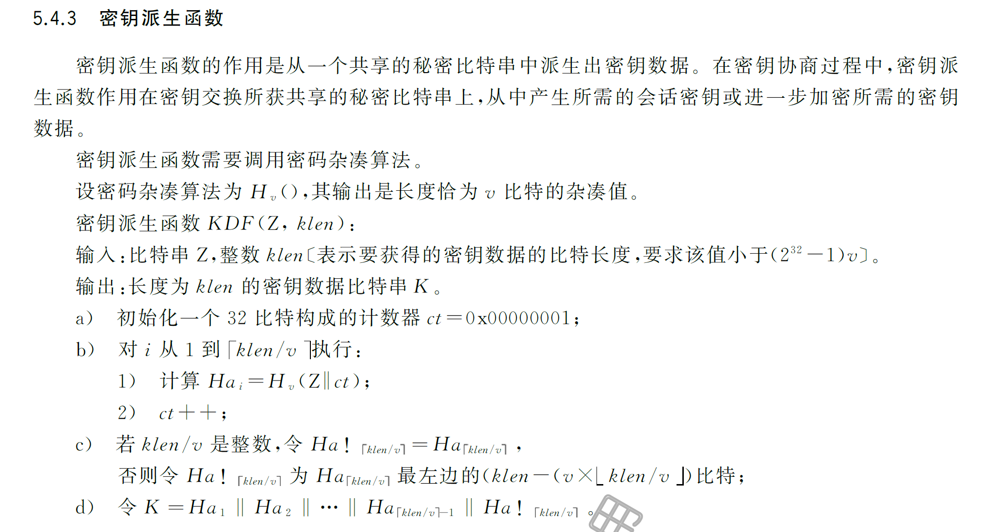

#### SM2数字签名SM3预处理

数学表示流程如下

$$
Z_A = H_{256}(ENTL_A\ ||\ ID_A\ ||\ a\ ||\ b\ ||\ x_G\ ||\  y_G\ ||\ x_A\ ||\ y_A)\\
 \overline{M} = Z_A\ ||\ M\\
 e  = H_v(\overline{M})
$$

参数解释：

- $ENTL_A$: 用户ID的长度，即$ID_A$的bit长度，占用2 byte.**一般为00 80**
- $ID_A$: 用户的可辩别标识ID。**一般为"1234567812345678"**
- $a,b,x_G,y_G$: 对应椭圆曲线参数a,b以及基点G
- $x_A,y_A$: 用户A公钥
- $M$: 消息本身
- $v$: 对应杂凑算法的长度
- $e$: 实际进行签名运算的中间值e

#### SM2加密算法KDF

对应标准**GB/T 32918.4 SM2公钥加密**

辅助函数密钥派生函数

