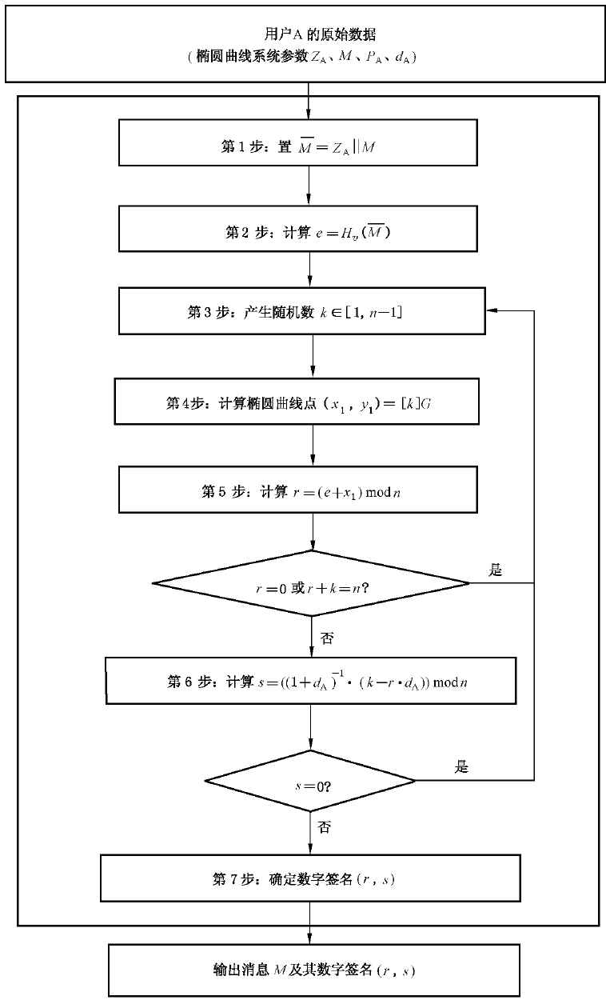
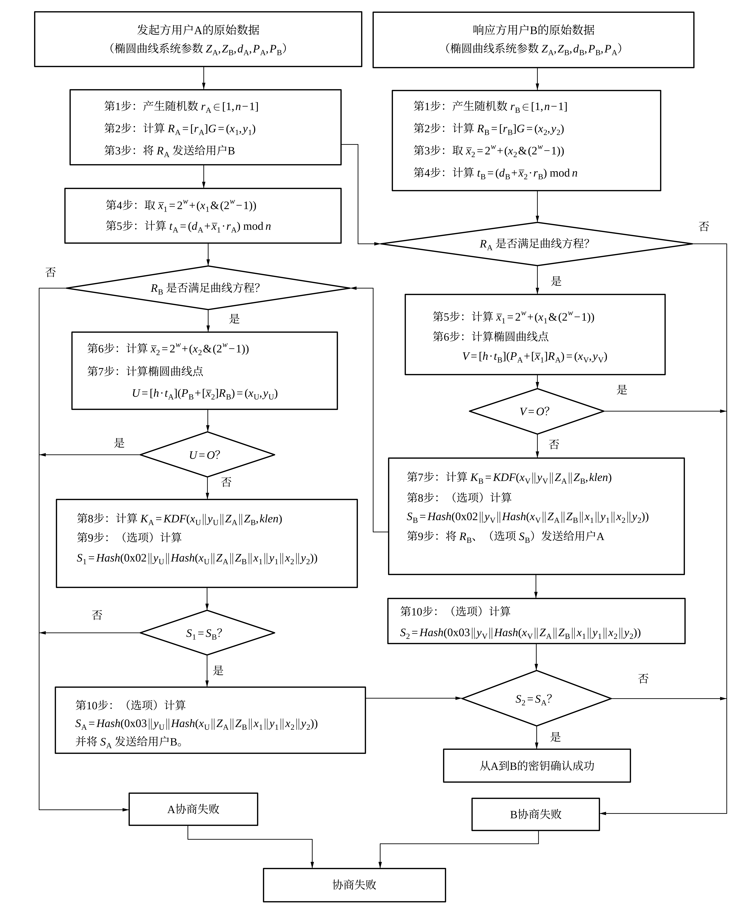
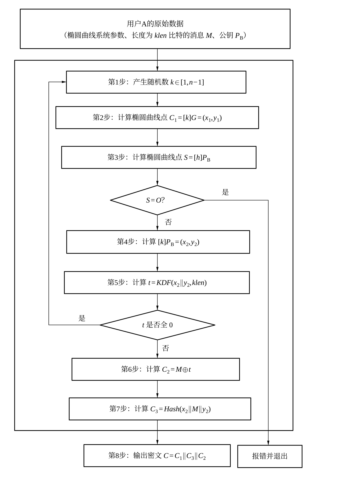

# SM2椭圆曲线公钥密码算法

## 数字签名算法

### 数字签名预处理

在进行非对称的数字签名前，首先要进行消息的预处理，包含计算用户其他信息、整体做杂凑运算等等。

#### 用户其他信息计算

$$
Z_A = H_{256}(ENTL_A || ID_A || a||b||x_G||y_G||x_A||y_A)
$$

其中：

- $ENTL_A$代表$ID_A$的长度，单位为bit，默认值为**128bit，即0x80**
- $ID_A$为用户A的可辩别标识，默认值**"1234567812345678"**
- $a,b,x_G,y_G$均为椭圆曲线的相关参数，曲线方程参数、有限域生成元
- $x_A,y_A$对应用户A的公钥

整体组装后，使用SM3计算得到$Z_A$

#### 计算消息杂凑e

e的计算步骤比较简单，拼接$Z_A$与消息M后，直接再次计算SM3杂凑即可
$$
\overline{M} = Z_A||M\\
e = H_v(\overline{M})
$$

### 数字签名

计算出消息的杂凑值e后，便会进行真正的SM2数字签名算法流程，步骤如下：

1. 用随机数发生器产生随机数$k\in [1,n-1]$
2. 计算点 $(x_1,y_1) = [k]G$
3. 计算 $r = (e + x_1)\ mod\ n$
4. 计算$s = ((1 + d_A)^{-1} * (k - r*d_A))\ mod\ n$
5. 得到签名 (r,s)

### 数字签名流程图

## 密钥交换算法

> SM2交换算法是采用SM2非对称算法的密钥交换算法，底层逻辑与Full MQV，即采用椭圆曲线的MQV密钥交换算法。

### 密钥交换流程

密钥交换的流程图如上所示，一些特殊点的阐述如下：
$$
\overline{x_1} = 2^\omega + (x_1\ \&\ (2^\omega -1))
$$
其中:
$$
\omega  = \left\lceil \frac{\log_{2}n}{2}\right\rceil -1
$$
可以很容易的看出，$\log_2n$本质是计算n的比特长度，对于SM2算法来说，这个值为256，则$\omega  = 127$

从而，$\overline{x_1}$本质上是$x_1$横坐标的低127bit位同时第128位恒为1.

> 如果我们看看椭圆曲线MQV中的$avf()$函数，更能有所理解:
>
> `avf` 是 **Associate Value Function（关联值函数）**。在椭圆曲线 MQV 中，它把一个公钥点 \(Q\) 转成一个公开的整数系数。算法可以用一句话记住：**把 \(Q\) 的横坐标转成整数，取最低的 \(w\) 位，再在这 \(w\) 位左边添一个二进制的 `1`。**
>
> 取多少位由基点的阶 \(n\) 决定。设 \(f=\lceil\log_2 n\rceil\)，\(w=\lceil f/2\rceil\)，用 \(t\) 表示横坐标转换成的整数，则
>
> \[ \operatorname{avf}(Q)=2^w+(t\bmod 2^w). \]

## 公钥加密算法

