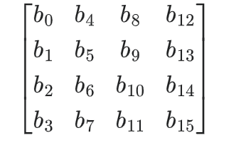

# AES(Advanced Encryption Standard)

## 算法概述

AES 的大多计算都是在一个特别的有限域上实现的。我们可以把AES的加密过程看作一个 4*4的**column-major order**矩阵的变换，元素为$b_0, b_1, b_2, ......, b_{16}$共计16个字节。

> **column-major order**指元素的排列顺序优先列，如下图

AES可选的密钥长度决定了迭代的轮次，对应关系如下

| 密钥长度 | 迭代轮次 |
| -------- | -------- |
| 128 bit  | 10       |
| 192 bit  | 12       |
| 256 bit  | 14       |

AES的大体步骤可以总结如下：

1. 密钥扩展（Key Expansion）
2. 初始轮密钥加（Initial round key addition）
3. 9/11/14 轮次变换
   1. 字节替换（SubBytes）
   2. 行变换（ShiftRows）
   3. 列混合（MixColumns）
   4. 轮密钥加（AddRoundKey）
4. 最终轮(Final round)
   1. 字节替换
   2. 列混合
   3. 轮密钥加

## 密钥扩展

这里省略介绍，可查阅[AES密钥调度(AES key schedule)](https://en.wikipedia.org/wiki/AES_key_schedule)。总之便是根据原始密钥的长度不同派生出多个配合轮次的轮密钥