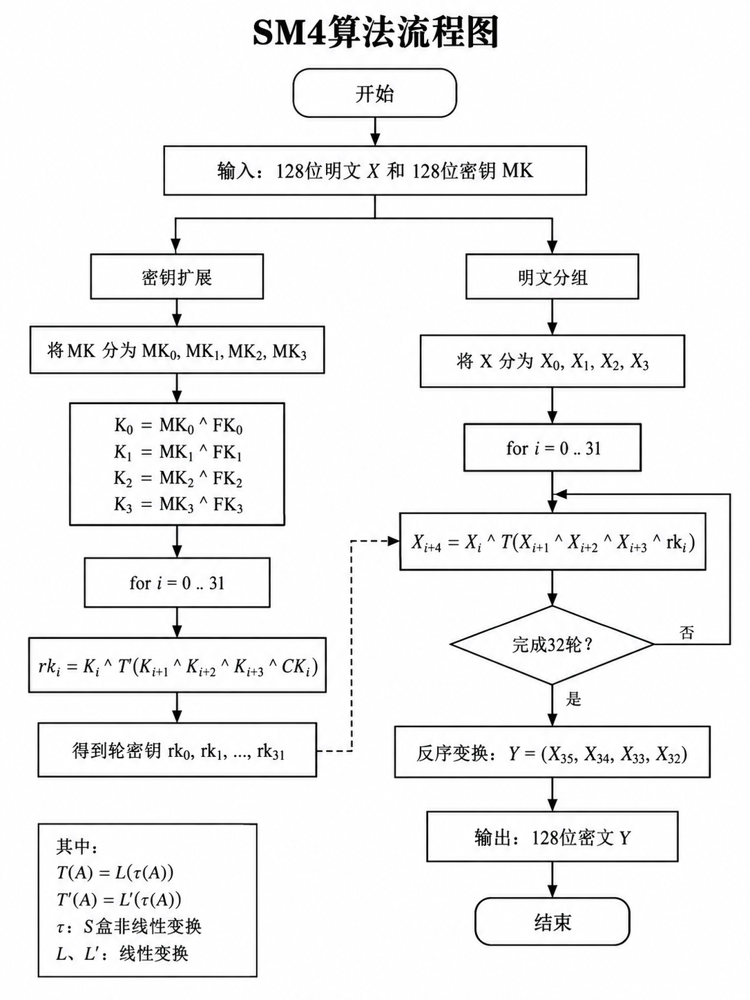
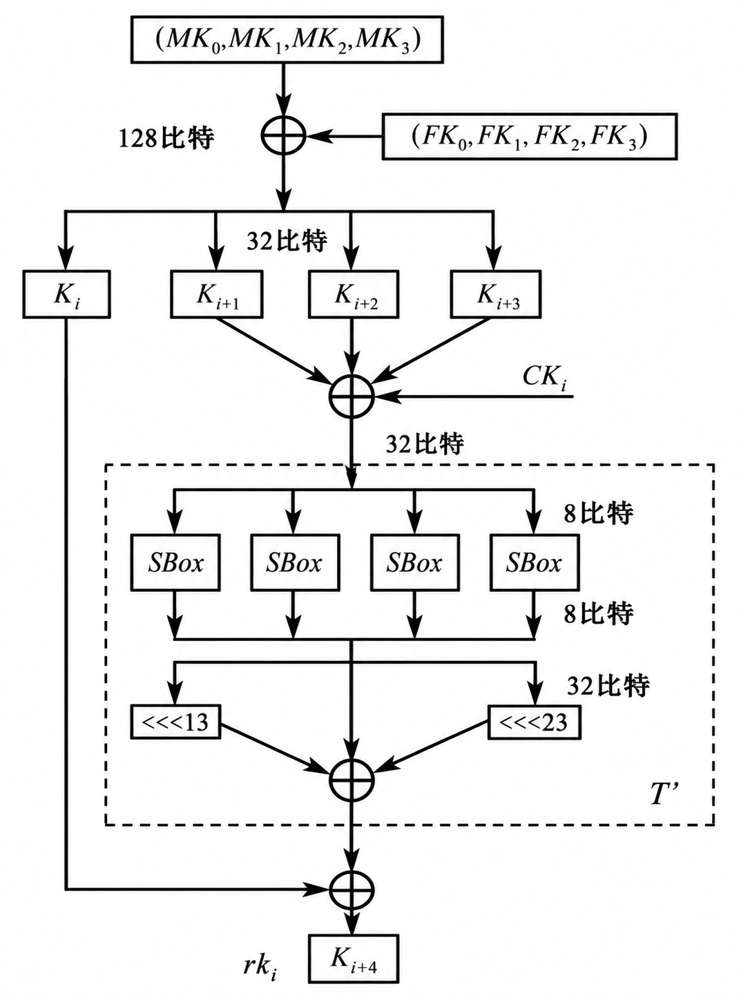
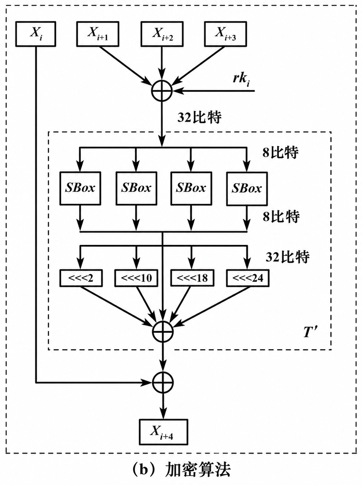

# SM4分组密码算法解析

## 算法流程

基本参数如下：

- **分组长度：128bit**
- **密钥长度：128bit**
- **轮函数迭代次数：32轮**

整体流程可以分词几个部分：

1. **密钥扩展**：128位密钥 $MK$ 拓展为轮密钥 $rk_0,rk_1,...,rk_{31}$
2. **轮函数迭代运算**：输入明文分组和轮密钥进行32轮迭代运算
3. **反序变换**：最后一轮迭代结果反序变换后得到密文

## 密钥扩展部分

> 密钥扩展的基本逻辑是将128bit的初始密钥MK，转化为32个32bit的轮密钥$rk_i$，用于参与轮函数的计算过程

密钥扩展的流程图如上所示，参数解释：

- $MK_{0-3}$：初始的密钥，分割成4个32位的字，对应$MK_0,MK_1,MK_2,MK_3$
- $FK_i$：系统参数
- $CK_i$：固定参数
- $rk_i$：轮密钥

> 由图中可以看到 $rk_i\ =\ K_{i+4}$, 即K从4之后生成结果即为对应的轮密钥

## 加密算法

加密算法流程如下图

