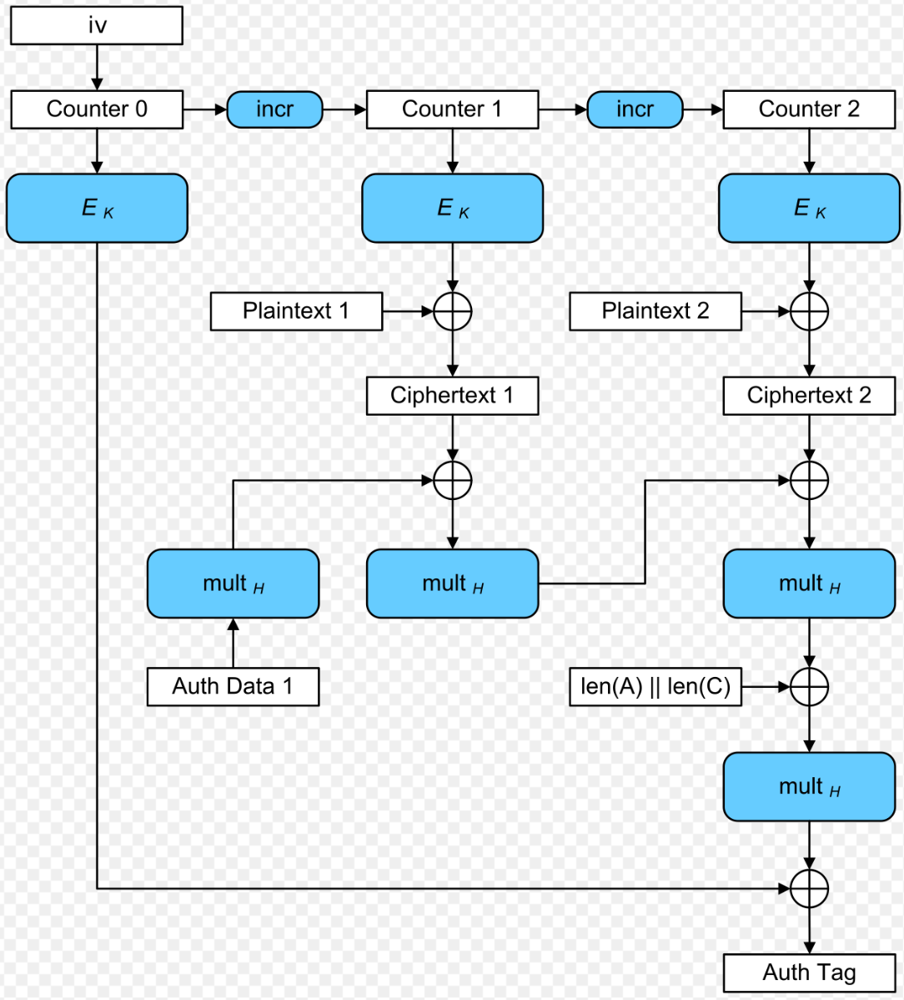
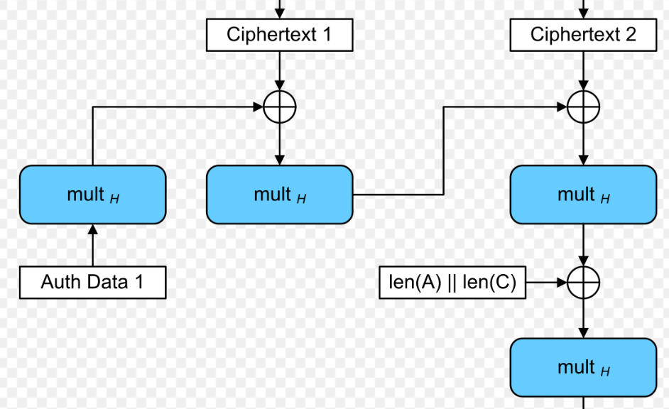
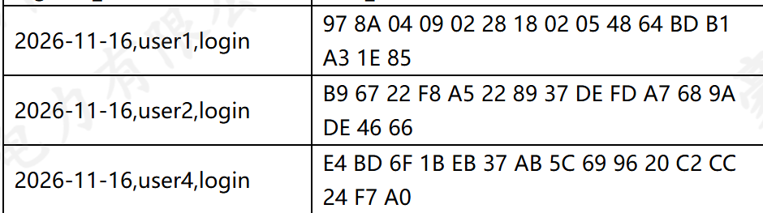
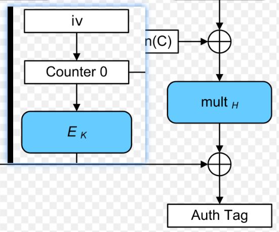

# GCM 可鉴别加密机制

## GCM总体流程

GCM是一个定义在Galois有限域上的可鉴别加密机制。总体上由**CTR**和**GMAC**两种组成，本文我们也会单独讨论GMAC和GHASH相关的细节定义。

我相信直接查看流程图，整个GCM的流程已经是大差不差了，这里有几个需要注意的点强调一下：

- GCM 本身是由**上半的CTR和下半的GMAC组成**
- **认证密钥H**：使用ECB模式直接对一分组的0（0x0000...）进行加密得到
- **Auth Tag**：由CTR0的加密结果和GHash的输出结果异或得到
- GCM、GMAC、GHash三者的关系是：$GHash \in GMAC \in GCM$

## GHASH

GHash是GMAC的组成部分，定义如下：
$$
GHASH(H, A, M) = X
$$
其中**H为128bit认证密钥**，在GCM和GMAC中一般使用$E_K(0)$计算得到，A为AAD额外附加数据，M为原消息，X为最终的128bit输出。对应到上面的截图中，就是如下部分：

可以看到，GHASH的计算结果就是将消息进行多次有限域乘法得到，具体流程如下：

1. 将Auth Data和Message（Cipher）使用**零填充**至128bit的倍数

2. 构造**128bit的L**,定义： $L = len(A)_{64} || len(c)_{64}$, 其中len(A)和len(c)均为64bit的**对应A和C的比特长度**

3. 拼接整个消息$M = AAD || C1|| C2|| ...||L = M_1||M_2||...||M_n||L$，其中每个部分均为**128bit**

4. 对于每个128bit的消息分组M_i,计算$Y_{i+1}$, $Y_0 = 0$
   $$
   Y_{i+1} = (Y_i\oplus M_i)\otimes H
   $$

5. 最终计算$X = (Y_n \oplus L)\otimes H$

也就是说，如果我们将GHASH(H,A,M)展开，我们可以得到如下的式子:
$$
GHASH(H,A,M) = A'\otimes H^n\oplus M_1\otimes H^{n-1}\oplus\ ...\ \oplus L\otimes H 
$$

> 其中A'是AAD通过0填充至128bit后得到的值，也就是说：
>
> 在**已知AAD、原消息和GHASH结果**的情况下, 可以将GHASH看作一个**关于H的一元高次方程组**,可以求得**H的根集**。
>
> 特别的情况，在已知多组消息和hash对的情况下，可能可以碰撞出H的唯一值.
>
> 更特别的情况下，若多组明文只有某一个分组位置的点存在不同，则可以通过异或计算得到：
> $$
> X_1 \oplus X_2 = (M1_i \oplus M2_{i})\otimes H^n
> $$
> 其中i为消息不同的分组，n为对应分组的高次H。由于其他变量已知，则可以轻易算出$H^n$,如模拟考试2的示例数据：
>
> 

## GMAC

GMAC的本质流程是在Ghash的结果处多了一步异或运算。具体步骤如下：

1. 计算$Temp = E_K(CTR_0)$
2. 计算$Hash = GHASH(H,A,M)$
3. $GMAC(K,A,M) = Temp \oplus Hash$

> 考点层面上，GMAC与GHASH类似，均是利用GHASH的多项式线性关系做文章，但是由于GMAC中存在加密的CTR0，也就是说**加密的CTR0的泄露**会是可能的重点
