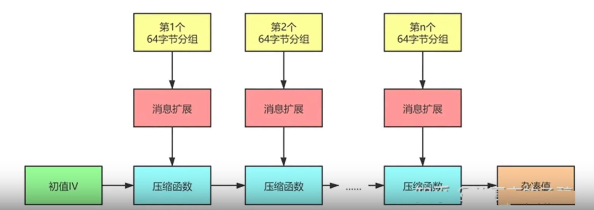
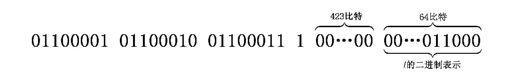
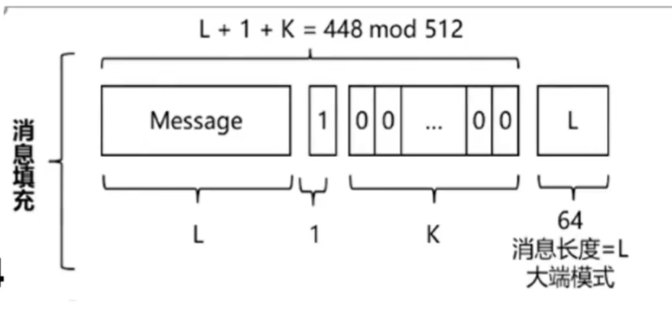
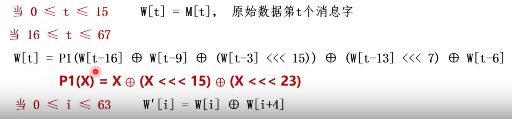
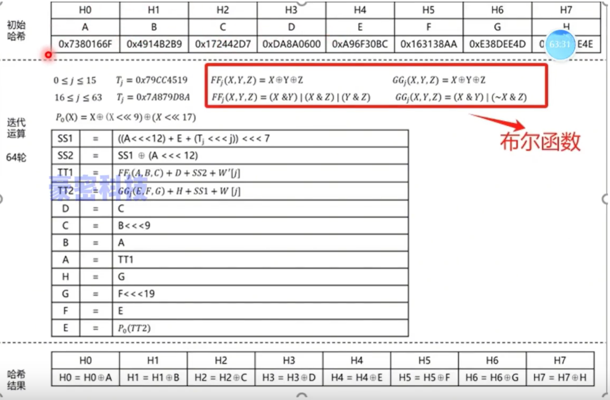

# SM3密码杂凑算法

## 算法概述

SM3算法的输入消息为长度 $l(l<2^{64})$ 比特的消息$m$，经过**填充、迭代压缩、生成杂凑值**，最终得到长度**256bit**的输出,整体的流程图如图所示

## 消息填充

1. 假设消息 $m$ 的长度为 $l$ 比特;
2. 首先将比特 $1$ 添加到消息的末尾
3. 再添加 $k$ 个比特 $0$，$k$是满足 $l+1+k≡448(mod512)$ 的最小的非负整数。
4. 然后再添加一个64位比特串,该比特串是长度 $l$ 的二进制表示。填充后的消息$m'$的比特长度为512的倍数

例如,对消息 $011000010110001001100011$ ,其长度 $l=24$ ,经填充得到比特串如图所示：

也可以理解成下图：

## 迭代压缩

迭代压缩整体总体包括**消息分组、消息扩展、压缩函数**几部分

即首先需要对填充后的消息 $m'$ 进行分组，分组长度为 **512bit**。

$$
m' = B^{(0)}B^{(1)}...B^{(n-1)},\ n = (l + k + 65)/512
$$

对 $m'$ 调用迭代函数 $CF()$，流程如下

$$
\begin{aligned}
&\mathbf{FOR}\quad i=0\quad \mathbf{TO}\quad n-1\\
&\qquad V^{(i+1)}=CF(V^{(i)},B^{(i)})\\
&\mathbf{ENDFOR}
\end{aligned}
$$

其中$V^{(0)}$为初始向量$IV$, $B^{(i)}$为消息分组，$V^{(n)}$为最终的杂凑输出

### 消息扩展

对于每个消息分组 $B^{(i)}$ 拓展为 132个字，$W_0,W_1,W_2,...,W_{67};W'_0,W'_1,W'_2,...,W'_{63}$

1. 首先将 $B^{(i)}$，分割为$W_0,W_1,...,W_{15}$
2. 第二步, 计算出所有$W_i$

$$
\begin{aligned}
&\mathbf{FOR}\quad j=16\quad \mathbf{TO}\quad 67\\
&\qquad W_i \leftarrow P_1\left(W_{i-16}\oplus W_{i-9}\oplus(W_{i-3}\lll 15)\right)\\
&\qquad\qquad \oplus(W_{i-13}\lll 7)\oplus W_{i-6}\\
&\mathbf{ENDFOR}
\end{aligned}
$$

3. 第三步, 从$W_i$计算出所有的$W'_i$

$$
\begin{aligned}
&\mathbf{FOR}\quad j=0\quad \mathbf{TO}\quad 63\\
&\qquad W'_i=W_i\oplus W_{i+4}\\
&\mathbf{ENDFOR}
\end{aligned}
$$

其中的置换函数$P_0$和$P_1$，$X$ 为字

$$
P_0(X) = X \oplus (X \lll 9) \oplus (X \lll 17)\\
P_1(X) = X \oplus (X \lll 15) \oplus (X \lll 23)
$$

对应课程中如图

### 压缩函数

令 $A, B, C,D,E,F,G,H$ 为字寄存器，$SS1,SS2,TT1,TT2$ 为中间变量，压缩函数 $V^{(i+1)}=CF(V^{(i)},B^{(i)})$ 的展开形式如下：

$$
\begin{aligned}
&ABCDEFGH \leftarrow V^{(i)}\\[6pt]
&\mathbf{FOR}\quad j=0\quad \mathbf{TO}\quad 63\\[4pt]
&\qquad SS1 \leftarrow \bigl((A\lll12)+E+(T_i\lll(j\bmod32))\bigr)\lll7\\[4pt]
&\qquad SS2 \leftarrow SS1\oplus(A\lll12)\\[4pt]
&\qquad TT1 \leftarrow FF_i(A,B,C)+D+SS2+W'_i\\[4pt]
&\qquad TT2 \leftarrow GG_i(E,F,G)+H+SS1+W_i\\[4pt]
&\qquad D \leftarrow C\\[4pt]
&\qquad C \leftarrow B\lll9\\[4pt]
&\qquad B \leftarrow A\\[4pt]
&\qquad A \leftarrow TT1\\[4pt]
&\qquad H \leftarrow G\\[4pt]
&\qquad G \leftarrow F\lll19\\[4pt]
&\qquad F \leftarrow E\\[4pt]
&\qquad E \leftarrow P_0(TT2)\\[4pt]
&\mathbf{ENDFOR}\\[6pt]
&V^{(i+1)}\leftarrow ABCDEFGH\oplus V^{(i)}
\end{aligned}
$$

> 字的存储采用大端的方式实现

其中的相关信息如下所示：

其中

- 初始值IV: 7380166f4914b2b9172442d7da8a0600a96f30bc163138aae38dee4db0fb0e4e
- 常量：

$$
T_j =
\begin{cases}
\mathrm{79cc4519}, & 0 \leq j \leq 15 \\[6pt]
\mathrm{7a879d8a}, & 16 \leq j \leq 63
\end{cases}
$$

- 布尔函数：

$$
FF_j(X,Y,Z) =
\begin{cases}
X \oplus Y \oplus Z, & 0 \leq j \leq 15 \\[6pt]
(X \land Y) \lor (X \land Z) \lor (Y \land Z), & 16 \leq j \leq 63
\end{cases}
$$

- 置换函数：

$$
GG_j(X,Y,Z) =
\begin{cases}
X \oplus Y \oplus Z, & 0 \leq j \leq 15 \\[6pt]
(X \land Y) \lor (\neg X \land Z), & 16 \leq j \leq 63
\end{cases}
$$

可以使用课程中的表格表示如下

