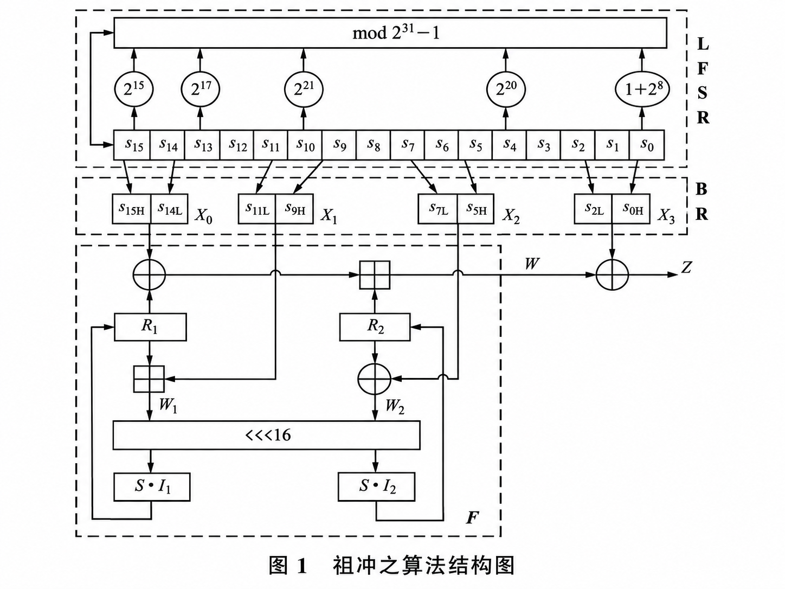
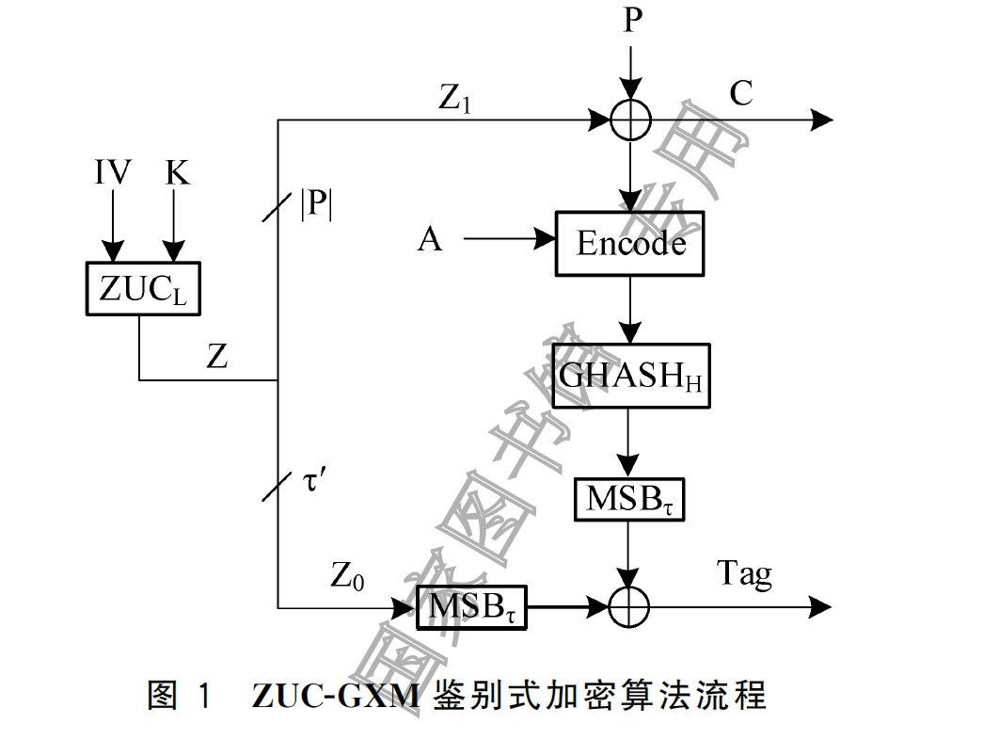
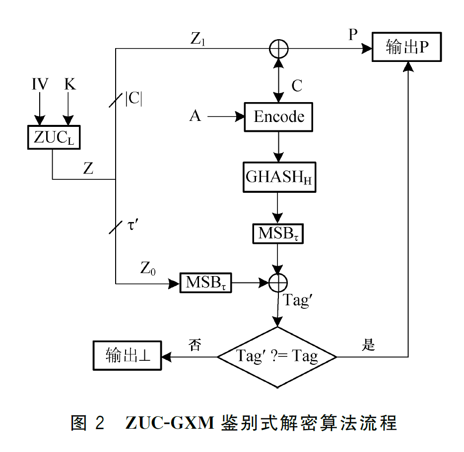
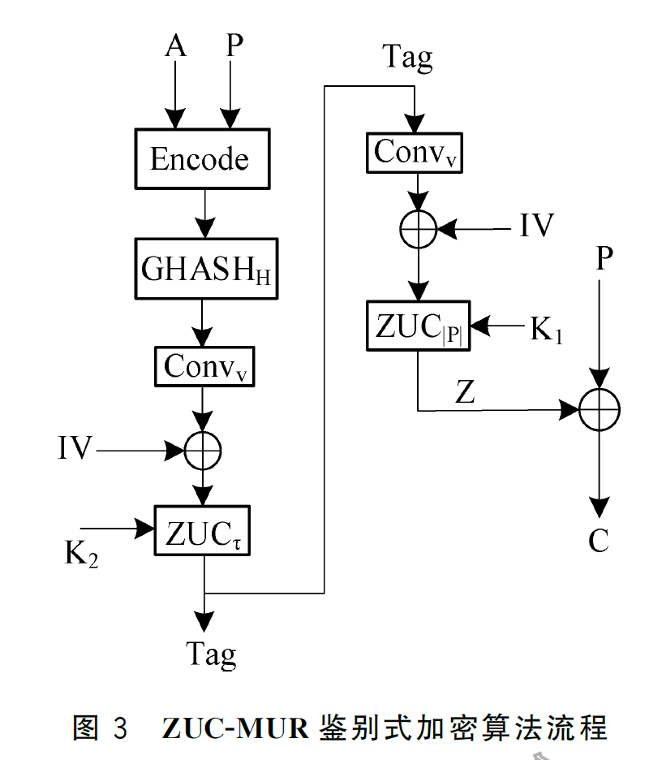
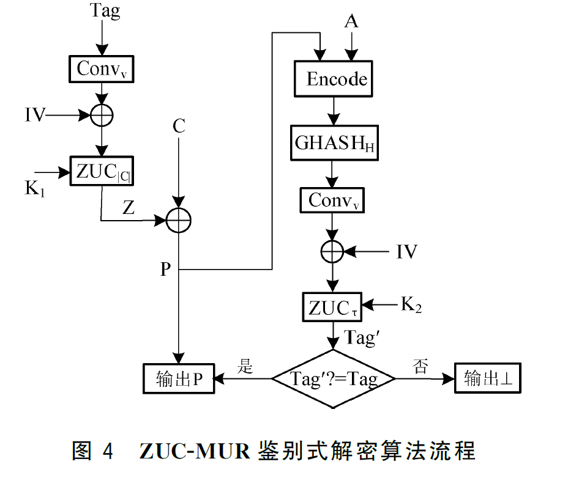

# ZUC祖冲之算法及其衍生算法

## ZUC算法描述：GM0001.1 / GB33133.1

### 算法结构

整体来看ZUC算法可以概述为以下结构

### 算法运行步骤

由于我们已经系统的学习过该算法，这里只补充一些算法运行步骤

#### 5.6.1 概述

祖冲之算法的输入参数为初始密钥 $k$、初始向量 $iv$ 和正整数 $L$，输出参数为 $L$ 个密钥字 $Z$。算法运行过程包含初始化步骤和工作步骤。

#### 5.6.2 初始化步骤

1. 将初始密钥 $k$ 和初始向量 $iv$ 装入到 LFSR 的寄存器单元变量 $s_0, s_1, \ldots, s_{15}$ 中，作为 LFSR 的初态；

2. 令 32 比特记忆单元变量 $R_1$ 和 $R_2$ 为 0；

3. **重复执行下述过程 32 次：**
   1. $BitReconstruction()$；
   2. $W = F(X_0, X_1, X_2)$；
   3. 输出 32 比特字 $W$；
   4. $LFSRWithInitialisationMode(W \mathbin{\texttt{>>}} 1$)。

#### 5.6.3 工作步骤

1. **执行下述过程：**
   1. $BitReconstruction()$；
   2. $F(X_0, X_1, X_2)$；
   3. $LFSRWithWorkMode()$。
2. **重复计算 $L$ 次下述过程：**
   1. $BitReconstruction()$；
   2. $Z = F(X_0, X_1, X_2) \oplus X_3$；
   3. 输出 32 比特密钥字 $Z$；
   4. $LFSRWithWorkMode()$。

## ZUC机密性算法：GM0001.2 / GB33133.2

ZUC的机密性算法，本身非常简单，甚至可以说和原本的ZUC算法几乎没有什么区别

我们可以按照下面这三步理解机密性算法：

1. 初始化,通过机密性密钥$CK_i$和其他的输入构造K和IV
2. 调用$ZUC(K,IV)$产生密钥流$k$
3. 计算密文$C = P \oplus k$

因此可以说，机密性算法的流程全部集中在了初始化这一步，这里我们只真的初始化进行解释

### 机密性初始化

**输入参数如下表**

| 变量      | 比特长度 | 释义         |
| --------- | -------- | ------------ |
| COUNT     | 32       | 计数器值     |
| BEARER    | 5        | 承载层标识   |
| DIRECTION | 1        | 传输方向标识 |
| CK        | 128      | 机密性密钥   |

获取输入参数后，便是计算时间ZUC的密钥K和IV

其中：

- $K = CK$（的确**就是一个东西**，标准非要故弄玄虚的分成两个变量）
- $IV = IV[0]\ ||\ IV[1]\ ||\ IV[2]\ ||...||\ IV[15]$，[]代表变量的一个8bit字字节
  - 对于$i = 0,1,2,3;\ IV[i] = COUNT[i]$
  - $IV[4] = BEARER\ ||\ DIRECTION\ ||\ 00_2$
  - $IV[5] = IV[6] = IV[7] = 00000000_2$
  - 对于$i = 8,9,10,...,15;\ IV[i] = IV[i-8]$

## ZUC完整性算法：GM0001.3 / GB33133.3

ZUC的完整性算法非常简单，几行甚至就可以概括

假设通过ZUC算法产生了L个字的密钥流K，则：

对于$i = 0,1,2,3,...,32*(L-1)$:
$$
k_i = K[i]\ ||\ K[i+1]\ ||\ K[i+2]\ ||...||\ K[i+31]
$$

> - $k_i$：是后续用于完整性运算的临时密钥长度为32bit
> - $K[i]$：表示密钥流的第i个bit

设T为32bit的全0串

对于$i = 0,1,2,3,...,LENGTH-1$:
$$
T = T \oplus k_i
$$
计算：
$$
T = T \oplus k_{LENGTH}
$$
计算最终MAC:
$$
MAC = T \oplus k_{32*(L-1)}
$$

## ZUC鉴别式加密机制 GM0001.4-2024

### ZUC-GXM

#### 加密流程

ZUC-GXM本质是一个**EtM**（Encrypt then MAC）算法，加密流程图如下：

- IV、K、P、C、Tag分别对应初始向量、密钥、原文、密文、鉴别码
- Z为使用ZUC算法生成密钥流
- $Z = Z_0||Z_1$，根据加密和鉴别所需的长度拆分成完整性密钥和机密性密钥
- $\tau \& \tau'$：代表所需鉴别码的长度, $\tau' = 32* [\tau/32]$
- L：密钥流长度
- A: **aad（Additional Application Data）**附属数据

因此GXM的流程可以表示成如下步骤：

1. 使用IV和K生成密钥流$Z = Z_0||Z_1$
2. 计算密文$C = P\oplus Z_1$
3. 对密文C和A计算`Encode()`编码函数
4. 对编码后的结果计算GMAC，这里GMAC的IV为$0|^{128}$
5. GMAC结果与$Z_0$进行异或得到Tag

> `Encode()`编码函数的输入为长度小于$2^{64}$比特的**附属数据A** 和长度小于$2^{64}$比特的数据X,`Encode(A,X)`的计
> 算步骤为:
>
> 1. 计算$A' = Partition(A),X' = Partition(X)$
> 2. 计算$Encode(A,X) = A'||X'||L_A||L_X$
>
> `Partition()`为零填充函数，填充为128bit的整数倍，**整分组不填充**
>
> L代表A和X的长度，每个长度变量占用64bit

#### 解密流程

解密流程如下，不做过多赘述

1. 先计算Tag值进行对比
2. 再进行密文解密

### ZUC-MUR

> **ZUC-MUR**本质是一个**MtE（MAC then Encrypt）**函数，先对明文做MAC再进行加密运算

有了上述流程的基础，这个图应该很容易明白，不做过多解释。加解密流程如下：

> 其中$Conv_v()$是一个和Encode类似的消息处理函数，主要目的是将任意长度的数据处理成长度为$v$的数据，设原消息的长度为$l$，有：
>
> - 若$l < v$，填充0直至v
> - 若$l>=v$，取$Conv_v(M) = MSB_l(M)$

