# 商用密码应用安全性评估测评实施指引

## 1 范围

本文件主要依据GB/T 43206—2023《信息安全技术信息系统密码应用测评要求》和GM/T 0116—2021《信息系统密码应用测评过程指南》，结合密码应用技术和管理测评指标，重点给出测评对象确定、测评方式推荐、测评实施操作说明、取证结果说明等内容，对商用密码应用安全性评估的测评实施工作提供指导。

本文件适用于指导、规范评估方开展商用密码应用安全性评估测评实施工作，旨在解决测评实施过程的规范性，以及取证结果的准确性和完备性，从而为测评结果的合理性和一致性提供可靠证据支撑。在本文件的基础上，评估方可结合有关领域与行业的业务场景和密码应用情况来制定相应的商用密码应用安全性评估作业指导文件。

> [!note]
>
> 注：本文件不涉及对《密码应用方案》评估的指导内容。

## 2 规范性引用文件

下列文件中的内容通过文中的规范性引用而构成本文件必不可少的条款。其中，注日期的引用文件，仅该日期对应的版本适用于本文件；不注日期的引用文件，其最新版本（包括所有的修改单）适用于本文件。

GB/T 25069—2022 信息安全技术术语

GB/T 39786—2021 信息安全技术信息系统密码应用基本要求

GB/T 43206—2023 信息安全技术信息系统密码应用测评要求

GB/T 43207—2023 信息安全技术信息系统密码应用设计指南

GM/T 0116—2021 信息系统密码应用测评过程指南

GM/Z 4001 密码术语

## 3 术语和定义

下列术语和定义适用于本文件。

### 3.1 推荐测评方式 recommended testing and evaluation method

为通过相对可靠途径，获取到用于某个测评指标或其关联测评对象结果判定的证据，所建议优先使用的测评方式。

### 3.2 关键证据 key evidence

对某个测评指标或其关联测评对象进行结果判定（尤其是“符合”或“部分符合”情形）所必需的证据。

### 3.3 取证结果 evidence collection result

对某个测评指标或其关联测评对象进行结果判定（尤其是“符合”或“部分符合”情形）所获得的证据集合，包含关键证据和一般证据。

## 4 缩略语

下列缩略语适用于本文件。

AH：认证头（Authentication Header）

APDU：应用协议数据单元（Application Protocol Data Unit）

API：应用程序编程接口（Application Programming Interface）

CRL：证书撤销列表（Certificate Revocation List）

ECC：椭圆曲线密码学（Elliptic Curve Cryptography）

ESP：封装安全载荷（Encapsulating Security Payload）

HMAC：带密钥的杂凑算法（Keyed-hash Message Authentication Code）

IC：集成电路（Integrated Circuit）

IDC：互联网数据中心（Internet Data Center）

IKE：互联网密钥交换（Internet Key Exchange）

IPSec：互联网安全协议（IP Security）

ISAKMP：互联网安全联盟和密钥管理协议（Internet Security Association and Key Management Protocol）

IV：初始向量（Initial Vector）

MAC：消息鉴别码（Message Authentication Code）

NVR：网络视频录像机（Network Video Recorder）

OCSP：在线证书状态查询协议（Online Certificate Status Protocol）

PCI-E：外设部件互联总线（Peripheral Component Interconnect Express）

PIN：个人识别码（Personal Identification Number）

RSA：RSA非对称密码算法（Rivest-Shamir-Adleman Asymmetric Cryptography Algorithm）

SSH：安全交互（Secure Shell）

SSL：安全套接层（Secure Sockets Layer）

TCP：传输控制协议（Transmission Control Protocol）

UDP：用户数据报协议（User Datagram Protocol）

VPN：虚拟专用网（Virtual Private Network）

ZUC：祖冲之（ZU Chongzhi）

## 5 概述

### 5.1 测评实施原则

对信息系统开展商用密码应用安全性评估测评实施时，应遵循以下原则。在某些情况下，受限于具体场景的安全需求和各项条件，本文件给出的指导内容可能存在不适用情况，此时也应结合如下原则和信息系统的实际情况实施测评工作。

a) 准确性原则：测评实施时，应结合GB/T 43206中的测评指标及相关内容开展工作，

确保测评实施内容、取证结果和指标考查内容的一致性。

b) 完备性原则：测评实施时，应考虑在不同检查点上获取证据并相互验证，以确保取

证结果是完备的。例如，应用服务器调用密码机实现重要数据传输完整性保护场景中，在传输过程中对数据报文进行抓包分析的同时，还需采用诸如在调用密码机过程中对数据报文进行抓包分析或登录密码机查看日志记录等方式，以确认密码机调用情况和密码功能使用情况是否符合预期。

c) 可靠性原则：测评实施时，应结合不同类型的测评方式获取证据并相互验证，以确

保取证结果是可靠的。同时，鼓励采用通过更高可靠程度的方式获取到的证据作为结果判定的依据。例如，对采用基于SM2证书的数字签名实现真实性场景进行测评时，在查阅相关技术文档后，需进一步采用抓包分析等测评方式进行核查；核查时不仅要验证相关SM2数字证书及其证书链，还要关注SM2数字签名机制实现是否合规、正确和有效。

d) 差异性原则：针对不同的密码实现方式，应在测评实施关注点上有所差异。

1) 若密码技术由合规密码产品实现，检查重点在于密码产品是否被安全、正确地

使用。例如，所处环境的风险控制措施是否与密码产品安全防护能力相匹配、是否按照相应安全等级要求被使用、是否配置为合规密码技术等。

2) 若密码技术由非合规产品实现2，检查重点在于密码实现（如开源密码库）是

否是当前未发现明显安全问题的版本，以及密码技术实现和使用正确性、密钥管理措施安全性等方面。

### 5.2 测评方式

根据测评实施时获取证据的来源或方法不同，测评方式可分为三类，见表5-1。在实际选用测评方式时，还需考虑是否获得系统责任方授权、系统运行环境的条件是否允许等限制因素，以规避或降低测评方式可能引发的风险对信息系统带来的影响。

**表5-1 测评方式汇总表**

<table style="width: 100%; table-layout: fixed;">
  <colgroup><col style="width: 6%"><col style="width: 10%"><col style="width: 18%"><col style="width: 44%"><col style="width: 22%"></colgroup>
  <tr>
    <th>序号</th>
    <th>类型</th>
    <th>测评方式</th>
    <th>描述</th>
    <th>特点</th>
  </tr>
  <tr>
    <td>1</td>
    <td>第一类</td>
    <td>访谈、文档审查、实地查看等</td>
    <td>测评方式以“说”和“看”为主，重点在于通过访谈相应岗位人员、审查技术或管理类文档和证明文件、查看测评对象所处环境和外观等，了解信息系统密码应用在技术和管理方面的基本信息。</td>
    <td>实施难度较小，但并非从实际业务中获取证据，取得的证据可靠性较低。</td>
  </tr>
  <tr>
    <td>2</td>
    <td>第二类</td>
    <td>工具测试、配置检查、代码审查、试错测试等</td>
    <td>测评方式以“简单实操”为主，重点在于对具体的实物或代码等，采用适合的方法或工具，获取业务实际流转过程中特定环节/位置的密码应用证据。其中，<ul><li>试错测试：如使用与账号、口令等信息不匹配的智能密码钥匙对登录应用时的身份鉴别机制测试。</li></ul></td>
    <td>实施难度适中，从实际业务中直接或间接获取证据，取得的证据可靠性较高。</td>
  </tr>
  <tr>
    <td>3</td>
    <td>第三类</td>
    <td>跟踪测试、基于密码机制的主动分析等</td>
    <td>测评方式以“验证密码机制正确有效”为主，重点在于对实际业务中的安全机制分析，获取用于证实密码使用有效性的证据。例如，跟踪测试、基于密码机制的主动分析等。其中，<ul><li>跟踪测试：对密码保护过程进行完整跟踪、分析，以确认安全机制、调用的方法和频次等是否正确、有效；</li><li>基于密码机制的主动分析：如篡改、重放、中间人攻击。</li></ul></td>
    <td>实施难度较大，从实际业务中直接获取证据，取得的证据可靠性较高。通常是对第二类测评方式所获证据的补充和增强。</td>
  </tr>
  <tr>
    <td colspan="5">备注： ① 获取证据的可靠程度为：“第一类”$<$“第二类”或“第三类”。在所提供的第二类测评方式中，“配置检查”更适用于对合规密码产品使用；“代码审查”更适用于对开源密码库等使用，而且需注意核实被测方所提供的静态代码与业务系统实际运行代码的一致性，例如版本信息。 ② 第一类测评方式属于所有测评指标默认采用的方式，且不局限于现场测评使用，后文不做赘述。</td>
  </tr>
</table>

<small>2 这里主要指第三方开源密码库。对于密码技术以自研方式实现且无法提供任何安全性证明的情形，由于无法判断其密码模块安全等级，且所采用的密码算法或技术实现安全性以及密钥管理安全性均无法得到保证和验证，因此不推荐，也不作为本文件考虑对象。</small>

### 5.3 测评实施规则

a) 对于密码应用技术测评的实施过程，应优先采用推荐测评方式（见第8章），并结

合通用测评实施指引（见第7章）中对应的测评实施过程，获取对某个测评指标或其关联测评对象进行结果判定所需的证据；若由于客观条件限制等原因导致无法采用推荐测评方式时，可采用其他测评方式替代，但原则上应采用较为可靠的测评方式（第二/三类）完成。对于密码应用管理测评的实施，应采用第一类测评方式（也是推荐测评方式，见第9章），获取对某个测评指标进行结果判定所需的证据。

> [!note]
>
> 注：第8章中推荐测评方式的设定，和指标及其关联资产的重要程度、安全防护措施对测评实施的开放程度等因素有关，是通常情况下获取证据的较为可靠方式，但不排除存在其他可靠方式。

b) 对于密码应用技术测评的取证结果，原则上应获取到关键证据，若由于客观条件限

制等原因导致无法获取时，则可通过获取一般证据进行弥补，并在密评报告中给出关键证据无法获取的原因说明；对于密码应用管理测评的取证结果，不区分关键证据，原则上均作为应采集的证据内容。

c) 当存在使用不同类别测评方式得到不一致结果的情形时，应以具有较高可靠程度的

测评方式提供的证据为准，并作为测评结果的判定依据。

## 6 密评测评实施总体框架

本章结合GM/T 0116中测评过程的4项基本测评活动：测评准备、方案编制、现场测评、分析与报告编制，给出密评测评实施总体框架，对测评过程中各个环节主要工作的开展落实做出相应说明，可作为测评过程具体实施方面的补充指导。其中，方案编制和现场测评这两个环节的主要工作是本文件重点指导内容，相应测评实施流程如图6-1所示。

**a) 测评准备**

若信息系统具有通过评估的密码应用方案，则该方案可作为掌握信息系统详细情况（包括网络拓扑、业务、系统资产、密码应用等信息）的主要参考资料；否则，需按GB/T 43207中的描述内容，并结合网络安全等级保护定级报告、安全需求分析报告、安全设计方案等文件，收集信息系统详细情况。同时，需要核实密码应用方案内容与信息系统实际情况的一致性，如信息系统的保护对象、安全风险和密码应用需求、不适用项、风险控制措施等，若出现不一致，在和信息系统责任单位确认后，以实际掌握的信息为准并开展测评。

> [!note]
>
> 注：对密码应用需求的核实，需结合信息系统实际业务和安全风险，并依据相关法律法规、标准规范要求。对不适用项的核实，需考虑以下三种情形，包括不存在与某项指标或对象相关的密码应用需求、“可”的指标不纳入到标准符合性测试，以及对“宜”的指标采用风险控制措施。

**b) 方案编制**

1) 根据第8章和第9章测评指标，以及信息系统实际情况，梳理并核实信息系统的

指标适用情况、测评对象及其密码应用需求。

2) 根据各项指标对应的推荐测评方式（汇总表见附录B）和密码应用场景，确定

实际采用的测评方式以及选取适合的测评检查点（针对技术测评），进而参考第7、8、9章提供的测评实施方法，编写技术和管理测评部分的测评实施内容。

**c) 现场测评**

执行技术测评和管理测评的测评实施内容并获取所需证据，具体地：

1) 对于技术测评，根据实际采用的测评方式、选取的测评检查点，以及对应的测

评实施内容，完成具体测评实施工作；对于管理测评，采用第一类测评方式，并根据对应的测评实施内容，完成具体测评实施工作。

2) 根据第8章和第9章提供的取证结果说明（含关键证据），从信息系统中获取密

码应用技术和管理测评的证据（附录C给出了技术测评部分的证据示例）。

> [!note]
>
> 注：本环节还需关注以下内容，

① 对密码使用有效性进行测评实施时，应检查信息系统中是否存在密码产品/实现“被旁路”的情形。在做旁路检查时，可分为密码应用对业务透明方式和非透明方式，前者的旁路检查重点为密码产品/实现的访问日志（是否处理了这次流量）、配置信息（例如，旁路或加密）、抓取数据包等；后者的旁路检查重点为密码产品/实现的调用日志（例如，调用的时间、密码功能、频次）、跟踪测试密码应用过程等。

② 在测评过程中，对密评人员操作行为进行记录，以体现测评实施过程的规范性和行为的可追溯性。例如，人员分工情况、在什么位置采用何种方法获取证据，以及在测评实施时如何避免给信息系统带来可能的风险。

**d) 分析与报告编制**

评估方应依据统一的报告模板格式和内容要求编制密评报告。报告中需根据客观证据逐项对测评指标或其关联的测评对象进行判定，并形成单元测评和整体测评结果、风险分析和评价结果，以及信息系统的测评结论。出具的密评报告应按照《商用密码应用安全性评估管理办法》相关要求完成备案工作。

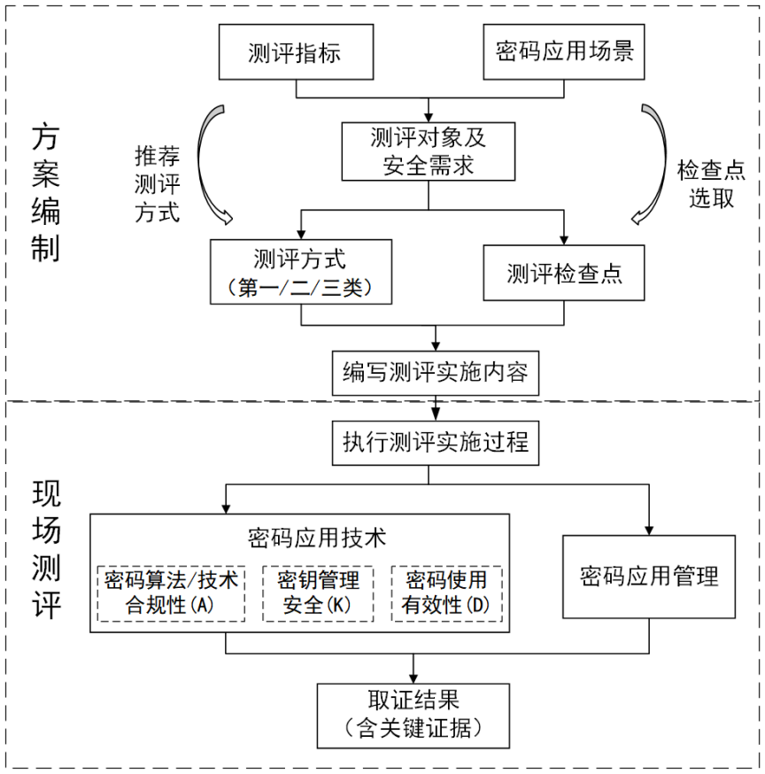

**图6-1 方案编制和现场测评实施流程**

## 7 通用测评实施指引

本章围绕技术测评中密码使用有效性（D）、密码算法/技术合规性（A）、密钥管理安全（K）三个测评实施维度，给出不同测评方式下“DAK”的典型测评实施方法，为第8章“技术测评实施指引”中各个安全层面的测评实施提供参考。测评实施维度和测评方式类别的对应关系见表7-1。其中，“A”和“K”的测评实施关注于密码算法、技术、产品和服务的合规性，以及密钥管理措施安全性，通常采用第一类和第二类测评方式完成；“D”的测评实施关注于为满足信息系统的安全需求，是否正确、有效地使用密码（技术）提供机密性、完整性、真实性和不可否认性功能，因此在第一类和第二类测评方式的基础上，还需采用第三类测评方式，共同完成这一方面的测评实施工作。

> [!note]
>
> 注：对于第8章取证结果说明中未提及情形，可参考本章提供的测评实施方法开展实际测评和取证工作。

**表7-1 测评实施维度与测评方式类别对应关系**

<table>
  <tr>
    <th>
测评实施维度

测评方式类别
</th>
    <th>密码使用有效性（7.1节）</th>
    <th>密码算法/技术合规性（7.2节）</th>
    <th>密钥管理安全（7.3节）</th>
  </tr>
  <tr>
    <td>第一类</td>
    <td>√</td>
    <td>√</td>
    <td>√</td>
  </tr>
  <tr>
    <td>第二类</td>
    <td>√</td>
    <td>√</td>
    <td>√</td>
  </tr>
  <tr>
    <td>第三类</td>
    <td>√</td>
    <td>/</td>
    <td>/</td>
  </tr>
  <tr>
    <td colspan="4">备注：√ 涉及，/ 不涉及。</td>
  </tr>
</table>

### 7.1 密码使用有效性

#### 7.1.1 传输机密性

**a) 对应的指标**

1) 网络和通信安全：通信过程中重要数据的机密性；

2) 设备和计算安全：远程管理通道安全；

3) 应用和数据安全：重要数据传输机密性。

**b) 可能涉及的密码产品**

IPSec/SSL VPN网关、安全认证网关、纵向加密认证网关、密码机、透明加密网关、安全浏览器、智能密码钥匙等。

**c) 测评实施操作说明**

**表 7-2 传输机密性测评实施操作说明**

| 测评方式 | 测评实施过程 |
| --- | --- |
| 第一类 | 采用访谈、文档审查和实地查看方式，了解系统网络通信、设备运维管理和数据传输等情况，确认有相应安全需求的通信信道、应用层重要数据的传输机密性保护机制及其实现方式（如密码产品、开源密码库）、使用的密码算法/技术、密钥管理措施等。例如，使用何种密码产品/密码实现，对哪些保护对象，采用何种密码算法/技术以及密码机制对其提供传输机密性保护，密钥管理措施如何实现。 |
| 第二类 | 1）采用工具测试方式（如协议分析工具）进行抓包操作，分析需要加密保护的重要数据在传输时是否为密文形式3、数据格式（如分组长度）是否与预期的密码技术相符合。 2）采用配置检查方式，如查看信息系统调用密码产品、开源密码库等密码实现形式的日志文件，确认传输机密性保护过程使用的密码算法/协议、保护对象、密钥管理措施等是否符合预期。 3）采用代码审查方式，定位信息系统调用密码产品、开源密码库等密码实现形式实现加解密功能的代码片段和接口函数，分析信息系统传输重要数据时所使用的加密算法、分组密码算法的工作模式、密码协议、保护对象等是否符合预期。 4）结合附录A中对应的密码产品应用测评方法进行实施。 |
| 第三类 | 采用跟踪测试方式，确认传输机密性功能的调用机制（如对加解密功能使用方的鉴别与访问控制措施）、调用指令和频次（如模拟相关业务时密码功能调用时刻、调用次数）是否正确。 |

<small>3 判断数据或密钥是否为密文形式在实际测评中较为困难，可通过查看用于数据或密钥的加密算法配置信息、加密功能调用情况、编码转换分析（如Base64解码）等方式进行间接确认。</small>

#### 7.1.2 存储机密性

**a) 对应的指标**

应用和数据安全：重要数据存储机密性。

**b) 可能涉及的密码产品**

密码机、数据库加密系统/安全数据库系统等。

**c) 测评实施操作说明**

**表 7-3 存储机密性测评实施操作说明**

| 测评方式 | 测评实施过程 |
| --- | --- |
| 第一类 | 采用访谈、文档审查和实地查看方式，了解系统中存储的重要数据情况，确认有相应安全需求的重要数据的存储机密性保护机制及其实现方式（如密码产品、开源密码库）、使用的密码算法/技术、密钥管理机制等。例如，使用何种密码产品/密码实现，对哪些保护对象，采用何种密码算法/技术以及密码机制对其提供存储机密性保护，密钥管理措施如何实现。 |
| 第二类 | 1）通过读取存储的重要数据，分析需要加密保护的数据在存储时是否为密文形式、数据格式（如分组长度）是否与预期的密码技术相符合。 2）采用配置检查方式，如查看信息系统调用密码产品、开源密码库等密码实现形式的日志文件，确认存储机密性保护过程使用的密码算法、保护对象、密钥管理措施等是否符合预期。 3）采用代码审查方式，定位信息系统调用密码产品、开源密码库等密码实现形式实现加解密功能的代码片段和接口函数，分析信息系统存储重要数据时所使用的加密算法、分组密码算法的工作模式、保护对象等是否符合预期。 4）结合附录A中对应的密码产品应用测评方法进行实施。 |
| 第三类 | 采用跟踪测试方式，确认存储机密性功能的调用机制（如对加解密功能使用方的鉴别与访问控制措施）、调用指令和频次（如模拟相关业务时密码功能调用时刻、调用次数）是否正确。 |

#### 7.1.3 传输完整性

**a) 对应的指标**

1) 网络和通信安全：通信数据完整性；

2) 设备和计算安全：远程管理通道安全；

3) 应用和数据安全：重要数据传输完整性。

**b) 可能涉及的密码产品**

IPSec/SSL VPN网关、安全认证网关、纵向加密认证网关、密码机、透明加密网关、安全浏览器、智能密码钥匙、安全电子签章系统等。

**c) 测评实施操作说明**

**表 7-4 传输完整性测评实施操作说明**

| 测评方式 | 测评实施过程 |
| --- | --- |
| 第一类 | 采用访谈、文档审查和实地查看方式，了解系统网络通信、设备运维管理和数据传输等情况，确认有相应安全需求的通信信道、应用层重要数据的传输完整性保护机制及其实现方式（如密码产品、开源密码库）、使用的密码算法/技术、密钥管理措施等。例如，使用何种密码产品/密码实现，对哪些保护对象，采用何种密码算法/技术以及密码机制对其提供传输完整性保护，密钥管理措施如何实现。 |
| 第二类 | 1）采用工具测试方式（如协议分析工具）进行抓包操作，分析需要完整性保护的数据在传输时的数据格式（如签名长度、消息鉴别码长度）是否与预期的密码技术相符合。 2）如果通过数字签名技术实现完整性保护，采用工具测试方式（如算法校验工具），使用签名公钥验证签名结果的有效性。 3）采用配置检查方式，如查看信息系统调用密码产品、开源密码库等密码实现形式的日志文件，确认传输完整性保护过程使用的密码算法/协议、保护对象、密钥管理措施等是否符合预期。 4）采用代码审查方式，定位信息系统调用密码产品、开源密码库等密码实现形式实现完整性保护功能的代码片段和接口函数，分析信息系统传输重要数据时所使用的完整性保护算法、分组密码算法的工作模式、密码协议、保护对象等是否符合预期。 5）结合附录A中对应的密码产品应用测评方法进行实施。 |
| 第三类 | 采用跟踪测试方式，确认传输完整性功能的调用和校验机制（如对完整性保护功能使用方的鉴别与访问控制措施、完整性校验策略）、调用指令和频次（如模拟相关业务时密码功能调用时刻、调用次数）是否正确。 |

#### 7.1.4 存储完整性

**a) 对应的指标**

1) 物理和环境安全：电子门禁记录数据存储完整性，视频监控记录数据存储完整性；

2) 网络和通信安全：网络边界访问控制信息的完整性；

3) 设备和计算安全：系统资源访问控制信息完整性，重要信息资源安全标记完整性，

日志记录完整性，重要可执行程序完整性、重要可执行程序来源真实性；

4) 应用和数据安全：访问控制信息完整性、重要信息资源安全标记完整性、重要数据

存储完整性。

**b) 可能涉及的密码产品**

安全门禁系统、PCI-E密码卡、密码机、签名验签服务器、数据库加密系统/安全数据库系统、智能密码钥匙、安全电子签章系统等。

**c) 测评实施操作说明**

**表 7-5 存储完整性测评实施操作说明**

| 测评方式 | 测评实施过程 |
| --- | --- |
| 第一类 | 采用访谈、文档审查和实地查看方式，了解系统物理安防、网络边界访问控制、设备管理和数据存储等情况，确认有相应安全需求的数据的存储完整性保护机制及其实现方式（如密码产品、开源密码库）、使用的密码算法/技术、密钥管理措施等。例如，使用何种密码产品/密码实现，对哪些保护对象，采用何种密码算法/技术以及密码机制对其提供存储完整性保护，密钥管理措施如何实现。 |
| 第二类 | 1）通过读取存储的重要数据，分析需要完整性保护的数据在存储时的数据格式（如签名长度、消息鉴别码长度）是否与预期的密码技术相符合。 2）如果通过数字签名技术实现完整性保护，采用工具测试方式（如算法校验工具），使用签名公钥验证签名结果的有效性。 3）采用配置检查方式，如查看信息系统调用密码产品、开源密码库等密码实现形式的日志文件，确认存储完整性保护过程使用的密码算法、保护对象、密钥管理措施等是否符合预期。 4）采用代码审查方式，定位信息系统调用密码产品、开源密码库等密码实现形式实现完整性保护功能的代码片段和接口函数，分析信息系统存储重要数据时所使用的完整性保护算法、分组密码算法的工作模式、保护对象等是否符合预期。 5）结合附录A中对应的密码产品应用测评方法进行实施。 |
| 第三类 | 1）采用跟踪测试方式，确认存储完整性功能的调用和校验机制（如对完整性保护功能使用方的鉴别与访问控制措施、完整性校验策略）、调用指令和频次（如模拟相关业务时密码功能调用时刻、调用次数）是否正确。 2）采用基于密码机制的主动分析方式，尝试对存储数据进行篡改（如修改原始数据、MAC或签名值），并确认校验机制是否正确。 |

#### 7.1.5 真实性

**a) 对应的指标**

1) 物理和环境安全：身份鉴别；

2) 网络和通信安全：身份鉴别、安全接入认证；

3) 设备和计算安全：身份鉴别、远程管理通道安全，重要可执行程序完整性、重要可

执行程序来源真实性；

4) 应用和数据安全：身份鉴别。

**b) 可能涉及的密码产品**

电子门禁系统、IPSec/SSL VPN网关、安全认证网关、智能IC卡、智能密码钥匙、动态令牌系统（含动态令牌和动态令牌认证系统）、协同签名系统、PCI-E密码卡、密码机、证书认证系统等。

**c) 测评实施操作说明**

**表 7-6 真实性测评实施操作说明**

| 测评方式 | 测评实施过程 |
| --- | --- |
| 第一类 | 采用访谈、文档审查和实地查看方式，确认系统所涉及鉴别过程使用的真实性保护机制及其实现方式（如密码产品、开源密码库）、使用的密码算法或技术、密钥管理机制等。例如，使用何种密码产品/密码实现，对哪些实体对象，采用何种密码算法/技术以及密码机制对其提供真实性功能，密钥管理措施如何实现。 |
| 第二类 | 物理和环境安全：采用非接触CPU卡、安全门禁系统方式实现参见附录A中对应的密码产品应用测评方法进行实施。网络和通信安全、设备和计算安全、应用和数据安全： 1）采用工具测试方式（如协议分析工具），对于通过数字签名技术实现的鉴别过程，抓取鉴别过程的挑战值和签名结果，使用对应公钥验证签名结果的有效性；对于通过动态口令技术实现的鉴别过程，抓取鉴别过程数据包中的动态口令等，确认鉴别过程是否正确，例如动态口令是否在认证端进行比对验证（如查看认证端比对记录）。 2）采用配置检查方式，查看提供实体鉴别功能的密码产品等配置的数字证书或用于实体鉴别的密钥，确认鉴别方式和密码算法等是否符合预期；如果鉴别未使用数字证书，要验证公钥或（对称）密钥与实体的绑定方式是否可靠，实际部署过程是否安全。 3）采用配置检查方式，如查看信息系统调用密码产品、开源密码库等密码实现形式的日志文件，确认实体鉴别过程使用的密码算法/协议、鉴别对象、密钥管理措施等是否符合预期。 4）采用代码审查方式，定位信息系统调用密码产品实现实体鉴别功能的代码片段和接口函数，分析信息系统实体鉴别过程所使用的密码算法、数字证书或密钥信息、鉴别对象和原理等是否符合预期。 5）结合附录A中对应的密码产品应用测评方法进行实施。 |
| 第三类 | 1）采用跟踪测试方式，确认实体鉴别功能调用和验证机制（如对实体鉴别功能使用方的鉴别与访问控制措施、验证策略）、调用指令和频次（如模拟相关业务时密码调用时刻、调用次数）是否正确。例如，实体鉴别机制是否符合GB/T 15843的要求，特别是“挑战-响应”方式的鉴别协议，需验证挑战值是否随机且从验证端生成。 2）采用基于密码机制的主动分析方式，尝试使用重放攻击、中间人攻击等分析手段，验证是否存在仿冒、绕过、越权等安全风险。 |

#### 7.1.6 不可否认性

**a) 对应的指标**

应用和数据安全：不可否认性。

**b) 可能涉及的密码产品**

智能密码钥匙、密码机、安全电子签章系统、时间戳服务器等。

**c) 测评实施操作说明**

**表 7-7 不可否认性测评实施操作说明**

<table>
  <tr>
    <th>测评方式</th>
    <th>测评实施过程</th>
  </tr>
  <tr>
    <td>第一类</td>
    <td>采用访谈、文档审查和实地查看方式，了解信息系统所涉及不可否认性机制及其实现方式（如密码产品、开源密码库）、使用的密码算法或技术、密钥管理机制等。例如，使用何种密码产品/密码实现，对哪些关键操作或文件等，采用何种密码算法/技术以及密码机制对其提供不可否认性保护，密钥管理措施如何实现。另外，对关键操作或文件进行数字签名时是否核验了操作人员身份；涉及时间信息时，是否对时间戳进行了验证。</td>
  </tr>
  <tr>
    <td>第二类</td>
    <td>1）采用工具测试方式（如算法校验工具或电子签章校验工具），使用相应公钥对作为不可否认性证据的签名结果的有效性进行验证。 2）采用配置检查方式，导出对关键操作或文件等进行数字签名所对应的数字证书，核验数字证书在执行数字签名时是否有效，检查数字证书与自然人、法人等实体之间的绑定关系。 3）采用配置检查方式，如查看信息系统调用密码产品、开源密码库等密码实现形式的日志文件，确认不可否认性实现过程使用的数字签名算法、关键操作或文件、密钥管理措施等是否符合预期。 4）采用代码审查方式，定位信息系统调用密码产品、开源密码库等密码实现形式实现不可否认性功能的代码片段和接口函数，分析信息系统实现不可否认性过程所使用的如数字签名算法、数字证书、关键操作或文件等是否符合预期。 5）结合附录A中对应的密码产品应用测评方法进行实施。</td>
  </tr>
  <tr>
    <td>第三类</td>
    <td>采用跟踪测试方式，确认不可否认性功能的调用和校验机制（如对不可否认性功能使用方的鉴别与访问控制措施、不可否认性校验策略）、调用指令和频次（如模拟相关业务时密码调用时刻、调用次数）是否正确。</td>
  </tr>
  <tr>
    <td colspan="2">备注：不可否认性测评的关注点主要是检查用于法律责任认定的证据（如签名值）是否由原发/接收行为主体或其委托的可信第三方产生且生成时间（如时间戳表示）在签名证书有效期内，同时签名证书由合法CA机构签发。</td>
  </tr>
</table>

### 7.2 密码算法/技术合规性

#### 7.2.1 密码算法合规性

##### 7.2.1.1 测评指标

见GB/T 43206-2023中的5.1.1。

##### 7.2.1.2 测评对象

信息系统中使用的密码算法。

##### 7.2.1.3 测评实施操作说明

**表 7-8 密码算法合规性测评实施操作说明**

| 测评方式 | 测评实施过程 |
| --- | --- |
| 第一类 | 采用访谈、文档审查和实地查看方式，了解信息系统中使用的密码算法的名称、用途及其实现方式（如密码产品、开源密码库），确认密码算法是否以国家标准或行业标准形式发布（如SM2、SM3、SM4、SM9、ZUC等），或取得国家密码管理部门同意使用的证明文件，或由于国际互联互通等需要而兼容。 |
| 第二类 | 1）采用配置检查方式，登录密码产品查看实际配置用于信息系统保护的密码算法及其安全强度等相关信息。 2）采用工具测试方式（如协议分析工具、算法校验工具），对获取到的相关数据进行分析，确认使用的密码算法及其安全强度等相关信息。 3）采用代码审查方式，定位信息系统调用密码产品、开源密码库等密码实现形式相应密码算法的代码片段和接口函数，确认使用的密码算法及其安全强度等相关信息。 4）结合附录A中对应的密码产品应用测评方法进行实施。 |
| 第三类 | / |
| 关键证据 | 1. 由密码算法合规性、密码算法安全强度、密码算法使用正确性这三类证据共同决定；对开源密码库等实现情形，还应当关注密码算法实现正确性。 1）密码算法名称 2）密码算法安全强度 ① 对称算法<ul><li>序列密码：如种子密钥长度。</li><li>分组密码：如工作模式、密钥长度。</li></ul> ② 非对称算法例如，SM2/SM9算法：私钥长度；RSA算法：模数长度。 ③ 杂凑算法输出（杂凑值）长度。 3）密码算法使用正确性例如，序列密码或分组密码算法的IV值设定（每次加密IV取值是否随机化）、SM2签名算法的随机数设定（每次签名是否随机产生）。 注：密码算法使用正确性验证与密码接口封装程度有一定关联。 4）密码算法实现正确性例如，采用算法校验工具得到验证结果，主要用于数字签名算法、杂凑算法；条件允许情况下，也可用于加密算法、MAC算法。 2. 另外，还需关注如下内容（若存在问题，同样会影响“A”的判定）： ① 密码算法安全使用条件，例如：SM1密码算法需以IP核的形式实现于芯片中，SM7密码算法需实现于非接触式IC卡中。 ② 在特定行业或场景，可能涉及行业标准或证明文件中准许使用的专有密码算法，则需关注实际使用专用算法的行业或场景与相关规定的一致性。 ③ 在特定行业或场景，可能涉及相关政策、标准规范（如行业标准）中准许使用的国外算法，如金融领域的国际互联互通业务中使用RSA-2048密码算法，则证据中需明确标注出与密码算法安全强度相关的信息。 |

#### 7.2.2 密码技术合规性

##### 7.2.2.1 测评指标

见GB/T 43206-2023中的5.2.1。

##### 7.2.2.2 测评对象

信息系统中使用的密码技术。

##### 7.2.2.3 测评实施操作说明

**表 7-9 密码技术合规性测评实施操作说明**

| 测评方式 | 测评实施过程 |
| --- | --- |
| 第一类 | 采用访谈、文档审查和实地查看方式，了解信息系统中使用的密码技术的名称、用途及其实现方式（如密码产品、开源密码库），确认密码技术是否以国家标准或行业标准形式发布。 |
| 第二类 | 1）采用工具测试方式（如协议分析工具），对获取到的相关数据进行分析，确认使用的密码技术。 2）采用配置检查方式，登录密码产品查看实际配置用于信息系统保护的密码技术。 3）采用代码审查方式，定位信息系统调用密码产品、开源密码库等密码实现形式相应密码功能的代码片段和接口函数，确认使用的密码技术。 4）结合附录A中对应的密码产品应用测评方法进行实施。 |
| 第三类 | / |
| 关键证据 | 密码技术名称、版本、实现方式，以及提供该密码技术的密码产品是否具有商用密码产品认证证书，证书上是否标识密码技术对应的标准等。 |

### 7.3 密钥管理安全

#### 7.3.1 密码产品合规性

##### 7.3.1.1 测评指标

见GB/T 43206-2023中的5.3.1。

##### 7.3.1.2 测评对象

信息系统中使用的密码产品，如附录A列举的密码产品。

##### 7.3.1.3 测评实施操作说明

**表 7-10 密码产品合规性测评实施操作说明**

| 测评方式 | 测评实施过程 |
| --- | --- |
| 第一类 | 采用访谈、文档审查和实地查看方式： 1）确认密码产品是否具有商用密码产品认证证书或密码检测证书；若为认证证书，进一步确认证书内容是否与在商用密码认证机构网站上的查询结果一致。依据密码模块相关标准的密码产品，获取其满足的密码模块相应安全等级；对于换证的密码产品，需进一步查看其商用密码产品型号证书以确认安全等级。 2）确认信息系统中使用的密码产品的生产厂商、外观形态、密码边界、型号、版本配置、密码功能等信息，并和其商用密码产品认证证书或密码检测证书内容进行比对，若无法根据证书直接确认的信息，则还需要厂商配合提供密码产品认证证书或密码检测证书对应的检测报告加以确认。 |
| 第二类 | 1）对密码产品实际使用时的安全运行条件进行检查，例如对登录人员的身份鉴别方式，必要时可参考产品送检相关材料或使用手册中的部署条件和使用规范，确认密码产品在实际使用时是否满足其安全运行的条件。 2）采用代码审查方式并结合认证证书或密码检测证书对应的检测报告，审查信息系统实际使用时所调用的产品密码功能的代码片段，确认实际使用的密码功能与送检产品所能提供的密码功能的一致性。 |
| 第三类 | / |
| 关键证据 | 由密码产品合规性、实际部署/使用和检测认证时的一致性、密码产品安全正确使用这三类证据共同决定。 1）密码产品合规性证据商用密码产品认证证书或密码检测证书，以及证书上所包含但不限于的如证书编号、生产厂商、有效期、遵循标准及其年份等信息。依据密码模块相关标准的密码产品，其密码模块安全等级信息。若为认证证书，认证证书内容与在商用密码认证机构网站上的查询结果一致性情况（查询方法：商用密码认证机构网站【首页】→【信息发布】→【认证证书查询】）。 2）实际部署/使用和检测认证时的一致性证据 （1）在实际部署环境中，如密码产品的生产厂商、外观形态、密码边界、型号、版本配置等信息与认证证书或密码检测证书及其对应的检测报告等材料内容的比对情况。 （2）在实际使用时，密码产品提供的密码功能信息与认证证书或密码检测证书及其对应的检测报告等材料内容的比对情况。 3）密码产品安全正确使用证据（可结合附录A执行具体密码产品的测评实施）在实际使用时，对密码产品安全运行条件的检查情况，例如，操作人员是否存在对密码产品错误或降级使用情况。 |

#### 7.3.2 密码服务合规性

##### 7.3.2.1 测评指标

见GB/T 43206-2023中的5.4.1。

##### 7.3.2.2 测评对象

信息系统中使用的密码服务，如第三方电子认证服务、电子政务电子认证服务。

##### 7.3.2.3 测评实施操作说明

**表 7-11 密码服务合规性测评实施操作说明**

| 测评方式 | 测评实施过程 |
| --- | --- |
| 第一类 | 采用访谈、文档审查和实地查看方式，确认信息系统使用的密码服务类型。若为电子认证服务，确认使用的第三方电子认证服务或电子政务电子认证服务是否经商用密码认证机构认证合格或具有国家密码管理部门同意使用的证明文件。 |
| 第二类 | 1）采用配置检查或工具测试方式，确认信息系统所使用的密码服务提供的数字证书中的签名算法合规性。 2）采用工具测试方式，使用数字证书校验工具，对业务流程中获取到的数字证书格式合规性进行分析，确认其是否符合GM/T 0015的有关要求。 |
| 第三类 | / |
| 关键证据 | 由密码服务合规性、数字证书格式合规性和签名算法这两类证据共同决定。 1）密码服务合规性证据商用密码认证机构认证合格或国家密码管理部门同意使用的证明文件。例如，认证证书或国家密码管理局颁发的：《电子政务电子认证服务机构》（针对电子政务电子认证服务），或《电子认证服务许可证》《电子认证服务使用密码许可证》（针对电子认证服务），又或电子认证服务提供商列入国家密码管理局官方网站公开的目录中（查询方法：国家密码管理局网站【首页】→【行政审批结果】→【电子认证服务使用密码许可单位名录】/【电子政务电子认证服务机构目录】）。 2）数字证书格式合规性和签名算法证据（若为电子认证服务） （1）数字证书格式与GM/T 0015的符合性情况。 （2）签发数字证书时，使用的签名算法。 |

#### 7.3.3 密钥管理安全性

##### 7.3.3.1 测评指标

见GB/T 43206-2023中的5.5.1。

##### 7.3.3.2 测评对象

GB/T 39786-2021附录B中描述的密钥生存周期管理各环节所使用的密码产品、密码服务以及密钥管理实现。

##### 7.3.3.3 测评实施操作说明

**表 7-12 密钥管理安全性测评实施操作说明**

| 测评方式 | 测评实施过程 |
| --- | --- |
| 第一类 | 采用访谈、文档审查和实地查看方式： 1）根据已通过评估的密码应用方案、密钥管理制度及策略类文档等，了解系统密钥种类和体系设计，以及密钥管理实现方式（例如，合规密码产品/服务、开源密码库）。 2）根据密钥管理制度及策略类文档内容，确认密钥管理措施的描述是否安全、正确，可参考GB/T 43206-2023附录A进行初步检查。 |
| 第二类 | 在实操测试过程中，进一步核实信息系统涉及到的密钥及其密钥管理措施安全性。对于非公开密钥，是否能被非授权访问、使用、泄露、修改和替换（例如，对称密钥或私钥在使用前需对使用方鉴权，在合规密码产品外存储时不以明文形式出现，并具有完整性保护措施等）；对称密钥由密钥协商方式产生时，密钥协商算法应能确保协商内容是安全正确等；对于公开密钥，是否能被非授权修改和替换，如公钥证书使用前需对其有效性（证书是否由合法CA机构签发，可通过证书链验证确认，验证通过也能表明证书的完整性）、有效期（证书使用时，当前时间是否在证书中有效期字段对应的时间内）和撤销状态（证书使用时，证书是否已经被撤销，可通过查询CRL、OCS P方式实现）进行验证等。可参考GB/T 43206-2023附录A进行深入检查，测评过程包括但不限于如下内容： 1）采用工具测试方式，使用协议分析工具、数字证书校验工具、算法校验工具和编码转换工具等，对业务流程中获取到的密钥相关信息进行分析，确认密钥种类、用途和保护方式是否符合预期。 2）采用配置检查方式，如登录到密码产品上，或是查看开源密码库调用密钥文件的位置（可根据信息系统调用开源密码库的日志文件等方式进行定位），确认配置的密钥种类、用途等是否符合预期。 3）采用代码审查方式，定位信息系统调用密码产品、开源密码库等密码实现形式实现相应密钥管理措施的代码片段和接口函数，确认密钥种类、用途以及密钥生成和保护方式等是否符合预期。例如，确认每个密钥的用途是否单一明确，密码调用过程是否有明确的密钥使用安全机制，并确认密钥生成方法安全强度是否有一定保障，且密钥在存储时是否受到保护（如对称密钥和私钥存储时是否受到机密性和完整性保护，公钥存储时是否受到完整性保护）。 4）结合附录A中对应的密码产品应用测评方法进行实施。 |
| 第三类 | / |
| 关键证据 | 主要检查用于为信息系统直接提供密码保护的密钥的管理措施安全性，涉及提供实体鉴别、数据加密或完整性保护、不可否认性功能等（业务）密钥等。证据包括但不限于：实际使用的密钥种类、用途，及其生存周期管理措施按照GB/T 43206-2023附录A的检查情况等，重点关注密钥不在合规密码产品边界内进行管理的各个环节；若开源密码库等实现情形，需关注密钥整个生存周期的管理。 |

## 8 技术测评实施指引

### 8.1 物理和环境安全

#### 8.1.1 测评指标

见GB/T 43206-2023中的6.1.1.1、6.1.2.1和6.1.3.1。

#### 8.1.2 测评对象

信息系统所在机房等重要区域，测评对象包括但不限于信息系统所在的责任单位机房、IDC机房、云服务提供商机房，以及其他和信息系统相关的重要区域等。

#### 8.1.3 可能涉及到的访谈人员、文档和测评工具

a) 人员：系统负责人、安全主管、机房管理员、密码应用岗位人员（如密码操作员、

密钥管理员）、密码产品厂商研发人员等；

b) 文档：电子门禁系统相关技术文档，如通过评估的密码应用方案、机房建设方案、

机房检测报告等；密钥管理制度及策略类文档；商用密码产品认证证书、国家密码管理部门同意在特定行业使用的密码算法证明文件等；

c) 测评工具：协议分析工具、算法校验工具等。

#### 8.1.4 测评实施操作说明

该安全层面下，不同测评指标对应的测评实施内容、推荐测评方式和取证结果说明见表8-1：

**表8-1 物理和环境安全层面测评实施指引**

<table>
  <colgroup><col style="width: 12%"><col style="width: 6%"><col style="width: 6%"><col style="width: 6%"><col style="width: 24%"><col style="width: 46%"></colgroup>
  <tr>
    <th rowspan="2">测评指标</th>
    <th colspan="3">测评实施内容</th>
    <th rowspan="2">推荐测评方式</th>
    <th rowspan="2">取证结果说明（★前的内容为关键证据）</th>
  </tr>
  <tr>
    <td>D</td>
    <td>A</td>
    <td>K</td>
  </tr>
  <tr>
    <td>身份鉴别</td>
    <td>参见7.1.5</td>
    <td rowspan="3">参见7.2</td>
    <td rowspan="3">参见7.3</td>
    <td>第二类：配置检查、代码审查</td>
    <td><ul><li>密码产品中，发卡过程对门禁卡中身份鉴别算法及其密钥的配置信息。（★）</li><li>身份鉴别机制有效性证据（★）。例如，密码调用代码，或者条件允许情况下，获取门禁卡与读卡器之间鉴别过程的报文（包括鉴别协议过程和算法等）。</li><li>门禁卡试错测试结果，例如使用其他权限门禁卡、是否可以复制门禁卡的测试情况记录。</li></ul> 注：若非合规密码产品实现情形，需获取相关证据以表明采用了有效的替代性风险控制措施，例如，基于生物特征识别技术（如指纹、人脸等）、重要区域出入口专人值守+机房访问登记记录+视频监控系统进行实时监控等检查证据。</td>
  </tr>
  <tr>
    <td>电子门禁记录数据存储完整性</td>
    <td>参见7.1.4</td>
    <td>第二类：配置检查、代码审查、工具测试（如算法校验工具）；第三类：基于密码机制的主动分析（条件允许情况下，尝试篡改）</td>
    <td rowspan="2"><ul><li>门禁/视频监控记录及其签名值或MAC值等，以及签名结果有效性验证、数据格式分析等结果。（★）</li><li>密码产品中，门禁/视频监控记录存储完整性保护算法及其密钥的配置信息。（★）</li><li>完整性校验机制及校验结果（★）。例如，密码调用代码，或者条件允许情况下，篡改门禁/视频监控记录的测试情况记录。</li></ul></td>
  </tr>
  <tr>
    <td>视频监控记录数据存储完整性</td>
    <td>参见7.1.4</td>
    <td>第二类：配置检查、代码审查、工具测试（如算法校验工具）；第三类：基于密码机制的主动分析（条件允许情况下，尝试篡改）</td>
  </tr>
  <tr>
    <td colspan="6">备注： ① 如果信息系统所在物理机房采用多区域部署或信息系统重要资产分布在不同的物理机房中时，那么该信息系统涉及的所有物理机房均应作为测评对象。 ② 如果信息系统重要资产受到多层（机房）门禁的保护，且多层门禁之间的物理区域不存在本信息系统非授权人员访问情形，那么可在多层门禁系统中选择密码应用最为合规、正确、有效的进行测评。 ③ 可能涉及电子门禁系统、智能IC卡、PCI-E密码卡等密码产品应用测评，详见附录A。 ④ 有关“A”和“K”的关键证据，需进一步参考本文件7.2和7.3。</td>
  </tr>
</table>

### 8.2 网络和通信安全

#### 8.2.1 测评指标

见GB/T 43206-2023中的6.2.1.1、6.2.2.1、6.2.3.1、6.2.4.1和6.2.5.1。

#### 8.2.2 测评对象

信息系统与网络边界外建立的网络通信信道，测评对象包括但不限于两个异地机房之间的IPSec VPN通信信道、运维终端与运维SSL VPN网关之间的通信信道、PC客户端（浏览器）与被测系统SSL VPN网关之间的通信信道、移动终端APP客户端与APP服务端之间的通信信道等。

#### 8.2.3 可能涉及到的访谈人员、文档和测评工具

a) 人员：系统负责人、安全主管、网络管理员、设备管理员、密码应用岗位人员（如

密码操作员、密钥管理员）、密码产品厂商研发人员等；

b) 文档：含有网络拓扑结构、设备清单及其部署位置和连接情况、网络类型和通信主

体、以及网络通道建立过程等信息的文档，如通过评估的密码应用方案、等保备案证明及定级报告、系统建设方案等；密钥管理制度及策略类文档；商用密码产品认证证书、密码检测证书或国家密码管理部门同意在特定行业使用的密码算法证明文件等；

c) 测评工具：协议分析工具、数字证书校验工具、算法校验工具等。

#### 8.2.4 测评实施操作说明

该安全层面下，不同测评指标对应的测评实施内容、推荐测评方式和取证结果说明见表8-2：

**表8-2 网络和通信安全层面测评实施指引**

<table>
  <colgroup><col style="width: 12%"><col style="width: 6%"><col style="width: 6%"><col style="width: 6%"><col style="width: 24%"><col style="width: 46%"></colgroup>
  <tr>
    <th rowspan="2">测评指标</th>
    <th colspan="3">测评实施内容</th>
    <th rowspan="2">推荐测评方式</th>
    <th rowspan="2">取证结果说明（★前的内容为关键证据）</th>
  </tr>
  <tr>
    <td>D</td>
    <td>A</td>
    <td>K</td>
  </tr>
  <tr>
    <td>身份鉴别</td>
    <td>参见7.1.5</td>
    <td rowspan="4">参见7.2</td>
    <td rowspan="4">参见7.3</td>
    <td>第二类：工具测试（如协议分析工具、数字证书校验工具）、配置检查</td>
    <td>基于IPSec VPN技术<ul><li>IPSec VPN网关端口开启情况（如UDP端口500、4500）、网络连接地址。（★）</li><li>ISAKMP主模式阶段通信报文中，协定的身份鉴别算法，以及对数字证书（如通信双方SM2签名证书）和相关电子认证服务的验证情况。（★）</li><li>IPSec VPN网关上，有关是否被旁路的设置、身份鉴别算法及其对应数字证书等配置信息。（★）基于SSL VPN技术</li><li>SSL VPN网关端口开启情况（如TCP端口</li></ul> 443）、网络连接地址。（★）<ul><li>SSL协议握手阶段通信报文中，协定的密码套件中的身份鉴别算法，以及对数字证书（如服务端SM2签名证书）和相关电子认证服务的验证情况。（★）</li><li>SSL VPN网关上，有关是否被旁路的设置、身份鉴别算法及其对应数字证书等配置信息。（★）</li></ul></td>
  </tr>
  <tr>
    <td>通信数据完整性</td>
    <td>参见7.1.3</td>
    <td>第二类：工具测试（如协议分析工具）、配置检查</td>
    <td rowspan="2">基于IPSec VPN技术<ul><li>ISAKMP主模式阶段通信报文中，协定的加密算法、完整性校验算法以及报文封装方式（AH、ESP）信息。（★）</li><li>IPSec VPN网关上，有关是否被旁路的设置、加密算法、完整性校验算法以及报文封装方式（AH、ESP）等配置信息。（★）基于SSL VPN技术</li><li>SSL握手阶段通信报文中，协定的密码套件中的密钥协商算法（若有）、加密算法、完整性校验算法信息。（★）</li><li>SSL VPN网关上，有关是否被旁路的设置、加密算法、完整性校验算法等配置信息。（★）</li></ul></td>
  </tr>
  <tr>
    <td>通信过程中重要数据的机密性</td>
    <td>参见7.1.1</td>
    <td>第二类：工具测试（协议分析工具）、配置检查</td>
  </tr>
  <tr>
    <td>网络边界访问控制信息的完整性</td>
    <td>参见7.1.4</td>
    <td>第二类：配置检查、代码审查、工具测试（如算法校验工具）</td>
    <td><ul><li>网络边界访问控制信息及其签名值或MAC值等，以及签名结果有效性验证、数据格式分析等结果。（★）</li><li>完整性校验机制有效性证据及校验结果（★）。</li></ul> 例如，完整性校验和结果反馈代码片段。 注：访问控制信息若存储于整机类密码产品中，在无法直接获取相关证据时，可采信密码产品检测认证结果；否则，需获取相关证据以证实受到完整性保护。</td>
  </tr>
  <tr>
    <td>安全接入认证</td>
    <td colspan="3">略4</td>
    <td>略</td>
    <td>略</td>
  </tr>
  <tr>
    <td colspan="6">备注： ① 测评对象可按通信主体和网络类型两个方面确定，网络类型主要依据网络之间是否相对独立进行分类，如互联网、政务外网、单位专网等；通信主体指参与通信的各方，典型的如客户端与服务端（如浏览器与SSL VPN网关）、服务端与服务端（如两台IPSec VPN网关之间）。 ② 本层面访问控制信息主要包括如部署在网络边界的VPN中的访问控制列表、防火墙的访问控制列表、边界路由的访问控制列表等进行网络边界访问控制的信息。 ③ 可能涉及IPSec VPN网关、SSL VPN网关、安全认证网关、安全浏览器、智能密码钥匙、纵向加密网关等密码产品应用测评，详见附录A。 ④ 有关“A”和“K”的关键证据，需进一步参考本文件7.2和7.3。</td>
  </tr>
</table>

<small>4 此处“略”是因为目前该指标缺乏典型密码应用场景，暂不提供相应的测评实施指引说明，下同。</small>

### 8.3 设备和计算安全

#### 8.3.1 测评指标

见GB/T 43206-2023中的6.3.1.1、6.3.2.1、6.3.3.1、6.3.4.1、6.3.5.1和6.3.6.1。

#### 8.3.2 测评对象

通用设备（如应用服务器/数据库服务器）、数据库及其管理系统、整机类和系统类的密码产品、堡垒机（当系统使用堡垒机用于对设备进行集中管理时）、各类虚拟设备（如虚拟机）等。

#### 8.3.3 可能涉及到的访谈人员、文档和测评工具

a) 人员：系统负责人、安全主管、服务器/数据库管理员、密码应用岗位人员（如密码

操作员、密钥管理员）、密码产品厂商研发人员等；

b) 文档：含有网络拓扑结构、各类服务器/数据库/网络安全设备/密码产品的清单以及

部署位置和连接情况、各类设备运维管理等信息的文档，如通过评估的密码应用方案、等保备案证明及定级报告、密码应用操作规程、运维管理类文档等；密钥管理制度及策略类文档；商用密码产品认证证书、密码检测证书或国家密码管理部门同意在特定行业使用的密码算法证明文件等；

c) 测评工具：协议分析工具、数字证书校验工具、算法校验工具等。

#### 8.3.4 测评实施操作说明

该安全层面下，不同测评指标对应的测评实施内容、推荐测评方式和取证结果说明见表8-3：

**表8-3 设备和计算安全层面测评实施指引**

<table>
  <colgroup><col style="width: 12%"><col style="width: 6%"><col style="width: 6%"><col style="width: 6%"><col style="width: 24%"><col style="width: 46%"></colgroup>
  <tr>
    <th rowspan="2">测评指标</th>
    <th colspan="3">测评实施内容</th>
    <th rowspan="2">推荐测评方式</th>
    <th rowspan="2">取证结果说明（★前的内容为关键证据）</th>
  </tr>
  <tr>
    <td>D</td>
    <td>A</td>
    <td>K</td>
  </tr>
  <tr>
    <td>身份鉴别</td>
    <td>参见7.1.5</td>
    <td rowspan="3">参见7.2</td>
    <td rowspan="3">参见7.3</td>
    <td>第二类：工具测试（如协议分析工具、数字证书校验工具）、配置检查、代码审查；第三类：跟踪测试、基于密码机制的主动分析（条件允许情况下，尝试重放攻击等）</td>
    <td>鉴别方式、待验证数据（如签名值、动态口令）和表明鉴别机制及其实现正确有效的证据等。（★）例如： 1）基于“挑战-响应”鉴别方式<ul><li>在鉴别协议数据报文或密码产品配置信息或调用密码功能代码中，身份鉴别算法、挑战值（如随机数）、响应值（如签名值、MAC值、密文值），以及身份鉴别机制有效性证据（如调用智能密码钥匙生成鉴别信息的交互数据、被登录设备调用密码产品完成验证操作的交互数据、密码产品日志记录）。（★）</li><li>若采用基于数字证书的签名技术实现，则给出签名结果有效性证据。（★）</li><li>条件允许情况下，基于密码机制的主动分析方式（如重放攻击、中间人攻击）的测试结果。</li></ul> 2）基于动态口令鉴别方式<ul><li>在鉴别协议数据报文或动态令牌系统配置信息或调用密码功能代码中，动态口令以及身份鉴别机制有效性证据（如调用动态令牌生成动态口令的交互数据、被登录设备调用动态令牌认证系统完成验证操作的交互数据、动态令牌认证系统日志记录）。（★）</li><li>条件允许情况下，基于密码机制的主动分析方式（如重放攻击、中间人攻击）测试结果。</li></ul></td>
  </tr>
  <tr>
    <td>远程管理通道安全</td>
    <td>参见7.1.1、7.1.3、7.1.5</td>
    <td>第二类：工具测试（如协议分析工具、数字证书校验工具）、配置检查；第三类：跟踪测试</td>
    <td>远程管理运维各类设备时，传输设备登录鉴别信息、指令等敏感数据的通道安全性证据。（★）例如： 1）基于SSL技术<ul><li>SSL服务端端口开启情况、网络连接地址。</li></ul> （★）<ul><li>SSL握手阶段通信报文中，协定的密码套件的各类算法信息，以及对用于身份鉴别的数字证书（如服务端SM2签名证书）和相关电子认证服务的验证情况。（★）</li><li>SSL服务端上，有关是否被旁路的设置、算法套件、数字证书等配置信息。（★）</li></ul> 2）基于SSH技术<ul><li>SSH服务端端口开启情况（如TCP端口22）、网络连接地址。（★）</li><li>SSH传输层协议通信报文中，协定的密钥协商、加密和完整性校验算法，以及对服务端身份鉴别的算法。（★）</li></ul></td>
  </tr>
  <tr>
    <td>系统资源访问控制信息完整性</td>
    <td>参见7.1.4</td>
    <td>第二类：配置检查、代码审查、工具测试（如算法校验工具）</td>
    <td><ul><li>系统资源访问控制信息及其签名值或MAC值等，以及签名结果有效性验证、数据格式分析等结果。（★）</li><li>完整性校验机制有效性证据及校验结果（★）。</li></ul> 例如，完整性校验和结果反馈代码片段。 注：访问控制信息若存储于整机类密码产品中，在无法直接获取相关证据时，可采信密码产品检测认证结果；否则，需获取相关证据以证实受到完整性保护。</td>
  </tr>
  <tr>
    <td>重要信息资源安全标记完整性</td>
    <td colspan="3">略</td>
    <td>略</td>
    <td>略</td>
  </tr>
  <tr>
    <td>日志记录完整性</td>
    <td>参见7.1.4</td>
    <td>参见7.2</td>
    <td>参见7.3</td>
    <td>第二类：配置检查、代码审查、工具测试（如算法校验工具）</td>
    <td><ul><li>日志记录及其签名值或MAC值等，以及签名结果有效性验证、数据格式分析等结果。（★）</li><li>完整性校验机制有效性证据及校验结果（★）。</li></ul> 例如，完整性校验和结果反馈代码片段。 注：日志记录若存储于整机类密码产品，在无法直接获取相关证据时，可采信密码产品检测认证结果；否则，需获取相关证据以证实受到完整性保护。</td>
  </tr>
  <tr>
    <td>重要可执行程序完整性、重要可执行程序来源真实性</td>
    <td colspan="3">略</td>
    <td>略</td>
    <td>略</td>
  </tr>
  <tr>
    <td colspan="6">备注： ① 针对通用服务器和堡垒机，以“具有相同硬件、软件配置的设备”为粒度确定测评对象，即具有相同硬件配置（如生产厂商、型号等）和软件配置（如操作系统版本、中间件等）的服务器/堡垒机作为一个测评对象。 ② 针对整机类密码产品（如IPSec VPN网关、SSL VPN网关、安全认证网关、金融数据密码机、服务器密码机、签名验签服务器、时间戳服务器、云服务器密码机等）、系统类密码产品（如动态令牌认证系统、证书认证系统、证书认证密钥管理系统等），以“具有相同商用密码产品认证证书编号的密码产品”为粒度确定测评对象，即具有同一商用密码产品认证证书的密码产品作为一个测评对象。 ③ 本安全层面访问控制信息主要包括设备操作系统的系统权限访问控制信息、系统文件目录的访问控制信息、数据库中的数据访问控制信息、堡垒机等第三方运维系统中的权限访问控制信息等。 ④ 可能涉及智能密码钥匙、签名验签服务器、动态令牌、动态令牌认证系统等密码产品应用测评，详见附录A。 ⑤ 有关“A”和“K”的关键证据，需进一步参考本文件7.2和7.3。</td>
  </tr>
</table>

### 8.4 应用和数据安全

#### 8.4.1 测评指标

见GB/T 43206-2023中的6.4.1.1、6.4.2.1、6.4.3.1、6.4.4.1、6.4.5.1、6.4.6.1、6.4.7.1和6.4.8.1。

#### 8.4.2 测评对象

关键业务应用（具体参考通过评估的密码应用方案或网络安全等级保护定级报告描述内容确定）。测评关键业务应用时，会涉及到对应用用户、重要数据、访问控制信息、关键操作等方面的检查。其中，应用用户包括但不限于管理员用户、业务用户等；重要数据包括但不限于鉴别信息、重要业务数据、重要审计数据、个人敏感信息以及法律法规规定的其他重要数据等。

#### 8.4.3 可能涉及到的访谈人员、文档和测评工具

a) 人员：系统负责人、安全主管、系统管理员/普通用户、数据库管理员、密码应用岗

位人员（如密码操作员、密钥管理员）、系统建设相关人员（如系统研发人员）、密码产品厂商研发人员等；

b) 文档：含有网络拓扑结构、密码产品清单及其部署位置和连接情况、关键业务应用

等信息的文档，如通过评估的密码应用方案、等保备案证明及定级报告、系统需求文档、总体方案、安全详细设计方案、密钥管理制度及策略类文档、密码产品白皮书、接口调用文档、配置说明文档、操作手册、商用密码产品认证证书或国家密码管理部门同意在特定行业使用的密码算法证明文件；

c) 测评工具：协议分析工具、数字证书校验工具、算法校验工具、电子签章校验工具

等。

#### 8.4.4 测评实施操作说明

该安全层面下，不同测评指标对应的测评实施内容、推荐测评方式和取证结果说明见表8-4：

**表8-4 应用和数据安全层面测评实施指引**

<table>
  <colgroup><col style="width: 12%"><col style="width: 6%"><col style="width: 6%"><col style="width: 6%"><col style="width: 24%"><col style="width: 46%"></colgroup>
  <tr>
    <th rowspan="2">测评指标</th>
    <th colspan="3">测评实施内容</th>
    <th rowspan="2">推荐测评方式</th>
    <th rowspan="2">取证结果说明（★前的内容为关键证据）</th>
  </tr>
  <tr>
    <td>D</td>
    <td>A</td>
    <td>K</td>
  </tr>
  <tr>
    <td>身份鉴别</td>
    <td>参见7.1.5</td>
    <td rowspan="2">参见7.2</td>
    <td rowspan="2">参见7.3</td>
    <td>第二类：工具测试（如协议分析工具、数字证书校验工具、算法校验工具）、配置检查、代码审查；第三类：跟踪测试、基于密码机制的主动分析（条件允许情况下，尝试重放攻击、中间人攻击等）</td>
    <td>鉴别方式、被验证方和验证方（如网络连接地址）、待验证数据（如签名值、动态口令）和表明鉴别机制及其实现正确有效的证据等。（★）例如： 1）基于“挑战-响应”鉴别方式<ul><li>在鉴别协议数据报文或密码产品配置信息或调用密码功能代码中，身份鉴别算法、挑战值（如随机数）、响应值（如签名值、MAC值、密文值），以及身份鉴别机制有效性证据（如调用智能密码钥匙生成鉴别信息的交互数据、被登录应用调用密码产品完成验证操作的交互数据、密码产品日志记录）。（★）</li><li>若采用基于数字证书的签名技术实现，则给出签名结果有效性证据。（★）</li><li>条件允许情况下，基于密码机制的主动分析方式（如重放攻击、中间人攻击）的测试结果。</li></ul> 2）基于动态口令鉴别方式<ul><li>在鉴别协议数据报文或动态令牌系统配置信息或调用密码功能代码中，动态口令以及身份鉴别机制有效性证据（如调用动态令牌生成动态口令的交互数据、被登录应用调用动态令牌认证系统完成验证操作的交互数据、动态令牌认证系统日志记录）。（★）</li><li>条件允许情况下，基于密码机制的主动分析方式（如重放攻击、中间人攻击）的测试结果。</li></ul></td>
  </tr>
  <tr>
    <td>访问控制信息完整性</td>
    <td>参见7.1.4</td>
    <td>第二类：工具测试（如算法校验工具）、配置检查、代码审查；第三类：跟踪测试、基于密码机制的主动分析（条件允许情况下，尝试篡改等）</td>
    <td><ul><li>访问控制信息及其签名值或MAC值等，以及签名结果有效性验证、数据格式分析等结果。（★）</li><li>完整性保护和校验功能的请求方和提供方（如网络连接地址），以及完整性保护和校验功能被安全、正确有效调用的证据（★）。例如，应用与密码产品交互数据中，调用完整性保护和校验功能的指令、算法标识、鉴别与访问控制机制、原始数据及其签名值或MAC；或密码产品日志记录；或调用完整性功能及相应保护对象的代码片段等。</li><li>密码产品中用于访问控制信息存储完整性保护的密码算法及其密钥、签名证书等配置信息。（★）</li><li>条件允许情况下，基于密码机制的主动分析方式（如篡改攻击）的测试结果。</li></ul></td>
  </tr>
  <tr>
    <td>重要信息资源安全标记完整性</td>
    <td colspan="3">略</td>
    <td>略</td>
    <td>略</td>
  </tr>
  <tr>
    <td>重要数据传输机密性</td>
    <td>参见7.1.1</td>
    <td rowspan="5">参见7.2</td>
    <td rowspan="5">参见7.3</td>
    <td>第二类：工具测试（如协议分析工具、编码转换工具）、配置检查、代码审查；第三类：跟踪测试</td>
    <td><ul><li>重要数据传输时，在数据报文中对应的密文值以及数据格式分析结果等。（★）</li><li>加解密功能的请求方和提供方（如网络连接地址），以及加解密功能被安全、正确有效调用的证据（★）。例如，应用与密码产品交互数据中，调用加解密功能的指令、算法标识、鉴别与访问控制机制、加解密数据；或密码产品日志记录；或调用加解密功能及相应保护对象的代码片段等。</li><li>密码产品中用于重要数据传输机密性保护的密码算法及其密钥、加密证书等配置信息。（★）</li></ul></td>
  </tr>
  <tr>
    <td>重要数据存储机密性</td>
    <td>参见7.1.2</td>
    <td>第二类：工具测试（如协议分析工具、编码转换工具）、配置检查、代码审查；第三类：跟踪测试</td>
    <td><ul><li>重要数据存储时，数据表中对应的密文值以及数据格式分析结果等。（★）</li><li>加解密功能的请求方和提供方（如网络连接地址），以及加解密功能被安全、正确有效调用的证据（★）。例如，应用与密码产品交互数据中，调用加解密功能的指令、算法标识、鉴别与访问控制机制、加解密数据；或密码产品日志记录；或调用加解密功能及相应保护对象的代码片段等。</li><li>密码产品中用于重要数据存储机密性保护的密码算法及其密钥、加密证书等配置信息。（★）</li></ul></td>
  </tr>
  <tr>
    <td>重要数据传输完整性</td>
    <td>参见7.1.3</td>
    <td>第二类：工具测试（如协议分析工具、数字证书校验工具、算法校验工具）、配置检查、代码审查；第三类：跟踪测试</td>
    <td><ul><li>重要数据传输时，在数据报文中原始数据及其签名值或MAC，以及签名结果有效性验证、数据格式分析等结果。（★）</li><li>完整性保护和校验功能的请求方和提供方（如网络连接地址），以及完整性保护和校验功能被安全、正确有效调用的证据（★）。例如，应用与密码产品交互数据中，调用完整性保护和校验功能的指令、算法标识、鉴别与访问控制机制、原始数据及其签名值或MAC、完整性校验条件与结果；或密码产品日志记录；或调用完整性功能及相应保护对象的代码片段等。</li><li>密码产品中用于重要数据传输完整性保护的密码算法及其密钥、签名证书等配置信息。（★）</li></ul></td>
  </tr>
  <tr>
    <td>重要数据存储完整性</td>
    <td>参见7.1.4</td>
    <td>第二类：工具测试（如协议分析工具、数字证书校验工具、算法校验工具）、配置检查、代码审查；第三类：跟踪测试、基于密码机制的主动分析（条件允许情况下，尝试篡改等）</td>
    <td><ul><li>重要数据存储时，数据表中原始数据及其签名值或MAC，以及签名结果有效性验证、数据格式分析等结果。（★）</li><li>完整性保护和校验功能的请求方和提供方（如网络连接地址），以及完整性保护和校验功能被安全、正确有效调用的证据（★）。例如，应用与密码产品交互数据中，调用完整性保护和校验功能的指令、算法标识、鉴别与访问控制机制、原始数据及其签名值或MAC、完整性校验条件与结果；或密码产品日志记录；或调用完整性功能及相应保护对象的代码片段等。</li><li>密码产品中用于重要数据存储完整性保护的密码算法及其密钥、签名证书等配置信息。（★）</li><li>条件允许情况下，基于密码机制的主动分析方式（如篡改攻击）的测试结果。</li></ul></td>
  </tr>
  <tr>
    <td>不可否认性</td>
    <td>参见7.1.6</td>
    <td>第二类：工具测试（如协议分析工具、数字证书校验工具、算法校验工具、电子签章校验工具）、配置检查、代码审查；第三类：跟踪测试</td>
    <td><ul><li>业务交互过程中，数据原发/接收行为或待签章文件，以及签名结果有效性验证、数据格式分析结果等。（★）</li><li>不可否认性功能的请求方和提供方（如网络连接地址），以及不可否认性保护和校验功能被安全、正确有效调用的证据（★）。例如，数字签名或电子签章功能调用过程中，调用不可否认性保护和校验功能的指令、算法标识、鉴别与访问控制机制（如签章使用权的鉴定）、原始数据或文件及其签名值等；或密码产品日志记录；或调用不可否认性功能及相应保护对象的代码片段等。</li><li>密码产品中用于不可否认性的数字签名算法及签名证书等配置情况。（★）</li></ul></td>
  </tr>
  <tr>
    <td colspan="6">备注： ① 针对一个应用中用户划分的颗粒度，若用户类型、登录终端类型和身份鉴别方式均相同，可作为身份鉴别的较为细粒度的一个测评对象。 ② 针对一个应用中业务类重要数据划分的颗粒度，若数据的业务类别和安全需求均相同，可作为重要数据传输和存储保护的较为细粒度的一个测评对象。 ③ 本安全层面访问控制信息主要包括应用系统的权限、标签等能够决定系统应用访问控制的措施等信息，如决定应用用户访问范围的含有角色权限、可访问资源等信息的数据表。 ④ 可能涉及智能密码钥匙、签名验签服务器、动态令牌、动态令牌认证系统、协同签名系统、密码机、证书认证系统、安全电子签章系统等密码产品应用测评，详见附录A。 ⑤ 有关“A”和“K”的关键证据，需进一步参考本文件7.2和7.3。</td>
  </tr>
</table>

## 9 管理测评实施指引

### 9.1 管理制度

#### 9.1.1 密码应用安全管理制度

##### 9.1.1.1 测评指标

见GB/T 43206-2023中的7.1.1.1。

##### 9.1.1.2 测评对象

安全管理制度类文档。

##### 9.1.1.3 可能涉及到的访谈人员和审查文档

a) 人员：信息系统相关人员（包括系统负责人、安全主管、密钥管理员、密码安全审计员、密码

操作员等）；

b) 文档：同9.1.1.2。

##### 9.1.1.4 测评实施操作说明

| 测评实施内容 | 取证结果说明 |
| --- | --- |
| 采用访谈和文档审查方式： 1) 确认各项安全管理制度是否包括密码人员管理、密钥管理、建设运行、应急处置、密码软硬件及介质管理等制度； 2) 确认各项安全管理制度作为正式发布实施版本的有效证据。 | 1) 安全管理制度中有关密码人员管理（至少涵盖密钥管理员、密码安全审计员、密码操作员）、密钥管理、建设运行、应急处置、密码软硬件及介质管理制度的内容； 2) 安全管理制度作为正式发布实施版本的相关证明，如文件上具有版本标识、发布和/或生效日期，且盖有单位公章或电子签章（针对电子版文件），或符合本单位制度发布规定的做法。 |

#### 9.1.2 密钥管理规则

##### 9.1.2.1 测评指标

见GB/T 43206-2023中的7.1.2.1。

##### 9.1.2.2 测评对象

密码应用方案、密钥管理制度及策略类文档。

##### 9.1.2.3 可能涉及到的访谈人员和审查文档

a) 人员：信息系统相关人员（包括系统负责人、安全主管、密钥管理员、密码安全审计员、密码

操作员等）；

b) 文档：同9.1.2.2。

##### 9.1.2.4 测评实施操作说明

| 测评实施内容 | 取证结果说明 |
| --- | --- |
| 采用访谈和文档审查方式： 1) 确认是否有通过评估的密码应用方案，并核查是否根据密码应用方案建立了相应的密钥管理规则（例如，密钥管理制度及策略类文档中的密钥全生存周期的安全性保护相关内容，主要关注直接用于信息系统保护的密钥）； 2) 确认密钥管理规则是否进行评审，是否有评审记录； 3) 结合本文件7.3.3测评实施过程中实际梳理的密钥，确认实际密钥的种类和管理措施是否与密钥管理规则的内容一致。 | 1) 密码应用方案评估情况及方案中有关密钥管理的内容，如提供密码应用方案关键页（封面、版本、密钥管理章节）、方案密评报告关键页（封面、基本信息表、评估结论）等； 2) 信息系统的密钥管理规则及策略类文档，以及相应的评审记录（包括如评审的时间、内容、人员、结果等关键信息）； 3) 信息系统中实际梳理的密钥种类和管理措施与密钥管理规则内容的一致性比对结果。 |

#### 9.1.3 操作规程

##### 9.1.3.1 测评指标

见GB/T 43206-2023中的7.1.3.1。

##### 9.1.3.2 测评对象

操作规程类文档。

##### 9.1.3.3 可能涉及到的访谈人员和审查文档

a) 人员：信息系统相关人员（包括系统负责人、安全主管、密钥管理员、密码安全审计员、密码

操作员等）；

b) 文档：同9.1.3.2。

##### 9.1.3.4 测评实施操作说明

| 测评实施内容 | 取证结果说明 |
| --- | --- |
| 采用访谈和文档审查方式，确认是否对密码相关管理人员或操作人员的日常管理操作建立操作规程，操作规程是否为发布的正式版本。 | 1) 对密码相关管理人员或操作人员的日常管理操作的操作规程（如密钥管理员、密码安全审计员、密码操作员、密码设备运维人员等岗位的操作规程）； 2) 证明操作规程为正式发布版本的信息，如文档上有发布时间、版本标识、盖章或签发人等关键信息。 |

#### 9.1.4 安全管理制度

##### 9.1.4.1 测评指标

见GB/T 43206-2023中的7.1.4.1。

##### 9.1.4.2 测评对象

密码应用安全管理制度类文档、操作规程类文档、记录表单类文档。

##### 9.1.4.3 可能涉及到的访谈人员和审查文档

a) 人员：信息系统相关人员（包括系统负责人、安全主管、密钥管理员、密码安全审计员、密码

操作员等）；

b) 文档：同9.1.4.2。

##### 9.1.4.4 测评实施操作说明

| 测评实施内容 | 取证结果说明 |
| --- | --- |
| 采用访谈和文档审查方式： 1) 确认是否有定期对密码应用安全管理制度和操作规程的合理性和适用性进行论证和审定； 2) 对经论证和审定后存在不足或需要改进的密码应用安全管理制度和操作规程，确认是否具有修订记录。 | 1) 相关规定中，定期对密码应用安全管理制度和操作规程的合理性和适用性进行论证和审定的内容，如论证和审定的内容、频次等； 2) 定期对密码应用安全管理制度和操作规程进行论证和审定的记录，记录信息如论证和审定的内容、日期、结果，且日期与规定的频次相一致等； 3) 对存在不足或需要改进的密码应用安全管理制度和操作规程的修订记录，记录信息如修订的时间、内容等关键信息。 |

#### 9.1.5 管理制度发布流程

##### 9.1.5.1 测评指标

见GB/T 43206-2023中的7.1.5.1。

##### 9.1.5.2 测评对象

密码应用安全管理制度类文档、操作规程类文档、记录表单类文档。

##### 9.1.5.3 可能涉及到的访谈人员和审查文档

a) 人员：信息系统相关人员（包括系统负责人、安全主管、密钥管理员、密码安全审计员、密码

操作员等）；

b) 文档：同9.1.5.2。

##### 9.1.5.4 测评实施操作说明

| 测评实施内容 | 取证结果说明 |
| --- | --- |
| 采用访谈和文档审查方式： 1) 确认相关密码应用安全管理制度和操作规程是否具有明确的发布流程和版本控制机制； 2) 确认已发布的密码应用安全管理制度和操作规程是否有发布流程和版本控制记录。 | 1) 有关密码应用安全管理制度和操作规程的发布流程和版本控制机制的相关规定内容； 2) 关于密码应用安全管理制度和操作规程的发布流程和版本控制的记录信息。 |

#### 9.1.6 制度执行过程记录

##### 9.1.6.1 测评指标

见GB/T 43206-2023中的7.1.6.1。

##### 9.1.6.2 测评对象

密码应用安全管理制度类文档、记录表单类文档。

##### 9.1.6.3 可能涉及到的访谈人员和审查文档

a) 人员：信息系统相关人员（包括系统负责人、安全主管、密钥管理员、密码安全审计员、密码

操作员等）；

b) 文档：同9.1.6.2。

##### 9.1.6.4 测评实施操作说明

| 测评实施内容 | 取证结果说明 |
| --- | --- |
| 采用访谈和文档审查方式，确认是否具有密码应用操作规程在执行过程中留存的相关执行记录文件。 | 密码应用操作规程在执行过程中留存的相关执行记录文件，记录表单有相关执行人员的签字，且签字人员与岗位设定人员匹配。 |

### 9.2 人员管理

#### 9.2.1 密码相关法律法规和密码管理制度

##### 9.2.1.1 测评指标

见GB/T 43206-2023中的7.2.1.1。

##### 9.2.1.2 测评对象

信息系统相关人员（包括系统负责人、安全主管、密钥管理员、密码安全审计员、密码操作员等）。

##### 9.2.1.3 可能涉及到的访谈人员和审查文档

a) 人员：同9.2.1.2；

b) 文档：密码相关法律法规、密码应用安全管理制度。

##### 9.2.1.4 测评实施操作说明

| 测评实施内容 | 取证结果说明 |
| --- | --- |
| 采用访谈方式，确认相关人员（系统负责人、安全主管、密钥管理员、密码安全审计员、密码操作员等）是否了解并遵守密码相关法律法规和密码应用安全管理制度。 | 密码应用安全管理的相关人员了解并遵守密码相关法律法规、密码应用安全管理制度的访谈记录，例如，包括密码相关法律法规、岗位责任、人员培训和考核、保密等访谈内容。 |

#### 9.2.2 密码应用岗位责任制度

##### 9.2.2.1 测评指标

见GB/T 43206-2023中的7.2.2.1。

##### 9.2.2.2 测评对象

密码应用安全管理制度类文档、系统相关人员(包括系统负责人、安全主管、密钥管理员、密码安全审计员、密码操作员等) 。

##### 9.2.2.3 可能涉及到的访谈人员和审查文档

a) 人员：系统相关人员(包括系统负责人、安全主管、密钥管理员、密码安全审计员、密码操作

员等)；

b) 文档：岗位责任制度、设备与系统的管理和使用账号规范等文档。

##### 9.2.2.4 测评实施操作说明

<table>
  <tr>
    <th>测评实施内容</th>
    <th>取证结果说明</th>
  </tr>
  <tr>
    <td>对于第二级的信息系统采用访谈和文档审查方式，确认安全管理制度类文档是否建立了密码应用岗位责任制度，安全管理制度中是否明确了各岗位在安全系统中的职责和权限。</td>
    <td>安全管理制度类文档中，根据密码应用的实际情况设置密码应用岗位并定义岗位职责和权限的内容。</td>
  </tr>
  <tr>
    <td>对于第三级的信息系统采用访谈、文档审查或实地查看方式： 1) 确认安全管理制度类文档是否根据密码应用的实际情况，设置密钥管理员、密码安全审计员、密码操作员等关键安全岗位并定义岗位职责； 2) 确认安全管理制度类文档是否对关键岗位建立多人共管机制，并确认密码安全审计员岗位人员是否不兼任密钥管理员、密码操作员等关键安全岗位； 3) 确认系统相关设备与系统的管理和使用账号是否有多人共用情况； 4) 确认是否已及时删除离职人员账号。</td>
    <td>安全管理制度类文档中， 1) 根据密码应用的实际情况，设置密钥管理员、密码安全审计员、密码操作员等关键安全岗位并定义岗位职责的内容； 2) 规定关键岗位建立多人共管机制的内容，以及规定密码安全审计员岗位人员不兼任密钥管理员、密码操作员等关键安全岗位的内容，如岗位名称与实际人员的对应名单等； 3) 相关设备与系统的管理和使用账号是否存在多人共用的情况（如制度规定内容、不同人员登录设备与系统的验证结果等）； 4) 离职人员账号及时删除的情况，如制度规定内容、离职人员名单及其账号被删除或失效的检查结果等。</td>
  </tr>
  <tr>
    <td>对于第四级的信息系统采用访谈、文档审查或实地查看方式： 1) 确认安全管理制度类文档是否根据密码应用的实际情况，设置密钥管理员、密码安全审计员、密码操作员等关键安全岗位并定义岗位职责； 2) 确认安全管理制度类文档是否对关键岗位建立多人共管机制，并确认密码安全审计员岗位人员是否不兼任密钥管理员、密码操作员等关键安全岗位； 3) 确认相关设备与系统的管理和使用账号是否有多人共用情况； 4) 确认离职人员是否及时删除其账号； 5) 确认密钥管理员、密码安全审计员和密码操作员是否由本机构的内部员工担任，是否具有人员录用时对录用人身份、背景、专业资格和资质等进行审查的相关文档或记录等。</td>
    <td>安全管理制度类文档中， 1) 根据密码应用的实际情况，设置密钥管理员、密码安全审计员、密码操作员等关键安全岗位并定义岗位职责的内容； 2) 规定关键岗位建立多人共管机制的内容，以及规定密码安全审计员岗位人员不兼任密钥管理员、密码操作员等关键安全岗位的，如岗位名称与实际人员的对应名单等； 3) 相关设备与系统的管理和使用账号是否存在多人共用的情况（如制度规定内容、不同人员登录设备与系统的验证结果等）； 4) 离职人员账号及时删除的情况，如制度规定内容、离职人员名单及其账号被删除或失效的检查结果等； 5) 密钥管理员、密码安全审计员和密码操作员岗位的人员名单及其与系统运营单位签订的聘用关系证明文件（如劳动合同）；密钥管理员、密码安全审计员和密码操作员岗位人员录用时对其身份、背景、专业资格和资质等进行审查的相关文档或记录等。</td>
  </tr>
  <tr>
    <td colspan="2">备注：关键岗位建立多人共管机制是指每个岗位至少需要两人及以上才能完成相应操作，以降低关键操作由单人决定带来的安全风险。</td>
  </tr>
</table>

#### 9.2.3 上岗人员培训制度

##### 9.2.3.1 测评指标

见GB/T 43206-2023中的7.2.3.1。

##### 9.2.3.2 测评对象

密码应用安全管理制度类文档和记录表单类文档、系统相关人员(包括系统负责人、安全主管、密钥管理员、密码安全审计员、密码操作员等)。

##### 9.2.3.3 可能涉及到的访谈人员和审查文档

a) 人员：系统相关人员(包括系统负责人、安全主管、密钥管理员、密码安全审计员、密码操作

员等)；

b) 文档：上岗人员培训制度、安全教育和培训计划、安全教育和培训记录等文档。

##### 9.2.3.4 测评实施操作说明

| 测评实施内容 | 取证结果说明 |
| --- | --- |
| 采用访谈和文档审查方式： 1) 确认安全教育和培训计划文档是否具有针对涉及密码的操作和管理的人员的培训计划； 2) 确认安全教育和培训记录是否有密码培训人员、密码培训内容、密码培训结果等的描述。 | 1) 安全教育和培训计划文档中，有关针对涉及密码的操作和管理的人员的培训计划内容，如培训目标、人员范围、内容、时间和方式等信息； 2) 安全教育和培训记录文件中，有关密码培训人员（如姓名、岗位等）、密码培训内容（如密码管理政策、密码使用安全意识等）、密码培训结果（如培训人员的考核结果、培训后的意见反馈等）的内容。 |

#### 9.2.4 安全岗位考核

##### 9.2.4.1 测评指标

见GB/T 43206-2023中的7.2.4.1。

##### 9.2.4.2 测评对象

密码应用安全管理制度类文档和记录表单类文档、系统相关人员(包括系统负责人、安全主管、密钥管理员、密码安全审计员、密码操作员等)。

##### 9.2.4.3 可能涉及到的访谈人员和审查文档

a) 人员：系统相关人员(包括系统负责人、安全主管、密钥管理员、密码安全审计员、密码操作

员等)；

b) 文档：人员考核制度和惩戒措施、人员考核记录等文档。

##### 9.2.4.4 测评实施操作说明

| 测评实施内容 | 取证结果说明 |
| --- | --- |
| 采用访谈和文档审查方式： 1) 确认安全管理制度文档是否包含系统相关人员(包括系统负责人、安全主管、密钥管理员、密码安全审计员、密码操作员等)的考核制度和惩戒措施； 2) 确认人员考核记录内容是否包括安全意识、密码操作管理技能及相关法律法规； 3) 通过记录表单类文档确认是否定期进行岗位人员考核。 | 1) 安全管理制度文档中，有关针对不同岗位和职责的人员考核制度和惩戒措施的内容，如考核标准、考核周期、考核流程以及奖惩措施等； 2) 人员考核记录内容相关信息，如安全意识、密码操作管理技能及相关法律法规等内容； 3) 岗位人员定期考核的记录表单类文档，如考核频次与考核制度中的考核周期一致性比对结果。 |

#### 9.2.5 关键岗位人员保密制度

##### 9.2.5.1 测评指标

见GB/T 43206-2023中的7.2.5.1。

##### 9.2.5.2 测评对象

密码应用安全管理制度类文档和记录表单类文档、系统相关人员(包括系统负责人、安全主管、密钥管理员、密码安全审计员、密码操作员等)。

##### 9.2.5.3 可能涉及到的访谈人员和审查文档

a) 人员：系统相关人员(包括系统负责人、安全主管、密钥管理员、密码安全审计员、密码操作

员等)。

b) 文档：保密制度、调离制度、保密协议等文档。

##### 9.2.5.4 测评实施操作说明

| 测评实施内容 | 取证结果说明 |
| --- | --- |
| 对于第一级的信息系统采用访谈和文档审查方式，了解人员离岗情况，确认人员离岗时是否具有及时终止其所有密码应用相关的访问权限、操作权限的记录。 | 人员离岗情况，以及终止其所有密码应用相关的访问权限、操作权限的记录，如离岗人员的信息、权限信息、权限终止的时间等。 |
| 对于第二级到第四级的信息系统采用访谈和文档审查方式： 1) 确认人员离岗的管理文档是否规定了关键岗位人员保密制度和调离制度等； 2) 确认关键岗位人员是否都签订了保密协议，以及保密协议是否有保密范围、保密责任、违约责任、协议的有效期限和责任人签字等内容。 | 1) 关键岗位人员的保密制度（涵盖如保密范围、保密责任以及违反保密规定的处理等）和调离制度（涵盖如离职前的保密审查、离职后的保密义务以及违反保密规定的处理等）内容； 2) 关键岗位人员名单及其签订的保密协议，协议中体现保密范围、保密责任、违约责任、协议的有效期限和责任人签字等内容。 |

### 9.3 建设运行

#### 9.3.1 密码应用方案

##### 9.3.1.1 测评指标

见GB/T 43206-2023中的7.3.1.1。

##### 9.3.1.2 测评对象

密码应用方案。

##### 9.3.1.3 可能涉及到的访谈人员和审查文档

a) 人员：系统相关人员(包括系统负责人、安全主管、密钥管理员、密码安全审计员、密码操作

员等)；

b) 文档：同9.3.1.2。

##### 9.3.1.4 测评实施操作说明

| 测评实施内容 | 取证结果说明 |
| --- | --- |
| 采用访谈和文档审查方式： 1) 确认在信息系统规划阶段，是否依据密码相关标准和信息系统密码应用需求，制定密码应用方案，确认密码应用方案主要内容和实际被测系统是否一致，包括机房、网络、设备、核心业务等方面和相应的密码保障系统； 2) 确认密码应用方案是否通过评估。 | 1) 依据密码相关标准和信息系统密码应用需求制定的密码应用方案（应能体现出方案是在系统规划阶段完成的），其主要内容和信息系统实际情况一致性比对说明； 2) 密码应用方案通过评估的情况，如密码应用方案密评报告的封面、基本信息表、评估结论等关键信息页。 |

#### 9.3.2 密钥安全管理策略

##### 9.3.2.1 测评指标

见GB/T 43206-2023中的7.3.2.1。

##### 9.3.2.2 测评对象

密码应用方案、密钥管理制度及策略类文档、密钥管理过程记录。

##### 9.3.2.3 可能涉及到的访谈人员和审查文档

a) 人员：系统相关人员(包括系统负责人、安全主管、密钥管理员、密码安全审计员、密码操作

员等)；

b) 文档：同9.3.2.2。

##### 9.3.2.4 测评实施操作说明

| 测评实施内容 | 取证结果说明 |
| --- | --- |
| 采用访谈和文档审查方式： 1) 确认是否有通过评估的密码应用方案；检查密钥管理制度及策略类文档是否确定系统涉及的密钥种类、体系及其生存周期环节，是否与密码应用方案一致；如信息系统没有相应的密码应用方案，确认密钥管理制度及策略类文档是否参照GB/T 43206-2023附录A进行编制； 2) 检查相关密钥管理过程记录，并结合本文件7.3.3测评实施过程中实际梳理的密钥，确认实际密钥的种类和管理措施等是否与密钥管理制度及策略类文档的内容一致。 | 1) 密码应用方案通过评估情况，如提供密码应用方案关键页（封面、版本）、方案密评报告关键页（封面、基本信息表、评估结论）等；密钥管理制度及策略类文档中有关系统涉及的密钥种类、体系及其生存周期环节的内容，以及与密码应用方案中内容的一致性比对结果；如果系统没有相应的密码应用方案，判断密钥管理制度及策略类文档参照GB/T 43206-2023附录A编制的比对结果，以及文档中为系统设计的密钥种类、体系及其生存周期环节的内容； 2) 密钥管理过程记录，记录中实际密钥的种类和管理措施与密钥管理制度及策略类文档内容的一致性比对结果。 |

#### 9.3.3 实施方案

##### 9.3.3.1 测评指标

见GB/T 43206-2023中的7.3.3.1。

##### 9.3.3.2 测评对象

密码实施方案。

##### 9.3.3.3 可能涉及到的访谈人员和审查文档

a) 人员：系统相关人员(包括系统负责人、安全主管、密钥管理员、密码安全审计员、密码操作

员等)；

b) 文档：密码实施方案、密码应用方案。

##### 9.3.3.4 测评实施操作说明

| 测评实施内容 | 取证结果说明 |
| --- | --- |
| 采用访谈和文档审查方式，确认是否有通过评估的密码应用方案，并确认是否按照密码应用方案，制定密码实施方案。 | 密码应用方案通过评估情况，如提供密码应用方案关键页（封面、版本）、方案密评报告关键页（封面、基本信息表、评估结论）等；密码实施方案作为正式发布实施版本的相关证明，以及按照密码应用方案制定密码实施方案的比对结果。 |

#### 9.3.4 投入运行前的密码应用安全性评估

##### 9.3.4.1 测评指标

见GB/T 43206-2023中的7.3.4.1。

##### 9.3.4.2 测评对象

密码应用安全性评估报告。

##### 9.3.4.3 可能涉及到的访谈人员和审查文档

a) 人员：系统相关人员(包括系统负责人、安全主管、密钥管理员、密码安全审计员、密码操作

员等)；

b) 文档：同9.3.4.2。

##### 9.3.4.4 测评实施操作说明

| 测评实施内容 | 取证结果说明 |
| --- | --- |
| 对于第一级到第二级的信息系统采用访谈和文档审查方式，确认信息系统投入运行前，是否组织进行密码应用安全性评估；确认是否具有系统投入运行前编制的密码应用安全性评估报告。 | 信息系统建设完成时间、投入运行时间，信息系统投入运行前的密评情况以及出具的密评报告，包括密评报告封面、基本信息表、评估结论等关键信息页。 |
| 对于第三级到第四级的信息系统采用访谈和文档审查方式，确认信息系统投入运行前是否组织进行密码应用安全性评估；确认是否具有系统投入运行前编制的密码应用安全性评估报告且系统通过评估。 | 信息系统建设完成时间、投入运行时间，信息系统投入运行前的密评通过情况，以及出具的密评报告，包括密评报告封面、基本信息表、评估结论等关键信息页。 |

#### 9.3.5 投入运行后的密码应用安全性评估

##### 9.3.5.1 测评指标

见GB/T 43206-2023中的7.3.5.1。

##### 9.3.5.2 测评对象

密码应用安全管理制度、密码应用安全性评估报告、攻防对抗演习报告、整改文档。

##### 9.3.5.3 可能涉及到的访谈人员和审查文档

a) 人员：系统相关人员(包括系统负责人、安全主管、密钥管理员、密码安全审计员、密码操作

员等)；

b) 文档：同9.3.5.2。

##### 9.3.5.4 测评实施操作说明

| 测评实施内容 | 取证结果说明 |
| --- | --- |
| 采用访谈和文档审查方式： 1) 确认信息系统投入运行后，信息系统责任方是否严格执行既定的密码应用安全管理制度，定期开展密码应用安全性评估及攻防对抗演习，并具有相应的密码应用安全性评估报告及攻防对抗演习报告； 2) 确认是否根据评估结果制定整改方案，并进行相应整改。 | 1) 密码应用安全管理制度中，有关信息系统投入运行后，对其定期（如每年）开展密码应用安全性评估及攻防对抗演习的相关规定，以及定期开展密评和攻防对抗演习的报告关键信息，如封面、时间、结论等； 2) 针对需要整改的系统，提供密码应用整改方案及相应的整改情况说明。 |

### 9.4 应急处置

#### 9.4.1 应急策略

##### 9.4.1.1 测评指标

见GB/T 43206-2023中的7.4.1.1。

##### 9.4.1.2 测评对象

密码应用应急策略、应急处置记录类文档。

##### 9.4.1.3 可能涉及到的访谈人员和审查文档

a) 人员：系统相关人员(包括系统负责人、安全主管、密钥管理员、密码安全审计员、密码操作

员等)；

b) 文档：同9.4.1.2。

##### 9.4.1.4 测评实施操作说明

| 测评实施内容 | 取证结果说明 |
| --- | --- |
| 对于第一级信息系统采用访谈和文档审查方式，确认用户是否根据密码产品提供的安全策略处置密码应用安全事件。 | 应急策略类文档及其正式发布实施的有效证明；应急策略类文档中有关根据密码产品提供的安全策略处置信息系统密码应用安全事件的内容；若发生过密码应用安全事件，提供该次密码应用安全事件的处置记录以及该记录和应急策略类文档中相关描述的一致性比对结果。 |
| 对于第二级信息系统采用访谈和文档审查方式： 1) 确认是否根据密码应用安全事件等级制定了相应的密码应用应急策略并对应急策略进行评审，应急策略中是否明确了密码应用安全事件发生时的应急处理流程及其他管理措施，并遵照执行； 2) 如发生过密码应用安全事件，确认是否具有该次安全事件的处置记录。 | 1) 应急策略类文档及其正式发布实施的有效证明；应急策略类文档中有关根据密码应用安全事件等级制定的相应密码应用应急策略，包括但不限于密码应用安全事件分类（如由于密钥泄露等密钥管理措施不安全导致的安全事件、由于密码设备被盗用等导致的安全事件等）、安全事件等级等关键内容，以及在密码应用安全事件发生时的应急处理流程及其他管理措施等内容；应急策略评审记录（记录信息如评审的时间、内容、人员、结果等关键信息）； 2) 若发生过密码应用安全事件，提供该次密码应用安全事件的处置记录以及该记录和应急策略类文档中相关描述的一致性比对结果。 |
| 对于第三级到第四级信息系统采用访谈和文档审查方式： 1) 确认是否根据密码应用安全事件等级制定了相应的密码应用应急策略并对应急策略进行评审，应急策略中是否明确了密码应用安全事件发生时的应急处理流程及其他管理措施，并遵照执行； 2) 如发生过密码应用安全事件，确认是否立即启动应急处置措施并具有相应的处置记录。 | 1) 应急策略类文档及其正式发布实施的有效证明；应急策略类文档中有关根据密码应用安全事件等级制定的相应密码应用应急策略，包括但不限于密码应用安全事件分类（例如，由于密钥泄露等密钥管理措施不安全导致的安全事件、由于密码设备被盗用等导致的安全事件等）、安全事件等级等关键内容，以及在密码应用安全事件发生时的应急处理流程及其他管理措施等内容；应急策略评审记录（记录信息如评审的时间、内容、人员、结果等关键信息）； 2) 若发生过密码应用安全事件，提供立即启动应急处置的证明，和该次密码应用安全事件的处置记录以及该记录和应急策略类文档中相关描述的一致性比对结果。 |

#### 9.4.2 事件处置

##### 9.4.2.1 测评指标

见GB/T 43206-2023中的7.4.2.1。

##### 9.4.2.2 测评对象

密码应用应急策略、应急处置记录类文档。

##### 9.4.2.3 可能涉及到的访谈人员和审查文档

a) 人员：系统相关人员(包括系统负责人、安全主管、密钥管理员、密码安全审计员、密码操作

员等)；

b) 文档：同9.4.2.2。

##### 9.4.2.4 测评实施操作说明

| 测评实施内容 | 取证结果说明 |
| --- | --- |
| 对于第三级信息系统采用访谈和文档审查方式，确认密码应用安全事件发生后，是否及时向信息系统主管部门进行报告。 | 1) 应急策略类文档中，有关密码应用安全事件发生后的上报机制的内容； 2) 若发生过密码应用安全事件，提供及时向信息系统主管部门进行报告的证明材料。 |
| 对于第四级信息系统采用访谈和文档审查方式，确认密码应用安全事件发生后，是否及时向信息系统主管部门及归属的密码管理部门进行报告。 | 1) 应急策略类文档中，有关密码应用安全事件发生后的上报机制的内容； 2) 若发生过密码应用安全事件，提供及时向信息系统主管部门及归属的密码管理部门进行报告的证明材料。 |

#### 9.4.3 处置情况上报

##### 9.4.3.1 测评指标

见GB/T 43206-2023中的7.4.3.1。

##### 9.4.3.2 测评对象

密码应用应急策略类文档、安全事件发生情况及处置情况报告。

##### 9.4.3.3 可能涉及到的访谈人员和审查文档

a) 人员：系统相关人员(包括系统负责人、安全主管、密钥管理员、密码安全审计员、密码操作

员等)；

b) 文档：同9.4.3.2。

##### 9.4.3.4 测评实施操作说明

| 测评实施内容 | 取证结果说明 |
| --- | --- |
| 采用访谈和文档审查方式，确认密码应用安全事件处置完成后，是否及时向信息系统主管部门及归属的密码管理部门报告事件发生情况及处置情况，如事件处置完成后，向相关部门提交安全事件发生情况及处置情况报告。 | 1) 应急策略类文档中，有关密码应用安全事件处置完成后的上报机制证据； 2) 若发生过密码应用安全事件，提供事件处置完成后及时向信息系统主管部门及归属的密码管理部门报告事件发生情况及处置情况的证明材料（如向相关部门提交安全事件发生情况及处置情况报告）。 |

## 附录 A

（规范性）

**典型密码产品应用测评**

本附录给出了直接为信息系统提供密码保护的典型密码产品应用的常用测评方法，作为第7章测评实施过程的细化和补充。

### A.1 终端或板卡类

#### A.1.1 安全浏览器

测评实施要点如下：

a) 采用工具测试方式，如使用协议分析工具，抓取安全浏览器与信息系统服务端之间

通信报文，获取用于传输机密性/完整性保护的密码协议版本、密码套件等信息。

b) 采用配置检查方式，查看安全浏览器上有关服务端数字证书配置信息。

#### A.1.2 智能IC卡和智能密码钥匙

测评实施要点如下：

a) 采用试错测试方式，检查在智能IC卡或智能密码钥匙未使用或错误使用（如使用他

人的介质）时，相关密码应用过程（如实体鉴别）是否正常工作。

b) 采用工具测试方式，条件允许情况下，在模拟的主机或抽选的主机上，如使用APD

U报文分析软件，用于对智能IC卡、智能密码钥匙的APDU指令进行抓取和分析，获取调用指令格式和内容（如口令和密钥是加密传输的）。

c) 如果智能IC卡或智能密码钥匙存储有数字证书，采用工具测试方式，将智能IC卡或

智能密码钥匙中存储的数字证书导出后，如采用数字证书校验工具，对数字证书和证书链进行验证。

d) 采用配置检查、试错测试等方式，验证智能密码钥匙的口令长度和错误口令登录验

证次数是否符合GM/T 0027的要求，如口令长度不少于6个字符、错误口令登录验证次数不大于10次（可尝试在模拟环境进行）。

#### A.1.3 PCI-E/PCI密码卡

测评实施要点如下：

a) 条件允许情况下，采用配置检查方式，如使用密码设备管理工具，查看PCI-E/PCI

密码卡是否为就绪状态或是否有在用的密钥，并确认实际使用的密码算法等。

b) 检查密码卡的各角色（如管理员、操作员）在登录PCI-E/PCI密码卡时是否采用智

能密码钥匙、智能IC卡等硬件装置进行身份鉴别。

### A.2 整机类

#### A.2.1 密码机

相关产品包括服务器密码机、金融数据密码机、签名验签服务器等。测评实施要点如下：

a) 采用工具测试方式，如使用协议分析工具，抓取信息系统调用密码机的指令报文，

确认其调用频率是否正常、调用指令是否正确。

b) 采用配置检查方式，登录到密码机上，查看安全策略配置信息，检查密码机使用的

密码算法、密钥体系结构和密钥标识类型等；或是查看密码机日志文件，检查与密钥管理、密码运算相关的日志记录，确认使用的密钥索引、密码算法等。

c) 查看密码机是否分别提供服务接口和管理接口，密码机的远程管理功能是否只能用

于远程监控（仅限服务器密码机），包括参数和状态查询等。

d) 检查服务器密码机、签名验签服务器等密码机的管理员角色在登录密码机时是否采

用智能密码钥匙、智能IC卡等硬件装置进行身份鉴别。

#### A.2.2 VPN产品和安全认证网关

##### A.2.2.1 IPSec VPN网关

测评实施要点如下：

a) 采用工具测试方式，如使用端口扫描工具，探测IPSec VPN和IPSec VPN服务端所

对应的端口服务是否开启，如IPSec VPN服务对应的UDP 500、4500端口（建议通过访谈和配置检查加以确认实际端口号配置情况）。

b) 采用工具测试方式，如使用协议分析工具，抓取IPSec VPN中ISAKMP和通信过程

的数据报文，确认网络连接地址、报文封装方式（AH、ESP）、解析密码算法标识以确认算法是否符合GM/T 0022标准要求。

c) 采用工具测试方式，如使用协议分析工具、数字证书校验工具等，抓取并验证IPS

ec协议ISAKMP主模式阶段传输的数字证书及其证书链。

d) 采用配置检查方式，登录到IPSec VPN网关上，查看安全策略配置信息，确认网络

连接地址、报文封装方式（AH、ESP）、密码算法、数字证书、抗重放设置等；或是查看IPSec VPN网关日志文件，检查与密钥管理、密码运算相关的日志记录。

e) 采用配置检查方式，登录到IPSec VPN网关上，查看密钥更新策略。工作密钥的最

长更新周期是否不超过24小时，如果采用流量条件，最大更新流量是否不大于210×232字节；会话密钥最长更新时间是否不超过1小时，如果采用流量条件，最大更新流量是否不大于210×232字节。

f) 检查IPSec VPN网关的管理员角色在登录网关时是否采用智能密码钥匙、智能IC卡

等硬件装置进行身份鉴别。而且，登录口令长度是否不小于8个字符（至少由数字、大小写字母和特殊字符其中的三种类型组成），使用错误口令或非法身份登录的次数限制在半小时内是否不大于8次。

##### A.2.2.2 SSL VPN网关

测评实施要点如下：

a) 采用工具测试方式，如使用端口扫描工具，探测SSL VPN服务常用的TCP 443端口

（视产品而定，建议通过访谈和配置检查加以确认实际端口号配置情况）。

b) 采用工具测试方式，如使用协议分析工具，抓取SSL协议握手阶段的数据报文，确

认网络连接地址，解析密码套件标识以确认算法是否符合GM/T 0024标准要求。

c) 采用工具测试方式，如使用协议分析工具、数字证书校验工具等，抓取并验证SSL

协议握手阶段传输的数字证书及其证书链。

d) 采用配置检查方式，登录到SSL VPN网关上，查看安全策略配置信息，确认网络连

接地址、密码算法、数字证书、抗重放设置等；或是查看SSL VPN网关日志文件，检查与密钥管理、密码运算相关的日志记录。

e) 采用配置检查方式，登录到SSL VPN网关上，查看工作密钥更新策略。对于客户端

-服务端模式，工作密钥的最长更新时间是否不超过8小时；对于网关-网关模式，工作密钥最长更新时间是否不超过1小时。

f) 检查SSL VPN网关的管理员角色在登录网关时是否采用智能密码钥匙、智能IC卡

等硬件装置进行身份鉴别。而且，登录口令长度是否不小于8个字符（至少由数字、字母和特殊字符其中的两种类型组成），使用错误口令或非法身份登录的次数限制在半小时内是否不大于8次。

##### A.2.2.3 安全认证网关

测评实施要点如下：

a) 采用配置检查方式，查看安全认证网关的部署模式、安全策略等配置信息，确认网

络连接地址、密码算法、用户证书、抗重放设置等。

b) 对使用代理模式的安全认证网关，采用工具测试方式，如使用协议分析工具、数字

证书校验工具等，抓取SSL协议握手阶段或IPSec VPN协议ISAKMP阶段的数据报文，检查通信双方协定的密码算法，并验证数字证书及其证书链。

> [!note]
>
> 注：对于具有IPSec/SSL协议功能的安全认证网关，可参考IPSec/SSL VPN网关应用测评的实施说明。

##### A.2.2.4 纵向加密认证网关

测评实施要点如下：

a) 采用配置检查方式，确认纵向加密认证网关中网段、协议、网络连接地址、密码算

法和数字证书等配置信息。

b) 采用工具测试方式，如使用协议分析工具，抓取经纵向加密认证网关处理的数据报

文，查看密码算法、数字证书等信息。

c) 采用工具测试方式，如使用数字证书校验工具，验证数字证书（如电力调度系统根

证书、网关证书等）及其证书链。

### A.3 系统类

#### A.3.1 安全门禁系统

测评实施要点如下：

a) 采用试错测试方式，通过复制门禁卡或尝试发一些错误的门禁卡（如不同权限的卡），

验证这些卡能否打开门禁。

b) 采用配置检查方式，如检查安全门禁系统后台管理系统发卡子系统的发卡过程及密

码算法等配置信息。

c) 采用配置检查方式，登录安全门禁系统管理后台或关联密码产品，如查看对门禁进

出记录进行完整性保护的密码算法配置信息。

d) 条件允许情况下，采用工具测试方式，如使用协议分析工具，对门禁卡和读卡器的

通信协议进行抓包分析，确认实际使用的身份鉴别算法和鉴别机制。

#### A.3.2 证书认证系统

测评实施要点如下：

a) 采用配置检查方式，登录证书认证系统，查看系统签发数字证书时使用的密码算法

和数字证书生命周期管理流程。

b) 采用工具测试（如数字证书校验工具）、配置检查方式，查看证书扩展项KeyUsage

字段，确定证书类型（签名证书或加密证书），并验证证书及其相关私钥的使用方式和用途是否正确，在具体应用场景中签名证书只能用于数字签名，加密证书只能用于数据加密和密钥协商。

c) 采用工具测试方式，如使用数字证书校验工具，验证生成或使用的证书格式是否符

合GM/T 0015的有关要求。

#### A.3.3 动态令牌和动态令牌认证系统

测评实施要点如下：

a) 采用配置检查、试错测试等方式，判断动态令牌的PIN码保护机制是否满足GM/T

0021的要求。例如，确认具有数字和功能按键的令牌是否有PIN码进行保护，PIN码长度不少于6位数字；PIN码输入错误次数超过5次，则应至少等待1小时才可继续尝试；PIN码输入超过最大尝试次数的情况超过5次，则令牌将被锁定，不可再使用。

b) 采用配置检查方式，如登录动态口令认证系统或动态令牌客户端管理工具、检查日

志文件，查看产生动态口令过程使用的密码算法，核实种子密钥是否以密文形式导入到动态令牌和认证系统中。

c) 采用工具测试方式，如使用协议分析工具，抓取并分析信息系统与动态令牌认证系

统之间的认证通信协议数据包，确认信息系统调用认证系统完成动态口令认证过程中动态口令值、认证时间等信息。例如，动态口令是否出现在认证端中进行比对验证（如查看认证端比对记录）。

#### A.3.4 协同签名系统

测评实施要点如下：

a) 采用配置检查方式，如查看协同签名系统的密码算法配置信息或日志文件，确认实

际使用的密码算法情况。

b) 采用工具测试方式，如使用协议分析工具，抓取协同签名系统客户端、服务端与验

证端（可能与协同签名系统的协同端是一个实体）之间进行协同签名的交互通信报文，根据通信报文中用户信息、随机数、签名结果、验签结果、数字证书（SM9不涉及）等内容，确认协同签名过程是否符合预期。

c) 采用代码审查方式，查看信息系统调用协同签名系统的密码应用接口代码，确认协

同生成密钥、协同计算签名过程有关安全性的信息，如实际使用的密码算法、用于签名的随机数是否独立产生和使用、对协作方是否进行身份鉴别，以及通信消息是否安全。

#### A.3.5 安全电子签章系统

测评实施要点如下：

a) 采用配置检查方式，确认电子签章系统使用的密码算法、数字证书。

b) 采用工具测试方式，如使用电子签章校验工具，对电子印章、电子签章以及时间戳

等进行解析和验证，确认是否符合GM/T 0031的要求。

c) 采用工具测试方式，如使用数字证书校验工具，验证制章人、签章人使用的数字证

书及其证书链，如证书格式是否符合GM/T 0015的有关要求。

#### A.3.6 密钥管理系统

测评实施要点如下：

a) 采用配置检查方式，查看密钥管理系统涉及的密钥体系结构和密钥种类，确认密钥

生命周期管理是否符合相关标准要求（如GM/T 0038、GM/T 0051、GM/T 0086、

GM/T 0107），如查看密钥管理系统对密钥生命周期管理功能和日志记录。

b) 采用工具测试方式，如使用协议分析工具，抓取密钥管理系统和其他密码设备之间

的通信报文，查看非公开密钥是否以密文形式进行分发和存储，公开密钥是否进行完整性保护。

c) 采用代码审查方式，查看信息系统调用密钥管理系统的密码应用接口代码，确认调

用接口输入、输出中，如密码算法及其输入参数、密钥、密钥索引等信息。

#### A.3.7 数据库加密系统/安全数据库系统

测评实施要点如下：

a) 采用配置检查方式，检查数据库加密系统/安全数据库系统是否提供了API调用服务，

且API是否被预期的数据库所调用，如查看配置信息或日志记录，确认实际使用的密码算法及其功能、数据库、保护内容等是否符合预期。

b) 采用工具测试方式，如使用协议分析工具，抓取信息系统调用数据库加密系统/安

全数据库系统的指令报文，确认其调用频率是否正常、调用指令是否正确。

## 附录 B

**（资料性）**

**不同测评指标的推荐测评方式汇总表**

表B.1给出了GB/T 43206-2023中不同技术和管理测评指标的推荐测评方式。

**表B.1 不同测评指标与推荐测评方式对照表**

<table>
  <colgroup><col style="width: 7%"><col style="width: 14%"><col style="width: 23%"><col style="width: 10%"><col style="width: 46%"></colgroup>
  <tr>
    <th colspan="3">测评指标</th>
    <th colspan="2">推荐测评方式</th>
  </tr>
  <tr>
    <td rowspan="33">技术要求</td>
    <td rowspan="5">物理和环境安全</td>
    <td>身份鉴别</td>
    <td>第二类</td>
    <td>配置检查、代码审查</td>
  </tr>
  <tr>
    <td rowspan="2">电子门禁记录数据存储完整性</td>
    <td>第二类</td>
    <td>配置检查、代码审查、工具测试（如算法校验工具）</td>
  </tr>
  <tr>
    <td>第三类</td>
    <td>基于密码机制的主动分析（条件允许情况下，尝试篡改）</td>
  </tr>
  <tr>
    <td rowspan="2">视频监控记录数据存储完整性</td>
    <td>第二类</td>
    <td>配置检查、代码审查、工具测试（如算法校验工具）</td>
  </tr>
  <tr>
    <td>第三类</td>
    <td>基于密码机制的主动分析（条件允许情况下，尝试篡改）</td>
  </tr>
  <tr>
    <td rowspan="5">网络和通信安全</td>
    <td>身份鉴别</td>
    <td>第二类</td>
    <td>工具测试（如协议分析工具、数字证书校验工具）、配置检查</td>
  </tr>
  <tr>
    <td>通信数据完整性</td>
    <td>第二类</td>
    <td>工具测试（如协议分析工具）、配置检查</td>
  </tr>
  <tr>
    <td>通信过程中重要数据的机密性</td>
    <td>第二类</td>
    <td>工具测试（如协议分析工具）、配置检查</td>
  </tr>
  <tr>
    <td>网络边界访问控制信息的完整性</td>
    <td>第二类</td>
    <td>配置检查、代码审查、工具测试（如算法校验工具）</td>
  </tr>
  <tr>
    <td>安全接入认证</td>
    <td>略</td>
    <td>略</td>
  </tr>
  <tr>
    <td rowspan="8">设备和计算安全</td>
    <td rowspan="2">身份鉴别</td>
    <td>第二类</td>
    <td>工具测试（如协议分析工具、数字证书校验工具）、配置检查、代码审查</td>
  </tr>
  <tr>
    <td>第三类</td>
    <td>跟踪测试、基于密码机制的主动分析（条件允许情况下，尝试重放攻击等）</td>
  </tr>
  <tr>
    <td rowspan="2">远程管理通道安全</td>
    <td>第二类</td>
    <td>工具测试（如协议分析工具、数字证书校验工具）、配置检查</td>
  </tr>
  <tr>
    <td>第三类</td>
    <td>跟踪测试</td>
  </tr>
  <tr>
    <td>系统资源访问控制信息完整性</td>
    <td>第二类</td>
    <td>配置检查、代码审查、工具测试（如算法校验工具）</td>
  </tr>
  <tr>
    <td>重要信息资源安全标记完整性</td>
    <td>略</td>
    <td>略</td>
  </tr>
  <tr>
    <td>日志记录完整性</td>
    <td>第二类</td>
    <td>配置检查、代码审查、工具测试（如算法校验工具）</td>
  </tr>
  <tr>
    <td>重要可执行程序完整性、重要可执行程序来源真实性</td>
    <td>略</td>
    <td>略</td>
  </tr>
  <tr>
    <td rowspan="15">应用和数据安全</td>
    <td rowspan="2">身份鉴别</td>
    <td>第二类</td>
    <td>工具测试（如协议分析工具、数字证书校验工具、算法校验工具）、配置检查、代码审查</td>
  </tr>
  <tr>
    <td>第三类</td>
    <td>跟踪测试、基于密码机制的主动分析（条件允许情况下，尝试重放攻击、中间人攻击等）</td>
  </tr>
  <tr>
    <td rowspan="2">访问控制信息完整性</td>
    <td>第二类</td>
    <td>工具测试（如算法校验工具）、配置检查、代码审查</td>
  </tr>
  <tr>
    <td>第三类</td>
    <td>跟踪测试、基于密码机制的主动分析（条件允许情况下，尝试篡改等）</td>
  </tr>
  <tr>
    <td>重要信息资源安全标记完整性</td>
    <td>略</td>
    <td>略</td>
  </tr>
  <tr>
    <td rowspan="2">重要数据传输机密性</td>
    <td>第二类</td>
    <td>工具测试（如协议分析工具、编码转换工具）、配置检查、代码审查</td>
  </tr>
  <tr>
    <td>第三类</td>
    <td>跟踪测试</td>
  </tr>
  <tr>
    <td rowspan="2">重要数据存储机密性</td>
    <td>第二类</td>
    <td>工具测试（如协议分析工具、编码转换工具）、配置检查、代码审查</td>
  </tr>
  <tr>
    <td>第三类</td>
    <td>跟踪测试</td>
  </tr>
  <tr>
    <td rowspan="2">重要数据传输完整性</td>
    <td>第二类</td>
    <td>工具测试（如协议分析工具、数字证书校验工具、算法校验工具）、配置检查、代码审查</td>
  </tr>
  <tr>
    <td>第三类</td>
    <td>跟踪测试</td>
  </tr>
  <tr>
    <td rowspan="2">重要数据存储完整性</td>
    <td>第二类</td>
    <td>工具测试（如协议分析工具、数字证书校验工具、算法校验工具）、配置检查、代码审查</td>
  </tr>
  <tr>
    <td>第三类</td>
    <td>跟踪测试、基于密码机制的主动分析（条件允许情况下，尝试篡改等）</td>
  </tr>
  <tr>
    <td rowspan="2">不可否认性</td>
    <td>第二类</td>
    <td>工具测试（如协议分析工具、数字证书校验工具、算法校验工具、电子签章校验工具）、配置检查、代码审查</td>
  </tr>
  <tr>
    <td>第三类</td>
    <td>跟踪测试</td>
  </tr>
  <tr>
    <td rowspan="19">管理要求</td>
    <td rowspan="6">管理制度</td>
    <td>具备密码应用安全管理制度</td>
    <td rowspan="19" colspan="2">管理部分推荐测评方式均为第一类测评方式。</td>
  </tr>
  <tr>
    <td>密钥管理规则</td>
  </tr>
  <tr>
    <td>建立操作规程</td>
  </tr>
  <tr>
    <td>定期修订安全管理制度</td>
  </tr>
  <tr>
    <td>明确管理制度发布流程</td>
  </tr>
  <tr>
    <td>制度执行过程记录留存</td>
  </tr>
  <tr>
    <td rowspan="5">人员管理</td>
    <td>了解并遵守密码相关法律法规和密码管理制度</td>
  </tr>
  <tr>
    <td>建立密码应用岗位责任制度</td>
  </tr>
  <tr>
    <td>建立上岗人员培训制度</td>
  </tr>
  <tr>
    <td>定期进行安全岗位人员考核</td>
  </tr>
  <tr>
    <td>建立关键岗位人员保密制度和调离制度</td>
  </tr>
  <tr>
    <td rowspan="5">建设运行</td>
    <td>制定密码应用方案</td>
  </tr>
  <tr>
    <td>制定密钥安全管理策略</td>
  </tr>
  <tr>
    <td>制定实施方案</td>
  </tr>
  <tr>
    <td>投入运行前进行密码应用安全性评估</td>
  </tr>
  <tr>
    <td>定期开展密码应用安全性评估及攻防对抗演习</td>
  </tr>
  <tr>
    <td rowspan="3">应急处置</td>
    <td>应急策略</td>
  </tr>
  <tr>
    <td>事件处置</td>
  </tr>
  <tr>
    <td>向有关主管部门上报处置情况</td>
  </tr>
</table>

## 附录 C

**（资料性）**

**不同安全层面典型密码应用场景及其测评实施的证据示例**5

### C.1 物理和环境安全

#### C.1.1 典型密码应用场景

##### C.1.1.1 场景一：机房部署安全门禁系统和服务器密码机

场景描述（如图C.1.1-1）：机房部署安全门禁系统，涉及智能IC卡、门禁读卡器、门禁发卡器和门禁控制器等组件，采用基于SM4-ECB算法的对称加解密技术，实现读卡器对机房访问人员的身份鉴别，相关密码运算和密钥管理由门禁卡、读卡器完成；同时部署服务器密码机，通过安全门禁系统调用服务器密码机，采用HMAC-SM3技术，实现对电子门禁记录的存储完整性保护，相关密码运算和密钥管理由服务器密码机完成。其中，安全门禁系统、服务器密码机等密码产品具有商用密码产品认证证书且安全等级满足要求。

| 密钥名称 | 关联指标 | 类型 | 用途 |
| --- | --- | --- | --- |
| 门禁卡卡片密钥 | 身份鉴别 | 对称密钥 | 用于生成门禁卡鉴别信息（采用SM4对称加密技术），一卡一密。使用卡片唯一识别号UID、特定发行信息（若有）等分散因子对门禁系统根密钥分散产生，存储在门禁卡中。 |
| 读卡器工作密钥 | 身份鉴别 | 对称密钥 | 即门禁系统根密钥，用于生成验证码以实现对门禁卡的鉴别（采用SM4对称加密技术）。鉴别时，使用读取的门禁卡卡片唯一识别号UID、特定发行信息（若有）等因子分散产生门禁卡卡片密钥，进而得到验证码。存储在读卡器中。 |
| HMAC密钥 | 电子门禁记录数据存储完整性 | 对称密钥 | 用于生成基于HMAC-SM3算法的消息鉴别码，实现门禁记录数据的存储完整性保护，由密码机生成和存储。 |

<small>5 附录C仅作为对密码应用技术各安全层面测评实施的参考示例，实际测评时需根据具体情况获取所需证据。另外，证据中如涉及身份证号、手机号、家庭住址、IP地址、端口号等信息系统相关人员、设备资产的敏感信息，需考虑脱敏处理。</small>

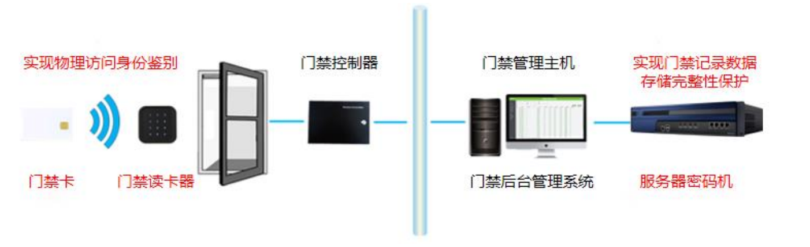

**图C.1.1-1机房部署安全门禁系统和服务器密码机实现身份鉴别、门禁记录数据存储完整性的密码应用场景**

##### C.1.1.2 场景二：机房部署安全视频监控系统

场景描述（如图C.1.1-2）：机房部署安全视频监控系统，涉及摄像机、NVR和视频监控客户端（含监控主机）等组件，采用HMAC-SM3技术实现视频监控记录数据的存储完整性保护。其中，安全视频监控系统中的PCI-E密码卡，以及摄像机、NVR设备中的加密芯片等密码产品具有商用密码产品认证证书且安全等级满足要求。

| 密钥名称 | 关联指标 | 类型 | 用途 |
| --- | --- | --- | --- |
| HMAC密钥 | 视频监控记录数据存储完整性 | 对称密钥 | 用于生成基于HMAC-SM3的消息鉴别码，实现视频监控记录数据的存储完整性保护。 |

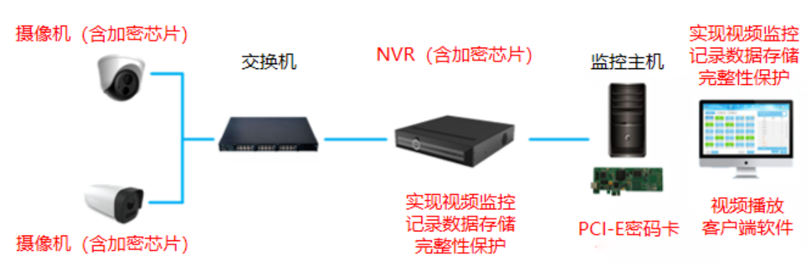

**图C.1.1-2机房部署安全视频监控系统实现视频监控记录数据存储完整性的密码应用场景**

#### C.1.2 测评检查点示例

（1）场景一：测评检查点示例

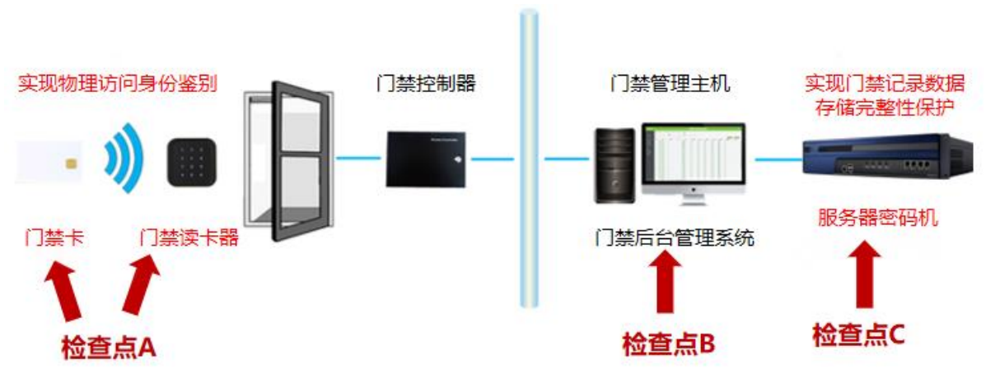

**图C.1.2-1机房部署安全门禁系统和服务器密码机场景测评检查点示例**

检查点A：检查安全门禁系统的发卡过程及密码算法相关配置信息，确认物理访问身份鉴别采用的密码算法、密码技术是否符合预期；通过分发错误或不同权限的门禁卡，验证能否打开门禁。

检查点B：检查电子门禁系统存储的进出记录数据完整性校验值长度是否符合预期；条件允许时，尝试进行数据篡改操作，验证电子门禁记录数据存储完整性保护机制的有效性。

检查点C：检查服务器密码机上的配置信息，确认门禁记录数据存储完整性保护算法及其密钥信息是否符合预期。

（2）场景二：测评检查点示例

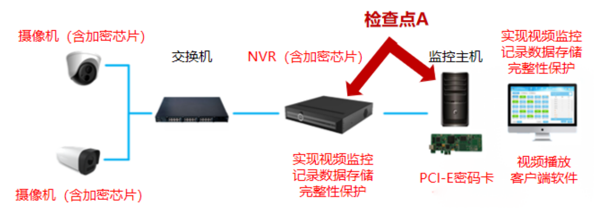

**图C.1.2-2机房部署安全视频监控系统场景测评检查点示例**

检查点A：查看安全视频监控系统存储的视频监控记录数据完整性校验值长度是否符合预期；确认视频监控记录数据存储完整性保护算法及其密钥信息是否符合预期；条件允许时，尝试进行数据篡改操作，验证视频监控记录数据存储完整性机制实现的有效性。

#### C.1.3 证据示例

**表C- 1物理和环境安全测评实施的证据示例**

| 测评单元 | 测评对象 | 证据示例 |
| --- | --- | --- |
| 身份鉴别 | XX机房 | 针对C.1.1.1场景一，根据本文件8.1.4、7.2、7.3提供的推荐测评方式和“DAK”取证结果说明，证据示例如下： 1）密码产品的认证证书和实物部署，如图C.1-1、图C.1-2、图C.1-3； 2）使用的身份鉴别算法配置信息、代码片段，如图C.1-4、图C.1-5； 3）使用非授权门禁卡的刷卡情况，如图C.1-6。 |
| 电子门禁记录数据存储完整性 | XX机房 | 针对C.1.1.1场景一，根据本文件8.1.4、7.2、7.3提供的推荐测评方式和“DAK”取证结果说明，证据示例如下： 1）密码产品的认证证书和实物部署，如图C.1-7； 2）门禁记录数据的HMAC值及数据格式分析结果，如图C.1-8； 3）使用的完整性保护算法配置信息、代码片段，如图C.1-9； 4）完整性校验机制及校验结果，如图C.1-10。 |
| 视频监控记录数据存储完整性 | XX机房 | 针对C.1.1.2场景二，根据本文件8.1.4、7.2、7.3提供的推荐测评方式和“DAK”取证结果说明，证据示例如下： 1）密码产品的认证证书和实物部署，如图C.1-11、图C.1-12、图C.1-13； 2）视频监控记录数据的HMAC值及长度特征，如图C.1-14； 3）使用的完整性保护算法配置信息、代码片段，如图C.1-15； 4）完整性校验机制及校验结果，如图C.1-16。 |

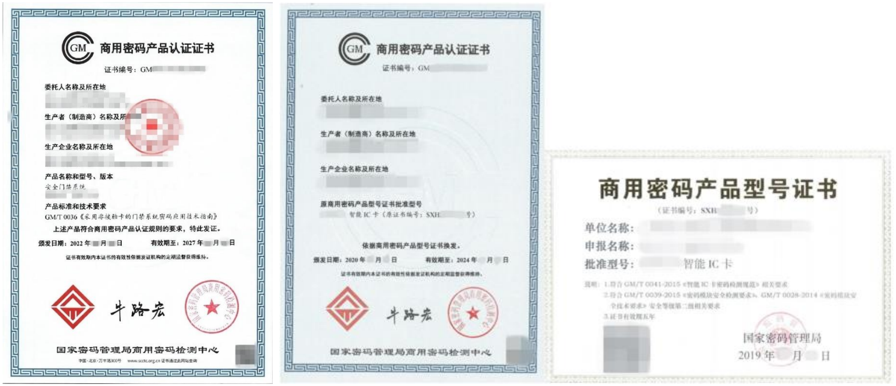

**图C.1-1安全门禁系统商用密码产品认证证书、智能IC卡商用密码产品认证证书及原型号证书（安全等级二级）**

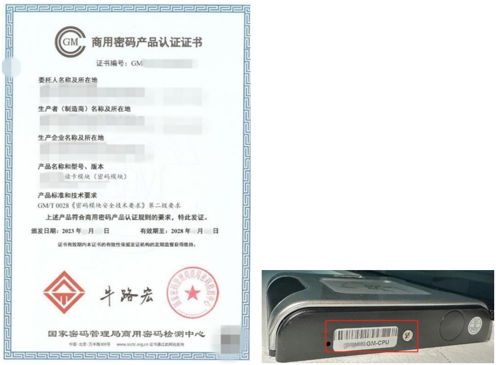

**图C.1-2门禁读卡器商用密码产品认证证书（安全等级二级）及实物图（认证证书与实际部署信息一致）**

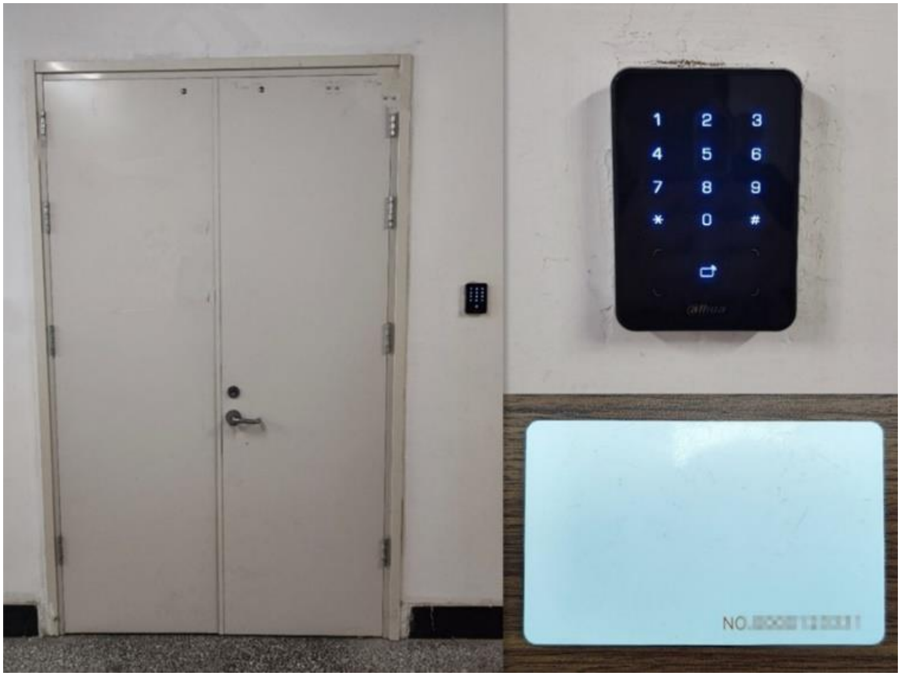

**图C.1-3机房安全门禁系统部署实景**

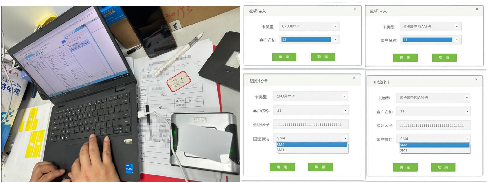

**图C.1-4安全门禁系统后台管理系统发卡子系统的发卡过程及密码算法相关配置（使用SM4算法）**

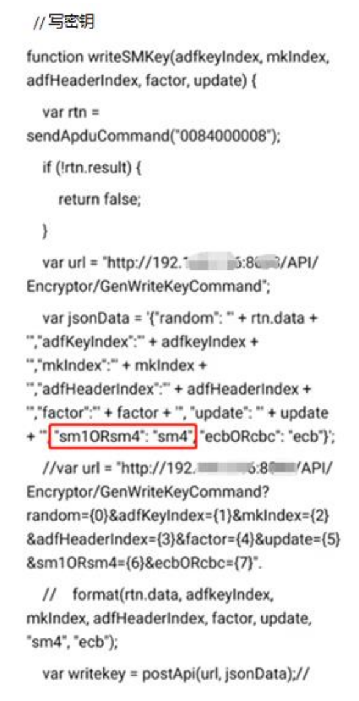

**图C.1-5安全门禁系统身份鉴别采用的SM4-ECB密码算法相关代码**

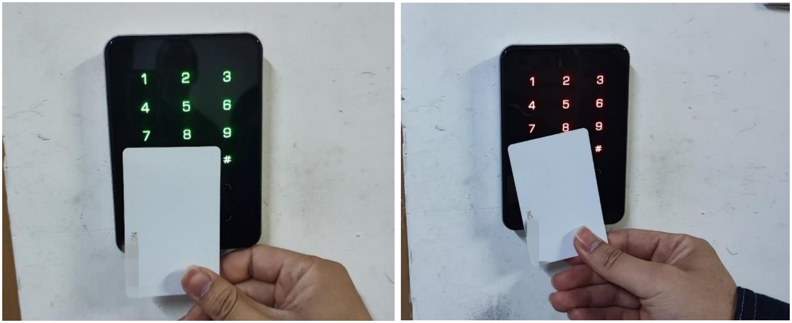

**图C.1-6左图授权门禁卡身份验证成功（键盘显示绿色）、右图非授权门禁卡身份验证失败（键盘显示红色）**

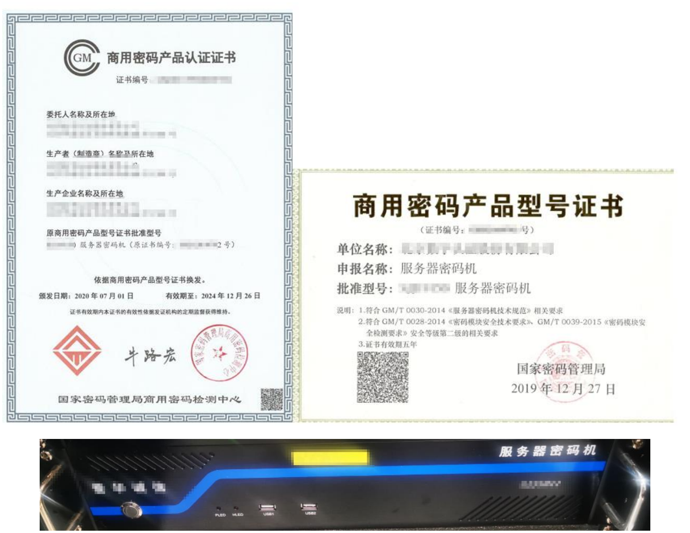

**图C.1-7服务器密码机商用密码产品认证证书（安全等级二级）及实物图（认证证书与实际部署信息一致）**

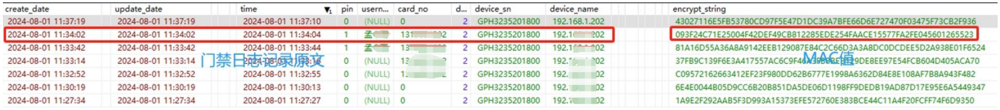

**图C.1-8数据库中存储的电子门禁记录数据的HMAC值**

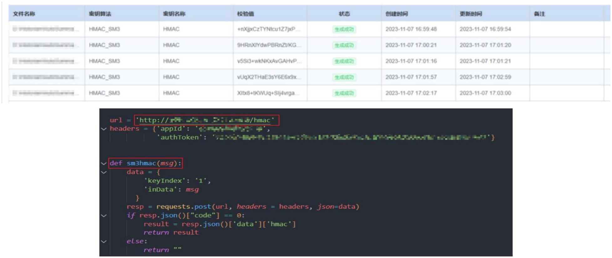

**图C.1-9密码机中HMAC算法配置、门禁记录数据存储完整性保护代码片段（基于SM3的HMAC技术）**

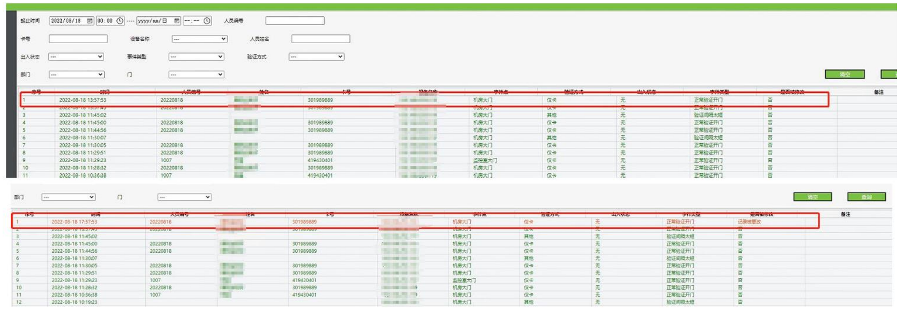

**图C.1-10现场测评时对门禁记录时间和人员名字信息进行修改并在安全门禁系统执行日志完整性校验操作，提示门禁记录被篡改**

**图C.1-11视频监控系统中密码模块、摄像机和NVR中安全芯片的商用密码产品认证证书及实物图（密码模块实物图略，认证证书与实际部署信息一致）**

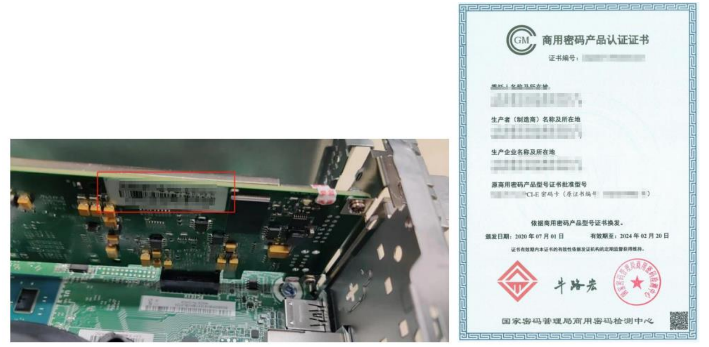

**图C.1-12视频监控系统监控主机使用的PCI-E密码卡及商用密码产品认证证书实物图（认证证书与实际部署信息一致）**

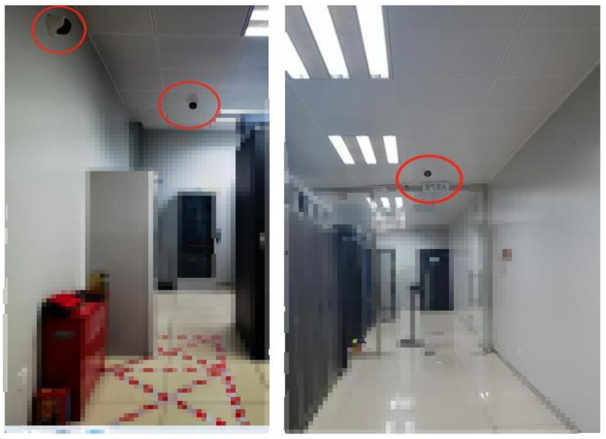

**图C.1-13机房内外及被测系统所在机柜旁监控摄像部署位置**

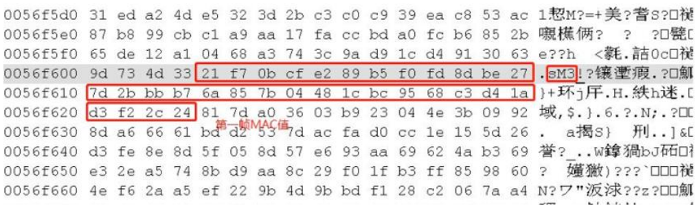

**图C.1-14视频监控记录数据某一帧的HMAC值（长度为256比特）**

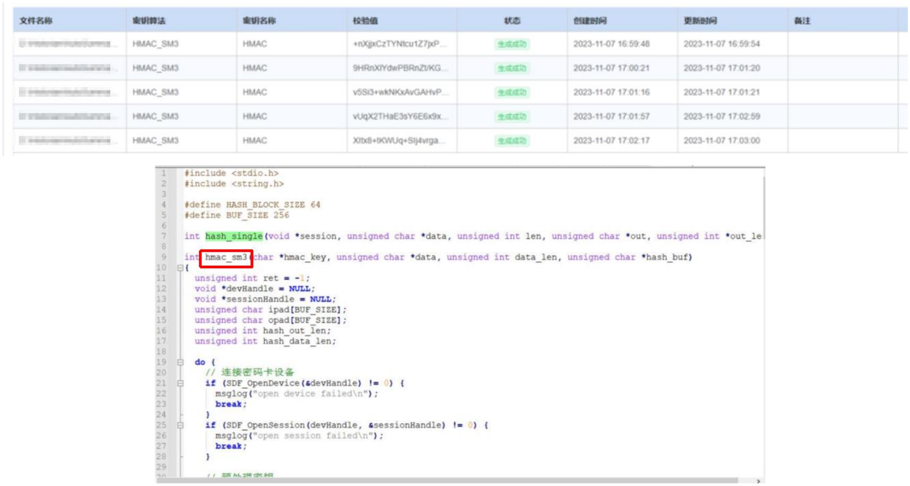

**图C.1-15视频监控系统中HMAC算法配置、视频监控记录数据存储完整性保护代码（基于SM3的HMAC技术）**

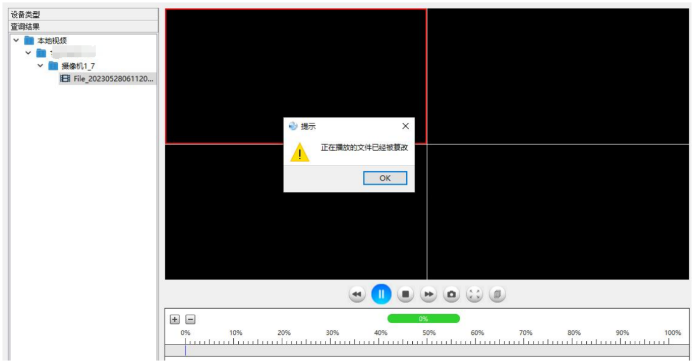

**图C.1-16篡改视频监控记录数据部分帧内容，客户端播放提示“正在播放的文件被篡改”，无法正常播放，即HMAC验证失败**

### C.2 网络和通信安全

#### C.2.1 典型密码应用场景

##### C.2.1.1 场景一：IPSec VPN通信信道

场景描述（站到站部署模式，如图C.2.1-1）：分支机构用户通过IPSec VPN隧道访问总部内网资源，产生一条分支机构IPSec VPN网关与总部IPSec VPN网关之间的通信信道。通道建立时，双方采用基于SM2证书的数字签名技术实现通信实体身份鉴别，采用SM4-CBC和HMAC-SM3算法实现通信报文的机密性和完整性保护，相关密码运算和密钥管理由IPSec VPN网关完成。其中，两端部署的IPSec VPN网关具有商用密码产品认证证书且安全等级满足要求。

| 密钥名称 | 关联指标 | 类型 | 用途 |
| --- | --- | --- | --- |
| 设备密钥 | 身份鉴别 | 非对称密钥对，包括签名密钥对和加密密钥对，公钥通常以数字证书形式存在，私钥存放在VPN网关内部。 | 用于签名的SM2算法设备密钥对在IKE/ISAKMP第一阶段（主模式）提供基于数字签名的身份鉴别功能；用于加密的SM2算法设备密钥对在IKE/ISAKMP第一阶段对密钥协商等数据提供机密性保护。 |
| 工作密钥 | 通信数据完整性、通信过程中重要数据的机密性 | 对称密钥，包括用于加密和用于完整性校验两种工作密钥。 | 用于加密的SM4-CBC算法工作密钥为IKE/ISAKMP第二阶段（快速模式）交互的数据提供机密性保护；用于完整性校验的HMAC-SM3算法工作密钥为IKE/ISAKMP第二阶段（快速模式）交互的数据提供完整性保护及对数据源进行身份鉴别。 |
| 会话密钥 | 通信数据完整性、通信过程中重要数据的机密性 | 对称密钥，包括用于加密和用于完整性校验两种会话密钥。 | 用于加密的SM4-CBC算法会话密钥为通信数据提供机密性保护；用于完整性校验的HMAC-SM3算法会话密钥为通信数据提供完整性保护。 |

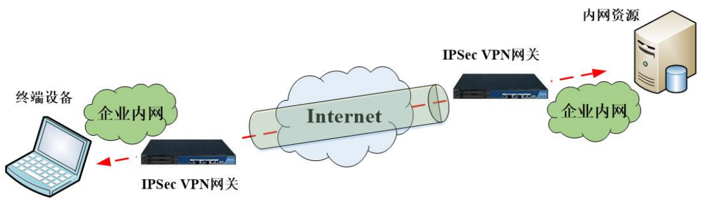

**图C.2.1-1 IPSec VPN通信场景（站到站部署模式）**

##### C.2.1.2 场景二：SSL VPN通信信道

场景描述（PC终端安全浏览器与SSL VPN网关之间的通信信道，如图C.2.1-2）：互联网PC终端用户使用安全浏览器通过HTTPS协议访问内网应用系统，在内网边界放置有SSL VPN网关用于实现安全接入，从而产生一条安全浏览器与SSL VPN网关之间的通信信道。通道建立时，采用基于SM2证书的数字签名技术实现SSL VPN网关的单向身份鉴别，采用SM4-CBC和HMAC-SM3算法实现通信数据的机密性和完整性保护，相关密码运算和密钥管理由安全浏览器和/或SSL VPN网关完成。其中，两端部署的安全浏览器、SSL VPN网关具有商用密码产品认证证书且安全等级满足要求。

| 密钥名称 | 关联指标 | 类型 | 用途 |
| --- | --- | --- | --- |
| 服务端密钥 | 身份鉴别 | 非对称密钥对，包括签名密钥对和加密密钥对，公钥通常以数字证书形式存在，私钥存放在VPN网关内部。 | SM2算法签名密钥对用于握手协议中服务端身份鉴别；SM2算法加密密钥对用于预主密钥协商时所用交换参数的机密性保护。 |
| 工作密钥 | 通信数据完整性、通信过程中重要数据的机密性 | 对称密钥，包括数据加密密钥和校验密钥。 | SM4-CBC算法数据加密密钥用于数据的加密和解密，为通信数据提供机密性保护；HMAC-SM3算法校验密钥用于数据的完整性计算和校验，为通信数据提供完整性保护。 |

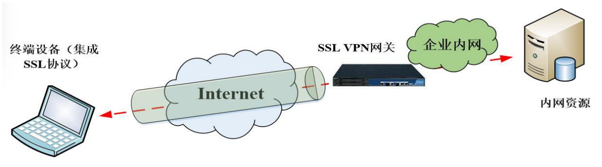

**图C.2.1-2 SSL VPN通信场景**

#### C.2.2 测评检查点示例

（1）场景一：测评检查点示例

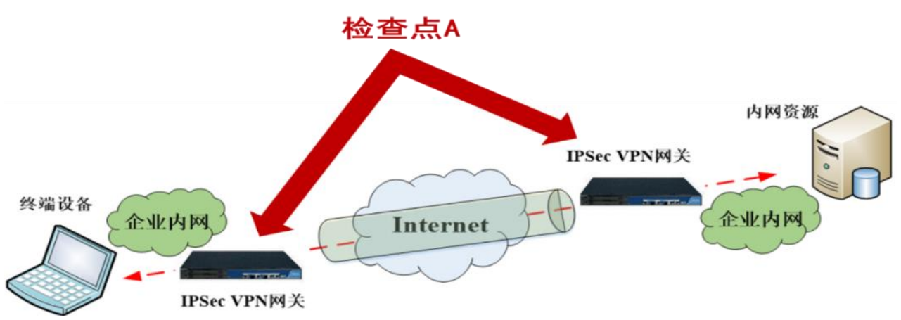

**图C.2.2-1 IPSec VPN通信场景（站到站部署模式）测评检查点示例**

检查点A：在IPSec VPN网关外网口或外侧出口路由器或防火墙上，通过镜像端口接入专用测试终端（如便携式电脑），在终端上使用协议分析工具，捕获并分析IPSec VPN网关通信数据包，确认通信双方是否开启IPSec VPN端口服务、协定的身份鉴别、加密和完整性保护算法等是否符合预期；使用数字证书校验工具，验证IPSec VPN网关的数字证书和相关电子认证服务；登录到IPSec VPN网关上，检查启用/旁路设置、身份鉴别、加密和完整性保护算法等是否符合预期。

（2）场景二：测评检查点示例

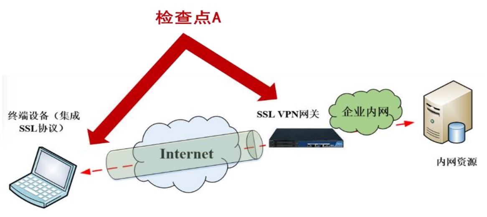

**图C.2.2-2 SSL VPN通信场景测评检查点示例**

检查点A：在SSL VPN网关外网口或外侧出口路由器或交换机上，通过镜像端口接入专用测试终端（如便携式电脑），在测试终端上或直接在安全浏览器所在PC终端上，使用协议分析工具，捕获并分析SSL通信数据包，确认通信双方是否开启SSL VPN端口服务、协定的身份鉴别、加密和完整性保护算法等是否符合预期；使用数字证书校验工具，验证SSL VPN网关的数字证书和相关电子认证服务；登录到SSL VPN网关上，检查是否被旁路的设置、身份鉴别、加密和完整性保护算法等是否符合预期。

#### C.2.3 证据示例

**表C- 2网络和通信安全测评实施的证据示例**

<table>
  <colgroup><col style="width: 16%"><col style="width: 20%"><col style="width: 64%"></colgroup>
  <tr>
    <th>测评单元</th>
    <th>测评对象</th>
    <th>证据示例</th>
  </tr>
  <tr>
    <td rowspan="2">身份鉴别</td>
    <td>分支机构IPSec VPN网关与总部IPSec VPN网关之间的通信信道</td>
    <td>针对C.2.1.1场景一，根据本文件8.2.4、7.2、7.3提供的推荐测评方式和“DAK”取证结果说明，证据示例如下： 1）密码产品的认证证书和实物部署，如图C.2-1； 2）身份鉴别过程所使用的数字证书对应的电子认证服务信息，如图C.2-2； 3）IPSec VPN通信双方IP地址、端口服务，以及实体鉴别应用机制情况，如图C.2-3； 4）IPSec VPN通信双方协定的身份鉴别算法，以及对数字证书及其证书链的验证情况，如图C.2-3、图C.2-4、图C.2-5、图C.2-6； 5）IPSec VPN网关上，有关启用/旁路设置、身份鉴别算法及其对应数字证书等配置信息，如图C.2-7。</td>
  </tr>
  <tr>
    <td>PC终端安全浏览器与SSL VPN网关之间的通信信道</td>
    <td>针对C.2.1.2场景二，根据本文件8.2.4、7.2、7.3提供的推荐测评方式和“DAK”取证结果说明，证据示例如下： 1）密码产品（安全浏览器、SSL VPN网关）的认证证书和实物部署，如图C.2-11、图C.2-12； 2）身份鉴别过程所使用的数字证书对应的电子认证服务信息，如图C.2-2； 3）SSL VPN通信双方IP地址、端口服务，以及实体鉴别应用机制情况，如图C.2-13； 4）SSL VPN通信双方协定的身份鉴别算法，以及对数字证书及其证书链的验证情况，如图C.2-14、图C.2-15、图C.2-16、图C.2-17； 5）SSL VPN网关上，有关SSL协议版本、身份鉴别算法配置信息，如图C.2-18、图C.2-19。</td>
  </tr>
  <tr>
    <td rowspan="2">通信数据完整性、通信过程中重要数据的机密性</td>
    <td>分支机构IPSec VPN网关与总部IPSec VPN网关之间的通信信道</td>
    <td>针对C.2.1.1场景一，根据本文件8.2.4、7.2、7.3提供的推荐测评方式和“DAK”取证结果说明，证据示例如下： 1）密码产品的认证证书和实物部署，如图C.2-1； 2）IPSec VPN通信双方协定的通信报文加密算法、完整性校验算法情况，如图C.2-8、图C.2-9； 3）IPSec VPN网关上，有关启用/旁路设置、加密算法、完整性校验算法以及报文封装方式等配置信息，如图C.2-10。</td>
  </tr>
  <tr>
    <td>PC终端安全浏览器与SSL VPN网关之间的通信信道</td>
    <td>针对C.2.1.2场景二，根据本文件8.2.4、7.2、7.3提供的推荐测评方式和“DAK”取证结果说明，证据示例如下： 1）密码产品（安全浏览器、SSL VPN网关）的认证证书和实物部署，如图C.2-11、图C.2-12； 2）SSL VPN通信双方协定的通信报文中加密算法、完整性校验算法情况，如图C.2-14； 3）SSL VPN网关上，有关SSL协议版本、加密算法、完整性校验算法等配置信息，如图C.2-18、图C.2-19。</td>
  </tr>
  <tr>
    <td>网络边界访问控制信息的完整性</td>
    <td>略</td>
    <td>略</td>
  </tr>
  <tr>
    <td>安全接入认证</td>
    <td>略</td>
    <td>略</td>
  </tr>
</table>

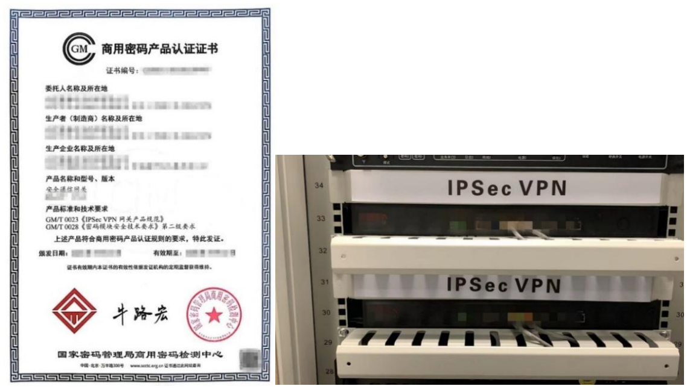

**图C.2-1 IPSec VPN网关商用密码产品认证证书及实物图**

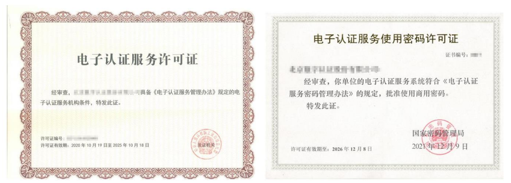

**图C.2-2电子认证服务机构电子认证服务使用密码许可证**

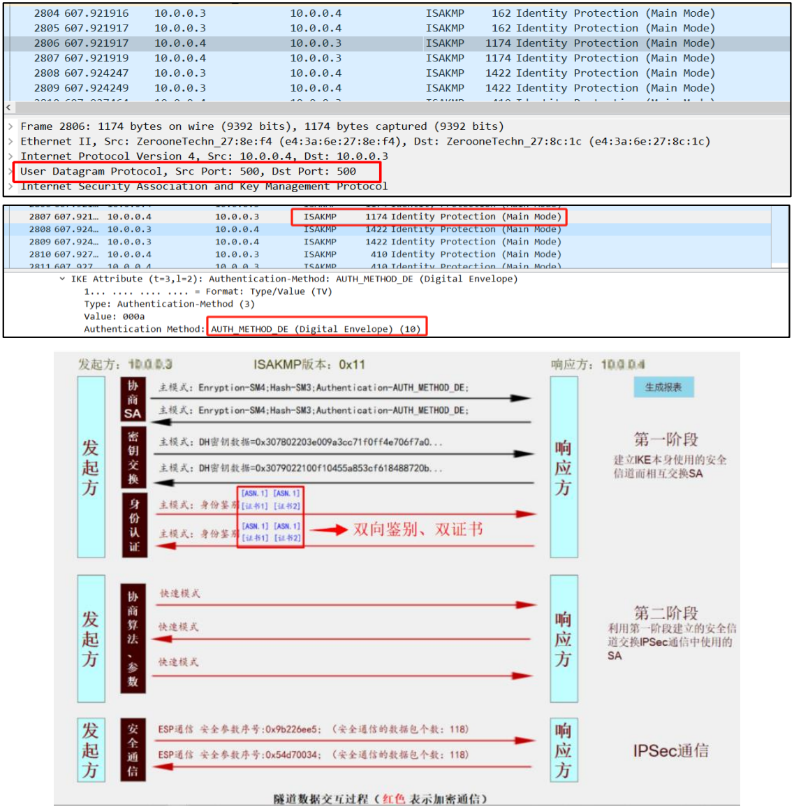

**图C.2-3 IPSec协议通信双方IP地址（10.XX.XX.3和10.XX.XX.4）、端口服务开启情况（UDP 500）和实体鉴别应用机制（双向鉴别）**

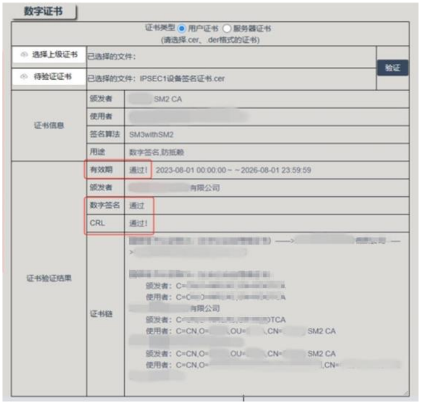

**图C.2-4总部IPSec VPN、分支机构IPSec VPN证书链验证结果**

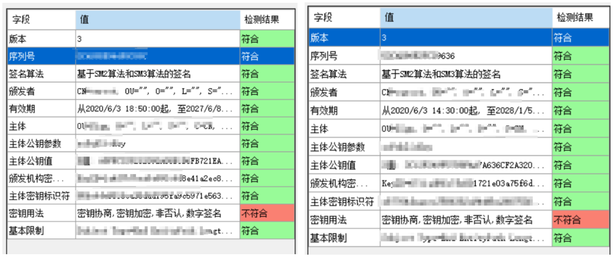

**图C.2-5总部IPSec VPN签名证书和加密证书合规性分析结果**

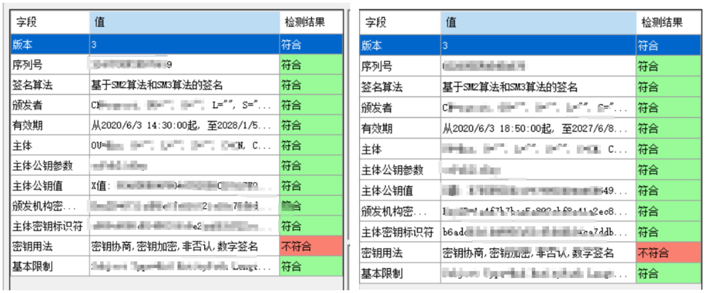

**图C.2-6分支机构IPSec VPN签名证书和加密证书合规性分析结果**

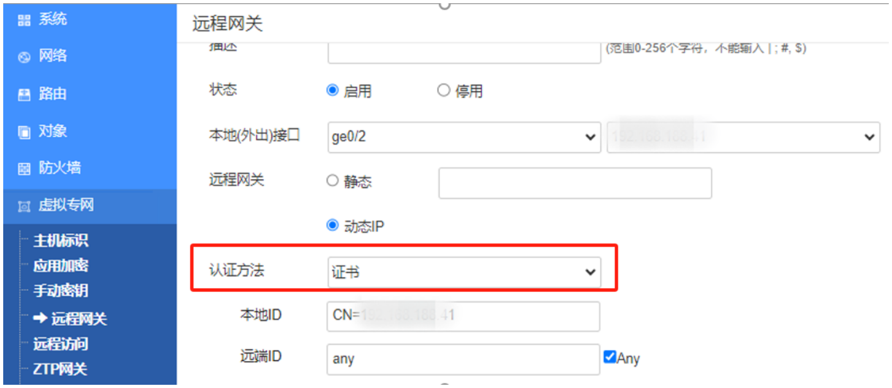

**图C.2-7 IPSec VPN网关的实体鉴别方式配置界面（采用数字证书鉴别方式）**

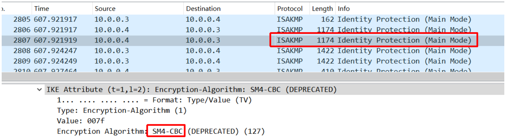

**图C.2-8 IPSec协议ISAKMP主模式阶段双方协定的加密算法（SM4-CBC）**

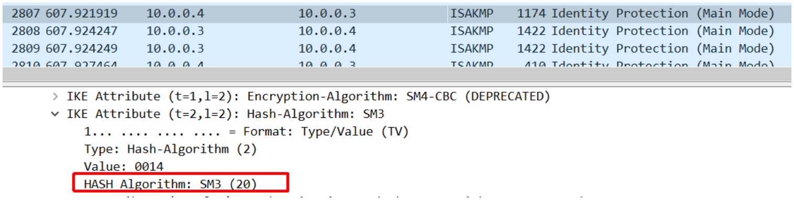

**图C.2-9 IPSec协议ISAKMP主模式阶段双方协定的完整性校验算法（HMAC-SM3）**

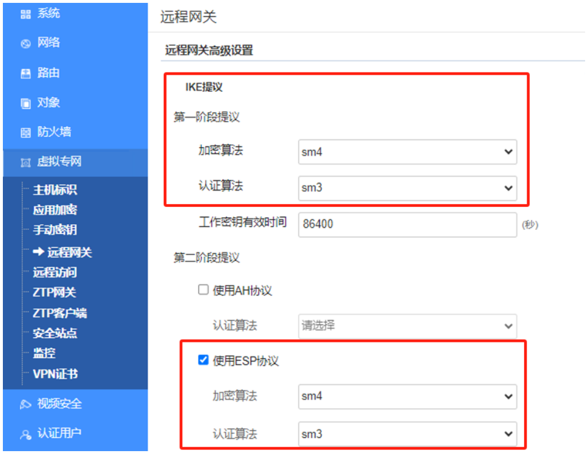

**图C.2-10 IPSec VPN网关的IKE（ISAKMP）配置界面**

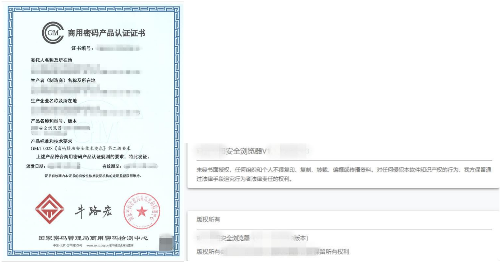

**图C.2-11 PC端安全浏览器商用密码产品认证证书（安全等级二级）及实际部署浏览器版本等信息**

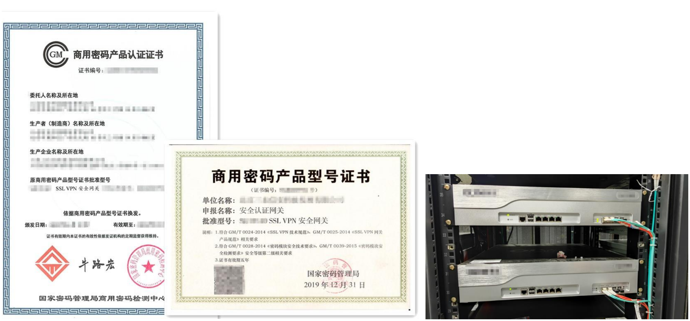

**图C.2-12 SSL VPN网关商用密码产品认证证书、原型号证书（安全等级二级）及实物部署图**

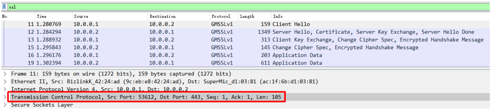

**图C.2-13 SSL协议通信双方IP地址（10.XX.XX.1、10.XX.XX.2）、端口服务开启情况（目的端TCP 443）**

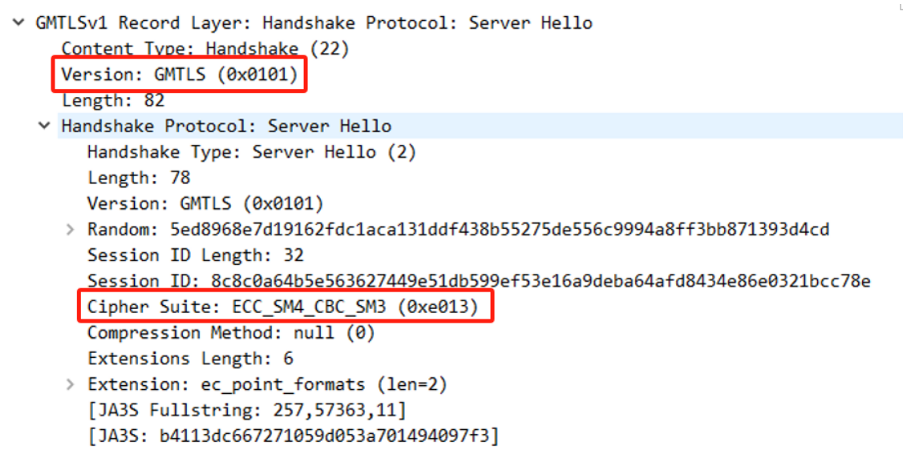

**图C.2-14 SSL协议握手阶段Server Hello数据包(密码套件ECC_SM4_CBC_SM3)，身份鉴别算法SM2、加密算法SM4-CBC、完整性校验算法HMAC-SM3**

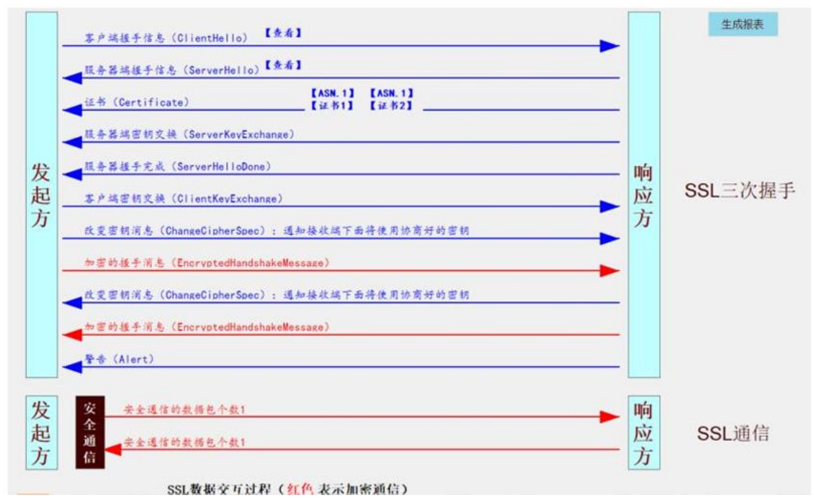

**图C.2-15 SSL协议握手过程解析结果（客户端对服务端单向鉴别，服务端具有双证书）**

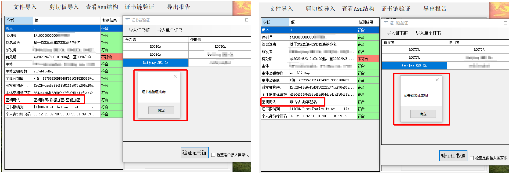

**图C.2-16 SSL VPN网关加密证书、签名证书证书链验证结果**

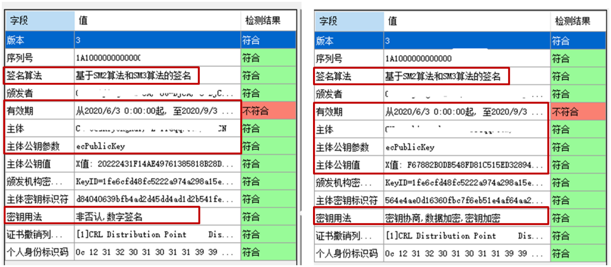

**图C.2-17 SSL VPN网关签名证书、加密证书合规性检测结果**

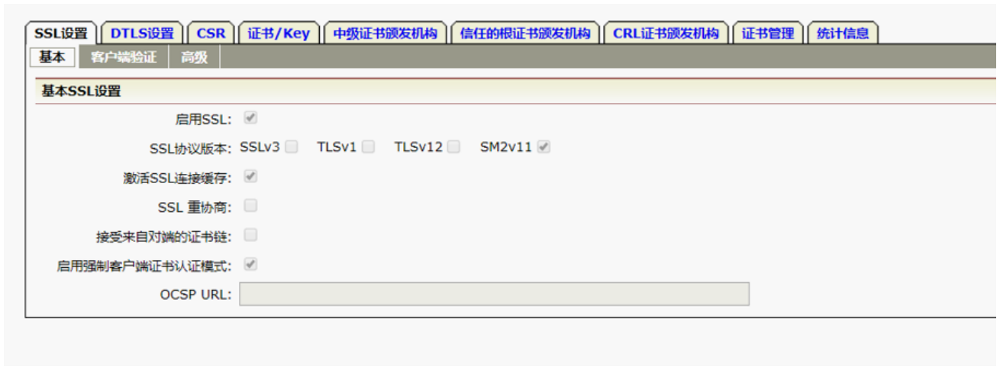

**图C.2-18 SSL VPN网关SSL协议配置界面**

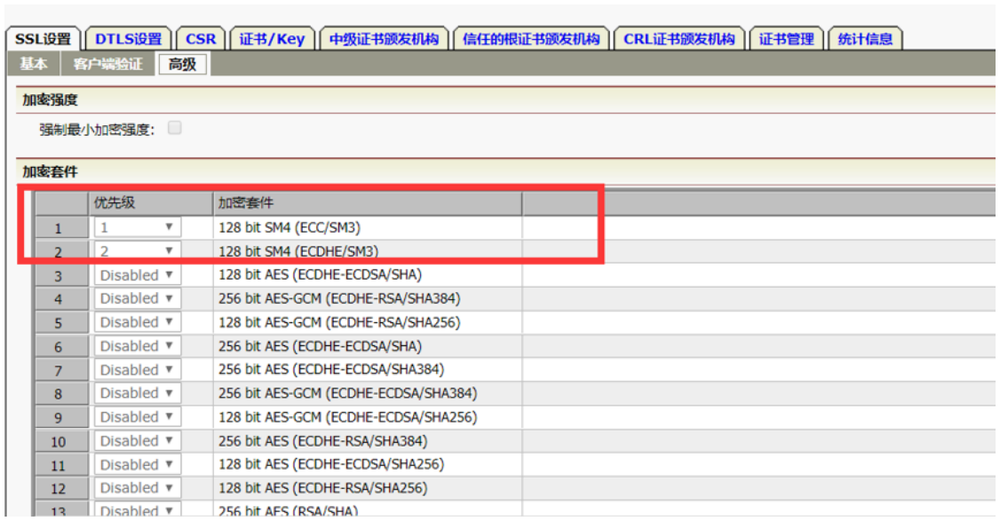

**图C.2-19 SSL VPN网关密码套件配置信息**

### C.3 设备和计算安全

#### C.3.1 典型密码应用场景

##### C.3.1.1 场景一：设备远程管理场景

场景描述（如图C.3.1-1）：运维人员在互联网上连接SSL VPN网关接入系统内部网络后，通过登录堡垒机实现对通用服务器、数据库管理系统、整机类和系统类密码产品的远程管理。用户登录堡垒机时，通过动态令牌生成动态口令，堡垒机调用动态令牌认证系统进行动态口令验证。其中，动态令牌、动态令牌认证系统具有商用密码产品认证证书且安全等级满足要求。

堡垒机的远程管理协议为HTTPS协议，通用服务器远程管理协议为SSHv2或RDP，整机类和系统类密码产品的远程管理协议为HTTPS等。

| 密钥名称 | 关联指标 | 类型 | 用途 |
| --- | --- | --- | --- |
| 用户种子密钥 | 身份鉴别 | 对称密钥。 | 用于堡垒机登录时，采用SM3算法生成动态口令。 |
| 设备密钥 | 远程管理通道安全 | 非对称密钥对，主要指设备签名密钥对，公钥通常以数字证书形式存在。 | 用于远程管理协议建立时，对服务端（堡垒机、通用服务器等）进行身份鉴别。 |
| 远程管理通信保护密钥 | 远程管理通道安全 | 对称密钥，包括数据加密密钥和校验密钥。 | 数据加密密钥为远程管理通道提供机密性保护；校验密钥为远程管理通道提供完整性保护。 |

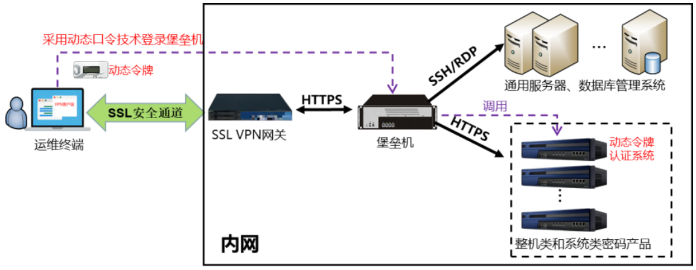

**图C.3.1-1设备运维管理场景**

#### C.3.2 测评检查点示例

（1）场景一：测评检查点示例

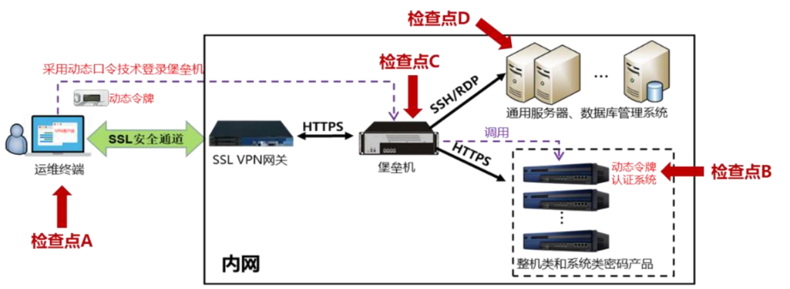

**图C.3.2-1设备远程运维管理场景测评检查点示例**

检查点A：在运维终端上查看堡垒机、通用服务器、数据库管理系统、整体类和系统类密码产品等设备的用户登录方式；使用协议分析工具，捕获并分析用户登录设备时的通信数据包，分析用户身份鉴别机制是否符合预期。

检查点B：在动态令牌认证系统外侧交换机上，通过镜像端口接入专用测试终端（如便携式电脑），在测试终端上使用协议分析工具，检查密码产品是否被有效调用，调用机制是否符合预期。

检查点C：在堡垒机外侧交换机上，通过镜像端口接入专用测试终端（如便携式电脑），在测试终端上或直接在堡垒机上使用协议分析工具，检查堡垒机远程管理通道的身份鉴别、通信数据机密性及完整性保护机制是否符合预期；使用数字证书校验工具，检查堡垒机远程管理通道实体鉴别采用的数字证书和相关电子认证服务是否符合预期。

检查点D：在服务器外侧交换机上，通过镜像端口接入专用测试终端（如便携式电脑），在测试终端上或直接在服务器上使用协议分析工具，检查服务器远程管理通道的身份鉴别、通信数据机密性及完整性保护机制是否符合预期；检查服务器远程管理协议配置信息，分析远程管理采用的密码算法、密码协议是否符合预期。

#### C.3.3 证据示例

**表C-3设备和计算安全测评实施证据示例**

<table>
  <colgroup><col style="width: 16%"><col style="width: 20%"><col style="width: 64%"></colgroup>
  <tr>
    <th>测评单元</th>
    <th>测评对象</th>
    <th>证据示例</th>
  </tr>
  <tr>
    <td rowspan="2">身份鉴别</td>
    <td>堡垒机</td>
    <td>针对C.3.1.1场景一，根据本文件8.3.4、7.2、7.3提供的推荐测评方式和“DAK”取证结果说明，证据示例如下： 1）密码产品的认证证书和实物部署，如图C.3-1、图C.3-2； 2）动态口令信息、动态令牌的PIN码保护策略，如图C.3-3、图C.3-4； 3）堡垒机调用动态令牌认证系统完成验证操作的交互数据，如图C.3-5； 4）动态口令认证系统上生成动态口令的密码算法、动态口令长度和取值范围等配置信息，如图C.3-6； 5）对动态口令鉴别过程进行重放测试的结果，如图C.3-7。</td>
  </tr>
  <tr>
    <td>……</td>
    <td>……</td>
  </tr>
  <tr>
    <td rowspan="3">远程管理通道安全</td>
    <td>堡垒机</td>
    <td>针对C.3.1.1场景一，根据本文件8.3.4、7.2、7.3提供的推荐测评方式和“DAK”取证结果说明，证据示例如下： 1）远程运维终端与堡垒机（服务端）之间的远程管理通道情况，包括通信双方IP地址、端口服务、使用的密码协议版本，以及实体鉴别应用机制情况，如图C.3-8； 2）远程运维终端与堡垒机之间的远程管理通道建立的TLS1.2协议中，通信双方协定的密码套件，以及对数字证书的验证情况，如图C.3-9。</td>
  </tr>
  <tr>
    <td>通用服务器</td>
    <td>针对C.3.1.1场景一，根据本文件8.3.4、7.2、7.3提供的推荐测评方式和“DAK”取证结果说明，证据示例如下： 1）堡垒机与通用服务器之间的远程管理通道情况，包括通信双方IP地址、端口服务、使用的协议版本，如图C.3-10； 2）堡垒机与通用服务器之间的远程管理通道建立的SSHv2协议中，通信双方协定的密钥交换算法、加密算法、完整性保护算法、身份鉴别算法等信息，如图C.3-11。</td>
  </tr>
  <tr>
    <td>……</td>
    <td>……</td>
  </tr>
  <tr>
    <td>系统资源访问控制信息完整性</td>
    <td>略</td>
    <td>略</td>
  </tr>
  <tr>
    <td>重要信息资源安全标记完整性</td>
    <td>略</td>
    <td>略</td>
  </tr>
  <tr>
    <td>日志记录完整性</td>
    <td>略</td>
    <td>略</td>
  </tr>
  <tr>
    <td>重要可执行程序完整性、重要可执行程序来源真实性</td>
    <td>略</td>
    <td>略</td>
  </tr>
</table>

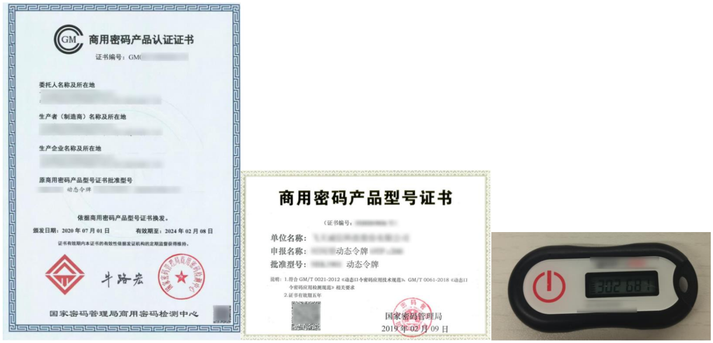

**图C.3-1动态令牌商用密码产品认证证书及原型号证书、实物部署图（安全等级二级）**

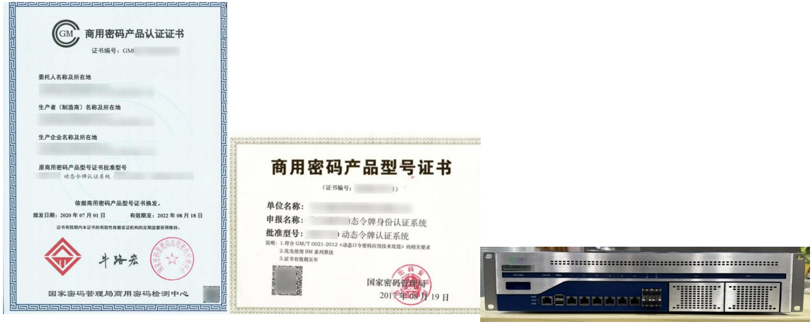

**图C.3-2动态令牌认证系统商用密码产品认证证书及原型号证书、实物部署图**

**图C.3-3堡垒机用户登录时输入动态令牌产生的动态口令（长度为6位）**

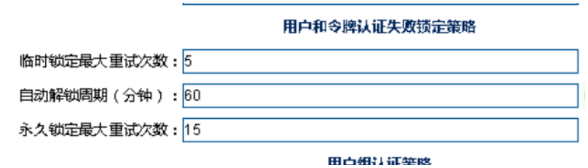

**图C.3-4用户和令牌认证失败锁定策略配置**

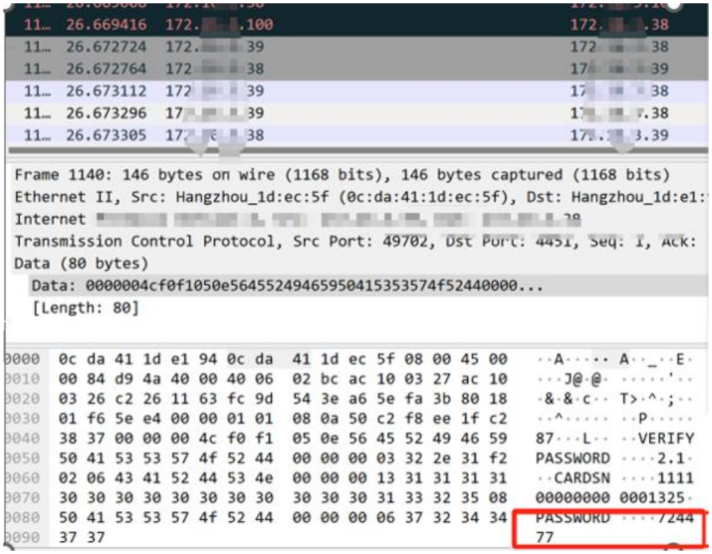

**图C.3-5堡垒机与动态令牌认证系统之间的认证通信协议数据包传输动态口令对堡垒机登录人员进行身份认证**

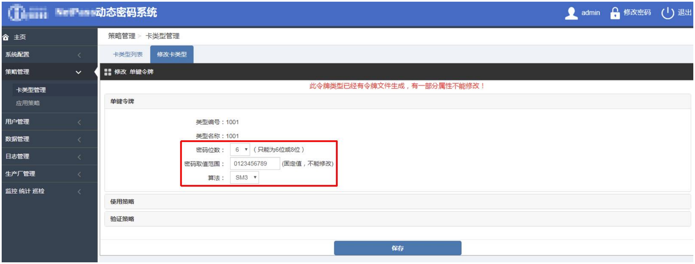

**图C.3-6动态口令认证系统上动态口令生成算法、动态口令长度和取值范围等配置信息（基于SM3算法生成动态口令）**

**图C.3-7距离上一次登录时间60秒后重新输入上次动态口令的重放测试结果（即口令一次有效）**

**图C.3-8通过TLSv1.2协议对堡垒机进行远程管理时的通信双方IP地址（10.XX.XX.249、192.XX.XX.86）、端口服务开启情况（目的端TCP 443）和实体鉴别应用机制（单向鉴别）**

**图C.3-9 SSL协议握手阶段的Server Hello数据包（密码套件ECDHE_RSA_WITH_AES_256_CBC_SHA），密钥交换算法ECDHE、身份鉴别算法RSA-2048、加密算法AES-256-CBC、完整性校验算法HMAC-SHA1，以及服务端RSA-2048数字证书**

**图C.3-10堡垒机使用SSHv2协议远程管理通用服务器的协议版本和交互过程**

**图C.3-11堡垒机使用SSHv2协议远程管理通用服务器协商的密码算法，密钥交换算法ECDHE、加密算法AES-128-CBC、完整性校验算法HMAC-SHA1、对服务端身份鉴别算法RSA-2048**

### C.4 应用和数据安全

#### C.4.1 典型密码应用场景

##### C.4.1.1 场景一：应用系统采用数字签名技术对登录用户进行身份鉴别

场景描述（如图C.4.1-1）：应用系统采用基于SM2的数字签名机制实现用户登录时的身份鉴别，用户登录应用时，需利用智能密码钥匙，进行“口令+SM2数字签名”的双因素身份鉴别，应用系统调用签名验签服务器进行签名验证，验证通过方可登录成功。其中，SM2数字证书存放于智能密码钥匙中，数字证书由合法CA机构签发，相关密码运算和密钥管理由智能密码钥匙和签名验签服务器完成，智能密码钥匙和签名验签服务器均具有商用密码产品认证证书且安全等级满足要求。

| 密钥名称 | 关联指标 | 类型 | 用途 |
| --- | --- | --- | --- |
| CA公钥 | 身份鉴别 | 非对称密钥对，公钥通常以数字证书形式存在。CA公钥由CA自签发形成CA根证书或可由国家信任根CA进行证书链验证。 | 用于验证用户数字证书。 |
| 用户签名密钥对 | 身份鉴别 | 非对称密钥对，公钥通常以数字证书形式存在，私钥存放在智能密码钥匙内部。 | 用于用户登录应用时的身份鉴别，基于SM2证书的数字签名技术实现。 |

**图C.4.1-1用户采用SM2数字签名技术完成登录应用时的身份鉴别场景**

##### C.4.1.2 场景二：应用系统调用密码机实现重要数据存储机密性和完整性保护

场景描述（如图C.4.1-2）：应用系统调用服务器密码机，采用SM4算法实现重要数据存储机密性保护，采用HMAC-SM3实现重要数据存储完整性保护，保护后的数据存储于数据库中。相关密码运算和密钥管理由服务器密码机完成，服务器密码机具有商用密码产品认证证书且安全等级满足要求。

| 密钥名称 | 关联指标 | 类型 | 用途 |
| --- | --- | --- | --- |
| 加密密钥 | 重要数据存储机密性 | 对称密钥 | 用于SM4加解密以实现重要数据的存储机密性保护。 |
| HMAC密钥 | 重要数据存储完整性 | 对称密钥 | 用于生成基于SM3的消息鉴别码，实现重要数据的存储完整性保护。 |

**图C.4.1-2应用系统调用密码机实现重要数据存储机密性和完整性保护场景**

##### C.4.1.3 场景三：应用系统采用数字签名技术实现关键操作行为的不可否认性

场景描述（如图C.4.1-3）：应用系统采用基于SM2的数字签名机制实现关键操作行为的不可否认性。用户每次执行关键操作时，调用本人智能密码钥匙对操作信息进行SM2数字签名，应用服务器接收到签名结果后调用签名验签服务器进行校验，校验通过则将该关键操作信息及其签名值一同存放于数据库中。相关密码运算和密钥管理由智能密码钥匙和签名验签服务器完成，智能密码钥匙和签名验签服务器均具有商用密码产品认证证书且安全等级满足要求。

| 密钥名称 | 关联指标 | 类型 | 用途 |
| --- | --- | --- | --- |
| CA公钥 | 不可否认性 | 非对称密钥对，公钥通常以数字证书形式存在。CA公钥由CA自签发形成CA根证书或可由国家信任根CA进行证书链验证。 | 用于验证用户数字证书。 |
| 用户签名密钥对 | 不可否认性 | 非对称密钥对，公钥通常以数字证书形式存在，私钥存放在智能密码钥匙内部。 | 用于关键操作信息的不可否认性保护，基于SM2证书的数字签名技术实现。 |

**图C.4.1-3采用SM2数字签名技术实现用户关键操作行为的不可否认性场景**

#### C.4.2 测评检查点示例

（1）场景一：测评检查点示例

**图C.4.2-1用户采用SM2数字签名技术完成登录应用时的身份鉴别场景测评检查点示例**

检查点A：在用户业务终端上查看应用系统用户登录方式，例如采用配置检查、试错测试等方式验证智能密码钥匙的口令长度和错误口令登录验证次数是否符合预期，检查在智能密码钥匙未使用或错误使用（如使用他人的介质）时身份鉴别过程是否符合预期；通过数字证书校验工具，验证用户登录应用系统使用的数字证书和相关电子认证服务；条件允许时在用户业务终端上使用APDU报文分析工具，分析智能密码钥匙的APDU指令格式和内容是否符合预期。

检查点B：在服务器外侧交换机上，通过镜像端口接入专用测试终端（如便携式电脑），在测试终端上或直接在服务器上使用协议分析工具，捕获并分析用户登录应用系统时的通信数据包，检查如用户身份鉴别机制、数字证书使用情况以及密码产品调用情况是否符合预期；采用算法校验工具对签名结果有效性进行验证。

检查点C：查看如签名验签服务器密钥相关配置、密码运算及相关密钥使用的日志记录，检查使用的密码算法、密钥等是否符合预期。

（2）场景二：测评检查点示例

**图C.4.2-2应用系统调用密码机实现重要数据存储机密性和完整性保护场景测评检查点示例**

检查点A：查看数据库所存储重要数据的数据格式（如密文分组长度、重要数据的消息鉴别码长度）是否符合预期；条件允许时，对有完整性保护的重要数据进行篡改操作，验证重要数据存储完整性机制实现的正确性和有效性。

检查点B：查看应用系统调用服务器密码机实现重要数据存储机密性及完整性保护功能的代码片段，确认是否调用服务器密码机实现相应密码功能，分析机密性及完整性保护使用的密码算法、分组算法工作模式、保护对象等是否符合预期；在应用服务器上，使用协议分析工具，检查密码产品是否被有效调用，调用机制是否符合预期。

检查点C：查看服务器密码机密钥相关配置、密钥管理和密码运算相关日志记录，检查使用的密码算法、密钥等是否符合预期。

（3）场景三：测评检查点示例

**图C.4.2-3采用SM2数字签名技术实现用户关键操作行为的不可否认性场景测评检查点示例**

检查点A：在用户业务终端上查看关键操作过程，例如采用配置检查、试错测试等方式验证智能密码钥匙的口令长度和错误口令登录验证次数是否符合预期，检查在智能密码钥匙未使用或错误使用（如使用他人的介质）时关键操作是否执行成功；通过数字证书校验工具，验证用户执行关键操作进行数字签名使用的数字证书和相关电子认证服务；条件允许时在用户业务终端上使用APDU报文分析软件，分析智能密码钥匙对关键操作信息进行数字签名的APDU指令格式和内容是否符合预期。

检查点B：采用工具测试或代码审查方式，在服务器外侧交换机上，通过镜像端口接入专用测试终端（如便携式电脑），在测试终端上或直接在服务器上使用协议分析工具，捕获并分析用户执行关键操作进行数字签名时的通信数据包，检查如对关键操作信息数字签名机制、数字证书使用情况以及密码产品调用情况是否符合预期；采用算法校验工具对签名结果有效性进行验证；分析数据库存储的关键操作数据的签名值数据格式是否符合预期。

检查点C：查看如签名验签服务器密钥相关配置、密码运算及相关密钥使用的日志记录，检查使用的密码算法、密钥等是否符合预期。

#### C.4.3 证据示例

**表C-4应用和数据安全测评实施证据示例**

| 测评单元 | 测评对象 | 证据示例 |
| --- | --- | --- |
| 身份鉴别 | 业务应用用户 | 针对C.4.1.1场景一，根据本文件8.4.4、7.2、7.3提供的推荐测评方式和“DAK”取证结果说明，证据示例如下： 1）密码产品的认证证书和实物部署，如图C.4-1； 2）身份鉴别过程所使用的数字证书对应的电子认证服务信息，如图C.4-2； 3）用户使用智能密码钥匙登录应用系统及智能密码钥匙PIN码设置情况，如图C.4-3、图C.4-4； 4）客户端与智能密码钥匙之间登录过程的交互数据、客户端与应用服务器之间登录过程的交互数据、应用系统调用签名验签服务器完成验证操作的交互数据，如图C.4-5、图C.4-6、图C.4-7； 5）签名验签服务器SM2签名验签功能调用日志，如图C.4-8； 6）签名验签服务器密钥管理配置信息中身份鉴别采用的密码算法，如图C.4-9； 7）对用户数字证书及其证书链的验证情况，如图C.4-10； 8）对数字签名结果有效性的验证结果，如图C.4-11。 |
| 访问控制信息完整性 | 略 | 略 |
| 重要信息资源安全标记完整性 | 略 | 略 |
| 重要数据传输机密性 | 略 | 略 |
| 重要数据存储机密性 | 重要数据 | 针对C.4.1.2场景二，根据本文件8.4.4、7.2、7.3提供的推荐测评方式和“DAK”取证结果说明，证据示例如下： 1）密码产品的认证证书和实物部署，如图C.4-12； 2）存储的重要数据密文值以及数据格式分析结果，如图C.4-13、图C.4-14； 3）应用服务器调用服务器密码机加解密功能的交互数据，如图C.4-15； 4）调用服务器密码机加解密功能的日志记录，如图C.4-16； 5）服务器密码机的机密性保护算法配置信息，如图C.4-17。 |
| 重要数据传输完整性 | 略 | 略 |
| 重要数据存储完整性 | 重要数据 | 针对C.4.1.2场景二，根据本文件8.4.4、7.2、7.3提供的推荐测评方式和“DAK”取证结果说明，证据示例如下： 1）密码产品的认证证书和实物部署，如图C.4-12； 2）重要数据存储的HMAC值及长度特征，如图C.4-18； 3）应用服务器调用服务器密码机完整性保护和校验功能的交互数据，如图C.4-19； 4）调用服务器密码机完整性保护和校验功能的日志记录，如图C.4-20； 5）服务器密码机的完整性保护算法配置信息，如图C.4-17； 6）完整性校验机制验证结果（篡改操作），如图C.4-21。 |
| 不可否认性 | 关键操作 | 针对C.4.1.3场景三，根据本文件8.4.4、7.2、7.3提供的推荐测评方式和“DAK”取证结果说明，证据示例如下： 1）密码产品的认证证书和实物部署，如图C.4-1； 2）不可否认功能实现所使用的数字证书对应的电子认证服务信息，如图C.4-2； 3）应用系统调用签名验签服务器进行关键操作签名有效性验证的交互数据，如图C.4-22； 4）对用户数字证书及其证书链的验证结果，如图C.4-23； 5）数据库中存储的关键操作签名值及签名验证结果，如图C.4-24、图C.4-25； 6）签名验签服务器密钥管理配置信息中不可否认性采用的密码算法，如图C.4-9。 |

**图C.4-1智能密码钥匙、签名验签服务器商用密码产品认证证书（安全等级二级）及签名验签服务器实物图**

**图C.4-2电子认证服务机构电子认证服务使用密码许可证**

**图C.4-3用户使用智能密码钥匙登录应用系统**

**图C.4-4用户智能密码钥匙PIN码设置最小长度6位、最大重试次数10次**

**图C.4-5客户端与智能密码钥匙之间的登录过程数据包（含待签名数据、签名值等）**

**图C.4-6客户端与应用服务器之间的登录过程数据包（含用户签名证书、挑战值、签名值等）**

**图C.4-7应用服务器发送至签名验签服务器的验签请求数据包（含用户签名证书、挑战值、签名值等）**

**图C.4-8签名验签服务器调用日志**

**图C.4-9签名验签服务器密钥管理配置信息（签名算法为SM2）**

**图C.4-10用户数字证书及其证书链验证结果**

**图C.4-11提取用户数字证书中的公钥对签名值进行SM2验签的结果**

**图C.4-12服务器密码机商用密码产品认证证书（安全等级二级）及实物图**

**图C.4-13重要数据（个人敏感信息）加密存储在数据库表中**

**图C.4-14重要数据（以身份证号为例）密文长度分析结果(长度为256比特)**

**图C.4-15应用服务器调用服务器密码机加解密功能的交互数据（密文长度为256比特，且与数据库中存储的一致）**

**图C.4-16服务器密码机SM4-CBC加解密功能调用日志**

**图C.4-17服务器密码机密钥配置（机密性保护采用SM4、完整性保护采用HMAC-SM3）**

**图C.4-18数据库中存储的重要数据的HMAC值（长度为256比特）**

**图C.4-19应用服务器调用服务器密码机进行HMAC-SM3计算的交互数据（HMAC值长度为256比特）**

**图C.4-20服务器密码机完整性保护和校验功能调用日志**

**图C.4-21尝试篡改已存储的重要数据，提示数据状态为“篡改”，即完整性校验失败**

**图C.4-22应用服务器调用签名验签服务器进行关键操作签名有效性验证的交互数据**

**图C.4-23用户签名证书及其证书链验证结果**

**图C.4-24数据库中存储的关键操作签名值（64字节/512比特，符合SM2签名值长度）**

**图C.4-25对用户关键操作的签名值有效性的验证结果**
