## 风险描述

### 口令直接使用了杂凑而没有加盐的重要数据传输机密性

口令的重要数据传输机密性 风险评价：口令的传输机密性仅采用了sm3杂凑运算 相同明文运算后一定会得到相同的杂凑值 存在攻击者通过字典攻击爆破还原明文的可能性 无法保证重要数据的传输机密性 所以判断为高风险

## 使用sm3进行存储完整性保护

来源于FAQ 第四版

仅使用SM3算法实现数据存储完整性功能，在安全机制方面存在缺 陷。入侵者可在篡改数据后，重新进行SM3杂凑运算并覆盖原先的杂凑 值。因此，应判定为“不符合”

因此建议使用合规的密码产品通过HMAC-SM3、基于SM4的MAC （参考GB/T 15852.1-2020《信息技术 安全技术 消息鉴别码 第1部分： 采用分组密码的机制》）或数字签名的方式实现数据存储的完整性。 

## 使用ecb模式进行数据机密性保护

### 2024年第三题第一问

ECB工作模式可能存在的问题：分组密码的ECB工作模式，因其工作流程的原因，在使用同一密钥的情况下相同的明文分组会产生相同的密文分组，攻击者在获取部分明密文分组对后可推测其他密文信息，也不能抵抗对分组的重放、嵌入、删除等攻击。并且违反了GB/T 17964-2021信息安全技术 分组密码算法的工作模式中 对于超过一个分组长度的明文一般建议不使用ECB工作模式的要求如图1

图1

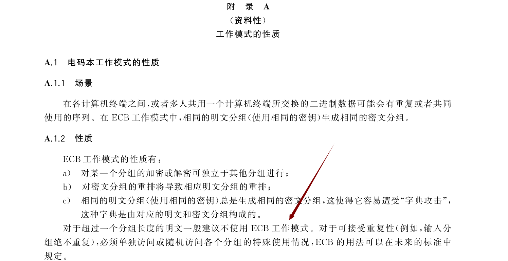

## 0051 对称密钥管理 密钥封装方式错误

来源 老师.pdf

问题       :密钥封装方式不符合GM/T0051-2016《密码设备管理 对称密钥管理技术规范》标准要求，接收者接收后无法对密钥进行管理并保证正确使用

改进建议:严格按照GM/T0051-2016《密码设备管理对称密钥管理技术规范》标准7.2.2进行分发密钥的封装。

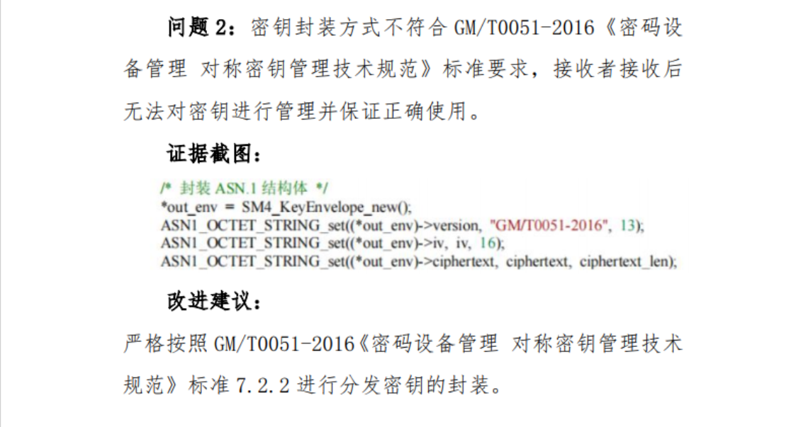

## 0051 对称密钥管理规定的sm4cbc iv初始值

在0051中要求 加密时应采用sm4算法 cbc模式 并且iv值需要为全0

2025年第十八题

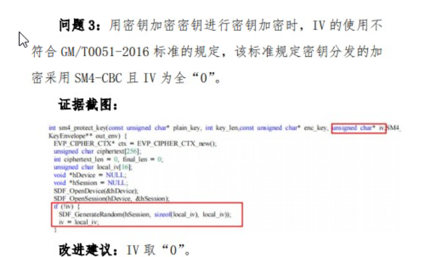

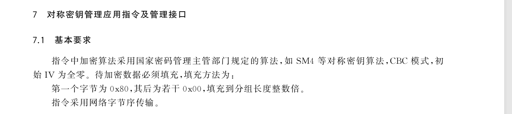

## 0051 对称密钥管理 完整性保护使用了cbc mac

不确定对不对 但老师的意思好像是说 0051中规定了不能用cbc mac得用 hamc 具体依据不知道是不是下面的封装格式里的内容

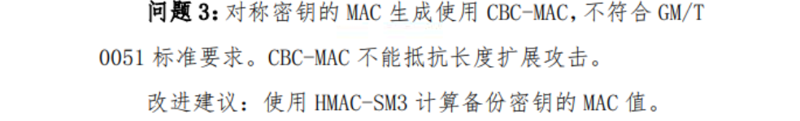

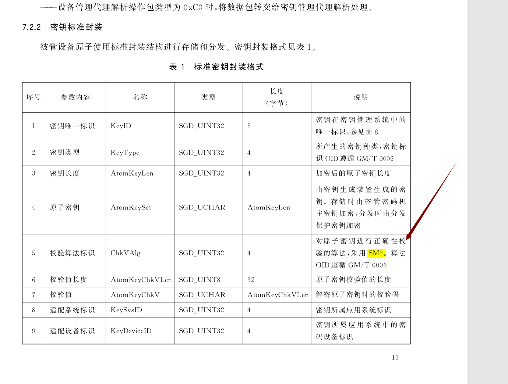

## 使用openssl进行密码保护

2025年第十八题

问题：密码（加密，完整性）保护过程调用openssl软件库实现 未在合规的密码模块内实现 导致 密钥明文出现在密码设备之外 存在泄露风险

改进建议：要用经过合法认证的密钥管理系统进行对称密钥管理 不能用openssl来实现密钥密码（加密，完整性）保护

## 0091基于口令的密钥派生

盐值位不小于64比特 也就是8字节  迭代次数不小于1024次 但对特别重要的推荐10000000迭代次数

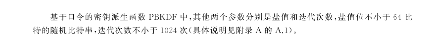

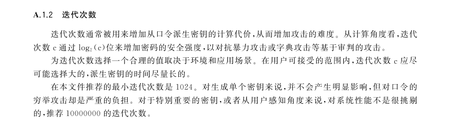

## SM4CBC 加密时 IV值

### 2024年第一题

安全风险：发送方IV值固定如图1在程序代码中没有随机产生 在相同密钥相同IV值的情况下 同明文加密的密文相同 存在明文信息泄露的风险 并且IV值固定不符合GB/T 17964-2021 信息安全技术 分组密码算法的工作模式 中CBC工作模式有关于IV的建议

改进建议：通过合规的密码设备每次使用时随机生成IV值

图1

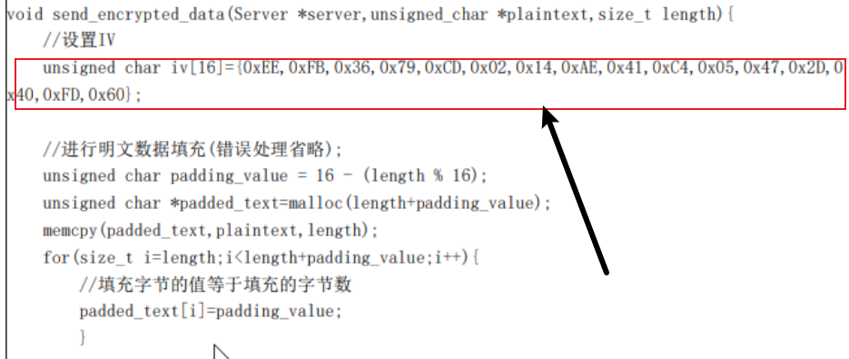

## 数据传输过程中密文及IV值没有进行完整性保护

### 2024年第一题

安全风险：在数据传输过程中密文及IV值没有进行完整性保护 如图1 可能会被攻击者篡改 无法保证数据的完整性及真实性 

改进建议：对密文及IV值使用HMAC或者SM2签名进行完整性保护

图1

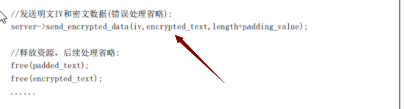

## 存在CBC填充提示攻击

### 2024年第一题

安全风险：服务端在检测到填充错误时会将填充错误信息返回至客户端如图1，该操作会导致CBC填充提示攻击，攻击者可利用相关提示信息对密文进行破解 威胁数据的保密性 

改进建议：不应向客户端返回具体的填充错误信息。应结合完整性保护机制，只有在完整性校验通过后再进行解密 若校验失败则统一丢弃报文 避免暴露错误信息

图1

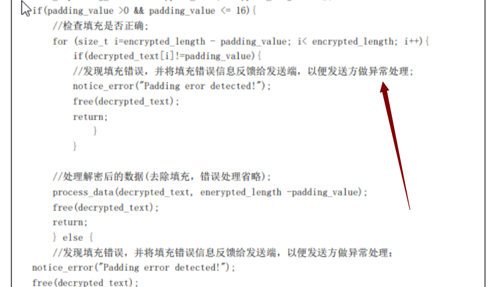

## hmac的mac值被截取了2字节

### 2024年第二题第三问

安全风险：hmac的输出结果仅截取了2字节作为mac值如图1 2字节的mac值的抗伪造的安全强度仅为2^16 强度过低 攻击者可以轻易通过遍历的手段穷尽mac值可能性 数据的完整性保护无效 并且16位mac值违反GB/T 15852.2中对于HMAC的MAC值的长度m应不小于32位的要求 如图2

改进建议：不应截断HMAC的输出值 应该使用完整的HMAC结果作为MAC值。若因特定业务的需要必须截断，其截断后的长度也必须符合相关国家标准。

图1

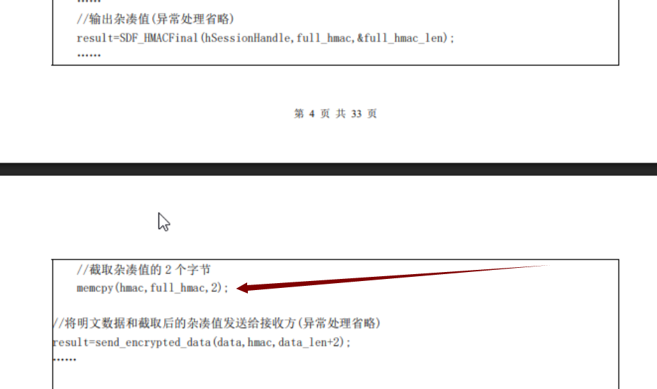

图2

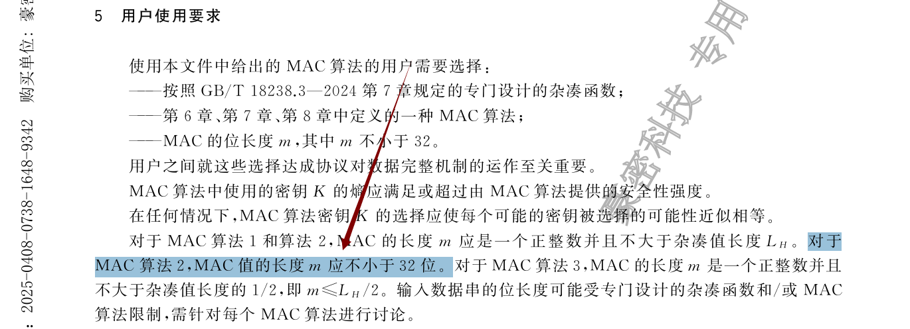

## 密钥没有在安全设备中产生

### 2024年第八题-自己写的-产生和传输同时存在问题

安全风险1：密钥的产生是通过 generate_key函数取系统随机数的方式产生的如图1 没有调用合规的密码设备产生 密钥的产生过程没有得到安全认证 如果应用系统服务器出现故障或者被篡改，导致生成的密钥不随机 那么密钥有被预测的风险 并且违反了GB/T 39786-2021的要求 密钥在符合GB/T37092的密码产品 中产生是十分必要的 如图2

改进建议1：密钥应该在合规的密码设备中产生 可以调用合规密码设备中的如SDF_GenerateKeyWithIPK_ECC和SDF_GenerateKeyWithKEK等接口 在密码设备内安全生成密钥并使用 并且在使用完成以后及时调用SDF_DestroyKey销毁会话密钥

图1

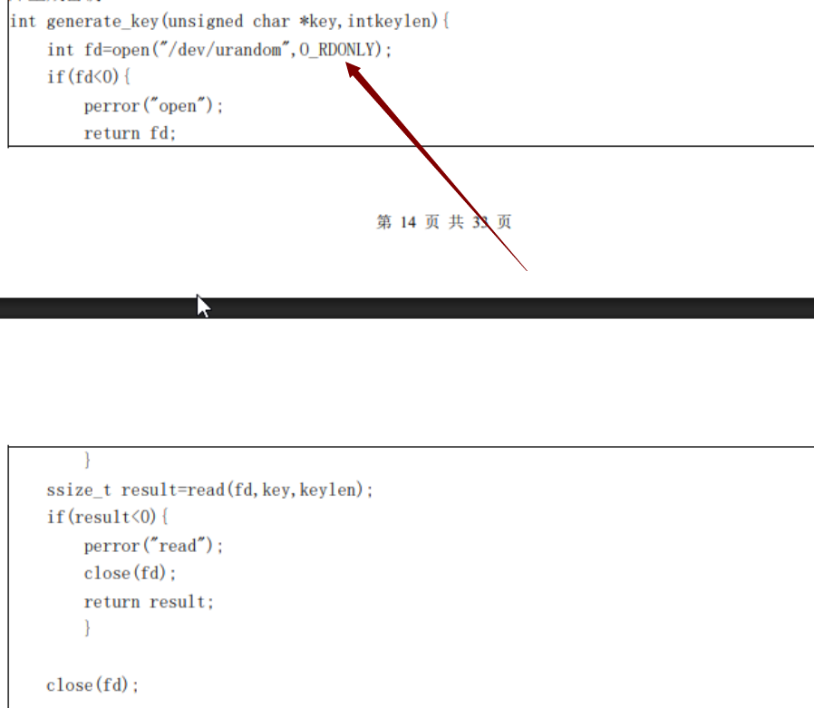

图2

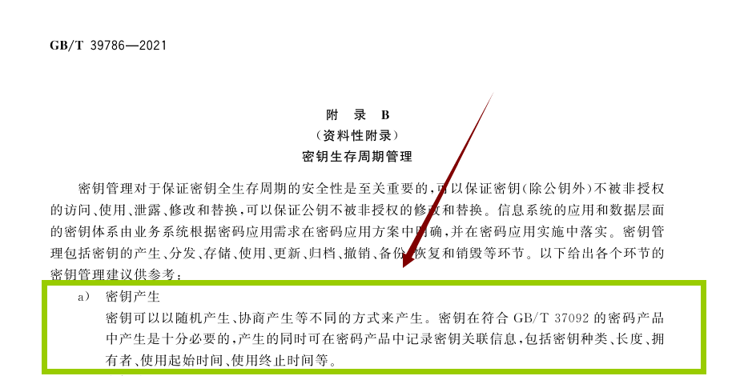

### 2024年第八题-老师ppt

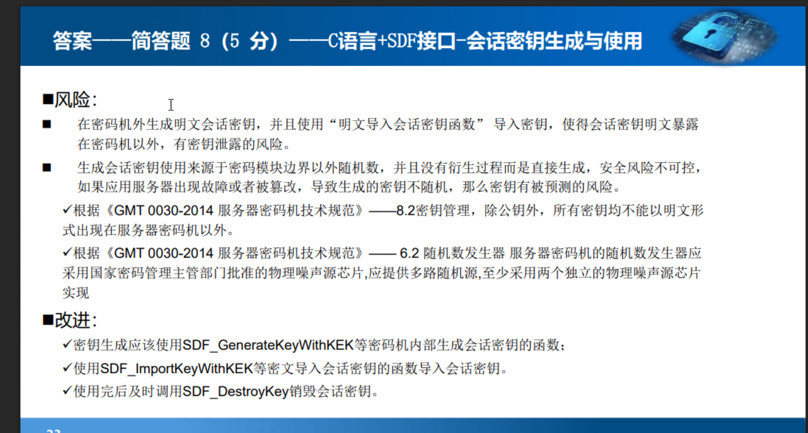

## 密钥在安全设备外明文传输

### 2024年第八题-自己写的-产生和传输同时存在问题

安全风险2：密钥的产生是通过 generate_key函数直接产生的明文密钥，并且产生后直接导入了服务器密码机中作为会话密码使用如图1，密钥明文出现在了系统中有泄露的安全风险，并且违反了GM/T 0030-2014 服务器密码机技术规范的要求 除公钥外,所有密钥均不能以明文形式出现在服务器密码机外如图2

改进建议2：密钥不应该已明文的形式在应用系统中传输及使用，应该调用合规密码设备中的如SDF_GenerateKeyWithIPK_ECC和SDF_GenerateKeyWithKEK等接口 生成密钥 并在使用时通过对应的密钥句柄使用密钥 并且在使用完成以后及时调用SDF_DestroyKey销毁会话密钥

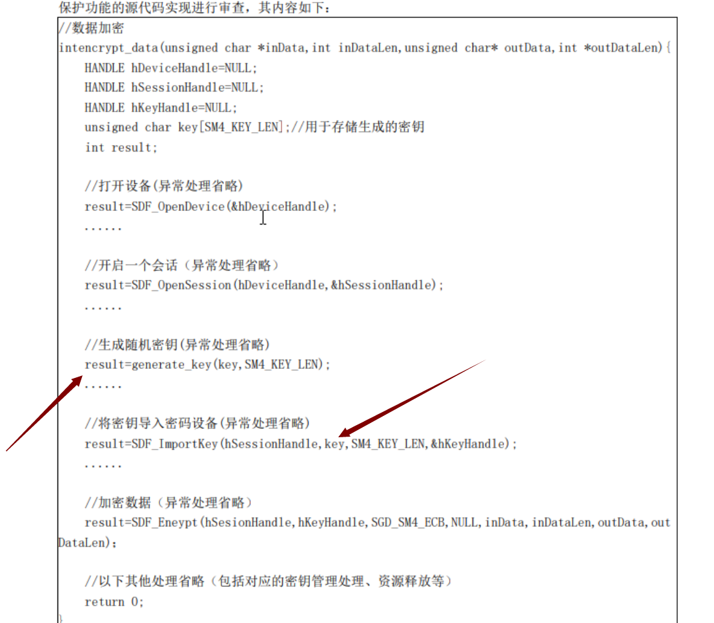

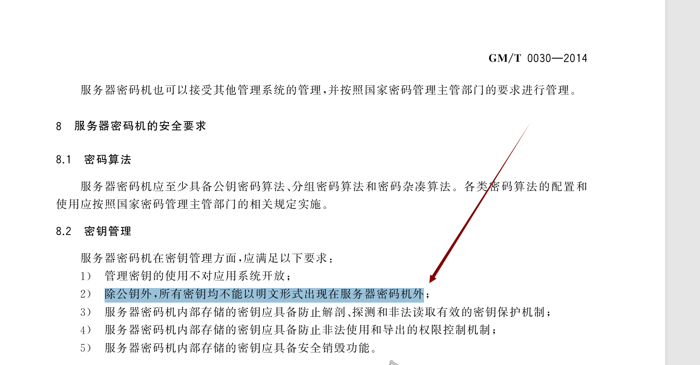

### 2024年第八题-老师ppt

## 源代码中数据库连接操作没有使用密码技术并硬编码

### 2024年第九题

安全风险1：数据库连接操作的身份鉴别方式为用户名+口令 未采用密码技术进行身份鉴别 且口令直接硬编码在源代码中如图1。一旦源代码或程序泄露，攻击者可直接连接数据库或者可通过逆向等手段获取口令值，导致数据库内存储的敏感信息面临被窃取或篡改的风险

改进建议1：应该采用密码技术对数据库连接的操作进行保护，同时禁止在代码中硬编码如口令或密钥等信息。

图1

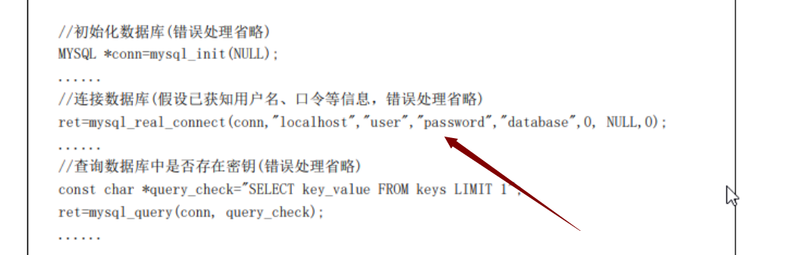

## 云需求场景下个租户没有进行合理的密钥隔离

### 2024年第九题

安全风险1：从以下代码中的SQL查询语句中可以看SQL查询只查询了并获取了第一条记录如图1 导致各企业使用的密钥完全相同，未实现各企业用户的密钥隔离，并且如果某用户获取到了其他用户的数据可直接进行解密

改进建议1：在调用get_key()函数时可以传入enterprise_id，在进行SQL 查询加入对enterprise_id字段的判断，确保不同企业用户获取各自的专属密钥，并且可以使用云服务器密码机，针对不同企业用户设置不同的虚拟密码机，由各企业用户管理和使用。

图1

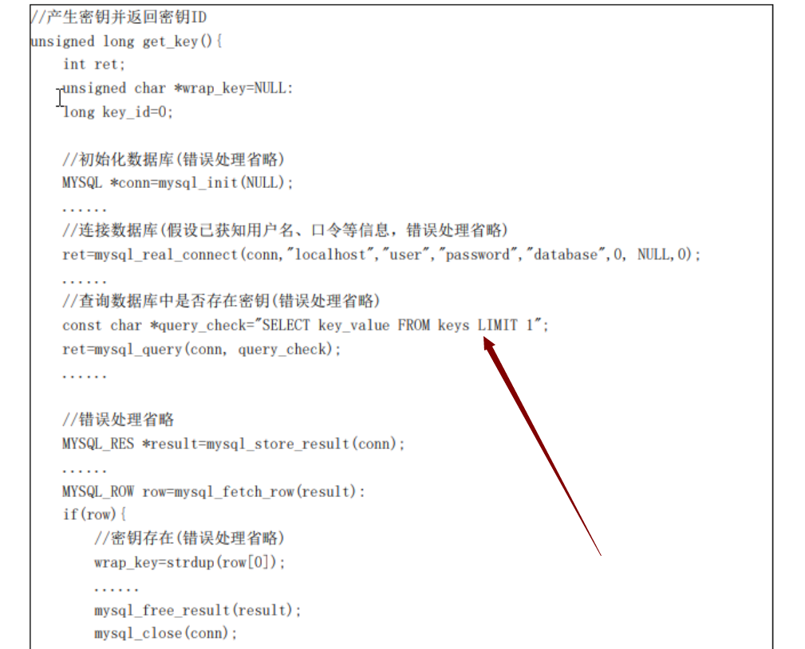

## 机密性保护和完整性保护密钥混用

### 2024年第九题

安全风险1：由下列程序代码可以看出如图1 在进行数据的机密性保护和完整性保护使用的密钥为同一个密钥，如果发生密钥泄露时机密性和完整性保护都会出现问题，并且不符合GB/T 39786-2021 信息安全技术信息系统 密码应用基本要求中对于密钥使用的要求 每个密钥一般只有单一的用途,明确用途并按用途正确使用是十分必要的。如图2

改进建议1：应遵循密钥用途单一性原则。为每个企业用户分别生成独立的机密性保护密钥和完整性保护密钥，严禁一钥多用。

图1

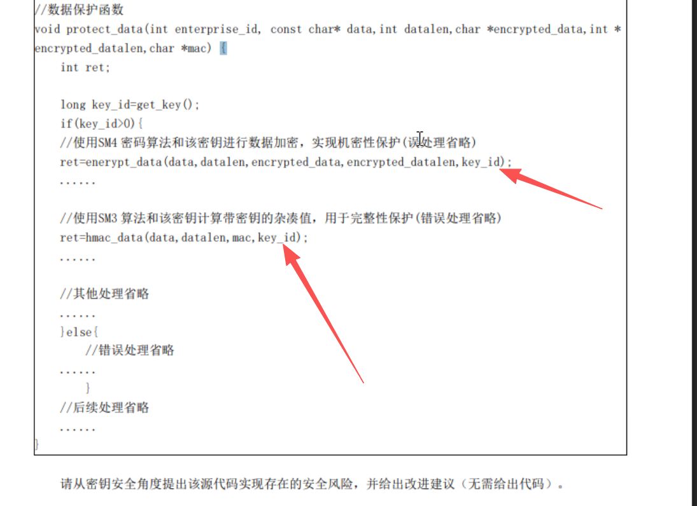

图2

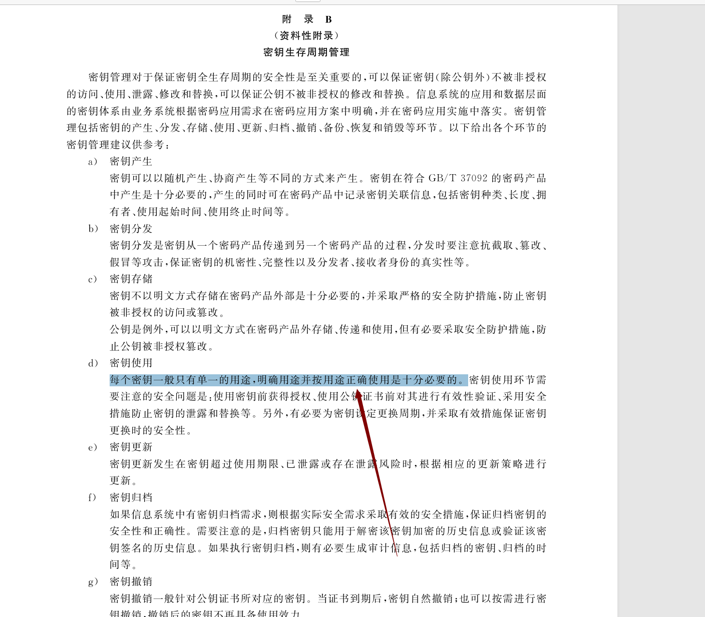

## 密钥存储和使用时没有进行完整性保护和校验

### 2024年第九题

安全风险1：由下列代码可以看出如图1 密文密钥被直接存储在了数据库中没有进行完整性保护 读取使用时也并不存在完整性校验机制 导致如果数据库中的密钥被篡改，用户在使用时候无法发现。并且不符合GB/T 39786-2021 信息安全技术信息系统 密码应用基本要求中对于密钥存储的要求，密钥不以明文方式存储在密码产品外部是十分必要的,并采取严格的安全防护措施,防止密钥 被非授权的访问或篡改。如图2

改进建议1：应在密钥存储时对密钥密文进行完整性保护，在从数据库中读取密钥时应对密钥密文做完整性校验。

图1

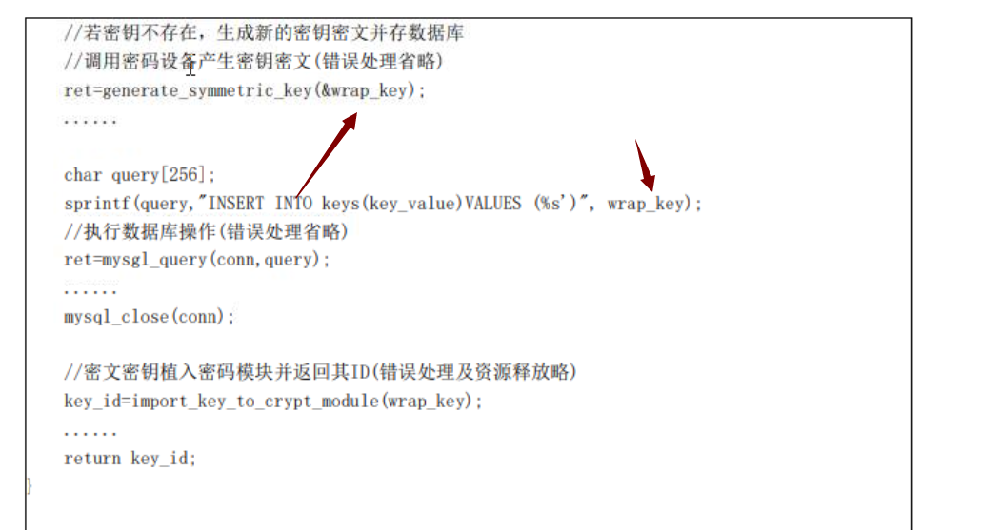

图2

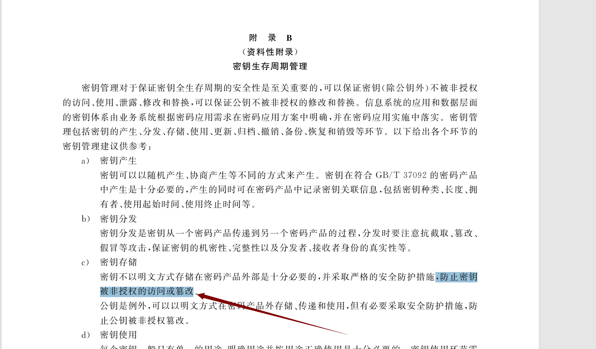