# 电子签章结构详解与完整验证流程

> - 本文参考标准《GBT38540-2020 安全电子签章密码技术规范》
> - 本文涉及到的附件为“综合能力测试（二）- 电子签章相关题目附件”：附件7-1.ofd，与附件7-2.ofd

本文涉及到电子签章和电子印章两个概念，通俗的说：

- 电子签章：实际在OFD文件中呈现的数据结构形式，本文我们会具体分析
- 电子印章：跟像是实体中的“印章本体的概念”，并没有附加在文件上

> 如果对应现实的实体印章，我们可以简单地把
>
> - **“电子签章”**理解为**“文件上已经被盖上的章印”**
> - **“电子印章”**理解为**“印章实体本身”**
>
> 那么盖章的流程就变成了：**使用“电子印章”在文件上生成“电子签章”**

## 电子印章结构

电子印章最外层的结构如图：

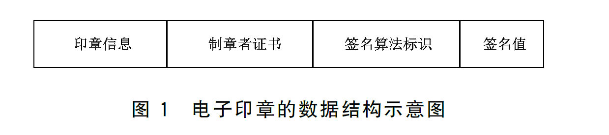

对应的ASN.1数据结构为：

```ASN.1
SESeal::=SEQUENCE{
	eSeaInfo	SES_SeaInfo,	--印章信息
	cert		OCTET STRING,	--制章者证书
	signAlgID	OBJECT IDENTIFIER,	--签名算法标识
	signedValue	BIT STRING	--签名值
}
```

### SES_SeaInfo印章信息结构体

印章信息数据结构定义的如下图和ANS.1编码

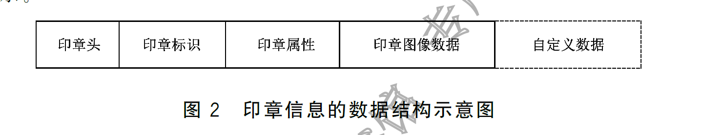

```asn.1
SES_SeaInfo::=SEQUENCE{
	header		SES_Header,	--印章头
	esID		IA5String,	--印章标识
	property	SES_ESPropertyInfo,	--印章属性
	picture		SES_ESPictureInfo,	--印章图像数据
	extData		ExtensionDatas	OPTIONAL	--自定义数据
}
```

#### SES_Header印章头

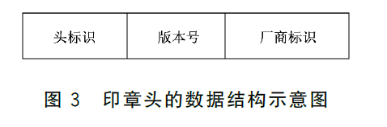

额外**注意点**：

- 头标识ID:固定值为**"ES"**
- 版本号version：本标准设置为**4**，代表版本为v4

#### 印章标识

区分电子印章的唯一标识编码

#### 印章属性

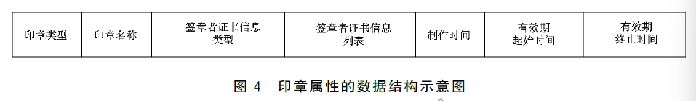

需要额外**注意点**：

- 签章者证书信息类型certListType：**1--数字证书**，**2--数字证书杂凑值**

#### 印章图像数据

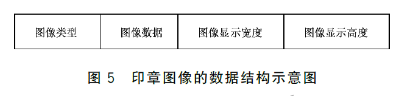

**注意点**

- 图像宽高单位为mm

#### 自定义数据

自定义数据包含一些自定义的属性信息，用于支持电子印章的拓展，主要为**可选结构**

```asn.1
ExtensionData::=SEQUENCE SIZE(0,MAX)OF ExtData
ExtData::=SEQUENCE{
	extnID		OBJECT IDENTIDIER, --自定义扩展字段标识
	critical	BOOLEAN DEFAULT FALSE, --自定义扩展字段是否关键
	extnValue	OCTET STRING	--自定义扩展字段数据段
}
```

### 其他

- **制章者证书**：对电子印章进行签名的制章者数字证书，DER编码
- **签名算法标识**：参考GBT33560，sm2-sm3算法标识为1.2.156.10197.1.501
- **签名值**：针对**印章信息域SES_SealInfo**按照**SEQUENCE**的方式组成的内容进行数字签名结果

## 电子签章结构

电子签章整体的结构下所示:

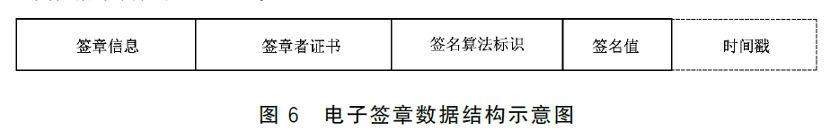

```asn.1
SES_Signature::=SEQUENCE{
	toSign			TBS_Sign,	--签章信息
	cert			OCTET STRING,	--签章者证书
	signatureAlgID	OBJECT IDNETIFIER,	--签名算法标识
	signature		BIT STRING,	--签名值
	timStamp[0]		BIT STRING OPTIONAL	--对签名值的时间戳
}
```

### 签章信息

签章信息的数据结构图如下：

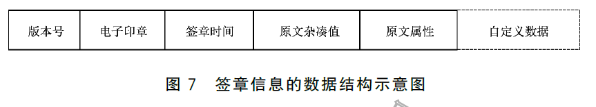

> 容易看到，电子印章是包含在签章数据结构中的

**注意点**

- 版本号version：电子签章版本号，与电子印章版本号保持一致
- 原文杂凑值dataHash：待签名的原文杂凑值
- 原文属性propertyInfo：原文数据的属性，内容自定义，但是至少包含**签名保护范围**

### 其他

- **签章者证书cert**：DER格式编码
- **签名算法标识signatureAlgID**：应与签章者证书中的算法声明保持一致
- **签名值signature**：签章者对**TBS_Sign**进行数字签名的结果；原文杂凑算法与签名算法保持协调，**如果是签名算法SM2，杂凑算法应为SM3算法**
- **时间戳timeStamp**：对签名值的时间戳，DER编码

### 完整的电子签章结构

通过上文的叙述，我们对电子签章本身已经有了一个初步的认识，那么完整的电子签章结构是什么样，可见下图

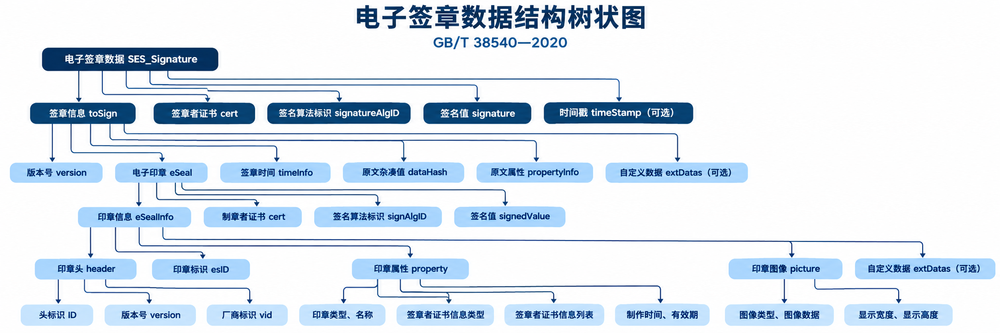

## OFD文件结构

OFD（Open Fixed-layout Documents），本质上是一个压缩包，里面包含了html、图片等等资源。如果我们对一个OFD文件进行unzip，我们可以看到如下大致目录结构

```sh
附件7-2.ofd
│
├── OFD.xml
│
└── Doc_0/
    │
    ├── Document.xml
    ├── PublicRes.xml
    ├── Res/
    │   └── font1_80.ttf
    │
    ├── Pages/
    │   ├── Page_0/
    │   │   └── Content.xml
    │   └── Page_1/
    │       └── Content.xml
    │
    ├── Annots/
    │   ├── Annotations.xml
    │   └── Page_0/
    │       └── Annotation.xml
    │
    └── Signs/
        ├── Signatures.xml
        │
        ├── Sign_0/
        │   ├── Signature.xml
        │   ├── Seal.esl
        │   └── SignedValue.dat
        │
        └── Sign_1/
            ├── Signature.xml
            ├── Seal.esl
            └── SignedValue.dat
```

> 接下来我们会详细说明各部分的作用

### OFD.xml 文件包入口和基本信息

OFD.xml是文件的入口，包含以下关键字

| 字段         | 作用                            |
| ------------ | ------------------------------- |
| DocType      | 文件类型，OFD                   |
| Version      | OFD 版本，本例为 1.1            |
| DocID        | 文档唯一标识                    |
| Author       | 文档作者                        |
| CreationDate | 创建日期                        |
| ModDate      | 修改日期                        |
| Creator      | 创建工具                        |
| DocRoot      | 指向主文档 Document.xml         |
| Signatures   | 指向签章索引文件 Signatures.xml |

其中最重要的是两个部分

```xml
<ofd:DocRoot>
    Doc_0/Document.xml
</ofd:DocRoot>

<ofd:Signatures>
    Doc_0/Signs/Signatures.xml
</ofd:Signatures>
```

分别标记了**文档页面内容**和**电子签章信息**

### Document.xml 文档主体描述文件

`Doc_0/Document.xml`是OFD文档的核心描述文件

| XML 节点    | 主要作用                           |
| ----------- | ---------------------------------- |
| CommonData  | 公共数据，包括页面区域、资源引用等 |
| Pages       | 定义文档包含哪些页面               |
| Permissions | 定义文档操作权限                   |
| Outlines    | 定义文档目录和页面跳转             |
| Annotations | 引用页面注释文件                   |
| Signatures  | 引用电子签章索引文件               |

### Pages 页面内容文件

`Pages` 目录用于存储 OFD 文档各页面的实际内容。

本例中有两个页面：

| 文件               | 内容                                               |
| ------------------ | -------------------------------------------------- |
| Page_0/Content.xml | 合同正文，包括合同编号、甲乙双方、金额、合同条款等 |
| Page_1/Content.xml | 合同签署页，包括签章区域、签署日期等               |

### Res & PublicRes 页面资源文件

如本例中所示

```sh
Doc_0/
│
├── PublicRes.xml
│
└── Res/
    └── font1_80.ttf
```

- `PublicRes.xml`：定义公共资源。
- `font1_80.ttf`：实际字体文件。

### Annots 页面注释和印章定位信息

目录结构

```sh
Annots/
│
├── Annotations.xml
│
└── Page_0/
    └── Annotation.xml
```

- Annotations.xml：页面注释索引

- Annotation.xml：具体注释信息

## Signs 电子签章的核心数据结构

`Signs`目录专门存储OFD文件的电子签章数据

如附件7-1只有一个签章，结构如下：

  ```sh
  Signs/
  │
  ├── Signatures.xml
  │
  └── Sign_0/
      ├── Signature.xml
      ├── Seal.esl
      └── SignedValue.dat
  ```

附件7-2有两个签章，结构如下：

  ```
  Signs/
  │
  ├── Signatures.xml
  │
  ├── Sign_0/
  │   ├── Signature.xml
  │   ├── Seal.esl
  │   └── SignedValue.dat
  │
  └── Sign_1/
      ├── Signature.xml
      ├── Seal.esl
      └── SignedValue.dat
  ```

可以注意到，每多一个电子签章，便会多一个额外的`Signs/Sign_x`目录。这个框架下主要涉及四类文件:

  1. **Signatues.xml**: 签章索引文件
  2. **Signature.xml**: 签章描述文件
  3. **Seal.esl**: 电子印章数据文件
  4. **SignedValue.dat**: 电子签章文件

  > 下面以附件7-2为例，分别分析这几个文件内容

  ### Signatures.xml 签章索引文件

  ```xml
  <ofd:Signatures xmlns:ofd="http://www.ofdspec.org/2016">
      <ofd:MaxSignId>2</ofd:MaxSignId>
      <ofd:Signature ID="1" Type="Seal" BaseLoc="/Doc_0/Signs/Sign_0/Signature.xml"></ofd:Signature>
      <ofd:Signature ID="2" Type="Seal" BaseLoc="/Doc_0/Signs/Sign_1/Signature.xml"></ofd:Signature>
  </ofd:Signatures>
  ```

可以看到其索引两个电子签章`/Doc_0/Signs/Sign_0/Signature.xml`和`/Doc_0/Signs/Sign_1/Signature.xml`

### Signture.xml 电子签章描述文件

这里以`/Doc_0/Signs/Sign_0/Signature.xml`内容为例

```xml
<ofd:Signature xmlns:ofd="http://www.ofdspec.org/2016">
  <ofd:SignedInfo>
    <ofd:Provider ProviderName="custom_ofd" Version="1.0" Company="custom"></ofd:Provider>
    <ofd:SignatureMethod>1.2.156.10197.1.501</ofd:SignatureMethod>
    <ofd:SignatureDateTime>20261016091312.221Z</ofd:SignatureDateTime>
    <ofd:References CheckMethod="1.2.156.10197.1.401">
      <ofd:Reference FileRef="/Doc_0/Document.xml">
        <ofd:CheckValue>vzvParrTNd30ZwQKAij5BLQXRzIVG9dINfE2JFZce78=</ofd:CheckValue>
      </ofd:Reference>
      <ofd:Reference FileRef="/Doc_0/Pages/Page_0/Content.xml">
        <ofd:CheckValue>yROhY69B85ihdSmZL7fYViKI9DVc3x+iloFBVlATrTI=</ofd:CheckValue>
      </ofd:Reference>
      <ofd:Reference FileRef="/Doc_0/Pages/Page_1/Content.xml">
        <ofd:CheckValue>TH82fNcJ8y+h743j1r40MbE4KwVj7iCRcHnXCmmTzIc=</ofd:CheckValue>
      </ofd:Reference>
      <ofd:Reference FileRef="/Doc_0/PublicRes.xml">
        <ofd:CheckValue>9MgSQ/p16dwDRZYIsbJ6/fLWlV8zutnZilxakKUXhL8=</ofd:CheckValue>
      </ofd:Reference>
      <ofd:Reference FileRef="/Doc_0/Res/font1_80.ttf">
        <ofd:CheckValue>09Xq7Va0rfoclnlZoEaFV8wxk6ankpnXCbL3H6Q7ZOI=</ofd:CheckValue>
      </ofd:Reference>
      <ofd:Reference FileRef="/OFD.xml">
        <ofd:CheckValue>TlSoI8GZrAL8D0ubvuIxmEHIDS8KP6zBaVp+Qw25e9s=</ofd:CheckValue>
      </ofd:Reference>
    </ofd:References>
    <ofd:StampAnnot ID="81" PageRef="1" Boundary="7.94 13.55 40.00 40.00"></ofd:StampAnnot>
    <ofd:Seal>
      <ofd:BaseLoc>/Doc_0/Signs/Sign_0/Seal.esl</ofd:BaseLoc>
    </ofd:Seal>
  </ofd:SignedInfo>
  <ofd:SignedValue>/Doc_0/Signs/Sign_0/SignedValue.dat</ofd:SignedValue>
</ofd:Signature>
```

其中包含几个关键部分

- **Provider**：签章服务提供者信息
- **SignatureMethod**：数字签名算法
  - 本例中为`1.2.156.10197.1.501`，对应SM2数字签名算法
- **SignatureDateTime**：签署时间
  - 本例中为`20261016091312.221Z`，对应2026-10-16 09:13:12.221 UTC，结尾的`Z`代表零时区
- **References**：数字摘要引用信息。**这是防止OFD篡改的关键机制**
- **StampAnnot**：印章位置和关联信息
  - 包含印章注释ID，印章所在页码，印章页面位置
- **Seal**：电子印章数据引用，表示印章的数据文件
- **SignedValue**: 实际的数字签名值引用文件位置

#### References 数字摘要引用结构

对于上文中附件，一个**References**结构由多个**Reference**组成：

```xml
<ofd:References CheckMethod="1.2.156.10197.1.401">
      <ofd:Reference FileRef="/Doc_0/Document.xml">
        <ofd:CheckValue>vzvParrTNd30ZwQKAij5BLQXRzIVG9dINfE2JFZce78=</ofd:CheckValue>
      </ofd:Reference>
     	......
      </ofd:Reference>
	  </ofd:Reference>
     	......
      </ofd:Reference>
</ofd:References>
```

每个**Reference**包含两个信息:

- `FileRef`: 用于标记文件的路径
- `CheckValue`：BASE64格式的hash值
  - hash算法由**References**的`CheckMethod`确定，本例中为`1.2.156.10197.1.401`，对应SM3算法
  - hash值是**直接对文件本身**进行hash得到

#### Reference CheckValue计算实例

以`/Doc_0/Document.xml`为例, 直接读取Document.xml的全部内容，计算SM3，对比内容

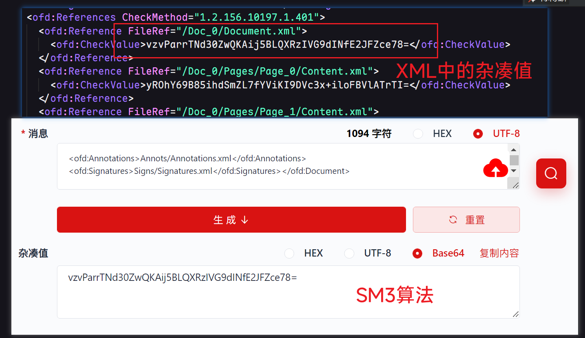

由于部分文件为二进制形式，并非直接的UTF-8编码。如`/Doc_0/Res/font1_80.ttf`，需要HEX进行HASH计算

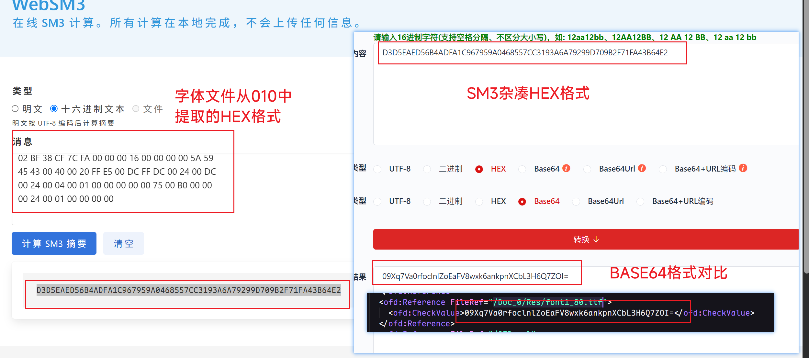

### Seal.esl 电子印章数据文件

> 这里我们直接使用`/Doc_0/Signs/Sign_0/Seal.esl`做为演示

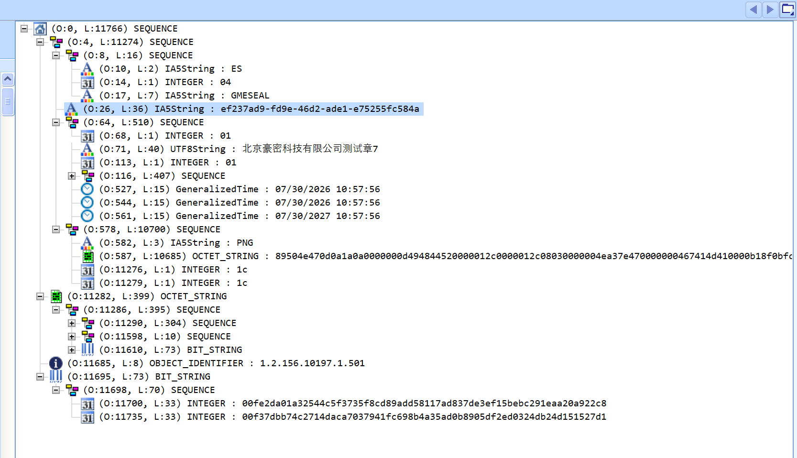

#### 电子印章的第一层 

电子印章结构由四部分组成：**印章信息、制章者证书、签名算法、签名值**

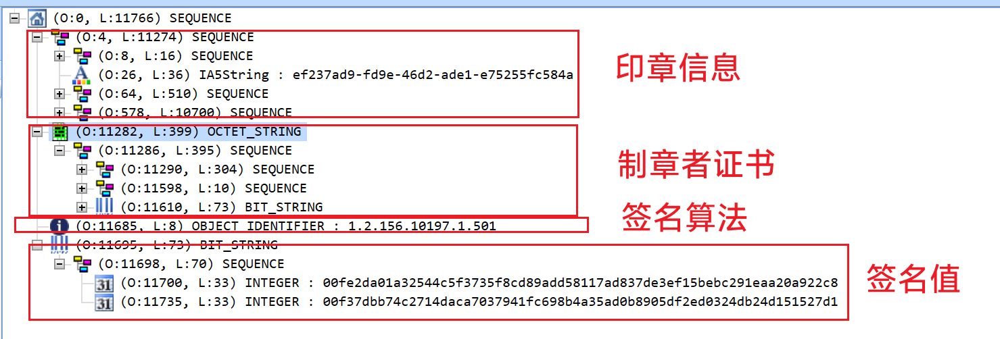

#### 印章信息解析

印章信息由四部分+一个可选部分组成：**印章头、印章标识、印章属性、印章图像、自定义数据（可选）**

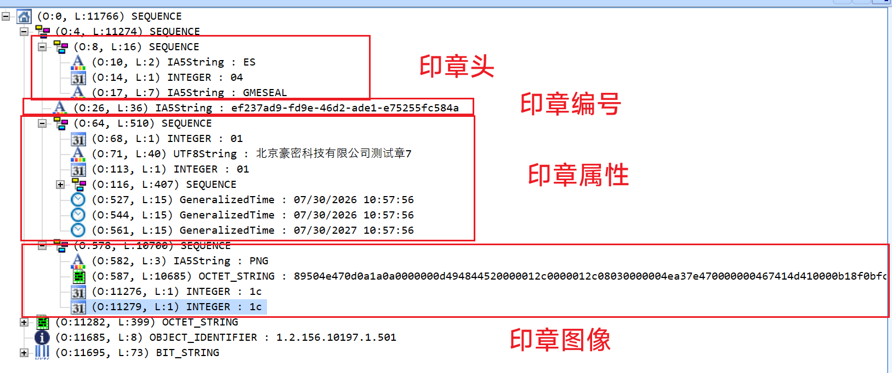

#### 印章属性解析

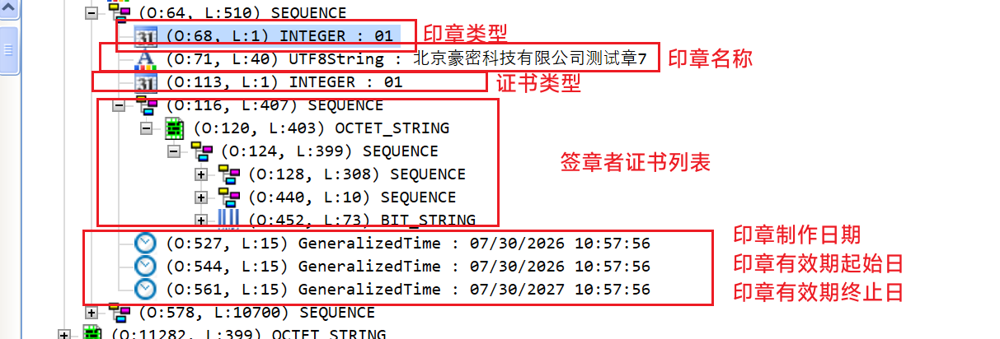

> 其中可以注意到证书类型**certListType**，用来标识证书列表内的数据类型
>
> - 值为1，代表数字证书
> - 值为2，代表数字证书的杂凑值

#### 电子印章中的数字签名验证

我们已知，电子印章中存在数字签名，根据标准中原文如下：

> signedValue:制章者对电子印章格式中**印章信息域SES_SealInfo**,按SEQUENCE方式组成的信
> 息内容进行数字签名所得的结果。


参考上图结构，电子印章的流程如下：

1. 从制章者证书中提取公钥
2. 提权印章信息作为签名消息
3. 提取签名值、签名算法
4. 进行签名验证

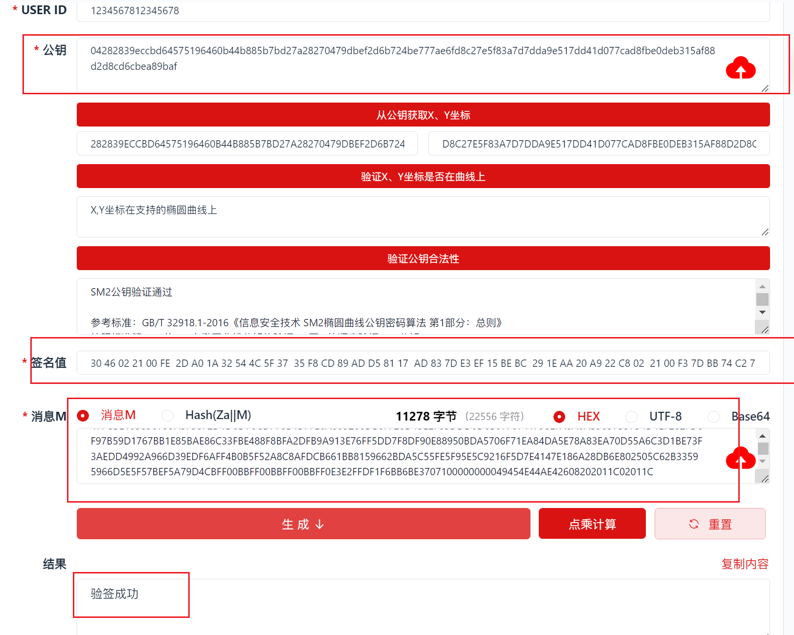

### SignedValue.dat 电子签章文件

`SignedValue.dat`文件同样使用ASN.1的编码格式。

如果我们详细查看其数据结构便能注意到：**这本质上是一个电子签章数据结构**

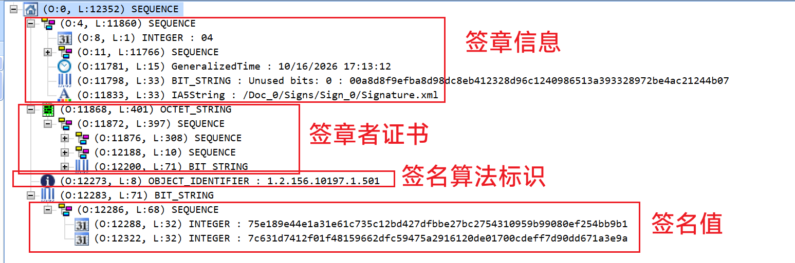

#### 签章信息结构解析

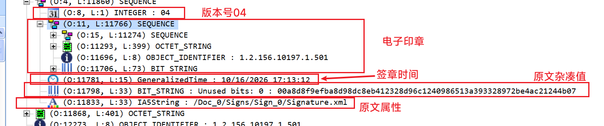

签章信息有几个部分组成：**版本号、电子印章、签章时间、原文杂凑值、原文属性**

> [!note]
>
> 1. 电子签章的版本号默认为04
> 2. 原文杂凑值为原文属性部分对应文件的杂凑值，这里应当是`/Doc_0/Signs/Sign_0/Signature.xml`文件杂凑值

这里**由于附件问题，不能验证成功**，但是使用**附件7-2.ofd**中的`/Doc_0/Signs/Sign_1/Signature.xml`和`/Doc_0/Signs/Sign_1/SignedValue.dat`，可以证明。如下图：

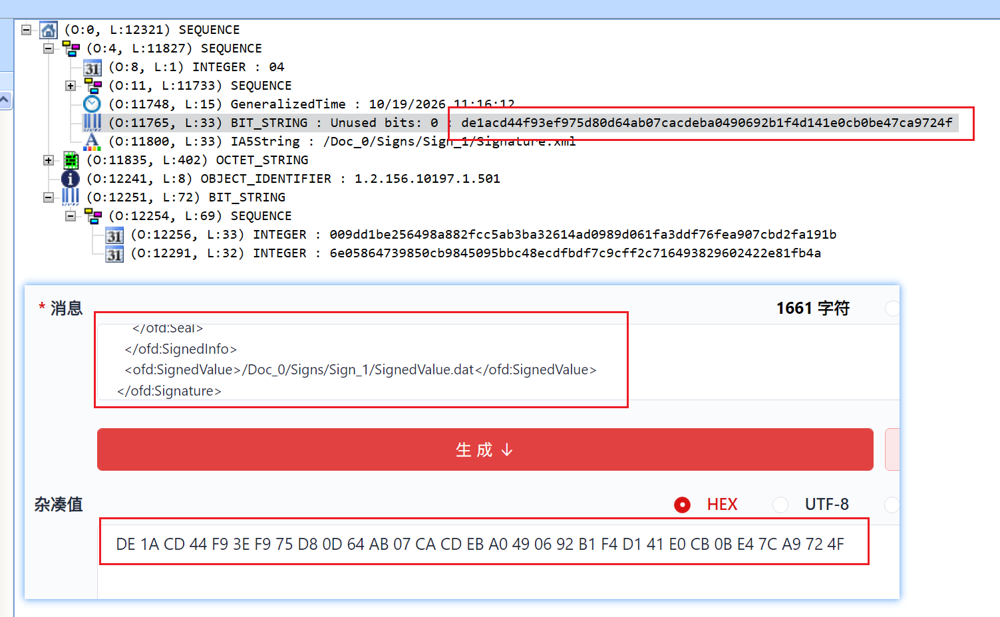

#### 电子签章数字签名验证

> 根据标准原文:
>
> "signature:签章者对**签章信息TBS_Sign**进行数字签名的结果;注意签名过程中的原文杂凑所采用的算法应与签名算法保持协调,如果签名算法是SM2,则杂凑算法应采用SM3算法"
>
> 也就是说，这里的签名并不是对原文杂凑的直接签名，而是**对TBS_Sign的签名**

签名验证流程：

1. 从电子签章中提权TBS_Sign签章信息部分作为签名原文
2. 提取签章者证书中的公钥
3. 提权签名算法和签名值
4. 签名验证

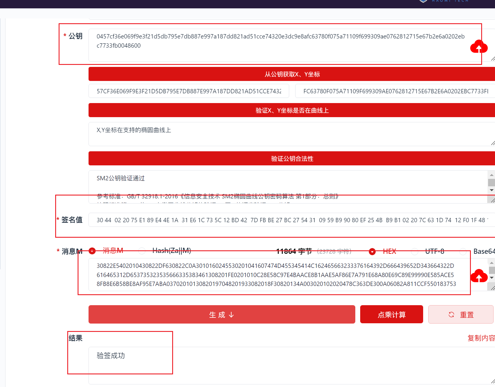

### 电子签章文件锁定

在《GM/T 0131-2023 电子签章应用接口规范》中，我们能够看到一个关于文件是否允许签章的参数**LockFile**，如图：

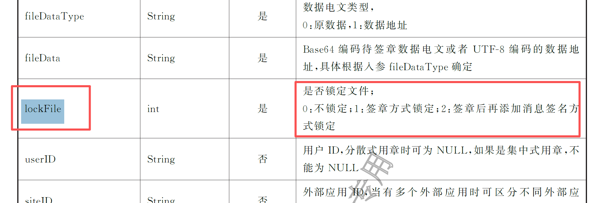

这里的**lockFile**的实现方式关键就在于我们上文提到的**signature.xml**

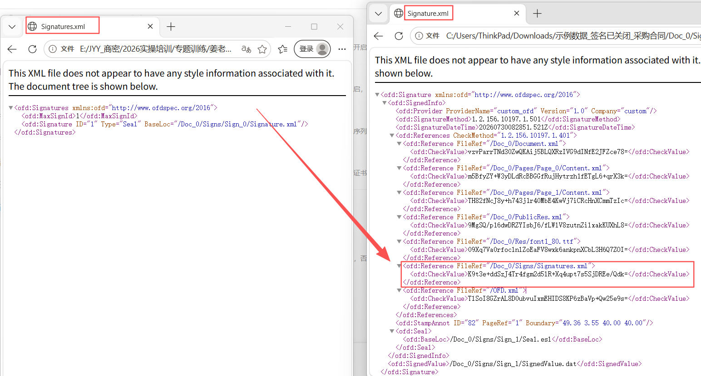

可以看到，若要实现对于签章文件的锁定，只需要将**signatures.xml**原文杂凑放入对应的**signature.xml**的**Reference**字段。那么在签名时便会完成对**signatures.xml**的完整性和不可否认性保护，当新增签章时，必然会导致**signatures.xml**的变更，那么在做签章验证时，便会出现无法完成签章验证的情况。

## 电子印章与电子签章生成和验证流程

建议直接看标准，这里不做过多赘述 **GBT38540-2020**
