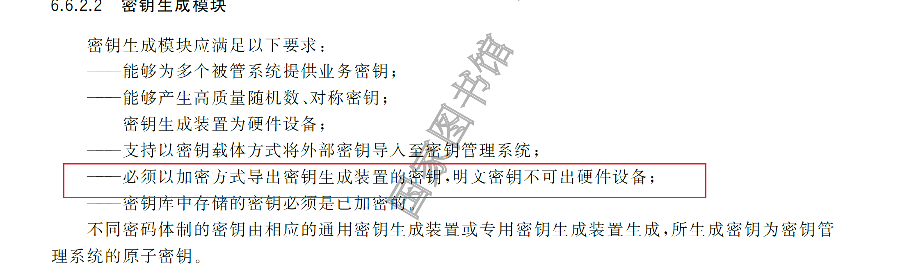
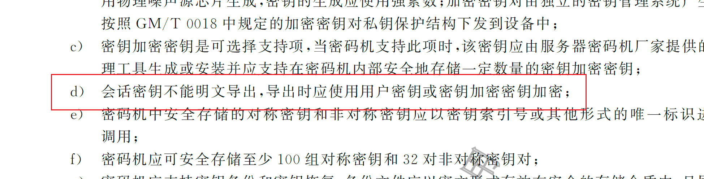
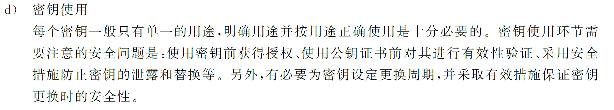
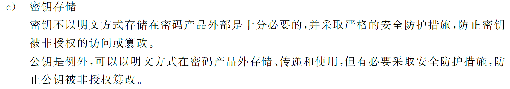
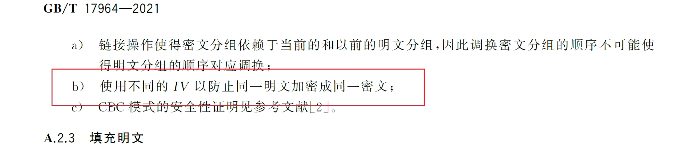
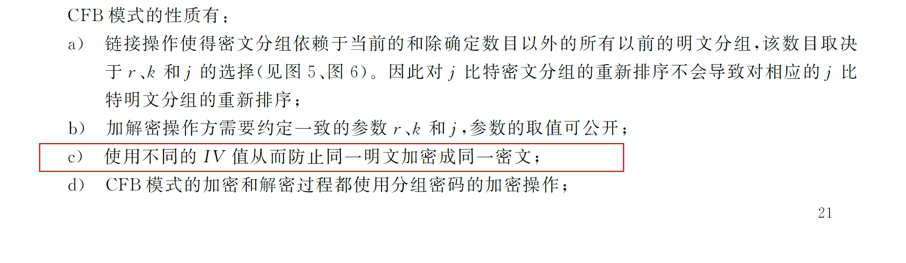
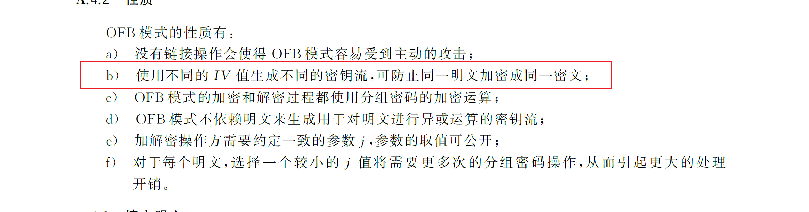
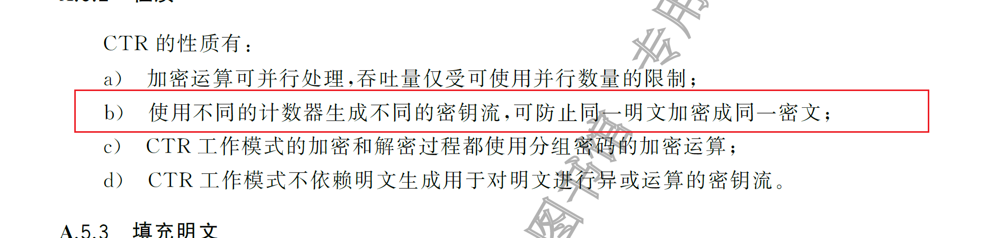
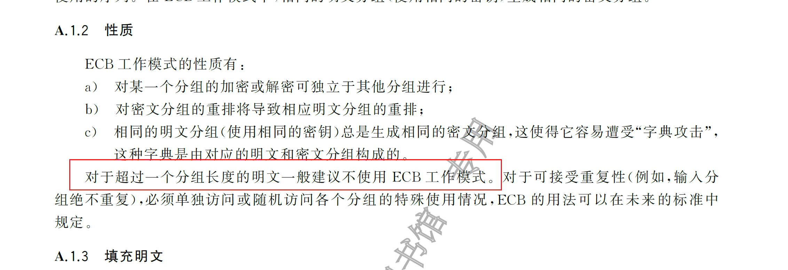

# 代码算法题目答题模板汇总

>**关于安全问题层面必须贴原代码中的证据**

## 密钥管理

### 密钥明文出现再信息系统中

#### 答题模板

**通用版本**：

代码中明文密钥 {`SampleKey`} 出现在信息系统中。违反GM/T0051中要求：必须以加密方式导出密钥生成装置的密钥，明文密钥不可出硬件密钥设备。

**服务器密码机版本：**

代码中明文密钥 {`SampleKey`} 出现在信息系统中。违反GM/T0059中要求：会话密钥不能明文导出，导出时应使用用户密钥或密钥加密密钥加密。

#### 标准截图

**0051对应截图**

**服务器密码机对应截图**

### 密钥用途

{重要数据} 的 {机密性} 和 {完整性保护} 算法使用同一密钥进行计算，违反GB/T 39786中要求：每个密钥一般只有单一的用途，明确用途并按用途正确使用是十分必要的。

### 密钥存储机密性、完整性

{xxx密钥} 存储时没有保护 {机密性/完整性} ，违反GB/T 39786中的要求：密钥不以明文方式存储在密码产品外部是十分必要的。

## 对称加密

### 分组加密工作模式IV固定

#### CBC/CFB 明文-密文问题

使用 {CBC/CFB} 时，IV固定，导致同一明文、同一密钥的情况下生成的密文相同。根据GB/T 17964中要求，{CBC/CFB} 需要使用不同的IV从而使得同一明文加密成不同密文。

**CBC模式截图**

**CFB模式截图**

#### OFB/CTR IV -> 密钥流问题

**OFB**

使用OFB工作模式时，存在IV固定问题，导致加密过程中产生的密钥流相同。根据GB/T 17964中要求，OFB应使用不同的IV产生不同的密钥流

**CTR**

使用CTR时，存在IV固定问题，导致加密过程中产生的密钥流相同。根据GB/T 17964中要求，CTR应使用不同的计数器产生不同的密钥流，防止同一明文加密成同一密文

**OFB截图**

**CTR截图**

### ECB模式多分组问题

多分组明文使用ECB模式加密时，相同明文分组对应密文分组相同。根据GB/T 17964中要求：对于超过一个分组的明文一般不建议使用ECB模式。

## 非对称加密问题

### SM2数字签名问题

- 随机数相同，可以推导出私钥d
- k泄露可以推出d
- d已知可以算k

### RSA签名 PSS 和 PKCS#1 V1.5

- PSS为随机性算法
- PKCS#1 V1.5 为确定性算法

## 消息鉴别码问题

## 密码产品调用问题

