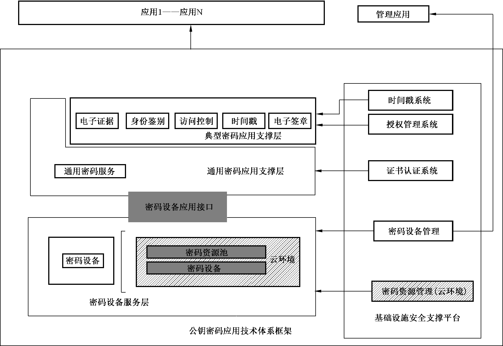

# GMT0018-2023密码设备应用接口规范

## 1 范围

本文件规定了公钥密码基础设施应用技术体系下服务端密码设备应用接口的算法标识、数据结构和接口函数。

本文件适用于服务端密码设备的研制、使用,以及基于该类密码设备的应用开发。

## 2 规范性引用文件

下列文件中的内容通过文中的规范性引用而构成本文件必不可少的条款。其中,注日期的引用文件,仅该日期对应的版本适用于本文件;不注日期的引用文件,其最新版本(包括所有的修改单)适用于本文件。

GB/T15852.2 信息技术  安全技术  消息鉴别码  第2部分:采用专用杂凑函数的机制

GB/T35276 信息安全技术 SM2密码算法使用规范

GB/T36624 信息技术  安全技术  可鉴别的加密机制

GB/T38635(所有部分) 信息安全技术 SM9标识密码算法

GM/T0006 密码应用标识规范

GM/T0022 IPSecVPN技术规范

GM/T0024 SSLVPN技术规范

GM/Z4001 密码术语

## 3 术语和定义

GM/Z4001界定的以及下列术语和定义适用于本文件。

### 3.1 私钥访问控制码 private key access password

用于验证私钥使用权限的口令字。

### 3.2 用户密钥 user key

存储在设备内部的用于应用密码运算的非对称密钥,包含签名密钥对和加密密钥对。

## 4 缩略语

下列缩略语适用于本文件。

ECC  椭圆曲线算法(EllipticCurveCryptography)

EPK  外部加密公钥(ExternalPublicKey)

IPK  内部加密公钥(InternalPublicKey)

ISK  内部加密私钥(InternalPrivateKey)

KEK  密钥加密密钥(KeyEncryptKey)

## 5 算法标识和数据结构

### 5.1 算法标识定义

本文件中所使用的算法其算法标识见GM/T0006。分组密码算法的算法标识包含其工作模式。

### 5.2 基本数据类型定义

本文件中的基本数据类型均为高位字节在前(Big-Endian)方式存储和交换。表1定义了基本数据类型。

**表1 基本数据类型**

| 类型名称 | 描述 | 定义 |
| --- | --- | --- |
| BYTE | 字节类型,无符号8位字符 | typedef unsigned char BYTE |
| CHAR | 字符类型,无符号8位字符 | typedef unsigned char CHAR |
| LONG | 长整数,有符号32位整数 | typedef int LONG |
| ULONG | 长整数,无符号32位整数 | typedef unsigned int ULONG |
| FLAGS | 标志类型,无符号32位整数 | typedef unsigned int FLAGS |
| LPSTR | 8位字符串指针,字符串按照UTF8格式存储及交换 | typedef CHAR * LPSTR |
| HANDLE | 句柄,指向任意数据对象的起始地址 | typedef void * HANDLE |

### 5.3 设备信息定义

表2定义了设备信息。

**表2 设备信息描述**

| 字段名称 | 数据长度<br>(字节) | 含义 |
| --- | --- | --- |
| IssuerName | 40 | 设备生产厂商名称 |
| DeviceName | 16 | 设备型号 |
| DeviceSerial | 16 | 设备编号,包含:日期(8字符)、批次号(3字符)、流水号(5字符) |
| DeviceVersion | 4 | 密码设备内部软件的版本号 |
| StandardVersion | 4 | 密码设备支持的接口规范版本号,本版本为2 |
| AsymAlgAbility | 8 | 前4字节表示支持的算法,表示方法为非对称算法标识按位或运算的结果;<br>后4字节表示算法的最大模长,表示方法为支持的模长按位或运算的结果 |
| SymAlgAbility | 4 | 所有支持的对称算法,表示方法为对称算法标识按位或运算的结果 |
| HashAlgAbility | 4 | 所有支持的杂凑算法,表示方法为杂凑算法标识按位或运算的结果 |
| BufferSize | 4 | 支持的最大文件存储空间(单位字节) |

实际数据结构定义:

```c
typedef struct DeviceInfo_st{
CHAR IssuerName[40];
CHAR DeviceName[16];
CHAR DeviceSerial[16];
ULONG DeviceVersion;
ULONG StandardVersion;
ULONG AsymAlgAbility[2];
ULONG SymAlgAbility;
ULONG HashAlgAbility;
ULONG BufferSize;
}DEVICEINFO;
```

### 5.4 密钥分类及存储定义

#### 5.4.1 设备密钥与用户密钥

设备密钥只能在设备初始化时生成或安装,用户密钥通过密码设备管理工具生成或安装。

设备密钥和用户密钥存放于密钥存储区,索引号从0开始检索,每个索引号对应一个签名密钥对和一个加密密钥对。其中,索引号为0表示设备密钥。索引号1开始表示用户密钥。表3描述了设备密钥和用户密钥存储方式。

**表3 设备密钥和用户密钥存储描述**
<table>
<tr><th>密钥对索引号</th><th>公钥</th><th>私钥</th></tr>
<tr><td rowspan="2">0x00</td><td>设备签名公钥</td><td>设备签名私钥</td></tr>
<tr><td>设备加密公钥</td><td>设备加密私钥</td></tr>
<tr><td rowspan="2">0x01</td><td>签名公钥</td><td>签名私钥</td></tr>
<tr><td>加密公钥</td><td>加密私钥</td></tr>
<tr><td rowspan="2">……</td><td>……</td><td>……</td></tr>
<tr><td>……</td><td>……</td></tr>
</table>

#### 5.4.2 密钥加密密钥

密钥加密密钥通过密码设备管理工具生成或安装,存放于密钥存储区,使用索引号从1开始。表4描述了密钥加密密钥存储方式。

**表4 密钥加密密钥存储描述**

| 密钥索引号 | 密钥加密密钥 |
| --- | --- |
| 0x01 | 密钥加密密钥001 |
| …… | …… |

#### 5.4.3 会话密钥

会话密钥使用设备接口函数生成或导入,会话密钥使用句柄检索。

### 5.5 RSA密钥数据结构定义

RSA密钥结构存储时顺序为从高到低,即密钥存放时从密钥结构数组的最高位开始,最高字节填在最高位,不足位从高位向低位填充数据0。表5定义了RSA 密钥数据结构。

**表5 RSA密钥数据结构**
<table>
<tr><th colspan="3">公钥数据结构定义</th></tr>
<tr><td>字段名称</td><td>数据长度(字节)</td><td>含义</td></tr>
<tr><td>bits</td><td>4</td><td>模长</td></tr>
<tr><td>m</td><td>RSAref_MAX_LEN</td><td>模N</td></tr>
<tr><td>e</td><td>RSAref_MAX_LEN</td><td>公钥指数</td></tr>
<tr><td colspan="3">私钥数据结构定义</td></tr>
<tr><td>字段名称</td><td>数据长度</td><td>含义</td></tr>
<tr><td>bits</td><td>4</td><td>模长</td></tr>
<tr><td>m</td><td>RSAref_MAX_LEN</td><td>模N</td></tr>
<tr><td>e</td><td>RSAref_MAX_LEN</td><td>公钥指数</td></tr>
<tr><td>d</td><td>RSAref_MAX_LEN</td><td>私钥指数</td></tr>
<tr><td>prime[2]</td><td>RSAref_MAX_PLEN * 2</td><td>素数p和q</td></tr>
<tr><td>pexp[2]</td><td>RSAref_MAX_PLEN * 2</td><td>Dp和Dq</td></tr>
<tr><td>coef</td><td>RSAref_MAX_PLEN</td><td>系数i</td></tr>
</table>

实际数据结构定义:

```c
#define RSAref_MAX_BITS  2048
#define RSAref_MAX_LEN  ((RSAref_MAX_BITS + 7)/8)
#define RSAref_MAX_PBITS  ((RSAref_MAX_BITS + 1)/2)
#define RSAref_MAX_PLEN  ((RSAref_MAX_PBITS + 7)/8)
typedef struct RSArefPublicKey_st
{
ULONG bits;
BYTE m[RSAref_MAX_LEN];
BYTE e[RSAref_MAX_LEN];
}RSArefPublicKey;
```

```c
typedef struct RSArefPrivateKey_st
{
ULONG bits;
BYTE m[RSAref_MAX_LEN];
BYTE e[RSAref_MAX_LEN];
BYTE d[RSAref_MAX_LEN];
BYTE prime[2][RSAref_MAX_PLEN];
BYTE pexp[2][RSAref_MAX_PLEN];
BYTE coef[RSAref_MAX_PLEN];
}RSArefPrivateKey;
```

注:RSAref_MAX_BITS的数值能根据实际支持的最大模长进行定义。

### 5.6 ECC密钥数据结构定义

表6定义了ECC密钥数据结构。

**表6 ECC密钥数据结构**
<table>
<tr><th colspan="3">公钥数据结构定义</th></tr>
<tr><td>字段名称</td><td>数据长度(字节)</td><td>含义</td></tr>
<tr><td>bits</td><td>4</td><td>密钥位长</td></tr>
<tr><td>x</td><td>ECCref_MAX_LEN</td><td>公钥x坐标</td></tr>
<tr><td>y</td><td>ECCref_MAX_LEN</td><td>公钥y坐标</td></tr>
<tr><td colspan="3">私钥数据结构定义</td></tr>
<tr><td>字段名称</td><td>数据长度(字节)</td><td>含义</td></tr>
<tr><td>bits</td><td>4</td><td>密钥位长</td></tr>
<tr><td>K</td><td>ECCref_MAX_LEN</td><td>私钥</td></tr>
</table>

实际数据结构定义:

```c
#define ECCref_MAX_BITS   512
#define ECCref_MAX_LEN   ((ECCref_MAX_BITS+7)/8)
typedef struct ECCrefPublicKey_st
{
ULONG bits;
BYTE x[ECCref_MAX_LEN];
BYTE y[ECCref_MAX_LEN];
}ECCrefPublicKey;
```

```c
typedef struct ECCrefPrivateKey_st
{
ULONG bits;
BYTE K[ECCref_MAX_LEN];
}ECCrefPrivateKey;
```

### 5.7 ECC加密数据结构定义

表7定义了ECC加密数据结构。

**表7 ECC加密数据结构**
<table>
<tr><th colspan="3">加密数据结构定义</th></tr>
<tr><td>字段名称</td><td>数据长度(字节)</td><td>含义</td></tr>
<tr><td>x</td><td>ECCref_MAX_LEN</td><td>X分量</td></tr>
<tr><td>y</td><td>ECCref_MAX_LEN</td><td>Y分量</td></tr>
<tr><td>M</td><td>32</td><td>明文的杂凑值</td></tr>
<tr><td>L</td><td>4</td><td>密文数据长度</td></tr>
<tr><td>C</td><td>L</td><td>密文数据</td></tr>
</table>

实际数据结构定义:

```c
typedef struct ECCCipher_st
{
BYTE x[ECCref_MAX_LEN];
BYTE y[ECCref_MAX_LEN];
BYTE M[32];
ULONG L;
BYTE C[];
}ECCCipher;
```

### 5.8 ECC签名数据结构定义

表8定义了ECC签名数据结构。

**表8 ECC签名数据结构**
<table>
<tr><th colspan="3">签名数据结构定义</th></tr>
<tr><td>字段名称</td><td>数据长度(字节)</td><td>含义</td></tr>
<tr><td>r</td><td>ECCref_MAX_LEN</td><td>签名的r部分</td></tr>
<tr><td>s</td><td>ECCref_MAX_LEN</td><td>签名的s部分</td></tr>
</table>

实际数据结构定义:

```c
typedef struct ECCSignature_st
{
BYTE r[ECCref_MAX_LEN];
BYTE s[ECCref_MAX_LEN];
}ECCSignature;
```

### 5.9 ECC密钥对保护结构定义

密钥管理系统下发到设备中的ECC 加密密钥对使用本结构保护,表9定义了ECC 密钥对保护结构。

**表9 ECC加密密钥对保护结构参数**

| 字段名称 | 数据长度(字节) | 含义 |
| --- | --- | --- |
| Version | 4 | 版本号,本版本为1 |
| ulSymmAlgID | 4 | 对称算法标识(必须为ECB模式) |
| ulBits | 4 | ECC密钥对的密钥位长 |
| cbEncryptedPrivKey | ECCref_MAX_LEN | 对称算法加密的ECC 私钥,ECC 私钥的原文<br>为ECCrefPrivateKey,结构中的K,其有效长度<br>为原文的(ulBits+ 7)/8 |
| PubKey | ECCref_MAX_LEN*2+4 | ECC密钥对的公钥 |
| ECCCipherBlob | ECCref_ MAX_LEN*2+32+<br>4+L | 用保护公钥加密过的对称密钥密文结构 |

实际数据结构定义:

```c
typedef struct EnvelopedECCKey_st{
ULONG Version;
ULONG ulSymmAlgID;
ULONG ulBits;
BYTE cbEncryptedPriKey[ECCref_MAX_LEN];
ECCrefPublicKeyPubKey;
ECCCipherECCCipherBlob;
}EnvelopedECCKey;
```

私钥密文结构中有效密文分组从0偏移量字节开始,顺序解密密文分组后将明文连接得到ECC密钥对的私钥的明文。

## 6 设备接口描述

### 6.1 密码设备应用接口在公钥密码基础设施应用技术体系框架中的位置

在公钥密码基础设施应用技术体系框架中,密码设备服务层由密码机、密码卡、智能密码终端设备组成,通过本文件规定的密码设备应用接口向通用密码服务层提供基础密码服务,如图1所示。

基础密码服务包括密钥生成、单一的密码运算、文件管理服务。

本文件采用C语言描述接口函数。如无特别说明,函数中参数的长度单位均为字节数。符合本文件的密码设备应支持本文件中关于ECC算法(本文件中ECC特指SM2算法)、对称算法以及杂凑运算的函数接口。本文件所列的所有接口函数均应能被应用系统任意调用。附录A 定义了函数返回代码,附录B定义了SM9算法相关数据结构和接口函数,附录C定义了VPN 设备相关接口函数。

产品支持SM9算法时,SM9算法相关数据结构和接口函数应符合附录B的定义。产品支持VPN时,VPN 设备相关接口函数应符合附录C的定义。



**图 1 密码设备应用接口在公钥密码基础设施应用技术体系框架中的位置**

### 6.2 设备管理类函数

#### 6.2.1 概述

设备管理类函数提供设备打开与关闭、会话创建与关闭、设备信息获取、随机数产生、私钥权限获取与释放功能,表10列出了设备管理类函数,附录A 定义了函数返回代码。

**表10 设备管理类函数**

| 函数名称 | 功能 |
| --- | --- |
| SDF_OpenDevice | 打开设备 |
| SDF_CloseDevice | 关闭设备 |
| SDF_OpenSession | 创建会话 |
| SDF_CloseSession | 关闭会话 |
| SDF_GetDeviceInfo | 获取设备信息 |
| SDF_GenerateRandom | 产生随机数 |
| SDF_GetPrivateKeyAccessRight | 获取私钥使用权限 |
| SDF_ReleasePrivateKeyAccessRight | 释放私钥使用权限 |

#### 6.2.2 打开设备

**原型：**

```c
LONG SDF_OpenDevice(HANDLE *phDeviceHandle);
```

**描述：**
打开密码设备。phDeviceHandle由函数初始化并填写内容。

**参数：**
phDeviceHandle[out]  返回的设备句柄

**返回值：**
0  成功

非0  失败,返回错误代码

#### 6.2.3 关闭设备

**原型：**

```c
LONG SDF_CloseDevice(HANDLEhDeviceHandle);
```

**描述：**
关闭密码设备,并释放相关资源。

**参数：**
hDeviceHandle[in]  已打开的设备句柄

**返回值：**
0  成功

非0  失败,返回错误代码

#### 6.2.4 创建会话

**原型：**

```c
LONG SDF_OpenSession(HANDLEhDeviceHandle,HANDLE *phSessionHandle);
```

**描述：**
创建与密码设备的会话。

**参数：**
hDeviceHandle[in]  已打开的设备句柄

phSessionHandle[out]  返回与密码设备建立的新会话句柄

**返回值：**
0  成功

非0  失败,返回错误代码

#### 6.2.5 关闭会话

**原型：**

```c
LONG SDF_CloseSession(HANDLEhSessionHandle);
```

**描述：**
关闭与密码设备已建立的会话,并释放相关资源。

**参数：**
hSessionHandle[in]  与密码设备已建立的会话句柄

**返回值：**
0  成功

非0  失败,返回错误代码

#### 6.2.6 获取设备信息

**原型：**

```c
LONG SDF_GetDeviceInfo(
HANDLE hSessionHandle,
DEVICEINFO *pstDeviceInfo);
```

**描述：**
获取密码设备能力描述。

**参数：**
hSessionHandle[in]  与设备建立的会话句柄

pstDeviceInfo[out]  设备能力描述信息,内容及格式见设备信息定义

**返回值：**
0  成功

非0  失败,返回错误代码

#### 6.2.7 产生随机数

**原型：**

```c
LONG SDF_GenerateRandom (
HANDLE hSessionHandle,
ULONG uiLength,
BYTE *pucRandom);
```

**描述：**
获取指定长度的随机数。

**参数：**
hSessionHandle[in]  与设备建立的会话句柄

uiLength[in]  获取的随机数长度

pucRandom[out]  缓冲区指针,用于存放获取的随机数

**返回值：**
0  成功

非0  失败,返回错误代码

#### 6.2.8 获取私钥使用权限

**原型：**

```c
LONG SDF_GetPrivateKeyAccessRight(
HANDLE hSessionHandle,
ULONG uiKeyIndex,
LPSTR pucPassword,
ULONG uiPwdLength);
```

**描述：**
获取密码设备内部存储的指定索引位置私钥的使用权。本文件涉及密码设备存储的密钥

对索引值的起始索引值为1,最大为n,密码设备的实际存储容量决定n 值。私钥访问控制码不少于8字节。

**参数：**
hSessionHandle[in]  与设备建立的会话句柄

uiKeyIndex[in]  密码设备存储的密钥对的索引值

pucPassword[in]  使用私钥权限的访问控制码

uiPwdLength[in]  私钥访问控制码长度

**返回值：**
0  成功

非0  失败,返回错误代码

#### 6.2.9 释放私钥使用权限

**原型：**

```c
LONG SDF_ReleasePrivateKeyAccessRight(
HANDLE hSessionHandle,
ULONG uiKeyIndex);
```

**描述：**
释放密码设备存储的指定索引位置私钥的使用授权。

**参数：**
hSessionHandle[in]  与设备建立的会话句柄

uiKeyIndex[in]  密码设备存储的密钥对的索引值

**返回值：**
0  成功

非0  失败,返回错误代码

### 6.3 密钥管理类函数

#### 6.3.1 概述

密钥管理类函数提供密钥的生成、销毁和导入导出功能,包括签名公钥和加密公钥的导出、会话密钥的生成并输出、会话密钥的导入、密钥协商参数的生成并输出、会话密钥的计算以及会话密钥的销毁函数,表11列出了密钥管理类函数,附录A 定义了函数返回代码。

**表11 密钥管理类函数**

| 函数名称 | 功能 |
| --- | --- |
| SDF_ExportSignPublicKey_RSA | 导出RSA 签名公钥 |
| SDF_ExportEncPublicKey_RSA | 导出RSA 加密公钥 |
| SDF_GenerateKeyWithIPK_RSA | 生成会话密钥并用内部RSA 公钥加密输出 |
| SDF_GenerateKeyWithEPK_RSA | 生成会话密钥并用外部RSA 公钥加密输出 |
| SDF_ImportKeyWithISK_RSA | 导入会话密钥并用内部RSA 私钥解密 |
| SDF_ExportSignPublicKey_ECC | 导出ECC签名公钥 |
| SDF_ExportEncPublicKey_ECC | 导出ECC加密公钥 |
| SDF_GenerateKeyWithIPK_ECC | 生成会话密钥并用内部ECC公钥加密输出 |
| SDF_GenerateKeyWithEPK_ECC | 生成会话密钥并用外部ECC公钥加密输出 |
| SDF_ImportKeyWithISK_ECC | 导入会话密钥并用内部ECC私钥解密 |
| SDF_GenerateAgreementDataWithECC | 生成密钥协商参数并输出 |
| SDF_GenerateKeyWithECC | 计算会话密钥 |
| SDF_GenerateAgreementDataAndKeyWithECC | 产生协商数据并计算会话密钥 |
| SDF_GenerateKeyWithKEK | 生成会话密钥并用密钥加密密钥加密输出 |
| SDF_ImportKeyWithKEK | 导入会话密钥并用密钥加密密钥解密 |
| SDF_DestroyKey | 销毁会话密钥 |

#### 6.3.2 导出RSA签名公钥

**原型：**

```c
LONG SDF_ExportSignPublicKey_RSA(
HANDLE hSessionHandle,
ULONG uiKeyIndex,
RSArefPublicKey*pucPublicKey);
```

**描述：**
导出密码设备内部存储的指定索引位置的RSA 签名公钥。

**参数：**
hSessionHandle[in]  与设备建立的会话句柄

uiKeyIndex[in]  密码设备存储的密钥对的索引值

pucPublicKey[out]  RSA公钥结构

**返回值：**
0  成功

非0  失败,返回错误代码

#### 6.3.3 导出RSA加密公钥

**原型：**

```c
LONG SDF_ExportEncPublicKey_RSA(
HANDLE hSessionHandle,
ULONG uiKeyIndex,
RSArefPublicKey*pucPublicKey);
```

**描述：**
导出密码设备内部存储的指定索引位置的RSA 加密公钥。

**参数：**
hSessionHandle[in]  与设备建立的会话句柄

uiKeyIndex[in]  密码设备存储的密钥对的索引值

pucPublicKey[out]  RSA公钥结构

**返回值：**
0  成功

非0  失败,返回错误代码

#### 6.3.4 生成会话密钥并用内部RSA公钥加密输出

**原型：**

```c
LONG SDF_GenerateKeyWithIPK_RSA (
HANDLE hSessionHandle,
ULONG uiIPKIndex,
ULONG uiKeyBits,
BYTE *pucKey,
ULONG *puiKeyLength,
HANDLE *phKeyHandle);
```

**描述：**
生成会话密钥并用指定索引的内部RSA 加密公钥加密输出,同时返回密钥句柄。公钥加

密数据时填充方式与PKCS#1v1.5相同。

**参数：**
hSessionHandle[in]  与设备建立的会话句柄

uiIPKIndex[in]  密码设备存储的密钥对的索引值

uiKeyBits[in]  指定产生的会话密钥长度

pucKey[out]  缓冲区指针,用于存放返回的密钥密文

puiKeyLength[out]  返回的密钥密文长度

phKeyHandle[out]  返回的密钥句柄

**返回值：**
0  成功

非0  失败,返回错误代码

#### 6.3.5 生成会话密钥并用外部RSA公钥加密输出

**原型：**

```c
LONG SDF_GenerateKeyWithEPK_RSA (
HANDLE hSessionHandle,
ULONG uiKeyBits,
RSArefPublicKey*pucPublicKey,
BYTE *pucKey,
ULONG *puiKeyLength,
HANDLE *phKeyHandle);
```

**描述：**
生成会话密钥并用外部RSA公钥加密输出。公钥加密数据时填充方式与PKCS#1v1.5相同。

**参数：**
hSessionHandle[in]  与设备建立的会话句柄

uiKeyBits[in]  指定产生的会话密钥长度

pucPublicKey[in]  输入的外部RSA 公钥结构

pucKey[out]  缓冲区指针,用于存放返回的密钥密文

puiKeyLength[out]  返回的密钥密文长度

phKeyHandle[out]  返回的密钥句柄

**返回值：**
0  成功

非0  失败,返回错误代码

#### 6.3.6 导入会话密钥并用内部RSA私钥解密

**原型：**

```c
LONG SDF_ImportKeyWithISK_RSA (
HANDLE hSessionHandle,
ULONG uiISKIndex,
BYTE *pucKey,
ULONG puiKeyLength,
HANDLE *phKeyHandle);
```

**描述：**
导入会话密钥并用内部RSA 私钥解密,同时返回密钥句柄。

**参数：**
hSessionHandle[in]  与设备建立的会话句柄

uiISKIndex[in]  密码设备存储的密钥对的索引值

pucKey[in]  缓冲区指针,用于存放输入的密钥密文

puiKeyLength[in]  输入的密钥密文长度

phKeyHandle[out]  返回的密钥句柄

**返回值：**
0  成功

非0  失败,返回错误代码

#### 6.3.7 导出ECC签名公钥

**原型：**

```c
LONG SDF_ExportSignPublicKey_ECC(
HANDLE hSessionHandle,
ULONG uiKeyIndex,
ECCrefPublicKey*pucPublicKey);
```

**描述：**
导出密码设备内部存储的指定索引位置的ECC签名公钥。

**参数：**
hSessionHandle[in]  与设备建立的会话句柄

uiKeyIndex[in]  密码设备存储的密钥对的索引值

pucPublicKey[out]  ECC公钥结构

**返回值：**
0  成功

非0  失败,返回错误代码

#### 6.3.8 导出ECC加密公钥

**原型：**

```c
LONG SDF_ExportEncPublicKey_ECC(
HANDLE hSessionHandle,
ULONG uiKeyIndex,
ECCrefPublicKey*pucPublicKey);
```

**描述：**
导出密码设备内部存储的指定索引位置的ECC加密公钥。

**参数：**
hSessionHandle[in]  与设备建立的会话句柄

uiKeyIndex[in]  密码设备存储的密钥对的索引值

pucPublicKey[out]  ECC公钥结构

**返回值：**
0  成功

非0  失败,返回错误代码

#### 6.3.9 生成会话密钥并用内部ECC公钥加密输出

**原型：**

```c
LONG SDF_GenerateKeyWithIPK_ECC (
HANDLE hSessionHandle,
ULONG uiIPKIndex,
ULONG uiKeyBits,
ECCCipher*pucKey,
HANDLE *phKeyHandle);
```

**描述：**
生成会话密钥并用指定索引的内部ECC加密公钥加密输出,同时返回密钥句柄。

**参数：**
hSessionHandle[in]  与设备建立的会话句柄

uiIPKIndex[in]  密码设备存储的密钥对的索引值

uiKeyBits[in]  指定产生的会话密钥长度

pucKey[out]  缓冲区指针,用于存放返回的密钥密文

phKeyHandle[out]  返回的密钥句柄

**返回值：**
0  成功

非0  失败,返回错误代码

#### 6.3.10 生成会话密钥并用外部ECC公钥加密输出

**原型：**

```c
LONG SDF_GenerateKeyWithEPK_ECC (
HANDLE hSessionHandle,
ULONG uiKeyBits,
ULONG uiAlgID,
ECCrefPublicKey*pucPublicKey,
ECCCipher*pucKey,
HANDLE *phKeyHandle);
```

**描述：**
生成会话密钥并用外部ECC公钥加密输出,同时返回密钥句柄。

**参数：**
hSessionHandle[in]  与设备建立的会话句柄

uiKeyBits[in]  指定产生的会话密钥长度

uiAlgID[in]  外部ECC公钥的算法标识

pucPublicKey[in]  输入的外部ECC公钥结构

pucKey[out]  缓冲区指针,用于存放返回的密钥密文

phKeyHandle[out]  返回的密钥句柄

**返回值：**
0  成功

非0  失败,返回错误代码

#### 6.3.11 导入会话密钥并用内部ECC私钥解密

**原型：**

```c
LONG SDF_ImportKeyWithISK_ECC (
HANDLE hSessionHandle,
ULONG uiISKIndex,
ECCCipher*pucKey,
HANDLE *phKeyHandle);
```

**描述：**
导入会话密钥并用内部ECC加密私钥解密,同时返回密钥句柄。

**参数：**
hSessionHandle[in]  与设备建立的会话句柄

uiISKIndex[in]  密码设备存储的密钥对的索引值

pucKey[in]  缓冲区指针,用于存放输入的密钥密文

phKeyHandle[out]  返回的密钥句柄

**返回值：**
0  成功

非0  失败,返回错误代码

#### 6.3.12 生成密钥协商参数并输出

**原型：**

```c
LONG SDF_GenerateAgreementDataWithECC (
HANDLE hSessionHandle,
ULONG uiISKIndex,
ULONG uiKeyBits,
BYTE *pucSponsorID,
ULONG uiSponsorIDLength,
ECCrefPublicKey *pucSponsorPublicKey,
ECCrefPublicKey *pucSponsorTmpPublicKey,
HANDLE *phAgreementHandle);
```

**描述：**
使用ECC 密钥协商算法,为计算会话密钥而产生协商参数,同时返回指定索引位置的

ECC公钥、临时ECC密钥对的公钥及协商句柄。协商会话密钥时,本函数首先由协商的发起方调用。

**参数：**
hSessionHandle[in]  与设备建立的会话句柄

uiISKIndex[in]  密码设备存储的密钥对的索引值

uiKeyBits[in]  要求协商的密钥长度

pucSponsorID[in]  参与密钥协商的发起方ID 值

uiSponsorIDLength[in]  发起方ID 长度

pucSponsorPublicKey[out]  返回的发起方ECC公钥结构

pucSponsorTmpPublicKey[out] 返回的发起方临时ECC公钥结构

phAgreementHandle[out]  返回的协商句柄,用于计算协商密钥

**返回值：**
0  成功

非0  失败,返回错误代码

#### 6.3.13 计算会话密钥

**原型：**

```c
LONG SDF_GenerateKeyWithECC (
HANDLE hSessionHandle,
BYTE *pucResponseID,
ULONG uiResponseIDLength,
ECCrefPublicKey*pucResponsePublicKey,
ECCrefPublicKey*pucResponseTmpPublicKey,
HANDLE hAgreementHandle,
HANDLE *phKeyHandle);
```

**描述：**
使用ECC密钥协商算法,使用自身协商句柄和响应方的协商参数计算会话密钥,同时返

回会话密钥句柄。使用SM2算法计算会话密钥的过程应符合GB/T35276。本函数由协商的发起方在获得响应方的协商参数后调用。会话密钥计算完成后,协商句柄被销毁,为协商句柄分配的内存资源也被释放。

**参数：**
hSessionHandle[in]  与设备建立的会话句柄

pucResponseID[in]  外部输入的响应方ID 值

uiResponseIDLength[in]  外部输入的响应方ID 长度

pucResponsePublicKey[in]  外部输入的响应方ECC公钥结构

pucResponseTmpPublicKey[in] 外部输入的响应方临时ECC公钥结构

hAgreementHandle[in]  协商句柄,用于计算协商密钥

phKeyHandle[out]  返回的密钥句柄

**返回值：**
0  成功

非0  失败,返回错误代码

#### 6.3.14 产生协商数据并计算会话密钥

**原型：**

```c
LONG SDF_GenerateAgreementDataAndKeyWithECC (
HANDLE hSessionHandle,
ULONG uiISKIndex,
ULONG uiKeyBits,
BYTE *pucResponseID,
ULONG uiResponseIDLength,
BYTE *pucSponsorID,
ULONG uiSponsorIDLength,
ECCrefPublicKey *pucSponsorPublicKey,
ECCrefPublicKey *pucSponsorTmpPublicKey,
ECCrefPublicKey *pucResponsePublicKey,
ECCrefPublicKey *pucResponseTmpPublicKey,
HANDLE *phKeyHandle);
```

**描述：**
使用ECC密钥协商算法,产生协商参数并计算会话密钥,同时返回产生的协商参数和密

钥句柄。使用SM2 算法计算会话密钥的过程应符合GB/T35276。本函数由响应方调用。

**参数：**
hSessionHandle[in]  与设备建立的会话句柄

uiISKIndex[in]  密码设备存储的密钥对的索引值

uiKeyBits[in]  协商后要求输出的密钥长度

pucResponseID[in]  响应方ID 值

uiResponseIDLength[in]  响应方ID 长度

pucSponsorID[in]  发起方ID 值

uiSponsorIDLength[in]  发起方ID 长度

pucSponsorPublicKey[in]  外部输入的发起方ECC公钥结构

pucSponsorTmpPublicKey[in]  外部输入的发起方临时ECC公钥结构

pucResponsePublicKey[out]  返回的响应方ECC公钥结构

pucResponseTmpPublicKey[out]  返回的响应方临时ECC公钥结构

phKeyHandle[out]  返回的密钥句柄

**返回值：**
0  成功

非0  失败,返回错误代码

#### 6.3.15 生成会话密钥并用密钥加密密钥加密输出

**原型：**

```c
LONG SDF_GenerateKeyWithKEK (
HANDLE hSessionHandle,
ULONG uiKeyBits,
ULONG uiAlgID,
ULONG uiKEKIndex,
BYTE *pucKey,
ULONG *puiKeyLength,
HANDLE *phKeyHandle);
```

**描述：**
生成会话密钥并用密钥加密密钥加密输出,同时返回密钥句柄。加密模式为ECB模式。

**参数：**
hSessionHandle[in]  与设备建立的会话句柄

uiKeyBits[in]  指定产生的会话密钥长度

uiAlgID[in]  算法标识,指定分组密码算法和工作模式

uiKEKIndex[in]  密码设备存储的密钥加密密钥的索引值

pucKey[out]  缓冲区指针,用于存放返回的密钥密文

puiKeyLength[out]  返回的密钥密文长度

phKeyHandle[out]  返回的密钥句柄

**返回值：**
0  成功

非0  失败,返回错误代码

#### 6.3.16 导入会话密钥并用密钥加密密钥解密

**原型：**

```c
LONG SDF_ImportKeyWithKEK (
HANDLE hSessionHandle,
ULONG uiAlgID,
ULONG uiKEKIndex,
BYTE *pucKey,
ULONG uiKeyLength,
HANDLE *phKeyHandle);
```

**描述：**
导入会话密钥并用密钥加密密钥解密,同时返回会话密钥句柄。加密模式为ECB模式。

**参数：**
hSessionHandle[in]  与设备建立的会话句柄

uiAlgID[in]  算法标识,指定分组密码算法和工作模式

uiKEKIndex[in]  密码设备存储的密钥加密密钥的索引值

pucKey[in]  缓冲区指针,用于存放输入的密钥密文

uiKeyLength[in]  输入的密钥密文长度

phKeyHandle[out]  返回的密钥句柄

**返回值：**
0  成功

非0  失败,返回错误代码

#### 6.3.17 销毁会话密钥

**原型：**

```c
LONG SDF_DestroyKey(
HANDLE hSessionHandle,
HANDLE hKeyHandle);
```

**描述：**
销毁会话密钥,并释放为密钥句柄分配的内存资源。本函数在对称算法运算完成后调用。

**参数：**
hSessionHandle[in]  与设备建立的会话句柄

hKeyHandle[in]  输入的密钥句柄

**返回值：**
0  成功

非0  失败,返回错误代码

### 6.4 非对称算法运算类函数

#### 6.4.1 概述

非对称算法运算类函数提供RSA 公私钥运算、ECC 签名验证和加密功能,表12列出了非对称算法运算类函数,附录A 定义了函数返回代码。

**表12 非对称算法运算类函数**

| 函数名称 | 功能 |
| --- | --- |
| SDF_ExternalPublicKeyOperation_RSA | 外部公钥RSA 运算 |
| SDF_InternalPublicKeyOperation_RSA | 内部公钥RSA 运算 |
| SDF_InternalPrivateKeyOperation_RSA | 内部私钥RSA 运算 |
| SDF_ExternalVerify_ECC | 外部公钥ECC验证 |
| SDF_InternalSign_ECC | 内部私钥ECC签名 |
| SDF_InternalVerify_ECC | 内部公钥ECC验证 |
| SDF_ExternalEncrypt_ECC | 外部公钥ECC加密 |

#### 6.4.2 外部公钥RSA运算

**原型：**

```c
LONG SDF_ExternalPublicKeyOperation_RSA(
HANDLE hSessionHandle,
RSArefPublicKey*pucPublicKey,
BYTE *pucDataInput,
ULONG uiInputLength,
BYTE *pucDataOutput,
ULONG *puiOutputLength);
```

**描述：**
指定使用外部公钥对数据进行RSA 运算。数据格式由应用层封装。

**参数：**
hSessionHandle[in]  与设备建立的会话句柄

pucPublicKey[in]  外部RSA 公钥结构

pucDataInput[in]  缓冲区指针,用于存放输入的数据

uiInputLength[in]  输入的数据长度

pucDataOutput[out]  缓冲区指针,用于存放输出的数据

puiOutputLength[out]  输出的数据长度

**返回值：**
0  成功

非0  失败,返回错误代码

#### 6.4.3 内部公钥RSA运算

**原型：**

```c
LONG SDF_InternalPublicKeyOperation_RSA(
HANDLE hSessionHandle,
ULONG uiKeyIndex,
BYTE *pucDataInput,
ULONG uiInputLength,
BYTE *pucDataOutput,
ULONG *puiOutputLength);
```

**描述：**
使用内部指定索引的公钥对数据进行RSA 运算。索引范围仅限于内部签名密钥对,数据

格式由应用层封装。

**参数：**
hSessionHandle[in]  与设备建立的会话句柄

uiKeyIndex[in]  密码设备存储的密钥对的索引值

pucDataInput[in]  缓冲区指针,用于存放外部输入的数据

uiInputLength[in]  输入的数据长度

pucDataOutput[out]  缓冲区指针,用于存放输出的数据

puiOutputLength[out]  输出的数据长度

**返回值：**
0  成功

非0  失败,返回错误代码

#### 6.4.4 内部私钥RSA运算

**原型：**

```c
LONG SDF_InternalPrivateKeyOperation_RSA(
HANDLE hSessionHandle,
ULONG uiKeyIndex,
BYTE *pucDataInput,
ULONG uiInputLength,
BYTE *pucDataOutput,
ULONG *puiOutputLength);
```

**描述：**
使用内部指定索引的私钥对数据进行RSA 运算。索引范围仅限于内部签名密钥对,数据

格式由应用层封装。

**参数：**
hSessionHandle[in]  与设备建立的会话句柄

uiKeyIndex[in]  密码设备存储的密钥对的索引值

pucDataInput[in]  缓冲区指针,用于存放外部输入的数据

uiInputLength[in]  输入的数据长度

pucDataOutput[out]  缓冲区指针,用于存放输出的数据

puiOutputLength[out]  输出的数据长度

**返回值：**
0  成功

非0  失败,返回错误代码

#### 6.4.5 外部公钥ECC验证

**原型：**

```c
LONG SDF_ExternalVerify_ECC(
HANDLE hSessionHandle,
ULONG uiAlgID,
ECCrefPublicKey*pucPublicKey,
BYTE *pucDataInput,
ULONG uiInputLength,
ECCSignature*pucSignature);
```

**描述：**
使用外部公钥对ECC 签名值进行验证运算。输入数据为待签数据的杂凑值。当使用

SM2算法时,该输入数据为待签数据经过SM2签名预处理的结果,SM2算法预处理过程应符合GB/T35276。

**参数：**
hSessionHandle[in]  与设备建立的会话句柄

uiAlgID[in]  算法标识,指定使用的ECC算法

pucPublicKey[in]  外部ECC公钥结构

pucData[in]  缓冲区指针,用于存放外部输入的数据

uiDataLength[in]  输入的数据长度

pucSignature[in]  缓冲区指针,用于存放输入的签名值数据

**返回值：**
0  成功

非0  失败,返回错误代码

#### 6.4.6 内部私钥ECC签名

**原型：**

```c
LONG SDF_InternalSign_ECC(
HANDLE hSessionHandle,
ULONG uiISKIndex,
BYTE *pucData,
ULONG uiDataLength,
ECCSignature*pucSignature);
```

**描述：**
使用内部指定索引的私钥对数据进行ECC 签名运算。输入数据为待签数据的杂凑值。

当使用SM2算法时,该输入数据为待签数据经过SM2签名预处理的结果,SM2算法预处理过程应符合GB/T35276。

**参数：**
hSessionHandle[in]  与设备建立的会话句柄

uiISKIndex[in]  密码设备存储的密钥对的索引值

pucData[in]  缓冲区指针,用于存放外部输入的数据

uiDataLength[in]  输入的数据长度

pucSignature[out]  缓冲区指针,用于存放输出的签名值数据

**返回值：**
0  成功

非0  失败,返回错误代码

#### 6.4.7 内部公钥ECC验证

**原型：**

```c
LONG SDF_InternalVerify_ECC(
HANDLE hSessionHandle,
ULONG uiISKIndex,
BYTE *pucData,
ULONG uiDataLength,
ECCSignature*pucSignature);
```

**描述：**
使用内部指定索引的公钥对ECC签名值进行验证运算。输入数据为待签数据的杂凑值。

当使用SM2算法时,该输入数据为待签数据经过SM2签名预处理的结果,SM2算法预处理过程应符合GB/T35276。

**参数：**
hSessionHandle[in]  与设备建立的会话句柄

uiISKIndex[in]  密码设备存储的密钥对的索引值

pucData[in]  缓冲区指针,用于存放外部输入的数据

uiDataLength[in]  输入的数据长度

pucSignature[in]  缓冲区指针,用于存放输入的签名值数据

**返回值：**
0  成功

非0  失败,返回错误代码

#### 6.4.8 外部公钥ECC加密

**原型：**

```c
LONG SDF_ExternalEncrypt_ECC(
HANDLE hSessionHandle,
ULONG uiAlgID,
ECCrefPublicKey*pucPublicKey,
BYTE *pucData,
ULONG uiDataLength,
ECCCipher*pucEncData);
```

**描述：**
使用外部公钥对数据进行ECC加密运算。

**参数：**
hSessionHandle[in]  与设备建立的会话句柄

uiAlgID[in]  算法标识,指定使用的ECC算法

pucPublicKey[in]  外部ECC公钥结构

pucData[in]  缓冲区指针,用于存放外部输入的数据

uiDataLength[in]  输入的数据长度

pucEncData[out]  缓冲区指针,用于存放输出的数据密文

**返回值：**
0  成功

非0  失败,返回错误代码

### 6.5 对称算法运算类函数

#### 6.5.1 概述

对称算法运算类函数提供对称加解密和MAC 计算功能,表13列出了对称算法运算类函数,附录A定义了函数返回代码。

产品支持可鉴别加解密时,可鉴别加解密相关接口函数应符合6.5.5、6.5.6及6.5.16~6.5.21的定义。

**表13 对称算法运算类函数**

| 函数名称 | 功能 |
| --- | --- |
| SDF_Encrypt | 单包对称加密 |
| SDF_Decrypt | 单包对称解密 |
| SDF_CalculateMAC | 计算单包MAC |
| SDF_AuthEnc | 单包可鉴别加密 |
| SDF_AuthDec | 单包可鉴别解密 |
| SDF_EncryptInit | 多包对称加密初始化 |
| SDF_EncryptUpdate | 多包对称加密 |
| SDF_EncryptFinal | 多包对称加密结束 |
| SDF_DecryptInit | 多包对称解密初始化 |
| SDF_DecryptUpdate | 多包对称解密 |
| SDF_DecryptFinal | 多包对称解密结束 |
| SDF_CalculateMACInit | 多包MAC初始化 |
| SDF_CalculateMACUpdate | 多包MAC计算 |
| SDF_CalculateMACFinal | 多包MAC结束 |
| SDF_AuthEncInit | 多包可鉴别加密初始化 |
| SDF_AuthEncUpdate | 多包可鉴别加密 |
| SDF_AuthEncFinal | 多包可鉴别加密结束 |
| SDF_AuthDecInit | 多包可鉴别解密初始化 |
| SDF_AuthDecUpdate | 多包可鉴别解密 |
| SDF_AuthDecFinal | 多包可鉴别解密结束 |

#### 6.5.2 单包对称加密

**原型：**

```c
LONG SDF_Encrypt(
HANDLE hSessionHandle,
HANDLE hKeyHandle,
ULONG uiAlgID,
BYTE *pucIV,
BYTE *pucData,
ULONG uiDataLength,
BYTE *pucEncData,
ULONG *puiEncDataLength);
```

**描述：**
使用指定的密钥句柄和IV 对数据进行对称加密运算。此函数不对数据进行填充处理。

此函数的IV 数据长度与算法分组长度相同。

**参数：**
hSessionHandle[in]  与设备建立的会话句柄

hKeyHandle[in]  指定的密钥句柄

uiAlgID[in]  算法标识,指定分组密码算法和工作模式

pucIV[in]  缓冲区指针,用于存放输入的IV 数据

pucData[in]  缓冲区指针,用于存放输入的数据明文

uiDataLength[in]  输入的数据明文长度

pucEncData[out]  缓冲区指针,用于存放输出的数据密文

puiEncDataLength[out]  输出的数据密文长度

**返回值：**
0  成功

非0  失败,返回错误代码

#### 6.5.3 单包对称解密

**原型：**

```c
LONG SDF_Decrypt(
HANDLE hSessionHandle,
HANDLE hKeyHandle,
ULONG uiAlgID,
BYTE *pucIV,
BYTE *pucEncData,
ULONG uiEncDataLength,
BYTE *pucData,
ULONG *puiDataLength);
```

**描述：**
使用指定的密钥句柄和IV 对数据进行对称解密运算。此函数的IV 数据长度与算法分

组长度相同。

**参数：**
hSessionHandle[in]  与设备建立的会话句柄

hKeyHandle[in]  指定的密钥句柄

uiAlgID[in]  算法标识,指定分组密码算法和工作模式

pucIV[in]  缓冲区指针,用于存放输入的IV 数据

pucEncData[in]  缓冲区指针,用于存放输入的数据密文

uiEncDataLength[in]  输入的数据密文长度

pucData[out]  缓冲区指针,用于存放输出的数据明文

puiDataLength[out]  输出的数据明文长度

**返回值：**
0  成功

非0  失败,返回错误代码

#### 6.5.4 计算单包MAC

**原型：**

```c
LONG SDF_CalculateMAC(
HANDLE hSessionHandle,
HANDLE hKeyHandle,
ULONG uiAlgID,
BYTE *pucIV,
BYTE *pucData,
ULONG uiDataLength,
BYTE *pucMac,
ULONG *puiMacLength);
```

**描述：**
使用指定的密钥句柄和IV 对数据进行对称加密MAC 运算。此函数不对数据进行填充

处理。MAC算法标识和工作模式的约定同分组密码算法。

**参数：**
hSessionHandle[in]  与设备建立的会话句柄

hKeyHandle[in]  指定的密钥句柄

uiAlgID[in]  算法标识,指定MAC加密算法和工作模式

pucIV[in]  缓冲区指针,用于存放输入的IV 数据

pucData[in]  缓冲区指针,用于存放输入的数据明文

uiDataLength[in]  输入的数据明文长度

pucMac[out]  缓冲区指针,用于存放输出的MAC值

puiMacLength[out]  输出的MAC值长度

**返回值：**
0  成功

非0  失败,返回错误代码

#### 6.5.5 单包可鉴别加密

**原型：**

```c
LONG SDF_AuthEnc(
HANDLE hSessionHandle,
HANDLE hKeyHandle,
ULONG uiAlgID,
BYTE *pucStartVar,
ULONG uiStartVarLength,
BYTE *pucAad,
ULONG uiAadLength,
BYTE *pucData,
ULONG uiDataLength,
BYTE *pucEncData,
ULONG *puiEncDataLength
BYTE *pucAuthData,
ULONG *puiAuthDataLength);
```

**描述：**
使用指定的密钥句柄对数据进行可鉴别加密运算。此函数应用于可鉴别加密的CCM 和

GCM模式,输入输出数据应根据GM/T0006定义的算法标识并按照GB/T36624的规定进行确定。

**参数：**
hSessionHandle[in]  与设备建立的会话句柄

hKeyHandle[in]  指定的密钥句柄

uiAlgID[in]  算法标识,指定分组密码算法和工作模式

pucStartVar[in]  缓冲区指针,用于存放输入的开始变量S

uiStartVarLength[in]  输入的开始变量长度

pucAad[in]  缓冲区指针,用于存放输入的额外的可鉴别数据

uiAadLength[in]  输入的额外的可鉴别数据长度

pucData[in]  缓冲区指针,用于存放输入的数据明文

uiDataLength[in]  输入的数据明文长度

pucEncData[out]  缓冲区指针,用于存放输出的数据密文

puiEncDataLength[out]  输出的数据密文长度

pucAuthData[out]  缓冲区指针,用于存放输出的鉴别数据

puiAuthDataLength[out]  输出的鉴别数据长度

**返回值：**
0  成功

非0  失败,返回错误代码

#### 6.5.6 单包可鉴别解密

**原型：**

```c
LONG SDF_AuthDec(
HANDLE hSessionHandle,
HANDLE hKeyHandle,
ULONG uiAlgID,
BYTE *pucStartVar,
ULONG uiStartVarLength,
BYTE *pucAad,
ULONG uiAadLength,
BYTE *pucAuthData,
ULONG *puiAuthDataLength,
BYTE *pucEncData,
ULONG uiEncDataLength,
BYTE *pucData,
ULONG *puiDataLength);
```

**描述：**
使用指定的密钥句柄对数据进行可鉴别解密运算。此函数应用于可鉴别解密的CCM 和

GCM模式,输入输出数据应按照GM/T0006定义的算法标识和GB/T36624的规定进行确定。

**参数：**
hSessionHandle[in]  与设备建立的会话句柄

hKeyHandle[in]  指定的密钥句柄

uiAlgID[in]  算法标识,指定分组密码算法和工作模式

pucStartVar[in]  缓冲区指针,用于存放输入的开始变量S

uiStartVarLength[in]  输入的开始变量长度

pucAad[in]  缓冲区指针,用于存放输入的额外的可鉴别数据

uiAadLength[in]  输入的额外的可鉴别数据长度

pucAuthData[in]  缓冲区指针,用于存放输入的鉴别数据

puiAuthDataLength[in]  输入的鉴别数据长度

pucEncData[in]  缓冲区指针,用于存放输入的数据密文

puiEncDataLength[in]  输入的数据密文长度

pucData[out]  缓冲区指针,用于存放输出的数据明文

puiDataLength[out]  输出的数据明文长度

**返回值：**
0  成功

非0  失败,返回错误代码

#### 6.5.7 多包对称加密初始化

**原型：**

```c
LONG SDF_EncryptInit(
HANDLE hSessionHandle,
HANDLE hKeyHandle,
ULONG uiAlgID,
BYTE *pucIV,
ULONG uiIVLength);
```

**描述：**
多包数据加密初始化,设置加密密钥句柄、IV 和算法标识。

**参数：**
hSessionHandle[in]  与设备建立的会话句柄

hKeyHandle[in]  指定的密钥句柄

uiAlgID[in]  算法标识,指定分组密码算法和工作模式

pucIV[in]  缓冲区指针,用于存放输入的IV 数据

uiIVLength[in]  输入的IV 数据长度

**返回值：**
0  成功

非0  失败,返回错误代码

#### 6.5.8 多包对称加密

**原型：**

```c
LONG SDF_EncryptUpdate(
HANDLE hSessionHandle,
BYTE *pucData,
ULONG uiDataLength,
BYTE *pucEncData,
ULONG *puiEncDataLength);
```

**描述：**
对多包数据进行对称加密运算。此函数不对数据进行填充处理。

**参数：**
hSessionHandle[in]  与设备建立的会话句柄

pucData[in]  缓冲区指针,用于存放输入的数据明文

uiDataLength[in]  输入的数据明文长度

pucEncData[out]  缓冲区指针,用于存放输出的数据密文

puiEncDataLength[out]  输出的数据密文长度

**返回值：**
0  成功

非0  失败,返回错误代码

#### 6.5.9 多包对称加密结束

**原型：**

```c
LONG SDF_EncryptFinal(
HANDLE hSessionHandle,
BYTE *pucLastEncData,
ULONG *puiLastEncDataLength);
```

**描述：**
多包对称加密结束,释放相关资源。输出的最后部分密文可以为空。

**参数：**
hSessionHandle[in]  与设备建立的会话句柄

pucLastEncData[out]  缓冲区指针,用于存放输出的最后部分密文

puiLastEncDataLength[out]  输出的最后部分密文长度

**返回值：**
0  成功

非0  失败,返回错误代码

#### 6.5.10 多包对称解密初始化

**原型：**

```c
LONG SDF_DecryptInit(
HANDLE hSessionHandle,
HANDLE hKeyHandle,
ULONG uiAlgID,
BYTE *pucIV,
ULONG uiIVLength);
```

**描述：**
多包数据解密初始化,设置解密密钥句柄、IV 和算法标识。

**参数：**
hSessionHandle[in]  与设备建立的会话句柄

hKeyHandle[in]  指定的密钥句柄

uiAlgID[in]  算法标识,指定分组密码算法和工作模式

pucIV[in]  缓冲区指针,用于存放输入的IV 数据

uiIVLength[in]  输入的IV 数据长度

**返回值：**
0  成功

非0  失败,返回错误代码

#### 6.5.11 多包对称解密

**原型：**

```c
LONG SDF_DecryptUpdate(
HANDLE hSessionHandle,
BYTE *pucEncData,
ULONG uiEncDataLength,
BYTE *pucData,
ULONG *puiDataLength);
```

**描述：**
对多包数据进行对称解密运算。

**参数：**
hSessionHandle[in]  与设备建立的会话句柄

pucEncData[in]  缓冲区指针,用于存放输入的数据密文

uiEncDataLength[in]  输入的数据密文长度

pucData[out]  缓冲区指针,用于存放输出的数据明文

puiDataLength[out]  输出的数据明文长度

**返回值：**
0  成功

非0  失败,返回错误代码

#### 6.5.12 多包对称解密结束

**原型：**

```c
LONG SDF_DecryptFinal(
HANDLE hSessionHandle,
BYTE *pucLastData,
ULONG *puiLastDataLength);
```

**描述：**
多包对称解密结束,释放相关资源。输出的最后部分明文可以为空。

**参数：**
hSessionHandle[in]  与设备建立的会话句柄

pucLastData[out]  缓冲区指针,用于存放输出的最后部分明文

puiLastDataLength[out]  输出的最后部分明文长度

**返回值：**
0  成功

非0  失败,返回错误代码

#### 6.5.13 多包MAC初始化

**原型：**

```c
LONG SDF_CalculateMACInit(
HANDLE hSessionHandle,
HANDLE hKeyHandle,
ULONG uiAlgID,
BYTE *pucIV,
ULONG uiIVLength);
```

**描述：**
多包对称MAC初始化,设置MAC密钥句柄、IV 和算法标识。对称MAC算法标识的约

定同分组密码算法。

**参数：**
hSessionHandle[in]  与设备建立的会话句柄

hKeyHandle[in]  指定的密钥句柄

uiAlgID[in]  算法标识,指定分组密码算法

pucIV[in]  缓冲区指针,用于存放输入的IV 数据

uiIVLength[in]  输入的IV 数据长度

**返回值：**
0  成功

非0  失败,返回错误代码

#### 6.5.14 多包MAC计算

**原型：**

```c
LONG SDF_CalculateMACUpdate(
HANDLE hSessionHandle,
BYTE *pucData,
ULONG uiDataLength);
```

**描述：**
对多包数据进行对称MAC计算。此函数不对数据进行填充处理。

**参数：**
hSessionHandle[in]  与设备建立的会话句柄

pucData[in]  缓冲区指针,用于存放输入的数据

uiDataLength[in]  输入的数据长度

**返回值：**
0  成功

非0  失败,返回错误代码

#### 6.5.15 多包MAC结束

**原型：**

```c
LONG SDF_CalculateMACFinal(
HANDLE hSessionHandle,
BYTE *pucMac,
ULONG *puiMacLength);
```

**描述：**
多包对称MAC结束,返回MAC计算结果,释放相关资源。

**参数：**
hSessionHandle[in]  与设备建立的会话句柄

pucMac[out]  缓冲区指针,用于存放输出的MAC值

puiMacLength[out]  输出的MAC值长度

**返回值：**
0  成功

非0  失败,返回错误代码

#### 6.5.16 多包可鉴别加密初始化

**原型：**

```c
LONG SDF_AuthEncInit(
HANDLE hSessionHandle,
HANDLE hKeyHandle,
ULONG uiAlgID,
BYTE *pucStartVar,
ULONG uiStartVarLength,
BYTE *pucAad,
ULONG uiAadLength,
ULONG uiDataLength);
```

**描述：**
多包数据可鉴别加密初始化,设置加密密钥句柄、算法标识、开始变量、额外的可鉴别数

据。此函数应用于可鉴别加密的CCM 和GCM 模式,输入输出数据应按照GM/T0006定义的算法标识和GB/T36624的规定进行确定。GCM 模式下的数据明文总长度参数可为空。

**参数：**
hSessionHandle[in]  与设备建立的会话句柄

hKeyHandle[in]  指定的密钥句柄

uiAlgID[in]  算法标识,指定分组密码算法和工作模式

pucStartVar[in]  缓冲区指针,用于存放输入的开始变量S

uiStartVarLength[in]  输入的开始变量长度

pucAad[in]  缓冲区指针,用于存放输入的额外的可鉴别数据

uiAadLength[in]  输入的额外的可鉴别数据长度

uiDataLength[in]  输入的数据明文总长度

**返回值：**
0  成功

非0  失败,返回错误代码

#### 6.5.17 多包可鉴别加密

**原型：**

```c
LONG SDF_AuthEncUpdate(
HANDLE hSessionHandle,
BYTE *pucData,
ULONG uiDataLength,
BYTE *pucEncData,
ULONG *puiEncDataLength);
```

**描述：**
对多包数据进行可鉴别加密运算。此函数的输出不包括鉴别数据。

**参数：**
hSessionHandle[in]  与设备建立的会话句柄

pucData[in]  缓冲区指针,用于存放输入的数据明文

uiDataLength[in]  输入的数据明文长度

pucEncData[out]  缓冲区指针,用于存放输出的数据密文

puiEncDataLength[out]  输出的数据密文长度

**返回值：**
0  成功

非0  失败,返回错误代码

#### 6.5.18 多包可鉴别加密结束

**原型：**

```c
LONG SDF_AuthEncFinal(
HANDLE hSessionHandle,
BYTE *pucLastEncData,
ULONG *puiLastEncDataLength,
BYTE *pucAuthData,
ULONG *puiAuthDataLength);
```

**描述：**
多包可鉴别加密结束,释放相关资源。此函数的输出数据应按照GM/T0006定义的算

法标识和GB/T36624的规定进行确定,输出的最后部分密文可为空。

**参数：**
hSessionHandle[in]  与设备建立的会话句柄

pucLastEncData[out]  缓冲区指针,用于存放输出的最后部分密文

puiLastEncDataLength[out]  输出的最后部分密文长度

pucAuthData[out]  缓冲区指针,用于存放输出的鉴别数据

puiAuthDataLength[out]  输出的鉴别数据长度

**返回值：**
0  成功

非0  失败,返回错误代码

#### 6.5.19 多包可鉴别解密初始化

**原型：**

```c
LONG SDF_AuthDecInit(
HANDLE hSessionHandle,
HANDLE hKeyHandle,
ULONG uiAlgID,
BYTE *pucStartVar,
ULONG uiStartVarLength,
BYTE *pucAad,
ULONG uiAadLength,
BYTE *pucAuthData,
ULONG uiAuthDataLength,
ULONG uiDataLength);
```

**描述：**
多包数据可鉴别解密初始化,设置解密密钥句柄、算法标识、开始变量、额外的可鉴别数

据。此函数应用于可鉴别解密的CCM 和GCM 模式,输入输出数据应按照GM/T0006定义的算法标识和GB/T36624的规定进行确定。GCM 模式下的数据明文总长度参数可为空。

**参数：**
hSessionHandle[in]  与设备建立的会话句柄

hKeyHandle[in]  指定的密钥句柄

uiAlgID[in]  算法标识,指定分组密码算法和工作模式

pucStartVar[in]  缓冲区指针,用于存放输入的开始变量S

uiStartVarLength[in]  输入的开始变量长度

pucAad[in]  缓冲区指针,用于存放输入的额外的可鉴别数据

uiAadLength[in]  输入的额外的可鉴别数据长度

pucAuthData[in]  缓冲区指针,用于存放输入的鉴别数据

uiAuthDataLength[in]  输入的鉴别数据长度

uiDataLength[in]  输入的数据明文总长度

**返回值：**
0  成功

非0  失败,返回错误代码

#### 6.5.20 多包可鉴别解密

**原型：**

```c
LONG SDF_AuthDecUpdate(
HANDLE hSessionHandle,
BYTE *pucEncData,
ULONG uiEncDataLength,
BYTE *pucData,
ULONG *puiDataLength);
```

**描述：**
对多包数据进行可鉴别解密运算。

**参数：**
hSessionHandle[in]  与设备建立的会话句柄

pucEncData[in]  缓冲区指针,用于存放输入的数据密文

uiEncDataLength[in]  输入的数据密文长度

pucData[out]  缓冲区指针,用于存放输出的数据明文

puiDataLength[out]  输出的数据明文长度

**返回值：**
0  成功

非0  失败,返回错误代码

#### 6.5.21 多包可鉴别解密结束

**原型：**

```c
LONG SDF_AuthDecFinal(
HANDLE hSessionHandle,
BYTE *pucLastData,
ULONG *puiLastDataLength);
```

**描述：**
多包可鉴别解密结束,释放相关资源。输出的最后部分明文可为空。

**参数：**
hSessionHandle[in]  与设备建立的会话句柄

pucLastData[out]  缓冲区指针,用于存放输出的最后部分明文

puLastDataLength[out]  输出的最后部分明文

**返回值：**
0  成功

非0  失败,返回错误代码

### 6.6 杂凑运算类函数

#### 6.6.1 概述

杂凑运算类函数提供杂凑运算功能,表14列出了杂凑运算类函数,附录A 定义了函数返回代码。

**表14 杂凑运算类函数**

| 函数名称 | 功能 |
| --- | --- |
| SDF_HMACInit | 带密钥的杂凑运算初始化 |
| SDF_HMACUpdate | 带密钥的多包杂凑运算 |
| SDF_HMACFinal | 带密钥的杂凑运算结束 |
| SDF_HashInit | 杂凑运算初始化 |
| SDF_HashUpdate | 多包杂凑运算 |
| SDF_HashFinal | 杂凑运算结束 |

#### 6.6.2 带密钥的杂凑运算初始化

**原型：**

```c
LONG SDF_HMACInit(
HANDLE hSessionHandle,
HANDLE hKeyHandle,
ULONG uiAlgID);
```

**描述：**
三步式带密钥的数据杂凑运算第一步。本函数执行带密钥的杂凑运算过程应符

合GB/T15852.2。

**参数：**
hSessionHandle[in]  与设备建立的会话句柄

hKeyHandle[in]  指定的密钥句柄

uiAlgID[in]  指定杂凑算法标识

**返回值：**
0  成功

非0  失败,返回错误代码

#### 6.6.3 带密钥的多包杂凑运算

**原型：**

```c
LONG SDF_HMACUpdate(
HANDLE hSessionHandle,
BYTE *pucData,
ULONG uiDataLength);
```

**描述：**
三步式带密钥的数据杂凑运算第二步,对输入的明文进行杂凑运算。本函数执行带密钥

的杂凑运算过程应符合GB/T15852.2。

**参数：**
hSessionHandle[in]  与设备建立的会话句柄

pucData[in]  缓冲区指针,用于存放输入的数据明文

uiDataLength[in]  输入的数据明文长度

**返回值：**
0  成功

非0  失败,返回错误代码

#### 6.6.4 带密钥的杂凑运算结束

**原型：**

```c
LONG SDF_HMACFinal(
HANDLE hSessionHandle,
BYTE *pucHMac,
ULONG *puiHMacLength);
```

**描述：**
三步式带密钥的数据杂凑运算第三步,杂凑运算结束返回杂凑数据并清除中间数据。本

函数执行带密钥的杂凑运算过程应符合GB/T15852.2。

**参数：**
hSessionHandle[in]  与设备建立的会话句柄

pucHMac[out]  缓冲区指针,用于存放输出的杂凑数据

puiHMacLength[out]  返回的杂凑数据长度

**返回值：**
0  成功

非0  失败,返回错误代码

#### 6.6.5 杂凑运算初始化

**原型：**

```c
LONG SDF_HashInit(
HANDLE hSessionHandle,
ULONG uiAlgID
ECCrefPublicKey*pucPublicKey,
BYTE *pucID,
ULONG uiIDLength);
```

**描述：**
三步式数据杂凑运算第一步。uiIDLength非零且uiAlgID 为SGD_SM3时,本函数执行

的是SM2的预处理1操作,此时pucPublicKey不能为空,SM2算法预处理过程应符合GB/T35276。

**参数：**
hSessionHandle[in]  与设备建立的会话句柄

uiAlgID[in]  指定杂凑算法标识

pucPublicKey[in]  签名者公钥,当uiAlgID 为SGD_SM3时有效

pucID[in]  签名者的ID 值,当uiAlgID 为SGD_SM3时有效

uiIDLength[in]  签名者ID 的长度,当uiAlgID 为SGD_SM3时有效

**返回值：**
0  成功

非0  失败,返回错误代码

#### 6.6.6 多包杂凑运算

**原型：**

```c
LONG SDF_HashUpdate(
HANDLE hSessionHandle,
BYTE *pucData,
ULONG uiDataLength);
```

**描述：**
三步式数据杂凑运算第二步,对输入的明文进行杂凑运算。

**参数：**
hSessionHandle[in]  与设备建立的会话句柄

pucData[in]  缓冲区指针,用于存放输入的数据明文

uiDataLength[in]  输入的数据明文长度

**返回值：**
0  成功

非0  失败,返回错误代码

#### 6.6.7 杂凑运算结束

**原型：**

```c
LONG SDF_HashFinal(
HANDLE hSessionHandle,
BYTE *pucHash,
ULONG *puiHashLength);
```

**描述：**
三步式数据杂凑运算第三步,杂凑运算结束返回杂凑数据并清除中间数据。

**参数：**
hSessionHandle[in]  与设备建立的会话句柄

pucHash[out]  缓冲区指针,用于存放输出的杂凑数据

puiHashLength[out]  返回的杂凑数据长度

**返回值：**
0  成功

非0  失败,返回错误代码

### 6.7 用户文件操作类函数

#### 6.7.1 概述

用户文件操作类函数提供文件的创建、读写和删除功能,表15列出了用户文件操作类函数,附录A定义了函数返回代码。

**表15 用户文件操作类函数**

| 函数名称 | 功能 |
| --- | --- |
| SDF_CreateFile | 创建文件 |
| SDF_ReadFile | 读取文件 |
| SDF_WriteFile | 写文件 |
| SDF_DeleteFile | 删除文件 |

#### 6.7.2 创建文件

**原型：**

```c
LONG SDF_CreateFile(
HANDLE hSessionHandle,
LPSTRpucFileName,
ULONG uiNameLen,
ULONG uiFileSize);
```

**描述：**
在密码设备内部创建用于存储用户数据的文件。

**参数：**
hSessionHandle[in]  与设备建立的会话句柄

pucFileName[in]  缓冲区指针,用于存放输入的文件名,最大长度128字节

uiNameLen[in]  文件名长度

uiFileSize[in]  文件所占存储空间的长度

**返回值：**
0  成功

非0  失败,返回错误代码

#### 6.7.3 读取文件

**原型：**

```c
LONG SDF_ReadFile(
HANDLE hSessionHandle,
LPSTRpucFileName,
ULONG uiNameLen,
ULONG uiOffset,
ULONG *puiFileLength,
BYTE *pucBuffer);
```

**描述：**
读取在密码设备内部存储用户数据的文件的内容。

**参数：**
hSessionHandle[in]  与设备建立的会话句柄

pucFileName[in]  缓冲区指针,用于存放输入的文件名,最大长度128字节

uiNameLen[in]  文件名长度

uiOffset[in]  指定读取文件时的偏移值

入参时指定读取文件内容的长度;出参时返回实际读取puiFileLength[in|out]文件内容的长度

pucBuffer[out]  缓冲区指针,用于存放读取的文件数据

**返回值：**
0  成功

非0  失败,返回错误代码

#### 6.7.4 写文件

**原型：**

```c
LONG SDF_WriteFile(
HANDLE hSessionHandle,
LPSTRpucFileName,
ULONG uiNameLen,
ULONG uiOffset,
ULONG uiFileLength,
BYTE *pucBuffer);
```

**描述：**
向密码设备内部存储用户数据的文件中写入内容。

**参数：**
hSessionHandle[in]  与设备建立的会话句柄

pucFileName[in]  缓冲区指针,用于存放输入的文件名,最大长度128字节

uiNameLen[in]  文件名长度

uiOffset[in]  指定写入文件时的偏移值

uiFileLength[in]  指定写入文件内容的长度

pucBuffer[in]  缓冲区指针,用于存放输入的写文件数据

**返回值：**
0  成功

非0  失败,返回错误代码

#### 6.7.5 删除文件

**原型：**

```c
LONG SDF_DeleteFile(
HANDLE hSessionHandle,
LPSTRpucFileName,
ULONG uiNameLen);
```

**描述：**
删除指定文件名的密码设备内部存储用户数据的文件。

**参数：**
hSessionHandle[in]  与设备建立的会话句柄

pucFileName[in]  缓冲区指针,用于存放输入的文件名,最大长度128字节

uiNameLen[in]  文件名长度

**返回值：**
0  成功

非0  失败,返回错误代码

### 6.8 验证调试类函数

#### 6.8.1 概述

验证调试类函数仅用于在调试、测试、检测场景下对产品的算法和功能进行验证,不用于实际密码服务。表16列出了验证调试类函数,附录A 定义了函数返回代码。

**表16 验证调试类函数**

| 函数名称 | 功能 |
| --- | --- |
| SDF_GenerateKeyPair_RSA | 产生RSA 非对称密钥对并输出 |
| SDF_GenerateKeyPair_ECC | 产生ECC非对称密钥对并输出 |
| SDF_ExternalPrivateKeyOperation_RSA | 外部私钥RSA 运算 |
| SDF_ExternalSign_ECC | 外部私钥ECC签名 |
| SDF_ExternalDecrypt_ECC | 外部私钥ECC解密 |
| SDF_ExternalSign_SM9 | 外部私钥SM9签名 |
| SDF_ExternalDecrypt_SM9 | 外部私钥SM9解密 |
| SDF_ExternalKeyEncrypt | 外部密钥单包对称加密 |
| SDF_ExternalKeyDecrypt | 外部密钥单包对称解密 |
| SDF_ExternalKeyEncryptInit | 外部密钥多包对称加密初始化 |
| SDF_ExternalKeyDecryptInit | 外部密钥多包对称解密初始化 |
| SDF_ExternalKeyHMACInit | 带外部密钥的杂凑运算初始化 |

#### 6.8.2 产生RSA非对称密钥对并输出

**原型：**

```c
LONG SDF_GenerateKeyPair_RSA(
ULONG uiKeyBits,
RSArefPublicKey*pucPublicKey,
RSArefPrivateKey*pucPrivateKey);
```

**描述：**
请求密码设备产生指定模长的RSA 密钥对。

**参数：**
uiKeyBits[in]  指定密钥模长

pucPublicKey[out]  RSA公钥结构

pucPrivateKey[out]  RSA私钥结构

**返回值：**
0  成功

非0  失败,返回错误代码

#### 6.8.3 产生ECC非对称密钥对并输出

**原型：**

```c
LONG SDF_GenerateKeyPair_ECC(
ULONG uiAlgID,
ULONG uiKeyBits,
ECCrefPublicKey*pucPublicKey,
ECCrefPrivateKey*pucPrivateKey);
```

**描述：**
请求密码设备产生指定类型和模长的ECC密钥对。

**参数：**
uiAlgID[in]  指定算法标识

uiKeyBits[in]  指定密钥长度

pucPublicKey[out]  ECC公钥结构

pucPrivateKey[out]  ECC私钥结构

**返回值：**
0  成功

非0  失败,返回错误代码

#### 6.8.4 外部私钥RSA运算

**原型：**

```c
LONG SDF_ExternalPrivateKeyOperation_RSA(
RSArefPrivateKey*pucPrivateKey,
BYTE *pucDataInput,
ULONG uiInputLength,
BYTE *pucDataOutput,
ULONG *puiOutputLength);
```

**描述：**
指定使用外部RSA 私钥对数据进行运算。数据格式由应用层封装。

**参数：**
pucPrivateKey[in]  外部RSA 私钥结构

pucDataInput[in]  缓冲区指针,用于存放输入的数据

uiInputLength[in]  输入的数据长度

pucDataOutput[out]  缓冲区指针,用于存放输出的数据

puiOutputLength[out]  输出的数据长度

**返回值：**
0  成功

非0  失败,返回错误代码

#### 6.8.5 外部私钥ECC签名

**原型：**

```c
LONG SDF_ExternalSign_ECC(
ULONG uiAlgID,
ECCrefPrivateKey*pucPrivateKey,
BYTE *pucDataInput,
ULONG uiInputLength,
ECCSignature*pucSignature);
```

**描述：**
指定使用外部ECC私钥对数据进行签名运算。当使用SM2算法时,该输入数据为待签

数据经过SM2签名预处理的结果,SM2算法预处理过程应符合GB/T35276。

**参数：**
uiAlgID[in]  算法标识,指定使用的ECC算法

pucPrivateKey[in]  外部ECC私钥结构

pucDataInput[in]  缓冲区指针,用于存放输入的数据

uiInputLength[in]  输入的数据长度

pucSignature[out]  缓冲区指针,用于存放输出的签名值数据

**返回值：**
0  成功

非0  失败,返回错误代码

#### 6.8.6 外部私钥ECC解密

**原型：**

```c
LONG SDF_ExternalDecrypt_ECC(
ULONG uiAlgID,
ECCrefPrivateKey*pucPrivateKey,
ECCCipher*pucEncData,
BYTE *pucData,
ULONG *uiDataLength);
```

**描述：**
指定使用外部ECC私钥对数据进行解密运算。

**参数：**
uiAlgID[in]  算法标识,指定使用的ECC算法

pucPrivateKey[in]  外部ECC私钥结构

pucEncData[in]  缓冲区指针,用于存放输入的数据密文

pucData[out]  缓冲区指针,用于存放输出的数据明文

uiDataLength[out]  输出的数据明文长度

**返回值：**
0  成功

非0  失败,返回错误代码

#### 6.8.7 外部私钥SM9签名

**原型：**

```c
intSDF_ExternalSign_SM9(
SM9SignMasterPublicKey*pSignMastPublicKey,
SM9SignUserPrivateKey*pSignUserPrivateKey,
BYTE *pucData,
ULONG uiDataLength,
SM9Signature*pSignature);
```

**描述：**
使用外部签名主公钥和外部SM9用户签名私钥对数据进行签名运算。输入数据为待签

数据的SM3杂凑值。

**参数：**
pSignMastPublicKey[in]  外部输入的签名主公钥

pSignUserPrivateKey[in]  外部用户签名私钥

pucData[in]  缓冲区指针,用于存放外部输入的待签名数据

uiDataLength[in]  输入的数据长度

pSignature[out]  缓冲区指针,用于存放输出的签名值数据

**返回值：**
0  成功

非0  失败,返回错误代码

#### 6.8.8 外部私钥SM9解密

**原型：**

```c
intSDF_ExternalDecrypt_SM9(
SM9EncUserPrivateKey*pEncUserPrivateKey,
BYTE *pucUserID,
ULONG uiUserIDLen
BYTE *pucIV,
BYTE *pucData,
ULONG uiDataLength,
SM9Cipher*pEncData);
```

**描述：**
使用用户加密密钥对(包括用户私钥和用户标识)对数据进行解密运算

**参数：**
pEncUserPrivateKey[in]  外部输入的用户加密私钥

pucUserID[in]  用户标识

uiUserIDLen[in]  用户标识的长度

ulAlgID[in]  加密明文的算法标识

pucIV [in]  输入的IV 数据

pucData[in]  缓冲区指针,用于存放外部输入的密文数据

uiDataLength[in]  输入的数据长度

pEncData[out]  缓冲区指针,用于存放输出的明文

**返回值：**
0  成功

非0  失败,返回错误代码

#### 6.8.9 外部密钥单包对称加密

**原型：**

```c
LONG SDF_ExternalKeyEncrypt(
ULONG uiAlgID,
BYTE *pucKey,
ULONG uiKeyLength,
BYTE *pucIV,
ULONG uiIVLength,
BYTE *pucData,
ULONG uiDataLength,
BYTE *pucEncData,
ULONG *puiEncDataLength);
```

**描述：**
使用外部密钥和IV 对数据进行对称加密运算。此函数不对数据进行填充处理。

**参数：**
uiAlgID[in]  算法标识,指定分组密码算法和工作模式

pucKey[in]  缓冲区指针,用于存放输入的密钥

uiKeyLength[in]  输入的密钥长度

pucIV[in]  缓冲区指针,用于存放输入的IV 数据

uiIVLength[in]  输入的IV 长度

pucData[in]  缓冲区指针,用于存放输入的数据明文

uiDataLength[in]  输入的数据明文长度

pucEncData[out]  缓冲区指针,用于存放输出的数据密文

puiEncDataLength[out]  输出的数据密文长度

**返回值：**
0  成功

非0  失败,返回错误代码

#### 6.8.10 外部密钥单包对称解密

**原型：**

```c
LONG SDF_ExternalKeyDecrypt(
ULONG uiAlgID,
BYTE *pucKey,
ULONG uiKeyLength,
BYTE *pucIV,
ULONG uiIVLength,
BYTE *pucEncData,
ULONG uiEncDataLength,
BYTE *pucData,
ULONG *puiDataLength);
```

**描述：**
使用外部密钥和IV 对数据进行对称解密运算。

**参数：**
uiAlgID[in]  算法标识,指定分组密码算法和工作模式

pucKey[in]  缓冲区指针,用于存放输入的密钥

uiKeyLength[in]  输入的密钥长度

pucIV[in|out]  缓冲区指针,用于存放输入的IV 数据

uiIVLength[in]  输入的IV 长度

pucEncData[in]  缓冲区指针,用于存放输入的数据密文

uiEncDataLength[in]  输入的数据密文长度

pucData[out]  缓冲区指针,用于存放输出的数据明文

puiDataLength[out]  输出的数据明文长度

**返回值：**
0  成功

非0  失败,返回错误代码

#### 6.8.11 外部密钥多包对称加密初始化

**原型：**

```c
LONG SDF_ExternalKeyEncryptInit(
HANDLE hSessionHandle,
ULONG uiAlgID,
BYTE *pucKey,
ULONG uiKeyLength,
BYTE *pucIV,
ULONG uiIVLength);
```

**描述：**
使用外部密钥的多包数据加密初始化,设置加密密钥、IV 和算法标识。

**参数：**
hSessionHandle[in]  与设备建立的会话句柄

uiAlgID[in]  算法标识,指定分组密码算法和工作模式

pucKey[in]  缓冲区指针,用于存放输入的密钥

uiKeyLength[in]  输入的密钥长度

pucIV[in]  缓冲区指针,用于存放输入的IV 数据

uiIVLength[in]  输入的IV 数据长度

**返回值：**
0  成功

非0  失败,返回错误代码

#### 6.8.12 外部密钥多包对称解密初始化

**原型：**

```c
LONG SDF_ExternalKeyDecryptInit(
HANDLE hSessionHandle,
ULONG uiAlgID,
BYTE *pucKey,
ULONG uiKeyLength,
BYTE *pucIV,
ULONG uiIVLength);
```

**描述：**
使用外部密钥的多包数据解密初始化,设置解密密钥、IV 和算法标识。

**参数：**
hSessionHandle[in]  与设备建立的会话句柄

uiAlgID[in]  算法标识,指定分组密码算法和工作模式

pucKey[in]  缓冲区指针,用于存放输入的密钥

uiKeyLength[in]  输入的密钥长度

pucIV[in]  缓冲区指针,用于存放输入的IV 数据

uiIVLength[in]  输入的IV 数据长度

**返回值：**
0  成功

非0  失败,返回错误代码

#### 6.8.13 带外部密钥的杂凑运算初始化

**原型：**

```c
LONG SDF_ExternalKeyHMACInit(
HANDLE hSessionHandle,
ULONG uiAlgID,
BYTE *pucKey,
ULONG uiKeyLength);
```

**描述：**
三步式带密钥的数据杂凑运算第一步。本函数执行带密钥的杂凑运算过程应符

合GB/T15852.2。

**参数：**
hSessionHandle[in]  与设备建立的会话句柄

uiAlgID[in]  指定杂凑算法标识

pucKey[in]  缓冲区指针,用于存放输入的密钥

uiKeyLength[in]  输入的密钥长度

**返回值：**
0  成功

非0  失败,返回错误代码

## 附录 A（规范性）函数返回代码定义

### A.1 函数返回代码定义

表A.1定义了本文件的函数返回代码。

**表A.1 函数返回代码定义**
<table>
<tr><th colspan="3">错误代码标识</th></tr>
<tr><td>宏描述</td><td>预定义值</td><td>说明</td></tr>
<tr><td>#define SDR_OK</td><td>0x0</td><td>操作成功</td></tr>
<tr><td>#define SDR_BASE</td><td>0x01000000</td><td>错误码基础值</td></tr>
<tr><td>#define SDR_UNKNOWERR</td><td>SDR_BASE + 0x00000001</td><td>未知错误</td></tr>
<tr><td>#define SDR_NOTSUPPORT</td><td>SDR_BASE + 0x00000002</td><td>不支持的接口调用</td></tr>
<tr><td>#define SDR_COMMFAIL</td><td>SDR_BASE + 0x00000003</td><td>与设备通信失败</td></tr>
<tr><td>#define SDR_HARDFAIL</td><td>SDR_BASE + 0x00000004</td><td>运算模块无响应</td></tr>
<tr><td>#define SDR_OPENDEVICE</td><td>SDR_BASE + 0x00000005</td><td>打开设备失败</td></tr>
<tr><td>#define SDR_OPENSESSION</td><td>SDR_BASE + 0x00000006</td><td>创建会话失败</td></tr>
<tr><td>#define SDR_PARDENY</td><td>SDR_BASE + 0x00000007</td><td>无私钥使用权限</td></tr>
<tr><td>#define SDR_KEYNOTEXIST</td><td>SDR_BASE + 0x00000008</td><td>不存在的密钥调用</td></tr>
<tr><td>#define SDR_ALGNOTSUPPORT</td><td>SDR_BASE + 0x00000009</td><td>不支持的算法调用</td></tr>
<tr><td>#define SDR_ALGMODNOTSUPPORT</td><td>SDR_BASE + 0x0000000A</td><td>不支持的算法模式调用</td></tr>
<tr><td>#define SDR_PKOPERR</td><td>SDR_BASE + 0x0000000B</td><td>公钥运算失败</td></tr>
<tr><td>#define SDR_SKOPERR</td><td>SDR_BASE + 0x0000000C</td><td>私钥运算失败</td></tr>
<tr><td>#define SDR_SIGNERR</td><td>SDR_BASE + 0x0000000D</td><td>签名运算失败</td></tr>
<tr><td>#define SDR_VERIFYERR</td><td>SDR_BASE + 0x0000000E</td><td>验证签名失败</td></tr>
<tr><td>#define SDR_SYMOPERR</td><td>SDR_BASE + 0x0000000F</td><td>对称算法运算失败</td></tr>
<tr><td>#define SDR_STEPERR</td><td>SDR_BASE + 0x00000010</td><td>多步运算步骤错误</td></tr>
<tr><td>#define SDR_FILESIZEERR</td><td>SDR_BASE + 0x00000011</td><td>文件长度超出限制</td></tr>
<tr><td>#define SDR_FILENOEXIST</td><td>SDR_BASE + 0x00000012</td><td>指定的文件不存在</td></tr>
<tr><td>#define SDR_FILEOFSERR</td><td>SDR_BASE + 0x00000013</td><td>文件起始位置错误</td></tr>
<tr><td>#define SDR_KEYTYPEERR</td><td>SDR_BASE + 0x00000014</td><td>密钥类型错误</td></tr>
<tr><td>#define SDR_KEYERR</td><td>SDR_BASE + 0x00000015</td><td>密钥错误</td></tr>
<tr><td>#define SDR_ENCDATAERR</td><td>SDR_BASE + 0x00000016</td><td>ECC加密数据错误</td></tr>
<tr><td>#define SDR_RANDERR</td><td>SDR_BASE + 0x00000017</td><td>随机数产生失败</td></tr>
<tr><td>#define SDR_PRKRERR</td><td>SDR_BASE + 0x00000018</td><td>私钥使用权限获取失败</td></tr>
<tr><td>#define SDR_MACERR</td><td>SDR_BASE + 0x00000019</td><td>MAC运算失败</td></tr>
<tr><td>#define SDR_FILEEXISTS</td><td>SDR_BASE + 0x0000001A</td><td>指定文件已存在</td></tr>
<tr><td>#define SDR_FILEWERR</td><td>SDR_BASE + 0x0000001B</td><td>文件写入失败</td></tr>
<tr><td>#define SDR_NOBUFFER</td><td>SDR_BASE + 0x0000001C</td><td>存储空间不足</td></tr>
<tr><td>#define SDR_INARGERR</td><td>SDR_BASE + 0x0000001D</td><td>输入参数错误</td></tr>
<tr><td>#define SDR_OUTARGERR</td><td>SDR_BASE + 0x0000001E</td><td>输出参数错误</td></tr>
<tr><td>#define SDR_USERIDERR</td><td>SDR_BASE + 0x0000001F</td><td>用户标识错误</td></tr>
<tr><td>……</td><td>SDR_BASE + 0x00000020<br>至<br>SDR_BASE + 0x00FFFFFF</td><td>预留</td></tr>
</table>

## 附录 B（规范性）SM9 算法相关数据结构和接口函数

### B.1 SM9算法相关数据结构

#### B.1.1 SM9主私钥数据结构定义

表B.1定义了SM9主私钥数据结构,用于SM9签名主私钥和SM9加密主私钥。

**表B.1 SM9主私钥数据结构**
| 字段名称 | 数据长度(字节) | 含义 |
| --- | --- | --- |
| bits | 4 | 模数的实际位长度 |
| s | SM9ref_MAX_LEN | 主私钥 |

实际数据结构定义:

```c
#define SM9ref_MAX_BITS      256
#define SM9ref_MAX_LEN  ((SM9ref_MAX_BITS+7)/8)
typedef struct SM9refMasterPrivateKey_st
{
ULONG bits;
BYTE s[SM9ref_MAX_LEN];
}SM9MasterPrivateKey;
```

#### B.1.2 SM9签名主公钥数据结构定义

表B.2定义了SM9签名主公钥数据结构。

**表B.2 SM9签名主公钥数据结构**
| 字段名称 | 数据长度(字节) | 含义 |
| --- | --- | --- |
| bits | 4 | 模数的实际位长度 |
| xa | SM9ref_MAX_LEN | 曲线上点X 坐标高维 |
| xb | SM9ref_MAX_LEN | 曲线上点X 坐标低维 |
| ya | SM9ref_MAX_LEN | 曲线上点Y 坐标高维 |
| yb | SM9ref_MAX_LEN | 曲线上点Y 坐标低维 |

实际数据结构定义:

```c
typedef struct SM9refSignMasterPublicKey_st
{
ULONG bits;
BYTE xa[SM9ref_MAX_LEN];
BYTE xb[SM9ref_MAX_LEN];
BYTE ya[SM9ref_MAX_LEN];
BYTE yb[SM9ref_MAX_LEN];
}SM9SignMasterPublicKey;
```

#### B.1.3 SM9加密主公钥数据结构定义

表B.3定义了SM9加密主公钥数据结构。

**表B.3 SM9加密主公钥数据结构**
| 字段名称 | 数据长度(字节) | 含义 |
| --- | --- | --- |
| bits | 4 | 模数的实际位长度 |
| x | SM9ref_MAX_LEN | 曲线上点X 坐标 |
| y | SM9ref_MAX_LEN | 曲线上点Y 坐标 |

实际数据结构定义:

```c
typedef struct SM9refEncMasterPublicKey_st
{
ULONG bits;
BYTE x[SM9ref_MAX_LEN];
BYTE y[SM9ref_MAX_LEN];
}SM9EncMasterPublicKey;
```

#### B.1.4 SM9用户签名私钥数据结构定义

表B.4定义了SM9用户签名私钥数据结构。

**表B.4 SM9用户签名私钥数据结构**
| 字段名称 | 数据长度(字节) | 含义 |
| --- | --- | --- |
| bits | 4 | 模数的实际位长度 |
| x | SM9ref_MAX_LEN | 曲线上点X 坐标 |
| y | SM9ref_MAX_LEN | 曲线上点Y 坐标 |

实际数据结构定义:

```c
typedef struct SM9refSignUserPrivateKey_st
{
ULONG bits;
BYTE x[SM9ref_MAX_LEN];
BYTE y[SM9ref_MAX_LEN];
}SM9SignUserPrivateKey;
```

#### B.1.5 SM9用户加密私钥数据结构定义

表B.5定义了SM9用户加密私钥数据结构。

**表B.5 SM9用户加密私钥数据结构**
| 字段名称 | 数据长度(字节) | 含义 |
| --- | --- | --- |
| bits | 4 | 模数的实际位长度 |
| xa | SM9ref_MAX_LEN | 曲线上点X 坐标高维 |
| xb | SM9ref_MAX_LEN | 曲线上点X 坐标低维 |
| ya | SM9ref_MAX_LEN | 曲线上点Y 坐标高维 |
| yb | SM9ref_MAX_LEN | 曲线上点Y 坐标低维 |

实际数据结构定义:

```c
typedef struct SM9refEncUserPrivateKey_st
{
ULONG bits;
BYTE xa[SM9ref_MAX_LEN];
BYTE xb[SM9ref_MAX_LEN];
BYTE ya[SM9ref_MAX_LEN];
BYTE yb[SM9ref_MAX_LEN];
}SM9EncUserPrivateKey;
```

#### B.1.6 SM9加密数据结构定义

表B.6定义了SM9加密数据结构。

**表B.6 SM9加密数据结构**
| 字段名称 | 数据长度(字节) | 含义 |
| --- | --- | --- |
| EncType | 4 | SM9加密算法机制 |
| x | SM9ref_MAX_LEN | 封装密文的X 坐标 |
| y | SM9ref_MAX_LEN | 封装密文的Y 坐标 |
| h | 32 | MAC值 |
| L | 4 | 密文数据长度 |
| C | L | 密文数据 |

实际数据结构定义:

```c
typedef struct SM9refCipher_st
{
ULONG EncType;
BYTE x[SM9ref_MAX_LEN];
BYTE y[SM9ref_MAX_LEN];
BYTE h[32];
ULONG L;
BYTE C[]
}SM9Cipher;
```

#### B.1.7 SM9签名数据结构定义

表B.7定义了SM9签名数据结构。

**表B.7 SM9签名数据结构**
| 字段名称 | 数据长度(字节) | 含义 |
| --- | --- | --- |
| h | SM9ref_MAX_LEN | 签名结果的H 部分 |
| x | SM9ref_MAX_LEN | 签名结果S部分的X 坐标 |
| y | SM9ref_MAX_LEN | 签名结果S部分的Y 坐标 |

实际数据结构定义:

```c
typedef struct SM9refSignature_st
{
BYTE h[SM9ref_MAX_LEN];
BYTE x[SM9ref_MAX_LEN];
BYTE y[SM9ref_MAX_LEN];
}SM9Signature;
```

#### B.1.8 SM9密钥封装数据结构定义

表B.8定义了SM9密钥封装数据结构。

**表B.8 SM9密钥封装数据结构**
| 字段名称 | 数据长度(字节) | 含义 |
| --- | --- | --- |
| x | SM9ref_MAX_LEN | 封装的交换密文曲线上点X 坐标 |
| y | SM9ref_MAX_LEN | 封装的交换密文曲线上点Y 坐标 |

实际数据结构定义:

```c
typedef struct SM9refKeyPackage_st
{
BYTE x[SM9ref_MAX_LEN];
BYTE y[SM9ref_MAX_LEN];
}SM9KeyPackage;
```

#### B.1.9 SM9用户加密密钥对保护结构定义

表B.9定义了SM9用户加密密钥对保护结构。

**表B.9 SM9用户加密密钥对保护结构**
| 字段名称 | 数据长度(字节) | 含义 |
| --- | --- | --- |
| version | 4 | 版本号 |
| ulSymmAlgID | 4 | 对称算法标识,限定ECB模式 |
| bits | 4 | 用户加密密钥对的密钥位长 |
| encryptedPriKey | SM9ref_MAX_LEN*4 | 对称算法加密的密文,加密的原文为:<br>SM9EncUserPrivateKey结构体中除去长<br>度的剩余部分 |
| encMasterPubKey | SM9EncMastPublicKey类型 | KGC的加密主公钥 |
| tmpMasterPubKey | SM9EncMastPublicKey类型 | 产生对称密钥的密钥封装数据的主公钥 |
| userIDLen | 4 | 用户标识长度 |
| userID | 1024 | 用户标识,实际有效长度为userIDLen |
| keyLen | 4 | 对称密钥比特位数 |
| keyPackage | SM9KeyPackage类型 | 加密用户加密私钥的对称密钥的密钥封<br>装数据 |

实际数据结构定义:

```c
typedef struct SM9refEncEnvelopedKey_st
{
ULONG version;
ULONG ulSymmAlgID;
ULONG bits;
BYTE  encryptedPriKey[SM9ref_MAX_LEN*4];
SM9EncMastPublicKeyencMastPubKey;
SM9EncMastPublicKeytmpMastPubKey;
ULONG userIDLen;
BYTE userID[256];
ULONG keyLen;
SM9KeyPackage keyPackage;
}SM9EncEnvelopedKey;
```

#### B.1.10 SM9用户签名密钥对保护结构定义

表B.10定义了SM9用户签名密钥对保护结构。

表B.10 SM9用户签名密钥对保护结构实际数据结构定义

**表B.10 SM9用户签名密钥对保护结构实际数据结构定义**
| 字段名称 | 数据长度(字节) | 含义 |
| --- | --- | --- |
| version | 4 | 版本号 |
| ulSymmAlgID | 4 | 对称算法标识,限定ECB模式 |
| bits | 4 | 用户加密密钥对的密钥位长 |
| encryptedPriKey | SM9ref_MAX_LEN*2 | 对称算法加密的密文,加密的原文为:<br>SM9SignUserPrivateKey结构体中除去长<br>度的剩余部分 |
| signMasterPubKey | SM9SignMastPublicKey类型 | KGC的签名主公钥 |
| tmpMasterPubKey | SM9EncMastPublicKey类型 | 产生对称密钥的密钥封装数据的主公钥 |
| userIDLen | 4 | 用户标识长度 |
| userID | 256 | 用户标识,实际有效长度为userIDLen |
| keyLen | 4 | 对称密钥比特位数 |
| keyPackage | SM9KeyPackage类型 | 加密用户加密私钥的对称密钥的密钥封<br>装数据 |

表B.10 SM9用户签名密钥对保护结构实际数据结构定义(续)

```c
typedef struct SM9refSignEnvelopedKey_st
{
ULONG version;
ULONG ulSymmAlgID;
ULONG bits;
BYTE  encryptedPriKey[SM9ref_MAX_LEN*2];
SM9SignMastPublicKey signMastPubKey;
SM9EncMastPublicKeytmpMastPubKey;
ULONG userIDLen;
BYTE userID[256];
ULONG keyLen;
SM9KeyPackage keyPackage;
}SM9SignEnvelopedKey;
```

### B.2 SM9算法相关接口函数

#### B.2.1 概述

SM9算法相关接口函数包括密钥管理类和非对称算法运算类接口数,表B.11列出了SM9算法相关接口函数,附录A 定义了函数返回代码。

**表B.11 SM9算法相关接口函数**
| 函数名称 | 功能 |
| --- | --- |
| SDF_ExportUserID_SM9 | 导出SM9用户标识 |
| SDF_GenerateEncMasterKeyPair_SM9 | 产生SM9临时加密主密钥对 |
| SDF_GenerateKeyWithEMK_SM9 | 生成会话密钥并用SM9外部加密主公钥和用户标识进行密钥封<br>装并输出 |
| SDF_GenerateKeyWithIMK_SM9 | 生成会话密钥并用SM9内部加密主公钥和用户标识进行密钥封<br>装并输出 |
| SDF_ImportKeyWithISK_SM9 | 使用SM9密钥封装结构导入会话密钥并用内部SM9加密密钥对<br>解封装 |
| SDF_GenerateAgreementDataWithSM9 | SM9生成密钥协商参数并输出 |
| SDF_GenerateKeyWithSM9 | SM9计算会话密钥 |
| SDF_GenerateAgreementDataAndKeyWithSM9 | SM9产生协商数据并计算会话密钥 |
| SDF_VerifyWithMasterEPK_SM9 | 外部主公钥SM9验证 |
| SDF_VerifyWithMasterIPK_SM9 | 内部主公钥SM9验证 |
| SDF_InternalSignWithMasterEPK_SM9 | 外部主公钥SM9签名 |
| SDF_InternalSignWithMasterIPK_SM9 | 内部主公钥SM9签名 |
| SDF_EncryptWithMasterEPK_SM9 | 外部主公钥SM9加密 |
| SDF_EncryptWithMasterIPK_SM9 | 内部主公钥SM9加密 |
| SDF_DecryptWithISK_SM9 | 用户密钥对SM9解密 |

#### B.2.2 导出SM9用户标识

**原型：**

```c
intSDF_ExportUserID_SM9(
HANDLE hSessionHandle,
ULONG uiKeyIndex,
BYTE *pucUserID,
ULONG *puiUserIDLen
);
```

**描述：**
导出密码设备内部存储的指定索引位置的用户标识。

**参数：**
hSessionHandle[in]  与设备建立的会话句柄

uiKeyIndex[in]  用户密钥索引

输出的用户标识缓冲区,若该项为NULL,则puiUse-

pucUserID[out]

rIDLen输出所需缓冲区长度输入为pucUserID 的缓冲区长度,输出为pucUserID 实puiUserIDLen[in|out]际长度

**返回值：**
0  成功

非0  失败,返回错误代码

#### B.2.3 产生SM9临时加密主密钥对

**原型：**

```c
intSDF_GenerateEncMasterKeyPair_SM9(
HANDLE hSessionHandle,
ULONG uiAlgID,
ULONG *uiMasterKeyIndex,
SM9EncMasterPublicKey*pEncMasterPuclicKey);
```

**描述：**
本函数由用户密码设备调用,生成临时加密主密钥,并用于KGC生成SM9用户密钥对保

护结构。当输入的SM9主密钥索引值为0xFFFFFFFF时,输出的主密钥索引值由密码设备内部产生。

**参数：**
hSessionHandle[in]  与设备建立的会话句柄

uiAlgID[in]  指定算法标识

uiMasterKeyIndex[in|out]  SM9主密钥索引

pEncMasterPuclicKey[out]  输出的SM9主公钥数据结构

**返回值：**
0  成功

非0  失败,返回错误代码

#### B.2.4 生成会话密钥并用SM9外部加密主公钥和用户标识进行密钥封装并输出

**原型：**

```c
intSDF_GenerateKeyWithEMK_SM9(
HANDLE hSessionHandle,
ULONG uiKeyLen,
SM9EncMasterPublicKey*pEncMasterPublicKey,
BYTE * pucUserID,
ULONG uiUserIDLen,
SM9KeyPackage *pKeyPackage,
HANDLE *phKeyHandle);
```

**描述：**
生成会话密钥并用用户标识加密的SM9密钥封装结构导出,加密主公钥由外部输入。密

钥封装的具体过程应符合GB/T38635。密钥封装和解封装函数输入的对称密钥长度值相同。

**参数：**
hSessionHandle[in]  与设备建立的会话句柄

uiKeyLen[in]  对称密钥长度

pEncMasterPublicKey[in]  外部输入的加密主公钥

pucUserID[in]  用户标识

uiUserIDLen[in]  用户标识长度

pKeyPackage[out]  输出的SM9密钥封装结构

phKeyHandle[out]  返回的密钥句柄

**返回值：**
0  成功

非0  失败,返回错误代码

#### B.2.5 生成会话密钥并用SM9内部加密主公钥和用户标识进行密钥封装并输出

**原型：**

```c
intSDF_GenerateKeyWithIMK_SM9(
HANDLE hSessionHandle,
ULONG uiKeyLen,
ULONG uiMasterKeyIndex,
BYTE * pucUserID,
ULONG uiUserIDLen,
SM9KeyPackage*pKeyPackage,
HANDLE *phKeyHandle);
```

**描述：**
生成会话密钥并用用户标识加密的SM9密钥封装结构导出,加密主公钥由内部索引。密

钥封装的具体过程应符合GB/T38635。密钥封装和解封装函数输入的对称密钥长度值相同。

**参数：**
hSessionHandle[in]  与设备建立的会话句柄

uiKeyLen[in]  对称密钥长度

uiMasterKeyIndex[in]  内部加密主公钥索引值

pucUserID[in]  用户标识

uiUserIDLen[in]  用户标识长度

pKeyPackage[out]  输出的SM9密钥封装结构

phKeyHandle[out]  返回的密钥句柄

**返回值：**
0  成功

非0  失败,返回错误代码

#### B.2.6 使用SM9密钥封装结构导入会话密钥并用内部SM9加密密钥对解封装

**原型：**

```c
intSDF_ImportKeyWithISK_SM9(
HANDLE hSessionHandle,
ULONG uiISKIndex,
ULONG uiKeyLen,
SM9KeyPackage*pKeyPackage,
HANDLE *phKeyHandle);
```

**描述：**
导入会话密钥并根据指定索引用用户标识和用户加密私钥解密。密钥解封装的具体过程

应符合GB/T38635,密码设备根据密钥封装结构产生指定长度对称密钥。

**参数：**
hSessionHandle[in]  与设备建立的会话句柄

密码设备内部存储用户加密私钥的索引值,对应于密钥

uiISKIndex[in]

封装使用的用户标识

uiKeyLen[in]  被封装的会话密钥长度

pKeyPackage[in]  SM9密钥封装结构

phKeyHandle[out]  返回的密钥句柄

**返回值：**
0  成功

非0  失败,返回错误代码

#### B.2.7 SM9生成密钥协商参数并输出

**原型：**

```c
intSDF_GenerateAgreementDataWithSM9(
HANDLE hSessionHandle,
ULONG uiMasterKeyIndex,
ULONG uiISKIndex,
ULONG uiKeyBits,
BYTE * pResponseID,
ULONG ulResponseIDLen,
BYTE * pSponsorID,
ULONG ulSponsorIDLen,
SM9EncMastPublicKey*pPublicKey,
SM9EncMastPublicKey*pSponsorTempPublicKey,
HANDLE *phAgreementHandle);
```

**描述：**
使用SM9算法协商会话密钥,协商的发起方首先调用本函数。

**参数：**
hSessionHandle[in]  与设备建立的会话句柄

uiMasterKeyIndex[in]  内部加密主公钥索引

uiISKIndex[in]  发起方用户加密私钥索引

uiKeyBits[in]  协商后要求输出的密钥长度

pResponseID[in]  响应方id

ulResponseIDLen[in]  响应方id长度

pSponsorID[in]  发起方id

ulSponsorIDLen[in]  发起方id长度

pPublicKey[out]  返回的发起方主公钥

pSponsorTempPublicKey[out]  返回的发起方临时公钥

phAgreementHandle[out]  返回的协商句柄,用于计算协商密钥

**返回值：**
0  成功

非0  失败,返回错误代码

#### B.2.8 SM9计算会话密钥

**原型：**

```c
intSDF_GenerateKeyWithSM9(
HANDLE hSessionHandle,
HANDLE hAgreementHandle,
SM9EncMastPublicKey*pTempPublicKey,
HANDLE *phKeyHandle);
```

**描述：**
使用SM9算法协商会话密钥,发起方使用自身协商句柄和响应方的协商参数计算会话密

钥,同时返回会话密钥句柄。使用SM9算法计算会话密钥的过程应符合GB/T38635。

本函数由协商的发起方在获得响应方的协商参数后调用。会话密钥计算完成后,协商句柄被销毁,为协商句柄分配的内存资源也被释放。

**参数：**
hSessionHandle[in]  与设备建立的会话句柄

hAgreementHandle[in]  协商句柄

pTempPublicKey[in]  响应方临时公钥

phKeyHandle[out]  返回的密钥句柄

**返回值：**
0  成功

非0  失败,返回错误代码

#### B.2.9 SM9产生协商数据并计算会话密钥

**原型：**

```c
intSDF_GenerateAgreementDataAndKeyWithSM9(
HANDLE hSessionHandle,
ULONG uiMasterKeyIndex,
ULONG uiISKIndex,
ULONG uiKeyBits,
BYTE * pResponseID,
ULONG ulResponseIDLen,
BYTE * pSponsorID,
ULONG ulSponsorIDLen,
SM9EncMastPublicKey*pPublicKey,
SM9EncMastPublicKey*pSponsorTempPublicKey,
SM9EncMastPublicKey*pResponseTempPublicKey,
HANDLE *phKeyHandle);
```

**描述：**
使用SM9算法协商会话密钥,响应方产生协商参数并计算会话密钥,同时返回协商参数

和会话密钥句柄。

**参数：**
hSessionHandle[in]  与设备建立的会话句柄

uiMasterKeyIndex[in]  内部加密主公钥索引

uiISKIndex[in]  响应方用户加密私钥索引

uiKeyBits[in]  协商后要求输出的密钥长度

pResponseID[in]  响应方id

ulResponseIDLen[in]  响应方id长度

pSponsorID[in]  发起方id

ulSponsorIDLen[in]  发起方id长度

pPublicKey[in]  发起方主公钥

pSponsorTempPublicKey[in]  发起方的临时主公钥

pResponseTempPublicKey[out]  返回的响应方临时主公钥

phKeyHandle[out]  返回的密钥句柄

**返回值：**
0  成功

非0  失败,返回错误代码

#### B.2.10 外部主公钥SM9验证

**原型：**

```c
intSDF_VerifyWithMasterEPK_SM9(
HANDLE hSessionHandle,
SM9SignMasterPublicKey*pSignPublicKey,
BYTE *pucUserID,
ULONG uiUserIDLen,
BYTE *pucData,
ULONG uiDataLength,
SM9Signature *pSignature);
```

**描述：**
使用外部签名主公钥和用户标识对SM9签名进行验证运算。输入数据为待签数据的

SM3杂凑值。

**参数：**
hSessionHandle[in]  与设备建立的会话句柄

pSignPublicKey[in]  外部输入的签名主公钥

pucUserID[in]  用户标识

uiUserIDLen[in]  用户标识的长度

pucData[in]  待验证签名的数据

uiDataLength[in]  数据长度

pSignature[in]  待验证签名值

**返回值：**
0  成功

非0  失败,返回错误代码

#### B.2.11 内部主公钥SM9验证

**原型：**

```c
intSDF_VerifyWithMasterIPK_SM9(
HANDLE hSessionHandle,
ULONG uiSignMasterKeyIndex,
BYTE *pucUserID,
ULONG uiUserIDLen,
BYTE *pucData,
ULONG uiDataLength,
SM9Signature *pSignature);
```

**描述：**
使用内部签名主公钥和用户标识对SM9签名进行验证运算。输入数据为待签数据的

SM3杂凑值。

**参数：**
hSessionHandle[in]  与设备建立的会话句柄

uiSignMasterKeyIndex[in]  内部签名主公钥的索引值

pucUserID[in]  用户标识

uiUserIDLen[in]  用户标识的长度

pucData[in]  待验证签名的数据

uiDataLength[in]  数据长度

pSignature[in]  待验证签名值

**返回值：**
0  成功

非0  失败,返回错误代码

#### B.2.12 外部主公钥SM9签名

**原型：**

```c
intSDF_InternalSignWithMasterEPK_SM9(
HANDLE hSessionHandle,
SM9SignMasterPublicKey*pSignPublicKey,
ULONG uiISKIndex,
BYTE *pucData,
ULONG uiDataLength,
SM9Signature*pSignature);
```

**描述：**
使用外部签名主公钥和SM9用户签名私钥对数据进行签名运算。输入数据为待签数据

的SM3杂凑值。

**参数：**
hSessionHandle[in]  与设备建立的会话句柄

pSignPublicKey[in]  外部输入的签名主公钥

uiISKIndex[in]  内部用户签名私钥的索引值

pucData[in]  缓冲区指针,用于存放外部输入的待签名数据

uiDataLength[in]  输入的数据长度

pSignature[out]  缓冲区指针,用于存放输出的签名值数据

**返回值：**
0  成功

非0  失败,返回错误代码

#### B.2.13 内部主公钥SM9签名

**原型：**

```c
intSDF_InternalSignWithMasterIPK_SM9(
HANDLE hSessionHandle,
ULONG uiMasterKeyIndex,
ULONG uiISKIndex,
BYTE *pucData,
ULONG uiDataLength,
SM9Signature*pSignature);
```

**描述：**
使用内部签名主公钥和SM9用户签名私钥对数据进行签名运算。输入数据为待签数据

的SM3杂凑值。

**参数：**
hSessionHandle[in]  与设备建立的会话句柄

uiMasterKeyIndex[in]  内部签名主公钥的索引值

uiISKIndex[in]  内部用户签名私钥的索引值

pucData[in]  缓冲区指针,用于存放外部输入的待签名数据

uiDataLength[in]  输入的数据长度

pSignature[out]  缓冲区指针,用于存放输出的签名值数据

**返回值：**
0  成功

非0  失败,返回错误代码

#### B.2.14 外部主公钥SM9加密

**原型：**

```c
intSDF_EncryptWithMasterEPK_SM9(
HANDLE hSessionHandle,
SM9EncMasterPublicKey*pEncPublicKey,
BYTE *pucUserID,
ULONG uiUserIDLen,
ULONG ulAlgID,
BYTE *pucIV,
BYTE *pucData,
ULONG uiDataLength,
SM9Cipher*pEncData);
```

**描述：**
使用用户标识和外部加密主公钥对数据进行加密运算。加密的具体过程应符合GB/T38635。

IV数据长度为16个字节,仅当uiAlgID为SGD_SM9_8_CBC、SGD_SM9_8_OFB、SGD_SM9_8_CFB时有效。

**参数：**
hSessionHandle[in]  与设备建立的会话句柄

pEncPublicKey[in]  外部输入的加密主公钥

pucUserID[in]  用户标识

uiUserIDLen[in]  用户标识的长度

ulAlgID[in]  加密明文的算法标识

pucIV [in]  输入的IV 数据

pucData[in]  缓冲区指针,用于存放外部输入的数据

uiDataLength[in]  输入的数据长度

pEncData[out]  缓冲区指针,用于存放输出的数据密文

**返回值：**
0  成功

非0  失败,返回错误代码

#### B.2.15 内部主公钥SM9加密

**原型：**

```c
intSDF_EncryptWithMasterIPK_SM9(
HANDLE hSessionHandle,
ULONG uiMasterKeyIndex,
BYTE *pucUserID,
ULONG uiUserIDLen,
ULONG ulAlgID,
BYTE *pIV,
BYTE *pucData,
ULONG uiDataLength,
SM9Cipher*pEncData);
```

**描述：**
使用用户标识和内部加密主公钥对数据进行加密运算。加密的具体过程应符合GB/T38635。

IV数据长度为16个字节,仅当uiAlgID为SGD_SM9_8_CBC、SGD_SM9_8_OFB、SGD_SM9_8_CFB时有效。

**参数：**
hSessionHandle[in]  与设备建立的会话句柄

uiMasterKeyIndex[in]  内部加密主公钥的索引值

pucUserID[in]  用户标识

uiUserIDLen[in]  用户标识的长度

ulAlgID[in]  加密明文的算法标识

pIV [in]  输入的IV 数据

pucData[in]  缓冲区指针,用于存放外部输入的数据

uiDataLength[in]  输入的数据长度

pEncData[out]  缓冲区指针,用于存放输出的数据密文

**返回值：**
0  成功

非0  失败,返回错误代码

#### B.2.16 用户密钥对SM9解密

**原型：**

```c
intSDF_DecryptWithISK_SM9(
HANDLE hSessionHandle,
ULONG uiISKIndex,
BYTE  *pucUserID,
ULONG uiUserIDLen,
ULONG ulAlgID,
BYTE  *pucIV,
SM9Cipher *pEncData,
ULONG *puiDataLength,
BYTE *pucData);
```

**描述：**
使用用户加密密钥对(包括用户私钥和用户标识)对数据进行解密运算。解密的具体过程

应符合GB/T38635。IV 数据长度为16个字节,仅当uiAlgID 为SGD_SM9_8_CBC、SGD_SM9_8_OFB、SGD_SM9_8_CFB时有效。输入的用户标识应和用户加密密钥对索引值对应的用户标识一致。

**参数：**
hSessionHandle[in]  与设备建立的会话句柄

用户加密密钥对索引值,该密钥对包括加密私钥和用户

uiISKIndex[in]

标识

pucUserID[in]  用户标识

uiUserIDLen[in]  用户标识的长度

ulAlgID[in]  加密明文的算法标识

pucIV [in]  输入的IV 数据

pEncData[in]  缓冲区指针,用于存放外部输入的密文数据

puiDataLength[out]  输出的数据长度

pucData[out]  缓冲区指针,用于存放输出的明文

**返回值：**
0  成功

非0  失败,返回错误代码

## 附录 C（规范性）VPN 设备相关接口函数

### C.1 概述

VPN设备相关接口函数包括计算工作密钥和会话密钥的接口函数,提供对VPN设备密钥计算的加速,表C.1列出了VPN设备相关接口函数,附录A定义了函数返回代码。

**表C.1 VPN设备相关接口函数**
| 函数名称 | 功能 |
| --- | --- |
| SDF_GenerateKeywithIKE | 计算IKE工作密钥 |
| SDF_GenerateKeywithEPK_IKE | 计算IKE工作密钥并用外部ECC公钥加密输出 |
| SDF_GenerateKeywithIPSEC | 计算IPSEC会话密钥 |
| SDF_GenerateKeywithEPK_IPSEC | 计算IPSEC会话密钥并用外部ECC公钥加密输出 |
| SDF_GenerateKeywithSSL | 计算SSL工作密钥 |
| SDF_GenerateKeywithEPK_SSL | 计算SSL工作密钥并用外部ECC公钥加密输出 |

### C.2 计算IKE工作密钥

**原型：**

```c
LONG SDF_GenerateKeywithIKE (
HANDLE hSessionHandle,
BYTE *pucSponsorNonce,
ULONG uiSponsorNonceLength,
BYTE *pucResponseNonce,
ULONG uiResponseNonceLength,
BYTE *pucSponsorCookie,
ULONG uiSponsorCookieLength,
BYTE *pucResponseCookie,
ULONG uiResponseCookieLength,
ULONG uiPrfAlgID,
HANDLE *phKeyHandleD,
ULONG uiKeyBitsD,
HANDLE *phKeyHandleA,
ULONG uiKeyBitsA,
HANDLE *phKeyHandleE,
ULONG uiKeyBitsE);
```

**描述：**
使用IKE一阶段(主模式)交换得到的密钥计算参数计算IKE工作密钥,同时返回工作密

钥句柄。计算IKE工作密钥的过程应符合GM/T0022。IKE一阶段(主模式)消息3和消息4交互完成后,本函数由参与通信的双方各自调用,计算后续工作密钥SKEYID_d,SKEYID_a,SKEYID_e。输入的密钥参数按顺序为Ni_b、Nr_b、CKY-I、CKY-R,返回的密钥句柄按顺序为SKEYID_d、SKEYID_a、SKEYID_e。

**参数：**
hSessionHandle[in]  与设备建立的会话句柄

pucSponsorNonce[in]  发起方nonce载荷主体

uiSponsorNonceLength[in]  发起方nonce载荷主体长度

pucResponseNonce[in]  响应方nonce载荷主体

uiResponseNonceLength[in]  响应方nonce载荷主体长度

pucSponsorCookie[in]  发起方cookie

uiSponsorCookieLength[in]  发起方cookie长度

pucResponseCookie[in]  响应方cookie

uiResponseCookieLength[in] 响应方cookie长度

uiPrfAlgID[in]  PRF算法标识

phKeyHandleD[out]  返回的SKEYID_d密钥句柄

uiKeyBitsD[in]  SKEYID_d密钥长度

phKeyHandleA[out]  返回的SKEYID_a密钥句柄

uiKeyBitsA[in]  SKEYID_a密钥长度

phKeyHandleE[out]  返回的SKEYID_e密钥句柄

uiKeyBitsE[in]  SKEYID_e密钥长度

**返回值：**
0  成功

非0  失败,返回错误代码

### C.3 计算IKE工作密钥并用外部ECC公钥加密输出

**原型：**

```c
LONG SDF_GenerateKeywithEPK_IKE (
HANDLE hSessionHandle,
BYTE *pucSponsorNonce,
ULONG uiSponsorNonceLength,
BYTE *pucResponseNonce,
ULONG uiResponseNonceLength,
BYTE *pucSponsorCookie,
ULONG uiSponsorCookieLength,
BYTE *pucResponseCookie,
ULONG uiResponseCookieLength,
ULONG uiPrfAlgID,
ULONG uiEccAlgID,
ECCrefPublicKey*pucPublicKey,
ECCCipher*pucKeyD,
ULONG uiKeyBitsD,
ECCCipher*pucKeyA,
ULONG uiKeyBitsA,
ECCCipher*pucKeyE,
ULONG uiKeyBitsE);
```

**描述：**
使用IKE一阶段(主模式)交换得到的密钥计算参数计算IKE 工作密钥,并用外部ECC

公钥加密输出。计算IKE工作密钥的过程应符合GM/T0022。IKE 一阶段(主模式)消息3和消息4 交互完成后,本函数由参与通信的双方各自调用,计算后续工作密钥SKEYID_d,SKEYID_a,SKEYID_e。输入的密钥参数按顺序为Ni_b、Nr_b、CKY-I、CKY-R,返回的密钥密文按顺序为SKEYID_d、SKEYID_a、SKEYID_e。

**参数：**
hSessionHandle[in]  与设备建立的会话句柄

pucSponsorNonce[in]  发起方nonce载荷主体

uiSponsorNonceLength[in]  发起方nonce载荷主体长度

pucResponseNonce[in]  响应方nonce载荷主体

uiResponseNonceLength[in]  响应方nonce载荷主体长度

pucSponsorCookie[in]  发起方cookie

uiSponsorCookieLength[in]  发起方cookie长度

pucResponseCookie[in]  响应方cookie

uiResponseCookieLength[in] 响应方cookie长度

uiPrfAlgID [in]  PRF算法标识

uiEccAlgID[in]  外部ECC公钥的算法标识

pucPublicKey[in]  输入的外部ECC公钥结构

pucKeyD[out]  缓冲区指针,用于存放返回的SKEYID_d密钥密文

uiKeyBitsD [in]  SKEYID_d密钥长度

pucKeyA[out]  缓冲区指针,用于存放返回的SKEYID_a密钥密文

**参数：**
uiKeyBitsA [in]  SKEYID_a密钥长度

pucKeyE[out]  缓冲区指针,用于存放返回的SKEYID_e密钥密文

uiKeyBitsE [in]  SKEYID_e密钥长度

**返回值：**
0  成功

非0  失败,返回错误代码

### C.4 计算IPSEC会话密钥

**原型：**

```c
LONG SDF_GenerateKeywithIPSEC (
HANDLE hSessionHandle,
BYTE *pucProtocolID,
ULONG uiProtocolIDLength,
BYTE *pucSpi,
ULONG uiSpiLength,
BYTE *pucSponsorNonce,
ULONG uiSponsorNonceLength,
BYTE *pucResponseNonce,
ULONG uiResponseNonceLength,
HANDLE hKeyHandle,
ULONG uiPrfAlgID,
HANDLE *phKeyHandleEnc,
ULONG uiKeyBitsEnc,
HANDLE *phKeyHandleMac,
ULONG uiKeyBitsMac,
BYTE *pucSalt,
ULONG uiSaltLength);
```

**描述：**
使用IKE二阶段(快速模式)交换得到的密钥计算参数计算IPSEC会话密钥,同时返回会

话密钥句柄。计算IPSEC会话密钥的过程应符合GM/T0022。IKE 二阶段(快速模式)消息交互完成后,本函数由参与通信的双方各自调用,计算IPSEC会话密钥,包括用于加密的会话密钥和用于完整性校验的会话密钥。输入的密钥参数按顺序为protocol、SPI、Ni_b、Nr_b,返回的密钥句柄按顺序为加密密钥和杂凑密钥(用于完整性校验)。采用GCM加密模式时,返回的杂凑密钥句柄应为空。

**参数：**
hSessionHandle[in]  与设备建立的会话句柄

pucProtocolID[in]  协议ID

**参数：**
uiProtocolIDLength[in]  协议ID 长度

pucSpi[in]  安全参数索引SPI

uiSpiLength[in]  安全参数索引SPI长度

pucSponsorNonce[in]  发起方nonce载荷主体

uiSponsorNonceLength[in]  发起方nonce载荷主体长度

pucResponseNonce[in]  响应方nonce载荷主体

uiResponseNonceLength[in]  响应方nonce载荷主体长度

hKeyHandle[in]  输入的SKEYID_d密钥句柄

uiPrfAlgID [in]  PRF算法标识

phKeyHandleEnc[out]  返回的加密密钥句柄

uiKeyBitsEnc[in]  加密密钥长度

phKeyHandleMac[out]  返回的杂凑密钥句柄

uiKeyBitsMac[in]  杂凑密钥长度

pucSalt[out]  缓冲区指针,用于存放返回的GCM 模式的Salt

uiSaltLength[in]  GCM模式的Salt长度

**返回值：**
0  成功

非0  失败,返回错误代码

### C.5 计算IPSEC会话密钥并用外部ECC公钥加密输出

**原型：**

```c
LONG SDF_GenerateKeywithEPK_IPSEC (
HANDLE hSessionHandle,
BYTE *pucProtocolID,
ULONG uiProtocolIDLength,
BYTE *pucSpi,
ULONG uiSpiLength,
BYTE *pucSponsorNonce,
ULONG uiSponsorNonceLength,
BYTE *pucResponseNonce,
ULONG uiResponseNonceLength,
HANDLE hKeyHandle,
ULONG uiPrfAlgID,
ULONG uiEccAlgID,
ECCrefPublicKey*pucPublicKey,
ECCCipher*pucKeyEnc
ULONG uiKeyBitsEnc,
ECCCipher*pucKeyMac,
ULONG uiKeyBitsMac,
BYTE *pucSalt,
ULONG uiSaltLength);
```

**描述：**
使用IKE二阶段(快速模式)交换得到的密钥计算参数计算IPSEC 会话密钥,并用外部

ECC公钥加密输出。计算IPSEC会话密钥的过程应符合GM/T0022。IKE二阶段(快速模式)消息交互完成后,本函数由参与通信的双方各自调用,计算IPSEC 会话密钥,包括用于加密的会话密钥和用于完整性校验的会话密钥。输入的密钥参数按顺序为protocol、SPI、Ni_b、Nr_b,返回的密钥密文按顺序为加密密钥和杂凑密钥(用于完整性校验)。

采用GCM 加密模式时,返回的杂凑密钥应为空。

**参数：**
hSessionHandle[in]  与设备建立的会话句柄

pucProtocolID[in]  协议ID

uiProtocolIDLength[in]  协议ID 长度

pucSpi[in]  安全参数索引SPI

uiSpiLength[in]  安全参数索引SPI长度

pucSponsorNonce[in]  发起方nonce载荷主体

uiSponsorNonceLength[in]  发起方nonce载荷主体长度

pucResponseNonce[in]  响应方nonce载荷主体

uiResponseNonceLength[in]  响应方nonce载荷主体长度

hKeyHandle[in]  输入的SKEYID_d密钥句柄

uiPrfAlgID [in]  PRF算法标识

uiEccAlgID[in]  外部ECC公钥的算法标识

pucPublicKey[in]  输入的外部ECC公钥结构

pucKeyEnc[out]  缓冲区指针,用于存放返回的加密密钥密文

uiKeyBitsEnc[in]  加密密钥长度

pucKeyMac[out]  缓冲区指针,用于存放返回的杂凑密钥密文

uiKeyBitsMac[in]  杂凑密钥长度

pucSalt[out]  缓冲区指针,用于存放返回的GCM 模式的Salt

uiSaltLength[in]  GCM模式的Salt长度

**返回值：**
0  成功

非0  失败,返回错误代码

### C.6 计算SSL工作密钥

**原型：**

```c
LONG SDF_GenerateKeywithSSL (
HANDLE hSessionHandle,
HANDLE hKeyHandlePreMaster,
BYTE *pucClientRandom,
ULONG uiClientRandomLength,
BYTE *pucServerRandom,
ULONG uiServerRandomLength,
ULONG uiPrfAlgID,
HANDLE *phKeyHandleClientMac,
ULONG uiKeyBitsClientMac,
HANDLE *phKeyHandleServerMac,
ULONG uiKeyBitsServerMac,
HANDLE *phKeyHandleClientEnc,
ULONG uiKeyBitsClientEnc,
HANDLE *phKeyHandleServerEnc,
ULONG uiKeyBitsServerEnc,
BYTE *pucClientIV,
ULONG uiClientIVLength,
BYTE *pucServerIV,
ULONG uiServerIVLength);
```

**描述：**
使用SSL 握手协议得到的密钥计算参数计算SSL 工作密钥,同时返回工作密钥句柄。

SSL计算工作密钥的过程应符合GM/T0024。SSL握手协议消息交互完成后,本函数由参与通信的双方各自调用,计算SSL 记录层协议的工作密钥并返回密钥句柄:client_write_MAC_secret(客户端杂凑密钥),server_write_MAC_secret(服务端杂凑密钥),client_write_ key(客户端加密密钥),server_write_key(服务端加密密钥)。ECDHE密钥交换方式的预主密钥句柄调用ECC密钥协商相关函数(客户端调用生成密钥协商参数并输出和计算会话密钥函数,服务端调用产生协商数据并计算会话密钥函数)产生,RSA 密钥交换方式的预主密钥句柄调用导入会话密钥并用内部RSA 私钥解密函数产生,ECC密钥交换方式的预主密钥句柄调用导入会话密钥并用内部ECC私钥解密函数产生。

**参数：**
hSessionHandle[in]  与设备建立的会话句柄

hKeyHandlePreMaster[in]  预主密钥pre_master_secret密钥句柄

pucClientRandom[in]  客户端随机数

uiClientRandomLength[in]  客户端随机数长度

pucServerRandom[in]  服务端随机数

uiServerRandomLength[in]  服务端随机数长度

uiPrfAlgID [in]  PRF算法标识

phKeyHandleClientMac[out] 返回的客户端杂凑密钥句柄

uiKeyBitsClientMac[in]  客户端杂凑密钥长度

phKeyHandleServerMac[out] 返回的服务端杂凑密钥句柄

uiKeyBitsServerMac[in]  服务端杂凑密钥长度

phKeyHandleClientEnc[out]  返回的客户端加密密钥句柄

uiKeyBitsClientEnc[in]  客户端加密密钥长度

phKeyHandleServerEnc[out] 返回的服务端加密密钥句柄

uiKeyBitsServerEnc[in]  服务端加密密钥长度

pucClientIV[out]  缓冲区指针,用于存放返回的客户端IV

uiClientIVLength[in]  客户端IV 长度

pucServerIV[out]  缓冲区指针,用于存放返回的服务端IV

uiServerIVLength[in]  服务端IV 长度

**返回值：**
0  成功

非0  失败,返回错误代码

### C.7 计算SSL工作密钥并用外部ECC公钥加密输出

**原型：**

```c
LONG SDF_GenerateKeywithEPK_SSL (
HANDLE hSessionHandle,
HANDLE hKeyHandlePreMaster,
BYTE *pucClientRandom,
ULONG uiClientRandomLength,
BYTE *pucServerRandom,
ULONG uiServerRandomLength,
ULONG uiPrfAlgID,
ULONG uiEccAlgID,
ECCrefPublicKey*pucPublicKey,
ECCCipher*pucKeyClientMac,
ULONG uiKeyBitsClientMac,
ECCCipher*pucKeyServerMac,
ULONG uiKeyBitsServerMac,
ECCCipher*pucKeyClientEnc,
ULONG uiKeyBitsClientEnc,
ECCCipher*pucKeyServerEnc,
ULONG uiKeyBitsServerEnc,
BYTE *pucClientIV,
ULONG uiClientIVLength,
BYTE *pucServerIV,
ULONG uiServerIVLength);
```

**描述：**
使用SSL握手协议得到的密钥计算参数计算SSL 工作密钥,并用外部ECC 公钥加密输

出。SSL计算工作密钥的过程应符合GM/T0024。SSL握手协议消息交互完成后,本函数由参与通信的双方各自调用,计算SSL记录层协议的工作密钥并返回密钥密文:client_write_MAC_secret(客户端杂凑密钥),server_write_MAC_secret(服务端杂凑密钥),client_write_ key(客户端加密密钥),server_write_key(服务端加密密钥)。ECDHE密钥交换方式的预主密钥句柄调用ECC密钥协商相关函数(客户端调用生成密钥协商参数并输出和计算会话密钥函数,服务端调用产生协商数据并计算会话密钥函数)产生,RSA 密钥交换方式的预主密钥句柄调用导入会话密钥并用内部RSA 私钥解密函数产生,ECC密钥交换方式的预主密钥句柄调用导入会话密钥并用内部ECC私钥解密函数产生。

**参数：**
hSessionHandle[in]  与设备建立的会话句柄

hKeyHandlePreMaster[in]  预主密钥pre_master_secret密钥句柄

pucClientRandom[in]  客户端随机数

uiClientRandomLength[in]  客户端随机数长度

pucServerRandom[in]  服务端随机数

uiServerRandomLength[in]  服务端随机数长度

uiPrfAlgID [in]  PRF算法标识

uiEccAlgID [in]  外部ECC公钥的算法标识

pucPublicKey[in]  输入的外部ECC公钥结构

pucKeyClientMac[out]  缓冲区指针,用于存放返回的客户端杂凑密钥

uiKeyBitsClientMac[in]  客户端杂凑密钥长度

pucKeyServerMac[out]  缓冲区指针,用于存放返回的服务端杂凑密钥

uiKeyBitsServerMac[in]  服务端杂凑密钥长度

pucKeyClientEnc[out]  缓冲区指针,用于存放返回的客户端加密密钥

uiKeyBitsClientEnc[in]  客户端加密密钥长度

pucKeyServerEnc[out]  缓冲区指针,用于存放返回的服务端加密密钥

uiKeyBitsServerEnc[in]  服务端加密密钥长度

pucClientIV[out]  缓冲区指针,用于存放返回的客户端IV

uiClientIVLength[in]  客户端IV 长度

pucServerIV[out]  缓冲区指针,用于存放返回的服务端IV

uiServerIVLength[in]  服务端IV 长度

**返回值：**
0  成功

非0  失败,返回错误代码

## 参考文献

[1] GB/T17901.1—2020 信息技术  安全技术  密钥管理  第1部分:框架

[2] GB/T17903.2—2021 信息技术  安全技术  抗抵赖  第2部分:采用对称技术的机制

[3] GB/T17903.3—2008 信息技术  安全技术  抗抵赖  第3部分:采用非对称技术的机制

[4] GB/T17964—2021 信息安全技术  分组密码算法的工作模式

[5] GB/T18238.1—2000 信息技术  安全技术  散列函数  第1部分:概述

[6] GB/T18238.2—2002 信息技术  安全技术  散列函数  第2部分:采用n位块密码的散列函数

[7] GB/T18238.3—2002 信息技术  安全技术  散列函数  第3部分:专用散列函数

[8] PKCS#1 v1.5RSACryptographyStandard

[9] RFC2104 HMAC:Keyed-HashingforMessageAuthentication
