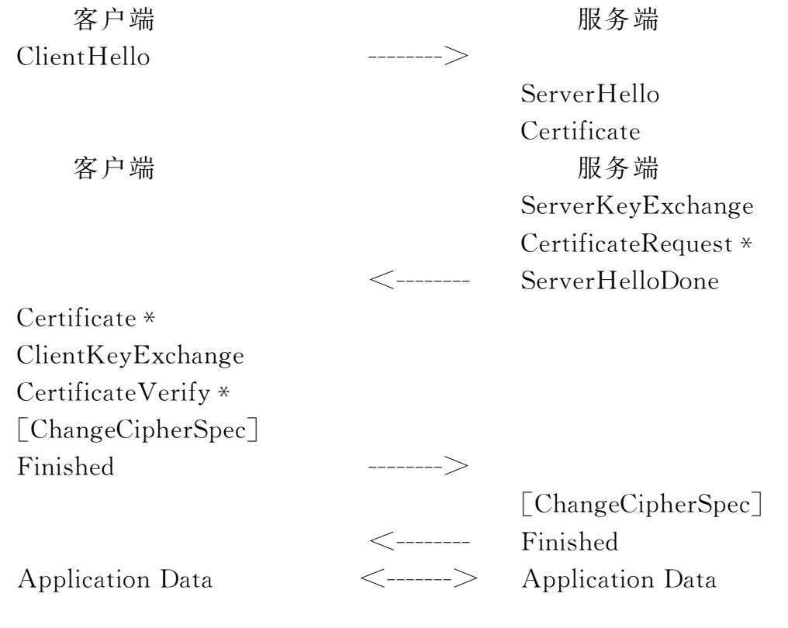
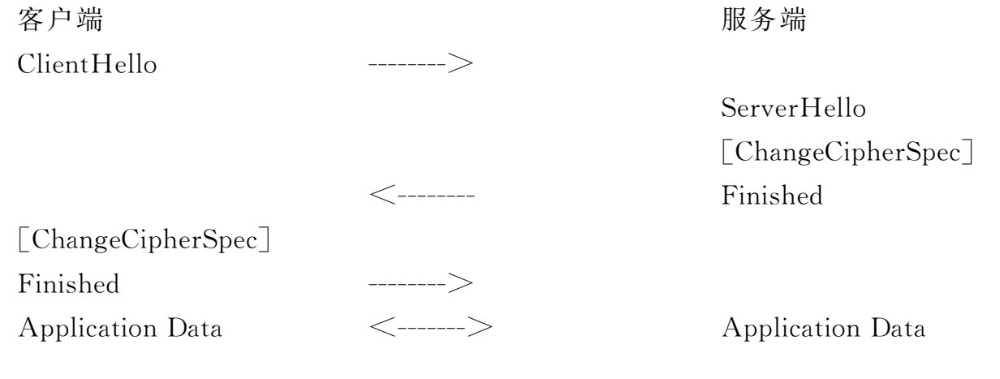

# GM/T 0024-2023 SSL VPN技术规范

## 1 范围

本文件规定了SSL VPN的技术协议、产品功能要求、产品性能参数和安全管理要求。

本文件适用于SSL VPN产品的研制,也适用于指导SSL VPN产品的检测、管理和使用。

## 2 规范性引用文件

下列文件中的内容通过文中的规范性引用而构成本文件必不可少的条款。其中,注日期的引用文件,仅该日期对应的版本适用于本文件;不注日期的引用文件,其最新版本(包括所有的修改单)适用于本文件。

GB/T 25069 信息安全技术 术语

GB/T 36624—2018 信息技术 安全技术 可鉴别的加密机制

GM/T 0005 随机性检测规范

GM/T 0009 SM2密码算法使用规范

GM/T 0010 SM2密码算法加密签名消息语法规范

GM/T 0015 基于SM2密码算法的数字证书格式规范

GM/T 0016 智能密码钥匙密码应用接口规范

GM/T 0081—2020 SM9密码算法加密签名消息语法规范

GM/T 0090—2020 标识密码应用标识格式规范

GM/Z 4001 密码术语

## 3 术语和定义

GB/T 25069和GM/Z 4001界定的以及下列术语和定义适用于本文件。

### 3.1 IBC算法 identity based cryptography algorithm

基于用户/实体唯一性身份标识和系统主密钥而生成用户密钥的密码机制。

### 3.2 IBC标识 IBC identity

由实体无法否认的信息组成,可唯一确定一个实体的身份。

> [!note]
>
> 注:如实体的可识别名称、电子邮箱、身份证号、电话号码、街道地址等。

### 3.3 IBC公共参数 IBC public parameter

为IBC系统的用户提供包括密码算法参数、系统策略和用户标识变化等相关公开信息的服务。

## 4 符号和缩略语

### 4.1 符号

下列符号适用于本文件。

$+$:串联

$\mathrm{HMAC}(X,Y)$:以$X$为密钥对$Y$进行密码杂凑运算

### 4.2 缩略语

下列缩略语适用于本文件。

AEAD:带关联数据的可鉴别的加密(Authenticated Encryption with Associated Data)

ADD:附加鉴别数据(Additional Authenticated Data)

CBC:密码分组链接(Cipher Block Chaining)

DN:识别名(Distinguished Name)

GCM:Galois计数器模式(Galois Counter Mode)

HMAC:采用带密钥杂凑的消息验证码(keyed-Hash Message Authentication Code)

IBC:标识密码算法(Identity-Based Cryptography)

IV:初始向量(Initialization Vector)

MAC:消息鉴别码(Message Authentication Code)

SSL:安全套接字层(Secure Sockets Layer)

TLCP:传输层密码协议(Transport Layer Cryptography Protocol)

VPN:虚拟专用网络(Virtual Private Network)

## 5 密码算法和密钥种类

### 5.1 密码算法

#### 5.1.1 非对称密码算法

非对称密码算法包括ECC椭圆曲线密码算法SM2、IBC标识密码算法SM9和RSA算法,用于身份鉴别、数字签名、密钥交换。

#### 5.1.2 分组密码算法

分组密码算法包括SM4算法,用于密钥交换数据的加密保护和报文数据的加密保护。该算法的工作模式为GCM或CBC模式。GCM工作模式应符合GB/T 36624—2018的加密机制5。

#### 5.1.3 密码杂凑算法

密码杂凑算法包括SM3算法和SHA256算法,用于对称密钥生成、完整性校验和数字签名。

#### 5.1.4 数据扩展函数P_hash

$\mathrm{P\_hash}$函数定义如下:

$$
\begin{aligned}\mathrm{P\_hash}(\mathrm{secret},\mathrm{seed}) &= \mathrm{HMAC}(\mathrm{secret},A(1)+\mathrm{seed}) + \\ &\quad \mathrm{HMAC}(\mathrm{secret},A(2)+\mathrm{seed}) + \\ &\quad \mathrm{HMAC}(\mathrm{secret},A(3)+\mathrm{seed}) + \\ &\quad \ldots\end{aligned}
$$

其中:

$\mathrm{secret}$是进行计算所需要的密钥;

$\mathrm{seed}$是进行计算所需要的数据;

$$
\begin{aligned}A(0)=\mathrm{seed}; \\ A(i)=\mathrm{HMAC}(\mathrm{secret},A(i-1));\end{aligned}
$$

$\mathrm{P\_hash}$能反复迭代直至产生要求长度的数据。

#### 5.1.5 伪随机函数PRF

PRF的计算方法如下:

$$
\mathrm{PRF}(\mathrm{secret},\mathrm{label},\mathrm{seed})=\mathrm{P\_hash}(\mathrm{secret},\mathrm{label}+\mathrm{seed})\text{。}
$$

### 5.2 密钥种类

#### 5.2.1 概述

在本文件中采用非对称密码算法进行身份鉴别和密钥交换,身份鉴别通过后协商预主密钥,双方各自计算主密钥,进而推导出工作密钥。使用工作密钥进行加解密和完整性校验。

#### 5.2.2 预主密钥

预主密钥(pre_master_secret)是双方协商生成的密钥素材,用于生成主密钥。

#### 5.2.3 主密钥

主密钥(master_secret)是由预主密钥、客户端随机数、服务端随机数、常量字符串,经计算生成的密钥素材,用于生成工作密钥。

#### 5.2.4 工作密钥

工作密钥包括数据加密密钥和校验密钥。其中数据加密密钥用于数据的加密和解密,校验密钥用于数据的完整性计算和校验。在本文件中,发送方使用的工作密钥称为写密钥,接收方使用的工作密钥称为读密钥。

#### 5.2.5 服务端密钥

服务端密钥为非对称密码算法的密钥对,包括签名密钥对和加密密钥对,用于握手过程中服务端身份鉴别和预主密钥的协商。其中基于证书体系的非对称算法的密钥对,其签名密钥对由VPN自身密码模块产生,加密密钥对应通过CA认证中心向KMC申请;基于标识体系的非对称密钥对,其签名密钥对和加密密钥对应由KGC产生。

#### 5.2.6 客户端密钥

客户端密钥为非对称密码算法的密钥对,包括签名密钥对和加密密钥对,用于握手过程中客户端身份鉴别和预主密钥的协商。其中基于证书体系的非对称算法的密钥对,其签名密钥对由对应的客户端密码模块产生(例如智能密码钥匙),加密密钥对应通过CA认证中心向KMC申请;基于标识体系的非对称密钥对,其签名密钥对和加密密钥对应由KGC产生。

## 6 协议

### 6.1 概述

SSL VPN协议包括记录层协议、密码规格变更协议、报警协议、握手协议和网关到网关协议。记录层协议用于传输数据的分段、压缩及解压缩、加密及解密、完整性校验;密码规格变更协议用于通知安全参数的变更;报警协议用于关闭通知和对错误进行报警;握手协议用于身份鉴别和安全参数协商;网关到网关协议用于建立网关到网关的传输层隧道。

### 6.2 数据类型定义

#### 6.2.1 基本数据类型

定义了六种基本数据类型,分别为opaque、uint8、uint16、uint24、uint32、uint64。所有类型都以网络字节顺序表示,最小数据的大小是一个8位字节。

opaque:任意类型数据,1个字节;

uint8:无符号的8位整数,1个字节;

uint16:无符号的16位整数,2个字节;

uint24:无符号的24位整数,3个字节;

uint32:无符号的32位整数,4个字节;

uint64:无符号的64位整数,8个字节。

#### 6.2.2 向量

向量(Vectors)是给定类型的数据序列。向量分为两种:定长和变长。定长向量以$[x]$来表示;变长向量以$<x..y>$来表示,其中$x$代表下限,$y$代表上限,如果只需表达上限时,用$<y>$表示。所有向量的长度都以字节为单位。变长向量首部表示向量实际长度,其首部大小为能容纳变长向量最大长度的最小字节数。

#### 6.2.3 枚举类型

枚举(Enumerateds)是一系列特定值的字段集合,通常每个字段都包括一个名称和值。如果包含一个未命名的值,这个值表示指定的最大值。如果只包含了名称而不定义值,只能用来指代状态值,不能在实际编码中使用。例如,

```c
enum { red(0), green(1), (255) } color
```

。枚举变量大小为能容纳最大枚举值的最小字节数。

#### 6.2.4 结构类型

结构类型(Constructed Types)用struct来定义。struct中的字段按照先后顺序串连起来进行编码。如果一个struct包含于另一个struct中,则可省略该struct的名字。

#### 6.2.5 变体类型

变体(Variants)类型用select、case来定义,用于定义依赖外部信息而变化的结构,类似于C语言中的union或ASN.1的CHOICE。

### 6.3 记录层协议

#### 6.3.1 概述

记录层协议是分层次的,每一层都包括长度字段、描述字段和内容字段。记录层协议接收将要被传输的消息,将数据分块、压缩(可选)、计算HMAC、加密,然后传输。接收到的数据经过解密、验证、解压缩(可选)、重新封装然后传送给高层应用。

记录层协议包括:握手,报警,密码规格变更和网关到网关协议。为了支持协议的扩展,记录层协议可支持其他的记录类型。任何新的记录类型都应在针对上述类型分配的内容类型值之外去分配。如果接收到一个不能识别的记录类型应忽略。

#### 6.3.2 连接状态

连接状态是记录层协议的操作环境。包括四种典型的连接状态:当前读与写状态,未决的读与写状态。其中,读表示接收数据,写表示发送数据。所有记录都是在当前读写状态下处理的。未决状态的安全参数可由握手协议设定,而密码规格变更消息可使未决状态变为当前状态。除了最初的当前状态外,当前状态应包含经过协商的安全参数。

连接状态的安全参数结构如下:

```c
struct {
    ConnectionEnd entity;
    BulkCipherAlgorithm bulk_cipher_algorithm;
    CipherType cipher_type;
    uint8 key_material_length;
    MACAlgorithm mac_algorithm;
    uint8 hash_size;
    CompressionMethod compression_algorithm;
    opaque master_secret[48];
    opaque client_random[32];
    opaque server_random[32];
    unit8 record_iv_length;
    unit8 fixed_iv_length;
    unit8 mac_length;
} SecurityParameters;
```

其中:

**a) ConnectionEnd**

表示本端在连接中的角色,为客户端或服务端。定义为:

```c
enum {server, client} ConnectionEnd
```

**b) BulkCipherAlgorithm**

用于数据加解密的密码算法。定义为:

```c
enum {sm4} BulkCipherAlgorithm
```

**c) CipherType**

表示密码算法的类型。定义为:

```c
enum {block} CipherType
```

**d) key_material_length**

表示密钥材料的长度。

**e) MACAlgorithm**

用于计算和校验消息完整性的密码杂凑算法。定义为:

```c
enum {sm3, sha_256} MACAlgorithm
```

**f) hash_size**

杂凑长度。

**g) CompressionMethod**

用于数据压缩的算法。定义为:

```c
enum {null(0), (255)} CompressionMethod
```

**h) master_secret**

在协商过程中由预主密钥、客户端随机数、服务端随机数计算出的48字节密钥。

**i) client_random**

由客户端产生的32字节随机数据。

**j) server_random**

由服务端产生的32字节随机数据。

**k) record_iv_length**

初始向量的长度。

**l) fixed_iv_length**

固定的初始向量长度。

**m) mac_length**

MAC长度。

记录层将使用上述安全参数来生成下列内容:

- 客户端写校验密钥client write MAC secret;

- 服务端写校验密钥server write MAC secret;

- 客户端写密钥client write key;

- 服务端写密钥server write key;

- 客户端写初始向量client write iv;

- 服务端写初始向量server write iv。

服务端接收和处理记录时使用客户端写参数,客户端接收和处理记录时使用服务端写参数。用安全参数生成这些密钥的算法,详见6.5。密钥生成后,连接状态可改变为当前状态。

#### 6.3.3 记录层

##### 6.3.3.1 概述

记录层接收从高层来的任意大小的非空连续数据,将数据分段、压缩、计算校验码、加密,然后传输。接收到的数据经过解密、验证、解压缩、重新封装然后传送给高层应用。

##### 6.3.3.2 分段

记录层将数据分成$2^{14}$字节或者更小的片段。

每个片段结构如下:

```c
struct {
    ContentType type;
    ProtocolVersion version;
    uint16 length;
    opaque fragment[TLSPlaintext.length];
} TLSPlaintext;
```

其中:

**a) type**

片段的记录层协议类型。定义为:

```c
enum {
    change_cipher_spec(20), alert(21), handshake(22),
    application_data(23), site2site(80), (255)
} ContentType;
```

**b) version**

所用协议的版本号。本文件的版本号为1.1。定义为:

```c
struct {
    uint8 major=0x01, minor=0x01;
} ProtocolVersion;
```

**c) length**

以字节为单位的片段长度,小于或等于$2^{14}$。

**d) fragment**

将传输的数据。记录层协议不关心具体数据内容。

##### 6.3.3.3 压缩和解压缩

所有的记录都使用当前会话状态指定的压缩算法进行压缩。当前会话状态指定的压缩算法被初始化为空算法。

压缩算法将一个TLSPlaintext结构的数据转换成一个TLSCompressed结构的数据。

压缩后的数据长度最多只能增加1024个字节。如果解压缩后的数据长度超过了$2^{14}$个字节,则报告一个decompression failure致命错误。

压缩后数据结构如下:

```c
struct {
    ContentType type;
    ProtocolVersion version;
    uint16 length;
    opaque fragment[TLSCompressed.length];
} TLSCompressed;
```

其中:

a) type、version的定义同6.3.3.2。

**b) length**

以字节为单位的TLSCompressed.fragment长度,小于或等于$2^{14}+1024$。

**c) fragment**

TLSPlaintext.fragment的压缩形式。

##### 6.3.3.4 加密和校验

###### 6.3.3.4.1 概述

加密运算和校验运算把一个TLSCompressed结构的数据转化为一个TLSCiphertext结构的数据。解密运算则是执行相反的操作。

加密后数据结构如下:

```c
struct {
    ContentType type;
    ProtocolVersion version;
    uint16 length;
    select(CipherSpec.cipher_type){
        case block: GenericBlockCipher;
        case aead: GenericAEADCipher;
    } fragment;
} TLSCiphertext;
```

其中:

a) type、version的定义同6.3.3.2。

**b) length**

以字节为单位的TLSCiphertext.fragment长度,小于或等于$2^{14}+2048$。

**c) fragment**

带有校验码的TLSCompressed.fragment加密形式。

###### 6.3.3.4.2 校验算法的数据处理

校验码的计算是在加密之前进行,运算方法如下:

$$
\begin{aligned}&\mathrm{HMAC\_hash}\bigl(\mathrm{MAC\_write\_secret},\;\mathrm{seq\_num}\\&\quad +\mathrm{TLSCompressed.type}+\mathrm{TLSCompressed.version}\\&\quad +\mathrm{TLSCompressed.length}+\mathrm{TLSCompressed.fragment}\bigr)\end{aligned}
$$

**a) seq_num**

序列号。每一个读写状态都分别维持一个单调递增序列号。序列号的类型为uint64,序列号初始值为零,最大不能超出$2^{64}-1$。序列号不能回绕。如果序列号溢出,应重新开始握手。

**b) hash**

计算校验码时使用的杂凑算法。

###### 6.3.3.4.3 分组密码算法的数据处理

使用分组密码算法加解密数据时,加密运算和校验运算用于将一个TLSCompressed.fragment结构的数据转换成一个TLSCiphertext.fragment结构的数据。被加密的数据包括了校验运算的结果。

加密处理前数据结构如下:

```c
struct {
    opaque IV[SecurityParameters.record_iv_length];
    block-ciphered struct {
        opaque content[TLSCompressed.length];
        opaque MAC[SecurityParameters.mac_length];
        uint8 padding_length;
        uint8 padding[GenericBlockCipher.padding_length];
    };
} GenericBlockCipher;
```

其中:

**a) IV**

在GenericBlockCipher中传输的初始化向量。该向量应随机产生。

**b) SecurityParameters.record_iv_length**

IV的长度,其缺省值与使用的密码套件相关。

**c) SecurityParameters.mac_length**

MAC的长度,其缺省值与使用的密码套件相关。

**d) content**

加密前的明文数据。

**e) MAC**

Content的校验值。

**f) padding**

填充的数据。在数据加密前应将数据填充为密码算法分组长度的整数倍,填充的长度不能超过255个字节。填充的每个字节的内容是填充的字节数。接收者应检查这个填充,如果出错,发送bad_record_mac报警消息。

###### 6.3.3.4.4 带关联数据的可鉴别的加密(AEAD)的数据处理

使用AEAD时,可鉴别加密函数在TLSCompressed.fragment结构和可鉴别加密TLSCiphertext.fragment结构之间进行转换。

AEAD的输入是一个密钥、一个随机数、明文和额外认证数据。密钥是客户端写密钥或服务端写密钥,根据是哪一端进行加密来确定。

```c
struct {
    opaque nonce_explicit[SecurityParameters.record_iv_length];
    aead-ciphered struct {
        opaque content[TLSCompressed.length];
    };
} GenericAEADCipher;
```

每个AEAD密码套件应指定提供给AEAD操作的随机数,以及GenericAEADCipher.nonce_explicit部分的长度大小。AEAD加密模式一般采用计数器模式。AEAD使用的随机数应由显式和隐式两部分组成,显式部分即nonce explicit,客户端和服务端使用的隐式部分分别来自client_write_iv和server_write_iv。

额外认证数据(additional_data)定义如下:

$$
\begin{aligned}\mathrm{additional\_data}={}&\mathrm{seq\_num}+\mathrm{TLSCompressed.type}\\&+\mathrm{TLSCompressed.version}+\mathrm{TLSCompressed.length};\end{aligned}
$$

AEAD的输出是由AEAD加密操作的密文输出组成。其长度通常比TLSCompressed.length长,但是多出的长度在AEAD密码算法中并不统一。因为密码算法可能包括了填充,所以开销的数量可能随着不同的TLSCompressed.length值而不同。每个AEAD密码算法生成的扩展应不能多于1024比特。

$$
\begin{aligned}\mathrm{AEADEncrypted}={}&\operatorname{AEAD\text{-}Encrypt}\bigl(\mathrm{write\_key},\;\mathrm{nonce},\\&\mathrm{plaintext},\;\mathrm{additional\_data}\bigr)\end{aligned}
$$

为了解密和验证,密码算法把密钥、随机数、additional_data和AEADEncrypted值当作输入。输出为明文或者一个指示解密失败的错误。即:

$$
\begin{aligned}\mathrm{TLSCompressed.fragment}={}&\operatorname{AEAD\text{-}Decrypt}\bigl(\mathrm{write\_key},\;\mathrm{nonce},\\&\mathrm{AEADEncrypted},\;\mathrm{additional\_data}\bigr)\end{aligned}
$$

如果解密失败,应生成一个致命的bad_record_mac警告。

### 6.4 握手协议族

#### 6.4.1 概述

握手协议族由密码规格变更协议、握手协议和报警协议三个子协议组成,用于双方协商出供记录层使用的安全参数,进行身份验证以及向对方报告错误。

握手协议族负责协商出一个会话,这个会话包含以下内容。

会话标识:由服务端选取的随意的字节序列,用于识别活跃或可恢复的会话。

证书:数字证书的格式应符合GM/T 0015。

压缩方法:压缩数据的算法。

密码规格:指定的密码算法。

主密钥:客户端和服务端共享的48个字节的密钥。

重用标识:标明能否用该会话发起一个新连接的标识。本文件仅支持会话标识的重用模式,表明是否能重用已有的或者现在的会话,不重新协商安全参数。

利用以上数据可产生安全参数。利用握手协议的重用特性,可使用相同的会话建立多个连接。

#### 6.4.2 密码规格变更协议

密码规格变更协议用于通知密码规格的改变,即通知对方使用刚协商好的安全参数来保护接下来的数据。该协议由一条消息组成,该消息用当前的压缩算法压缩并用当前的密码规格加密,如果是首次协商,该消息为明文。

该消息的长度为一个字节,其值为1。客户端和服务端都应在安全参数协商完毕之后、握手结束消息之前发送此消息。

对于刚协商好的密钥,写密钥在此消息发送之后立即启用;读密钥在收到此消息之后立即启用。

密码规格变更消息结构定义如下:

```c
struct {
    enum {change_cipher_spec(1), (255)} type;
} ChangeCipherSpec;
```

#### 6.4.3 报警协议

##### 6.4.3.1 结构定义

报警协议用于关闭连接的通知以及对整个连接过程中出现的错误进行报警,其中关闭通知由发起者发送,错误报警由错误的发现者发送。该协议由一条消息组成,该消息用当前的压缩算法压缩并用当前的密码规格加密,如果是首次协商,该消息为明文。

报警消息的长度为两个字节,分别为报警级别和报警内容。

报警消息结构定义如下:

```c
enum {warning(1), fatal(2), (255)} AlertLevel;
enum {
    close_notify(0),
    unexpected_message(10),
    bad_record_mac(20),
    decryption_failed(21),
    record_overflow(22),
    decompression_failure(30),
    handshake_failure(40),
    bad_certificate(42),
    unsupported_certificate(43),
    certificate_revoked(44),
    certificate_expired(45),
    certificate_unknown(46),
    illegal_parameter(47),
    unknown_ca(48),
    access_denied(49),
    decode_error(50),
    decrypt_error(51),
    protocol_version(70),
    insufficient_security(71),
    internal_error(80),
    user_canceled(90),
    unsupported_site2site(200),
    no_area(201),
    unsupported_areatype(202),
    bad_ibcparam(203),
    unsupported_ibcparam(204)
    identity_need(205),
    (255)
} AlertDescription;

struct {
    AlertLevel level;
    AlertDescription description;
} Alert;
```

##### 6.4.3.2 关闭通知

除非出现致命报警,客户端和服务端任何一方在结束连接之前都应发送关闭通知消息。对于该消息的发送方,该消息通知对方不再发送任何数据,可等待接收方回应的关闭通知消息后关闭本次连接,也可立即关闭本次连接。对于接收方,收到该消息后应回应一个关闭通知消息,然后关闭本次连接,不再接收和发送数据。

##### 6.4.3.3 错误报警

当发送或接收到一个致命级别报警之后,双方都应立即关闭连接,废弃出错连接的会话标识和密钥,被致命报警关闭的连接是不能复用的。本文件定义的错误报警表见表1。

**表 1 错误报警表**

| 错误报警名称 | 值 | 级别 | 描述 |
| --- | --- | --- | --- |
| unexpected_message | 10 | 致命 | 接收到一个不符合上下文关系的消息 |
| bad_record_mac | 20 | 致命 | MAC校验错误或解密错误 |
| decryption_failed | 21 | 致命 | 解密失败 |
| record_overflow | 22 | 致命 | 报文过长 |
| decompression_failure | 30 | 致命 | 解压缩失败 |
| handshake_failure | 40 | 致命 | 协商失败 |
| bad_certificate | 42 | — | 证书被破坏 |
| unsupported_certificate | 43 | — | 不支持证书类型 |
| certificate_revoked | 44 | — | 证书被撤销 |
| certificate_expired | 45 | — | 证书过期或未生效 |
| certificate_unknown | 46 | — | 未知证书错误 |
| illegal_parameter | 47 | 致命 | 非法参数 |
| unknown_ca | 48 | 致命 | 根证书不可信 |
| access_denied | 49 | 致命 | 拒绝访问 |
| decode_error | 50 | 致命 | 消息解码失败 |
| decrypt_error | 51 | — | 消息解密失败 |
| protocol_version | 70 | 致命 | 版本不匹配 |
| insufficient_security | 71 | 致命 | 安全性不足 |
| internal_error | 80 | 致命 | 内部错误 |
| user_canceled | 90 | 警告 | 用户取消操作 |
| unsupported_site2site | 200 | 致命 | 不支持site2site |
| no_area | 201 | — | 没有保护域 |
| unsupported_areatype | 202 | — | 不支持的保护域类型 |
| bad_ibcparam | 203 | 致命 | 接收到一个无效的ibc公共参数 |
| unsupported_ibcparam | 204 | 致命 | 不支持ibc公共参数中定义的信息 |
| identity_need | 205 | 致命 | 缺少对方的ibc标识 |

对于没有明确指出级别的错误报警,发送者可自行决定是否致命,如果发送者认为是致命的,应向接收者发出关闭通知,最后关闭本次连接;如果接收到一个警告级别的报警,接收者可自行决定是否致命,如果接收者认为是致命的,应向发起者发出关闭通知,最后关闭本次连接。

#### 6.4.4 握手协议总览

握手协议涉及以下过程:

a) 交换hello消息来协商密码套件,交换随机数,决定是否会话重用;

b) 交换必要的参数,协商预主密钥;

c) 交换证书或IBC信息,用于验证对方;

d) 使用预主密钥和交换的随机数生成主密钥;

e) 向记录层提供安全参数;

f) 验证双方计算的安全参数的一致性、握手过程的真实性和完整性。

握手过程如下:客户端发送客户端hello消息给服务端,服务端应回应服务端hello消息,否则产生一个致命错误并且断开连接。客户端hello和服务端hello用于在客户端和服务端进行基于SM2、RSA或IBC的密码算法协商,以及确定安全传输能力,包括协议版本,会话标识,密码套件属性,并且产生和交换随机数。此外,客户端hello和服务端hello消息中可根据情况内嵌多种不同的扩展字段,来实现额外的信息协商能力,扩展字段及其定义见附录A。

在客户端hello和服务端hello消息之后是身份验证和密钥交换过程。包括服务端证书、服务端密钥交换,客户端证书、客户端密钥交换。

在服务端发送完hello消息之后,接着发送自己的证书消息,服务端密钥交换消息。如果服务端需要验证客户端的身份,则向客户端发送证书请求消息。然后发送服务端hello完成消息,表示hello消息阶段已经结束,服务端等待客户端的返回消息。如果服务端发送了一个证书请求消息,客户端应返回一个证书消息。然后客户端发送密钥交换消息,消息内容取决于客户端hello消息和服务端hello消息协商出的密钥交换算法。如果客户端发送了证书消息,那么也应发送一个带数字签名的证书验证消息供服务端验证客户端的身份。

接着客户端发送密码规格变更消息,然后客户端立即使用刚协商的算法和密钥,加密并发送握手结束消息。服务端则回应密码规格变更消息,使用刚协商的算法和密钥,加密并发送握手结束消息。至此握手过程结束,服务端和客户端可开始数据安全传输。

握手消息流程见图1。



> [!note]
>
> 注:
>
> \* 表示可选或依赖于上下文关系的消息,不是每次都发送。
>
> []不属于握手协议消息。

**图 1 握手消息流程**

如果客户端和服务端决定重用之前的会话,可不必重新协商安全参数。客户端发送客户端hello消息,并且带上要重用的会话标识。如果服务端有匹配的会话存在,服务端则使用相应的会话状态接受连接,发送一个具有相同会话标识的服务端hello消息。然后客户端和服务端各自发送密码规格变更消息和握手结束消息。至此握手过程结束,服务端和客户端可开始数据安全传输。如果服务端没有匹配的会话标识,服务端会生成一个新的会话标识进行一个完整的握手过程。

会话重用的握手消息流程见图2。



**图 2 重用的握手消息流程**

#### 6.4.5 握手协议

##### 6.4.5.1 结构定义

握手协议是在记录层协议之上的协议,用于协商安全参数。握手协议的消息通过记录层协议传输。

握手消息结构定义如下:

```c
struct {
    HandshakeType msg_type;
    uint24 length;
    select(HandshakeType){
        case client_hello: ClientHello;
        case server_hello: ServerHello;
        case certificate: Certificate;
        case server_key_exchange: ServerKeyExchange;
        case certificate_request: CertificateRequest;
        case server_hello_done: ServerHelloDone;
        case certificate_verify: CertificateVerify;
        case client_key_exchange: ClientKeyExchange;
        case finished: Finished;
    } body;
} Handshake;
```

握手消息类型定义如下:

```c
enum {
    client_hello(1), server_hello(2),
    certificate(11), server_key_exchange(12),
    certificate_request(13), server_hello_done(14),
    certificate_verify(15), client_key_exchange(16),
    finished(20), (255)
} HandshakeType;
```

握手协议消息应按照规定的流程顺序进行发送,否则将会导致致命的错误。不需要的握手消息可被接收方忽略。

##### 6.4.5.2 Hello消息

###### 6.4.5.2.1 ClientHello消息

该消息为客户端hello消息。

客户端hello消息作为握手协议的第一条消息。

客户端在发送客户端hello消息之后,等待服务端回应服务端hello消息。

客户端hello消息结构定义如下:

```c
struct {
    ProtocolVersion client_version;
    Random random;
    SessionID session_id;
    CipherSuite cipher_suites<2..2^16-1>;
    CompressionMethod compression_methods<1..2^8-1>;
    select(extensions_present){
        case false:
            struct {};
        case true:
            Extension extensions<0..2^16-1>;
    }
} ClientHello;
```

其中:

**a) client_version**

客户端在这个会话中使用的协议版本。在本文件中,协议版本号是1.1。

**b) random**

客户端产生的随机信息,其内容包括时钟和随机数,结构定义如下:

```c
struct {
    uint32 gmt_unix_time;
    opaque random_bytes[28];
} Random;
```

gmt_unix_time为标准UNIX32位格式表示的发送者时钟,其值为从格林威治时间的1970年1月1日零点到当前时间的秒数。

random_bytes为28个字节的随机数。

**c) session_id**

客户端在连接中使用的会话标识,定义为:

```c
opaque SessionID<0..32>
```

session_id是一个可变长字段,其值由服务端决定。如果没有可重用的会话标识或希望协商安全参数,该字段应为空,否则表示客户端希望重用该会话。这个会话标识可能是之前的连接标识、当前连接标识、或其他处于连接状态的连接标识。会话标识生成后应一直保持到被超时删除或与这个会话相关的连接遇到致命错误被关闭。一个会话失效或被关闭时则与其相关的连接都应被强制关闭。

**d) cipher_suites**

客户端所支持的密码套件列表,客户端应按照密码套件使用的优先级顺序排列,优先级最高的密码套件应排在首位。如果会话标识字段不为空,本字段应至少包含将重用的会话所使用的密码套件。

密码套件定义如下:

```c
uint8 CipherSuite[2];
```

每个密码套件包括一个密钥交换算法、一个加密算法和一个校验算法。服务端将在密码套件列表中选择一个与之匹配的密码套件,如果没有可匹配的密码套件,应返回握手失败报警消息handshake_failure并且关闭连接。

本文件支持的密码套件列表如表2所示。

**表 2 密码套件列表**

| 名称 | 密钥交换 | 加密 | 校验 | 值 |
| --- | --- | --- | --- | --- |
| ECDHE_SM4_CBC_SM3 | ECDHE | SM4_CBC | SM3 | {0xe0,0x11} |
| ECDHE_SM4_GCM_SM3 | ECDHE | SM4_GCM | SM3 | {0xe0,0x51} |
| ECC_SM4_CBC_SM3 | ECC | SM4_CBC | SM3 | {0xe0,0x13} |
| ECC_SM4_GCM_SM3 | ECC | SM4_GCM | SM3 | {0xe0,0x53} |
| IBSDH_SM4_CBC_SM3 | IBSDH | SM4_CBC | SM3 | {0xe0,0x15} |
| IBSDH_SM4_GCM_SM3 | IBSDH | SM4_GCM | SM3 | {0xe0,0x55} |
| IBC_SM4_CBC_SM3 | IBC | SM4_CBC | SM3 | {0xe0,0x17} |
| IBC_SM4_GCM_SM3 | IBC | SM4_GCM | SM3 | {0xe0,0x57} |
| RSA_SM4_CBC_SM3 | RSA | SM4_CBC | SM3 | {0xe0,0x19} |
| RSA_SM4_GCM_SM3 | RSA | SM4_GCM | SM3 | {0xe0,0x59} |
| RSA_SM4_CBC_SHA256 | RSA | SM4_CBC | SHA256 | {0xe0,0x1c} |
| RSA_SM4_GCM_SHA256 | RSA | SM4_GCM | SHA256 | {0xe0,0x5a} |

在本文件中实现ECC和ECDHE的算法为SM2;实现IBC和IBSDH的算法为SM9。

**a) compression_methods**

客户端所支持的压缩算法列表,客户端应按照压缩算法使用的优先级顺序排列,优先级最高的压缩算法应排在首位。

定义如下:

```c
enum {null(0), (255)} CompressionMethod;
```

服务端将在压缩算法列表中选择一个与之匹配的压缩算法。列表中应包含空压缩算法,这样客户端和服务端总能协商出一致的压缩算法,压缩算法默认为空。

**b) extensions**

客户端可根据需要在客户端hello消息中携带扩展字段以便进行额外的握手信息协商。具体的Extension结构定义见6.4.5.2.3。

###### 6.4.5.2.2 ServerHello消息

该消息为服务端hello消息。

如果能从客户端hello消息中找到匹配的密码套件,服务端发送这个消息作为对客户端hello消息的回复。如果找不到匹配的密码套件,服务端将回应handshake failure报警消息。

服务端hello消息结构定义如下:

```c
struct {
    ProtocolVersion server_version;
    Random random;
    SessionID session_id;
    CipherSuite cipher_suite;
    CompressionMethod compression_method;
    select(extensions_present){
        case false:
            struct {};
        case true:
            Extension extensions<0..2^16-1>;
    }
} ServerHello;
```

其中:

**a) server_version**

该字段表示服务端支持的协议版本。本文件的版本号是1.1。

**b) random**

服务端产生的随机数。

**c) session_id**

服务端使用的会话标识,如果客户端hello消息中的会话标识不为空,且服务端存在匹配的会话标识,则服务端重用与该标识对应的会话建立新连接,并在回应的服务端hello消息中带上与客户端一致的会话标识,否则服务端产生一个新的会话标识,用来建立一个新的会话。

**d) cipher_suite**

服务端从客户端hello消息中选取的一个密码套件。对于重用的会话,本字段存放重用会话使用的密码套件。

**e) compression_method**

服务端从客户端hello消息中选取的一个压缩算法,对于重用的会话,本字段存放重用会话使用的压缩算法,压缩算法默认为空。

**f) extensions**

服务端响应客户端hello中扩展字段而产生的服务端扩展字段条目。只有出现在客户端hello中的扩展字段才允许被服务器端响应。

###### 6.4.5.2.3 Hello消息扩展字段

扩展字段的结构定义如下:

```c
struct {
    ExtensionType extension_type;
    opaque extension_data<0..2^16-1>;
} Extension;

enum {
    server_name(0), trusted_ca_keys(3), status_request(5),
    supported_groups(10), signature_algorithm(13)
    application_layer_protocol_negotiation(16), client_id(66);
} ExtensionType;
```

其中:

**a) extension_type**

标识了具体的扩展类型,具体的扩展类型见ExtensionType的定义。具体的扩展字段含义请见附录A。其中扩展字段类型和扩展字段名称对应关系为:server_name对应附录A中“A.1 SNI服务器名称指示”、trusted_ca_keys对应“A.2 Trusted CA Indication受信CA指示”、status_request对应“A.3 Certificate Status Request证书状态请求”、supported_groups对应“A.4 Supported Elliptic Curves支持的椭圆曲线”、signature_algorithm对应“A.5 Signature Algorithm签名算法”、application_layer_protocol_negotiation对应“A.6 Application Layer Protocol Negotiation应用层协议协商”、client_id对应“A.7 Client ID客户端标识”。

**b) extension_data**

包含了某个扩展字段自有的数据内容,每个扩展字段的自有数据内容和结构见附录A。

##### 6.4.5.3 ServerCertificate消息

该消息为服务端证书消息。

服务端应发送一个服务端证书消息给客户端,该消息总是紧跟在服务端hello消息之后。当选中的密码套件使用ECC或RSA或ECDHE算法时,本消息的内容为服务端的签名证书和加密证书;当选中的密码套件使用IBC或IBSDH算法时,本消息的内容为服务端标识和IBC公共参数,用于客户端与服务端协商IBC公开参数。

证书格式应符合GM/T 0015,证书类型应能适用于已经确定的密钥交换算法。密钥交换算法与证书密钥类型的关系如表3所示。

**表 3 密钥交换算法与证书密钥类型关系表**

| 密钥交换算法 | 证书密钥类型 |
| --- | --- |
| RSA | RSA公钥,应使用加密证书中的公钥 |
| IBC | 服务端标识和IBC公共参数 |
| IBSDH | 服务端标识和IBC公共参数 |
| ECC | ECC公钥,应使用加密证书中的公钥 |
| ECDHE | ECC公钥,应使用加密证书中的公钥 |

对于证书消息结构如下:

```c
opaque ASN.1Cert<1..2^24-1>;
struct {
    ASN.1Cert certificate<0..2^24-1>;
} Certificate;
```

certificate

服务器证书:按照先后顺序分为为签名证书、加密证书、签名证书链和加密证书链。

IBC标识及公共参数结构:

```c
opaque ASN.1IBCParam<1..2^24-1>;
struct {
    opaque ibc_id<1..2^16-1>;
    ASN.1IBCParam ibc_parameter;
} Certificate;
```

其中:

**a) ibc_id**

服务端标识,内容应符合GM/T 0090—2020中Identifier结构的DER编码结果,或由用户自定义的标识信息。

**b) ibc_parameter**

IBC公共参数,内容应符合GM/T 0081—2020附录A定义的IBCSysParams结构的DER编码结果。

##### 6.4.5.4 ServerKeyExchange消息

本消息为服务端密钥交换消息。本消息传送的信息用于客户端计算产生48字节的预主密钥。

服务端密钥交换消息结构定义如下:

```c
enum {ECDHE, ECC, IBSDH, IBC, RSA} KeyExchangeAlgorithm;
struct {
    select(KeyExchangeAlgorithm){
        case ECDHE:
            ServerECDHEParams params;
            digitally-signed struct {
                opaque client_random[32];
                opaque server_random[32];
                ServerECDHEParams params;
            } signed_params;
        case ECC:
            digitally-signed struct {
                opaque client_random[32];
                opaque server_random[32];
                opaque ASN.1Cert<1..2^24-1>;
            } signed_params;
        case IBSDH:
            ServerIBSDHParams params;
            digitally-signed struct {
                opaque client_random[32];
                opaque server_random[32];
                ServerIBSDHParams params;
            } signed_params;
        case IBC:
            digitally-signed struct {
                opaque client_random[32];
                opaque server_random[32];
                opaque ibc_id<1..2^16-1>;
            } signed_params;
        case RSA:
            digitally-signed struct {
                opaque client_random[32];
                opaque server_random[32];
                opaque ASN.1Cert<1..2^24-1>;
            } signed_params;
    }
} ServerKeyExchange;
```

其中:

**a) ServerECDHEParams**

服务端的密钥交换参数,当使用SM2算法时,交换的参数应符合GM/T 0009,其中服务端的公钥不需要交换,客户端直接从服务端的加密证书中获取。

```c
struct {
    ECParameters curve_params;
    ECPoint public;
} ServerECDHParams;
```

如果使用SM2算法,第一个参数不校验。

**b) ServerIBSDHParams**

使用IBSDH算法时,服务端的密钥交换参数,内容应符合GM/T 0081中的KeyAgreementInfo结构的DER编码结果。

**c) signed_params**

当密钥交换方式为ECDHE和IBSDH时,signed_params是服务端对双方随机数和服务端密钥交换参数的签名;当密钥交换方式为ECC和RSA时,signed_params是服务端对双方随机数和服务端加密证书的签名;当密钥交换方式为IBC时,signed_params是服务端对双方随机数和服务端标识的签名,其中ibc_id为服务端标识。

##### 6.4.5.5 CertificateRequest消息

本消息为证书请求消息。

如果服务端要求认证客户端,则应发送此消息,要求客户端发送自己的证书。

该消息紧跟在服务端密钥交换消息之后。

证书请求消息的结构定义如下:

```c
struct {
    ClientCertificateType certificate_types<1..2^8-1>;
    DistinguishedName certificate_authorities<0..2^16-1>;
} CertificateRequest;
```

其中:

**a) certificate_types**

要求客户端提供的证书类型的列表。

```c
enum {
    rsa_sign(1), sm2_sign(64), ibc_params(80), (255)
} ClientCertificateType;
```

**b) certificate_authorities**

如果ClientCertificateType是ibc_params,本字段的内容是IBC密钥管理中心的信任域名列表。否则是服务端信任的CA的证书DN列表,包括根CA或者二级CA的DN。

定义如下:

```c
opaque DistinguishedName<1..2^16-1>;
```

##### 6.4.5.6 ServerHelloDone消息

表示握手过程的hello消息阶段完成。发送完该消息后服务端会等待客户端的响应消息。

客户端接收到服务端的hello完成消息之后,应验证服务端证书是否有效,并检验服务端的hello消息参数是否可接受。如果可接受,客户端继续握手过程。否则发送一个Handshake failure致命报警。

服务端hello完成消息结构如下:

```c
struct {} ServerHelloDone;
```

##### 6.4.5.7 ClientCertificate消息

本消息为客户端证书消息。如果服务端请求客户端证书,客户端要随后发送本消息。

当协商的密码套件使用IBC或IBSDH算法时,此消息的内容为客户端标识和IBC公共参数,用于客户端与服务端协商IBC公开参数。

客户端证书消息的结构见6.4.5.3。

##### 6.4.5.8 ClientKeyExchange消息

本消息为客户端密钥交换消息。

如果服务端请求客户端证书,本消息紧跟于客户端证书消息之后,否则本消息是客户端接收到服务端hello完成消息后所发送的第一条消息。

如果密钥交换算法使用RSA算法、ECC算法和IBC算法,本消息中包含预主密钥,该预主密钥由客户端产生,采用服务端的加密公钥进行加密。当服务端收到加密后的预主密钥后,利用相应的私钥进行解密,获取所述预主密钥的明文。如果是IBC算法,客户端利用获取的服务端标识和IBC公开参数,产生服务端公钥。如果是RSA算法,宜使用PKCS#1版本2.1对RSA加密后的密文进行编码。如果密钥交换算法使用ECDHE算法或IBSDH算法,本消息中包含计算预主密钥的客户端密钥交换参数。

客户端密钥交换消息结构定义如下:

```c
struct {
    select(KeyExchangeAlgorithm){
        case ECDHE:
            Opaque ClientECDHEParams<1..2^16-1>;
        case IBSDH:
            Opaque ClientIBSDHParams<1..2^16-1>;
        case ECC:
            opaque ECCEncryptedPreMasterSecret<0..2^16-1>;
        case IBC:
            opaque IBCEncryptedPreMasterSecret<0..2^16-1>;
        case RSA:
            opaque RSAEncryptedPreMasterSecret<0..2^16-1>;
    } exchange_keys;
} ClientKeyExchange;
```

其中:

**a) ClientECDHEParams:**

使用ECDHE算法时,要求客户端发送证书。客户端的密钥交换参数,当使用SM2算法时,交换的参数应符合GM/T 0009。

其结构如下:

```c
struct {
    ECParameters curve_params;
    ECPoint public;
} ClientECDHParams;
```

如果使用SM2算法,第一个参数不校验。

**b) ClientIBSDHParams:**

使用IBSDH算法时,客户端的密钥交换参数。

**c) ECCEncryptedPreMasterSecret**

使用ECC加密算法时,用服务端加密公钥加密的预主密钥。

**d) IBCEncryptedPreMasterSecret**

使用IBC加密算法时,用服务端加密公钥加密的预主密钥。

**e) RSAEncryptedPreMasterSecret**

使用RSA加密算法时,用服务端加密公钥加密的预主密钥。

预主密钥的数据结构如下:

```c
struct {
    ProtocolVersion client_version;
    opaque random[46];
} PreMasterSecret;
```

其中:

**1) client_version**

客户端所支持的版本号。服务端要检查这个值是否跟客户端hello消息中所发送的值相匹配。

**2) random**

46字节的随机数。

##### 6.4.5.9 CertificateVerify消息

本消息为证书校验消息。

该消息用于鉴别客户端是否为证书的合法持有者,只有ClientCertificate消息发送时才发送此消息,紧跟于客户端密钥交换消息之后。

证书校验消息的数据结构如下:

```c
struct {
    Signature signature;
} CertificateVerify;
```

其中:

Signature的结构如下:

```c
enum {rsa_sha256, rsa_sm3,
    ecc_sm3,
    ibs_sm3} SignatureAlgorithm;

struct {
    select(SignatureAlgorithm)
    {
        case rsa_sha256:
            digitally-signed struct {
                opaque sha256_hash[32];
            };
        case rsa_sm3:
            digitally-signed struct {
                opaque sm3_hash[32];
            };
        case ecc_sm3://当ECC为SM2算法时, 用这个套件。
            digitally-signed struct {
                opaque sm3_hash[32];
            };
        case ibs_sm3:
            digitally-signed struct {
                opaque sm3_hash[32];
            };
    }
} Signature;
```

sm3_hash和sha256_hash是指hash运算的结果,运算的内容是自客户端hello消息开始直到本消息为止(不包括本消息)的所有与握手有关的消息(加密证书要包在签名计算中),包括握手消息的类型和长度域。

当使用SM2算法签名时,使用客户端的签名密钥,应符合GM/T 0009和GM/T 0010。

##### 6.4.5.10 Finished消息

本消息为握手结束消息。

服务端和客户端各自在密码规格变更消息之后发送本消息,用于验证密钥交换过程是否成功,并校验握手过程的完整性。

本消息用本次握手过程协商出的算法和密钥保护。

本消息的接收方应检验消息内容的正确性。一旦一方发送了握手结束消息,并且接收到了对方的握手结束消息并通过校验,可使用该连接进行数据安全传输。

握手结束消息数据结构如下:

```c
struct {
    opaque verify_data[12];
} Finished;
```

其中:

verify_data为校验数据,该数据产生方法如下:

$$
\mathrm{PRF}(\mathrm{master\_secret},\mathrm{finished\_label},\mathrm{SM3}(\mathrm{handshake\_messages}))[0..11]\text{。}
$$

表达式中:

**a) finished_label**

对于由客户端发送的结束消息,该标签是字符串“client finished”。对于服务端,该标签是字符串“server finished”。

**b) handshake_messages**

指自客户端hello消息开始直到本消息为止(不包括本消息、密码规格变更消息)的所有与握手有关的消息,包括握手消息的类型和长度域。

### 6.5 密钥计算

#### 6.5.1 主密钥计算

主密钥由48个字节组成,由预主密钥、客户端随机数、服务端随机数、常量字符串,经PRF计算生成。

计算方法如下:

$$
\begin{aligned}\mathrm{master\_secret}={}&\mathrm{PRF}\bigl(\mathrm{pre\_master\_secret},\;\texttt{"master secret"},\\&\mathrm{ClientHello.random}+\mathrm{ServerHello.random}\bigr)[0..47]\end{aligned}
$$

#### 6.5.2 工作密钥

工作密钥包括校验密钥和加密密钥,具体密钥长度由选用的密码算法决定。由主密钥、客户端随机数、服务端随机数、常量字符串,经PRF计算生成。

计算方法如下:

$$
\begin{aligned}\mathrm{key\_block}={}&\mathrm{PRF}\bigl(\mathrm{SecurityParameters.master\_secret},\;\texttt{"key expansion"},\\&\mathrm{SecurityParameters.server\_random}\\&+\mathrm{SecurityParameters.client\_random}\bigr);\end{aligned}
$$

直到生成所需长度的输出,然后按顺序分割得到所需的密钥:

$$
\begin{gathered}\mathrm{client\_write\_MAC\_secret}[\mathrm{SecurityParameters.hash\_size}] \\ \mathrm{server\_write\_MAC\_secret}[\mathrm{SecurityParameters.hash\_size}] \\ \mathrm{client\_write\_key}[\mathrm{SecurityParameters.key\_material\_length}] \\ \mathrm{server\_write\_key}[\mathrm{SecurityParameters.key\_material\_length}] \\ \mathrm{client\_write\_IV}[\mathrm{SecurityParameters.fixed\_iv\_length}] \\ \mathrm{server\_write\_IV}[\mathrm{SecurityParameters.fixed\_iv\_length}]\end{gathered}
$$

### 6.6 网关到网关协议

#### 6.6.1 概述

网关到网关协议定义了SSL VPN之间建立网关到网关的传输层隧道,对IP数据报文进行安全传输时所采用的报文格式(包括控制报文与数据报文),以及控制报文交换过程和数据报文封装过程。网关到网关协议采用记录层协议作为底层的承载协议,和握手协议在同一层次,使用80作为协议类型编号,详见6.3.3.2。网关到网关协议在当前的连接状态之下进行传输数据的处理。

#### 6.6.2 协议报文格式

网关到网关协议包括两种协议报文,控制报文和数据报文。定义如下:

```c
enum {command(0), data(1), (255)} Site2SiteContentType;
struct {
    uint16 length;
    select(Site2SiteContentType){
        case command: Site2SiteCmd;
        case data: Site2SiteData;
    } Site2Sitefragment;
} Site2Site;
```

其中:

**a) Site2SiteContentType**

网关到网关载荷数据类型,0为控制报文,1为数据报文。

**b) length**

网关到网关载荷的长度,不包括类型域和长度域。

**c) Site2SiteCmd**

网关到网关控制报文,定义了保护域的信息交换报文。定义如下:

```c
enum {cmd_area(0), (255)} CmdType;
struct {
    select(CmdType){
        case cmdarea:
            Arealist arealist<0..2^14>;
    } CmdFragment;
} Site2SiteCmd;
```

其中:

AreaList:

SSL VPN保护域列表,包括网络层保护域和传输层保护域。网络层保护域可采用子网与子网掩码、网络地址范围这两种方式表示。定义如下:

```c
enum {subnet_ipv4(0), subnet_ipv6(1), range_ipv4(2), range_ipv6(3), (255)} AreaType;
```

传输层保护域由传输层协议和传输层端口来表示。传输层端口为0代表任意端口(TCP/UDP)或任意类型(ICMP)。定义如下:

```c
struct {
    uint8 Protocol;
    uint16 port;
} TlArea;

struct {
    select(AreaType){
        case subnet_ipv4: ipv4_addr_subnet;
        case subnet_ipv6: ipv6_addr_subnet;
        case range_ipv4: ipv4_addr_range;
        case range_ipv6: ipv6_addr_range;
    } NlAreaFragment;
    TlArea TlAreaFragment;
} AreaList;
```

其中:

**1) TlArea**

传输层保护域。

**2) ipv4_addr_subnet**

表示ipv4的子网地址。由两个32位的值组成,第一个值表示子网的IP地址,第二个值表示子网的网络掩码。网络掩码中的比特1表示该子网的IP地址中对应位是固定值,比特0表示对应位是通配值。

**3) ipv4_addr_range**

表示ipv4的地址范围。由两个32位的值组成,第一个值表示地址范围的起始地址,第二个值表示地址范围的结束地址。落在这两个地址区间的所有IP地址都被认为属于该地址范围之内。

**4) ipv6_addr_subnet**

表示ipv6的子网地址。由一个128位和一个8位的值构成。第一个值表示ipv6子网地址,第二个值表示子网地址的前缀长度。该长度表示128位的子网地址的前若干位为固定值,剩下的后若干位为通配值。

**5) ipv6_addr_range**

表示ipv6的地址范围。由两个128位的值组成,第一个值表示地址范围的起始地址,第二个值表示地址范围的结束地址。落在这两个地址区间的所有IP地址都被认为属于该地址范围之内。

**d) Site2SiteData**

网关到网关数据报文,内容为原始的完整IP报文。

#### 6.6.3 控制报文交换过程

控制报文的交换过程由通信双方的任何一方发起,通知对方自己所保护的网络信息。在握手协议完成之后可发送控制报文,使用握手协议协商好的安全参数保护控制报文。

在网关到网关的数据报文传输过程中,如果接收到新的传递保护域的控制报文,将触发该连接的重用过程,详见6.4.4。

#### 6.6.4 数据报文出入站过程

SSL VPN网关之间通过握手协议建立SSL连接,并将该连接与本地和对端的保护域进行绑定,出入站的IP报文应与对端和本地的保护域进行匹配。本地和对端保护域可通过控制报文获取,也可人工配置。

##### 6.6.4.1 出站报文处理

本地保护域内的IP报文在通过SSL VPN转发时,SSL VPN根据该报文的目的IP地址和源IP地址信息查找匹配的对端保护域及本地保护域,获取相应的有效SSL连接。然后将整个IP报文作为记录层的数据内容封装在该连接的记录层之上,通过记录层传送,封装格式详见6.3.3。如果没有相应的有效连接,则触发新的握手过程或者该连接的重用过程,详见6.4.4,协商建立或者更新相应的连接。如果查找不到相应的保护域,根据本地安全策略丢弃该报文或者进行其他处理。

##### 6.6.4.2 入站报文处理

对入站的数据报文进行解密、校验、解压缩操作,然后对于恢复出的IP报文,首先根据目的IP地址和源IP地址信息查找匹配的本地保护域及对端保护域,并检查和该SSL连接的绑定关系是否一致,对于查找到对应保护域并符合绑定关系的IP报文,进行路由和转发。如果查找不到相应的保护域或者不符合绑定关系的IP报文,根据本地安全策略丢弃该报文或者进行其他处理。

## 7 产品要求

### 7.1 产品功能要求

#### 7.1.1 工作模式

SSL VPN产品工作模式分为客户端-服务端模式和网关-网关模式两种。其中客户端-服务端模式是必备模式,网关-网关模式是可选模式,两种模式都应按照第6章的要求正确实现。

#### 7.1.2 随机数功能

SSL VPN产品应具有随机数生成功能,其随机数应由多路硬件噪声源产生。

#### 7.1.3 密钥交换

SSL VPN产品应具有密钥交换功能,通过协商产生工作密钥。

密钥交换应按照6.4的要求进行。

#### 7.1.4 安全报文传输

SSL VPN产品具有安全报文传输功能,保证数据的安全传输。

安全报文传输应按照6.3的要求进行。

#### 7.1.5 访问控制

SSL VPN产品具有细粒度的访问控制功能,基于用户或用户组对资源进行有效的控制。其中网络访问至少应控制到IP地址、端口、对Web资源的访问至少应控制到URL,并能根据访问时间进行控制。

#### 7.1.6 密钥更新

SSL VPN产品应根据时间周期或报文流量进行工作密钥更新。其中,根据时间周期进行更新为必备功能,根据报文流量进行更新为必备功能。根据时间周期进行更新的情况下,客户端-服务端模式最长时间不超过8h,网关-网关模式最长时间不超过1h。

### 7.2 产品性能参数

#### 7.2.1 最大并发连接数

同时在线TLCP连接的最大数目,产品应满足用户网络环境对最大TLCP连接数量性能的要求。

#### 7.2.2 每秒新建连接数

每秒钟可新建的最大TLCP连接数目,产品应满足用户网络环境对每秒能接入新TLCP连接性能的要求。

#### 7.2.3 最大并发用户数

同时在线用户的最大数目,产品应满足用户网络环境对最大并发用户数量性能的要求。

#### 7.2.4 加解密吞吐率

在丢包率为0的条件下,产品应满足用户网络环境对网络数据加解密吞吐性能的要求。

### 7.3 安全管理要求

#### 7.3.1 安全要求

##### 7.3.1.1 密钥安全

加密密钥对由外部密钥管理机构产生并由CA认证机构签发加密证书。加密密钥对的私钥保护方法应符合GM/T 0016。

签名证书、加密证书和加密密钥对的私钥应能被导入SSL VPN产品中。

在SSL VPN产品中,密钥的私钥应有安全保护措施。

密钥应按设定的安全策略进行更新。

密钥可以安全形式进行备份,并在需要时能恢复。

工作密钥产生后应保存在易失性存储器中,达到其更新条件后应立即更换,在连接断开、设备断电、实例释放时应销毁。

##### 7.3.1.2 数据配置安全

所有的配置数据应保证其在设备中的完整性、可靠性。应有管理界面对配置数据进行配置和管理,管理员进入管理界面应通过身份鉴别。

##### 7.3.1.3 存储与部件安全

SSL VPN产品应提供安全措施,保证密码算法、密钥、关键数据的存储安全。

所有密码运算应在独立的密码部件中进行。

除必需的通信接口和管理接口以外,不提供任何可供调试、跟踪的外部接口。内部的调试、检测接口应在产品定型后封闭。

##### 7.3.1.4 软件安全

所有的安全协议及管理软件应自主实现。

操作系统应进行安全加固,关闭所有不需要的端口和服务。

任何操作指令及其任意组合,不能泄露密钥和敏感信息。

#### 7.3.2 管理要求

##### 7.3.2.1 日志管理

SSL VPN产品应提供日志记录、查看和导出功能。

日志内容包括:

- 管理员操作行为,包括登录认证、系统配置、密钥管理操作;

- 用户访问行为,包括用户、时间、访问资源、结果;

- 异常事件,包括认证失败、非法访问异常事件的记录。

##### 7.3.2.2 管理员管理

SSL VPN服务端产品应设置管理员,进行系统配置、密钥生成、导入、备份和恢复操作。管理员应持有表征用户身份信息(如证书)的装置,与登录口令相结合登录系统,进行管理操作前应通过身份鉴别。

登录口令长度应不小于8个字符,且至少由数字、字母和特殊字符其中的两种类型组成。

使用错误口令或非法身份登录的次数限制应小于或等于8。

##### 7.3.2.3 设备管理

###### 7.3.2.3.1 设备初始化

SSL VPN产品的初始化,除必须由厂商进行的操作外,系统配置、密钥的生成和管理、管理员的产生均应由用户完成。

###### 7.3.2.3.2 设备自检

应对密码运算部件、关键部件(包括随机数生成器等)进行正确性检查、敏感信息进行完整性检查,在检查不通过时应报警并停止工作。

## 8 产品检测

### 8.1 产品功能检测

#### 8.1.1 工作模式

在客户端-服务端工作模式下,客户端应能通过服务端访问到受保护内网服务器。在网关-网关工作模式下,一个网关保护的客户主机应能访问到另一个网关保护的内网服务器。检测结果应符合7.1.1的要求。

#### 8.1.2 随机数功能

按照GM/T 0005的要求对随机数进行检测,检测结果应符合7.1.2的要求。

#### 8.1.3 密钥交换

密钥交换协议应按照6.4的要求进行。检测结果应符合7.1.3的要求。

#### 8.1.4 安全报文传输

安全报文封装协议应按照6.3的要求进行。检测结果应符合7.1.4的要求。

#### 8.1.5 访问控制

从客户端访问服务端保护的内网服务器,应只能访问到授权的资源。检测结果应符合7.1.5的要求。

#### 8.1.6 密钥更新

密钥更新应按照6.5的要求进行。检测结果应符合7.1.6的要求。

### 8.2 产品性能检测

#### 8.2.1 最大并发连接数

最大并发连接数是指在同一时刻能与服务器进行交互的连接的最大数量。在检测平台模拟多个客户端行为,与服务端进行TLCP连接并保持,然后不断增加客户端,并重复此过程,直到无法建立并保持连接为止。取已经接入的TLCP连接数目为测试结果。

#### 8.2.2 每秒新接连接数

在检测平台模拟多个客户端行为,并发与服务端建立TLCP会话。重复此过程一段时间,取每秒建立SSL会话数目的平均值作为测试结果。

#### 8.2.3 最大并发用户数

最大并发用户数是指在同一时刻能与服务器进行交互的在线用户的最大数量。这些用户的最大特征是和服务器产生了交互,这种交互既可是单向的传输数据,也可是双向的传送数据。在检测平台模拟多个客户端行为,与服务端建立TLCP会话,在这个会话上,从内网服务器下载512字节页面的数据,并在内网服务器上设置页面延迟,以保证在整个负载增加的过程中每一个会话均被保持且有数据通过。然后,不断增加客户端,并重复此过程,取负载稳定期的平均并发会话数作为测试结果。

#### 8.2.4 加解密吞吐率

在检测平台模拟多个客户端行为,与服务端建立TLCP会话。在这个会话上,从内网服务器下载1MB数据,重复以上步骤,直到每个用户成功下载20MB大小的数据。然后向内网服务器上传1MB数据,重复以上步骤,直到每个用户成功上传20MB大小的数据。取内网服务器收发数据的平均速率作为测试结果。

### 8.3 安全管理检测

#### 8.3.1 安全检测

##### 8.3.1.1 密钥安全

对密钥进行管理以确保密钥安全。在被测设备的管理界面上进行设备密钥的产生或导入、备份和恢复以及更新操作。密钥的检测结果应符合7.3.1.1的要求。

##### 8.3.1.2 数据配置安全

所有的配置数据应保证其在设备中的完整性、可靠性。应有管理界面对配置数据进行配置和管理,管理员进入管理界面应通过身份鉴别。检测结果应符合7.3.1.2的要求。

##### 8.3.1.3 存储与部件安全

对被检测设备的存储及其密码部件进行检测。检测结果应符合7.3.1.3的要求。

##### 8.3.1.4 软件安全

使用漏洞扫描工具探测系统的端口和服务,并审查厂商提供的设计文档和厂商提交的产品安全性承诺,应符合相应产品规范的要求。检测结果应符合7.3.1.4的要求

#### 8.3.2 管理检测

##### 8.3.2.1 日志管理

可以查看并导出日志记录。日志格式应符合相关产品规范的要求。检测结果应符合7.3.2.1的要求。

##### 8.3.2.2 管理员管理

用非法的身份或错误的口令登录,系统应拒绝;当连续重试次数到达系统设定的限制值时系统应锁定;用合法的身份和正确口令登录,应能进入管理界面,进行相应的管理操作。检测结果应符合7.3.2.2的要求。

##### 8.3.2.3 设备管理

###### 8.3.2.3.1 设备初始化

对设备进行初始化操作,结果应符合相应产品规范的要求。检测结果应符合7.3.2.3.1的要求。

###### 8.3.2.3.2 设备自检

对设备进行自检操作,产品检测结果应符合相应产品规范的要求。检测结果应符合7.3.2.3.2的要求。

## 9 判定规则

本文件中,8.1和8.3(除8.3.1.2)中的任意一项不合格,判定为产品密码检测不合格。

## 附录 A（资料性）扩展字段说明

### A.1 SNI服务器名称指示

SNI扩展字段的定义:

```c
struct {
    NameType name_type;
    select(name_type){
        case host_name: HostName;
    } name;
} ServerName;

enum {
    host_name(0), (255)
} NameType;

opaque HostName<1..2^16-1>;

struct {
    ServerName server_name_list<1..2^16-1>
} ServerNameList;
```

其中:HostName是DNS主机名。

### A.2 Trusted CA Indication受信CA指示

Trusted CA Indication定义:

```c
struct {
    TrustedAuthority trusted_authorities_list<0..2^16-1>;
} TrustedAuthorities;

struct {
    IdentifierType identifier_type;
    select(identifier_type){
        case pre_agreed: struct {};
        case key_sm3_hash: SM3Hash;
        case x509_name: DistinguishedName;
        case cert_sm3_hash: SM3Hash;
    } identifier;
} TrustedAuthority;

enum {
    pre_agreed(0), x509_name(2),
    key_sm3_hash(4), cert_sm3_hash(5), (255)
} IdentifierType;
```

客户端指定其信任的CA,从而服务器端可根据客户端所信任的CA发送服务器证书给客户端。

### A.3 Certificate Status Request证书状态请求

Certificate Status Request定义:

客户端发送的扩展内容为:

```c
struct {
    CertificateStatusType status_type;
    select(status_type){
        case ocsp: OCSPStatusRequest;
    } request;
} CertificateStatusRequest;

enum {ocsp(1), (255)} CertificateStatusType;

struct {
    ResponderID responder_id_list<0..2^16-1>;
    Extensions request_extensions;
} OCSPStatusRequest;

opaque ResponderID<1..2^16-1>;
opaque Extensions<0..2^16-1>;
```

如果服务器端对客户端进行响应,则应以如下格式应答:

```c
struct {
    CertificateStatusType status_type;
    select(status_type){
        case ocsp: OCSPResponse;
    } response;
} CertificateStatus;
opaque OCSPResponse<1..2^24-1>;
```

其中,OCSPResponse应包括完整的OCSP应答内容。

### A.4 Supported Elliptic Curves支持的椭圆曲线

Supported Elliptic Curves定义:

```c
enum {
    deprecated(1..22),
    SM2Curve(41)
    reserved(0xFE00..0xFEFF),
    deprecated(0xFF01..0xFF02),
    (0xFFFF)
} NamedCurve;
struct {
    NamedCurve named_curve_list<2..2^16-1>
} NamedCurveList;
```

服务器应从客户端支持的椭圆曲线列表中选择一个曲线进行后续的握手流程。

### A.5 Signature Algorithm签名算法

Signature Algorithm定义:

```c
enum {
    none(0), sha224(3), sha256(4), sha384(5),
    sha512(6), SM3(7), (255)
} HashAlgorithm;

enum {anonymous(0), rsa(1), dsa(2), ecdsa(3), SM2(4), (255)}
SignatureAlgorithm;

struct {
    HashAlgorithm hash;
    SignatureAlgorithm signature;
} SignatureAndHashAlgorithm;
SignatureAndHashAlgorithm
supported_signature_algorithms<2..2^16-2>;
```

客户端在使用商用密码算法进行协商时,应发送SignatureAlgorithm扩展并指定HashAlgorithm为SM3,指定SignatrueAlgorithm为SM2。

### A.6 Applicatoin Layer Protocol Negotiation应用层协议协商

```c
enum {
    application_layer_protocol_negotiation(16), (65535)
} ExtensionType;

opaque ProtocolName<1..2^8-1>;

struct {
    ProtocolName protocol_name_list<2..2^16-1>
} ProtocolNameList;
```

其中ProtocolName的定义和IANA保持一致:<https://www.iana.org/assignments/tls-extension-type-values/tls-extensiontype-values.xhtml#alpn-protocol-ids>。

### A.7 Client ID客户端标识

```c
opaque ClientID<1..2^16-1>;
```

客户端的ClientHello消息的CipherSuite包括IBSDH密钥交换算法时,需要发送ClientID扩展,指定客户端的标识信息。

## 参考文献

[1] GB/T 15852.2—2012 信息技术 安全技术 消息鉴别码 第2部分:采用专用杂凑函数的机制
