# APDU报文结构解析

> [!note]
>
> APDU 全称 Application Protocol Data Unit，即应用协议数据单元
>
> 本文总结自《GM/T 0017-2023智能密码钥匙应用接口数据格式规范》

## APDU命令结构

### 整体结构

APDU请求体由固定 **4byte的命令头**和**不定长的命令体组成**：


其中命令体的**Lc字段、数据字段、Le字段**均为可选字段，Lc用来标识数据字段的长度，Le用来标识期望的数据长度。

APDU响应体由**不定长的主体和固定2byte的尾标**组成：

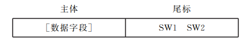

### APDU请求 - 命令头

由上述结构图可知，命令头由以下四个部分组成，每个部分各占1byte：

- CLA: Class Type, the type of the ADPU
- INS: Instruction Byte of Command Message
- P1: Parameter 1
- P2: Parameter 2

其中比较重要的便是CLA和INS，分别代表了指令的类型以及指令具体是什么。

#### CLA

CLA采用比特编码的方式标识类型，具体如图所示

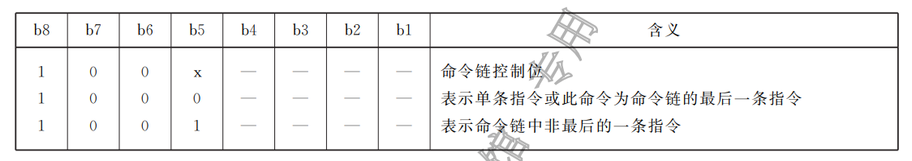

b1-b8分别表示一个字节的从低到高比特位，其中b1-b4为预留位，无实际含义。由上图易得CLA的取值范围只可以是**80和90**，分别对应最后一条指令和非最后一条指令。

#### INS

INS用来标识具体的指令，部分的指令对应表如下，完整的INS指令表项可以查找文末的附录：

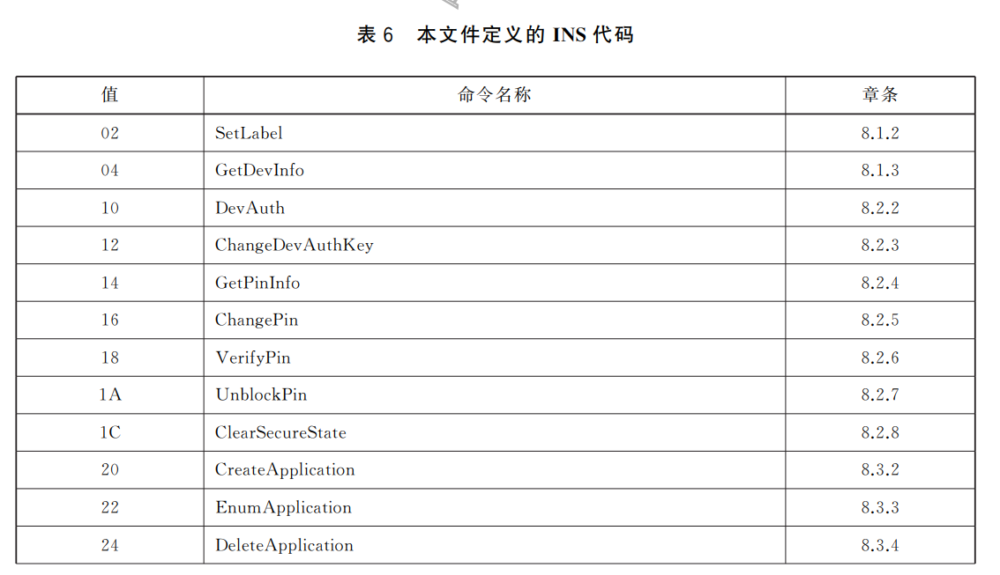

#### P1 & P2参数

P1和P2可以为任何值，如果不对P1和P2进行进一步的限定，应均置0x00

### APDU请求 - 命令体

上文中，我们提到：

> 命令体的**Lc字段、数据字段、Le字段**均为可选字段
>
> Lc: 标识数据字段的长度；
>
> 数据字段：实际的数据内容；
>
> Le：标识期望的数据字段的长度，当Le为0时，表示期望返回数据为65536字节，否则为1-65535的具体值

因此，一个完整的APDU命令有以下四种情况

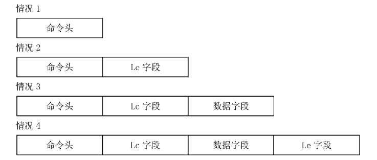

- 情况1：Lc、数据、Le均为空。**特别注意：Le为空即Le为0，期望返回数据长度为65536**；
- 情况2：Le非空，有具体期望返回长度
- 情况3：Lc、数据非空，Le为空
- 情况4：Lc、数据、Le均为非空，最完整的命令情况

#### 命令体编码规范

命令体为一个不定长的字节合集，遵从一套**命令体编码规范**，并非直接进行数据的拼接。具体来说，规范讲命令体定义为一个L个字节的集合体，每个字节分别对应B1 - BL，L为命令的字节总长度。

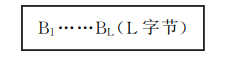

其中核心要求为两点：

1. B1的值必须为0x00，也就是这个字段非空时的开头一定是0x00
2. Lc和Le若非空，长度均为固定2字节

也就是说，当Lc、数据字段、Le均存在时，完整的APDU命令如下：

```shell
+-----+-----+------+------+------+-----------+--------------+-----------+
| CLA | INS | 0x00 | 0x00 | 0x00 | 2 Byte Lc | Lc Byte Data | 2 Byte Le |
+-----+-----+------+------+------+-----------+--------------+-----------+
```

用标准中的图表表示我们上文谈到的四种情况如下：

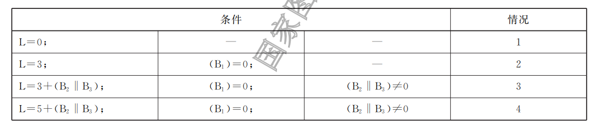

- 情况1：全为空，L为0
- 情况2：Le非空。B1固定0x00， B2-B3一起代表Le的具体值，L总长度为3
- 情况3：Lc和数据非空，但是Le为空。B1固定0x00，B2-B3代表Lc，之后紧挨着Lc长度的数据段。L的长度为$L = 3 + (B_2 || B_3)$
- 情况4：均为非空。B1固定0x00，B2-B3代表Lc，之后紧挨着Lc长度的数据段，最后两字节为Le。L的长度为$L = 5 +(B_2 || B_3)$

### APDU响应

上文我们说到响应由数据段和SW1、SW2组成


数据字段的长度由请求对应的Le决定，SW1和SW2则更加具体的体现了智能密码钥匙的处理状态

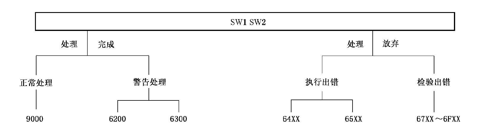

> [!note]
>
> 注：当SW1=63或65时，非易失存储器状态发生改变，当SW1为其他6X时，非易失存储器状态不发生变化


## 附录A INS指令代码集


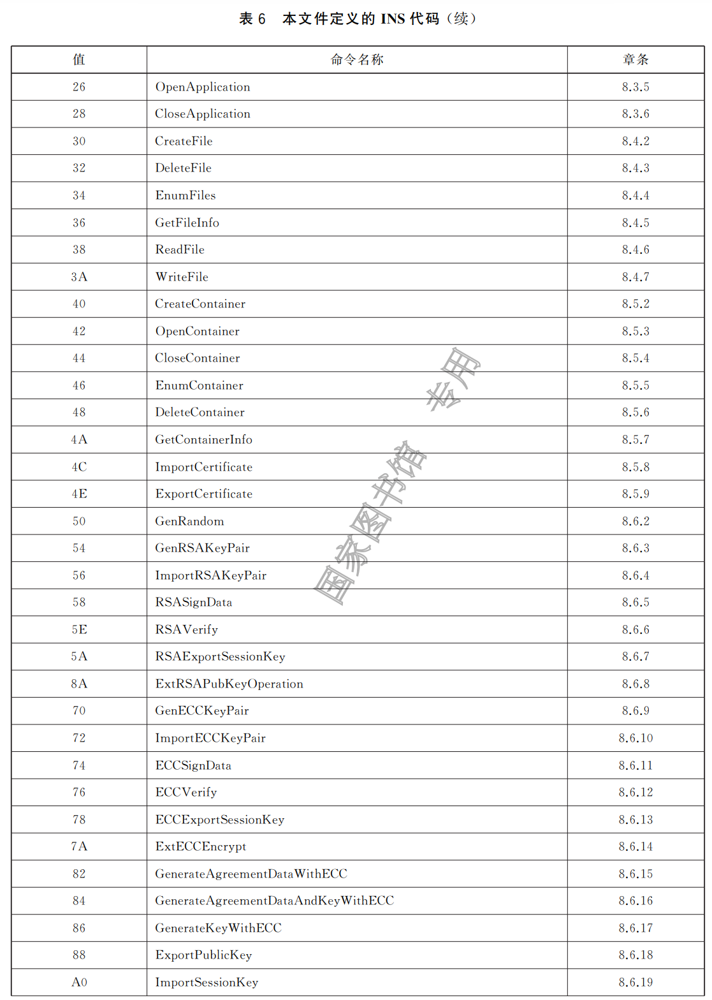

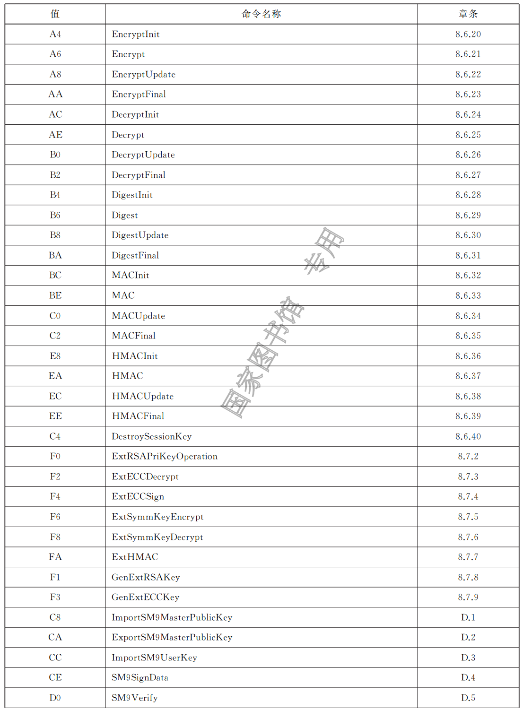

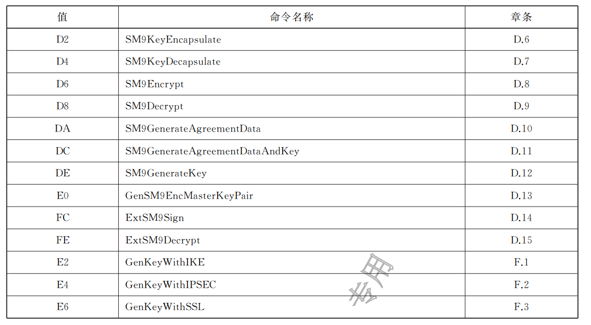

## 附录B SW1 & SW2 响应状态集

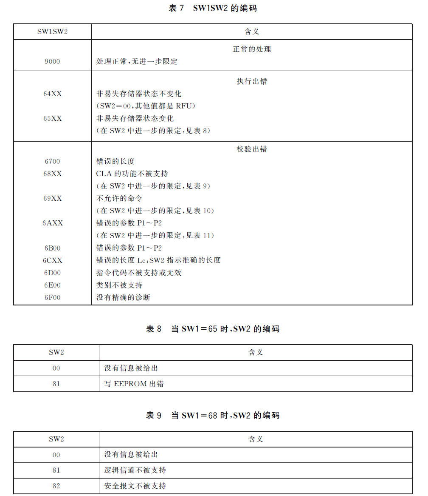
