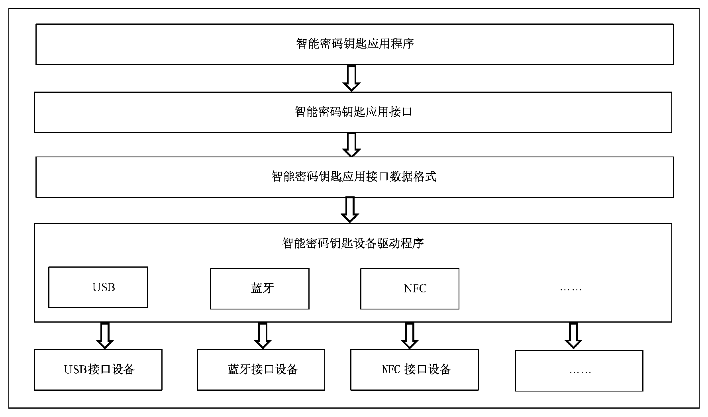
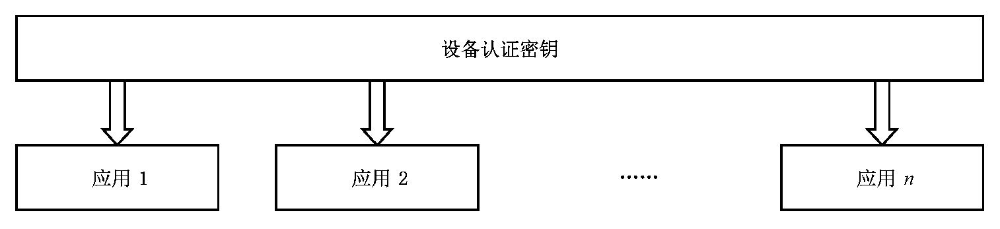
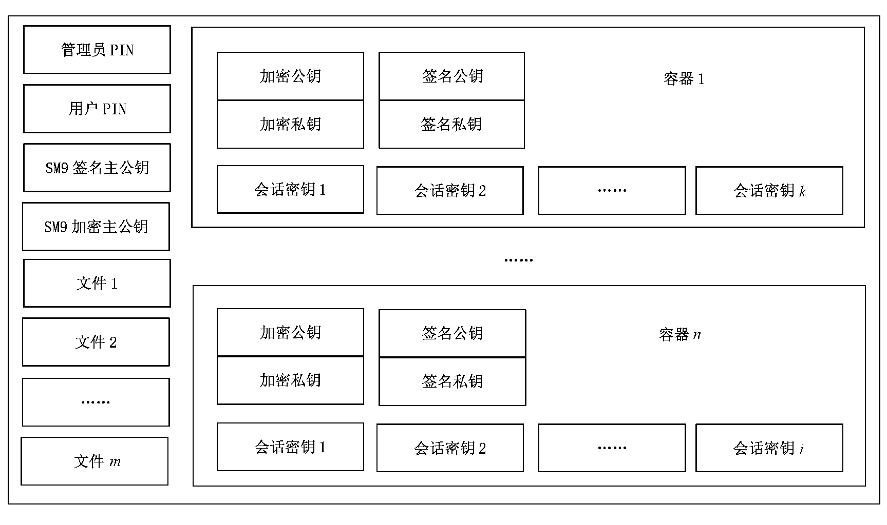

# GMT0016-2023智能密码钥匙密码应用接口规范

## 1 范围

本文件规定了公钥密码体制下的智能密码钥匙应用接口标准、密码相关应用接口的函数、数据类型、参数的定义和设备的安全要求。

本文件适用于智能密码钥匙产品的研制、使用和检测。

## 2 规范性引用文件

下列文件中的内容通过文中的规范性引用而构成本文件必不可少的条款。其中，注日期的引用文件，仅该日期对应的版本适用于本文件；不注日期的引用文件，其最新版本（包括所有的修改单）适用于本文件。

GM/T 0006—2023 密码应用标识规范

GM/T 0017—2023 智能密码钥匙密码应用接口数据格式规范

GM/T 0027—2014 智能密码钥匙技术规范

GM/T 0028—2014 密码模块安全要求

GM/Z 4001 密码术语

PKCS#1 RSA 密码规范版本2.1（RSA Cryptography specification version 2.1）

## 3 术语和定义

GM/Z 4001 界定的以及下列术语和定义适用于本文件。

### 3.1 容器 container

密码设备中用于保存密钥所划分的唯一性存储空间。

### 3.2 终端设备 terminal device

智能密码钥匙的统称。

### 3.3 设备认证 device authentication

智能密码钥匙对应用程序的认证。

### 3.4 设备认证密钥 device authentication key

用于设备认证的密钥。

### 3.5 设备标签 device label

终端设备的别名，可由用户进行设定并存储于设备内部。

### 3.6 管理员PIN administrator PIN

管理员的口令，为ASCII 字符串。

### 3.7 用户PIN user PIN

用户的个人口令，为ASCII 字符串。

### 3.8 应用 application

包括容器和文件的一种结构，具备独立的管理权限。

## 4 缩略语

下列缩略语适用于本文件。

API：应用编程接口（Application Programming Interface）

ASCII：美国信息交换标准码（American Standard Code for Information Interchange）

MAC：消息鉴别码（Message Authentication Code）

PKI：公钥基础设施（Public Key Infrastructure）

PIN：个人身份识别码（Personal Identification Number）

## 5 结构模型

### 5.1 层次关系

智能密码钥匙应用接口位于智能密码钥匙应用程序与智能密码钥匙应用接口数据格式之间，如图1 所示。智能密码钥匙硬件接口应符合GM/T 0027—2014 中6.1 的规定。



**图 1 接口在应用层次关系中的位置**

### 5.2 设备的应用结构

终端设备应具有一个设备认证密钥。终端设备应支持一个或多个应用。应用之间应相互独立。设备的逻辑结构如图2 所示。



**图 2 设备逻辑结构**

应用由管理员PIN、用户PIN、文件和容器组成，可存在多个文件和多个容器。应用应维护自身的权限状态。管理员PIN 和用户PIN 的校验操作可改变应用权限状态。一个应用的逻辑结构如图3所示。

容器用于存放加密密钥对、签名密钥对和会话密钥。其中，加密密钥对用于保护会话密钥，签名密钥对用于数字签名和验证，会话密钥用于数据加解密和MAC 运算。容器中存放SM2 算法的密钥对时，与其对应的数字证书也应存放在该容器中，且签名密钥对应由内部产生，加密密钥对应由外部安全导入；容器中存放SM9 算法的密钥对时，其公钥由标识表示；会话密钥可由内部产生，也可由外部产生并安全导入。



**图 3 应用逻辑结构图**

## 6 数据类型定义

### 6.1 算法标识

密码算法标识应符合GM/T 0006—2023 中第6 章的规定。

### 6.2 基本数据类型

字节数组应使用高位字节在前（Big-Endian）的方式存储和交换。基本数据类型定义见表1。

**表1 基本数据类型**

| 类型名称 | 描述 | 备注 |
| --- | --- | --- |
| INT8 | 有符号8 位整数 | 例如：typedef char INT8 |
| INT16 | 有符号16 位整数 | 例如，typedef short INT16 |
| INT32 | 有符号32 位整数 | 例如，typedef int INT32 |
| UINT8 | 无符号8 位整数 | 例如，typedef unsigned char UINT8 |
| UINT16 | 无符号16 位整数 | 例如，typedef unsigned short UINT16 |
| UINT32 | 无符号32 位整数 | 例如，typedef unsigned int UINT32 |
| BOOL | 布尔类型，取值为TRUE 或FALSE | — |
| BYTE | 字节类型，无符号8 位整数 | typedef UINT8 BYTE |
| CHAR | 字符类型，无符号8 位整数 | typedef UINT8 CHAR |
| LONG | 长整数，有符号32 位整数 | typedef INT32 LONG |
| ULONG | 长整数，无符号32 位整数 | typedef UINT32 ULONG |
| UINT | 无符号32 位整数 | typedef UINT32 UINT |
| WORD | 字类型，无符号16 位整数 | typedef UINT16 WORD |
| DWORD | 双字类型，无符号32 位整数 | typedef UINT32 DWORD |
| FLAGS | 标志类型，无符号32 位整数 | typedef UINT32 FLAGS |
| LPSTR | 8 位字符串指针，按照UTF8 格式存储及交换 | typedef CHAR * LPSTR |
| HANDLE | 句柄，指向任意数据对象的起始地址 | typedef void * HANDLE |
| DEVHANDLE | 设备句柄 | typedef HANDLE DEVHANDLE |
| HAPPLICATION | 应用句柄 | typedef HANDLE HAPPLICATION |
| HCONTAINER | 容器句柄 | typedef HANDLE HCONTAINER |

### 6.3 常量定义

数据常量标识定义了在规范中用到的常量的取值。数据常量标识的定义如表2 所示。

**表2 常量定义**

| 常量名 | 取值 | 描述 |
| --- | --- | --- |
| TRUE | 0x00000001 | 布尔值为真 |
| FALSE | 0x00000000 | 布尔值为假 |
| DEVAPI | _stdcall | _stdcall 函数调用方式 |
| ADMIN_TYPE | 0 | 管理员PIN 类型 |
| USER_TYPE | 1 | 用户PIN 类型 |

### 6.4 复合数据类型

#### 6.4.1 对齐方式

复合数据类型应采用单字节对齐方式。

#### 6.4.2 版本

##### 6.4.2.1 类型定义

```c
typedef struct Struct_Version{
BYTE major;
BYTE minor;
}VERSION;
```

##### 6.4.2.2 数据项

数据项应符合表3 的规定。

**表3 版本定义**

| 数据项 | 类型 | 意义 | 备注 |
| --- | --- | --- | --- |
| major | BYTE | 主版本号 | 使用ASCII 编码，取值范围为字符0 至字符9 |
| minor | BYTE | 次版本号 | 使用ASCII 编码，取值范围为字符0 至字符9 |

#### 6.4.3 设备信息

##### 6.4.3.1 类型定义

```c
typedef struct Struct_DEVINFO{
VERSION Version;
CHAR Manufacturer[64];
CHAR Issuer[64];
CHAR Label[32];
CHAR SerialNumber[32];
VERSION HWVersion;
VERSION FirmwareVersion;
ULONG AlgSymCap;
ULONG AlgAsymCap;
ULONG AlgHashCap;
ULONG DevAuthAlgId;
ULONG TotalSpace;
ULONG FreeSpace;
ULONG MaxECCBufferSize;
ULONG MaxBufferSize;
BYTE Reserved[64];
} DEVINFO_SKF,*PDEVINFO_SKF;
```

##### 6.4.3.2 数据项

数据项应符合表4 的规定。

**表4 设备信息描述**

| 数据项 | 类型 | 意义 | 备注 |
| --- | --- | --- | --- |
| Version | VERSION | 版本号 | 数据结构版本号，本结构的版本号为2.0 |
| Manufacturer | CHAR 数组 | 设备厂商信息 | 以‘\0’为结束符的ASCII 字符串 |
| Issuer | CHAR 数组 | 发行厂商信息 | 以‘\0’为结束符的ASCII 字符串 |
| Label | CHAR 数组 | 设备标签 | 以‘\0’为结束符的ASCII 字符串 |
| SerialNumber | CHAR 数组 | 序列号 | 以‘\0’为结束符的ASCII 字符串 |
| HWVersion | VERSION | 设备硬件版本 | — |
| FirmwareVersion | VERSION | 设备本身固件版本 | — |
| AlgSymCap | ULONG | 分组密码算法标识 | — |
| AlgAsymCap | ULONG | 非对称密码算法标识 | — |
| AlgHashCap | ULONG | 密码杂凑算法标识 | — |
| DevAuthAlgId | ULONG | 设备认证使用的分组密码算法标识 | — |
| TotalSpace | ULONG | 设备总空间大小 | — |
| FreeSpace | ULONG | 用户可用空间大小 | — |
| MaxECCBufferSize | ULONG | 能够处理的ECC 加密数据大小 | — |
| MaxBufferSize | ULONG | 能够处理的分组运算和杂凑运算的<br>数据大小 | — |
| Reserved | BYTE | 保留扩展 | — |

#### 6.4.4 RSA 公钥数据结构

##### 6.4.4.1 类型定义

```c
typedef struct Struct_RSAPUBLICKEYBLOB{
ULONG AlgID;
ULONG BitLen;
BYTE Modulus[MAX_RSA_MODULUS_LEN];
BYTE PublicExponent[MAX_RSA_EXPONENT_LEN];
}RSAPUBLICKEYBLOB, *PRSAPUBLICKEYBLOB;
```

MAX_RSA_MODULUS_LEN 为算法模数的最大长度；

MAX_RSA_EXPONENT_LEN 为算法指数的最大长度。

##### 6.4.4.2 数据项

数据项应符合表5 的规定。

**表5 RSA 公钥数据结构**

| 数据项 | 类型 | 意义 | 备注 |
| --- | --- | --- | --- |
| AlgID | ULONG | 算法标识号 | — |
| BitLen | ULONG | 模数的实际位长度 | 应是8 的倍数 |
| Modulus | BYTE 数组 | $n = p \times q$ | 实际长度为BitLen/8 字节<br>#define MAX_RSA_MODULUS_LEN 512<br>#define MAX_RSA_EXPONENT_LEN 4 |
| PublicExponent | BYTE 数组 | 公开密钥e | 一般为00010001 |

#### 6.4.5 RSA 私钥数据结构

##### 6.4.5.1 类型定义

```c
typedef struct Struct_RSAPRIVATEKEYBLOB{
ULONG AlgID;
ULONG BitLen;
BYTE Modulus[MAX_RSA_MODULUS_LEN];
BYTE PublicExponent[MAX_RSA_EXPONENT_LEN];
BYTE PrivateExponent[MAX_RSA_MODULUS_LEN];
BYTE Prime1[MAX_RSA_MODULUS_LEN/2];
BYTE Prime2[MAX_RSA_MODULUS_LEN/2];
BYTE Prime1Exponent[MAX_RSA_MODULUS_LEN/2];
BYTE Prime2Exponent[MAX_RSA_MODULUS_LEN/2];
BYTE Coefficient[MAX_RSA_MODULUS_LEN/2];
}RSAPRIVATEKEYBLOB, *PRSAPRIVATEKEYBLOB;
```

MAX_RSA_MODULUS_LEN 为RSA 算法模数的最大长度。

##### 6.4.5.2 数据项

数据项应符合表6 的规定。

**表6 RSA 私钥数据结构**

| 数据项 | 类型 | 意义 | 备注 |
| --- | --- | --- | --- |
| AlgID | ULONG | 算法标识号 | — |
| BitLen | ULONG | 模数的实际位长度 | 应是8 的倍数 |
| Modulus | BYTE 数组 | $n = p \times q$ | 实际长度为BitLen/8 字节 |
| PublicExponent | BYTE 数组 | 公开密钥e | 一般为00010001 |
| PrivateExponent | BYTE 数组 | 私有密钥d | 实际长度为BitLen/8 字节 |
| Prime1 | BYTE 数组 | 素数p | 实际长度为BitLen/16 字节 |
| Prime2 | BYTE 数组 | 素数q | 实际长度为BitLen/16 字节 |
| Prime1Exponent | BYTE 数组 | d mod （p-1）的值 | 实际长度为BitLen/16 字节 |
| Prime2Exponent | BYTE 数组 | d mod （q -1）的值 | 实际长度为BitLen/16 字节 |
| Coefficient | BYTE 数组 | q 模p 的乘法逆元 | 实际长度为BitLen/16 字节 |

#### 6.4.6 ECC 公钥数据结构

##### 6.4.6.1 类型定义

```c
typedef struct Struct_ECCPUBLICKEYBLOB{
ULONG BitLen;
BYTE XCoordinate[ECC_MAX_XCOORDINATE_BITS_LEN/8];
BYTE YCoordinate[ECC_MAX_YCOORDINATE_BITS_LEN/8];
}ECCPUBLICKEYBLOB, *PECCPUBLICKEYBLOB;
```

ECC_MAX_XCOORDINATE_LEN 为ECC 算法X 坐标的最大长度；ECC_MAX_YCOORDINATE_LEN 为ECC 算法Y 坐标的最大长度。

##### 6.4.6.2 数据项

数据项描述见表7。

**表7 ECC 公钥数据结构**

| 数据项 | 类型 | 意义 | 备注 |
| --- | --- | --- | --- |
| BitLen | ULONG | 模数的实际位长度 | 应是8 的倍数 |
| XCoordinate | BYTE 数组 | 曲线上点的X 坐标 | 有限域上的整数<br>#define ECC_MAX_XCOORDINATE_BITS_LEN 512 |
| YCoordinate | BYTE 数组 | 曲线上点的Y 坐标 | 有限域上的整数<br>#define ECC_MAX_YCOORDINATE_BITS_LEN 512 |

#### 6.4.7 ECC 私钥数据结构

##### 6.4.7.1 类型定义

```c
typedef struct Struct_ECCPRIVATEKEYBLOB{
ULONG BitLen;
BYTE PrivateKey[ECC_MAX_MODULUS_BITS_LEN/8];
}ECCPRIVATEKEYBLOB, *PECCPRIVATEKEYBLOB;
```

ECC_MAX_MODULUS_BITS_LEN 为ECC 算法模数的最大长度。

##### 6.4.7.2 数据项

数据项描述见表8。

**表8 ECC 私钥数据结构**

| 数据项 | 类型 | 意义 | 备注 |
| --- | --- | --- | --- |
| BitLen | ULONG | 模数的实际位长度 | 应是8 的倍数 |
| PrivateKey | BYTE 数组 | 私有密钥 | 有限域上的整数<br>#define ECC_MAX_MODULUS_BITS_LEN 512 |

#### 6.4.8 ECC 密文数据结构

##### 6.4.8.1 类型定义

```c
typedef struct Struct_ECCCIPHERBLOB{
BYTE XCoordinate[ECC_MAX_XCOORDINATE_BITS_LEN/8];
BYTE YCoordinate[ECC_MAX_XCOORDINATE_BITS_LEN/8];
BYTE HASH[32];
ULONG CipherLen;
BYTE Cipher[1];
} ECCCIPHERBLOB, *PECCCIPHERBLOB;
```

##### 6.4.8.2 数据项

数据项描述见表9。

**表9 ECC 密文数据结构**

| 数据项 | 类型 | 意义 | 备注 |
| --- | --- | --- | --- |
| XCoordinate | BYTE 数组 | 与y 组成椭圆曲线上的点（x，y） | — |
| YCoordinate | BYTE 数组 | 与x 组成椭圆曲线上的点（x，y） | — |
| HASH | BYTE 数组 | 明文的杂凑值 | — |
| CipherLen | ULONG | 密文数据长度 | — |
| Cipher | BYTE 数组 | 密文数据 | 实际长度为CipherLen |

#### 6.4.9 ECC 签名数据结构

##### 6.4.9.1 类型定义

```c
typedef struct Struct_ECCSIGNATUREBLOB{
BYTE r[ECC_MAX_XCOORDINATE_BITS_LEN/8];
BYTE s[ECC_MAX_XCOORDINATE_BITS_LEN/8];
} ECCSIGNATUREBLOB, *PECCSIGNATUREBLOB;
```

ECC_MAX_MODULUS_BITS_LEN 为ECC 算法模数的最大长度。

##### 6.4.9.2 数据项

数据项描述见表10。

**表10 ECC 签名数据结构**

| 数据项 | 类型 | 意义 | 备注 |
| --- | --- | --- | --- |
| r | BYTE 数组 | 签名结果的r 部分 | — |
| s | BYTE 数组 | 签名结果的s 部分 | — |

#### 6.4.10 分组密码参数

##### 6.4.10.1 类型定义

```c
typedef struct Struct_BLOCKCIPHERPARAM{
BYTE IV[MAX_IV_LEN];
ULONG IVLen;
ULONG FeedBitLen;
} BLOCKCIPHERPARAM, *PBLOCKCIPHERPARAM;
```

##### 6.4.10.2 数据项

数据项描述见表11。

**表11 分组密码参数**

| 数据项 | 类型 | 意义 | 备注 |
| --- | --- | --- | --- |
| IV | BYTE 数组 | 初始向量，MAX_IV_LEN 为初始化向量的最<br>大长度#define MAX_IV_LEN 32 | — |
| IVLen | ULONG | 初始向量实际长度（按字节计算） | — |
| FeedBitLen | ULONG | 反馈值的位长度（按位计算） | 只针对OFB、CFB 模式 |

#### 6.4.11 ECC 加密密钥对保护结构

##### 6.4.11.1 类型定义

```c
typedef struct Struct_ENVELOPEDKEYBLOB{
ULONG  Version;
ULONG  ulSymmAlgID;
ULONG  ulBits;
BYTE cbEncryptedPriKey[64];
ECCPUBLICKEYBLOB PubKey;
ECCCIPHERBLOB ECCCipherBlob;
}ENVELOPEDKEYBLOB, *PENVELOPEDKEYBLOB;
```

私钥密文数组中的有效密文分组应从0 偏移量字节开始。顺序解密密文分组后将明文连接应得到加密密钥对的私钥的明文。

##### 6.4.11.2 数据项

数据项描述见表12。

**表12 加密密钥对保护结构参数**

| 数据项 | 类型 | 意义 | 备注 |
| --- | --- | --- | --- |
| Version | ULONG | 版本号，本版本为2 | — |
| ulSymmAlgID | ULONG | 对称算法标识 | 应为ECB 模式 |
| ulBits | ULONG | 加密密钥对的密钥位长 | — |
| cbEncryptedPrivKey | BYTE 数组 | 对称算法加密的加密私钥，加密私钥<br>的原文为ECCPRIVATEKEYBLOB<br>结构中的PrivateKey | 其有效长度为原文的（ulBits<br>+ 7）/8 |
| PubKey | ECCPUBLICKEYB<br>LOB | 加密密钥对的公钥 | — |
| ECCCipherBlob | ECCCIPHERBLOB | 用保护公钥加密过的对称密钥密文 | — |

#### 6.4.12 文件属性

##### 6.4.12.1 类型定义

```c
typedef struct Struct_FILEATTRIBUTE{
CHAR FileName[32];
ULONG FileSize;
ULONG ReadRights;
ULONG WriteRights;
} FILEATTRIBUTE, *PFILEATTRIBUTE;
```

##### 6.4.12.2 数据项

数据项描述见表13。

**表13 文件属性**

| 数据项 | 类型 | 意义 | 备注 |
| --- | --- | --- | --- |
| FileName | CHAR 数组 | 文件名 | 以‘\0’结束的ASCII 字符串，最大长度为32 |
| FileSize | ULONG | 文件大小 | 创建文件时定义的文件大小 |
| ReadRights | ULONG | 读取权限 | 读取文件应已取得的权限 |
| WriteRights | ULONG | 写入权限 | 写入文件应已取得的权限 |

#### 6.4.13 权限类型

权限类型的定义见表14。

**表14 权限类型**

| 权限类型 | 值 | 说明 |
| --- | --- | --- |
| SECURE_NEVER_ACCOUNT | 0x00000000 | 不准许 |
| SECURE_ADM_ACCOUNT | 0x00000001 | 管理员权限 |
| SECURE_USER_ACCOUNT | 0x00000010 | 用户权限 |
| SECURE_ANYONE_ACCOUNT | 0x000000FF | 任何人 |

#### 6.4.14 设备状态

设备状态的定义见表15。

**表15 设备状态**

| 设备状态 | 值 | 说明 |
| --- | --- | --- |
| DEV_ABSENT_STATE | 0x00000000 | 设备不存在 |
| DEV_PRESENT_STATE | 0x00000001 | 设备存在 |
| DEV_UNKNOW_STATE | 0x00000002 | 设备状态未知 |

#### 6.4.15 错误代码

接口函数所返回的错误代码应符合附录A 中的规定。

## 7 接口函数

### 7.1 设备管理

#### 7.1.1 概述

设备管理主要完成设备的插拔事件处理、枚举设备、连接设备、断开连接、获取设备状态、设置设备标签、获取设备信息、锁定设备、解锁设备的操作。设备管理系列函数见表16。

**表16 设备管理系列函数**

| 函数名称 | 功能 |
| --- | --- |
| SKF_WaitForDevEvent | 等待设备插拔事件 |
| SKF_CancelWaitForDevEvent | 取消等待设备插拔事件 |
| SKF_EnumDev | 枚举设备 |
| SKF_ConnectDev | 连接设备 |
| SKF_DisconnectDev | 断开连接 |
| SKF_GetDevState | 获取设备状态 |
| SKF_SetLabel | 设置设备标签 |
| SKF_GetDevInfo | 获取设备信息 |
| SKF_LockDev | 锁定设备 |
| SKF_UnlockDev | 解锁设备 |

#### 7.1.2 等待设备插拔事件

**原型**

```c
ULONG DEVAPI SKF_WaitForDevEvent(LPSTR szDevName,ULONG *pulDevNameLen, ULONG *pulEvent)
```

**功能描述**  该函数等待设备插入或者拔除事件。szDevName 返回发生事件的设备名称。

**参数**  szDevName  [OUT] 发生事件的设备名称。

pulDevNameLen  [IN，OUT] 输入/输出参数，当输入时表示缓冲区长度，输出时表

示设备名称的有效长度，长度包含字符串结束符。

pulEvent  [OUT] 事件类型。1 表示插入，2 表示拔出。

**返回值**  SAR_OK： 成功。

其他：  错误码。

注：本函数为阻塞函数。

#### 7.1.3 取消等待设备插拔事件

**原型**

```c
ULONG DEVAPI SKF_CancelWaitForDevEvent()
```

**功能描述**  该函数取消等待设备插入或者拔除事件。

**参数**

**返回值**  SAR_OK： 成功。

其他：  错误码。

注：使本进程正在执行的SKF_WaitForDevEvent 函数立即返回。

#### 7.1.4 枚举设备

**原型**

```c
ULONG DEVAPI SKF_EnumDev(BOOL bPresent, LPSTR szNameList, ULONG
*pulSize)
```

**功能描述**  获得当前系统中的设备列表。

**参数**  bPresent  [IN] 为TRUE 表示取当前设备状态为存在的设备列表。为FALSE

表示取当前驱动支持的设备列表。

szNameList  [OUT] 设备名称列表。如果该参数为NULL，将由pulSize 返回该列

表的字节长度。每个设备的名称以单个‘\0’结束，以双‘\0’表示列表的结束。

pulSize  [IN，OUT] 输入时表示设备名称列表的缓冲区长度，输出时表示sz-

NameList 所占用的空间大小。

**返回值**  SAR_OK： 成功。

其他：  错误码。

#### 7.1.5 连接设备

**原型**

```c
ULONG DEVAPI SKF_ConnectDev (LPSTR szName, DEVHANDLE *phDev)
```

**功能描述**  通过设备名称连接设备，返回设备的句柄。

**参数**  szName  [IN] 设备名称。

phDev  [OUT] 返回设备操作句柄。

**返回值**  SAR_OK： 成功。

其他：  错误码。

#### 7.1.6 断开连接

**原型**

```c
ULONG DEVAPI SKF_DisConnectDev (DEVHANDLE hDev)
```

**功能描述**  断开一个已经连接的设备，并释放句柄。

**参数**  hDev  [IN] 连接设备时返回的设备句柄。

**返回值**  SAR_OK： 成功。

其他：  错误码。

注：如果该设备已被锁定，函数首先解锁该设备。断开连接操作并不影响设备的权限状态。

#### 7.1.7 获取设备状态

**原型**

```c
ULONG DEVAPI SKF_GetDevState(LPSTR szDevName, ULONG *pulDevState)
```

**功能描述**  获取设备是否存在的状态。

**参数**  szDevName  [IN] 设备名称。

pulDevState  [OUT] 返回设备状态。

**返回值**  SAR_OK： 成功。

其他：  错误码。

#### 7.1.8 设置设备标签

**原型**

```c
ULONG DEVAPI SKF_SetLabel (DEVHANDLE hDev, LPSTR szLabel)
```

**功能描述**  设置设备标签。

**参数**  hDev  [IN] 连接设备时返回的设备句柄。

szLabel  [IN] 设备标签字符串。该字符串应小于32 字节。

**返回值**  SAR_OK： 成功。

其他：  错误码。

#### 7.1.9 获取设备信息

**原型**

```c
ULONG DEVAPI SKF_GetDevInfo (DEVHANDLE hDev, DEVINFO *pDevInfo)
```

**功能描述**  获取设备的一些特征信息，包括设备标签、厂商信息和支持的算法。

**参数**  hDev  [IN] 连接设备时返回的设备句柄。

pDevInfo [OUT] 返回设备信息。

**返回值**  SAR_OK： 成功。

其他：  错误码。

#### 7.1.10 锁定设备

**原型**

```c
ULONG DEVAPI SKF_LockDev (DEVHANDLE hDev, ULONG ulTimeOut)
```

**功能描述**  获得设备的独占使用权。

**参数**  hDev  [IN] 连接设备时返回的设备句柄。

ulTimeOut [IN] 超时时间，单位为毫秒。如果为0xFFFFFFFF 表示无限等待。

**返回值**  SAR_OK： 成功。

其他：  错误码。

#### 7.1.11 解锁设备

**原型**

```c
ULONG DEVAPI SKF_UnlockDev (DEVHANDLE hDev)
```

**功能描述**  释放对设备的独占使用权。

**参数**  hDev  [IN] 连接设备时返回的设备句柄。

**返回值**  SAR_OK： 成功。

其他：  错误码。

### 7.2 访问控制

#### 7.2.1 概述

访问控制主要完成设备认证、PIN 码管理和安全状态管理操作。安全状态表示设备认证、校验PIN 之后用户所取得的资源访问能力。访问控制系列函数见表17。

**表17 访问控制系列函数**

| 函数名称 | 功能 |
| --- | --- |
| SKF_ChangeDevAuthKey | 修改设备认证密钥 |
| SKF_DevAuth | 设备认证 |
| SKF_ChangePIN | 修改PIN |
| SKF_GetPINInfo | 获得PIN 码信息 |
| SKF_VerifyPIN | 校验PIN |
| SKF_UnblockPIN | 解锁PIN |
| SKF_ClearSecureState | 清除应用安全状态 |

#### 7.2.2 修改设备认证密钥

**原型**

```c
ULONG DEVAPI SKF_ChangeDevAuthKey (DEVHANDLE hDev, BYTE *pbKeyCipher, ULONG ulKeyCipherLen,BYTE *pbKeyMac, ULONG ulKeyMacLen)
```

**功能描述**  更改设备认证密钥。使用密文+MAC 方式进行密钥更新。MAC 用于保证只有原设备

认证密钥持有者才能完成本操作。

**参数**  hDev  [IN] 连接时返回的设备句柄。

pbKeyCipher  [IN] 新设备认证密钥的密文。该密文通过使用原设备认证密钥

对新设备认证密钥进行加密得到，计算过程应符合GM/T 0017—2023 中附录B 的规定。

ulKeyCipherLen  [IN] pbKeyCipher 的长度。

pbKeyMac  [IN] 报文鉴别码，该报文鉴别码由原设备认证密钥对含有pbKey-

Cipher 的数据进行计算得到，计算过程应符合GM/T 0017—2023中附录B 的规定。

ulKeyMacLen  [IN] pbKeyMac 的长度。

**返回值**  SAR_OK： 成功。

其他：  错误码。

#### 7.2.3 设备认证

**原型**

```c
ULONG DEVAPI SKF_DevAuth (DEVHANDLE hDev, BYTE *pbAuthData,
ULONG ulLen)
```

**功能描述**  设备认证是设备对应用程序的认证。认证过程应符合8.2.3 中的规定。

**参数**  hDev  [IN] 连接时返回的设备句柄。

pbAuthData  [IN] 认证数据。

ulLen  [IN] 认证数据的长度。

**返回值**  SAR_OK： 成功。

其他：  错误码。

#### 7.2.4 修改PIN

**原型**

```c
ULONG DEVAPI SKF_ChangePIN (HAPPLICATION hApplication, ULONG ulPINType, LPSTR szOldPin,LPSTR szNewPin,ULONG *pulRetryCount)
```

**功能描述**  调用该函数可修改Administrator PIN 和User PIN 的值。

如果原PIN 码错误导致验证失败，该函数会返回相应PIN 码的剩余重试次数，当剩余次数为0 时，表示PIN 已经被锁死。

**参数**  hApplication  [IN] 应用句柄。

ulPINType  [IN] PIN 类型，可为ADMIN_TYPE 或USER_TYPE。

szOldPin  [IN] 原PIN 值。

szNewPin  [IN] 新PIN 值。

pulRetryCount  [OUT] 出错后重试次数。

**返回值**  SAR_OK： 成功。

其他：  错误码。

#### 7.2.5 获取PIN 信息

**原型**

```c
ULONG DEVAPI SKF_GetPINInfo(HAPPLICATION hApplication, ULONG ulPINType, ULONG *pulMaxRetryCount, ULONG *pulRemainRetryCount, BOOL *pbDefaultPin)
```

**功能描述**  获取PIN 码信息，包括最大重试次数、当前剩余重试次数，以及当前PIN 码是否为出厂默

认PIN 码。

**参数**  hApplication  [IN] 应用句柄。

ulPINType  [IN] PIN 类型。

pulMaxRetryCount  [OUT] 最大重试次数。

pulRemainRetryCount [OUT] 当前剩余重试次数，当为0 时表示已锁死。

pbDefaultPin  [OUT] 是否为出厂默认PIN 码。

**返回值**  SAR_OK： 成功。

其他：  错误码。

#### 7.2.6 校验PIN

**原型**

```c
ULONG DEVAPI SKF_VerifyPIN (HAPPLICATION hApplication, ULONG ulPINType, LPSTR szPIN, ULONG *pulRetryCount)
```

**功能描述**  校验PIN 码。校验成功后，会获得相应的权限，如果PIN 码错误，会返回PIN 码的重试次

数，当重试次数为0 时表示PIN 码已经锁死。

**参数**  hApplication  [IN] 应用句柄。

ulPINType  [IN] PIN 类型。

szPIN  [IN] PIN 值。

pulRetryCount  [OUT] 出错后返回的重试次数。

**返回值**  SAR_OK： 成功。

其他：  错误码。

#### 7.2.7 解锁PIN

**原型**

```c
ULONG DEVAPI SKF_UnblockPIN (HAPPLICATION hApplication, LPSTR szAdminPIN, LPSTR szNewUserPIN,ULONG *pulRetryCount)
```

**功能描述**  当用户的PIN 码锁死后，通过调用该函数来解锁用户PIN 码。

解锁后，用户PIN 码被设置成新值，用户PIN 码的重试次数也恢复到原值。

**参数**  hApplication  [IN] 应用句柄。

szAdminPIN  [IN] 管理员PIN 码。

szNewUserPIN [IN] 新的用户PIN 码。

pulRetryCount  [OUT] 管理员PIN 码错误时，返回剩余重试次数。

**返回值**  SAR_OK： 成功。

其他：  错误码。

注：验证完管理员PIN 才能够解锁用户PIN 码，如果输入的Administrator PIN 不正确或者已经锁死，会调用失

败，并返回Administrator PIN 的重试次数。

#### 7.2.8 清除应用安全状态

**原型**

```c
ULONG DEVAPI SKF_ClearSecureState (HAPPLICATION hApplication)
```

**功能描述**  清除应用当前的安全状态。

**参数**  hApplication  [IN] 应用句柄。

**返回值**  SAR_OK： 成功。

其他：  错误码。

### 7.3 应用管理

#### 7.3.1 概述

应用管理主要完成应用的创建、枚举、删除、打开、关闭操作。应用管理系列函数见表18。

**表18 应用管理系列函数**

| 函数名称 | 功能 |
| --- | --- |
| SKF_CreateApplication | 创建应用 |
| SKF_EnumApplication | 枚举应用 |
| SKF_DeleteApplication | 删除应用 |
| SKF_OpenApplication | 打开应用 |
| SKF_CloseApplication | 关闭应用 |

#### 7.3.2 创建应用

**原型**

```c
ULONG DEVAPI SKF_CreateApplication(DEVHANDLE hDev, LPSTR szAppName,
LPSTR szAdminPin, DWORD dwAdminPinRetryCount,LPSTR szUserPin, DWORD
dwUserPinRetryCount,DWORD dwCreateFileRights, HAPPLICATION *phApplication)
```

**功能描述**  创建一个应用。

**参数**  hDev  [IN] 连接设备时返回的设备句柄。

szAppName  [IN] 应用名称。

szAdminPin  [IN] 管理员PIN。

dwAdminPinRetryCount [IN] 管理员PIN 最大重试次数。

szUserPin  [IN] 用户PIN。

dwUserPinRetryCount  [IN] 用户PIN 最大重试次数。

dwCreateFileRights  [IN] 在该应用下创建文件和容器的权限，权限类型应符合

6.4.12 的规定。取值为各种权限的或值。

phApplication  [OUT] 应用的句柄。

**返回值**  SAR_OK： 成功。

其他：  错误码。

注：权限要求：已取得设备权限。

#### 7.3.3 枚举应用

**原型**

```c
ULONG DEVAPI SKF_EnumApplication(DEVHANDLE hDev, LPSTR szAppName,
ULONG *pulSize)
```

**功能描述**  枚举设备中存在的所有应用。

**参数**  hDev  [IN] 连接设备时返回的设备句柄。

szAppName  [OUT] 返回应用名称列表，如果该参数为空，将由pulSize 返回

该列表的字节长度。每个应用的名称以单个‘\0’结束，以双‘\0’表示列表的结束。

pulSize  [IN，OUT] 输入时表示应用名称的缓冲区长度，输出时返回

szAppName 所占用的空间大小。

**返回值**  SAR_OK： 成功。

其他：  错误码。

#### 7.3.4 删除应用

**原型**

```c
ULONG DEVAPI SKF_DeleteApplication(DEVHANDLE hDev, LPSTR szAppName)
```

**功能描述**  删除指定的应用。

**参数**  hDev  [IN] 连接设备时返回的设备句柄。

szAppName  [IN] 应用名称。

**返回值**  SAR_OK： 成功。

其他：  错误码。

注：权限要求：已取得设备权限。

#### 7.3.5 打开应用

**原型**

```c
ULONG DEVAPI SKF_OpenApplication(DEVHANDLE hDev, LPSTR szAppName,
HAPPLICATION *phApplication)
```

**功能描述**  打开指定的应用。

**参数**  hDev  [IN] 连接设备时返回的设备句柄。

szAppName  [IN] 应用名称。

phApplication  [OUT] 应用的句柄。

**返回值**  SAR_OK： 成功。

其他：  错误码。

#### 7.3.6 关闭应用

**原型**

```c
ULONG DEVAPI SKF_CloseApplication(HAPPLICATION hApplication)
```

**功能描述**  关闭应用并释放应用句柄。

**参数**  hApplication  [IN] 应用句柄。

**返回值**  SAR_OK： 成功。

其他：  错误码。

注：此函数不影响应用安全状态。

### 7.4 文件管理

#### 7.4.1 概述

文件管理函数用以支持用户扩展开发，包括创建文件、删除文件、枚举文件、获取文件信息、文件读操作、文件写操作。文件管理系列函数见表19。

**表19 文件管理系列函数**

| 函数名称 | 功能 |
| --- | --- |
| SKF_CreateFile | 创建文件 |
| SKF_DeleteFile | 删除文件 |
| SKF_EnumFiles | 枚举文件 |
| SKF_GetFileInfo | 获取文件信息 |
| SKF_ReadFile | 读文件 |
| SKF_WriteFile | 写文件 |

#### 7.4.2 创建文件

**原型**

```c
ULONG DEVAPI SKF_CreateFile (HAPPLICATION hApplication, LPSTR szFileName, ULONG ulFileSize, ULONG ulReadRights,ULONG ulWriteRights)
```

**功能描述**  创建文件时要指定文件的名称，大小，以及文件的读写权限。

**参数**  hApplication  [IN] 应用句柄。

szFileName  [IN] 文件名称，长度不应大于32 个字节。

ulFileSize  [IN] 文件大小。

ulReadRights  [IN] 文件读权限，权限类型应符合6.4.11 的要求。取值可为各

种权限的或值。

ulWriteRights  [IN] 文件写权限，权限类型应符合6.4.11 的要求。取值可为各

种权限的或值。

**返回值**  SAR_OK： 成功。

其他：  错误码。

注：权限要求：已取得应用指定的创建文件权限。

#### 7.4.3 删除文件

**原型**

```c
ULONG DEVAPI SKF_DeleteFile (HAPPLICATION hApplication, LPSTR szFileName)
```

**功能描述**  删除指定文件：

文件删除后，文件中写入的所有信息将丢失。

文件在设备中的占用的空间将被释放。

**参数**  hApplication  [IN] 要删除文件所在的应用句柄。

szFileName  [IN] 要删除文件的名称。

**返回值**  SAR_OK： 成功。

其他：  错误码。

注：权限要求：已取得该文件的创建权限。

#### 7.4.4 枚举文件

**原型**

```c
ULONG DEVAPI SKF_EnumFiles (HAPPLICATION hApplication, LPSTR szFileList, ULONG *pulSize)
```

**功能描述**  枚举一个应用下存在的所有文件。

**参数**  hApplication  [IN] 应用句柄。

szFileList  [OUT] 返回文件名称列表，该参数为空，由pulSize 返回文件信息的

字节长度。每个文件名称以单个‘\0’结束，以双‘\0’表示列表的结束。

pulSize  [IN，OUT] 输入时表示数据缓冲区的大小，输出时表示实际文件名

称列表的长度。

**返回值**  SAR_OK： 成功。

其他：  错误码。

#### 7.4.5 获取文件属性

**原型**

```c
ULONG DEVAPI SKF_GetFileInfo (HAPPLICATION hApplication, LPSTR szFileName, FILEATTRIBUTE *pFileInfo)
```

**功能描述**  获取文件信息：

获取应用文件的属性信息，例如，文件的大小、权限。

**参数**  hApplication  [IN] 文件所在应用的句柄。

szFileName  [IN] 文件名称。

pFileInfo  [OUT] 文件信息，指向文件属性结构的指针。

**返回值**  SAR_OK： 成功。

其他：  错误码。

#### 7.4.6 读文件

**原型**

```c
ULONG DEVAPI SKF_ReadFile (HAPPLICATION hApplication, LPSTR szFileName, ULONG ulOffset, ULONG ulSize, BYTE * pbOutData, ULONG *pulOutLen)
```

**功能描述**  读取文件内容。

**参数**  hApplication  [IN] 应用句柄。

szFileName  [IN] 文件名。

ulOffset  [IN] 文件读取偏移位置。

ulSize  [IN] 要读取的长度。

pbOutData  [OUT] 返回数据的缓冲区。

pulOutLen  [IN，OUT]输入时表示给出的缓冲区大小；输出时表示实际读取返回的

数据大小。

**返回值**  SAR_OK： 成功。

其他：  错误码。

注：权限要求：已取得该文件的读权限。

#### 7.4.7 写文件

**原型**

```c
ULONG DEVAPI SKF_WriteFile (HAPPLICATION hApplication, LPSTR szFileName, ULONG ulOffset, BYTE *pbData, ULONG ulSize)
```

**功能描述**  写数据到文件中。

**参数**  hApplication  [IN] 应用句柄。

szFileName  [IN] 文件名。

ulOffset  [IN] 写入文件的偏移量。

pbData  [IN] 写入数据缓冲区。

ulSize  [IN] 写入数据的大小。

**返回值**  SAR_OK： 成功。

其他：  错误码。

注：权限要求：已取得该文件的写权限。

### 7.5 容器管理

#### 7.5.1 概述

容器管理提供容器的创建、删除、枚举、打开和关闭操作，也提供获取容器类型、导入数字证书和导出数字证书操作。容器管理函数见表20。

**表20 容器管理系列函数**

| 函数名称 | 功能 |
| --- | --- |
| SKF_CreateContainer | 创建容器 |
| SKF_DeleteContainer | 删除容器 |
| SKF_EnumContainer | 枚举容器 |
| SKF_OpenContainer | 打开容器 |
| SKF_CloseContainer | 关闭容器 |
| SKF_GetContainerType | 获得容器类型 |
| SKF_ImportCertificate | 导入数字证书 |
| SKF_ExportCertificate | 导出数字证书 |

#### 7.5.2 创建容器

**原型**

```c
ULONG DEVAPI SKF_CreateContainer (HAPPLICATION hApplication, LPSTR szContainerName, HCONTAINER *phContainer)
```

**功能描述**  在应用下建立指定名称的容器并返回容器句柄。

**参数**  hApplication  [IN] 应用句柄。

szContainerName [IN] ASCII 字符串，表示所建立容器的名称，容器名称的最大长度

不能超过64 字节。

phContainer  [OUT] 返回所建立容器的容器句柄。

**返回值**  SAR_OK： 成功。

其他：  错误码。

注：权限要求：已取得用户权限。

#### 7.5.3 删除容器

**原型**

```c
ULONG DEVAPI SKF_DeleteContainer(HAPPLICATION hApplication, LPSTR szContainerName)
```

**功能描述**  在应用下删除指定名称的容器并释放容器相关的资源。

**参数**  hApplication  [IN] 应用句柄。

szContainerName [IN] 指向删除容器的名称。

**返回值**  SAR_OK： 成功。

其他：  错误码。

注：权限要求：已取得用户权限。

#### 7.5.4 打开容器

**原型**

```c
ULONG DEVAPI SKF_OpenContainer(HAPPLICATION hApplication,LPSTR szContainerName,HCONTAINER *phContainer)
```

**功能描述**  获取容器句柄。

**参数**  hApplication  [IN] 应用句柄。

szContainerName  [IN] 容器的名称。

phContainer  [OUT] 返回所打开容器的句柄。

**返回值**  SAR_OK： 成功。

其他：  错误码。

#### 7.5.5 关闭容器

**原型**

```c
ULONG DEVAPI SKF_CloseContainer(HCONTAINER hContainer)
```

**功能描述**  关闭容器句柄，并释放容器句柄相关资源。

**参数**  hContainer  [IN] 容器句柄。

**返回值**  SAR_OK： 成功。

其他：  错误码。

#### 7.5.6 枚举容器

**原型**

```c
ULONG DEVAPI SKF_EnumContainer (HAPPLICATION hApplication, LPSTR szContainerName, ULONG *pulSize)
```

**功能描述**  枚举应用下所有容器并返回容器名称列表。

**参数**  hApplication  [IN] 应用句柄。

szContainerName  [OUT] 指向容器名称列表缓冲区。如果此参数为NULL 时，

由pulSize 返回容器列表的字节长度，如果此参数不为NULL时，返回容器名称列表，每个容器名以‘\0’为结束，列表以双‘\0’结束。

pulSize  [IN，OUT] 输入时表示szContainerName 缓存区的长度，输出

时表示容器名称列表的长度。

**返回值**  SAR_OK： 成功。

其他：  错误码。

#### 7.5.7 获得容器类型

**原型**

```c
ULONG DEVAPI SKF_GetContainerType(HCONTAINER hContainer, ULONG *pulContainerType)
```

**功能描述**  获取容器的类型。

**参数**  hContainer  [IN] 容器句柄。

pulContainerType  [OUT] 获得的容器类型。指针指向的值为0 表示未定、尚未

分配类型或者为空容器，为1 表示为RSA 容器，为2 表示为SM2 容器，3 表示SM9 容器。

**返回值**  SAR_OK： 成功。

其他：  错误码。

#### 7.5.8 导入数字证书

**原型**

```c
ULONG DEVAPI SKF_ImportCertificate(HCONTAINER hContainer, BOOL bSignFlag, BYTE* pbCert, ULONG ulCertLen)
```

**功能描述**  向容器内导入数字证书。

**参数**  hContainer  [IN] 容器句柄。

bSignFlag  [IN] TRUE 表示签名证书，FALSE 表示加密证书。

pbCert  [IN] 指向证书内容缓冲区。

ulCertLen  [IN] 证书长度。

**返回值**  SAR_OK： 成功。

其他：  错误码。

#### 7.5.9 导出数字证书

**原型**

```c
ULONG DEVAPI SKF_ExportCertificate(HCONTAINER hContainer, BOOL bSignFlag, BYTE* pbCert, ULONG *pulCertLen)
```

**功能描述**  从容器内导出数字证书。

**参数**  hContainer  [IN] 容器句柄。

bSignFlag  [IN] TRUE 表示签名证书，FALSE 表示加密证书。

pbCert  [OUT] 指向证书内容缓冲区，如果此参数为NULL 时，pul-

CertLen 返回证书内容的字节长度；如果此参数不为NULL时，返回数字证书内容。

pulCertLen  [IN，OUT] 输入时表示pbCert 缓冲区的长度，输出时表示证

书内容的长度。

**返回值**  SAR_OK： 成功。

其他：  错误码。

### 7.6 密码服务

#### 7.6.1 概述

密码服务函数提供对称算法运算、非对称算法运算、密码杂凑运算、密钥管理和消息鉴别码计算功能。

智能密码钥匙支持SM9 密码算法的，其SM9 接口函数应符合附录B 的规定。

智能密码钥匙支持VPN 相关接口的，其VPN 接口函数应符合附录C 的规定。

密码服务系列函数见表21。

**表21 密码服务系列函数**

| 函数名称 | 功能 |
| --- | --- |
| SKF_GenRandom | 生成随机数 |
| SKF_GenRSAKeyPair | 生成RSA 签名密钥对 |
| SKF_ImportRSAKeyPair | 导入RSA 加密密钥对 |
| SKF_RSASignData | RSA 签名 |
| SKF_RSAVerify | RSA 验签 |
| SKF_RSAExportSessionKey | RSA 生成导出会话密钥 |
| SKF_ExtRSAPubKeyOp | 外来RSA 公钥运算 |
| SKF_GenECCKeyPair | 生成ECC 签名密钥对 |
| SKF_ImportECCKeyPair | 导入ECC 加密密钥对 |
| SKF_ECCSignData | ECC 签名 |
| SKF_ECCVerify | ECC 验签 |
| SKF_ECCExportSessionKey | ECC 生成并导出会话密钥 |
| SKF_ExtECCEncrypt | ECC 外来公钥加密 |
| SKF_GenerateAgreementDataWithECC | ECC 生成密钥协商参数并输出 |
| SKF_GenerateKeyWithECC | ECC 计算会话密钥 |
| SKF_GenerateAgreementDataAndKeyWithECC | ECC 产生协商数据并计算会话密钥 |
| SKF_ExportPublicKey | 导出公钥 |
| SKF_ImportSessionKey | 导入会话密钥 |
| SKF_EncryptInit | 加密初始化 |
| SKF_Encrypt | 单包数据加密 |
| SKF_EncryptUpdate | 多包数据加密 |
| SKF_EncryptFinal | 结束加密 |
| SKF_DecryptInit | 解密初始化 |
| SKF_Decrypt | 单包数据解密 |
| SKF_DecryptUpdate | 多包数据解密 |
| SKF_DecryptFinal | 结束解密 |
| SKF_DigestInit | 密码杂凑初始化 |
| SKF_Digest | 单包数据密码杂凑 |
| SKF_DigestUpdate | 多包数据密码杂凑 |
| SKF_DigestFinal | 结束密码杂凑 |
| SKF_MacInit | 消息鉴别码运算初始化 |
| SKF_Mac | 单包数据消息鉴别码运算 |
| SKF_MacUpdate | 多包数据消息鉴别码运算 |
| SKF_MacFinal | 结束消息鉴别码运算 |
| SKF_HMACInit | 带密钥的杂凑运算初始化 |
| SKF_HMAC | 带密钥的单包杂凑运算 |
| SKF_HMACUpdate | 带密钥的多包杂凑运算 |
| SKF_HMACFinal | 带密钥的杂凑运算结束 |
| SKF_CloseHandle | 关闭密码对象句柄 |

#### 7.6.2 生成随机数

**原型**

```c
ULONG DEVAPI SKF_GenRandom (DEVHANDLE hDev, BYTE *pbRandom,
ULONG ulRandomLen)
```

**功能描述**  产生指定长度的随机数。

**参数**  hDev  [IN] 设备句柄。

pbRandom  [OUT] 返回的随机数。

ulRandomLen  [IN] 随机数长度。

**返回值**  SAR_OK： 成功。

其他：  错误码。

#### 7.6.3 生成RSA 签名密钥对

**原型**

```c
ULONG DEVAPI SKF_GenRSAKeyPair (HCONTAINER hContainer, ULONG ulBitsLen, RSAPUBLICKEYBLOB *pBlob)
```

**功能描述**  生成RSA 签名密钥对并输出签名公钥。

**参数**  hContainer  [IN] 容器句柄。

ulBitsLen  [IN] 密钥模长。

pBlob  [OUT] 返回的RSA 公钥数据结构。

**返回值**  SAR_OK： 成功。

其他：  错误码。

注：权限要求：已取得用户权限。

#### 7.6.4 导入RSA 加密密钥对

**原型**

```c
ULONG DEVAPI SKF_ImportRSAKeyPair (
HCONTAINER hContainer, ULONG ulSymAlgId,
BYTE *pbWrappedKey, ULONG ulWrappedKeyLen,
BYTE *pbEncryptedData, ULONG ulEncryptedDataLen)
```

**功能描述**  导入RSA 加密公私钥对。

**参数**  hContainer  [IN] 容器句柄。

ulSymAlgId  [IN] 对称算法密钥标识。

pbWrappedKey  [IN] 使用该容器内签名公钥保护的对称算法密钥。

ulWrappedKeyLen  [IN] 保护的对称算法密钥长度。

pbEncryptedData  [IN] 对称算法密钥保护的RSA 加密私钥。私钥的格式遵循

PKCS #1 v2.1： RSA Cryptography Standard 中的私钥格式定义。

ulEncryptedDataLen  [IN] 对称算法密钥保护的RSA 加密公私钥对长度。

**返回值**  SAR_OK： 成功。

其他：  错误码。

注：权限要求：已取得用户权限。

#### 7.6.5 RSA 签名

**原型**

```c
ULONG DEVAPI SKF_RSASignData (HCONTAINER hContainer, BYTE *pbData,
ULONG ulDataLen, BYTE *pbSignature, ULONG *pulSignLen)
```

**功能描述**  使用hContainer 指定容器的签名私钥，对指定数据pbData 进行数字签名。签名后的结果

存放到pbSignature 缓冲区，设置pulSignLen 为签名的长度。

**参数**  hContainer  [IN] 用来签名的私钥所在容器句柄。

pbData  [IN] 被签名的数据。

ulDataLen  [IN] 签名数据长度，应不大于RSA 密钥模长-11。

pbSignature  [OUT] 存放签名结果的缓冲区指针，如果值为NULL，用于取得签名

结果长度。

pulSignLen  [IN，OUT] 输入时表示签名结果缓冲区大小，输出时表示签名结果长

度。

**返回值**  SAR_OK： 成功。

其他：  错误码。

注：权限要求：已取得用户权限。

#### 7.6.6 RSA 验签

**原型**

```c
ULONG DEVAPI SKF_RSAVerify (HCONTAINER hContainer, BYTE *pbData,
ULONG ulDataLen, BYTE *pbSignature, ULONG ulSignLen)
```

**功能描述**  使用hContainer 指定容器的签名公钥，进行验证RSA 签名操作。

**参数**  hDev  [IN] 设备句柄。

pRSAPubKeyBlob [IN] RSA 公钥数据结构。

pbData  [IN] 待验证签名的数据。

ulDataLen  [IN] 数据长度，应不大于公钥模长-11。

pbSignature  [IN] 待验证的签名值。

ulSignLen  [IN] 签名值长度，应为公钥模长。

**返回值**  SAR_OK： 成功。

其他：  错误码。

#### 7.6.7 RSA 生成导出会话密钥

**原型**

```c
ULONG DEVAPI SKF_RSAExportSessionKey (HCONTAINER hContainer, ULONG
ulAlgId, RSAPUBLICKEYBLOB *pPubKey, BYTE *pbData, ULONG *pulDataLen,
HANDLE *phSessionKey)
```

**功能描述**  生成会话密钥并用外部RSA 公钥加密输出。

**参数**  hContainer  [IN] 容器句柄。

ulAlgId  [IN] 会话密钥算法标识。

pPubKey  [IN] 加密会话密钥的RSA 公钥数据结构。

pbData  [OUT] 导出的加密会话密钥密文，按照PKCS#1v1.5 要求

封装。

pulDataLen  [IN，OUT] 输入时表示会话密钥密文数据缓冲区长度，输出

时表示会话密钥密文的实际长度。

phSessionKey  [OUT] 导出的密钥句柄。

**返回值**  SAR_OK： 成功。

其他：  错误码。

#### 7.6.8 外来RSA 公钥运算

**原型**

```c
ULONG DEVAPI SKF_ExtRSAPubKeyOperation (DEVHANDLE hDev,
RSAPUBLICKEYBLOB* pRSAPubKeyBlob,BYTE* pbInput, ULONG ulInputLen,
BYTE* pbOutput, ULONG* pulOutputLen)
```

**功能描述**  使用外部传入的RSA 公钥对输入数据做公钥运算并输出结果。

**参数**  hDev  [IN] 设备句柄。

pRSAPubKeyBlob  [IN] RSA 公钥数据结构。

pbInput  [IN] 指向待运算的原始数据缓冲区。

ulInputLen  [IN] 待运算原始数据的长度，应为公钥模长。

pbOutput  [OUT] 指向RSA 公钥运算结果缓冲区，如果该参数为NULL，

则由pulOutputLen 返回运算结果的实际长度。

pulOutputLen  [IN，OUT] 输入时表示pbOutput 缓冲区的长度，输出时表示

RSA 公钥运算结果的实际长度。

**返回值**  SAR_OK： 成功。

其他：  错误码。

#### 7.6.9 生成ECC 签名密钥对

**原型**

```c
ULONG DEVAPI SKF_GenECCKeyPair (HCONTAINER hContainer, ULONG ulAlgId, ECCPUBLICKEYBLOB *pBlob)
```

**功能描述**  生成ECC 签名密钥对并输出签名公钥。

**参数**  hContainer  [IN] 密钥容器句柄。

ulAlgId  [IN] 算法标识，只支持SGD_SM2_1 算法。

pBlob  [OUT] 返回ECC 公钥数据结构。

**返回值**  SAR_OK： 成功。

其他：  错误码。

注：权限要求：已取得用户权限。

#### 7.6.10 导入ECC 加密密钥对

**原型**

```c
ULONG DEVAPI SKF_ImportECCKeyPair (HCONTAINER hContainer,
PENVELOPEDKEYBLOB pEnvelopedKeyBlob)
```

**功能描述**  导入ECC 公私钥对。

**参数**  hContainer  [IN] 密钥容器句柄。

pEnvelopedKeyBlob  [IN] 受保护的加密密钥对。

**返回值**  SAR_OK： 成功。

其他：  错误码。

注：权限要求：已取得用户权限。

#### 7.6.11 ECC 签名

**原型**

```c
ULONG DEVAPI SKF_ECCSignData (HCONTAINER hContainer, BYTE *pbData,
ULONG ulDataLen, PECCSIGNATUREBLOB pSignature)
```

**功能描述**  ECC 数字签名。采用ECC 算法和指定私钥hKey，对指定数据pbData 进行数字签名。签

名后的结果存放到pSignature 中。

**参数**  hContainer  [IN] 密钥容器句柄。

pbData  [IN] 待签名的数据。

ulDataLen  [IN] 待签名数据长度，应小于密钥模长。

pSignature  [OUT] 签名值。

**返回值**  SAR_OK： 成功。

其他：  错误码。

注：权限要求：已取得用户权限。

输入数据为待签数据的杂凑值。当使用SM2 算法时，该输入数据为待签数据经SM2 签名预处理操作得到的结果，预处理过程符合GM/T 0009—2023 中第8 章的规定。

#### 7.6.12 ECC 验签

**原型**

```c
ULONG DEVAPI SKF_ECCVerify (DEVHANDLE hDev, ECCPUBLICKEYBLOB*
pECCPubKeyBlob, BYTE *pbData, ULONG ulDataLen, PECCSIGNATUREBLOB
pSignature)
```

**功能描述**  用ECC 公钥对数据进行验签。

**参数**  hDev  [IN] 设备句柄。

pECCPubKeyBlob  [IN] ECC 公钥数据结构。

pbData  [IN] 待验证签名的数据。

ulDataLen  [IN] 数据长度。

pSignature  [IN] 待验证签名值。

**返回值**  SAR_OK： 成功。

其他：  错误码。

注：输入数据为待签数据的杂凑值。当使用SM2 算法时，该输入数据为待签数据经过SM2 签名预处理的结果，

预处理过程符合GM/T 0009—2023 中第8 章的规定。

#### 7.6.13 ECC 生成并导出会话密钥

**原型**

```c
ULONG DEVAPI SKF_ECCExportSessionKey (HCONTAINER hContainer, ULONG
ulAlgId, ECCPUBLICKEYBLOB *pPubKey, PECCCIPHERBLOB pData, HANDLE
*phSessionKey)
```

**功能描述**  生成会话密钥并用外部公钥加密导出。

**参数**  hContainer  [IN] 容器句柄。

ulAlgId  [IN] 会话密钥算法标识。

pPubKey  [IN] 外部输入的公钥结构。

pData  [OUT] 会话密钥密文。

phSessionKey  [OUT] 会话密钥句柄。

**返回值**  SAR_OK： 成功。

其他：  错误码。

#### 7.6.14 ECC 外来公钥加密

**原型**

```c
ULONG DEVAPI SKF_ExtECCEncrypt (DEVHANDLE hDev,
ECCPUBLICKEYBLOB* pECCPubKeyBlob,BYTE* pbPlainText, ULONG ulPlainTextLen, PECCCIPHERBLOB pCipherText)
```

**功能描述**  使用外部传入的ECC 公钥对输入数据做加密运算并输出结果。

**参数**  hDev  [IN] 设备句柄。

pECCPubKeyBlob  [IN] ECC 公钥数据结构。

pbPlainText  [IN] 待加密的明文数据。

ulPlainTextLen  [IN] 待加密明文数据的长度。

pCipherText  [OUT] 密文数据。

**返回值**  SAR_OK： 成功。

其他：  错误码。

#### 7.6.15 ECC 生成密钥协商参数并输出

**原型**

```c
ULONG DEVAPI SKF_GenerateAgreementDataWithECC (HCONTAINER hContainer,
ULONG ulAlgId,ECCPUBLICKEYBLOB* pContainerECCPubKeyBlob,
ECCPUBLICKEYBLOB* pTempECCPubKeyBlob,BYTE* pbID, ULONG ulIDLen,
HANDLE *phAgreementHandle)
```

**功能描述**  使用ECC 密钥协商算法，为计算会话密钥而产生协商参数，返回容器中ECC 公钥、临时

ECC 密钥对的公钥及协商句柄。

**参数**  hContainer  [IN] 容器句柄。

ulAlgId  [IN] 会话密钥算法标识。

pTempECCPubKeyBlob  [OUT] 发起方临时ECC 公钥。

pbID  [IN] 发起方的ID。

ulIDLen  [IN] 发起方ID 的长度，不大于32。

phAgreementHandle  [OUT] 返回的密钥协商句柄。

**返回值**  SAR_OK： 成功。

其他：  错误码。

注：为协商会话密钥，协商的发起方首先调用本函数。

#### 7.6.16 ECC 计算会话密钥

**原型**

```c
ULONG DEVAPI SKF_GenerateKeyWithECC (HANDLE hAgreementHandle,
ECCPUBLICKEYBLOB* pECCPubKeyBlob,
ECCPUBLICKEYBLOB* pTempECCPubKeyBlob,
BYTE* pbID, ULONG ulIDLen, HANDLE *phKeyHandle)
```

**功能描述**  使用ECC 密钥协商算法，使用自身协商句柄和响应方的协商参数计算会话密钥，同时返

回会话密钥句柄。

**参数**  hAgreementHandle  [IN] 密钥协商句柄。

pECCPubKeyBlob  [IN] 外部输入的响应方ECC 公钥。

pTempECCPubKeyBlob  [IN] 外部输入的响应方临时ECC 公钥。

pbID  [IN] 响应方的ID。

ulIDLen  [IN] 响应方ID 的长度，不大于32。

phKeyHandle  [OUT] 返回的密钥句柄。

**返回值**  SAR_OK： 成功。

其他：  错误码。

注：协商的发起方获得响应方的协商参数后调用本函数，计算会话密钥。计算过程符合GM/T 0009—2023 中

9.6 的规定。

#### 7.6.17 ECC 产生协商数据并计算会话密钥

**原型**

```c
ULONG DEVAPI SKF_GenerateAgreementDataAndKeyWithECC(HANDLE hContainer, ULONG ulAlgId,ECCPUBLICKEYBLOB* pSponsorECCPubKeyBlob,
ECCPUBLICKEYBLOB* pSponsorTempECCPubKeyBlob,
ECCPUBLICKEYBLOB* pTempECCPubKeyBlob,
BYTE* pbID, ULONG ulIDLen, BYTE *pbSponsorID, ULONG ulSponsorIDLen,
HANDLE *phKeyHandle)
```

**功能描述**  使用ECC 密钥协商算法，产生协商参数并计算会话密钥，输出临时ECC 密钥对公钥，并

返回产生的密钥句柄。

**参数**  hContainer  [IN] 容器句柄。

ulAlgId  [IN] 会话密钥算法标识。

pSponsorECCPubKeyBlob  [IN] 发起方的ECC 公钥。

pSponsorTempECCPubKeyBlob  [IN] 发起方的临时ECC 公钥。

pTempECCPubKeyBlob  [OUT] 响应方的临时ECC 公钥。

pbID  [IN] 响应方的ID。

ulIDLen  [IN] 响应方ID 的长度，不大于32。

pbSponsorID  [IN] 发起方的ID。

ulSponsorIDLen  [IN] 发起方ID 的长度，不大于32。

phKeyHandle  [OUT] 返回的对称算法密钥句柄。

**返回值**  SAR_OK： 成功。

其他：  错误码。

注：本函数由响应方调用。

#### 7.6.18 导出公钥

**原型**

```c
ULONG DEVAPI SKF_ExportPublicKey (HCONTAINER hContainer, BOOL bSignFlag, BYTE* pbBlob, ULONG* pulBlobLen)
```

**功能描述**  导出容器中的签名公钥或者加密公钥。

**参数**  hContainer  [IN] 密钥容器句柄。

bSignFlag  [IN] TRUE 表示导出签名公钥，FALSE 表示导出加密公钥。

pbBlob  [OUT] 指向RSA 公钥结构（RSAPUBLICKEYBLOB），或ECC 公钥

结构（ECCPUBLICKEYBLOB），或SM9 用户标识（BYTE 数组），如果此参数为NULL 时，由pulBlobLen 返回pbBlob 的长度。SM9 相关内容见附录D。

pulBlobLen  [IN，OUT] 输入时表示pbBlob 缓冲区的长度，输出时表示导出公钥结

构的大小。

**返回值**  SAR_OK： 成功。

其他：  错误码。

#### 7.6.19 导入会话密钥

**原型**

```c
ULONG DEVAPI SKF_ImportSessionKey (HCONTAINER hContainer,ULONG ulAlgId,BYTE *pbWrapedData,ULONG ulWrapedLen,HANDLE *phKey)
```

**功能描述**  导入会话密钥密文，使用容器中的加密私钥解密得到会话密钥。

**参数**  hContainer  [IN] 容器句柄。

ulAlgId  [IN] 会话密钥算法标识。

pbWrapedData [IN] 要导入的会话密钥密文。当容器为ECC 类型时，此参数为

ECCCIPHERBLOB 密文数据，当容器为RSA 类型时，此参数为RSA 公钥加密后的数据，当容器为SM9 类型时，此参数为SM9 密钥封装的封装密文数据PAIRKEYPACKAGEBLOB。

ulWrapedLen  [IN] 会话密钥密文长度。

phKey  [OUT] 返回会话密钥句柄。

**返回值**  SAR_OK： 成功。

其他：  错误码。

注：权限要求：已取得用户权限。

#### 7.6.20 加密初始化

**原型**

```c
ULONG DEVAPI SKF_EncryptInit (HANDLE hKey, BLOCKCIPHERPARAM EncryptParam)
```

**功能描述**  数据加密初始化。设置数据加密的算法相关参数。

**参数**  hKey  [IN] 加密密钥句柄。

EncryptParam [IN] 分组密码算法相关参数：初始向量、初始向量长度、反馈值的位

长度。

**返回值**  SAR_OK： 成功。

其他：  错误码。

#### 7.6.21 单包数据加密

**原型**

```c
ULONG DEVAPI SKF_Encrypt(HANDLE hKey, BYTE * pbData, ULONG ulDataLen, BYTE *pbEncryptedData, ULONG *pulEncryptedLen)
```

**功能描述**  单包数据的加密操作。用指定加密密钥对指定数据进行加密，被加密的数据只包含一个

数据包，加密后的密文保存到指定的缓冲区中。SKF_Encrypt 只对单包数据进行加密，在调用SKF_Encrypt 之前，应调用SKF_EncryptInit 初始化加密操作。SKF_Encypt 等价于先调用SKF_EncryptUpdate 再调用SKF_EncryptFinal。单包数据可包含若干分组。

**参数**  hKey   [IN] 加密密钥句柄。

pbData  [IN] 待加密数据。

ulDataLen  [IN] 待加密数据长度。

pbEncryptedData  [OUT] 加密后的数据缓冲区指针，可为NULL，用于获得加密后数

据长度。

pulEncryptedLen  [IN，OUT] 输入时表示结果数据缓冲区长度，输出时表示结果数

据实际长度。

**返回值**  SAR_OK： 成功。

其他：  错误码。

#### 7.6.22 多包数据加密

**原型**

```c
ULONG DEVAPI SKF_EncryptUpdate(HANDLE hKey, BYTE * pbData, ULONG ulDataLen, BYTE *pbEncryptedData, ULONG *pulEncryptedLen)
```

**功能描述**  多个数据包的加密操作。用指定加密密钥对指定数据进行加密，被加密的数据包含多个

数据包，加密后的密文保存到指定的缓冲区中。SKF_EncryptUpdate 对数据进行加密，在调用SKF_EncryptUpdate 之前，应调用SKF_EncryptInit 初始化加密操作；在调用SKF_EncryptUpdate 处理全部数据包之后，应调用SKF_EncryptFinal 结束加密操作。

**参数**  hKey   [IN] 加密密钥句柄。

pbData  [IN] 待加密数据。

ulDataLen  [IN] 待加密数据长度。

pbEncryptedData  [OUT] 加密后的数据缓冲区指针。

pulEncryptedLen  [OUT] 返回加密后的数据长度。

**返回值**  SAR_OK： 成功。

其他：  错误码。

#### 7.6.23 结束加密

**原型**

```c
ULONG DEVAPI SKF_EncryptFinal (HANDLE hKey, BYTE *pbEncryptedData,
ULONG *ulEncryptedDataLen )
```

**功能描述**  结束多个分组数据的加密，返回剩余加密结果。先调用SKF_EncryptInit 初始化加密操

作，再调用SKF_EncryptUpdate 对多个分组数据进行加密，最后调用SKF_EncryptFinal结束多个分组数据的加密。

**参数**  hKey  [IN] 加密密钥句柄。

pbEncyptedData  [OUT] 加密结果的缓冲区。

ulEncyptedDataLen  [OUT] 加密结果的长度。

**返回值**  SAR_OK： 成功。

其他：  错误码。

#### 7.6.24 解密初始化

**原型**

```c
ULONG DEVAPI SKF_DecryptInit (HANDLE hKey, BLOCKCIPHERPARAM DecryptParam)
```

**功能描述**  数据解密初始化，设置解密密钥相关参数。调用SKF_DecryptInit 之后，可调用SKF_De-

crypt 对单个分组数据进行解密，也可多次调用SKF_DecryptUpdate 之后再调用SKF_DecryptFinal 完成对多个分组数据的解密。

**参数**  hKey  [IN] 解密密钥句柄。

DecryptParam  [IN] 分组密码算法相关参数：初始向量、初始向量长度、反馈值

的位长度。

**返回值**  SAR_OK： 成功。

其他：  错误码。

#### 7.6.25 单包数据解密

**原型**

```c
ULONG DEVAPI SKF_Decrypt(HANDLE hKey, BYTE * pbEncryptedData, ULONG
ulEncryptedLen, BYTE * pbData, ULONG *pulDataLen)
```

**功能描述**  单包数据的解密操作。用指定解密密钥对指定数据进行解密，被解密的数据只包含一个

数据包，解密后的明文保存到指定的缓冲区中。SKF_Decrypt 只对单包数据进行解密，在调用SKF_Decrypt 之前，应调用SKF_DecryptInit 初始化解密操作。SKF_Decypt 等价于先调用SKF_DecryptUpdate 再调用SKF_DecryptFinal。单包数据可包含若干分组。

**参数**  hKey   [IN] 解密密钥句柄。

pbEncryptedData  [IN] 待解密数据。

ulEncryptedLen  [IN] 待解密数据长度。

pbData  [OUT] 指向解密后的数据缓冲区指针，当为NULL 时可获得解密

后的数据长度。

pulDataLen  [IN，OUT] 输入时表示结果数据缓冲区长度，输出时表示结果数据

实际长度。

**返回值**  SAR_OK： 成功。

其他：  错误码。

#### 7.6.26 多包数据解密

**原型**

```c
ULONG DEVAPI SKF_DecryptUpdate(HANDLE hKey, BYTE * pbEncryptedData,
ULONG ulEncryptedLen, BYTE * pbData, ULONG *pulDataLen)
```

**功能描述**  多个数据包的解密操作。用指定解密密钥对指定数据进行解密，被解密的数据包含多个

分组，解密后的明文保存到指定的缓冲区中。SKF_DecryptUpdate 对数据进行解密，在调用SKF_DecryptUpdate 之前，应调用SKF_DecryptInit 初始化解密操作；在调用SKF_DecryptUpdate 处理所有数据包之后，应调用SKF_DecryptFinal 结束解密操作。

**参数**  hKey   [IN] 解密密钥句柄。

pbEncryptedData  [IN] 待解密数据。

ulEncryptedLen  [IN] 待解密数据长度。

pbData  [OUT] 指向解密后的数据缓冲区指针。

pulDataLen  [IN，OUT] 输入时表示结果数据缓冲区长度，输出时表示结果数据

实际长度。

**返回值**  SAR_OK： 成功。

其他：  错误码。

#### 7.6.27 结束解密

**原型**

```c
ULONG DEVAPI SKF_DecryptFinal (HANDLE hKey, BYTE *pbDecryptedData,
ULONG *pulDecryptedDataLen)
```

**功能描述**  结束多包数据的解密。先调用SKF_DecryptInit 初始化解密操作，再调用SKF_Decryp-

tUpdate 对多包数据进行解密，最后调用SKF_DecryptFinal 结束多包数据的解密。

**参数**  hKey  [IN] 解密密钥句柄。

pbDecryptedData  [OUT] 指向解密结果的缓冲区，如果此参数为NULL 时，由

pulDecryptedDataLen 返回解密结果的长度。

pulDecryptedDataLen  [IN，OUT] 输入时表示pbDecryptedData 缓冲区的长度，输出

时表示解密结果的长度。

**返回值**  SAR_OK： 成功。

其他：  错误码。

#### 7.6.28 密码杂凑初始化

**原型**

```c
ULONG DEVAPI SKF_DigestInit(DEVHANDLE hDev, ULONG ulAlgID,
ECCPUBLICKEYBLOB *pPubKey,BYTE *pucID, ULONG ulIDLen, HANDLE
*phHash)
```

**功能描述**  初始化密码杂凑计算操作，指定计算密码杂凑的算法。

**参数**  hDev  [IN] 连接设备时返回的设备句柄。

ulAlgID  [IN] 密码杂凑算法标识。

pPubKey  [IN] 签名者公钥。当ulAlgID 为SGD_SM3 时有效。

pucID  [IN] 签名者的ID 值，当ulAlgID 为SGD_SM3 时有效。

ulIDLen  [IN] 签名者ID 的长度，当ulAlgID 为SGD_SM3 时有效。

phHash  [OUT] 密码杂凑对象句柄。

**返回值**  SAR_OK： 成功。

其他：  错误码。

注：当ulAlgID 为SGD_SM3 且ulIDLen 不为0 的情况下pPubKey、pucID 有效，执行SM2 算法签名预处理1 操作。

计算过程符合GM/T 0009—2023 中8.1 的规定。

#### 7.6.29 单包数据密码杂凑

**原型**

```c
ULONG DEVAPI SKF_Digest (HANDLE hHash, BYTE *pbData, ULONG ulDataLen, BYTE *pbHashData, ULONG *pulHashLen)
```

**功能描述**  对单包的消息进行密码杂凑计算。调用SKF_Digest 之前，应调用SKF_DigestInit 初始化

密码杂凑计算操作。SKF_Digest 等价于多次调用SKF_DigestUpdate 之后再调用SKF_DigestFinal。

**参数**  hHash  [IN] 密码杂凑对象句柄。

pbData  [IN] 指向消息数据的缓冲区。

ulDataLen  [IN] 消息数据的长度。

pbHashData  [OUT] 密码杂凑数据缓冲区指针，当此参数为NULL 时，由pul-

HashLen 返回密码杂凑结果的长度。

pulHashLen  [IN，OUT] 输入时表示结果数据缓冲区长度，输出时表示结果数

据实际长度。

**返回值**  SAR_OK： 成功。

其他：  错误码。

#### 7.6.30 多包数据密码杂凑

**原型**

```c
ULONG DEVAPI SKF_DigestUpdate (HANDLE hHash, BYTE *pbData, ULONG
ulDataLen)
```

**功能描述**  对多个分组的消息进行密码杂凑计算。调用SKF_DigestUpdate 之前，应调用SKF_Di-

gestInit 初始化密码杂凑计算操作；调用SKF_DigestUpdate 之后，应调用SKF_DigestFinal 结束密码杂凑计算操作。

**参数**  hHash  [IN] 密码杂凑对象句柄。

pbData  [IN] 指向消息数据的缓冲区。

ulDataLen  [IN] 消息数据的长度。

**返回值**  SAR_OK： 成功。

其他：  错误码。

#### 7.6.31 结束密码杂凑

**原型**

```c
ULONG DEVAPI SKF_DigestFinal (HANDLE hHash, BYTE *pHashData, ULONG
*pulHashLen)
```

**功能描述**  结束多个分组消息的密码杂凑计算操作，将密码杂凑结果保存到指定的缓冲区。

**参数**  hHash  [IN] 密码杂凑对象句柄。

pHashData  [OUT] 返回的密码杂凑结果缓冲区指针，如果此参数NULL 时，由pul-

HashLen 返回杂凑结果的长度。

pulHashLen [IN，OUT] 输入时表示杂凑结果缓冲区的长度，输出时表示密码杂凑结

果的长度。

**返回值**  SAR_OK： 成功。

其他：  错误码。

注：SKF_DigestFinal 用于在调用若干SKF_DigestUpdate 之后完成密码杂凑操作。

#### 7.6.32 消息鉴别码运算初始化

**原型**

```c
ULONG DEVAPI SKF_MacInit (HANDLE hKey, BLOCKCIPHERPARAM* pMacParam, HANDLE *phMac)
```

**功能描述**  初始化消息鉴别码计算操作，设置计算消息鉴别码的初始参数，并返回消息鉴别码句柄。

**参数**  hKey  [IN] 计算消息鉴别码的密钥句柄。

pMacParam [IN] 消息认证计算相关参数，包括初始向量、初始向量长度、填充方法。

phMac  [OUT] 消息鉴别码对象句柄。

**返回值**  SAR_OK： 成功。

其他：  错误码。

注：消息鉴别码计算采用分组加密算法的CBC 模式，将加密结果的最后一块作为计算结果。待计算数据的长度

是分组加密算法块长的倍数，接口内部不作数据填充。

#### 7.6.33 单包数据消息鉴别码运算

**原型**

```c
ULONG DEVAPI SKF_Mac(HANDLE hMac, BYTE* pbData, ULONG ulDataLen,
BYTE *pbMacData, ULONG *pulMacLen)
```

**功能描述**  SKF_Mac 计算单包数据的消息鉴别码。

**参数**  hMac  [IN] 消息鉴别码句柄。

pbData  [IN] 指向待计算数据的缓冲区。

ulDataLen  [IN] 待计算数据的长度。

pbMacData  [OUT] 指向计算后的Mac 结果，如果此参数为NULL 时，由pulMacLen

返回计算后Mac 结果的长度。

pulMacLen  [IN，OUT] 输入时表示pbMacData 缓冲区的长度，输出时表示Mac 结果

的长度。

**返回值**  SAR_OK：  成功。

其他：  错误码。

注：调用SKF_Mac 之前，调用SKF_MacInit 初始化消息鉴别码计算操作。SKF_Mac 等价于多次调用SKF_Mac-

Update 之后再调用SKF_MacFinal。

#### 7.6.34 多包数据消息鉴别码运算

**原型**

```c
ULONG DEVAPI SKF_MacUpdate(HANDLE hMac, BYTE * pbData, ULONG ulDataLen)
```

**功能描述**  计算多个分组数据的消息鉴别码。

**参数**  hMac  [IN] 消息鉴别码句柄。

pbData  [IN] 指向待计算数据的缓冲区。

plDataLen  [IN] 待计算数据的长度。

**返回值**  SAR_OK： 成功。

其他：  错误码。

注：调用SKF_MacUpdate 之前，调用SKF_MacInit 初始化消息鉴别码计算操作；调用SKF_MacUpdate 之后，调

用SKF_MacFinal 结束多个分组数据的消息鉴别码计算操作。

#### 7.6.35 结束消息鉴别码运算

**原型**

```c
ULONG DEVAPI SKF_MacFinal (HANDLE hMac, BYTE *pbMacData, ULONG
*pulMacDataLen)
```

**功能描述**  结束多个分组数据的消息鉴别码计算操作。

**参数**  hMac  [IN] 消息鉴别码句柄。

pbMacData  [OUT] 指向消息鉴别码的缓冲区，当此参数为NULL 时，由pulMac-

DataLen 返回消息鉴别码返回的长度。

pulMacDataLen [OUT] 调用时表示消息鉴别码缓冲区的最大长度，返回消息鉴别码

的长度。

**返回值**  SAR_OK：  成功。

其他：  错误码。

注：SKF_MacFinal 用于在SKF_MacUpdate 之后完成消息鉴别码运算操作。

#### 7.6.36 带密钥的杂凑运算初始化

**原型**

```c
ULONG DEVAPI SKF_HMACInit (HANDLE hKey, HANDLE *phHMac)
```

**功能描述**  三步式带密钥的数据杂凑运算的第一步。

**参数**  hKey  [IN] 密钥句柄。

phHMac  [OUT] HMAC 对象句柄。

**返回值**  SAR_OK：  成功。

其他：   错误码。

#### 7.6.37 带密钥的单包杂凑运算

**原型**

```c
ULONG DEVAPI SKF_HMAC (HANDLE hHMac,BYTE *pbData,
ULONG ulDataLength, BYTE *pbHashData, ULONG *pulHashLen)
```

**功能描述**  单包数据的带密钥的数据杂凑运算，对输入的明文进行杂凑运算。

**参数**  hHMac  [IN] HMAC 对象句柄。

pbData  [IN] 缓冲区指针，指向明文数据。

ulDataLength  [IN] 明文数据的长度。

pbHashData  [OUT] 密码杂凑数据缓冲区指针，当此参数为NULL 时，由pulHash-

Len 返回密码杂凑结果的长度。

pulHashLen  [IN，OUT] 输入时表示结果数据缓冲区长度，输出时表示结果数据实

际长度。

**返回值**  SAR_OK：  成功。

其他：   错误码。

#### 7.6.38 带密钥的多包杂凑运算

**原型**

```c
ULONG DEVAPI SKF_HMACUpdate (HANDLE hHMac,BYTE *pbData, ULONG
ulDataLength)
```

**功能描述**  三步式带密钥的数据杂凑运算的第二步，对输入的明文进行杂凑运算。

**参数**  hHMac  [IN] HMAC 对象句柄。

pbData  [IN] 缓冲区指针，指向明文数据。

ulDataLength  [IN] 明文数据的长度。

**返回值**  SAR_OK：  成功。

其他：   错误码。

#### 7.6.39 带密钥的杂凑运算结束

**原型**

```c
ULONG DEVAPI SKF_HMACFinal (HANDLE hHMac,BYTE *pbHMac, ULONG
*pulHMacLength)
```

**功能描述**  三步式带密钥的数据杂凑运算的第三步，杂凑运算结束返回结果。

**参数**  hHMac  [IN] HMAC 对象句柄。

pbHMac  [OUT] 缓冲区指针，指向杂凑计算结果。

pulHMacLength  [OUT] 杂凑计算结果的长度。

**返回值**  SAR_OK：  成功。

其他：   错误码。

#### 7.6.40 关闭密码对象句柄

**原型**

```c
ULONG DEVAPI SKF_CloseHandle(HANDLE hHandle)
```

**功能描述**  关闭会话密钥、密码杂凑对象、消息鉴别码对象、ECC 密钥协商句柄。

**参数**  hHandle  [IN] 要关闭的对象句柄。

**返回值**  SAR_OK：  成功。

其他：   错误码。

### 7.7 验证调试

#### 7.7.1 概述

验证调试类接口函数仅用于在调试、测试和检测场景下对产品的算法和功能进行验证，不用于实际密码服务。

#### 7.7.2 生成RSA 密钥对并导出

**原型**

```c
ULONG DEVAPI SKF_GenExtRSAKey (DEVHANDLE hDev, ULONG ulBitsLen,
RSAPRIVATEKEYBLOB *pBlob)
```

**功能描述**  由设备生成RSA 密钥对并明文输出。

**参数**  hDev  [IN] 设备句柄。

ulBitsLen  [IN] 密钥模长。

pBlob  [OUT] 返回的私钥数据结构。

**返回值**  SAR_OK： 成功。

其他：  错误码。

注：生成的私钥只用于输出，接口内不做保留和计算。

#### 7.7.3 生成ECC 密钥对并导出

**原型**

```c
ULONG DEVAPI SKF_GenExtECCKey (DEVHANDLE hDev, ULONG ulBitsLen,
ECCPRIVATEKEYBLOB *pPrivate_key,ECCPUBLICKEYBLOB *pPublic_key,)
```

**功能描述**  由设备生成ECC 密钥对并明文输出。

**参数**  hDev  [IN] 设备句柄。

ulBitsLen  [IN] 密钥模长。

pPrivate_key  [OUT] 返回的私钥数据结构。

pPublick_key  [OUT] 返回的公钥数据结构。

**返回值**  SAR_OK： 成功。

其他：  错误码。

注：生成的私钥只用于输出，接口内不做保留和计算。

#### 7.7.4 RSA 外来私钥运算

**原型**

```c
ULONG DEVAPI SKF_ExtRSAPriKeyOperation (DEVHANDLE hDev,
RSAPRIVATEKEYBLOB* pRSAPriKeyBlob,BYTE* pbInput, ULONG ulInputLen,
BYTE* pbOutput, ULONG* pulOutputLen)
```

**功能描述**  直接使用外部传入的RSA 私钥对输入数据做私钥运算并输出结果。

**参数**  hDev  [IN] 设备句柄。

pRSAPriKeyBlob  [IN] RSA 私钥数据结构。

pbInput  [IN] 指向待运算数据缓冲区。

ulInputLen  [IN] 待运算数据的长度，应为公钥模长。

pbOutput  [OUT] RSA 私钥运算结果，如果该参数为NULL，则由pulOut-

putLen 返回运算结果的实际长度。

pulOutputLen  [IN，OUT] 输入时表示pbOutput 缓冲区的长度，输出时表示

RSA 私钥运算结果的实际长度。

**返回值**  SAR_OK： 成功。

其他：  错误码。

#### 7.7.5 ECC 外来私钥解密

**原型**

```c
ULONG DEVAPI SKF_ExtECCDecrypt (DEVHANDLE hDev,
ECCPRIVATEKEYBLOB* pECCPriKeyBlob, PECCCIPHERBLOB pCipherText,
BYTE* pbPlainText, ULONG* pulPlainTextLen)
```

**功能描述**  使用外部传入的ECC 私钥对输入数据做解密运算并输出结果。

**参数**  hDev  [IN] 设备句柄。

pECCPriKeyBlob  [IN] ECC 私钥数据结构。

pCipherText  [IN] 待解密的密文数据。

pbPlainText  [OUT] 函数执行返回的明文数据，如果该参数为NULL，则由

pulPlainTextLen 返回明文数据的实际长度。

pulPlainTextLen  [IN，OUT] 输入时表示pbPlainText 缓冲区的长度，输出时表示

明文数据的实际长度。

**返回值**  SAR_OK： 成功。

其他：  错误码。

#### 7.7.6 ECC 外来私钥签名

**原型**

```c
ULONG DEVAPI SKF_ExtECCSign (DEVHANDLE hDev,
ECCPRIVATEKEYBLOB* pECCPriKeyBlob, BYTE* pbData, ULONG ulDataLen,
PECCSIGNATUREBLOB pSignature)
```

**功能描述**  使用外部传入的ECC 私钥对输入数据做签名运算并输出结果。

**参数**  hDev  [IN] 设备句柄。

pECCPriKeyBlob  [IN] ECC 私钥数据结构。

pbData  [IN] 待签名数据。

ulDataLen  [IN] 待签名数据的长度。

pSignature  [OUT] 签名值。

**返回值**  SAR_OK： 成功。

其他：  错误码。

注：输入数据为待签数据的杂凑值。当使用SM2 算法时，该输入数据为待签数据经过SM2 签名预处理的结果，

预处理过程符合GM/T 0009—2023 中第8 章的规定。

#### 7.7.7 外来对称密钥加密

**原型**

```c
ULONG DEVAPI SKF_ExtKeyEncrypt(HANDLE hDev, BYTE *pbKey, ULONG
ulKeyLen,BYTE * pbData, ULONG ulDataLen, BYTE *pbEncryptedData, ULONG
*pulEncryptedLen)
```

**功能描述**  使用外来加密密钥对指定数据进行加密，被加密的数据只包含单一分组，加密后的密文

保存到指定的缓冲区中。

**参数**  hDev   [IN] 设备句柄。

pbKey  [IN] 外来密钥。

ulKeyLen  [IN] 外来密钥长度。

pbData  [IN] 待加密数据。

ulDataLen  [IN] 待加密数据长度。

pbEncryptedData  [OUT] 加密后的数据缓冲区指针，可为NULL，用于获得加密后数

据长度。

pulEncryptedLen  [IN，OUT] 输入时表示结果数据缓冲区长度，输出时表示结果数

据实际长度。

**返回值**  SAR_OK： 成功。

其他：  错误码。

#### 7.7.8 外来对称密钥解密

**原型**

```c
ULONG DEVAPI SKF_ExtKeyDecrypt(HANDLE hDev, BYTE *pbKey, ULONG
ulKeyLen,BYTE * pbData, ULONG ulDataLen, BYTE *pbEncryptedData, ULONG
*pulEncryptedLen)
```

**功能描述**  使用外来解密密钥对指定数据进行解密，被解密的数据只包含单一分组，解密后的密文

保存到指定的缓冲区中。

**参数**  hDev   [IN] 设备句柄。

pbKey  [IN] 外来密钥。

ulKeyLen  [IN] 外来密钥长度。

pbData  [IN] 待解密数据。

ulDataLen  [IN] 待解密数据长度。

pbEncryptedData  [OUT] 解密后的数据缓冲区指针，可为NULL，用于获得解密后数

据长度。

pulEncryptedLen  [IN，OUT] 输入时表示结果数据缓冲区长度，输出时表示结果数

据实际长度。

**返回值**  SAR_OK： 成功。

其他：  错误码。

#### 7.7.9 带外部密钥的杂凑运算

**原型**

```c
ULONG DEVAPI SKF_ExtHmac (HANDLE hDev,BYTE *pbKey, ULONG ulKeyLength, BYTE *pbData, ULONG ulDataLength, ULONG uAlgID,BYTE *pbHashData, ULONG *pulHashLen)
```

**功能描述**  单包数据的带密钥的密码杂凑运算。

**参数**  hDev  [IN] 设备句柄。

pbKEY  [IN] 外部密钥。

ulKeyLength  [IN] 外部密钥的长度。

pbData  [IN] 缓冲区指针，指向明文数据。

ulDataLength  [IN] 明文数据的长度。

uAlgID  [IN] 密码杂凑算法标识。

pbHashData  [OUT] 密码杂凑数据缓冲区指针，当此参数为NULL 时，由pulHash-

Len 返回密码杂凑结果的长度。

pulHashLen  [IN，OUT] 输入时表示结果数据缓冲区长度，输出时表示结果数据实

际长度。

**返回值**  SAR_OK：  成功。

其他：   错误码。

#### 7.7.10 设备命令传输

**原型**

```c
ULONG DEVAPI SKF_Transmit(DEVHANDLE hDev, BYTE* pbCommand,
ULONG ulCommandLen,BYTE* pbData, ULONG* pulDataLen)
```

**功能描述**  将命令直接发送给设备，并返回结果。

**参数**  hDev  [IN] 设备句柄。

pbCommand  [IN] 设备命令。

ulCommandLen [IN] 命令长度。

pbData  [OUT] 返回结果数据。

pulDataLen  [IN，OUT] 输入时表示结果数据缓冲区长度，输出时表示结果数据实

际长度。

**返回值**  SAR_OK： 成功。

其他：  错误码。

## 8 接口使用要求

### 8.1 设备使用阶段

设备的使用分成两个阶段。

- a） 出厂阶段：设备出厂时，预置设备认证密钥，在此阶段除修改设备认证密钥及创建应用操作

外，禁止其他操作。

- b）应用阶段：已创建了应用的设备进入应用阶段。在此阶段，可进行所有操作。

### 8.2 权限管理

#### 8.2.1 权限分类

权限分为设备权限、用户权限和管理员权限。

- a） 设备权限：通过设备认证后获得设备权限。

- b）用户权限：用户PIN 码验证通过后，获得用户权限，用户权限只作用于其所在的应用。

- c） 管理员权限：管理员PIN 码验证通过后，获得管理员权限，管理员权限只作用于其所在的

应用。

#### 8.2.2 权限使用

权限的使用遵循以下要求。

- a） 设备权限仅用于创建应用、删除应用和修改设备认证密钥。

- b）创建和删除容器应已取得用户权限。

- c） 创建文件的权限在创建应用时指定。

- d）文件的读写权限在创建文件时指定。

- e） 容器内私钥的使用应已取得用户权限。

- f） 用户PIN 码和管理员PIN 码均具有最大重试次数，在创建应用时设定。当验证PIN 码错误

次数达到最大重试次数后，PIN 码即锁死。

- g）用户PIN 码的解锁应已取得管理员权限。

- h）用户PIN 码的修改应已取得用户权限，管理员PIN 码的修改应已取得管理员权限。

#### 8.2.3 设备认证

应通过设备认证后才能在设备内创建和删除应用。设备认证使用分组密码算法和设备认证密钥进行。认证的流程如下：

- a） 被认证方调用SKF_GenRandom 函数从设备获取8 字节随机数RND，并用0x00 将其填充至

密码算法的分块长度，组成数据块D0；

- b）被认证方对D0 加密，得到加密结果D1，并调用SKF_DevAuth（），将D1 发送至设备；

- c） 设备收到D1 后，验证D1 是否正确，正确则通过设备认证，否则设备认证失败。

#### 8.2.4 PIN 码安全要求

PIN 码的使用符合以下要求：

- a） PIN 码长度应不少于6 个字符；

- b） PIN 码在设备和本接口之间的传输过程中应采取保护措施，防止PIN 码泄露；

- c） PIN 码在设备中应安全存储，不可从设备中导出。

### 8.3 其他安全要求

智能密码钥匙是一类密码模块，在物理安全、非入侵安全、敏感安全参数管理、自测试、生命周期保障方面应符合GM/T 0028—2014 中第8 章的规定。

## 附录 A（规范性）错误代码定义

### A.1 错误代码定义

本文件定义的错误代码如表A.1 所示。

**表A.1 错误代码定义和说明**
<table>
<tr><th>宏描述</th><th>预定义值</th><th>说明</th></tr>
<tr><td>SAR_OK</td><td>0x00000000</td><td>成功</td></tr>
<tr><td>SAR_FAIL</td><td>0x0A000001</td><td>失败</td></tr>
<tr><td>SAR_UNKNOWNERR</td><td>0x0A000002</td><td>异常错误</td></tr>
<tr><td>SAR_NOTSUPPORTYETERR</td><td>0x0A000003</td><td>不支持的服务</td></tr>
<tr><td>SAR_FILEERR</td><td>0x0A000004</td><td>文件操作错误</td></tr>
<tr><td>SAR_INVALIDHANDLEERR</td><td>0x0A000005</td><td>无效的句柄</td></tr>
<tr><td>SAR_INVALIDPARAMERR</td><td>0x0A00BBBB</td><td>无效的参数</td></tr>
<tr><td>SAR_READFILEERR</td><td>0x0A000007</td><td>读文件错误</td></tr>
<tr><td>SAR_WRITEFILEERR</td><td>0x0A000008</td><td>写文件错误</td></tr>
<tr><td>SAR_NAMELENERR</td><td>0x0A000009</td><td>名称长度错误</td></tr>
<tr><td>SAR_KEYUSAGEERR</td><td>0x0A00000A</td><td>密钥用途错误</td></tr>
<tr><td>SAR_MODULUSLENERR</td><td>0x0A00000B</td><td>模的长度错误</td></tr>
<tr><td>SAR_NOTINITIALIZEERR</td><td>0x0A00000C</td><td>未初始化</td></tr>
<tr><td>SAR_OBJERR</td><td>0x0A00000D</td><td>对象错误</td></tr>
<tr><td>SAR_MEMORYERR</td><td>0x0A00000E</td><td>内存错误</td></tr>
<tr><td>SAR_TIMEOUTERR</td><td>0x0A00000F</td><td>超时</td></tr>
<tr><td>SAR_INDATALENERR</td><td>0x0A000010</td><td>输入数据长度错误</td></tr>
<tr><td>SAR_INDATAERR</td><td>0x0A000011</td><td>输入数据错误</td></tr>
<tr><td>SAR_GENRANDERR</td><td>0x0A000012</td><td>生成随机数错误</td></tr>
<tr><td>SAR_HASHOBJERR</td><td>0x0A000013</td><td>HASH 对象错</td></tr>
<tr><td>SAR_HASHERR</td><td>0x0A000014</td><td>HASH 运算错误</td></tr>
<tr><td>SAR_GENRSAKEYERR</td><td>0x0A000015</td><td>产生RSA 密钥错</td></tr>
<tr><td>SAR_RSAMODULUSLENERR</td><td>0x0A000016</td><td>RSA 密钥模长错误</td></tr>
<tr><td>SAR_CSPIMPRTPUBKEYERR</td><td>0x0A000017</td><td>CSP 服务导入公钥错误</td></tr>
<tr><td>SAR_RSAENCERR</td><td>0x0A000018</td><td>RSA 加密错误</td></tr>
<tr><td>SAR_RSADECERR</td><td>0x0A000019</td><td>RSA 解密错误</td></tr>
<tr><td>SAR_HASHNOTEQUALERR</td><td>0x0A00001A</td><td>HASH 值不相等</td></tr>
<tr><td>SAR_KEYNOTFOUNTERR</td><td>0x0A00001B</td><td>密钥未发现</td></tr>
<tr><td>SAR_CERTNOTFOUNTERR</td><td>0x0A00001C</td><td>证书未发现</td></tr>
<tr><td>SAR_NOTEXPORTERR</td><td>0x0A00001D</td><td>对象未导出</td></tr>
<tr><td>SAR_DECRYPTPADERR</td><td>0x0A00001E</td><td>解密时做补丁错误</td></tr>
<tr><td>SAR_MACLENERR</td><td>0x0A00001F</td><td>MAC 长度错误</td></tr>
<tr><td>SAR_BUFFER_TOO_SMALL</td><td>0x0A000020</td><td>缓冲区不足</td></tr>
<tr><td>SAR_KEYINFOTYPEERR</td><td>0x0A000021</td><td>密钥类型错误</td></tr>
<tr><td>SAR_NOT_EVENTERR</td><td>0x0A000022</td><td>无事件错误</td></tr>
<tr><td>SAR_DEVICE_REMOVED</td><td>0x0A000023</td><td>设备已移除</td></tr>
<tr><td>SAR_PIN_INCORRECT</td><td>0x0A000024</td><td>PIN 不正确</td></tr>
<tr><td>SAR_PIN_LOCKED</td><td>0x0A000025</td><td>PIN 被锁死</td></tr>
<tr><td>SAR_PIN_INVALID</td><td>0x0A000026</td><td>PIN 无效</td></tr>
<tr><td>SAR_PIN_LEN_RANGE</td><td>0x0A000027</td><td>PIN 长度错误</td></tr>
<tr><td>SAR_USER_ALREADY_LOGGED_IN</td><td>0x0A000028</td><td>用户已经登录</td></tr>
<tr><td>SAR_USER_PIN_NOT_INITIALIZED</td><td>0x0A000029</td><td>没有初始化用户口令</td></tr>
<tr><td>SAR_USER_TYPE_INVALID</td><td>0x0A00002A</td><td>PIN 类型错误</td></tr>
<tr><td>SAR_APPLICATION_NAME_INVALID</td><td>0x0A00002B</td><td>应用名称无效</td></tr>
<tr><td>SAR_APPLICATION_EXISTS</td><td>0x0A00002C</td><td>应用已经存在</td></tr>
<tr><td>SAR_USER_NOT_LOGGED_IN</td><td>0x0A00002D</td><td>用户没有登录</td></tr>
<tr><td>SAR_APPLICATION_NOT_EXISTS</td><td>0x0A00002E</td><td>应用不存在</td></tr>
<tr><td>SAR_FILE_ALREADY_EXIST</td><td>0x0A00002F</td><td>文件已经存在</td></tr>
<tr><td>SAR_NO_ROOM</td><td>0x0A000030</td><td>空间不足</td></tr>
<tr><td>SAR_FILE_NOT_EXIST</td><td>0x0A000031</td><td>文件不存在</td></tr>
<tr><td>SAR_REACH_MAX_CONTAINER_COUNT</td><td>0x0A000032</td><td>已达到最大可管理容器数</td></tr>
<tr><td colspan="3">扩展错误码</td></tr>
<tr><td>SAR_AUTH_BLOCKED</td><td>0x0A000033</td><td>密钥已被锁住</td></tr>
<tr><td>SAR_INVALIDCONTAINERERR</td><td>0x0A000035</td><td>无效容器</td></tr>
<tr><td>SAR_CONTAINER_NOT_EXISTS</td><td>0x0A000036</td><td>容器不存在</td></tr>
<tr><td>SAR_CONTAINER_EXISTS</td><td>0x0A000037</td><td>容器已存在</td></tr>
<tr><td>SAR_KEYNOUSAGEERR</td><td>0x0A000039</td><td>密钥未被使用</td></tr>
<tr><td>SAR_FILEATTRIBUTEERR</td><td>0x0A00003A</td><td>文件操作权限错误</td></tr>
<tr><td>SAR_DEVNOAUTH</td><td>0x0A00003B</td><td>设备未认证</td></tr>
</table>

## 附录 B（规范性）SM9 应用接口

### B.1 数据结构

#### B.1.1 SM9 签名主私钥数据结构：

- a） 类型定义

```c
#define SM9_MODULUS_BITS_LEN 256
```

```c
#define SM9_MODULUS_BYTES_LEN ((SM9_MODULUS_BITS_LEN+7)/8)
```

```c
typedef struct Struct_SM9MASTPRIVATEKEYBLOB{
ULONG ulBitLen;
BYTE cbPrivateKey [SM9_MODULUS_BYTES_LEN];
}SM9MASTPRIVATEKEYBLOB;
```

```c
typedef SM9MASTPRIVATEKEYBLOB SM9SIGNMASTPRIVATEKEYBLOB,
```

*PSM9SIGNMASTPRIVATEKEYBLOB;

```c
typedef SM9MASTPRIVATEKEYBLOB SM9ENCMASTPRIVATEKEYBLOB,
```

*PSM9ENCMASTPRIVATEKEYBLOB;其中，SM9_MODULUS_BYTES_LEN 为SM9 算法模数的字节长度，值为32。

- b）数据项描述见表B.1。

**表 B.1 SM9 签名主私钥数据结构**
| 数据项 | 类型 | 意义 | 备注 |
| --- | --- | --- | --- |
| ulBitLen | ULONG | 模数的位长度 | 值为256 |
| cbPrivateKey | BYTE 数组 | 签名主密钥 | 有限域上的整数 |

#### B.1.2 SM9 签名主公钥数据结构:

- a） 类型定义

```c
#define SM9_XCOORDINATE_BITS_LEN SM9_MODULUS_BITS_LEN
```

```c
#define SM9_XCOORDINATE_BYTES_LEN ((SM9_XCOORDINATE_BITS_LEN+7)/8)
```

```c
#define SM9_YCOORDINATE_BITS_LEN SM9_MODULUS_BITS_LEN
```

```c
#define SM9_YCOORDINATE_BYTES_LEN ((SM9_YCOORDINATE_BITS_LEN+7)/8)
```

```c
typedef struct Struct_SM9KEYBLOB2{
ULONG ulCompressType;
ULONG ulBitLen;
BYTE cbXACoordinate[SM9_XCOORDINATE_BYTES_LEN];
BYTE cbXBCoordinate[SM9_XCOORDINATE_BYTES_LEN];
BYTE cbYACoordinate[SM9_YCOORDINATE_BYTES_LEN];
BYTE cbYBCoordinate[SM9_YCOORDINATE_BYTES_LEN];
}SM9KEYBLOB2, *PSM9KEYBLOB2;
```

```c
typedef SM9KEYBLOB2 SM9SIGNMASTPUBLICKEYBLOB,
```

*PSM9SIGNMASTPUBLICKEYBLOB;其中，SM9_XCOORDINATE_BYTES_LEN 为SM9 签名主公钥X 坐标的字节长度，值为32；SM9_YCOORDINATE_BYTES_LEN 为SM9 签名主公钥Y 坐标的字节长度，值为32。

- b）数据项描述见表B.2。

**表B.2 SM9 签名主公钥数据结构**
| 数据项 | 类型 | 意义 | 备注 |
| --- | --- | --- | --- |
| ulCompressType | ULONG | 压缩类型 | 值为2、3 或4。当为4 时cbYACoordinate、<br>cbYBCoordinate 有效，当为其他值时<br>cbYACoordinate、cbYBCoordinate 无效 |
| ulBitLen | ULONG | 模数的实际位长度 | 值为256 |
| cbXACoordinate | BYTE 数组 | 曲线上点的X 坐标高维 | 有限域上的整数 |
| cbXBCoordinate | BYTE 数组 | 曲线上点的X 坐标低维 | 有限域上的整数 |
| cbYACoordinate | BYTE 数组 | 曲线上点的Y 坐标高维 | 有限域上的整数 |
| cbYBCoordinate | BYTE 数组 | 曲线上点的Y 坐标低维 | 有限域上的整数 |

#### B.1.3 SM9 加密主公钥数据结构：

- a） 类型定义

```c
typedef struct Struct_SM9KEYBLOB1{
ULONG ulCompressType;
ULONG ulBitLen;
BYTE cbXCoordinate[SM9_XCOORDINATE_BYTES_LEN];
BYTE cbYCoordinate[SM9_YCOORDINATE_BYTES_LEN];
} SM9KEYBLOB1,*PSM9KEYBLOB1;
```

```c
typedef SM9KEYBLOB1 SM9ENCMASTPUBLICKEYBLOB,
```

*PSM9ENCMASTPUBLICKEYBLOB;

- b）数据项描述见表B.3。

**表B.3 SM9 加密主公钥数据结构**
| 数据项 | 类型 | 意义 | 备注 |
| --- | --- | --- | --- |
| ulCompressType | ULONG | 压缩类型 | 值为2、3 或4。当为4 时cbYCoordinate 有效，当为<br>其他值时cbYCoordinate 无效 |
| ulBitLen | ULONG | 模数的位长度 | 值为256 |
| cbXCoordinate | BYTE 数组 | 曲线上点的X 坐标 | 有限域上的整数 |
| cbYCoordinate | BYTE 数组 | 曲线上点的Y 坐标 | 有限域上的整数 |

#### B.1.4 SM9 用户签名密钥数据结构：

- a） 类型定义

```c
typedef SM9KEYBLOB1 SM9USERSIGNPRIVATEKEYBLOB,
```

*PSM9USERSIGNPRIVATEKEYBLOB;

- b）数据项描述见表B.4。

**表B.4 SM9 用户签名密钥数据结构**
| 数据项 | 类型 | 意义 | 备注 |
| --- | --- | --- | --- |
| ulCompressType | ULONG | 压缩类型 | 值为2、3 或4。当为4 时cbYCoordinate 有效，当<br>为其他值时cbYCoordinate 无效 |
| ulBitLen | ULONG | 模数的位长度 | 值为256 |
| cbXCoordinate | BYTE 数组 | 曲线上点的X 坐标 | 有限域上的整数 |
| cbYCoordinate | BYTE 数组 | 曲线上点的Y 坐标 | 有限域上的整数 |

#### B.1.5 SM9 用户加密密钥数据结构：

- a） 类型定义

```c
typedef SM9KEYBLOB2 SM9USERENCPRIVATEKEYBLOB,
```

*PSM9USERENCPRIVATEKEYBLOB;

- b）数据项描述见表B.5。

**表B.5 SM9 用户加密密钥数据结构**
| 数据项 | 类型 | 意义 | 备注 |
| --- | --- | --- | --- |
| ulCompressType | ULONG | 压缩类型 | 值为2、3 或4。当为4 时cbYACoordinate、<br>cbYBCoordinate 有效，当为其他值时<br>cbYACoordinate、cbYBCoordinate 无效 |
| ulBitLen | ULONG | 模数的实际位长度 | 值为256 |
| cbXACoordinate | BYTE 数组 | 曲线上点的X 坐标高维 | 有限域上的整数 |
| cbXBCoordinate | BYTE 数组 | 曲线上点的X 坐标低维 | 有限域上的整数 |
| cbYACoordinate | BYTE 数组 | 曲线上点的Y 坐标高维 | 有限域上的整数 |
| cbYBCoordinate | BYTE 数组 | 曲线上点的Y 坐标低维 | 有限域上的整数 |

#### B.1.6 SM9 签名数据结构：

- a） 类型定义

```c
typedef struct Struct_SM9SIGNATUREBLOB{
BYTE h[SM9_MODULUS_BYTES_LEN];
BYTE cbSXCoordinate[SM9_XCOORDINATE_BYTES_LEN];
BYTE cbSYCoordinate[SM9_XCOORDINATE_BYTES_LEN];
} SM9SIGNATUREBLOB, *PSM9SIGNATUREBLOB;
```

- b）数据项描述见表B.6。

**表B.6 SM9 签名数据结构**
| 数据项 | 类型 | 意义 | 备注 |
| --- | --- | --- | --- |
| h | BYTE 数组 | 签名结果的h 部分 | — |
| cbSXCoordinate | BYTE 数组 | 签名结果的S 部分的X 坐标 | 有限域上的整数 |
| cbSYCoordinate | BYTE 数组 | 签名结果的S 部分的Y 坐标 | 有限域上的整数 |

#### B.1.7 SM9 密文数据结构：

- a） 类型定义

```c
typedef struct Struct_SM9CIPHERBLOB{
ULONG ulAsymAlgId;
BYTE cbXCoordinate[SM9_XCOORDINATE_BYTES_LEN];
BYTE cbYCoordinate[SM9_YCOORDINATE_BYTES_LEN];
BYTE cbC3[32];
ULONG ulC2Len;
BYTE cbC2[1];
} SM9CIPHERBLOB, *PSM9CIPHERBLOB:
```

- b）数据项描述见表B.7。

**表 B.7 SM9 密文数据结构**
| 数据项 | 类型 | 意义 | 备注 |
| --- | --- | --- | --- |
| ulAsymAlgId | ULONG | SM9 加密算法标识 | — |
| cbXCoordinate | BYTE 数组 | 加密结果的C1 部分的X 坐标 | 有限域上的整数 |
| cbYCoordinate | BYTE 数组 | 加密结果的C1 部分的Y 坐标 | 有限域上的整数 |
| cbC3 | BYTE 数组 | 加密结果的C3 部分 | — |
| ulC2Len | ULONG | 加密结果的C2 部分的字节长度 | — |
| cbC2 | BYTE 数组 | 加密结果的C2 部分 | — |

#### B.1.8 SM9 密钥封装数据结构：

- a）类型定义

```c
typedef struct Struct_SM9KEYPACKAGEBLOB{
BYTE cbXCoordinate[SM9_XCOORDINATE_BYTES_LEN];
BYTE cbYCoordinate[SM9_YCOORDINATE_BYTES_LEN];
} SM9KEYPACKAGEBLOB, *PSM9KEYPACKAGEBLOB;
```

- b）数据项描述见表B.8。

**表B.8 SM9 密钥封装数据结构**
| 数据项 | 类型 | 意义 | 备注 |
| --- | --- | --- | --- |
| cbXCoordinate | BYTE 数组 | 封装密文的X 坐标 | 有限域上的整数 |
| cbYCoordinate | BYTE 数组 | 封装密文的Y 坐标 | 有限域上的整数 |

#### B.1.9 SM9 用户签名密钥密钥封装保护结构：

- a） 类型定义

```c
typedef struct Struct_SM9SIGNENCAPSULATEDKEYBLOB {
ULONG Version;
ULONG ulSymmAlgID;
ULONG ulBits;
BYTE cbEncryptedPriKey[64];
SM9SIGNMASTPUBLICKEYBLOB signMastPubKey;
SM9ENCMASTPUBLICKEYBLOB tmpEncMastPubKey;
BYTE ucUserID[256];
ULONG ulUserIDLen;
SM9KEYPACKAGEBLOB keyPackageBlob;
} SM9SIGNENCAPSULATEDKEYBLOB, *PSM9SIGNENCAPSULATEDKEYBLOB;
```

- b）数据项描述见表B.9。

**表B.9 SM9 用户签名密钥保护结构**
| 数据项 | 类型 | 意义 | 备注 |
| --- | --- | --- | --- |
| Version | ULONG | 版本号，本版本为1 | — |
| ulSymmAlgID | ULONG | 对称算法标识 | 应为ECB 模式（不填充<br>补满） |
| ulBits | ULONG | 模数的位长度 | 值为256 |
| cbEncryptedPrivKey | BYTE 数组 | 对称算法加密的用户签名<br>私钥 | 加密原文为SM9<br>USERSIGNPRIVAT<br>EKEYBLOB 结构中的<br>cbXCoordinate\|\|<br>cbYCoordinate |
| signMasterPubKey | SM9SIGNMASTPUBLICKEYBLOB | KGC 用于生成用户签名<br>私钥的签名主公钥 | — |
| tmpEncMastPubKey | SM9ENCMASTPUBLICKEYBLOB | 用户生成的临时加密主<br>公钥 | — |
| ucUserID | BYTE 数组 | 用户标识 | — |
| ulUserIDLen | ULONG | 用户标识长度 | — |
| keyPackageBlob | SM9KEYPACKAGEBLOB | 用临时加密主公钥和用户<br>标识使用SM9 密钥封装<br>的对称密钥的封装密文 | 用户根据ulSymm<br>AlgID 解封装出特定长<br>度的对称密钥 |

#### B.1.10 SM9 用户签名密钥数字信封保护结构：

- a） 类型定义

```c
typedef struct Struct_SM9SIGNENVELOPEDKEYBLOB {
ULONG Version;
ULONG ulSymmAlgID;
ULONG ulBits;
BYTE cbEncryptedPriKey[64];
SM9SIGNMASTPUBLICKEYBLOB signMastPubKey;
SM9ENCMASTPUBLICKEYBLOB tmpEncMastPubKey;
BYTE ucUserID[256];
ULONG ulUserIDLen;
SM9CIPHERBLOB cipherBlob;
} SM9SIGNENVELOPEDKEYBLOB, *PSM9SIGNENVELOPEDKEYBLOB;
```

- b）数据项描述见表B.10。

**表B.10 SM9 用户签名密钥数字信封保护结构**
| 数据项 | 类型 | 意义 | 备注 |
| --- | --- | --- | --- |
| Version | ULONG | 版本号，本版本为1 | — |
| ulSymmAlgID | ULONG | 对称算法标识 | 应为ECB 模式（不填充补满） |
| ulBits | ULONG | 模数的位长度 | 值为256 |
| cbEncryptedPrivKey | BYTE 数组 | 对称算法加密的用<br>户签名密钥密文 | 加密原文为<br>SM9USERSIGNPRIVATEKEY<br>BLOB 结构中的cbXCoordinate\|\|<br>cbYCoordinate |
| signMasterPubKey | SM9SIGNMASTPUBLICKEYBLOB | KGC 用于生成用<br>户签名密钥的签名<br>主公钥 | — |
| tmpEncMastPubKey | SM9ENCMASTPUBLICKEYBLOB | 用户生成的临时加<br>密主公钥 | — |
| ucUserID | BYTE 数组 | 用户标识 | — |
| ulUserIDLen | ULONG | 用户标识长度 | — |
| cipherBlob | SM9KEYPACKAGEBLOB | 用临时加密主公钥<br>和用户标识加密的<br>对称密钥密文 | 加密模式应为SGD_SM9_3_KDF<br>或者SGD_SM9_3_ECB 模式 |

#### B.1.11 SM9 用户加密密钥封装保护结构：

- a） 类型定义

```c
typedef struct SKF_SM9ENCENCAPSULATEDKEYBLOB {
ULONG Version;
ULONG ulSymmAlgID;
ULONG ulBits;
BYTE cbEncryptedPriKey[SM9_MODULUS_BITS_LEN*4];
SM9ENCMASTPUBLICKEYBLOB encMastPubKey;
SM9ENCMASTPUBLICKEYBLOB tmpEncMastPubKey;
BYTE ucUserID[256];
ULONG ulUserIDLen;
SM9KEYPACKAGEBLOB keyPackageBlob;
} SM9ENCENCAPSULATEDKEYBLOB, *PSM9ENCENCAPSULATEDKEYBLOB;
```

- b）数据项描述见表B.11。

**表B.11 用户加密密钥对保护结构**
| 数据项 | 类型 | 意义 | 备注 |
| --- | --- | --- | --- |
| Version | ULONG | 版本号，本版本为1 | — |
| ulSymmAlgID | ULONG | 对称算法标识 | 应为ECB 模式（不填充补满） |
| ulBits | ULONG | 模数的位长度 | 值为256 |
| cbEncryptedPrivKey | BYTE 数组 | 对称算法加密的用<br>户加密密钥密文 | 加密原文为<br>SM9USERENCPRIVATEKEYBL<br>OB 结构中的 cbXACoordinate\|\|<br>cbXBCoordinate\|\| cbYACoordinate\|\|<br>cbYBCoordinate |
| encMastPubKey | SM9ENCMASTPUBLICKEYBLOB | KGC 用于生成用<br>户加密密钥的的<br>加密主公钥 | — |
| tmpEncMastPubKey | SM9ENCMASTPUBLICKEYBLOB | 用户生成的临时<br>加密主公钥 | — |
| ucUserID | BYTE 数组 | 用户标识 | — |
| ulUserIDLen | ULONG | 用户标识长度 | — |
| keyPackage | SM9KEYPACKAGEBLOB | 用临时加密主公<br>钥和用户ID 生成<br>的密钥封装密文 | 用户根据ulSymmAlgID 解封装出<br>特定长度的对称密钥 |

#### B.1.12 SM9 用户加密密钥数字信封保护结构：

- a） 类型定义

```c
typedef struct SKF_SM9ENCENVELOPEDKEYBLOB {
ULONG Version;
ULONG ulSymmAlgID;
ULONG ulBits;
BYTE cbEncryptedPriKey[128];
SM9ENCMASTPUBLICKEYBLOB encMastPubKey;
SM9ENCMASTPUBLICKEYBLOB tmpEncMastPubKey;
BYTE ucUserID[256];
ULONG ulUserIDLen;
SM9CIPHERBLOB cipherBlob;
} SM9ENCENVELOPEDKEYBLOB, *PSM9ENCENVELOPEDKEYBLOB;
```

- b）数据项描述见表B.12。

**表B.12 SM9 用户加密密钥数字信封保护结构**
| 数据项 | 类型 | 意义 | 备注 |
| --- | --- | --- | --- |
| Version | ULONG | 版本号，本版本为1 | — |
| ulSymmAlgID | ULONG | 对称算法标识 | 应为ECB 模式（不填充补满） |
| ulBits | ULONG | 模数的实际位长度 | 值为256 |
| cbEncryptedPrivKey | BYTE 数组 | 对称算法加密的用<br>户加密密钥密文 | 加密原文为<br>SM9USERENCPRIVATEKEYB<br>LOB 结构中的cbXACoordinate\|\|<br>cbXBCoordinate\|\|cbYACoordinate\|\|<br>cbYBCoordinate |
| encMasterPubKey | SM9ENCMASTPUBLICKEYBLOB | KGC 用于生成用户<br>加密密钥的的签名<br>主公钥 | — |
| tmpMasterPubKey | SM9ENCMASTPUBLICKEYBLOB | 用户生成的临时加<br>密主公钥 | — |
| ucUserID | BYTE 数组 | 用户标识 | — |
| ulUserIDLen | ULONG | 用户标识长度 | — |
| cipherBlob | SM9CIPHERBLOB | 用临时加密主公钥<br>和用户ID 加密的对<br>称密钥密文 | 加密模式应为SGD_SM9_3_KDF<br>或者SGD_SM9_3_ECB |

### B.2 SM9 接口

#### B.2.1 导入SM9 签名主公钥

**原型**

```c
ULONG DEVAPI SKF_ImportSM9SignMastPubKey (HAPPLICATION hApplication, PSM9SIGNMASTPUBLICKEYBLOB pSignMastPubKeyBlob)
```

**功能描述**  导入SM9 签名主公钥。

**参数**  phApplication  [IN] 应用句柄。

pSignMastPubKeyBlob  [IN] SM9 签名主公钥数据结构。

**返回值**  SAR_OK： 成功。

其他：  错误码。

注：权限要求：已取得管理员权限。

#### B.2.2 导入SM9 加密主公钥

**原型**

```c
ULONG DEVAPI SKF_ImportSM9EncMastPubKey (HAPPLICATION hApplication, PSM9ENCMASTPUBLICKEYBLOB pEncMastPubKeyBlob)
```

**功能描述**  导入SM9 加密主公钥。

**参数**  phApplication  [IN] 应用句柄。

pEncMastPubKeyBlob [IN] SM9 加密主公钥数据结构。

**返回值**  SAR_OK： 成功。

其他：  错误码。

注：权限要求：已取得管理员权限。

#### B.2.3 导出SM9 签名主公钥

**原型**

```c
ULONG DEVAPI SKF_ExportSM9SignMastPubKey (HAPPLICATION hApplication, PSM9SIGNMASTPUBLICKEYBLOB pSignMastPubKeyBlob)
```

**功能描述**  导出SM9 签名主公钥。

**参数**  phApplication  [IN] 应用句柄。

pSignMastPubKeyBlob  [OUT] SM9 签名主公钥数据结构。

**返回值**  SAR_OK： 成功。

其他：  错误码。

#### B.2.4 导出SM9 加密主公钥

**原型**

```c
ULONG DEVAPI SKF_ExportSM9EncMastPubKey (HAPPLICATION hApplication, SM9ENCMASTPUBLICKEYBLOB *pEncMastPubKeyBlob)
```

**功能描述**  导入SM9 加密主公钥。

**参数**  phApplication  [IN] 应用句柄。

pEncMastPubKeyBlob  [OUT] SM9 加密主公钥数据结构。

**返回值**  SAR_OK： 成功。

其他：  错误码。

#### B.2.5 生成SM9 临时加密主密钥对

**原型**

```c
ULONG DEVAPI SKF_GenSM9EncMastKeyPair (HAPPLICATION hApplication,
PSM9ENCMASTPUBLICKEYBLOB pEncMastPubKeyBlob)
```

**功能描述**  生成SM9 临时加密主密钥对并输出加密主公钥。

**参数**  phApplication  [IN] 应用句柄。

pEncMastPubKeyBlob  [OUT] 返回SM9 临时加密主公钥数据结构。

**返回值**  SAR_OK： 成功。

其他：  错误码。

注：权限要求：已取得用户权限。

#### B.2.6 导入SM9 用户签名密钥对密钥封装保护结构

**原型**

```c
ULONG DEVAPI SKF_ImportSM9SignEncapsulatedKey (HCONTAINER hContainer,
PSM9SIGNENCAPSULATEDKEYBLOB pEncapsulatedKeyBlob)
```

**功能描述**  导入使用用户签名密钥对保护结构1 保护的SM9 用户签名私钥和签名主公钥。

**参数**  hContainer  [IN] 密钥容器句柄。

pEncapsulatedKeyBlob  [IN] 用户签名密钥密钥封装保护结构。

**返回值**  SAR_OK： 成功。

其他：  错误码。

注：权限要求：已取得用户权限。

#### B.2.7 导入SM9 用户签名密钥对数字信封保护结构

**原型**

```c
ULONG DEVAPI SKF_ImportSM9SignEnvelopedKey (HCONTAINER hContainer,
PSM9SIGNENVELOPEDKEYBLOB pEnvelopedKeyBlob)
```

**功能描述**  导入使用用户签名密钥对保护结构2 保护的SM9 用户签名私钥和签名主公钥。

**参数**  hContainer  [IN] 密钥容器句柄。

pEnvelopedKeyBlob  [IN] 用户签名密钥数字信封保护结构。

**返回值**  SAR_OK： 成功。

其他：  错误码。

注：权限要求：已取得用户权限。

#### B.2.8 导入SM9 用户加密密钥对密钥封装保护结构

**原型**

```c
ULONG DEVAPI SKF_ImportSM9EncEncapsulatedKey (HCONTAINER hContainer,
PSM9ENCENCAPSULATEDKEYBLOB pEncapsulatedKeyBlob)
```

**功能描述**  导入使用用户加密密钥对保护结构1 保护的SM9 用户加密私钥和加密主公钥。

**参数**  hContainer  [IN] 密钥容器句柄。

pEncapsulatedKeyBlob  [IN] 用户加密密钥密钥封装保护结构。

**返回值**  SAR_OK： 成功。

其他：  错误码。

注：权限要求：已取得用户权限。

#### B.2.9 导入SM9 用户加密密钥对数字信封保护结构

**原型**

```c
ULONG DEVAPI SKF_ImportSM9EncEnvelopedKey (HCONTAINER hContainer,
PSM9ENCENVELOPEDKEYBLOB pEnvelopedKeyBlob)
```

**功能描述**  导入使用用户加密密钥对保护结构2 保护的SM9 用户加密私钥和加密主公钥。

**参数**  hContainer  [IN] 密钥容器句柄。

pEnvelopedKeyBlob  [IN] 用户加密密钥数字信封保护结构。

**返回值**  SAR_OK： 成功。

其他：  错误码。

注：权限要求：已取得用户权限。

#### B.2.10 SM9 生成密钥协商参数并输出

**原型**

```c
ULONG DEVAPI SKF_SM9GenerateAgreementData (HCONTAINER hContainer,
ULONG ulAlgID, BYTE *pucResponsorID, ULONG ulResponsorIDLen,
PSM9KEYBLOB1 pSponsorTempSM9PubKeyBlob, HANDLE *phAgreementHandle)
```

**功能描述**  使用SM9 密钥协商算法，为计算会话密钥而产生协商参数，返回临时SM9 密钥对的公钥

及协商句柄。

**参数**  hContainer  [IN] 容器句柄。

ulAlgID  [IN] 会话密钥算法标识。

pucResponsorID  [IN] 响应方的ID。

ulResponsorIDLen [IN] 响应方ID 的长度。

pSponsorTempSM [OUT] 发起方临时公钥。

9PubKeyBlob phAgreemen-  [OUT] 返回的密钥协商句柄。

tHandle

**返回值**  SAR_OK： 成功。

其他：  错误码。

注：权限要求：已取得用户权限。为协商会话密钥，协商的发起方首先调用本函数。

#### B.2.11 SM9 产生协商数据并计算会话密钥

**原型**

```c
ULONG DEVAPI SKF_SM9GenerateAgreementDataAndKey (
HANDLE hContainer, ULONG ulAlgID, PSM9KEYBLOB1 pSponsorTempSM9PubKeyBlob, BYTE *pucSponsorID, ULONG ulSponsorIDLen, PSM9KEYBLOB1 pResponsorTempSM9PubKeyBlob, HANDLE *phKeyHandle)
```

**功能描述**  使用SM9 密钥协商算法，产生协商参数并计算会话密钥，输出临时公钥，并返回产生的

密钥句柄。

**参数**  hContainer  [IN] 容器句柄。

ulAlgID  [IN] 会话密钥算法标识。

pSponsorTempSM9PubKeyBlob  [IN] 发起方的临时公钥。

pucSponsorID  [IN] 发起方的ID。

ulSponsorIDLen  [IN] 发起方ID 的长度。

pResponsorTempSM9PubKeyBlob  [OUT] 响应方的临时公钥。

phKeyHandle  [OUT] 返回的会话密钥句柄。

**返回值**  SAR_OK： 成功。

其他：  错误码。

注：权限要求：已取得用户权限。本函数由响应方调用。

#### B.2.12 SM9 计算会话密钥并确认

**原型**

```c
ULONG DEVAPI SKF_SM9GenerateKey (HANDLE hAgreementHandle,
PSM9KEYBLOB1 pResponsorTempSM9PubKeyBlob, HANDLE *phKeyHandle)
```

**功能描述**  使用SM9 密钥协商算法，使用自身协商句柄和响应方的协商参数计算会话密钥，同时

返回会话密钥句柄。

**参数**  hAgreementHandle  [IN] 密钥协商句柄。

pResponsorTempSM9PubKeyBlob [IN] 响应方临时公钥。

phKeyHandle  [OUT] 返回的密钥句柄。

**返回值**  SAR_OK： 成功。

其他：  错误码。

注：权限要求：已取得用户权限。发起方获得响应方的协商参数后调用本函数，计算会话密钥。

#### B.2.13 SM9 签名

**原型**

```c
ULONG DEVAPI SKF_SM9SignData (HCONTAINER hContainer, BYTE *pucData, ULONG ulDataLen, PSM9SIGNATUREBLOB pSignature)
```

**功能描述**  SM9 数字签名。采用SM9 算法和用户私钥，对指定数据pbData 进行数字签名。签名

后的结果存放到pSignature 中。

**参数**  hContainer  [IN] 密钥容器句柄。

pucData  [IN] 待签名的数据。

ulDataLen  [IN] 待签名的数据长度。

pSignature  [OUT] 签名值。

**返回值**  SAR_OK： 成功。

其他：  错误码。

注：权限要求：已取得用户权限。待签名数据pucData 为待签名消息原文的SM3 杂凑值，ulDataLen 为SM3 杂凑函

数的输出杂凑长度，值为32。

#### B.2.14 SM9 验签

**原型**

```c
ULONG DEVAPI SKF_SM9Verify(HAPPLICATION hApplication,
PSM9SIGNMASTPUBLICKEYBLOB pSignMastPubKeyBlob, BYTE *pucUserID,
ULONG ulUserIDLen, BYTE *pucData, ULONG ulDataLen, PSM9
SIGNATUREBLOB pSignature)
```

**功能描述**  用SM9 签名者ID 对数据进行验签。

**参数**  hApplication  [IN] 应用句柄。

pSignMastPubKeyBlob [IN] 签名主公钥，若为NULL，则使用内部主公钥。

pUserID  [IN] 签名者ID。

ulUserIDLen  [IN] 签名者ID 的长度。

pbData  [IN] 待验证签名的数据。

ulDataLen  [IN] 待验证签名的数据长度。

pSignature  [IN] 待验证签名值。

**返回值**  SAR_OK： 成功。

其他：  错误码。

注：待验证签名的数据pucData 为待验证签名的消息原文的SM3 杂凑值，ulDataLen 为SM3 杂凑函数的输出杂

凑长度，值为32。

#### B.2.15 SM9 密钥封装

**原型**

```c
ULONG DEVAPI SKF_SM9KeyEncapsulate (HAPPLICATION hApplication,
ULONG ulAlgID, PSM9ENCMASTPUBLICKEYBLOB pEncPubKeyBlob,
BYTE *pucUserID, ULONG ulUserIDLen,
PSM9KEYPACKAGEBLOB pKeyPackageBlob,HANDLE *phSessionKey)
```

**功能描述**  生成会话密钥并使用接收者标识进行密钥封装。

**参数**  phApplication  [IN] 应用句柄。

ulAlgID  [IN] 封装密钥算法标识。

pEncPubKeyBlob  [IN] 加密主公钥，若输入NULL，则使用内部主公钥。

pUserID  [IN] 接收者用户标识。

ulUserIDLen  [IN] 接收者用户标识的长度。

pKeyPackageBlob  [OUT] 封装后的密文。

phSessionKey  [OUT] 会话密钥句柄。

**返回值**  SAR_OK： 成功。

其他：  错误码。

#### B.2.16 SM9 密钥解封装

**原型**

```c
ULONG DEVAPI SKF_SM9KeyDecapsulate (HCONTAINER hContainer,
ULONG ulAlgID, PSM9KEYPACKAGEBLOB pKeyPackageBlob,
HANDLE *phSessionKey)
```

**功能描述**  接收者对封装密文解封装并返回会话密钥句柄。

**参数**  hContainer  [IN] 密钥容器句柄。

ulAlgID  [IN] 会话密钥算法标识。

pKeyPackageBlob  [IN] 封装密文。

phSessionKey  [OUT] 会话密钥句柄。

**返回值**  SAR_OK： 成功。

其他：  错误码。

注：权限要求：已取得用户权限。

#### B.2.17 SM9 加密

**原型**

```c
ULONG DEVAPI SKF_SM9Encrypt (HAPPLICATION hApplication,
PSM9ENCMASTPUBLICKEYBLOB pEncPubKeyBlob, BYTE *pucUserID,
ULONG ulUserIDLen, ULONG ulAsymAlgId,
BYTE *pucIV, ULONG ulIVLen,
BYTE *pucPlainText, ULONG ulPlainTextLen,
PSM9CIPHERBLOB pCipherText, ULONG *pulCipherTextLen)
```

**功能描述**  使用外部传入的用户标识对输入数据做加密运算并输出结果。

**参数**  hApplication  [IN] 应用句柄。

pEncPubKeyBlob  [IN] SM9 加密主公钥，若为NULL，则使用内部加密主公

钥。

pucUserID  [IN] 用户ID。

ulUserIDLen  [IN] 用户ID 的长度。

ulAsymAlgId  [IN] SM9 加密算法标识。

pucIV  [IN] SM9 加密算法内部IV 向量，当为NULL 时，由设备内

部生成。当不为NULL 并且ulAsymAlgId 为SGD_SM9_3_CBC、SGD_SM9_3_CFB、SGD_SM9_3_OFB 时有效。

ulIVLen  [IN] SM9 加密算法内部IV 向量长度。当pucIV 不为

NULL 并且ulAsymAlgId 为SGD_SM9_3_CBC、SGD_SM9_3_CFB、SGD_SM9_3_OFB 时有效。

pbPlainText  [IN] 待加密的明文数据。

ulPlainTextLen  [IN] 待加密明文数据的长度。

pCipherText  [OUT] SM9 密文数据结构，当为NULL 时，pulCipherTex-

tLen 输出pCipherText 的字节长度。

pulCipherTextLen  [IN，OUT] 输入为pCipherText 缓冲区长度，输出为SM9

密文数据结构实际长度。

**返回值**  SAR_OK： 成功。

其他：  错误码。

#### B.2.18 SM9 解密

**原型**

```c
int SKF_SM9Decrypt(
```

HANDLE hContainer，PSM9CIPHERBLOB pCipherText BYTE *pucPlainText，ULONG  *pulPlainTextLen）

**描述**  使用用户私钥对输入密文进行解密运算并输出结果。

**参数**  hContainer  [IN] 容器句柄

pCipherText  [IN] 密文

pucPlainText  [OUT] 指向解密结果的缓冲区，如果此参数为NULL 时，由

pulPlainTextLen 返回解密结果的长度。

pulPlainTextLen  [IN，OUT] 输入时表示pucPlainText 缓冲区的长度，输出时

表示解密结果的长度。

**返回值**  SAR_OK：  成功。

其他：  失败，返回错误代码。

## 附录 C（规范性）VPN 相关接口

### C.1 计算IKE 工作密钥

**原型**

```c
int SKF_GenerateKeywithIKE (
HANDLE  hContainer,
BYTE *pucSponsorNonce,
UINT  uiSponsorNonceLength,
BYTE *pucResponseNonce,
UINT  uiResponseNonceLength,
BYTE *pucSponsorCookie,
UINT  uiSponsorCookieLength,
BYTE *pucResponseCookie,
UINT  uiResponseCookieLength,
UINT  uiPrfAlgID,
UINT  uiKeyBitsD,
HANDLE  *phKeyHandleD,
UINT  uiKeyBitsA,
HANDLE  *phKeyHandleA,
UINT  uiKeyBitsE,
HANDLE  *phKeyHandleE);
```

**描述**

使用IKE 一阶段（主模式）交换得到的密钥计算参数计算IKE 工作密钥，同时返回工作密钥句柄。

**参数**

| 参数 | 说明 |
| --- | --- |
| hContainer[in] | 容器句柄 |
| pucSponsorNonce[in] | 发起方nonce 载荷主体 |
| uiSponsorNonceLength[in] | 发起方nonce 载荷主体长度 |
| pucResponseNonce[in] | 响应方nonce 载荷主体 |
| uiResponseNonceLength[in] | 响应方nonce 载荷主体长度 |
| pucSponsorCookie[in] | 发起方cookie |
| uiSponsorCookieLength[in] | 发起方cookie 长度 |
| pucResponseCookie[in] | 响应方cookie |
| uiResponseCookieLength[in] | 响应方cookie 长度 |
| uiPrfAlgID[in] | PRF 算法标识 |
| uiKeyBitsD[in] | SKEYID_d 密钥长度 |
| phKeyHandleD[out] | 返回的SKEYID_d 密钥句柄 |
| uiKeyBitsA[in] | SKEYID_a 密钥长度 |
| phKeyHandleA[out] | 返回的SKEYID_a 密钥句柄 |
| uiKeyBitsE[in] | SKEYID_e 密钥长度 |
| phKeyHandleE[out] | 返回的SKEYID_e 密钥句柄 |

**返回值**

| 返回值 | 说明 |
| --- | --- |
| 0 | 成功 |
| 非0 | 失败，返回错误代码 |

注：IKE 一阶段（主模式）消息3 和消息4 交互完成后，参与通信的双方各自调用本函数，计算后续工作密钥SKEYID_d、SKEYID_a、SKEYID_e。IKE 一阶段（主模式）计算IKE 工作密钥的过程符合GM/T 0022—2023中5.1.2.1 的规定，输入的密钥参数按顺序为Ni_b、Nr_b、CKY - I、CKY - R，返回的密钥句柄按顺序为SKEYID_d、SKEYID_a、SKEYID_e。

### C.2 计算IKE 工作密钥并用外部ECC 公钥加密输出

**原型**

```c
int SKF_GenerateKeywithEPK_IKE (
HANDLE  hContainer,
BYTE  *pucSponsorNonce,
UINT  uiSponsorNonceLength,
BYTE  *pucResponseNonce,
UINT  uiResponseNonceLength,
BYTE  *pucSponsorCookie,
UINT  uiSponsorCookieLength,
BYTE  *pucResponseCookie,
UINT  uiResponseCookieLength,
UINT  uiPrfAlgID,
UINT  uiEccAlgID,
ECCPUBLICKEYBLOB* pucPublicKey,
UINT  uiKeyBitsD,
ECCCipher *pucKeyD,
HANDLE  *phKeyHandleD,
UINT  uiKeyBitsA,
ECCCipher *pucKeyA,
HANDLE  *phKeyHandleA,
UINT  uiKeyBitsE,
ECCCipher *pucKeyE,
HANDLE  phKeyHandleE);
```

**描述**

使用IKE 一阶段（主模式）交换得到的密钥计算参数计算IKE 工作密钥，并用外部ECC公钥加密输出，同时返回工作密钥句柄。

**参数**

| 参数 | 说明 |
| --- | --- |
| hContainer [in] | 容器句柄 |
| pucSponsorNonce [in] | 发起方nonce 载荷主体 |
| uiSponsorNonceLength [in] | 发起方nonce 载荷主体长度 |
| pucResponseNonce [in] | 响应方nonce 载荷主体 |
| uiResponseNonceLength [in] | 响应方nonce 载荷主体长度 |
| pucSponsorCookie [in] | 发起方cookie |
| uiSponsorCookieLength [in] | 发起方cookie 长度 |
| pucResponseCookie [in] | 响应方cookie |
| uiResponseCookieLength [in] | 响应方cookie 长度 |
| uiPrfAlgID [in] | PRF 算法标识 |
| uiEccAlgID [in] | 外部ECC 公钥的算法标识 |
| pucPublicKey [in] | 输入的外部ECC 公钥结构 |
| uiKeyBitsD [in] | 返回的SKEYID_d 密钥长度 |
| pucKeyD [out] | 缓冲区指针，用于存放返回的SKEYID_d 密钥密文 |
| phKeyHandleD [out] | 返回的SKEYID_d 密钥句柄 |
| uiKeyBitsA [in] | SKEYID_a 密钥长度 |
| pucKeyA [out] | 缓冲区指针，用于存放返回的SKEYID_A 密钥密文 |
| phKeyHandleA [out] | 返回的SKEYID_a 密钥句柄 |
| uiKeyBitsE [in] | SKEYID_e 密钥长度 |
| pucKeyE [out] | 缓冲区指针，用于存放返回的SKEYID_E 密钥密文 |
| phKeyHandleE [out] | 返回的SKEYID_e 密钥句柄 |

**返回值**

| 返回值 | 说明 |
| --- | --- |
| 0 | 成功 |
| 非0 | 失败，返回错误代码 |

注：IKE 一阶段（主模式）消息3 和消息4 交互完成后，参与通信的双方各自调用本函数，计算后续工作密钥SKEYID_d、SKEYID_a、SKEYID_e。IKE 一阶段（主模式）计算IKE 工作密钥的过程符合GM/T 0022—2023 中5.1.2.1 的规定，输入的密钥参数按顺序为Ni_b、Nr_b、CKY-I、CKY-R，返回的密钥密文及密钥句柄按顺序为SKEYID_d、SKEYID_a、SKEYID_e。

### C.3 计算IPSEC 会话密钥

**原型**

```c
int SKF_GenerateKeywithIPSEC (
HANDLE hContainer,
BYTE *pucProtocolID,
UINT  uiProtocolIDLength,
BYTE *pucSpi,
UINT  uiSpiLength,
BYTE *pucSponsorNonce,
UINT  uiSponsorNonceLength,
BYTE *pucResponseNonce,
UINT  uiResponseNonceLength,
HANDLE phKeyHandle,
UINT  uiPrfAlgID,
UINT  uiKeyBitsEnc,
HANDLE *phKeyHandleEnc,
UINT  uiKeyBitsMac,
HANDLE phKeyHandleMac);
```

**描述**

使用IKE 二阶段（快速模式）交换得到的密钥计算参数计算IPSEC 会话密钥，同时返回会话密钥句柄。

**参数**

| 参数 | 说明 |
| --- | --- |
| hContainer [in] | 容器句柄 |
| pucProtocolID [in] | 协议ID |
| uiProtocolIDLength [in] | 协议ID 长度 |
| pucSpi [in] | 安全参数索引SPI |
| uiSpiLength [in] | 安全参数索引SPI 长度 |
| pucSponsorNonce [in] | 发起方nonce 载荷主体 |
| uiSponsorNonceLength [in] | 发起方nonce 载荷主体长度 |
| pucResponseNonce [in] | 响应方nonce 载荷主体 |
| uiResponseNonceLength [in] | 响应方nonce 载荷主体长度 |
| hKeyHandle[in] | 输入的SKEYID_d 密钥句柄 |
| uiPrfAlgID [in] | PRF 算法标识 |
| uiKeyBitsEnc [in] | 返回的加密密钥长度 |
| phKeyHandleEnc[out] | 返回的加密密钥句柄 |
| uiKeyBitsMac [in] | 返回的杂凑密钥长度 |
| phKeyHandleMac[out] | 返回的杂凑密钥句柄 |

**返回值**

| 返回值 | 说明 |
| --- | --- |
| 非0 | 失败，返回错误代码 |

注：IKE 二阶段（快速模式）消息交互完成后，参与通信的双方各自调用本函数，计算IPSEC 会话密钥，包括用于加密的会话密钥和用于完整性校验的会话密钥。IKE 二阶段（快速模式）计算IPSEC 会话密钥的过程符合GM/T 0022—2023 中5.1.2.2 的规定，输入的密钥参数按顺序为protocol、SPI、Ni_b、Nr_b，返回的密钥句柄按顺序为加密密钥和杂凑密钥。本函数在C.1 计算IKE 工作密钥函数调用之后调用，并将该函数返回的密钥句柄之一（SKEYID_d）作为输入。

### C.4 计算IPSEC 会话密钥并用外部ECC 公钥加密输出

**原型**

```c
int SKF_GenerateKeywithEPK_IPSEC (
HANDLE hContainer,
BYTE  *pucProtocolID,
UINT  uiProtocolIDLength,
BYTE  *pucSpi,
UINT  uiSpiLength,
BYTE  *pucSponsorNonce,
UINT  uiSponsorNonceLength,
BYTE  *pucResponseNonce,
UINT  uiResponseNonceLength,
HANDLE hKeyHandle,
UINT  uiPrfAlgID,
UINT  uiEccAlgID,
ECCPUBLICKEYBLOB* pucPublicKey,
UINT  uiKeyBitsEnc,
ECCCipher *pucKeyEnc
HANDLE *phKeyHandleEnc,
UINT  uiKeyBitsMac,
ECCCipher *pucKeyMac
HANDLE  *phKeyHandleMac);
```

**描述**

使用IKE 二阶段（快速模式）交换得到的密钥计算参数计算IPSEC 会话密钥，并用外部ECC 公钥加密输出，同时返回会话密钥句柄。

**参数**

| 参数 | 说明 |
| --- | --- |
| hContainer[in] | 容器句柄 |
| pucProtocolID[in] | 协议ID |
| uiProtocolIDLength[in] | 协议ID 长度 |
| pucSpi [in] | 安全参数索引SPI |
| uiSpiLength [in] | 安全参数索引SPI 长度 |
| pucSponsorNonce[in] | 发起方nonce 载荷主体 |
| uiSponsorNonceLength[in] | 发起方nonce 载荷主体长度 |
| pucResponseNonce[in] | 响应方nonce 载荷主体 |
| uiResponseNonceLength[in] | 响应方nonce 载荷主体长度 |
| hKeyHandle[in] | 输入的SKEYID_d 密钥句柄 |
| uiPrfAlgID [in] | PRF 算法标识 |
| uiEccAlgID[in] | 外部ECC 公钥的算法标识 |
| pucPublicKey[in] | 输入的外部ECC 公钥结构 |
| uiKeyBitsEnc [in] | 返回的加密密钥长度 |
| pucKeyEnc [out] | 缓冲区指针，用于存放返回的加密密钥密文 |
| phKeyHandleEnc[out] | 返回的加密密钥句柄 |
| uiKeyBitsMac [in] | 返回的杂凑密钥长度 |
| pucKeyMac [out] | 缓冲区指针，用于存放返回的杂凑密钥密文 |
| phKeyHandleMac[out] | 返回的杂凑密钥句柄 |

**返回值**

| 返回值 | 说明 |
| --- | --- |
| 非0 | 失败，返回错误代码 |

注：IKE 二阶段（快速模式）消息交互完成后，参与通信的双方各自调用本函数，计算IPSEC 会话密钥，包括用于加密的会话密钥和用于完整性校验的会话密钥。IKE 二阶段（快速模式）计算IPSEC 会话密钥的过程符合GM/T 0022—2023 中5.1.2.2 的规定，输入的密钥参数按顺序为protocol、SPI、Ni_b、Nr_b，返回的密钥密文和密钥句柄按顺序为加密密钥和杂凑密钥（用于完整性校验）。本函数在C.1 计算IKE 工作密钥函数调用之后调用，并将该函数返回的密钥句柄之一（SKEYID_d）作为输入。

### C.5 计算SSL 工作密钥

**原型**

```c
int SKF_GenerateKeywithSSL (
HANDLE hContainer,
HANDLE hKeyPreMaster,
BYTE *pucClientRandom,
UINT uiClientRandomLength,
BYTE *pucServerRandom,
UINT uiServerRandomLength,
UINT uiPrfAlgID,
UINT uiKeyBitsClientMac,
HANDLE *phKeyHandleClientMac,
UINT uiKeyBitsServerMac,
HANDLE *phKeyHandleServerMac,
UINT uiKeyBitsClientEnc,
HANDLE *phKeyHandleClientEnc,
UINT uiKeyBitsServerEnc,
HANDLE *phKeyHandleServerEnc
BYTE  *pucClientIV,
ULONG ulClientIVLength,
BYTE  *pucServerIV,
ULONG ulServerIVLength
);
```

**描述**

使用SSL 握手协议得到的预主密钥计算SSL 工作密钥，同时返回工作密钥句柄。

**参数**

| 参数 | 说明 |
| --- | --- |
| hContainer[in] | 容器句柄 |
| hKeyPreMaster[in] | 预主密钥pre_master_secret 密钥句柄 |
| pucClientRandom[in] | 客户端随机数 |
| uiClientRandomLength[in] | 客户端随机数长度 |
| pucServerRandom[in] | 服务端随机数 |
| uiServerRandomLength[in] | 服务端随机数长度 |
| uiPrfAlgID [in] | PRF 算法标识 |
| uiKeyBitsClientMac[in] | 客户端杂凑密钥长度 |
| phKeyHandleClientMac[out] | 客户端杂凑密钥句柄 |
| uiKeyBitsServerMac[in] | 服务端杂凑密钥长度 |
| phKeyHandleServerMac[out] | 服务端杂凑密钥句柄 |
| uiKeyBitsClientEnc[in] | 客户端加密密钥长度 |
| phKeyHandleClientEnc[out] | 客户端加密密钥句柄 |
| uiKeyBitsServerEnc[in] | 服务端加密密钥长度 |
| phKeyHandleServerEnc[out] | 服务端加密密钥句柄 |
| pucClientⅣ[out] | 缓冲区指针，用于存放返回的客户端Ⅳ |
| uiClientⅣLength[in] | 客户端初始向量长度 |
| pucServeⅣ[out] | 缓冲区指针，用于存放返回的服务端Ⅳ |
| uiServerⅣLength[in] | 服务端初始向量长度 |

**返回值**

| 返回值 | 说明 |
| --- | --- |
| 非0 | 失败，返回错误代码 |

注：SSL 握手协议消息交互完成后，参与通信的双方各自调用本函数，计算SSL 记录层协议的工作密钥并返回密钥句柄：client_write_MAC_secret（客户端杂凑密钥）、server_write_MAC_secret（服务端杂凑密钥）、client_write_ key（客户端加密密钥）、server_write_key（服务端加密密钥）。SSL 计算工作密钥的过程符合GM/T 0024—2023 中6.5.2 的规定。预主密钥句柄是调用RSA 生成并导出会话密钥接口、ECC 生成并导出会话密钥接口或者密钥协商接口得到的句柄。在调用接口时传入的算法标识为0x00000000。

### C.6 计算SSL 工作密钥并用外部ECC 公钥加密输出

**原型**

```c
int SKF_GenerateKeywithEPK_SSL (
HANDLE hContainer,
HANDLE hKeyPreMaster,
BYTE  *pucClientRandom,
UINT uiClientRandomLength,
BYTE  *pucServerRandom,
UINT uiServerRandomLength,
UINT uiPrfAlgID,
UINT uiEccAlgID,
ECCPUBLICKEYBLOB *pucPublicKey,
UINT uiKeyBitsClientMac,
ECCCipher *pucKeyClientMac,
HANDLE *phKeyHandleClientMac,
UINT uiKeyBitsServerMac,
ECCCipher *pucKeyServerMac,
HANDLE *phKeyHandleServerMac,
UINT uiKeyBitsClientEnc,
ECCCipher *pucKeyClientEnc,
HANDLE *phKeyHandleClientEnc,
UINT uiKeyBitsServerEnc,
ECCCipher *pucKeyServerEnc,
HANDLE *phKeyHandleServerEnc,
BYTE *pucClientⅣ,
ULONG uiClientⅣLength,
BYTE *pucServerⅣ,
ULONG uiServerⅣLength);
```

**描述**

使用SSL 握手协议得到的密钥计算参数计算SSL 工作密钥，并用外部ECC 公钥加密输出。

**参数**

| 参数 | 说明 |
| --- | --- |
| hContainer[in] | 容器句柄 |
| hKeyPreMaster[in] | 预主密钥句柄 |
| pucClientRandom[in] | 客户端随机数 |
| uiClientRandomLength[in] | 客户端随机数长度 |
| pucServerRandom[in] | 服务端随机数 |
| uiServerRandomLength[in] | 服务端随机数长度 |
| uiPrfAlgID [in] | PRF 算法标识 |
| uiEccAlgID [in] | 外部ECC 公钥的算法标识 |
| pucPublicKey[in] | 输入的外部ECC 公钥结构 |
| uiKeyBitsClientMac[in] | 客户端杂凑密钥长度 |
| pucKeyClientMac[out] | 客户端杂凑密钥 |
| phKeyHandleClientMac[out] | 客户端杂凑密钥句柄 |
| uiKeyBitsServerMac[in] | 服务端杂凑密钥长度 |
| pucKeyServerMac[out] | 服务端杂凑密钥 |
| phKeyHandleServerMac[out] | 服务端杂凑密钥句柄 |
| uiKeyBitsClientEnc[in] | 客户端加密密钥长度 |
| pucKeyClientEnc[out] | 客户端加密密钥 |
| phKeyHandleClientEnc[out] | 客户端加密密钥句柄 |
| uiKeyBitsServerEnc[in] | 服务端加密密钥长度 |
| pucKeyServerEnc[out] | 服务端加密密钥 |
| phKeyHandleServerEnc[out] | 服务端加密密钥句柄 |
| pucClientⅣ[out] | 缓冲区指针，用于存放返回的客户端Ⅳ |
| uiClientⅣLength[in] | 客户端Ⅳ 长度 |
| pucServerⅣ[out] | 缓冲区指针，用于存放返回的服务端Ⅳ |
| uiServerⅣLength[in] | 服务端Ⅳ 长度 |

**返回值**

| 返回值 | 说明 |
| --- | --- |
| 非0 | 失败，返回错误代码 |

注：SSL 握手协议消息交互完成后，参与通信的双方各自调用本函数，计算SSL 记录层协议的工作密钥并返回密钥密文和密钥句柄：client_write_MAC_secret（客户端杂凑密钥）、server_write_MAC_secret（服务端杂凑密钥）、client_write_ key（客户端加密密钥）、server_write_key（服务端加密密钥）。SSL 计算工作密钥的过程符合GM/T 0024—2023 中6.5.2 的规定。预主密钥句柄是调用RSA 生成并导出会话密钥接口、ECC 生成并导出会话密钥接口或者密钥协商接口得到的句柄。在调用接口时传入的算法标识为0x00000000。


## 附录 D（资料性）SM9 编程范例

编程范例供应用开发商参考，应用开发商可根据实际情况进行相应的修改后使用。

```c
DEVHANDLE hDev;
HAPPLICATION hApplication;
HCONTAINER hContainer;
SM9SIGNMASTPUBLICKEYBLOB signMastPubKeyBlob;
SM9ENCMASTPUBLICKEYBLOB encMastPubKeyBlob;
SM9ENCMASTPUBLICKEYBLOB tempEncMastPubKeyBlob;
SM9SIGNENCAPSULATEDKEYBLOB signEncapsulatedKeyBlob;
SM9ENCENCAPSULATEDKEYBLOB encEncapsulatedKeyBlob;
SM9SIGNENVELOPEDKEYBLOB signEnvelopedKeyBlob;
SM9ENCENVELOPEDKEYBLOB encEnvelopedKeyBlob;
SM9KEYBLOB1 sponsorTempSM9PubKeyBlob;
SM9KEYBLOB1 responsorTempSM9PubKeyBlob;
SM9KEYPACKAGEBLOB keyPackageBlob;
HANDLE hAgreementHandle;
HANDLE hKeyHandle;
BYTE responsorID[MAX_USER_ID_LEN];
BYTE responsorIDLen;
BYTE sponsorID[MAX_USER_ID_LEN];
BYTE sponsorIDLen;
BYTE userID[MAX_USER_ID_LEN];
ULONG userIDLen;
BYTE digest[32];
SM9SIGNATUREBLOB signature;
BYTE* pPlainText;
ULONG plainTextLen;
BYTE IV[16];
PSM9CIPHERBLOB pCipher;
ULONG cipherLen;
ULONG ret;
// 打开设备,创建应用和容器
/* 1. 导入KGC 的主公钥 */
// 从KGC 获取到签名主公钥signMastPubKeyBlob 和加密主公钥encMastPubKeyBlob
ret = SKF_ImportSM9SignMastPubKey(hApplication, &signMastPubKeyBlob);
if (ret != SAR_OK) {
// 错误处理
}
ret = SKF_ImportSM9EncMastPubKey(hApplication, &encMastPubKeyBlob);
if (ret != SAR_OK) {
// 错误处理
}
/* 2. 申请用户密钥 */
// 生成SM9 临时加密主密钥对
ret = SKF_GenSM9EncMastKeyPair(hApplication, &tempEncMastPubKeyBlob);
if (ret != SAR_OK) {
// 错误处理
}
// 将用户标识和tempEncMastPubKeyBlob 发送给KGC 申请用户密钥
// KGC 生成密钥封装保护结构(或数字信封保护结构)并下发给用户
// 导入用户签名密钥和加密密钥密钥封装保护结构
ret = SKF_ImportSM9SignEncapsulatedKey(hContainer, &signEncapsulatedKeyBlob);
if (ret != SAR_OK) {
// 错误处理
}
ret = SKF_ImportSM9EncEncapsulatedKey(hContainer, &encEncapsulatedKeyBlob);
if (ret != SAR_OK) {
// 错误处理
}
// 若KGC 下发的是数字信封保护结构,则导入用户签名密钥和加密密钥密钥封装保护结构
ret = SKF_ImportSM9SignEnvelopedKey(hContainer, &signEnvelopedKeyBlob);
if (ret != SAR_OK) {
// 错误处理
}
ret = SKF_ImportSM9EncEnvelopedKey(hContainer, &encEnvelopedKeyBlob);
if (ret != SAR_OK) {
// 错误处理
}
/* 3. 密钥协商 */
// 生成密钥协商参数并输出,本过程由发起方调用
ret = SKF_SM9GenerateAgreementData(hContainer, SGD_SM4_CBC, responsorID, responsorIDLen, &sponsorTempSM9PubKeyBlob, hAgreementHandle);
if (ret != SAR_OK) {
// 错误处理
}
// 产生协商数据并计算会话密钥,本过程由响应方调用
ret = SKF_SM9GenerateAgreementDataAndKey(
hContainer, SGD_SM4_CBC, &sponsorTempSM9PubKeyBlob, sponsorID, sponsorIDLen,
&responsorTempSM9PubKeyBlob,
&hKeyHandle);
if (ret != SAR_OK) {
// 错误处理
}
// 计算会话密钥并确认,本过程由发起方调用
ret = SKF_SM9GenerateKey(hAgreementHandle, &responsorTempSM9PubKeyBlob, &hKeyHandle);
if (ret != SAR_OK) {
// 错误处理
}
/* 4. 签名 */
// 计算待签数据的SM3 杂凑值并存入digest 中
ret = SKF_SM9SignData(hContainer, digest, 32, &signature);
if (ret != SAR_OK) {
// 错误处理
}
// 若hApplication 中已导入KGC 签名主公钥,则签名主公钥可传入NULL
ret = SKF_SM9Verify(hApplication, &signMastPubKeyBlob, userID, userIDLen, digest, 32,
&signature);
if (ret != SAR_OK) {
// 签名验证失败或错误
}else{
// 签名验证成功
}
/* 5. SM9 密钥封装 */
// 设置userID 为密钥解封装方的标识
// 若hApplication 中已导入KGC 加密主公钥,则加密主公钥可传入NULL
ret = SKF_SM9KeyEncapsulate(hApplication, SGD_SM4_CBC, &encMastPubKeyBlob, userID, userIDLen, &keyPackageBlob, &hKeyHandle);
if (ret != SAR_OK) {
// 错误处理
}
// 将keyPackageBlob 发送给密钥解封装方
// 密钥解封装,本过程由密钥解封装方调用
ret = SKF_KeyDecapsulate(hContainer, SGD_SM4_CBC, &keyPackageBlob, &hKeyHandle);
if (ret != SAR_OK) {
// 错误处理
}
/* 6. 加密 */
// 设置pPlainText 指向待加密数据, plainTextLen 为待加密数据长度
// 若hApplication 中已导入KGC 加密主公钥,则加密主公钥可传入NULL
// IV 可传入NULL,则设备内部产生IV
ret = SKF_SM9Encrypt (hApplication, &encMastPubKeyBlob, userID, userIDLen,
SGD_SM9_3_CBC, IV, 16, pPlainText, plainTextLen, NULL, &cipherLen);
if (ret != SAR_OK) {
// 错误处理
}
pCipher = (PSM9CIPHERBLOB)malloc(cipherLen);
if (pCipher == NULL) {
// 错误处理
}
ret = SKF_SM9Encrypt (hApplication, &encMastPubKeyBlob, userID, userIDLen,
SGD_SM9_3_CBC, IV, 16, pPlainText, plainTextLen, pCipher, &cipherLen);
if (ret != SAR_OK) {
// 错误处理
}
// 解密
ret = SKF_SM9Decrypt(hContainer, pCipher, NULL, &plainTextLen);
if (ret != SAR_OK) {
// 错误处理
}
pPlainText = (BYTE*)malloc(plainTextLen);
if (pPlainText == NULL) {
// 错误处理
}
ret = SKF_SM9Decrypt(hContainer, pCipher, pPlainText, &plainTextLen);
if (ret != SAR_OK) {
// 错误处理
}
free(pCipher);
free(pPlainText);
// 关闭容器、应用和设备
```

## 参考文献

［1］ GM/T 0009—2023 SM2 密码算法使用规范

［2］ GM/T 0022—2023 IPSec VPN 技术规范

［3］ GM/T 0024—2023 SSL VPN 技术规范

［4］ GM/T 0080—2020 SM9 密码算法使用规范
