# GMT0017-2023 智能密码钥匙密码应用接口数据格式规范

## 1 范围

本文件规定了智能密码钥匙密码应用接口与设备之间的数据交换格式,给出了接口相关数据的类型、格式、参数和使用方法的说明。

本文件适用于智能密码钥匙产品的研制、使用和检测。

## 2 规范性引用文件

下列文件中的内容通过文中的规范性引用而构成本文件必不可少的条款。其中,注日期的引用文件,仅该日期对应的版本适用于本文件;不注日期的引用文件,其最新版本(包括所有的修改单)适用于本文件。

GB/T 16649.3 识别卡带触点的集成电路卡第3 部分:电信号和传输协议

GB/T 35276 信息安全技术 SM2 密码算法使用规范

GB/T 41389 信息安全技术 SM9 密码算法使用规范

GM/T 0006 密码应用标识规范

GM/T 0016 智能密码钥匙密码应用接口规范

GM/T 0022 IPSec VPN 技术规范

GM/T 0024 SSL VPN 技术规范

GM/Z 4001 密码术语

## 3 术语和定义

GM/Z 4001 界定的以及下列术语和定义适用于本文件。

### 3.1 命令 command

应用接口向设备发出的用于启动一个操作或请求一个应答的信息。

### 3.2 响应 response

设备处理完成收到的命令后,返回给应用接口的信息。

### 3.3 管理员 PIN administrator PIN

以 ASCII 字符串表示的管理员口令。

### 3.4 用户 PIN user PIN

以 ASCII 字符串表示的用户个人口令。

### 3.5 应用 application

具备独立的权限管理包括容器和文件的结构。

### 3.6 容器 container

密码设备中用于保存密钥所划分的唯一性存储空间。

### 3.7 设备认证 device authentication

智能密码钥匙对应用程序的认证。

### 3.8 设备认证密钥 device authentication key

用于设备认证的密钥。

### 3.9 设备标签 device label

设备的别名。

> [!note]
>
> 注:由用户进行设定并存储于设备内部。

## 4 符号和缩略语

### 4.1 符号

下列符号适用于本文件。

$(B_{1})$表示字节$(B_{1})$的值

$B_{1}\mathbin{\Vert}B_{2}$ 表示字节 $B_{1}($最高有效字节)和 $B_{2}($最低有效字节)的并置

$(B_{1}\mathbin{\Vert}B_{2})$表示字节 $B_{1}$ 和 $B_{2}$ 并置的值

$\mathit{Lc}$ APDU 命令的报文数据域长度

$\mathit{Le}$ APDU 命令的期望返回数据长度

P1 APDU 命令头中的参数1

P2 APDU 命令头中的参数2

SW1 APDU 命令的返回状态码1

SW2 APDU 命令的返回状态码2

XX 表示1 个字节16 进制数

XXXX 表示2 个字节16 进制数

XX…XX 表示若干个字节16 进制数

### 4.2 缩略语

下列缩略语适用于本文件。

APDU 应用协议数据单元(Application Protocol Data Unit)

API 应用编程接口(Application Programming Interface)

ASCII 美国信息交换标准码(American Standard Code for Information Interchange)

BLE 低功耗蓝牙(Bluetooth Low Energy)

CBC 密文分组链接(Cipher Block Chaining)

CCID 集成电路卡接口设备(Integreted Circuits Card Interface Device)

CLA APDU 的类型字节(Class Type)

COS 卡操作系统(Card Operating System)

ECB 电码本(Electronic Codebook)

HID 人机接口设备(Human Interface Device)

ICC 集成电路卡(Integrated Circuit Card)

INS APDU 的命令字节(Instruction Byte of Command Message)

MAC 消息鉴别码(Message Authentication Code)

NFC 近场通信(Near Field Communication)

PIN 个人识别码(Personal Identification Number)

PKCS 公钥密码使用标准(the Public-Key Cryptography Standard)

PKCS#1 公钥密码使用标准系列规范中的第1 部分(The Public—Key Cryptography Standard Part 1)

PKI 公钥基础设施(Public Key Infrastructure)

RFU 保留给未来使用(Reserved for future use)

UMS 大容量存储设备(USB Mass Storage)

USB 通用串行总线(Universal Serials BUS)

UUID 通用唯一识别码(Universally Unique Identifier)

## 5 结构模型

智能密码钥匙密码应用接口数据格式位于智能密码钥匙应用程序与设备之间,见图1。

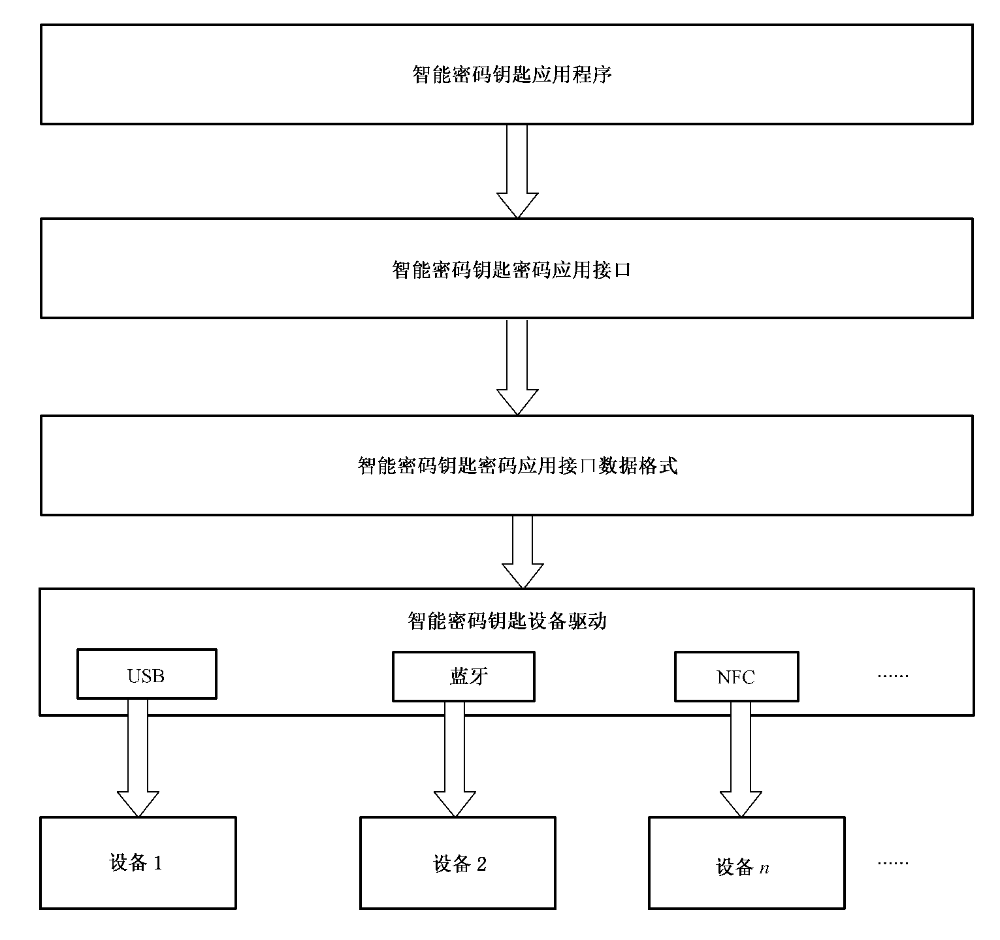

**图 1 数据格式规范在应用层次关系中的位置**

## 6 APDU 报文结构

### 6.1 概述

智能密码钥匙密码应用接口与设备之间的数据交换以 APDU 的形式进行编码。

应用协议由发送命令、接收实体处理命令以及返回响应组成。因此,特定的响应对应于特定的命令,称作为命令响应对。

命令报文和响应报文统称为 APDU,命令报文从接口设备发送到密码钥匙,响应报文由密码钥匙返回到接口设备。

在命令响应对中,命令报文和响应报文都可包含有数据,共有4 种组合,见表1。

**表 1 命令响应对内的数据**

| 情况 | 命令数据 | 期望响应的数据 |
| --- | --- | --- |
| 1 | 无数据 | 无数据 |
| 2 | 无数据 | 有数据 |
| 3 | 有数据 | 无数据 |
| 4 | 有数据 | 有数据 |

### 6.2 命令 APDU

命令 APDU 结构见图2,本条所定义的命令 APDU 由下列内容组成:

- 必备的4 字节命令头(CLA INS P1 P2);

- 有条件的可变长度主体。

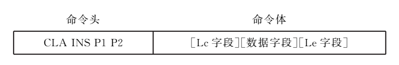

**图 2 命令 APDU 结构**

在命令 APDU 的数据字段中出现的字节数用 $\mathit{Lc}$ 来表示。

在响应 APDU 的数据字段中期望的字节最大数用 $\mathit{Le}($期望数据的长度)来表示。当 $\mathit{Le}$ 字段只包含0 时,则要求有效数据字节的最大数。

按照表1 中的4 种情况,对应的命令 APDU 的4 种结构见图3。

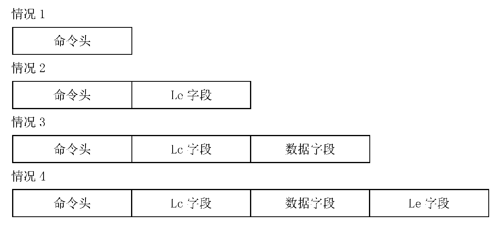

**图 3 命令 APDU 的4 种结构**

在情况1 中,长度 $\mathit{Lc}$ 为0,因此 $\mathit{Lc}$ 字段和数据字段都为空。长度 $\mathit{Le}$ 也为0,因此 $\mathit{Le}$ 字段为空。从而,命令体为空。

在情况2 中,长度 $\mathit{Lc}$ 为0,因此 $\mathit{Lc}$ 字段和数据字段都为空。长度 $\mathit{Le}$ 不为0,因此 $\mathit{Le}$ 字段存在。从而,命令体由 $\mathit{Le}$ 字段组成。

在情况3 中,长度 $\mathit{Lc}$ 不为0,因此 $\mathit{Lc}$ 字段存在,并且数据字段由 $\mathit{Lc}$ 后续字节组成。长度 $\mathit{Le}$ 为0,因此 $\mathit{Le}$ 字段为空。从而命令体由 $\mathit{Lc}$ 字段后紧跟着数据字段组成。

在情况4 中,长度 $\mathit{Lc}$ 不为0,因此 $\mathit{Lc}$ 字段存在,并且数据字段由 $\mathit{Lc}$ 后续字节组成。长度 $\mathit{Le}$ 也不为0,因此 $\mathit{Le}$ 字段也存在。从而命令体由 $\mathit{Lc}$ 字段后紧跟着数据字段和 $\mathit{Le}$ 字段组成。

### 6.3 命令体的编码约定

在情况1 中,命令 APDU 的命令体为空。这种命令 APDU 未带长度字段。

在情况2、3 和4 中,命令 APDU 的命令体由 $B_{1}\sim B_{L}$ 所表示的 $L$ 字节组成,见图4。这种命令体运载了1 个或2 个长度字段;$B_{1}$ 是第1 个长度字段的一部分。

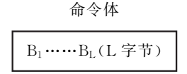

**图 4 不为空的命令体**

本文件要求 $\mathit{Lc}$ 字段和 $\mathit{Le}$ 字段应为扩充方式编码$(B_{1}$ 的值为‘00’,并且每个长度值都按2 个其他字节进行编码)。

按照表1 和图3 中的4 种情况及可能的 $\mathit{Lc}$、$\mathit{Le}$ 扩展,命令 APDU 的编码见表2。

**表 2 命令 APDU 的编码**

<table markdown="1">
<tr>
<th colspan="3">条件</th>
<th>情况</th>
</tr>
<tr markdown="1">
<td markdown="1">$L=0;$</td>
<td>—</td>
<td>—</td>
<td>1</td>
</tr>
<tr markdown="1">
<td markdown="1">$L=3;$</td>
<td markdown="1">$(B_{1})=0;$</td>
<td>—</td>
<td>2</td>
</tr>
<tr markdown="1">
<td markdown="1">$L=3+(B_{2}\mathbin{\Vert}B_{3});$</td>
<td markdown="1">$(B_{1})=0;$</td>
<td markdown="1">$(B_{2}\mathbin{\Vert}B_{3})\ne 0$</td>
<td>3</td>
</tr>
<tr markdown="1">
<td markdown="1">$L=5+(B_{2}\mathbin{\Vert}B_{3});$</td>
<td markdown="1">$(B_{1})=0;$</td>
<td markdown="1">$(B_{2}\mathbin{\Vert}B_{3})\ne 0$</td>
<td>4</td>
</tr>
</table>

任何其他命令 APDU 为无效的。

对以上4 种情况说明如下。

情况1:$L=0$,主体为空。

- 没有字节用于值为0 的 $\mathit{Lc}$。

- 没有数据字节存在。

- 没有字节用于值为0 的 $\mathit{Le}$。

情况2:$L=3$,并且$(B_{1})=0$。

- 没有字节用于值为0 的 $\mathit{Lc}$。

- 没有数据字节存在。

- $\mathit{Le}$ 字段由3 个字节组成,其中 $B_{1}=0$,$B_{2}$ 和 $B_{3}$ 为 $\mathit{Le}$ 的实际值,$B_{2}$ 为高位字节。若 $\mathit{Le}$ 为0,则期望返回数据的65536 字节。

情况3:$L=3+(B_{2}\mathbin{\Vert}B_{3})$,$(B_{1})=0$,并且$(B_{2}\mathbin{\Vert}B_{3})\ne 0$。

- $\mathit{Lc}$ 字段由前3 个字节组成,其中,$B_{2}$ 和 $B_{3}$ 为 $\mathit{Lc}$ 的实际值$(1\sim 65535)$,$B_{2}$ 为高位字节。

- $B_{4}\sim B_{L}$ 是数据字段中的 $\mathit{Lc}$ 字节。

- 没有字节用于值为0 的 $\mathit{Le}$。

情况4:$L=5+(B_{2}\mathbin{\Vert}B_{3})$,$(B_{1})=0$,并且$(B_{2}\mathbin{\Vert}B_{3})\ne 0$。

- $\mathit{Lc}$ 字段由前3 个字节组成,其中 $B_{1}=0$,$B_{2}$ 和 $B_{3}$ 为 $\mathit{Lc}(\ne 0)$的实际值$(1\sim 65535)$,$B_{2}$ 为高位字节。

- $B_{4}\sim B_{L-2}$ 是数据字段中的 $\mathit{Lc}$ 字节。

- $\mathit{Le}$ 字段由最后的2 个字节 $B_{L-1}$ 和 $B_{L}$ 组成,$B_{L-1}$ 为高位字节。若 $\mathit{Le}$ 为0,则期望返回数据的65536 字节。

### 6.4 响应 APDU

响应 APDU 结构见图5,本文件定义的响应 APDU 由下列内容组成:

- 有条件的可变长度主体;

- 必备的2 字节状态字(SW1、SW2)。

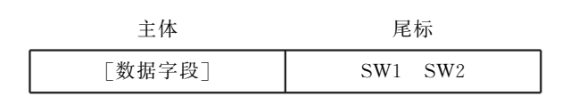

**图 5 响应 APDU 结构**

在响应 APDU 的数据字段中呈现的字节数用 $\mathit{Lr}$ 来表示。

状态字对“命令响应对”之后的接收实体的状态进行了编码。

> [!note]
>
> 注:如果该命令被放弃,则响应 APDU 是一个状态字,它按2 个状态字节来编码出错条件。

## 7 命令头、数据字段和响应状态字的编码约定

### 7.1 概述

命令 APDU 的内容见表3。

**表 3 命令 APDU 内容**

| 代码 | 名称 | 长度/字节 | 描述 |
| --- | --- | --- | --- |
| CLA | 类别 | 1 | 指令的类别 |
| INS | 指令 | 1 | 指令代码 |
| P1 | 参数1 | 1 | 指令参数1 |
| P2 | 参数2 | 1 | 指令参数2 |
| $\mathit{Lc}$ 字段 | 长度 | 3 | 在命令的数据字段中呈现的字节数 |
| 数据字段 | 数据 | 变量$=\mathit{Lc}$ | 在命令的数据字段中发送的字节串 |
| $\mathit{Le}$ 字段 | 长度 | 2 或3 | 在向命令响应的数据字段中期望的字节最大数 |

响应 APDU 的内容见表4。

**表 4 响应 APDU 内容**

| 代码 | 名称 | 长度/字节 | 描述 |
| --- | --- | --- | --- |
| 数据字段 | 数据 | 变量$=\mathit{Lr}$ | 在响应的数据字段中收到的字节串 |
| SW1 | 状态字节1 | 1 | 命令处理状态 |
| SW2 | 状态字节2 | 1 | 命令处理受限字符 |

后续条规定了类别字节、指令字节、参数字节、数据字段字节和状态字节用的编码约定。

除非另有规定,在这些字节中,RFU 位都编码为0,并且 RFU 字节也都编码为‘00’。

### 7.2 CLA(类别)字节

CLA 表示指令的类别。CLA 的编码及含义见表5。

**表 5 CLA 的编码及含义**

| b8 | b7 | b6 | b5 | b4 | b3 | b2 | b1 | 含义 |
| --- | --- | --- | --- | --- | --- | --- | --- | --- |
| 1 | 0 | 0 | x | — | — | — | — | 命令链控制位 |
| 1 | 0 | 0 | 0 | — | — | — | — | 表示单条指令或此命令为命令链的最后一条指令 |
| 1 | 0 | 0 | 1 | — | — | — | — | 表示命令链中非最后的一条指令 |

命令链可用于支持分多步骤完成的任务或传输大数据量的场合。

### 7.3 INS(指令)字节

INS 表示请求处理的命令。按照 GB/T16649.3 的规定,值6X 和9X 是无效的。

本文件定义的 INS 代码见表6。

**表 6 本文件定义的 INS 代码**

| 值 | 命令名称 | 章条 |
| --- | --- | --- |
| 02 | SetLabel | 8.1.2 |
| 04 | GetDevInfo | 8.1.3 |
| 10 | DevAuth | 8.2.2 |
| 12 | ChangeDevAuthKey | 8.2.3 |
| 14 | GetPinInfo | 8.2.4 |
| 16 | ChangePin | 8.2.5 |
| 18 | VerifyPin | 8.2.6 |
| 1A | UnblockPin | 8.2.7 |
| 1C | ClearSecureState | 8.2.8 |
| 20 | CreateApplication | 8.3.2 |
| 22 | EnumApplication | 8.3.3 |
| 24 | DeleteApplication | 8.3.4 |
| 26 | OpenApplication | 8.3.5 |
| 28 | CloseApplication | 8.3.6 |
| 30 | CreateFile | 8.4.2 |
| 32 | DeleteFile | 8.4.3 |
| 34 | EnumFiles | 8.4.4 |
| 36 | GetFileInfo | 8.4.5 |
| 38 | ReadFile | 8.4.6 |
| 3A | WriteFile | 8.4.7 |
| 40 | CreateContainer | 8.5.2 |
| 42 | OpenContainer | 8.5.3 |
| 44 | CloseContainer | 8.5.4 |
| 46 | EnumContainer | 8.5.5 |
| 48 | DeleteContainer | 8.5.6 |
| 4A | GetContainerInfo | 8.5.7 |
| 4C | ImportCertificate | 8.5.8 |
| 4E | ExportCertificate | 8.5.9 |
| 50 | GenRandom | 8.6.2 |
| 54 | GenRSAKeyPair | 8.6.3 |
| 56 | ImportRSAKeyPair | 8.6.4 |
| 58 | RSASignData | 8.6.5 |
| 5E | RSAVerify | 8.6.6 |
| 5A | RSAExportSessionKey | 8.6.7 |
| 8A | ExtRSAPubKeyOperation | 8.6.8 |
| 70 | GenECCKeyPair | 8.6.9 |
| 72 | ImportECCKeyPair | 8.6.10 |
| 74 | ECCSignData | 8.6.11 |
| 76 | ECCVerify | 8.6.12 |
| 78 | ECCExportSessionKey | 8.6.13 |
| 7A | ExtECCEncrypt | 8.6.14 |
| 82 | GenerateAgreementDataWithECC | 8.6.15 |
| 84 | GenerateAgreementDataAndKeyWithECC | 8.6.16 |
| 86 | GenerateKeyWithECC | 8.6.17 |
| 88 | ExportPublicKey | 8.6.18 |
| A0 | ImportSessionKey | 8.6.19 |
| A4 | EncryptInit | 8.6.20 |
| A6 | Encrypt | 8.6.21 |
| A8 | EncryptUpdate | 8.6.22 |
| AA | EncryptFinal | 8.6.23 |
| AC | DecryptInit | 8.6.24 |
| AE | Decrypt | 8.6.25 |
| B0 | DecryptUpdate | 8.6.26 |
| $B_{2}$ | DecryptFinal | 8.6.27 |
| $B_{4}$ | DigestInit | 8.6.28 |
| B6 | Digest | 8.6.29 |
| B8 | DigestUpdate | 8.6.30 |
| BA | DigestFinal | 8.6.31 |
| BC | MACInit | 8.6.32 |
| BE | MAC | 8.6.33 |
| C0 | MACUpdate | 8.6.34 |
| C2 | MACFinal | 8.6.35 |
| E8 | HMACInit | 8.6.36 |
| EA | HMAC | 8.6.37 |
| EC | HMACUpdate | 8.6.38 |
| EE | HMACFinal | 8.6.39 |
| C4 | DestroySessionKey | 8.6.40 |
| F0 | ExtRSAPriKeyOperation | 8.7.2 |
| F2 | ExtECCDecrypt | 8.7.3 |
| F4 | ExtECCSign | 8.7.4 |
| F6 | ExtSymmKeyEncrypt | 8.7.5 |
| F8 | ExtSymmKeyDecrypt | 8.7.6 |
| FA | ExtHMAC | 8.7.7 |
| F1 | GenExtRSAKey | 8.7.8 |
| F3 | GenExtECCKey | 8.7.9 |
| C8 | ImportSM9MasterPublicKey | D.1 |
| CA | ExportSM9MasterPublicKey | D.2 |
| CC | ImportSM9UserKey | D.3 |
| CE | SM9SignData | D.4 |
| D0 | SM9Verify | D.5 |
| $\mathit{D2}$ | SM9KeyEncapsulate | D.6 |
| D4 | SM9KeyDecapsulate | D.7 |
| D6 | SM9Encrypt | D.8 |
| D8 | SM9Decrypt | D.9 |
| DA | SM9GenerateAgreementData | D.10 |
| DC | SM9GenerateAgreementDataAndKey | D.11 |
| DE | SM9GenerateKey | D.12 |
| E0 | GenSM9EncMasterKeyPair | D.13 |
| FC | ExtSM9Sign | D.14 |
| FE | ExtSM9Decrypt | D.15 |
| E2 | GenKeyWithIKE | F.1 |
| E4 | GenKeyWithIPSEC | F.2 |
| E6 | GenKeyWithSSL | F.3 |

产品支持 SM9 算法的,SM9 算法指令的定义应符合附录 D 的规定。

产品支持 VPN 相关指令的,VPN 相关指令的定义应符合附录 F 的规定。

### 7.4 参数字节

命令中的参数字节 P1、P2 可具有任何值。如果参数字节不提供进一步的限定,则应置为‘00’。

### 7.5 数据字段字节

在数据字段(即 DATA 域中的数据)中对本文件定义的数据结构(复合数据类型)进行传输时,结构体中的基本数据类型和大整数均以 Big Endian(高位字节在前)方式进行编码,整个结构体以紧缩格式进行编码(即各数据元素之间以单字节对齐)。

### 7.6 状态字节

响应的状态字节 SW1SW2 表示了智能密码钥匙内的处理状态。本文件定义的状态字节值的结构方案见图6。

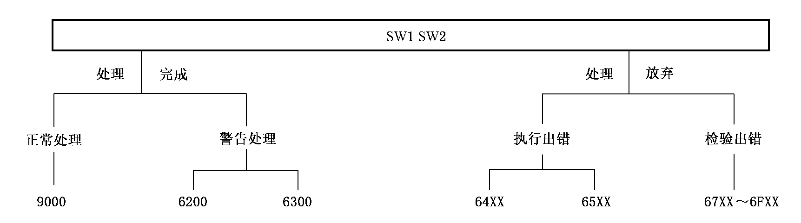

> [!note]
>
> 注:当 SW1=63 或65 时,非易失存储器的状态变化。当 SW1=除63 和65 外的6X 时,非易失存储器的状态不变化。

**图 6 状态字节的结构方案**

本文件定义的 SW1SW2 编码的一般含义见表7。对于每个命令,相应的条款提供了更详细的含义。常用的状态字节的定义和说明应符合附录 A 的规定。

当 SW1 的值为65,68,69 和6A 时,SW2 的值见表$8\sim$表11。

**表 7 SW1SW2 的编码**

| SW1SW2 | 含义 |
| --- | --- |
| 9000 | 正常的处理处理正常,无进一步限定 |
| 64XX65XX | 执行出错非易失存储器状态不变化(SW2=00,其他值都是 RFU)非易失存储器状态变化(在 SW2 中进一步的限定,见表8) |
| 670068XX69XX6AXX6B006CXX6D006E006F00 | 校验出错错误的长度 CLA 的功能不被支持(在 SW2 中进一步的限定,见表9)不允许的命令(在 SW2 中进一步的限定,见表10)错误的参数 $\mathit{P1}\sim \mathit{P2}($在 SW2 中进一步的限定,见表11)错误的参数 $\mathit{P1}\sim \mathit{P2}$ 错误的长度 $\mathit{Le}$:SW2 指示准确的长度指令代码不被支持或无效类别不被支持没有精确的诊断 |

**表 8 当 SW1=65 时,SW2 的编码**

| SW2 | 含义 |
| --- | --- |
| 00 | 没有信息被给出 |
| 81 | 写 EEPROM 出错 |

**表 9 当 SW1=68 时,SW2 的编码**

| SW2 | 含义 |
| --- | --- |
| 00 | 没有信息被给出 |
| 81 | 逻辑信道不被支持 |
| 82 | 安全报文不被支持 |

**表 10 当 SW1=69 时,SW2 的编码**

| SW2 | 含义 |
| --- | --- |
| 00 | 没有信息被给出 |
| 81 | 命令与文件结构不兼容 |
| 82 | 安全状态不被满足 |
| 83 | 认证方法被锁定 |
| 84 | 引用的数据无效 |
| 85 | 使用的条件不被满足 |
| 86 | 命令不被允许 |

**表 11 当 SW1=6A 时,SW2 的编码**

| SW2 | 含义 |
| --- | --- |
| 00 | 没有信息被给出 |
| 80 | 数据字段中的参数不正确 |
| 81 | 功能不被支持 |
| 82 | 文件未找到 |
| 83 | 记录未找到 |
| 84 | 无足够的文件存储空间 |
| 85 | $\mathit{Lc}$ 与 TLV 结构不一致 |
| 86 | 不正确的参数 P1、P2 |
| 87 | $\mathit{Lc}$ 与 P1、P2 不一致 |
| 88 | 引用的数据未找到 |

## 8 APDU 指令

### 8.1 设备管理指令

#### 8.1.1 概述

设备管理指令用于完成设置设备标签和获取设备信息。

#### 8.1.2 SetLabel(设置设备标签)

##### 8.1.2.1 定义与范围

SetLabel 命令用于设置或修改设备的标签。

##### 8.1.2.2 注意事项

标签数据长度应小于或等于32 字节,不能为空。

##### 8.1.2.3 命令报文

见表12。

**表 12 SetLabel 命令报文编码**

| 代码 | 长度<br>byte | 值<br>Hex | 描述 |
| --- | --- | --- | --- |
| CLA | 1 | 80 | — |
| INS | 1 | 02 | — |
| P1 | 1 | 00 | — |
| P2 | 1 | 00 | — |
| $\mathit{Lc}$ | 3 | 0000XX | 标签数据的字节数 |
| DATA | $\mathit{Lc}$ | XX…XX | 标签数据 |
| $\mathit{Le}$ | — | — | 不存在 |

##### 8.1.2.4 命令报文数据域

命令报文数据域由待设置的设备标签组成。

##### 8.1.2.5 响应报文数据域

无响应数据。

##### 8.1.2.6 响应报文状态码

智能密码钥匙可能回送的状态码见表13。

**表 13 SetLabel 命令响应状态码**

| SW1 | SW2 | 意义 |
| --- | --- | --- |
| 90 | 00 | 正确执行 |
| 65 | 81 | 写 EEPROM 失败 |
| 67 | 00 | 长度错误$(\mathit{Lc}$ 与 DATA 域数据长度不一致) |
| 69 | 82 | 不满足安全状态 |
| 6A | 86 | P1、P2 参数错误 |
| 6E | 00 | CLA 不正确 |

#### 8.1.3 GetDevInfo(获取设备信息)

##### 8.1.3.1 定义与范围

GetDevInfo 命令用于获取设备的一些特征信息,包括遵循的标准版本、设备标签、厂商信息、支持的算法和能力。

##### 8.1.3.2 注意事项

无。

##### 8.1.3.3 命令报文

见表14。

**表 14 GetDevInfo 命令报文编码**

| 代码 | 长度<br>byte | 值<br>Hex | 描述 |
| --- | --- | --- | --- |
| CLA | 1 | 80 | — |
| INS | 1 | 04 | — |
| P1 | 1 | 00 | — |
| P2 | 1 | 00 | — |
| $\mathit{Lc}$ | — | — | 不存在 |
| DATA | — | — | 不存在 |
| $\mathit{Le}$ | 3 | 000000 | 期望返回全部设备信息 |

##### 8.1.3.4 命令报文数据域

命令报文数据不存在。

##### 8.1.3.5 响应报文数据域

响应报文数据为以下 cosDEVINFO 数据结构(应对此结构体以紧缩格式进行定义)的字节流编码。

```c
typedef struct Struct_cosDEVINFO{
    VERSION StructVersion;
    VERSION SpecificationVersion;
    CHAR Manufacturer[64];
    CHAR Issuer[64];
    CHAR Label[32];
    CHAR SerialNumber[32];
    VERSION HWVersion;
    VERSION FirmwareVersion;
    ULONG AlgSymCap;
    ULONG AlgAsymCap;
    ULONG AlgHashCap;
    ULONG DevAuthAlgId;
    ULONG TotalSpace;
    ULONG FreeSpace;
    WORD MaxApduDataLen;
    WORD UserAuthMethod;
    WORD DeviceType;
    BYTE MaxContainerNum;
    BYTE MaxCertNum;
    WORD MaxFileNum;
    BYTE Reserved[54];
}cosDEVINFO;
typedef struct Struct_Version{
    BYTE major;
    BYTE minor;
}VERSION;
```

设备详细描述见表15。版本定义见表16。

**表 15 设备信息描述**

| 数据项 | 类型 | 意义 | 规则 |
| --- | --- | --- | --- |
| StructVersion | VERSION | 版本号 | 数据结构版本号,本结构的版本号为1.0 |
| SpecificationVersion | VERSION | 版本号 | 标准版本号,当前版本号为2.0 |
| Manufacturer | CHAR ARRAY | 设备厂商信息 | 以‘\0’为结束符的 ASCII 字符串 |
| Issuer | CHAR ARRAY | 发行厂商信息 | 以‘\0’为结束符的 ASCII 字符串 |
| Label | CHAR ARRAY | 设备标签 | 以‘\0’为结束符的 ASCII 字符串 |
| SerialNumber | CHAR ARRAY | 序列号 | 以‘\0’为结束符的 ASCII 字符串 |
| HWVersion | VERSION | 设备硬件版本 | — |
| FirmwareVersion | VERSION | 设备本身固件版本 | — |
| AlgSymCap | ULONG | 分组密码算法标识 | 分组密码算法标识的编码规则:从低位到高位,第0 位$\sim$第7 位按位表示分组密码算法工作模式,第8 位$\sim$第31 位按位表示分组密码算法。当多个分组算法同时存在时,可用“或”的形式表示。详细定义应符合 GM/T0006 的要求 |
| AlgAsymCap | ULONG | 非对称密码算法标识 | 非对称密码算法标识的编码规则:从低位到高位,第0 位$\sim$第7 位为0,第8 位$\sim$第15 位按位表示非对称密码算法的算法协议,如果所表示的非对称算法没有相应的算法协议则为0,第16 位$\sim$第31 位按位表示非对称密码算法类型。当多个非对称算法同时存在时,可用“或”的形式表示。详细定义应符合 GM/T0006 的要求 |
| AlgHashCap | ULONG | 密码杂凑算法标识 | 密码杂凑算法标识的编码规则:从低位到高位,第0 位$\sim$第7 位表示密码杂凑算法,第8 位$\sim$第31 位为0。当多个密码杂凑算法同时存在时,可用“或”的形式表示。详细定义应符合 GM/T0006 的要求 |
| DevAuthAlgId | ULONG | 设备认证使用的分组密码算法标识 | 默认使用 SM4 算法进行设备认证操作。设备可支持多种认证算法,各算法按照与 AlgSymCap 同样的方式进行编码 |
| TotalSpace | ULONG | 设备总空间大小 | — |
| FreeSpace | ULONG | 用户可用空间大小 | — |
| MaxApduDataLen | WORD | 设备支持的 APDU 命令数据域最大长度 | — |
| UserAuthMethod | WORD | 用户认证方式 | 是 PIN 认证还是其他认证方式(如指纹或自带键盘)<br>1:PIN 认证;<br>2:指纹认证;<br>3:通过设备自带的键盘输入 PIN 码。<br>其他值暂无定义 |
| DeviceType | WORD | 设备类型 | 返回设备的类型,如 IC 卡、普通 Key、显示按键 Key 或指纹 Key。<br>1:IC 卡;<br>2:普通 USBKey;<br>3:显示按键 Key(不带键盘);<br>4:显示按键 Key(自带键盘,可用于输入 PIN 码);<br>5:指纹 Key。<br>其他值暂无定义 |
| MaxContainerNum | BYTE | 应用支持的最大容器数量 | 0 表示不限制 |
| MaxCertNum | BYTE | 应用支持的最大证书数量 | 0 表示不限制 |
| MaxFileNum | WORD | 应用支持的最大文件数 | 0 表示不限制 |
| Reserved | BYTE ARRAY | 保留字节 | 用于今后扩展使用 |

**表 16 版本定义**

<table>
  <tr>
    <th>数据项</th>
    <th>类型</th>
    <th>意义</th>
    <th>备注</th>
  </tr>
  <tr>
    <td>major</td>
    <td>BYTE</td>
    <td>主版本号</td>
    <td rowspan="2">主版本号和次版本号以“.”分隔,例如 Version1.0,主版本号为1,次版本号为0;Version2.10,主版本号为2,次版本号为10</td>
  </tr>
  <tr>
    <td>minor</td>
    <td>BYTE</td>
    <td>次版本号</td>
  </tr>
</table>

##### 8.1.3.6 响应报文状态码

智能密码钥匙可能回送的状态码见表17。

**表 17 GetDevInfo 命令响应状态码**

| SW1 | SW2 | 意义 |
| --- | --- | --- |
| 90 | 00 | 正确执行 |
| 6A | 86 | P1、P2 参数错误 |
| 6C | 00 | $\mathit{Le}$ 错误,$\mathit{Le}$ 一定为000000 |
| 6E | 00 | CLA 错误 |

### 8.2 访问控制指令

#### 8.2.1 概述

访问控制指令用于完成设备认证、PIN 码管理和安全状态管理。

#### 8.2.2 DevAuth(设备认证)

##### 8.2.2.1 定义与范围

DevAuth 命令是设备对应用程序的认证。

##### 8.2.2.2 注意事项

执行此命令前,应通过取随机数命令从设备获取8 字节随机数。设备认证流程应符合 GM/T0016 中的规定。

##### 8.2.2.3 命令报文

见表18。

**表 18 DevAuth 命令报文编码**

| 代码 | 长度<br>byte | 值<br>Hex | 描述 |
| --- | --- | --- | --- |
| CLA | 1 | 80 | — |
| INS | 1 | 10 | — |
| P1 | 1 | 00 | — |
| P2 | 1 | XX | 认证算法,0x00 默认为 SM4 算法 |
| $\mathit{Lc}$ | 3 | 0000XX | — |
| DATA | $\mathit{Lc}$ | XX…XX | 加密的认证数据 |
| $\mathit{Le}$ | — | — | 不存在 |

P2 的定义见表19。

**表 19 P2 的定义**

| P2 | 定义 |
| --- | --- |
| 0x00 | SM4(设备一定支持,默认算法) |
| 0x01 | SSF33 |
| 0x02 | SM1 |

##### 8.2.2.4 命令报文数据域

命令报文数据域由加密的认证数据组成。

##### 8.2.2.5 响应报文数据域

无响应数据。

##### 8.2.2.6 响应报文状态码

智能密码钥匙可能回送的状态码见表20。

**表 20 DevAuth 命令响应状态码**

| SW1 | SW2 | 意义 |
| --- | --- | --- |
| 90 | 00 | 正确执行 |
| 63 | CX | 认证失败,还剩下 $X$ 次重试机会 |
| 67 | 00 | 长度错误$(\mathit{Lc}$ 与 DATA 域数据长度不一致) |
| 69 | 83 | 认证方法锁定 |
| 69 | 84 | 引用数据无效 |
| 6A | 86 | P1、P2 参数错误 |
| 6E | 00 | CLA 错误 |

#### 8.2.3 ChangeDevAuthKey(修改设备认证密钥)

##### 8.2.3.1 定义与范围

ChangeDevAuthKey 命令用于更改设备认证密钥。

##### 8.2.3.2 注意事项

执行此命令前,应通过取随机数命令获取8 字节随机数。

##### 8.2.3.3 命令报文

见表21。

**表 21 ChangeDevAuthKey 命令报文编码**

| 代码 | 长度<br>byte | 值<br>Hex | 描述 |
| --- | --- | --- | --- |
| CLA | 1 | 84 | — |
| INS | 1 | 12 | — |
| P1 | 1 | 00 | — |
| P2 | 1 | XX | 认证算法,0x00 默认为 SM4 算法 |
| $\mathit{Lc}$ | 3 | 0000XX | — |
| DATA | $\mathit{Lc}$ | XX…XX | 新设备认证密钥的密文数据+消息鉴别码(MAC)数据元(4 字节) |
| $\mathit{Le}$ | — | — | 不存在 |

P2 的定义见表22。

**表 22 P2 的定义**

| P2 | 定义 |
| --- | --- |
| 0x00 | SM4(设备一定支持,默认算法) |
| 0x01 | SSF33 |
| 0x02 | SM1 |

##### 8.2.3.4 命令报文数据域

命令报文数据域由新设备认证密钥的密文数据和消息鉴别码(MAC)数据元组成,用于加密及 MAC 运算的密钥为原设备认证密钥。数据加密及 MAC 运算过程应符合附录 B 的规定。

##### 8.2.3.5 响应报文数据域

无响应数据。

##### 8.2.3.6 响应报文状态码

智能密码钥匙可能回送的状态码见表23。

**表 23 ChangeDevAuthKey 命令响应状态码**

| SW1 | SW2 | 意义 |
| --- | --- | --- |
| 90 | 00 | 正确执行 |
| 65 | 81 | 写 EEPROM 失败 |
| 67 | 00 | 长度错误$(\mathit{Lc}$ 与 DATA 域数据长度不一致) |
| 69 | 83 | 设备认证密钥已经锁定 |
| 69 | 84 | 引用数据无效 |
| 63 | CX | 校验失败,$X$ 为可重试次数(设备内在 MAC 校验失败时返回此错误代码) |
| 6A | 86 | P1、P2 参数错误 |
| 6E | 00 | CLA 错误 |

#### 8.2.4 GetPinInfo(获取 PIN 信息)

##### 8.2.4.1 定义与范围

GetPinInfo 命令是获取指定应用下的 PIN 码信息,包括最大重试次数、当前剩余重试次数,以及当前 PIN 码是否为出厂默认 PIN 码。

##### 8.2.4.2 注意事项

无。

##### 8.2.4.3 命令报文

见表24。

**表 24 GetPinInfo 命令报文编码**

| 代码 | 长度<br>byte | 值<br>Hex | 描述 |
| --- | --- | --- | --- |
| CLA | 1 | 80 | — |
| INS | 1 | 14 | — |
| P1 | 1 | 00 | — |
| P2 | 1 | XX | PIN 类型(0x00 为管理员 PIN,0x01 为用户 PIN) |
| $\mathit{Lc}$ | 3 | 000002 | 应用 ID 长度 |
| DATA | $\mathit{Lc}$ | XXXX | 应用 ID |
| $\mathit{Le}$ | 2 | 0003 | 最大重试次数(1 字节)+当前剩余重试次数(1 字节)+出厂默认 PIN 码状态(1 字节) |

##### 8.2.4.4 命令报文数据域

命令报文数据域为应用 ID。

##### 8.2.4.5 响应报文数据域

响应报文数据由最大重试次数(1 字节)+当前剩余重试次数(1 字节)+出厂默认 PIN 码状态(1 字节)组成。出厂默认 PIN 码状态为01 表示建立应用后,PIN 码还没有修改过。

##### 8.2.4.6 响应报文状态码

智能密码钥匙可能回送的状态码见表25。

**表 25 GetPinInfo 命令响应状态码**

| SW1 | SW2 | 意义 |
| --- | --- | --- |
| 90 | 00 | 正确执行 |
| 6C | 03 | $\mathit{Le}$ 长度错误,$\mathit{Le}$ 一定为000003 |
| 69 | 86 | 没有打开应用 |
| 6A | 86 | P1、P2 参数错误 |
| 6E | 00 | CLA 错误 |

#### 8.2.5 ChangePin(修改 PIN)

##### 8.2.5.1 定义与范围

ChangePin 命令用来修改指定应用的管理员 PIN 值或者用户 PIN 值。

##### 8.2.5.2 注意事项

执行此命令前,应预先打开应用,并通过取随机数命令获取8 字节随机数。

##### 8.2.5.3 命令报文

见表26。

**表 26 ChangePin 命令报文编码**

| 代码 | 长度<br>byte | 值<br>Hex | 描述 |
| --- | --- | --- | --- |
| CLA | 1 | 84 | — |
| INS | 1 | 16 | — |
| P1 | 1 | 00 | — |
| P2 | 1 | XX | PIN 类型(0x00 为管理员 PIN,0x01 为用户 PIN) |
| $\mathit{Lc}$ | 3 | 0000XX | — |
| DATA | $\mathit{Lc}$ | XX…XX | 应用 ID(2 字节)+新 PIN 的密文数据+消息鉴别码(MAC)数据元(4 字节) |
| $\mathit{Le}$ | — | — | 不存在 |

##### 8.2.5.4 命令报文数据域

命令报文数据域由应用 ID、新 PIN 的密文数据和消息鉴别码(MAC)数据元组成。

加密以及 MAC 运算的密钥为原 PIN 经过密码杂凑运算(使用 SM3 算法)后的前16 字节数据。

加密以及 MAC 运算使用 SM4 算法。数据加密及 MAC 运算过程应符合附录 B 的规定。

##### 8.2.5.5 响应报文数据域

无响应数据。

##### 8.2.5.6 响应报文状态码

智能密码钥匙可能回送的状态码见表27。

**表 27 ChangePin 命令响应状态码**

| SW1 | SW2 | 意义 |
| --- | --- | --- |
| 90 | 00 | 正确执行 |
| 65 | 81 | 写 EEPROM 失败 |
| 67 | 00 | 长度错误$(\mathit{Lc}$ 与 DATA 域数据长度不一致) |
| 69 | 83 | PIN 码已经被锁定 |
| 69 | 84 | 引用数据无效 |
| 63 | CX | 校验失败,$X$ 为可重试次数(设备内在 MAC 校验失败时返回此错误代码) |
| 6A | 80 | 数据域不正确(新 PIN 码加密的补足错误) |
| 6A | 86 | P1、P2 参数错误 |
| 6E | 00 | CLA 错误 |

#### 8.2.6 VerifyPin(校验 PIN)

##### 8.2.6.1 定义与范围

VerifyPin 命令是校验 PIN 码。校验成功后,会获得相应的权限,如果 PIN 码错误,会返回 PIN 码的重试次数,当重试次数为0 时表示 PIN 码已经锁死。

##### 8.2.6.2 注意事项

执行此命令前,应预先打开应用,并通过取随机数命令获取8 字节随机数。

##### 8.2.6.3 命令报文

见表28。

**表 28 VerifyPin 命令报文编码**

| 代码 | 长度<br>byte | 值<br>Hex | 描述 |
| --- | --- | --- | --- |
| CLA | 1 | 80 | — |
| INS | 1 | 18 | — |
| P1 | 1 | 00 | — |
| P2 | 1 | XX | PIN 类型(0x00 为管理员 PIN,0x01 为用户 PIN) |
| $\mathit{Lc}$ | 3 | 000012 | — |
| DATA | $\mathit{Lc}$ | XX…XX | 应用 ID(2 字节)+加密的校验数据(16 字节) |
| $\mathit{Le}$ | — | — | 不存在 |

##### 8.2.6.4 命令报文数据域

命令报文数据域为应用 ID 和使用加密密钥对8 字节随机数进行加密后的结果组成。

加密密钥为 PIN 经过密码杂凑运算(使用 SM3 算法)后的前16 字节数据。

加密算法使用 SM4 算法。数据加密过程应符合附录 B 的规定。

##### 8.2.6.5 响应报文数据域

无响应数据。

##### 8.2.6.6 响应报文状态码

智能密码钥匙可能回送的状态码见表29。

**表 29 VerifyPin 命令响应状态码**

| SW1 | SW2 | 意义 |
| --- | --- | --- |
| 90 | 00 | 正确执行 |
| 67 | 00 | 长度错误$(\mathit{Lc}$ 与 DATA 域数据长度不一致) |
| 63 | CX | 校验失败,$X$ 为可重试次数 |
| 69 | 83 | 认证方法锁定 |
| 69 | 84 | 引用数据无效 |
| 69 | 8A | 没有打开应用 |
| 6A | 86 | 参数 P1、P2 不正确 |

#### 8.2.7 UnblockPin(解锁 PIN)

##### 8.2.7.1 定义与范围

UnblockPin 命令用来解锁已锁死的用户 PIN 码。解锁后,用户 PIN 码被设置成新值,用户 PIN 码的重试次数也恢复到初始值。

##### 8.2.7.2 注意事项

执行此命令前,应预先打开应用,并通过取随机数命令获取8 字节随机数。

##### 8.2.7.3 命令报文

见表30。

**表 30 UnblockPin 命令报文编码**

| 代码 | 长度<br>byte | 值<br>Hex | 描述 |
| --- | --- | --- | --- |
| CLA | 1 | 84 | — |
| INS | 1 | 1A | — |
| P1 | 1 | 00 | — |
| P2 | 1 | 00 | — |
| $\mathit{Lc}$ | 3 | 0000XX | — |
| DATA | $\mathit{Lc}$ | XX…XX | 应用 ID(2 字节)+新用户 PIN 的密文数据+消息鉴别码(MAC)数据元(4 字节) |
| $\mathit{Le}$ | — | — | 不存在 |

##### 8.2.7.4 命令报文数据域

命令报文数据域由应用 ID、新用户 PIN 的密文数据和消息鉴别码(MAC)数据元组成。

加密及线路保护密钥为管理员 PIN 经过密码杂凑运算(使用 SM3 算法)后的前16 字节数据。

加密以及 MAC 运算使用 SM4 算法。数据加密及 MAC 运算过程应符合附录 B 的规定。

##### 8.2.7.5 响应报文数据域

无响应数据。

##### 8.2.7.6 响应报文状态码

智能密码钥匙可能回送的状态码见表31。

**表 31 UnblockPin 命令响应状态码**

| SW1 | SW2 | 意义 |
| --- | --- | --- |
| 90 | 00 | 正确执行 |
| 65 | 81 | 写 EEPROM 失败 |
| 67 | 00 | 长度错误$(\mathit{Lc}$ 与 DATA 域数据长度不一致) |
| 63 | CX | 校验失败,$X$ 为可重试次数。当 $X$ 为0 时,管理员 PIN 锁死 |
| 69 | 83 | 认证方法锁定 |
| 69 | 84 | 引用数据无效 |
| 6A | 86 | P1、P2 参数错误 |
| 6E | 00 | CLA 错误 |

#### 8.2.8 ClearSecureState(清除应用安全状态)

##### 8.2.8.1 定义与范围

ClearSecureState 命令用于清除指定应用的安全状态。安全状态至少包括 PIN 码认证状态。

##### 8.2.8.2 注意事项

执行此命令前,应先执行打开应用命令。

##### 8.2.8.3 命令报文

见表32。

**表 32 ClearSecureState 命令报文编码**

| 代码 | 长度<br>byte | 值<br>Hex | 描述 |
| --- | --- | --- | --- |
| CLA | 1 | 80 | — |
| INS | 1 | 1C | — |
| P1 | 1 | 00 | — |
| P2 | 1 | 00 | — |
| $\mathit{Lc}$ | 3 | 000002 | 应用 ID 长度 |
| DATA | $\mathit{Lc}$ | XXXX | 应用 ID |
| $\mathit{Le}$ | — | — | 不存在 |

##### 8.2.8.4 命令报文数据域

命令报文数据为应用 ID。

##### 8.2.8.5 响应报文数据域

无响应数据。

##### 8.2.8.6 响应报文状态码

智能密码钥匙可能回送的状态码见表33。

**表 33 ClearSecureState 命令响应状态码**

| SW1 | SW2 | 意义 |
| --- | --- | --- |
| 90 | 00 | 正确执行 |
| 67 | 00 | 长度错误$(\mathit{Lc}$ 与 DATA 域数据长度不一致) |
| 69 | 8A | 没有打开应用 |
| 6A | 86 | P1、P2 参数错误 |
| 6E | 00 | CLA 错误 |

### 8.3 应用管理指令

#### 8.3.1 概述

应用管理指令用于完成应用的创建、枚举、删除、打开和关闭。

#### 8.3.2 CreateApplication(创建应用)

##### 8.3.2.1 定义与范围

CreateApplication 命令用于在设备上创建一个应用。

##### 8.3.2.2 注意事项

设备认证通过后才可执行此命令。同一个设备中不允许存在相同名称的应用。

##### 8.3.2.3 命令报文

见表34。

**表 34 CreateApplication 命令报文编码**

| 代码 | 长度<br>byte | 值<br>Hex | 描述 |
| --- | --- | --- | --- |
| CLA | 1 | 80 | — |
| INS | 1 | 20 | — |
| P1 | 1 | 00 | — |
| P2 | 1 | 00 | — |
| $\mathit{Lc}$ | 3 | 0000XX | cosAPPLICATIONINFO 结构体的大小 |
| DATA | $\mathit{Lc}$ | XX…XX | cosAPPLICATIONINFO 结构体的字节流编码数据 |
| $\mathit{Le}$ | — | — | 不存在 |

##### 8.3.2.4 命令报文数据域

命令报文数据为以下结构体(以紧缩格式表示)的字节流编码数据。

```c
typedef struct Struct_cosAPPLICATIONINFO{
    CHAR szApplicatinName[32];//应用名称,不足32字节数据以0x00补全
    CHAR szAdminPin[16];//管理员口令,不足16字节数据以0x00补全
    ULONG dwAdminPinRetryCount;//管理员口令重试次数
    CHAR szUserPin[16];//用户口令,不足16字节数据以0x00补全
    ULONG dwUserPinRetryCount;//用户口令重试次数
    ULONG dwCreateFileRights;//在应用下创建文件的权限,权限信息的定义应
    //符合GM/T0016中的权限类型定义。
    BYTE byContainerNum;//要求应用支持的容器数量
    BYTE byCertNum;//要求应用支持的证书数量
    WORD wFileNum;//要求应用支持的文件数量
}cosAPPLICATIONINFO;
```

##### 8.3.2.5 响应报文数据域

无响应数据。

##### 8.3.2.6 响应报文状态码

智能密码钥匙可能回送的状态码见表35。

**表 35 CreateApplication 命令响应状态码**

| SW1 | SW2 | 意义 |
| --- | --- | --- |
| 90 | 00 | 正确执行 |
| 67 | 00 | 长度错误$(\mathit{Lc}$ 与 DATA 域数据长度不一致) |
| 69 | 82 | 安全状态不满足 |
| 6A | 84 | 设备空间不足,无法创建更多应用 |
| 6A | 86 | P1、P2 参数错误 |
| 6A | 89 | 应用已经存在 |
| 6E | 00 | CLA 错误 |

#### 8.3.3 EnumApplication(枚举应用)

##### 8.3.3.1 定义与范围

EnumApplication 命令用于枚举设备上存在的所有应用。

##### 8.3.3.2 注意事项

无。

##### 8.3.3.3 命令报文

见表36。

**表 36 EnumApplication 命令报文编码**

| 代码 | 长度<br>byte | 值<br>Hex | 描述 |
| --- | --- | --- | --- |
| CLA | 1 | 80 | — |
| INS | 1 | 22 | — |
| P1 | 1 | 00 | — |
| P2 | 1 | 00 | — |
| $\mathit{Lc}$ | — | — | 不存在 |
| DATA | — | — | 不存在 |
| $\mathit{Le}$ | 3 | 000000 | 期望返回所有的应用名称 |

##### 8.3.3.4 命令报文数据域

命令报文数据不存在。

##### 8.3.3.5 响应报文数据域

返回应用名称列表。每个应用的名称以单个‘\0’结束,以双‘\0’表示列表的结束。

##### 8.3.3.6 响应报文状态码

智能密码钥匙可能回送的状态码见表37。

**表 37 EnumApplication 命令响应状态码**

| SW1 | SW2 | 意义 |
| --- | --- | --- |
| 90 | 00 | 正确执行,所有数据都已经返回 |
| 67 | 00 | 长度错误$(\mathit{Lc}$ 与 DATA 域数据长度不一致) |
| 6A | 86 | P1、P2 参数错误 |
| 6E | 00 | CLA 错误 |
| 6A | 9E | 还有更多数据需要上传,需重新发送本条指令获取后续数据 |

#### 8.3.4 DeleteApplication(删除应用)

##### 8.3.4.1 定义与范围

DeleteApplication 命令用于删除设备上的一个应用。

##### 8.3.4.2 注意事项

设备认证通过后才可执行此命令。

##### 8.3.4.3 命令报文

见表38。

**表 38 DeleteApplication 命令报文编码**

| 代码 | 长度<br>byte | 值<br>Hex | 描述 |
| --- | --- | --- | --- |
| CLA | 1 | 80 | — |
| INS | 1 | 24 | — |
| P1 | 1 | 00 | — |
| P2 | 1 | 00 | — |
| $\mathit{Lc}$ | 3 | 0000XX | 应用名称长度(不含‘\0’字符) |
| DATA | $\mathit{Lc}$ | XX…XX | 应用名称 |
| $\mathit{Le}$ | — | — | 不存在 |

##### 8.3.4.4 命令报文数据域

命令报文数据为待删除应用的名称。

##### 8.3.4.5 响应报文数据域

无响应数据。

##### 8.3.4.6 响应报文状态码

智能密码钥匙可能回送的状态码见表39。

**表 39 DeleteApplication 命令响应状态码**

| SW1 | SW2 | 意义 |
| --- | --- | --- |
| 90 | 00 | 正确执行 |
| 67 | 00 | 长度错误$(\mathit{Lc}$ 与 DATA 域数据长度不一致) |
| 69 | 82 | 安全状态不满足 |
| 6A | 8B | 指定的应用不存在 |

#### 8.3.5 OpenApplication(打开应用)

##### 8.3.5.1 定义与范围

OpenApplication 命令用于打开设备上的一个应用。

##### 8.3.5.2 注意事项

应用可被多次重复打开;设备厂商自行决定是否支持多应用的并发访问。

##### 8.3.5.3 命令报文

见表40。

**表 40 OpenApplication 命令报文编码**

| 代码 | 长度<br>byte | 值<br>Hex | 描述 |
| --- | --- | --- | --- |
| CLA | 1 | 80 | — |
| INS | 1 | 26 | — |
| P1 | 1 | 00 | — |
| P2 | 1 | 00 | — |
| $\mathit{Lc}$ | 3 | 0000XX | 应用名称长度(不含‘\0’字符) |
| DATA | $\mathit{Lc}$ | XX…XX | 应用名称 |
| $\mathit{Le}$ | 2 | 00XX | 期望返回应用属性信息的长度 |

##### 8.3.5.4 命令报文数据域

命令报文数据为待打开应用的名称。

##### 8.3.5.5 响应报文数据域

返回应用的属性信息。如:应用权限;应用可支持的最大容器数据、最大证书个数、最大文件数量。见表41。

**表 41 OpenApplication 响应报文数据域编码**

| 偏移 | 数据域 | 数据类型 | 字节长度 | 说明 |
| --- | --- | --- | --- | --- |
| 0 | dwCreateFileRights | ULONG | 4 | 在该应用下创建文件和容器的权限 |
| 4 | byMaxContainer-Num | BYTE | 1 | 指定应用可支持的最大容器数量 |
| 5 | byMaxCertNum | BYTE | 1 | 指定应用可支持的最大证书数量 |
| 6 | wMaxFileNum | WORD | 2 | 指定应用可支持的最大文件数量 |
| 8 | wAppID | WORD | 2 | 返回的应用 ID,用于标识已打开的应用,后续操作可通过此 ID 引用打开的应用 |

##### 8.3.5.6 响应报文状态码

智能密码钥匙可能回送的状态码见表42。

**表 42 OpenApplication 命令响应状态码**

| SW1 | SW2 | 意义 |
| --- | --- | --- |
| 90 | 00 | 正确执行 |
| 67 | 00 | 长度错误$(\mathit{Lc}$ 与 DATA 域数据长度不一致) |
| 6A | 8A | 指定的应用已打开 |
| 6A | 8B | 应用不存在 |
| 6A | 90 | 已有打开的应用,当前设备不支持同时打开多个应用 |

#### 8.3.6 CloseApplication(关闭应用)

##### 8.3.6.1 定义与范围

CloseApplication 命令用于关闭设备上的一个已打开应用。

##### 8.3.6.2 注意事项

任何情况下都可执行此命令。关闭应用只需调用一次,关闭应用不改变应用的安全状态。

##### 8.3.6.3 命令报文

见表43。

**表 43 CloseApplication 命令报文编码**

| 代码 | 长度<br>byte | 值<br>Hex | 描述 |
| --- | --- | --- | --- |
| CLA | 1 | 80 | — |
| INS | 1 | 28 | — |
| P1 | 1 | 00 | — |
| P2 | 1 | 00 | — |
| $\mathit{Lc}$ | 3 | 000002 | 应用 ID 数据长度,为2 字节 |
| DATA | $\mathit{Lc}$ | XXXX | 应用 ID |
| $\mathit{Le}$ | — | — | 不存在 |

##### 8.3.6.4 命令报文数据域

命令报文数据为待关闭应用的 ID。

##### 8.3.6.5 响应报文数据域

无响应数据。

##### 8.3.6.6 响应报文状态码

智能密码钥匙可能回送的状态码见表44。

**表 44 CloseApplication 命令响应状态码**

| SW1 | SW2 | 意义 |
| --- | --- | --- |
| 90 | 00 | 正确执行 |
| 67 | 00 | 长度错误$(\mathit{Lc}$ 与 DATA 域数据长度不一致) |
| 6A | 88 | 引用的应用不存在 |

### 8.4 文件管理指令

#### 8.4.1 概述

文件管理指令用于完成文件的创建、删除和枚举,获取文件信息,以及文件的读、写操作。

#### 8.4.2 CreateFile(创建文件)

##### 8.4.2.1 定义与范围

CreateFile 命令用于在设备上的指定应用下创建一个文件。

##### 8.4.2.2 注意事项

应具有应用指定的创建文件的权限。

##### 8.4.2.3 命令报文

见表45。

**表 45 CreateFile 命令报文编码**

| 代码 | 长度<br>byte | 值<br>Hex | 描述 |
| --- | --- | --- | --- |
| CLA | 1 | 80 | — |
| INS | 1 | 30 | — |
| P1 | 1 | XX | 应用 ID 的高字节 |
| P2 | 1 | XX | 应用 ID 的低字节 |
| $\mathit{Lc}$ | 3 | 0000XX | FILEATTRIBUTE 结构体的大小 |
| DATA | $\mathit{Lc}$ | XX…XX | FILEATTRIBUTE 结构体的字节流编码数据 |
| $\mathit{Le}$ | — | — | 不存在 |

##### 8.4.2.4 命令报文数据域

命令报文数据使用 GM/T0016 中定义的 FILEATTRIBUTE 结构体的字节流编码数据,具体见表46。

**表 46 CreateFile 命令报文数据域编码**

| 偏移 | 数据域 | 数据类型 | 字节长度 | 说明 |
| --- | --- | --- | --- | --- |
| 0 | FileName | CHAR ARRAY | 32 | 文件名,不足32 字节则后面用0 补位 |
| 32 | FileSize | ULONG | 4 | 文件大小 |
| 36 | ReadRights | ULONG | 4 | 读权限控制标识 |
| 40 | WriteRights | ULONG | 4 | 写权限控制标识 |

其中读、写权限控制标识的具体含义应符合 GM/T0016 中的规定。

##### 8.4.2.5 响应报文数据域

无响应数据。

##### 8.4.2.6 响应报文状态码

智能密码钥匙可能回送的状态码见表47。

**表 47 CreateFile 命令响应状态码**

| SW1 | SW2 | 意义 |
| --- | --- | --- |
| 90 | 00 | 正确执行 |
| 67 | 00 | 长度错误$(\mathit{Lc}$ 与 DATA 域数据长度不一致) |
| 6A | 88 | 引用的应用不存在 |
| 69 | 82 | 安全状态不满足 |
| 6A | 84 | 设备空间不足,无法创建更多文件 |
| 6A | 92 | 同名文件已存在 |

#### 8.4.3 DeleteFile(删除文件)

##### 8.4.3.1 定义与范围

DeleteFile 命令用于删除设备上的一个文件。

##### 8.4.3.2 注意事项

应具有应用指定的创建文件的权限。该指令执行成功后,该文件写入的所有信息将丢失。

##### 8.4.3.3 命令报文

见表48。

**表 48 DeleteFile 命令报文编码**

| 代码 | 长度<br>byte | 值<br>Hex | 描述 |
| --- | --- | --- | --- |
| CLA | 1 | 80 | — |
| INS | 1 | 32 | — |
| P1 | 1 | XX | 应用 ID 的高字节 |
| P2 | 1 | XX | 应用 ID 的低字节 |
| $\mathit{Lc}$ | 3 | 0000XX | 文件名长度 |
| DATA | $\mathit{Lc}$ | XX…XX | 文件名 |
| $\mathit{Le}$ | — | — | 不存在 |

##### 8.4.3.4 命令报文数据域

命令报文数据域为文件名,不包含结尾的‘\0’。

##### 8.4.3.5 响应报文数据域

无响应数据。

##### 8.4.3.6 响应报文状态码

智能密码钥匙可能回送的状态码见表49。

**表 49 DeleteFile 命令响应状态码**

| SW1 | SW2 | 意义 |
| --- | --- | --- |
| 90 | 00 | 正确执行 |
| 67 | 00 | 长度错误$(\mathit{Lc}$ 与 DATA 域数据长度不一致) |
| 6A | 88 | 引用的应用不存在 |
| 69 | 82 | 安全状态不满足 |
| 65 | 81 | 写 EEPROM 失败 |
| 6A | 93 | 文件不存在 |

#### 8.4.4 EnumFiles(枚举文件)

##### 8.4.4.1 定义与范围

EnumFiles 命令用于枚举设备上指定应用下存在的所有文件。

##### 8.4.4.2 注意事项

无。

##### 8.4.4.3 命令报文

见表50。

**表 50 EnumFiles 命令报文编码**

| 代码 | 长度<br>byte | 值<br>Hex | 描述 |
| --- | --- | --- | --- |
| CLA | 1 | 80 | — |
| INS | 1 | 34 | — |
| P1 | 1 | XX | 应用 ID 的高字节 |
| P2 | 1 | XX | 应用 ID 的低字节 |
| $\mathit{Lc}$ | — | — | 不存在 |
| DATA | — | — | 不存在 |
| $\mathit{Le}$ | 3 | 000000 | 期望返回所有的文件名称 |

##### 8.4.4.4 命令报文数据域

命令报文数据不存在。

##### 8.4.4.5 响应报文数据域

返回文件名称列表。每个文件的名称以单个‘\0’结束,以双‘\0’表示列表的结束。

##### 8.4.4.6 响应报文状态码

智能密码钥匙可能回送的状态码见表51。

**表 51 EnumFiles 命令响应状态码**

| SW1 | SW2 | 意义 |
| --- | --- | --- |
| 90 | 00 | 正确执行 |
| 6A | 88 | 应用不存在 |
| 69 | 82 | 安全状态不满足 |
| 6A | 9E | 还有更多数据需要上传,需重新发送本条指令获取后续数据 |

#### 8.4.5 GetFileInfo(获取文件信息)

##### 8.4.5.1 定义与范围

GetFileInfo 命令用于获取指定应用目录下指定文件的属性信息。

##### 8.4.5.2 注意事项

无。

##### 8.4.5.3 命令报文

见表52。

**表 52 GetFileInfo 命令报文编码**

| 代码 | 长度<br>byte | 值<br>Hex | 描述 |
| --- | --- | --- | --- |
| CLA | 1 | 80 | — |
| INS | 1 | 36 | — |
| P1 | 1 | XX | 应用 ID 的高字节 |
| P2 | 1 | XX | 应用 ID 的低字节 |
| $\mathit{Lc}$ | 3 | 0000XX | 文件名长度 |
| DATA | $\mathit{Lc}$ | XX…XX | 文件名 |
| $\mathit{Le}$ | 2 | 00XX | 期望返回的数据字节 |

##### 8.4.5.4 命令报文数据域

命令报文数据为文件名称,不包含结尾的‘\0’。

##### 8.4.5.5 响应报文数据域

响应报文数据的编码结构见表53。

**表 53 GetFileInfo 响应报文数据域编码**

| 偏移 | 数据域 | 数据类型 | 字节长度 | 说明 |
| --- | --- | --- | --- | --- |
| 0 | FileSize | ULONG | 4 | 文件大小 |
| 4 | ReadRights | ULONG | 4 | 读权限控制标识 |
| 8 | WriteRights | ULONG | 4 | 写权限控制标识 |

其中读、写权限控制标识的具体含义应符合 GM/T0016 中的规定。

##### 8.4.5.6 响应报文状态码

智能密码钥匙可能回送的状态码见表54。

**表 54 GetFileInfo 命令响应状态码**

| SW1 | SW2 | 意义 |
| --- | --- | --- |
| 90 | 00 | 正确执行 |
| 67 | 00 | 长度错误$(\mathit{Lc}$ 与 DATA 域数据长度不一致) |
| 6A | 88 | 应用不存在 |
| 6A | 93 | 文件不存在 |
| 69 | 82 | 安全状态不满足 |

#### 8.4.6 ReadFile(读文件)

##### 8.4.6.1 定义与范围

ReadFile 命令用于从指定文件的指定开始位置读取指定长度的数据。

##### 8.4.6.2 注意事项

无。

##### 8.4.6.3 命令报文

见表55。

**表 55 ReadFile 命令报文编码**

| 代码 | 长度<br>byte | 值<br>Hex | 描述 |
| --- | --- | --- | --- |
| CLA | 1 | 80 | — |
| INS | 1 | 38 | — |
| P1 | 1 | 00 | — |
| P2 | 1 | 00 | — |
| $\mathit{Lc}$ | 3 | 0000XX | 命令报文数据长度 |
| DATA | $\mathit{Lc}$ | XX…XX | 命令报文数据 |
| $\mathit{Le}$ | 2 | XXXX | 期望读取的数据长度,0 表示读取所有数据 |

##### 8.4.6.4 命令报文数据域

命令报文编码见表56。

**表 56 ReadFile 命令报文数据域编码**

| 偏移 | 数据域 | 数据类型 | 字节长度 | 说明 |
| --- | --- | --- | --- | --- |
| 0 | wAppID | WORD | 2 | 应用 ID |
| 2 | wOffset | WORD | 2 | 数据读取的偏移量 |
| 4 | wReadLen | WORD | 2 | 期望读取数据的长度(若此值为0,表示返回所有数据) |
| 6 | $\mathit{wFileNameLen}$ | WORD | 2 | 文件名称长度,不含结尾的‘\0’字符 |
| 8 | chFileName | CHAR ARRAY | $\mathit{wFileNameLen}$ | 文件名称 |

##### 8.4.6.5 响应报文数据域

响应报文数据的长度由 $\mathit{Le}$ 的值决定$(\mathit{Le}$ 的值应与命令报文编码中的 wReadLen 相等)。如果 $\mathit{Le}$ 超过可读取的实际数据长度,则返回实际长度的数据。

##### 8.4.6.6 响应报文状态码

智能密码钥匙可能回送的状态码见表57。

**表 57 ReadFile 命令响应状态码**

| SW1 | SW2 | 意义 |
| --- | --- | --- |
| 90 | 00 | 正确执行 |
| 69 | 82 | 权限不满足 |
| 6A | 93 | 指定的文件不存在 |
| 6B | 00 | 偏移值超出文件长度 |
| 6E | 01 | 待返回数据长度超出最大缓冲区长度 |

#### 8.4.7 WriteFile(写文件)

##### 8.4.7.1 定义与范围

WriteFile 命令用于向指定应用的指定文件的指定位置写入指定长度的数据。

##### 8.4.7.2 注意事项

应满足文件的写入权限。

##### 8.4.7.3 命令报文

见表58。

**表 58 WriteFile 命令报文编码**

| 代码 | 长度<br>byte | 值<br>Hex | 描述 |
| --- | --- | --- | --- |
| CLA | 1 | 80 | — |
| INS | 1 | 3A | — |
| P1 | 1 | 00 | — |
| P2 | 1 | 00 | — |
| $\mathit{Lc}$ | 3 | 00XXXX | 命令报文数据长度 |
| DATA | $\mathit{Lc}$ | XX…XX | 命令报文数据 |
| $\mathit{Le}$ | — | — | 不存在 |

##### 8.4.7.4 命令报文数据域

命令报文数据为应用 ID、文件名、偏移地址及待写入的数据。

命令报文编码见表59。

**表 59 WriteFile 命令报文数据域编码**

| 偏移 | 数据域 | 数据类型 | 字节长度 | 说明 |
| --- | --- | --- | --- | --- |
| 0 | wAppID | WORD | 2 | 应用 ID |
| 2 | wOffset | WORD | 2 | 数据写入的偏移量 |
| 4 | $\mathit{wFileNameLen}$ | WORD | 2 | 文件名称长度,不含结尾的‘\0’字符 |
| 6 | chFileName | CHAR ARRAY | $\mathit{wFileNameLen}$ | 文件名称 |
| $6+\mathit{wFileNameLen}$ | $\mathit{wDataLen}$ | WORD | 2 | 待写入数据的长度 |
| $8+\mathit{wFileNameLen}$ | pbData | BYTE ARRAY | $\mathit{wDataLen}$ | 待写入数据 |

##### 8.4.7.5 响应报文数据域

无响应数据。

##### 8.4.7.6 响应报文状态码

智能密码钥匙可能回送的状态码见表60。

**表 60 WriteFile 命令响应状态码**

| SW1 | SW2 | 意义 |
| --- | --- | --- |
| 90 | 00 | 正确执行 |
| 67 | 00 | 长度错误(偏移量和 $\mathit{Lc}$ 之和超过文件长度) |
| 69 | 82 | 权限不满足 |
| 6A | 93 | 指定的文件不存在 |
| 6B | 00 | 偏移值超出文件长度 |

### 8.5 容器管理指令

#### 8.5.1 概述

容器管理指令用于完成容器的创建、打开、关闭、枚举和删除,获取容器信息,以及证书的导入、导出。

#### 8.5.2 CreateContainer(创建容器)

##### 8.5.2.1 定义与范围

CreateContainer 命令用于在特定的应用上创建一个容器。

##### 8.5.2.2 注意事项

应通过用户权限验证。容器名称的最大长度不超过34 字节。在特定的应用下创建容器。同一应用下不允许创建同名的容器。

##### 8.5.2.3 命令报文

见表61。

**表 61 CreateContainer 命令报文编码**

| 代码 | 长度<br>byte | 值<br>Hex | 描述 |
| --- | --- | --- | --- |
| CLA | 1 | 80 | — |
| INS | 1 | 40 | — |
| P1 | 1 | 00 | — |
| P2 | 1 | 00 | — |
| $\mathit{Lc}$ | 3 | 0000XX | 应用 ID 和容器名称的字节数 |
| DATA | $\mathit{Lc}$ | XX…XX | 应用 ID(2 字节)和容器名称 |
| $\mathit{Le}$ | 2 | 0002 | 返回容器 ID 值 |

##### 8.5.2.4 命令报文数据域

命令报文数据由应用 ID 和待创建的容器名称组成。

##### 8.5.2.5 响应报文数据域

响应报文为返回的容器 ID(2 字节)。

##### 8.5.2.6 响应报文状态码

智能密码钥匙可能回送的状态码见表62。

**表 62 CreateContainer 命令响应状态码**

| SW1 | SW2 | 意义 |
| --- | --- | --- |
| 90 | 00 | 正确执行 |
| 67 | 00 | 长度错误$(\mathit{Lc}$ 与 DATA 域数据长度不一致) |
| 69 | 82 | 安全状态不满足 |
| 6A | 84 | 设备空间不足,无法创建更多容器 |
| 65 | 81 | 写 EEPROM 失败 |
| 6E | 02 | 指定的容器已存在 |
| 6A | 88 | 引用的应用未找到 |

#### 8.5.3 OpenContainer(打开容器)

##### 8.5.3.1 定义与范围

OpenContainer 命令用于在设备的特定应用上打开一个容器。

##### 8.5.3.2 注意事项

已经打开应用的情况下,可执行此命令。允许重复打开容器。

##### 8.5.3.3 命令报文

见表63。

**表 63 OpenContainer 命令报文编码**

| 代码 | 长度<br>byte | 值<br>Hex | 描述 |
| --- | --- | --- | --- |
| CLA | 1 | 80 | — |
| INS | 1 | 42 | — |
| P1 | 1 | 00 | — |
| P2 | 1 | 00 | — |
| $\mathit{Lc}$ | 3 | 0000XX | 应用 ID 和容器名称的字节数 |
| DATA | $\mathit{Lc}$ | XX…XX | 应用 ID(2 字节)和容器名称值 |
| $\mathit{Le}$ | 2 | 0002 | 返回容器 ID 值(2 字节) |

##### 8.5.3.4 命令报文数据域

命令报文数据为应用 ID 和待打开容器名称。

##### 8.5.3.5 响应报文数据域

响应报文为返回的容器 ID(2 字节)。

##### 8.5.3.6 响应报文状态码

智能密码钥匙可能回送的状态码见表64。

**表 64 OpenContainer 命令响应状态码**

| SW1 | SW2 | 意义 |
| --- | --- | --- |
| 90 | 00 | 正确执行 |
| 67 | 00 | 长度错误$(\mathit{Lc}$ 与 DATA 域数据长度不一致) |
| 6A | 88 | 引用的应用未找到 |
| 6A | 91 | 指定的容器不存在 |

#### 8.5.4 CloseContainer(关闭容器)

##### 8.5.4.1 定义与范围

CloseContainer 命令用于在指定应用上关闭一个容器。

##### 8.5.4.2 注意事项

已经打开该应用并且已经打开该容器的情况下,可执行此命令。关闭容器只需调用一次。

##### 8.5.4.3 命令报文

见表65。

**表 65 CloseContainer 命令报文编码**

| 代码 | 长度<br>byte | 值<br>Hex | 描述 |
| --- | --- | --- | --- |
| CLA | 1 | 80 | — |
| INS | 1 | 44 | — |
| P1 | 1 | 00 | — |
| P2 | 1 | 00 | — |
| $\mathit{Lc}$ | 3 | 0000XX | 应用 ID 和容器 ID 的字节数 |
| DATA | $\mathit{Lc}$ | XX…XX | 应用 ID(2 字节)和容器 ID(2 字节) |
| $\mathit{Le}$ | — | — | 不存在 |

##### 8.5.4.4 命令报文数据域

命令报文数据由应用 ID 和待关闭的容器 ID 组成。

##### 8.5.4.5 响应报文数据域

无响应数据。

##### 8.5.4.6 响应报文状态码

智能密码钥匙可能回送的状态码见表66。

**表 66 CloseContainer 命令响应状态码**

| SW1 | SW2 | 意义 |
| --- | --- | --- |
| 90 | 00 | 正确执行 |
| 67 | 00 | 长度错误$(\mathit{Lc}$ 与 DATA 域数据长度不一致) |
| 6A | 8B | 引用的应用未找到 |
| 6A | 94 | 引用的容器未找到 |

#### 8.5.5 EnumContainer(枚举容器)

##### 8.5.5.1 定义与范围

EnumContainer 命令用于枚举特定应用中存在的所有容器。

##### 8.5.5.2 注意事项

已经打开该应用的情况下,可执行此命令。

##### 8.5.5.3 命令报文

见表67。

**表 67 EnumContainer 命令报文编码**

| 代码 | 长度<br>byte | 值<br>Hex | 描述 |
| --- | --- | --- | --- |
| CLA | 1 | 80 | — |
| INS | 1 | 46 | — |
| P1 | 1 | 00 | — |
| P2 | 1 | 00 | — |
| $\mathit{Lc}$ | 3 | 0000XX | 应用 ID 字节数 |
| DATA | $\mathit{Lc}$ | XX…XX | 应用 ID(2 字节) |
| $\mathit{Le}$ | 2 | 0000 | 期望返回容器名称列表 |

##### 8.5.5.4 命令报文数据域

命令报文数据为应用 ID。

##### 8.5.5.5 响应报文数据域

响应报文数据是返回的容器名称列表。每个应用的名称以单个‘\0’结束,以双‘\0’表示列表的结束。

##### 8.5.5.6 响应报文状态码

智能密码钥匙可能回送的状态码见表68。

**表 68 EnumContainer 命令响应状态码**

| SW1 | SW2 | 意义 |
| --- | --- | --- |
| 90 | 00 | 正确执行 |
| 67 | 00 | 长度错误$(\mathit{Lc}$ 与 DATA 域数据长度不一致) |
| 6A | 88 | 引用的应用未找到 |
| 6A | 9E | 还有更多数据需要上传,需重新发送本条指令获取后续数据 |

#### 8.5.6 DeleteContainer(删除容器)

##### 8.5.6.1 定义与范围

DeleteContainer 命令用于删除特定应用上指定的容器。

##### 8.5.6.2 注意事项

已经打开该应用的情况下,通过用户权限验证后,可执行此命令。

##### 8.5.6.3 命令报文

见表69。

**表 69 DeleteContainer 命令报文编码**

| 代码 | 长度<br>byte | 值<br>Hex | 描述 |
| --- | --- | --- | --- |
| CLA | 1 | 80 | — |
| INS | 1 | 48 | — |
| P1 | 1 | 00 | — |
| P2 | 1 | 00 | — |
| $\mathit{Lc}$ | 3 | 0000XX | 应用 ID 和容器名称的字节数 |
| DATA | $\mathit{Lc}$ | XX…XX | 应用 ID(2 字节)和容器名称值 |
| $\mathit{Le}$ | — | — | 不存在 |

##### 8.5.6.4 命令报文数据域

命令报文数据由应用 ID 和待删除的容器名称组成。

##### 8.5.6.5 响应报文数据域

无响应数据。

##### 8.5.6.6 响应报文状态码

智能密码钥匙可能回送的状态码见表70。

**表 70 DeleteContainer 命令响应状态码**

| SW1 | SW2 | 意义 |
| --- | --- | --- |
| 90 | 00 | 正确执行 |
| 67 | 00 | 长度错误$(\mathit{Lc}$ 与 DATA 域数据长度不一致) |
| 69 | 82 | 安全状态不满足 |
| 6A | 88 | 引用的应用未找到 |
| 6A | 91 | 指定的容器未找到 |

#### 8.5.7 GetContainerInfo(获取容器信息)

##### 8.5.7.1 定义与范围

GetContainerInfo 命令用于获取特定应用下的特定容器的相关信息。

##### 8.5.7.2 注意事项

已经打开应用的情况下,可执行此命令。

##### 8.5.7.3 命令报文

见表71。

**表 71 GetContainerInfo 命令报文编码**

| 代码 | 长度<br>byte | 值<br>Hex | 描述 |
| --- | --- | --- | --- |
| CLA | 1 | 80 | — |
| INS | 1 | 4A | — |
| P1 | 1 | 00 | — |
| P2 | 1 | 00 | — |
| $\mathit{Lc}$ | 3 | 0000XX | 应用 ID 和容器名称的字节数 |
| DATA | $\mathit{Lc}$ | XX…XX | 应用 ID(2 字节)和容器名称 |
| $\mathit{Le}$ | 2 | 000B | — |

##### 8.5.7.4 命令报文数据域

命令报文数据由应用 ID 和容器名称组成。

##### 8.5.7.5 响应报文数据域

见表72。

**表 72 GetContainerInfo 响应报文数据域编码**

| 偏移 | 数据域 | 数据类型 | 字节长度 | 说明 |
| --- | --- | --- | --- | --- |
| 0 | ContainerType | BYTE | 1 | 容器类型,0 表示未定、尚未分配类型或者为空容器,1 表示为 RSA 容器,2 表示为 SM2 容器,3 表示为 SM9 容器 |
| 1 | ulSignKeyLen | ULONG | 4 | 签名密钥对的位长度,未生成则此值为0 |
| 5 | ulExchgKeyLen | ULONG | 4 | 加密密钥对的位长度,未导入则此值为0 |
| 9 | bSignCertFlag | BYTE | 1 | 是否存在签名证书的标志字节。1 表示存在,0 表示不存在,其他值无效 |
| 10 | bExchgCertFlag | BYTE | 1 | 是否存在加密证书的标志字节。1 表示存在,0 表示不存在,其他值无效 |

##### 8.5.7.6 响应报文状态码

智能密码钥匙可能回送的状态码见表73。

**表 73 GetContainerInfo 命令响应状态码**

| SW1 | SW2 | 意义 |
| --- | --- | --- |
| 90 | 00 | 正确执行 |
| 67 | 00 | 长度错误$(\mathit{Lc}$ 与 DATA 域数据长度不一致) |
| 6A | 88 | 引用的应用未找到 |
| 6A | 91 | 指定的容器未找到 |

#### 8.5.8 ImportCertificate(导入数字证书)

##### 8.5.8.1 定义与范围

ImportCertificate 命令用于向当前容器内导入指定类型的数字证书。

##### 8.5.8.2 注意事项

用户认证通过后才可执行此命令。

##### 8.5.8.3 命令报文

见表74。

**表 74 ImportCertificate 命令报文编码**

| 代码 | 长度<br>byte | 值<br>Hex | 描述 |
| --- | --- | --- | --- |
| CLA | 1 | 80 | — |
| INS | 1 | 4C | — |
| P1 | 1 | 00 | — |
| P2 | 1 | 00 | — |
| $\mathit{Lc}$ | 3 | 00XXXX | 应用 ID、容器 ID 和证书数据报文数据总长度 |
| DATA | $\mathit{Lc}$ | XX…XX | 应用 ID、容器 ID 和数字证书信息 |
| $\mathit{Le}$ | — | — | 不存在 |

##### 8.5.8.4 命令报文数据域

见表75。

**表 75 ImportCertificate 命令报文数据域编码**

| 偏移 | 数据域 | 数据类型 | 字节长度 | 说明 |
| --- | --- | --- | --- | --- |
| 0 | wAppID | WORD | 2 | 应用 ID |
| 2 | wContainerID | WORD | 2 | 容器 ID 签名01，加密00 |
| 4 | bCertType | BYTE | 1 | 证书类型,1 表示为签名证书,0 表示加密证书 |
| 5 | $\mathit{ulCertLen}$ | ULONG | 4 | 证书数据长度 |
| 9 | pbCert | BYTE ARRAY | $\mathit{ulCertLen}$ | 证书数据 |

##### 8.5.8.5 响应报文数据域

无响应数据。

##### 8.5.8.6 响应报文状态码

智能密码钥匙可能回送的状态码见表76。

**表 76 ImportCertificate 命令响应状态码**

| SW1 | SW2 | 意义 |
| --- | --- | --- |
| 90 | 00 | 正确执行 |
| 67 | 00 | 长度错误$(\mathit{Lc}$ 与 DATA 域数据长度不一致) |
| 6A | 88 | 引用的应用不存在 |
| 6A | 94 | 应用的容器不存在 |
| 6A | 95 | 容器中没有对应的密钥对 |

#### 8.5.9 ExportCertificate(导出数字证书)

##### 8.5.9.1 定义与范围

ExportCertificate 命令用于将当前容器内指定类型的数字证书导出。

##### 8.5.9.2 注意事项

应用、容器打开的情况下可执行此命令。

##### 8.5.9.3 命令报文

见表77。

**表 77 ExportCertificate 命令报文编码**

| 代码 | 长度<br>byte | 值<br>Hex | 描述 |
| --- | --- | --- | --- |
| CLA | 1 | 80 | — |
| INS | 1 | 4E | — |
| P1 | 1 | XX | 希望导出的证书类型 |
| P2 | 1 | 00 | — |
| $\mathit{Lc}$ | 3 | 0000XX | 应用 ID 和容器 ID 的字节数 |
| DATA | $\mathit{Lc}$ | XX…XX | 应用 ID、容器 ID |
| $\mathit{Le}$ | 2 | 0000 | — |

##### 8.5.9.4 命令报文数据域

命令报文数据由应用 ID 和容器 ID 组成。

##### 8.5.9.5 响应报文数据域

见表78。

**表 78 ExportCertificate 响应报文数据域编码**

| 偏移 | 数据域 | 数据类型 | 字节长度 | 说明 |
| --- | --- | --- | --- | --- |
| 0 | $\mathit{ulCertLen}$ | ULONG | 4 | 证书数据长度 |
| 4 | pbCert | BYTE ARRAY | $\mathit{ulCertLen}$ | 证书数据 |

##### 8.5.9.6 响应报文状态码

智能密码钥匙可能回送的状态码见表79。

**表 79 ExportCertificate 命令响应状态码**

| SW1 | SW2 | 意义 |
| --- | --- | --- |
| 90 | 00 | 正确执行 |
| 6A | 94 | 引用的容器不存在 |
| 6A | 88 | 引用的应用不存在 |
| 6A | 96 | 指定类型的证书不存在 |

### 8.6 密码服务指令

#### 8.6.1 使用要求

密码服务指令用于完成对称算法运算、非对称算法运算、密码杂凑运算、消息鉴别码运算和密钥管理功能。8.6 中 APDU 指令的编程范例见附录 C。SM2 算法的使用应符合 GB/T35276 中的规定。SM9 算法指令的编程范例见附录 E。SM9 算法的使用应符合 GB/T41389 中的规定。

#### 8.6.2 GenRandom(生成随机数)

##### 8.6.2.1 定义与范围

GenRandom 命令用于产生指定长度的随机数。

##### 8.6.2.2 注意事项

无。

##### 8.6.2.3 命令报文

见表80。

**表 80 GenRandom 命令报文编码**

| 代码 | 长度<br>byte | 值<br>Hex | 描述 |
| --- | --- | --- | --- |
| CLA | 1 | 80 | — |
| INS | 1 | 50 | — |
| P1 | 1 | 00 | — |
| P2 | 1 | 00 | — |
| $\mathit{Lc}$ | — | — | 不存在 |
| DATA | — | — | 不存在 |
| $\mathit{Le}$ | 3 | 00XXXX | 指定长度的随机数 |

##### 8.6.2.4 命令报文数据域

无命令报文数据域。

##### 8.6.2.5 响应报文数据域

响应报文数据域为随机数。

##### 8.6.2.6 响应报文状态码

智能密码钥匙可能回送的状态码见表81。

**表 81 GenRandom 命令响应状态码**

| SW1 | SW2 | 意义 |
| --- | --- | --- |
| 90 | 00 | 正确执行 |
| 67 | 00 | $\mathit{Lc}$ 长度错误 |
| 6A | 86 | P1、P2 参数错误 |
| 6E | 00 | CLA 错误 |

#### 8.6.3 GenRSAKeyPair(生成 RSA 签名密钥对)

##### 8.6.3.1 定义与范围

GenRSAKeyPair 命令是在指定的应用和容器中生成 RSA 签名密钥对并输出签名公钥。

##### 8.6.3.2 注意事项

应通过用户权限验证。

使用 RSA 算法时,不宜支持2048 位以下的密钥位长度。

##### 8.6.3.3 命令报文

见表82。

**表 82 GenRSAKeyPair 命令报文编码**

| 代码 | 长度<br>byte | 值<br>Hex | 描述 |
| --- | --- | --- | --- |
| CLA | 1 | 80 | — |
| INS | 1 | 54 | — |
| P1 | 1 | 00 | — |
| P2 | 1 | 00 | — |
| $\mathit{Lc}$ | 3 | 000006 | — |
| DATA | $\mathit{Lc}$ | XX…XX | 应用 ID(2 字节)+容器 ID(2 字节)+RSA 密钥位长度(2 字节) |
| $\mathit{Le}$ | 2 | XXXX | — |

##### 8.6.3.4 命令报文数据域

报文数据域为应用 ID(2 字节)+容器 ID(2 字节)+RSA 密钥位长度(2 字节)。

##### 8.6.3.5 响应报文数据域

响应报文数据域为签名密钥对的公钥数据。见表83。

**表 83 GenRSAKeyPair 响应报文数据域编码**

| 偏移 | 数据域 | 数据类型 | 字节长度 | 说明 |
| --- | --- | --- | --- | --- |
| 0 | Modulus | BYTE ARRAY | $\mathit{BitLen}/8$ | 实际长度为 $\mathit{BitLen}/8$ 字节,$\mathit{BitLen}$ 为 RSA 模长 |
| $\mathit{BitLen}/8$ | PublicExponent | BYTE ARRAY | 4 | 一般为0x00010001 |

##### 8.6.3.6 响应报文状态码

智能密码钥匙可能回送的状态码见表84。

**表 84 GenRSAKeyPair 命令响应状态码**

| SW1 | SW2 | 意义 |
| --- | --- | --- |
| 90 | 00 | 正确执行 |
| 65 | 81 | 写 EEPROM 失败 |
| 67 | 00 | 长度错误$(\mathit{Lc}$ 与 DATA 域数据长度不一致) |
| 69 | 82 | 不满足安全状态 |
| 6A | 81 | 功能不支持 |
| 6A | 84 | 空间不足 |
| 6A | 86 | P1、P2 参数错误 |
| 6E | 00 | CLA 错误 |
| 6A | 88 | 引用的应用不存在 |
| 6A | 94 | 引用的容器不存在 |

#### 8.6.4 ImportRSAKeyPair(导入 RSA 加密密钥对)

##### 8.6.4.1 定义与范围

ImportRSAKeyPair 命令在指定应用的容器中导入 RSA 加密公私钥对。

##### 8.6.4.2 注意事项

应通过用户权限验证。

使用 RSA 算法时,不宜支持2048 位以下的密钥位长度。

##### 8.6.4.3 命令报文

见表85。

**表 85 ImportRSAKeyPair 命令报文编码**

| 代码 | 长度<br>byte | 值<br>Hex | 描述 |
| --- | --- | --- | --- |
| CLA | 1 | 80 | — |
| INS | 1 | 56 | — |
| P1 | 1 | 00 | — |
| P2 | 1 | 00 | — |
| $\mathit{Lc}$ | 3 | 00XXXX | — |
| DATA | $\mathit{Lc}$ | XX…XX | 详见8.6.4.4 |
| $\mathit{Le}$ | — | — | 不存在 |

##### 8.6.4.4 命令报文数据域

见表86。命令报文数据域由对称密钥算法标识、使用指定签名公钥保护的对称密钥和用对称密钥保护的 RSA 加密私钥组成。RSA 私钥的格式使用 PKCS#1 中定义的私钥格式。

**表 86 ImportRSAKeyPair 命令报文数据域编码**

| 偏移 | 数据域 | 数据类型 | 字节长度 | 说明 |
| --- | --- | --- | --- | --- |
| 0 | wAppID | WORD | 2 | 应用 ID |
| 2 | wContainerID | WORD | 2 | 容器 ID |
| 4 | ulSymAlgID | ULONG | 4 | 用于加密待导入的加密密钥对私钥的会话密钥算法标识 |
| 8 | $\mathit{ulWrappedKeyLen}$ | ULONG | 4 | 签名公钥加密的会话密钥密文长度 |
| 12 | pbWrappedKey | BYTE ARRAY | $\mathit{ulWrappedKeyLen}$ | 签名公钥加密的会话密钥密文 |
| — | $\mathit{ulBits}$ | ULONG | 4 | 待导入加密密钥对的密钥位长度 |
| — | $\mathit{ulEncryptedDataLen}$ | ULONG | 4 | 待导入加密密钥对私钥密文长度(字节数) |
| — | pbEncryptedData | BYTE ARRAY | $\mathit{ulEncryptedDataLen}$ | 待导入加密密钥对的密文,加密密钥对私钥原文格式使用 PKCS#1 中定义的私钥格式 |

##### 8.6.4.5 响应报文数据域

无响应数据。

##### 8.6.4.6 响应报文状态码

智能密码钥匙可能回送的状态码见表87。

**表 87 ImportRSAKeyPair 命令响应状态码**

| SW1 | SW2 | 意义 |
| --- | --- | --- |
| 90 | 00 | 正确执行 |
| 67 | 00 | 长度错误$(\mathit{Lc}$ 与 DATA 域数据长度不一致) |
| 69 | 82 | 不满足安全状态 |
| 6A | 84 | 空间不足 |
| 6A | 94 | 引用的容器不存在 |
| 6A | 88 | 引用的应用不存在 |

#### 8.6.5 RSASignData(RSA 签名)

##### 8.6.5.1 定义与范围

RSASignData 命令是使用指定签名私钥,对指定数据进行数字签名。签名后的结果输出。

##### 8.6.5.2 注意事项

应通过用户权限验证。

##### 8.6.5.3 命令报文

见表88。

**表 88 RSASignData 命令报文编码**

| 代码 | 长度<br>byte | 值<br>Hex | 描述 |
| --- | --- | --- | --- |
| CLA | 1 | 80 | — |
| INS | 1 | 58 | — |
| P1 | 1 | XX | 1:输入为待签名数据的原文,在设备内进行密码杂凑运算和 PKCS#1 编码处理;<br>2:输入为原文做密码杂凑后的数据,若数据长度与公钥模长相等,则直接进行签名;其他情况则先进行 PKCS#1 编码,然后签名 |
| P2 | 1 | XX | 支持的密码杂凑算法:<br>1:SM3;<br>3:SHA256。<br>其他值暂不定义 |
| $\mathit{Lc}$ | 3 | 00XXXX | 命令报文数据长度 |
| DATA | $\mathit{Lc}$ | XX…XX | 应用 ID+容器 ID+待签名数据 |
| $\mathit{Le}$ | 2 | XXXX | 签名结果长度 |

##### 8.6.5.4 命令报文数据域

命令报文数据域为应用 ID、容器 ID 和待签名数据。

##### 8.6.5.5 响应报文数据域

响应报文数据域为签名结果。

##### 8.6.5.6 响应报文状态码

智能密码钥匙可能回送的状态码见表89。

**表 89 RSASignData 命令响应状态码**

| SW1 | SW2 | 意义 |
| --- | --- | --- |
| 90 | 00 | 正确执行 |
| 67 | 00 | 长度错误$(\mathit{Lc}$ 与 DATA 域数据长度不一致) |
| 69 | 82 | 不满足安全状态 |
| 6A | 88 | 引用的应用不存在 |
| 6A | 94 | 引用的容器不存在 |
| 6A | 95 | 容器中对应密钥对不存在 |

#### 8.6.6 RSAVerify(RSA 验签)

##### 8.6.6.1 定义与范围

RSAVerify 命令用 RSA 公钥(从外部输入)对数据进行签名验证。

##### 8.6.6.2 注意事项

无。

##### 8.6.6.3 命令报文

见表90。

**表 90 RSAVerify 命令报文编码**

| 代码 | 长度<br>byte | 值<br>Hex | 描述 |
| --- | --- | --- | --- |
| CLA | 1 | 80 | — |
| INS | 1 | 5E | — |
| P1 | 1 | 00 | 1:待验证数据为原文;<br>2:待验证数据为原文做密码杂凑后的数据,若数据长度与公钥模长相等,则表示数据已经过 PKCS#1 编码处理 |
| P2 | 1 | 00 | 支持的密码杂凑算法:<br>1:SM3;<br>3:SHA256。<br>其他值暂不定义 |
| $\mathit{Lc}$ | 3 | 00XXXX | 命令报文数据长度 |
| DATA | $\mathit{Lc}$ | XX…XX | 公钥、待验签数据和签名数据 |
| $\mathit{Le}$ | — | — | 无 |

##### 8.6.6.4 命令报文数据域

见表91。

**表 91 RSAVerify 命令报文数据域编码**

| 偏移 | 数据域 | 数据类型 | 字节长度 | 说明 |
| --- | --- | --- | --- | --- |
| 0 | $\mathit{BitLen}$ | ULONG | 4 | 输入公钥的密钥位长度 |
| 4 | Modulus | BYTE ARRAY | $\mathit{BitLen}/8$ | 实际长度为 $\mathit{BitLen}/8$ 字节,$\mathit{BitLen}$ 为 RSA 模长 |
| $4+\mathit{BitLen}/8$ | PublicExponent | BYTE ARRAY | 4 | 公钥模指数,一般为0x00010001 |
| $8+\mathit{BitLen}/8$ | $\mathit{ulDataLen}$ | ULONG | 4 | 待验证签名的数据长度 |
| $12+\mathit{BitLen}/8$ | pbData | BYTE ARRAY | $\mathit{ulDataLen}$ | 待验证签名的数据 |
| $12+\mathit{BitLen}/8+\mathit{ulDataLen}$ | $\mathit{ulSignLen}$ | WORD | 2 | 签名值长度,一定为公钥模长 |
| $14+\mathit{BitLen}/8+\mathit{ulDataLen}$ | pbSignature | BYTE ARRAY | $\mathit{ulSignLen}$ | 待验证的签名值 |

##### 8.6.6.5 响应报文数据域

无响应数据。

##### 8.6.6.6 响应报文状态码

智能密码钥匙可能回送的状态码见表92。

**表 92 RSAVerify 命令响应状态码**

| SW1 | SW2 | 意义 |
| --- | --- | --- |
| 90 | 00 | 正确执行,验签成功 |
| 67 | 00 | 长度错误$(\mathit{Lc}$ 与 DATA 域数据长度不一致) |
| 6A | 98 | 正确执行,但验证签名失败 |

#### 8.6.7 RSAExportSessionKey(RSA 生成并导出会话密钥)

##### 8.6.7.1 定义与范围

RSAExportSessionKey 命令是生成会话密钥并用外部公钥加密输出。

##### 8.6.7.2 注意事项

应预先打开应用和容器。

##### 8.6.7.3 命令报文

见表93。

**表 93 RSAExportSessionKey 命令报文编码**

| 代码 | 长度<br>byte | 值<br>Hex | 描述 |
| --- | --- | --- | --- |
| CLA | 1 | 80 | — |
| INS | 1 | 5A | — |
| P1 | 1 | 00 | — |
| P2 | 1 | 00 | — |
| $\mathit{Lc}$ | 3 | 00XXXX | — |
| DATA | $\mathit{Lc}$ | XX…XX | 详见命令报文数据域 |
| $\mathit{Le}$ | 2 | XXXX | 输出数据长度 |

##### 8.6.7.4 命令报文数据域

命令报文数据域见表94。

**表 94 RSAExportSessionKey 命令报文数据域编码**

| 偏移 | 数据域 | 数据类型 | 字节长度 | 说明 |
| --- | --- | --- | --- | --- |
| 0 | wAppID | WORD | 2 | 应用 ID |
| 2 | wContainerID | WORD | 2 | 容器 ID |
| 4 | ulAlgId | ULONG | 4 | 会话密钥算法标识 |
| 8 | $\mathit{BitLen}$ | ULONG | 4 | 加密密钥对的密钥位长度 |
| 12 | Modulus | BYTE ARRAY | $\mathit{BitLen}/8$ | 实际长度为 $\mathit{BitLen}/8$ 字节 |
| $12+\mathit{BitLen}/8$ | PublicExponent | BYTE ARRAY | 4 | 一般为0x00010001 |

##### 8.6.7.5 响应报文数据域

响应报文数据域编码见表95 所示,会话密钥密文应按照 PKCS#1 的规定进行封装。

**表 95 RSAExportSessionKey 响应报文数据域编码**

| 偏移 | 数据域 | 数据类型 | 字节长度 | 说明 |
| --- | --- | --- | --- | --- |
| 0 | wSessionKeyID | WORD | 2 | 生成的会话密钥 ID |
| 2 | pbData | BYTE ARRAY | $\mathit{BitLen}/8$ | 会话密钥密文 |

##### 8.6.7.6 响应报文状态码

智能密码钥匙可能回送的状态码见表96。

**表 96 RSAExportSessionKey 命令响应状态码**

| SW1 | SW2 | 意义 |
| --- | --- | --- |
| 90 | 00 | 正确执行 |
| 67 | 00 | 长度错误$(\mathit{Lc}$ 与 DATA 域数据长度不一致) |
| 6A | 88 | 引用的应用不存在 |
| 6A | 94 | 引用的容器不存在 |

#### 8.6.8 ExtRSAPubKeyOperation(外部 RSA 公钥运算)

##### 8.6.8.1 定义与范围

ExtRSAPubKeyOperation 命令使用外部传入的 RSA 公钥对输入数据做公钥运算并输出结果。

##### 8.6.8.2 注意事项

无。

##### 8.6.8.3 命令报文

见表97。

**表 97 ExtRSAPubKeyOperation 命令报文编码**

| 代码 | 长度<br>byte | 值<br>Hex | 描述 |
| --- | --- | --- | --- |
| CLA | 1 | 80 | — |
| INS | 1 | 8A | — |
| P1 | 1 | 00 | — |
| P2 | 1 | 00 | — |
| $\mathit{Lc}$ | 3 | 00XXXX | 命令报文数据长度 |
| DATA | $\mathit{Lc}$ | XX…XX | 公钥、待运算数据 |
| $\mathit{Le}$ | 2 | XXXX | 输出数据长度(为公钥模长的字节数) |

##### 8.6.8.4 命令报文数据域

见表98。

**表 98 ExtRSAPubKeyOperation 命令报文数据域编码**

| 偏移 | 数据域 | 数据类型 | 字节长度 | 说明 |
| --- | --- | --- | --- | --- |
| 0 | $\mathit{BitLen}$ | ULONG | 4 | 输入公钥的密钥位长度 |
| 4 | Modulus | BYTE ARRAY | $\mathit{BitLen}/8$ | 实际长度为 $\mathit{BitLen}/8$ 字节,$\mathit{BitLen}$ 为 RSA 模长 |
| $4+\mathit{BitLen}/8$ | PublicExponent | BYTE ARRAY | 4 | 公钥模指数,一般为0x00010001 |
| $8+\mathit{BitLen}/8$ | ulInputLen | ULONG | 4 | 待运算数据的长度,一定为公钥模长 |
| $12+\mathit{BitLen}/8$ | pbInput | BYTE ARRAY | $\mathit{ulDataLen}$ | 待运算数据 |

##### 8.6.8.5 响应报文数据域

本命令返回公钥运算的结果。

##### 8.6.8.6 响应报文状态码

智能密码钥匙可能回送的状态码见表99。

**表 99 ExtRSAPubKeyOperation 命令响应状态码**

| SW1 | SW2 | 意义 |
| --- | --- | --- |
| 90 | 00 | 正确执行,公钥运算成功 |
| 67 | 00 | 长度错误$(\mathit{Lc}$ 与 DATA 域数据长度不一致) |
| 6A | 98 | 公钥运算失败 |

#### 8.6.9 GenECCKeyPair(生成 SM2 签名密钥对)

##### 8.6.9.1 定义与范围

GenECCKeyPair 命令用于在指定应用的当前容器中生成 SM2 签名密钥对并输出签名公钥。

##### 8.6.9.2 注意事项

应通过用户权限认证。

##### 8.6.9.3 命令报文

见表100。

**表 100 GenECCKeyPair 命令报文编码**

| 代码 | 长度<br>byte | 值<br>Hex | 描述 |
| --- | --- | --- | --- |
| CLA | 1 | 80 | — |
| INS | 1 | 70 | — |
| P1 | 1 | 00 | — |
| P2 | 1 | 00 | — |
| $\mathit{Lc}$ | 3 | 000008 | DATA 域字节数为8 |
| DATA | $\mathit{Lc}$ | XX…XX | 命令报文数据 |
| $\mathit{Le}$ | 2 | XXXX | 期望返回的公钥数据字节长度 |

##### 8.6.9.4 命令报文数据域

命令报文各数据域见表101。

**表 101 GenECCKeyPair 命令报文数据域编码**

| 偏移 | 数据域 | 数据类型 | 字节长度 | 说明 |
| --- | --- | --- | --- | --- |
| 0 | wAppID | WORD | 2 | 应用 ID |
| 2 | wContainerID | WORD | 2 | 容器 ID |
| 4 | $\mathit{ulBits}$ | ULONG | 4 | 期望生成密钥对的位长度 |

##### 8.6.9.5 响应报文数据域

见表102。

**表 102 GenECCKeyPair 响应报文数据域编码**

| 偏移 | 数据域 | 数据类型 | 字节长度 | 说明 |
| --- | --- | --- | --- | --- |
| 0 | XCoordinate | BYTE ARRAY | $\mathit{ulBits}/8$ | ECCPUBLICKEYBLOB 结构中的 XCoordinate,曲线上点的 $X$ 坐标 |
| $\mathit{ulBits}/8$ | YCoordinate | BYTE ARRAY | $\mathit{ulBits}/8$ | ECCPUBLICKEYBLOB 结构中的 YCoordinate,曲线上点的 $Y$ 坐标 |

##### 8.6.9.6 响应报文状态码

智能密码钥匙可能回送的状态码见表103。

**表 103 GenECCKeyPair 命令响应状态码**

| SW1 | SW2 | 意义 |
| --- | --- | --- |
| 90 | 00 | 正确执行 |
| 67 | 00 | 长度错误$(\mathit{Lc}$ 与 DATA 域数据长度不一致) |
| 69 | 82 | 安全状态不满足 |
| 6A | 88 | 引用的应用不存在 |
| 6A | 94 | 引用的容器不存在 |

#### 8.6.10 ImportECCKeyPair(导入 SM2 加密密钥对)

##### 8.6.10.1 定义与范围

ImportECCKeyPair 命令用于在指定应用的指定容器中导入 SM2 加密密钥对。

##### 8.6.10.2 注意事项

应通过用户权限认证。

##### 8.6.10.3 命令报文

见表104。

**表 104 ImportECCKeyPair 命令报文编码**

| 代码 | 长度<br>byte | 值<br>Hex | 描述 |
| --- | --- | --- | --- |
| CLA | 1 | 80 | — |
| INS | 1 | 72 | — |
| P1 | 1 | 00 | — |
| P2 | 1 | 00 | — |
| $\mathit{Lc}$ | 3 | 00XXXX | 命令报文数据长度 |
| DATA | $\mathit{Lc}$ | XX…XX | 导入的加密密钥对数据 |
| $\mathit{Le}$ | — | — | 无 |

##### 8.6.10.4 命令报文数据域

命令报文数据为经对称密钥加密后的待导入加密密钥对数据。

以下为相关数据结构定义。

```c
typedef struct SKF_ENVELOPEDKEYBLOB{
    ULONG Version;//当前版本为1
    ULONG ulSymmAlgID;//用于加密待导入SM2密钥对的对称算法标识,限定为使用ECB模式对密钥对数据进行加密
    ULONG ulBits;//待导入加密密钥对的密钥位长度
    BYTE cbEncryptedPriKey[64];//待导入加密密钥对私钥的密文
    ECCPUBLICKEYBLOB PubKey;//待导入加密密钥对的公钥
    ECCCIPHERBLOB ECCCipherBlob;//用保护公钥加密的对称密钥密文
}ENVELOPEDKEYBLOB,*PENVELOPEDKEYBLOB;
typedef struct Struct_ECCCIPHERBLOB{
    //SM2加密算法输出密文中C1的X坐标值,其位长度与设备中签名公钥的位长度相等
    BYTE XCoordinate[ECC_MAX_XCOORDINATE_BITS_LEN/8];
    //SM2加密算法输出密文中C1的Y坐标值,其位长度与设备中签名公钥的位长度相等
    BYTE YCoordinate[ECC_MAX_YCOORDINATE_BITS_LEN/8];
    //SM2加密算法输出密文中的参数C3
    BYTE HASH[32];
    //SM2加密算法输出密文中参数C2的长度
    ULONG CipherLen;
    //SM2加密算法输出密文中参数C2的值
    BYTE Cipher[1];
}ECCCIPHERBLOB,*PECCCIPHERBLOB;
typedef struct Struct_ECCPUBLICKEYBLOB{
    ULONG BitLen;
    BYTE XCoordinate[ECC_MAX_XCOORDINATE_BITS_LEN/8];
    BYTE YCoordinate[ECC_MAX_YCOORDINATE_BITS_LEN/8];
}ECCPUBLICKEYBLOB,*PECCPUBLICKEYBLOB;
typedef struct Struct_ECCPRIVATEKEYBLOB{
    ULONG BitLen;
    BYTE PrivateKey[ECC_MAX_MODULUS_BITS_LEN/8];
}ECCPRIVATEKEYBLOB,*PECCPRIVATEKEYBLOB;
```

命令报文数据域编码见表105。

**表 105 ImportECCKeyPair 命令报文数据域编码**

| 偏移 | 数据域 | 数据类型 | 字节长度 | 说明 |
| --- | --- | --- | --- | --- |
| 0 | wAppID | WORD | 2 | 应用 ID |
| 2 | wContainerID | WORD | 2 | 容器 ID |
| 4 | Version | ULONG | 4 | 加密密钥对保护结构的版本 |
| 8 | ulSymmAlgID | ULONG | 4 | 用于加密待导入加密密钥对的会话密钥算法标识 |
| 12 | $\mathit{ulBits}$ | ULONG | 4 | 待导入加密密钥对的密钥位长度 |
| 16 | $\mathit{ulEncryptedPriKeyLen}$ | ULONG | 4 | 待导入加密密钥对私钥密文长度(字节为单位) |
| 20 | cbEncryptedPriKey | BYTE ARRAY | $\mathit{ulEncryptedPriKeyLen}$ | 待导入加密密钥对私钥的密文,加密私钥的原文为 ECCPRIVATEKEYBLOB 结构中的 PrivateKey 数据的有效部分 |
| — | importedXCoordinate | BYTE ARRAY | $\mathit{ulBits}/8$ | 待导入加密密钥对公钥中的 $X$ 坐标 |
| — | importedYCoordinate | BYTE ARRAY | $\mathit{ulBits}/8$ | 待导入加密密钥对公钥中的 $Y$ 坐标 |
| — | $\mathit{ulC1Bits}$ | ULONG | 4 | ECCCIPHERBLOB 结构体中 $X$ 坐标和 $Y$ 坐标的位长度其值应与设备中签名公钥的位长度相等 |
| — | C1XCoordinate | BYTE ARRAY | $\mathit{ulC1Bits}/8$ | ECCCIPHERBLOB 结构体中的 $X$ 坐标 |
| — | C1YCoordinate | BYTE ARRAY | $\mathit{ulC1Bits}/8$ | ECCCIPHERBLOB 结构体中的 $Y$ 坐标 |
| — | HASH | BYTE ARRAY | 32 | ECCCIPHERBLOB 结构体中的 Hash 杂凑值 |
| — | $\mathit{CipherLen}$ | ULONG | 4 | ECCCIPHERBLOB 结构体中的密文数据长度 |
| — | Cipher | BYTE ARRAY | $\mathit{CipherLen}$ | ECCCIPHERBLOB 结构体中的密文数据,为会话密钥密文 |

##### 8.6.10.5 响应报文数据域

无响应数据。

##### 8.6.10.6 响应报文状态码

智能密码钥匙可能回送的状态码见表106。

**表 106 ImportECCKeyPair 命令响应状态码**

| SW1 | SW2 | 意义 |
| --- | --- | --- |
| 90 | 00 | 正确执行 |
| 67 | 00 | 长度错误$(\mathit{Lc}$ 与 DATA 域数据长度不一致) |
| 69 | 82 | 安全状态不满足 |
| 6A | 88 | 引用的应用不存在 |
| 6A | 94 | 引用的容器不存在 |
| 6A | 97 | 数据写入失败 |

#### 8.6.11 ECCSignData(SM2 签名)

##### 8.6.11.1 定义与范围

ECCSignData 命令使用指定容器中 SM2 签名私钥对输入数据进行签名并返回签名结果。

##### 8.6.11.2 注意事项

应通过用户权限认证。

##### 8.6.11.3 命令报文

见表107。

**表 107 ECCSignData 命令报文编码**

| 代码 | 长度<br>byte | 值<br>Hex | 描述 |
| --- | --- | --- | --- |
| CLA | 1 | 80 | — |
| INS | 1 | 74 | — |
| P1 | 1 | XX | 1:输入为待签名数据的原文。当使用 SM2 算法时,在设备内进行 SM2 预处理,然后对预处理结果进行签名操作。<br>2:输入的待签名数据为原始数据的杂凑值。当使用 SM2 算法时,该待签名数据为原始数据经过 SM2 签名预处理的结果。(SM2 的预处理过程遵守 GB/T35276 的要求)<br>其他值暂不支持 |
| P2 | 1 | 00 | — |
| $\mathit{Lc}$ | 3 | 00XXXX | 命令报文数据长度 |
| DATA | $\mathit{Lc}$ | XX…XX | P1=1 时,应用 ID(2 字节)+容器 ID(2 字节)+用户 ID 长度(4 字节)+用户 ID 值+输入的待签名数据;P1=2 时,应用 ID(2 字节)+容器 ID(2 字节)+输入的待签名数据 |
| $\mathit{Le}$ | 2 | 0000 | 期望设备返回所有签名结果数据 |

##### 8.6.11.4 命令报文数据域

命令报文数据为应用 ID、容器 ID 和待签名数据。

##### 8.6.11.5 响应报文数据域

本命令响应报文数据为指定容器中 SM2 私钥对输入的待签名数据的签名结果。

相关数据结构定义,

```c
typedef struct Struct_ECCSIGNATUREBLOB{
    BYTE r[ECC_MAX_MODULUS_BITS_LEN/8];
    BYTE s[ECC_MAX_MODULUS_BITS_LEN/8];
}ECCSIGNATUREBLOB,*PECCSIGNATUREBLOB;
```

响应报文数据域编码见表108。

**表 108 ECCSignData 响应报文数据域编码**

| 偏移 | 数据域 | 数据类型 | 字节长度 | 说明 |
| --- | --- | --- | --- | --- |
| 0 | $\mathit{ulBits}$ | ULONG | 4 | 签名密钥对的密钥位长度 |
| 4 | r | BYTE ARRAY | $\mathit{ulBits}/8$ | 签名结果的 r 部分 |
| $4+\mathit{ulBits}/8$ | $s$ | BYTE ARRAY | $\mathit{ulBits}/8$ | 签名结果的 $s$ 部分 |

##### 8.6.11.6 响应报文状态码

智能密码钥匙可能回送的状态码见表109。

**表 109 ECCSignData 命令响应状态码**

| SW1 | SW2 | 意义 |
| --- | --- | --- |
| 90 | 00 | 正确执行 |
| 67 | 00 | 长度错误$(\mathit{Lc}$ 与 DATA 域数据长度不一致) |
| 69 | 82 | 安全状态不满足 |
| 6A | 88 | 引用的应用不存在 |
| 6A | 94 | 引用的容器不存在 |
| 6A | 95 | 容器中不存对应的密钥对 |

#### 8.6.12 ECCVerify(SM2 验签)

##### 8.6.12.1 定义与范围

ECCVerify 命令用 SM2 公钥(从外部输入)对数据进行验签。

##### 8.6.12.2 注意事项

无。

##### 8.6.12.3 命令报文

见表110。

**表 110 ECCVerify 命令报文编码**

| 代码 | 长度<br>byte | 值<br>Hex | 描述 |
| --- | --- | --- | --- |
| CLA | 1 | 80 | — |
| INS | 1 | 76 | — |
| P1 | 1 | 00 | — |
| P2 | 1 | 00 | — |
| $\mathit{Lc}$ | 3 | 00XXXX | 命令报文数据长度 |
| DATA | $\mathit{Lc}$ | XX…XX | 公钥、签名数据和待验签数据 |
| $\mathit{Le}$ | — | — | 无 |

##### 8.6.12.4 命令报文数据域

见表111。

**表 111 ECCVerify 命令报文数据域编码**

| 偏移 | 数据域 | 数据类型 | 字节长度 | 说明 |
| --- | --- | --- | --- | --- |
| 0 | $\mathit{ulBits}$ | ULONG | 4 | 签名密钥的密钥位长度 |
| 4 | XCoordinate | BYTE ARRAY | $\mathit{ulBits}/8$ | ECCPUBLICKEYBLOB 结构中的 XCoordinate,曲线上点的 $X$ 坐标 |
| $4+\mathit{ulBits}/8$ | YCoordinate | BYTE ARRAY | $\mathit{ulBits}/8$ | ECCPUBLICKEYBLOB 结构中的 YCoordinate,曲线上点的 $Y$ 坐标 |
| $4+\mathit{ulBits}/4$ | $\mathit{ulDataLen}$ | ULONG | 4 | 待验证签名的数据长度 |
| — | pbData | BYTE ARRAY | $\mathit{ulDataLen}$ | 待验证签名的数据 |
| — | R | BYTE ARRAY | $\mathit{ulBits}/8$ | 签名结果的 r 部分 |
| — | S | BYTE ARRAY | $\mathit{ulBits}/8$ | 签名结果的 $s$ 部分 |

其中待验证签名的数据为待签原始数据的杂凑值。当使用 SM2 算法时,该输入数据为待验签原始数据经过 SM2 签名预处理的结果。

##### 8.6.12.5 响应报文数据域

无响应数据。

##### 8.6.12.6 响应报文状态码

智能密码钥匙可能回送的状态码见表112。

**表 112 ECCVerify 命令响应状态码**

| SW1 | SW2 | 意义 |
| --- | --- | --- |
| 90 | 00 | 正确执行,验签成功 |
| 67 | 00 | 长度错误$(\mathit{Lc}$ 与 DATA 域数据长度不一致) |
| 6A | 98 | 正确执行,但验证签名失败 |

#### 8.6.13 ECCExportSessionKey(SM2 生成并导出会话密钥)

##### 8.6.13.1 定义与范围

ECCExportSessionKey 命令在设备的指定容器中生成会话密钥并用外部公钥加密导出。

##### 8.6.13.2 注意事项

应预先打开应用和容器。

##### 8.6.13.3 命令报文

见表113。

**表 113 ECCExportSessionKey 命令报文编码**

| 代码 | 长度<br>byte | 值<br>Hex | 描述 |
| --- | --- | --- | --- |
| CLA | 1 | 80 | — |
| INS | 1 | 78 | — |
| P1 | 1 | 00 | — |
| P2 | 1 | 00 | — |
| $\mathit{Lc}$ | 3 | 00XXXX | 命令报文数据长度 |
| DATA | $\mathit{Lc}$ | XX…XX | 外部公钥数据 |
| $\mathit{Le}$ | 2 | 0000 | 期望设备返回所有结果数据 |

##### 8.6.13.4 命令报文数据域

见表114。

**表 114 ECCExportSessionKey 命令报文数据域编码**

| 偏移 | 数据域 | 数据类型 | 字节长度 | 说明 |
| --- | --- | --- | --- | --- |
| 0 | wAppID | WORD | 2 | 应用 ID |
| 2 | wContainerID | WORD | 2 | 容器 ID |
| 4 | $\mathit{ulBits}$ | ULONG | 4 | 外部公钥的密钥位长度 |
| 8 | XCoordinate | BYTE ARRAY | $\mathit{ulBits}/8$ | 外部公钥的 XCoordinate,曲线上点的 $X$ 坐标 |
| $8+\mathit{ulBits}/8$ | YCoordinate | BYTE ARRAY | $\mathit{ulBits}/8$ | 外部公钥的 YCoordinate,曲线上点的 $Y$ 坐标 |
| $8+\mathit{ulBits}/4$ | ulAlgId | ULONG | 4 | 会话密钥算法标识 |

##### 8.6.13.5 响应报文数据域

相关数据结构定义,

```c
typedef struct Struct_ECCCIPHERBLOB{
    BYTE XCoordinate[ECC_MAX_XCOORDINATE_BITS_LEN/8];//C1的X坐标
    BYTE YCoordinate[ECC_MAX_YCOORDINATE_BITS_LEN/8];//C1的Y坐标
    BYTE HASH[32];
    ULONG CipherLen;
    BYTE Cipher[1];
}ECCCIPHERBLOB,*PECCCIPHERBLOB;
```

见表115。

**表 115 ECCExportSessionKey 响应报文数据域编码**

| 偏移 | 数据域 | 数据类型 | 字节长度 | 说明 |
| --- | --- | --- | --- | --- |
| 0 | $\mathit{ulBits}$ | ULONG | 4 | 输出密文结构中 C1 的位长度 |
| 4 | XCoordinate | BYTE ARRAY | $\mathit{ulBits}/8$ | 输出密文结构中 C1 的 $X$ 坐标 |
| $\mathit{ulBits}/8+4$ | YCoordinate | BYTE ARRAY | $\mathit{ulBits}/8$ | 输出密文结构中 C1 的 $Y$ 坐标 |
| $\mathit{ulBits}/4+4$ | HASH | BYTE ARRAY | 32 | ECCCIPHERBLOB 中的 HASH 数据 |
| $\mathit{ulBits}/4+36$ | $\mathit{CipherLen}$ | ULONG | 4 | 会话密钥密文数据字节长度 |
| $\mathit{ulBits}/4+40$ | Cipher | BYTE ARRAY | $\mathit{CipherLen}$ | 会话密钥密文数据 |
| $\mathit{ulBits}/4+40+\mathit{CipherLen}$ | wSessionKeyID | WORD | 2 | 生成的会话密钥 ID |

##### 8.6.13.6 响应报文状态码

智能密码钥匙可能回送的状态码见表116。

**表 116 ECCExportSessionKey 命令响应状态码**

| SW1 | SW2 | 意义 |
| --- | --- | --- |
| 90 | 00 | 正确执行 |
| 67 | 00 | 长度错误$(\mathit{Lc}$ 与 DATA 域数据长度不一致) |
| 69 | 82 | 安全状态不满足 |
| 6A | 88 | 引用的应用不存在 |
| 6A | 94 | 引用的容器不存在 |
| 6A | 99 | 不支持的会话密钥算法标识 |

#### 8.6.14 ExtECCEncrypt(外部 SM2 公钥加密)

##### 8.6.14.1 定义与范围

ExtECCEncrypt 命令使用外部传入的 SM2 公钥对输入数据做加密运算并输出结果。

##### 8.6.14.2 注意事项

无。

##### 8.6.14.3 命令报文

见表117。

**表 117 ExtECCEncrypt 命令报文编码**

| 代码 | 长度<br>byte | 值<br>Hex | 描述 |
| --- | --- | --- | --- |
| CLA | 1 | 80 | — |
| INS | 1 | 7A | — |
| P1 | 1 | 00 | — |
| P2 | 1 | 00 | — |
| $\mathit{Lc}$ | 3 | 00XXXX | 命令报文数据长度 |
| DATA | $\mathit{Lc}$ | XX…XX | 外部公钥和待加密数据 |
| $\mathit{Le}$ | 2 | 0000 | 期望设备返回所有加密结果数据 |

##### 8.6.14.4 命令报文数据域

见表118。

**表 118 ExtECCEncrypt 命令报文数据域编码**

| 偏移 | 数据域 | 数据类型 | 字节长度 | 说明 |
| --- | --- | --- | --- | --- |
| 0 | $\mathit{ulBits}$ | ULONG | 4 | 外部公钥的密钥位长度 |
| 4 | XCoordinate | BYTE ARRAY | $\mathit{ulBits}/8$ | 外部公钥 ECCPUBLICKEYBLOB 结构中的 XCoordinate,曲线上点的 $X$ 坐标 |
| $4+\mathit{ulBits}/8$ | YCoordinate | BYTE ARRAY | $\mathit{ulBits}/8$ | 外部公钥 ECCPUBLICKEYBLOB 结构中的 YCoordinate,曲线上点的 $Y$ 坐标 |
| $4+\mathit{ulBits}/4$ | $\mathit{ulPlainTextLen}$ | ULONG | 4 | 待加密的数据长度 |
| $8+\mathit{ulBits}/4$ | pbPlainText | BYTE ARRAY | $\mathit{ulPlainTextLen}$ | 待加密的数据 |

##### 8.6.14.5 响应报文数据域

见表119。

**表 119 ExtECCEncrypt 响应报文数据域编码**

| 偏移 | 数据域 | 数据类型 | 字节长度 | 说明 |
| --- | --- | --- | --- | --- |
| 0 | $\mathit{ulBits}$ | ULONG | 4 | ECCCIPHERBLOB 结构中的 SM2 密钥位长度 |
| 4 | XCoordinate | BYTE ARRAY | $\mathit{ulBits}/8$ | ECCCIPHERBLOB 结构中的 XCoordinate,曲线上点的 $X$ 坐标 |
| $4+\mathit{ulBits}/8$ | YCoordinate | BYTE ARRAY | $\mathit{ulBits}/8$ | ECCCIPHERBLOB 结构中的 YCoordinate,曲线上点的 $Y$ 坐标 |
| $4+\mathit{ulBits}/4$ | HASH | BYTE ARRAY | 32 | ECCCIPHERBLOB 中的 HASH 数据 |
| $36+\mathit{ulBits}/4$ | $\mathit{CipherLen}$ | ULONG | 4 | 密文数据字节长度 |
| $40+\mathit{ulBits}/4$ | Cipher | BYTE ARRAY | $\mathit{CipherLen}$ | 密文数据 |

##### 8.6.14.6 响应报文状态码

智能密码钥匙可能回送的状态码见表120。

**表 120 ExtECCEncrypt 命令响应状态码**

| SW1 | SW2 | 意义 |
| --- | --- | --- |
| 90 | 00 | 正确执行 |
| 67 | 00 | 长度错误$(\mathit{Lc}$ 与 DATA 域数据长度不一致) |
| 6A | 9A | 非对称加密失败 |

#### 8.6.15 GenerateAgreementDataWithECC(SM2 生成密钥协商参数并输出)

##### 8.6.15.1 定义与范围

GenerateAgreementDataWithECC 命令使用 SM2 密钥协商算法,为计算会话密钥而产生协商参数,返回临时 SM2 密钥对的公钥及协商句柄。

##### 8.6.15.2 注意事项

为协商会话密钥,协商的发起方应首先调用本函数。

##### 8.6.15.3 命令报文

见表121。

**表 121 GenerateAgreementDataWithECC 命令报文编码**

| 代码 | 长度<br>byte | 值<br>Hex | 描述 |
| --- | --- | --- | --- |
| CLA | 1 | 80 | — |
| INS | 1 | 82 | — |
| P1 | 1 | 00 | — |
| P2 | 1 | 00 | — |
| $\mathit{Lc}$ | 3 | 00XXXX | 命令报文数据长度 |
| DATA | $\mathit{Lc}$ | XX…XX | 会话密钥算法标识、发起方的标识 |
| $\mathit{Le}$ | 2 | 0000 | 期望返回所有数据 |

##### 8.6.15.4 命令报文数据域

见表122。

**表 122 GenerateAgreementDataWithECC 命令报文数据域编码**

| 偏移 | 数据域 | 数据类型 | 字节长度 | 说明 |
| --- | --- | --- | --- | --- |
| 0 | wAppID | WORD | 2 | 应用 ID |
| 2 | wContainerID | WORD | 2 | 容器 ID |
| 4 | ulAlgId | ULONG | 4 | 会话密钥算法标识 |
| 8 | $\mathit{ulIDLen}$ | ULONG | 4 | 发起方的 ID 长度 |
| 12 | pbID | BYTE ARRAY | $\mathit{ulIDLen}$ | 发起方的 ID |

##### 8.6.15.5 响应报文数据域

见表123。

**表 123 GenerateAgreementDataWithECC 响应报文数据域编码**

| 偏移 | 数据域 | 数据类型 | 字节长度 | 说明 |
| --- | --- | --- | --- | --- |
| 0 | $\mathit{ulSponsorBits}$ | ULONG | 4 | 发起方 SM2 密钥对的密钥位长度 |
| 4 | SponsorXCoordinate | BYTE ARRAY | $\mathit{ulSponsorBits}/8$ | 发起方 SM2 公钥 ECCPUBLICKEYBLOB 结构中的 XCoordinate,曲线上点的 $X$ 坐标 |
| — | SponsorYCoordinate | BYTE ARRAY | $\mathit{ulSponsorBits}/8$ | 发起方 SM2 公钥 ECCPUBLICKEYBLOB 结构中的 YCoordinate,曲线上点的 $Y$ 坐标 |
| — | $\mathit{ulSponsorTempBits}$ | ULONG | 4 | 发起方临时 SM2 密钥对的密钥位长度 |
| — | SponsorTempXCoordinate | BYTE ARRAY | $\mathit{ulSponsorTempBits}/8$ | 发起方临时 SM2 公钥 ECCPUBLICKEYBLOB 结构中的 XCoordinate,曲线上点的 $X$ 坐标 |
| — | SponsorTempYCoordinate | BYTE ARRAY | $\mathit{ulSponsorTempBits}/8$ | 发起方临时 SM2 公钥 ECCPUBLICKEYBLOB 结构中的 YCoordinate,曲线上点的 $Y$ 坐标 |
| — | hAgreementHandle | ULONG | 4 | 返回的密钥协商句柄 |

##### 8.6.15.6 响应报文状态码

智能密码钥匙可能回送的状态码见表124。

**表 124 GenerateAgreementDataWithECC 命令响应状态码**

| SW1 | SW2 | 意义 |
| --- | --- | --- |
| 90 | 00 | 正确执行 |
| 67 | 00 | 长度错误$(\mathit{Lc}$ 与 DATA 域数据长度不一致) |
| 6A | 88 | 引用的应用不存在 |
| 6A | 94 | 引用的容器不存在 |
| 6B | 02 | 生成密钥协商数据失败 |

#### 8.6.16 GenerateAgreementDataAndKeyWithECC(SM2 产生协商数据并计算会话密钥)

##### 8.6.16.1 定义与范围

GenerateAgreementDataAndKeyWithECC 命令使用 SM2 密钥协商算法,产生协商参数并计算会话密钥,输出临时 SM2 密钥对公钥,并返回产生的密钥句柄。

##### 8.6.16.2 注意事项

本函数由响应方调用。

##### 8.6.16.3 命令报文

见表125。

**表 125 GenerateAgreementDataAndKeyWithECC 命令报文编码**

| 代码 | 长度<br>byte | 值<br>Hex | 描述 |
| --- | --- | --- | --- |
| CLA | 1 | 80 | — |
| INS | 1 | 84 | — |
| P1 | 1 | 00 | — |
| P2 | 1 | 00 | — |
| $\mathit{Lc}$ | 3 | 00XXXX | 命令报文数据长度 |
| DATA | $\mathit{Lc}$ | XX…XX | 会话密钥算法标识、发起方的 SM2 公钥、发起方临时 SM2 公钥、发起方 ID、响应方 ID |
| $\mathit{Le}$ | 2 | 0000 | 期望返回所有数据 |

##### 8.6.16.4 命令报文数据域

见表126。

**表 126 GenerateAgreementDataAndKeyWithECC 命令报文数据域编码**

| 偏移 | 数据域 | 数据类型 | 字节长度 | 说明 |
| --- | --- | --- | --- | --- |
| 0 | wAppID | WORD | 2 | 应用 ID |
| 2 | wContainerID | WORD | 2 | 容器 ID |
| 4 | ulAlgId | ULONG | 4 | 会话密钥算法标识 |
| 8 | $\mathit{ulSponsorBits}$ | ULONG | 4 | 发起方 SM2 密钥对的密钥位长度 |
| 12 | SponsorXCoordinate | BYTE ARRAY | $\mathit{ulSponsorBits}/8$ | 发起方 SM2 公钥 ECCPUBLICKEYBLOB 结构中的 XCoordinate,曲线上点的 $X$ 坐标 |
| — | SponsorYCoordinate | BYTE ARRAY | $\mathit{ulSponsorBits}/8$ | 发起方 SM2 公钥 ECCPUBLICKEYBLOB 结构中的 YCoordinate,曲线上点的 $Y$ 坐标 |
| — | $\mathit{ulSponsorTempBits}$ | ULONG | 4 | 发起方临时 SM2 密钥对的密钥位长度 |
| — | SponsorTempXCoordinate | BYTE ARRAY | $\mathit{ulSponsorTempBits}/8$ | 发起方临时 SM2 公钥 ECCPUBLICKEYBLOB 结构中的 XCoordinate,曲线上点的 $X$ 坐标 |
| — | SponsorTempYCoordinate | BYTE ARRAY | $\mathit{ulSponsorTempBits}/8$ | 发起方临时 SM2 公钥 ECCPUBLICKEYBLOB 结构中的 YCoordinate,曲线上点的 $Y$ 坐标 |
| — | $\mathit{ulSponsorIDLen}$ | ULONG | 4 | 发起方的 ID 长度 |
| — | pbSponsorID | BYTE ARRAY | $\mathit{ulSponsorIDLen}$ | 发起方的 ID |
| — | $\mathit{ulIDLen}$ | ULONG | 4 | 响应方的 ID 长度 |
| — | pbID | BYTE ARRAY | $\mathit{ulIDLen}$ | 响应方的 ID |

##### 8.6.16.5 响应报文数据域

见表127。

**表 127 GenerateAgreementDataAndKeyWithECC 响应报文数据域编码**

| 偏移 | 数据域 | 数据类型 | 字节长度 | 说明 |
| --- | --- | --- | --- | --- |
| 0 | $\mathit{ulResponserBits}$ | ULONG | 4 | 响应方 SM2 密钥对的密钥位长度 |
| 4 | ResponserXCoordinate | BYTE ARRAY | $\mathit{ulResponserBits}/8$ | 响应方 SM2 公钥 ECCPUBLICKEYBLOB 结构中的 XCoordinate,曲线上点的 $X$ 坐标 |
| — | ResponserYCoordinate | BYTE ARRAY | $\mathit{ulResponserBits}/8$ | 响应方 SM2 公钥 ECCPUBLICKEYBLOB 结构中的 YCoordinate,曲线上点的 $Y$ 坐标 |
| — | $\mathit{ulResponserTempBits}$ | ULONG | 4 | 响应方临时 SM2 密钥对密钥位长度 |
| — | ResponserTempXCoordinate | BYTE ARRAY | $\mathit{ulResponserTempBits}/8$ | 响应方临时 SM2 公钥 ECCPUBLICKEYBLOB 结构中的 XCoordinate,曲线上点的 $X$ 坐标 |
| — | ResponserTempYCoordinate | BYTE ARRAY | $\mathit{ulResponserTempBits}/8$ | 响应方临时 SM2 公钥 ECCPUBLICKEYBLOB 结构中的 YCoordinate,曲线上点的 $Y$ 坐标 |
| — | hSessionKeyID | WORD | 2 | 返回会话密钥 ID |

##### 8.6.16.6 响应报文状态码

智能密码钥匙可能回送的状态码见表128。

**表 128 GenerateAgreementDataAndKeyWithECC 命令响应状态码**

| SW1 | SW2 | 意义 |
| --- | --- | --- |
| 90 | 00 | 正确执行 |
| 67 | 00 | 长度错误$(\mathit{Lc}$ 与 DATA 域数据长度不一致) |
| 6A | 88 | 引用的应用不存在 |
| 6A | 94 | 引用的容器不存在 |
| 6B | 01 | 生成密钥协商数据失败 |

#### 8.6.17 GenerateKeyWithECC(SM2 计算会话密钥)

##### 8.6.17.1 定义与范围

GenerateKeyWithECC 命令使用 SM2 密钥协商算法,使用自身协商句柄和响应方的协商参数计算会话密钥,同时返回会话密钥句柄。

##### 8.6.17.2 注意事项

协商的发起方获得响应方的协商参数后调用本函数,计算会话密钥。

##### 8.6.17.3 命令报文

见表129。

**表 129 GenerateKeyWithECC 命令报文编码**

| 代码 | 长度<br>byte | 值<br>Hex | 描述 |
| --- | --- | --- | --- |
| CLA | 1 | 80 | — |
| INS | 1 | 86 | — |
| P1 | 1 | 00 | — |
| P2 | 1 | 00 | — |
| $\mathit{Lc}$ | 3 | 00XXXX | 命令报文数据长度 |
| DATA | $\mathit{Lc}$ | XX…XX | 密钥协商句柄、响应方 SM2 公钥、响应方临时 SM2 公钥、响应方 ID |
| $\mathit{Le}$ | 2 | 0002 | 期望返回协商成功的会话密钥 ID |

##### 8.6.17.4 命令报文数据域

见表130。

**表 130 GenerateKeyWithECC 命令报文数据域编码**

| 偏移 | 数据域 | 数据类型 | 字节长度 | 说明 |
| --- | --- | --- | --- | --- |
| 0 | wAppID | WORD | 2 | 应用 ID |
| 2 | wContainerID | WORD | 2 | 容器 ID |
| 4 | hAgreementHandle | ULONG | 4 | 发起方的密钥协商句柄 |
| 8 | $\mathit{ulResponserBits}$ | ULONG | 4 | 响应方 SM2 密钥对的密钥位长度 |
| 12 | ResponserXCoordinate | BYTE ARRAY | $\mathit{ulResponserBits}/8$ | 响应方 SM2 公钥 ECCPUBLICKEYBLOB 结构中的 XCoordinate,曲线上点的 $X$ 坐标 |
| — | ResponserYCoordinate | BYTE ARRAY | $\mathit{ulResponserBits}/8$ | 响应方 SM2 公钥 ECCPUBLICKEYBLOB 结构中的 YCoordinate,曲线上点的 $Y$ 坐标 |
| — | $\mathit{ulResponserTempBits}$ | ULONG | 4 | 响应方临时 SM2 密钥对密钥位长度 |
| — | ResponserTempXCoordinate | BYTE ARRAY | $\mathit{ulResponserTempBits}/8$ | 响应方临时 SM2 公钥 ECCPUBLICKEYBLOB 结构中的 XCoordinate,曲线上点的 $X$ 坐标 |
| — | ResponserTempYCoordinate | BYTE ARRAY | $\mathit{ulResponserTempBits}/8$ | 响应方临时 SM2 公钥 ECCPUBLICKEYBLOB 结构中的 YCoordinate,曲线上点的 $Y$ 坐标 |
| — | $\mathit{ulResponserIDLen}$ | ULONG | 4 | 响应方的 ID 长度 |
| — | pbResponserID | BYTE ARRAY | $\mathit{ulResponserIDLen}$ | 响应方的 ID |

##### 8.6.17.5 响应报文数据域

见表131。

**表 131 GenerateKeyWithECC 响应报文数据域编码**

| 偏移 | 数据域 | 数据类型 | 字节长度 | 说明 |
| --- | --- | --- | --- | --- |
| 0 | hSessionKeyID | WORD | 2 | 返回会话密钥 ID |

##### 8.6.17.6 响应报文状态码

智能密码钥匙可能回送的状态码见表132。

**表 132 GenerateKeyWithECC 命令响应状态码**

| SW1 | SW2 | 意义 |
| --- | --- | --- |
| 90 | 00 | 正确执行 |
| 67 | 00 | 长度错误$(\mathit{Lc}$ 与 DATA 域数据长度不一致) |
| 6A | 88 | 引用的应用不存在 |
| 6A | 94 | 引用的容器不存在 |
| 6B | 02 | 生成协商密钥失败 |

#### 8.6.18 ExportPublicKey(导出公钥)

##### 8.6.18.1 定义与范围

ExportPublicKey 命令用于导出公钥。

##### 8.6.18.2 注意事项

无

##### 8.6.18.3 命令报文

见表133。

**表 133 ExportPublicKey 命令报文编码**

| 代码 | 长度<br>byte | 值<br>Hex | 描述 |
| --- | --- | --- | --- |
| CLA | 1 | 80 | — |
| INS | 1 | 88 | — |
| P1 | 1 | 00/01 | 00 表示签名公钥,01 表示加密公钥签名01，加密00 |
| P2 | 1 | 00 | — |
| $\mathit{Lc}$ | 3 | 00XXXX | 数据域长度 |
| DATA | $\mathit{Lc}$ | XX…XX | — |
| $\mathit{Le}$ | 2 | XXXX | 期望获取的公钥长度。如果为0,表示获取实际长度的公钥数据 |

##### 8.6.18.4 命令报文数据域

命令报文数据域具体见表134。

**表 134 ExportPublicKey 命令报文数据域编码**

| 偏移 | 数据域 | 数据类型 | 字节长度 | 说明 |
| --- | --- | --- | --- | --- |
| 0 | wAppID | BYTE ARRAY | 2 | 应用 ID |
| 2 | wContainerID | BYTE ARRAY | 2 | 容器 ID |

##### 8.6.18.5 响应报文数据域

响应报文数据域为导出的公钥数据,具体见表135、表136 和表137。

**表 135 ExportPublicKey 响应报文数据域编码(RSA 公钥)**

| 偏移 | 数据域 | 数据类型 | 字节长度 | 说明 |
| --- | --- | --- | --- | --- |
| 0 | $\mathit{BitLen}$ | ULONG | 4 | 模数的实际位长度 |
| 4 | Modulus | BYTE ARRAY | $\mathit{BitLen}/8$ | 模数 $N$ |
| $4+\mathit{BitLen}/8$ | PublicExponent | BYTE ARRAY | 4 | 一般为0x00010001 |

**表 136 ExportPublicKey 响应报文数据域编码(SM2 公钥)**

| 偏移 | 数据域 | 数据类型 | 字节长度 | 说明 |
| --- | --- | --- | --- | --- |
| 0 | $\mathit{BitLen}$ | ULONG | 4 | 模数的实际位长度 |
| 4 | XCoordinate | BYTE ARRAY | $\mathit{BitLen}/8$ | 曲线上点的 $X$ 坐标 |
| $4+\mathit{BitLen}/8$ | YCoordinate | BYTE ARRAY | $\mathit{BitLen}/8$ | 曲线上点的 $Y$ 坐标 |

**表 137 ExportPublicKey 响应报文数据域编码(SM9 用户标识)**

| 偏移 | 数据域 | 数据类型 | 字节长度 | 说明 |
| --- | --- | --- | --- | --- |
| 0 | $\mathit{Len}$ | ULONG | 4 | 用户标识长度 |
| 4 | ID | BYTE ARRAY | $\mathit{Len}$ | SM9 用户标识 |

##### 8.6.18.6 响应报文状态码

智能密码钥匙可能回送的状态码见表138。

**表 138 ExportPublicKey 命令响应状态码**

| SW1 | SW2 | 意义 |
| --- | --- | --- |
| 90 | 00 | 正确执行 |
| 67 | 00 | $\mathit{Lc}$ 错误 |
| 6A | 88 | 引用的应用不存在 |
| 69 | 82 | 安全状态不满足 |
| 6A | 86 | 参数错误 |
| 6A | 94 | 引用的容器不存在 |
| 6A | 95 | 对应的密钥对不存在 |

#### 8.6.19 ImportSessionKey(导入加密会话密钥)

##### 8.6.19.1 定义与范围

ImportSessionKey 命令用于导入密文会话密钥,对会话密钥进行加密操作的公钥为指定应用的指定容器中的加密公钥。

##### 8.6.19.2 注意事项

应通过用户权限认证。

##### 8.6.19.3 命令报文

见表139。

**表 139 ImportSessionKey 命令报文编码**

| 代码 | 长度<br>byte | 值<br>Hex | 描述 |
| --- | --- | --- | --- |
| CLA | 1 | 80 | — |
| INS | 1 | A0 | — |
| P1 | 1 | 00 | — |
| P2 | 1 | 00 | — |
| $\mathit{Lc}$ | 3 | 00XXXX | 数据域长度 |
| DATA | $\mathit{Lc}$ | XX…XX | — |
| $\mathit{Le}$ | 2 | 0002 | 期望获取的会话密钥 ID 长度 |

##### 8.6.19.4 命令报文数据域

命令报文数据域具体见表140、表141 和表142。

**表 140 ImportSessionKey 命令报文数据域编码**

| 偏移 | 数据域 | 数据类型 | 字节长度 | 说明 |
| --- | --- | --- | --- | --- |
| 0 | wAppID | BYTE ARRAY | 2 | 应用 ID |
| 2 | wContainerID | BYTE ARRAY | 2 | 容器 ID |
| 4 | ulAlgID | ULONG | 4 | 会话密钥算法标识 |
| 8 | $\mathit{ulWrapedLen}$ | ULONG | 4 | 会话密钥密文长度 |
| 12 | pbWrapedData | BYTE ARRAY | $\mathit{ulWrapedLen}$ | 会话密钥密文。当容器为 SM2 类型时,编码见表141;当容器为 RSA 类型时,此参数为 RSA 公钥加密后的数据;当容器为 SM9 类型时,此参数为 SM9 密钥封装的封装密文数据,编码见表142 |

**表 141 用 SM2 公钥加密的会话密钥密文**

| 偏移 | 数据域 | 数据类型 | 字节长度 | 说明 |
| --- | --- | --- | --- | --- |
| 0 | $\mathit{ulBits}$ | ULONG | 4 | ECCCIPHERBLOB 结构中的 SM2 密钥位长度 |
| 4 | XCoordinate | BYTE ARRAY | $\mathit{ulBits}/8$ | ECCCIPHERBLOB 结构中的 XCoordinate,曲线上点的 $X$ 坐标 |
| $4+\mathit{ulBits}/8$ | YCoordinate | BYTE ARRAY | $\mathit{ulBits}/8$ | ECCCIPHERBLOB 结构中的 YCoordinate,曲线上点的 $Y$ 坐标 |
| $4+\mathit{ulBits}/4$ | HASH | BYTE ARRAY | 32 | ECCCIPHERBLOB 中的 HASH 数据 |
| $36+\mathit{ulBits}/4$ | $\mathit{CipherLen}$ | ULONG | 4 | 密文数据字节长度 |
| $40+\mathit{ulBits}/4$ | Cipher | BYTE ARRAY | $\mathit{CipherLen}$ | 密文数据 |

**表 142 用 SM9 密钥封装的会话密钥密文**

| 偏移 | 数据域 | 数据类型 | 字节长度 | 说明 |
| --- | --- | --- | --- | --- |
| 0 | $\mathit{ulBits}$ | ULONG | 4 | PAIRKEYPACKAGEBLOB 结构中的 SM9 密钥位长度 |
| 4 | CX | BYTE ARRAY | $\mathit{ulBits}/8$ | 封装密文的 $X$ 坐标 |
| $4+\mathit{ulBits}/8$ | CY | BYTE ARRAY | $\mathit{ulBits}/8$ | 封装密文的 $Y$ 坐标 |

##### 8.6.19.5 响应报文数据域

响应报文的数据域为对应导入的会话密钥的 ID。

##### 8.6.19.6 响应报文状态码

智能密码钥匙可能回送的状态码见表143。

**表 143 ImportSessionKey 命令响应状态码**

| SW1 | SW2 | 意义 |
| --- | --- | --- |
| 90 | 00 | 正确执行 |
| 67 | 00 | $\mathit{Lc}$ 错误$(\mathit{Lc}$ 不满足解密条件) |
| 6A | 88 | 应用不存在 |
| 6A | 86 | P1/P2 参数错误(算法不支持) |
| 6A | 94 | 引用的容器不存在 |
| 6A | 95 | 容器中没有对应的密钥对 |
| 69 | 82 | 权限不满足 |
| 6A | 84 | 空间不足 |
| 6A | 99 | 不支持的会话密钥算法标识 |

#### 8.6.20 EncryptInit(加密初始化)

##### 8.6.20.1 定义与范围

EncryptInit 命令用于开始加密操作前的参数设置。

##### 8.6.20.2 注意事项

对于指定的密钥,如果存在未结束的加密、解密、杂凑操作,EncryptInit 命令将会失败。

##### 8.6.20.3 命令报文

见表144。

**表 144 EncryptInit 命令报文编码**

| 代码 | 长度<br>byte | 值<br>Hex | 描述 |
| --- | --- | --- | --- |
| CLA | 1 | 80 | — |
| INS | 1 | A4 | — |
| P1 | 1 | 00 | — |
| P2 | 1 | 00 | — |
| $\mathit{Lc}$ | 3 | 00XXXX | 数据域长度 |
| DATA | $\mathit{Lc}$ | XX…XX | 数据加密相关参数 |
| $\mathit{Le}$ | — | — | — |

##### 8.6.20.4 命令报文数据域

命令报文数据域见表145。

**表 145 EncryptInit 命令报文数据域编码**

| 偏移 | 数据域 | 数据类型 | 字节长度 | 说明 |
| --- | --- | --- | --- | --- |
| 0 | wAppID | WORD | 2 | 应用 ID |
| 2 | wContainerID | WORD | 2 | 容器 ID |
| 4 | wKeyID | WORD | 2 | 密钥 ID |
| 6 | AlgID | ULONG | 4 | 算法标识 |
| 10 | $\mathit{IVLen}$ | WORD | 2 | 起始向量的实际长度 |
| 12 | IV | BYTE ARRAY | $\mathit{IVLen}$ | 起始向量 |
| $12+\mathit{IVLen}$ | FeedBitLen | ULONG | 4 | 反馈值的位长度 |

##### 8.6.20.5 响应报文数据域

无响应数据。

##### 8.6.20.6 响应报文状态码

智能密码钥匙可能回送的状态码见表146。

**表 146 EncryptInit 命令响应状态码**

| SW1 | SW2 | 意义 |
| --- | --- | --- |
| 90 | 00 | 正确执行 |
| 6A | 8C | 引用的会话密钥不存在 |
| 6A | 88 | 引用的应用不存在 |
| 67 | 00 | $\mathit{Lc}$ 错误 |
| 69 | 82 | 权限不满足 |
| 6A | 94 | 引用的容器不存在 |
| 69 | 85 | 使用条件不满足 |

#### 8.6.21 Encrypt(单包数据加密)

##### 8.6.21.1 定义与范围

Encrypt 命令用于单包数据的加密。

##### 8.6.21.2 注意事项

下传 Encrypt 命令前应先下传 EncryptInit 命令。如果下传 EncryptInit 命令后已经下传过对同一密钥的 Encrypt 命令或 EncryptFinal 命令,则应重新下传 EncryptInit 命令。

待加密数据长度应为分组长度的整数倍,设备不对分组数据进行补位填充操作。

##### 8.6.21.3 命令报文

见表147。

**表 147 Encrypt 命令报文编码**

| 代码 | 长度<br>byte | 值<br>Hex | 描述 |
| --- | --- | --- | --- |
| CLA | 1 | 80 | — |
| INS | 1 | A6 | — |
| P1 | 1 | 00 | — |
| P2 | 1 | 00 | — |
| $\mathit{Lc}$ | 3 | 00XXXX | 数据域长度 |
| DATA | $\mathit{Lc}$ | XX…XX | 应用 ID(2 字节)+容器 ID(2 字节)+密钥 ID(2 字节)+待加密的明文分组数据 |
| $\mathit{Le}$ | 2 | XXXX | 期望回送的密文数据长度。如果为0,表示回送实际长度的密文数据 |

##### 8.6.21.4 命令报文数据域

命令报文数据域由应用 ID、容器 ID、密钥 ID(2 字节)及待加密的明文分组数据组成。

##### 8.6.21.5 响应报文数据域

响应报文数据域为期望长度的密文数据。

##### 8.6.21.6 响应报文状态码

智能密码钥匙可能回送的状态码见表148。

**表 148 Encrypt 命令响应状态码**

| SW1 | SW2 | 意义 |
| --- | --- | --- |
| 90 | 00 | 正确执行 |
| 6A | 8C | 引用的对称密钥不存在 |
| 67 | 00 | $\mathit{Lc}$ 错误 |
| 69 | 85 | 使用条件不满足 |
| 6A | 8D | 数据错误(密钥句柄与 EncryptInit 命令指定的不符) |
| 6A | 88 | 引用的应用不存在 |
| 6A | 94 | 引用的容器不存在 |

#### 8.6.22 EncryptUpdate(多包数据加密)

##### 8.6.22.1 定义与范围

EncryptUpdate 命令用于多包数据的加密。

##### 8.6.22.2 注意事项

下传 EncryptUpdate 命令前应先下传 EncryptInit 命令。如果下传 EncryptInit 命令后已经下传过对同一密钥的 Encrypt 命令或 EncryptFinal 命令,则应重新下传 EncryptInit 命令。

待加密数据长度应为分组长度的整数倍,设备不对分组数据进行补位填充操作。

##### 8.6.22.3 命令报文

见表149。

**表 149 EncryptUpdate 命令报文编码**

| 代码 | 长度<br>byte | 值<br>Hex | 描述 |
| --- | --- | --- | --- |
| CLA | 1 | 80 | — |
| INS | 1 | A8 | — |
| P1 | 1 | 00 | — |
| P2 | 1 | 00 | — |
| $\mathit{Lc}$ | 3 | 00XXXX | 数据域长度 |
| DATA | $\mathit{Lc}$ | XX…XX | 应用 ID(2 字节)+容器 ID(2 字节)+密钥 ID(2 字节)+待加密的明文分组数据 |
| $\mathit{Le}$ | 2 | XXXX | 期望回送的密文数据长度。如果为0,表示回送实际长度的密文数据 |

##### 8.6.22.4 命令报文数据域

命令报文数据域由应用 ID、容器 ID、密钥 ID 和待加密的一个或多个明文分组数据组成。

##### 8.6.22.5 响应报文数据域

响应报文数据域为期望长度的密文数据。

##### 8.6.22.6 响应报文状态码

智能密码钥匙可能回送的状态码见表150。

**表 150 EncryptUpdate 命令响应状态码**

| SW1 | SW2 | 意义 |
| --- | --- | --- |
| 90 | 00 | 正确执行 |
| 6A | 8C | 引用的对称密钥不存在 |
| 67 | 00 | $\mathit{Lc}$ 错误 |
| 69 | 85 | 使用条件不满足 |
| 6A | 8D | 数据错误 |
| 6A | 88 | 引用的应用不存在 |
| 6A | 94 | 引用的容器不存在 |

#### 8.6.23 EncryptFinal(结束加密)

##### 8.6.23.1 定义与范围

EncryptFinal 命令用于结束一次加密操作,获取剩余加密结果。

##### 8.6.23.2 注意事项

待加密数据长度应为分组长度的整数倍,设备不对分组数据进行补位填充操作。

##### 8.6.23.3 命令报文

见表151。

**表 151 EncryptFinal 命令报文编码**

| 代码 | 长度<br>byte | 值<br>Hex | 描述 |
| --- | --- | --- | --- |
| CLA | 1 | 80 | — |
| INS | 1 | AA | — |
| P1 | 1 | 00 | — |
| P2 | 1 | 00 | — |
| $\mathit{Lc}$ | 3 | 00XXXX | 数据域长度 |
| DATA | $\mathit{Lc}$ | XX…XX | 应用 ID(2 字节)+容器 ID(2 字节)+密钥 ID(2 字节)+最后一段待加密的分组数据或不存在 |
| $\mathit{Le}$ | 2 | XXXX | 期望回送的密文数据长度。如果为0,表示回送实际长度的密文数据 |

##### 8.6.23.4 命令报文数据域

命令报文数据域由应用 ID、容器 ID、密钥 ID 和最后一段待加密的分组数据组成,其中待加密的分组数据可不存在。

##### 8.6.23.5 响应报文数据域

响应报文数据域为期望长度的密文数据。

##### 8.6.23.6 响应报文状态码

智能密码钥匙可能回送的状态码见表152。

**表 152 EncryptFinal 命令响应状态码**

| SW1 | SW2 | 意义 |
| --- | --- | --- |
| 90 | 00 | 正确执行 |
| 6A | 8C | 引用的对称密钥不存在 |
| 67 | 00 | $\mathit{Lc}$ 错误 |
| 69 | 85 | 使用条件不满足 |
| 6A | 88 | 引用的应用不存在 |
| 6A | 94 | 引用的容器不存在 |

#### 8.6.24 DecryptInit(解密初始化)

##### 8.6.24.1 定义与范围

DecryptInit 命令用于开始解密操作前的参数设置。

##### 8.6.24.2 注意事项

对于指定的密钥,如果存在未结束的加密、解密、杂凑操作,DecryptInit 命令将会失败。

##### 8.6.24.3 命令报文

见表153。

**表 153 DecryptInit 命令报文编码**

| 代码 | 长度<br>byte | 值<br>Hex | 描述 |
| --- | --- | --- | --- |
| CLA | 1 | 80 | — |
| INS | 1 | AC | — |
| P1 | 1 | 00 | — |
| P2 | 1 | 00 | — |
| $\mathit{Lc}$ | 3 | 00XXXX | 数据域长度 |
| DATA | $\mathit{Lc}$ | XX…XX | 数据解密相关参数 |
| $\mathit{Le}$ | — | — | — |

##### 8.6.24.4 命令报文数据域

命令报文数据域的具体内容见表154。

**表 154 DecryptInit 命令报文数据域编码**

| 偏移 | 数据域 | 数据类型 | 字节长度 | 说明 |
| --- | --- | --- | --- | --- |
| 0 | wAppID | WORD | 2 | 应用 ID |
| 2 | wContainerID | WORD | 2 | 容器 ID |
| 4 | wKeyID | WORD | 2 | 密钥 ID |
| 6 | AlgID | ULONG | 4 | 算法标识 |
| 10 | $\mathit{IVLen}$ | WORD | 2 | 起始向量的实际长度 |
| 12 | IV | BYTE ARRAY | $\mathit{IVLen}$ | 起始向量 |
| $12+\mathit{IVLen}$ | FeedBitLen | ULONG | 4 | 反馈值的位长度 |

##### 8.6.24.5 响应报文数据域

无响应数据。

##### 8.6.24.6 响应报文状态码

智能密码钥匙可能回送的状态码见表155。

**表 155 DecryptInit 命令响应状态码**

| SW1 | SW2 | 意义 |
| --- | --- | --- |
| 90 | 00 | 正确执行 |
| 67 | 00 | $\mathit{Lc}$ 错误 |
| 69 | 82 | 权限不满足 |
| 69 | 85 | 使用条件不满足 |
| 6A | 88 | 引用的应用不存在 |
| 6A | 8C | 引用的对称密钥不存在 |
| 6A | 94 | 引用的容器不存在 |

#### 8.6.25 Decrypt(单包数据解密)

##### 8.6.25.1 定义与范围

Decrypt 命令用于单包数据的解密。

##### 8.6.25.2 注意事项

下传 Decrypt 命令前应先下传 DecryptInit 命令。如果下传 DecryptInit 命令后已经下传过对同一密钥的 Decrypt 命令或 DecryptFinal 命令,则应重新下传 DecryptInit 命令。

待解密数据长度应为分组长度的整数倍,设备不对补位填充的分组数据进行去填充操作。

##### 8.6.25.3 命令报文

见表156。

**表 156 Decrypt 命令报文编码**

| 代码 | 长度<br>byte | 值<br>Hex | 描述 |
| --- | --- | --- | --- |
| CLA | 1 | 80 | — |
| INS | 1 | AE | — |
| P1 | 1 | 00 | — |
| P2 | 1 | 00 | — |
| $\mathit{Lc}$ | 3 | 00XXXX | 数据域长度 |
| DATA | $\mathit{Lc}$ | XX…XX | 应用 ID(2 字节)+容器 ID(2 字节)+密钥 ID(2 字节)+待解密的分组数据 |
| $\mathit{Le}$ | 2 | XXXX | 期望回送的数据长度。如果为0,表示回送实际长度的数据 |

##### 8.6.25.4 命令报文数据域

命令报文数据域由应用 ID、容器 ID、密钥 ID(2 字节)和待解密的分组数据组成。

##### 8.6.25.5 响应报文数据域

响应报文数据域为期望长度的解密数据。

##### 8.6.25.6 响应报文状态码

智能密码钥匙可能回送的状态码见表157。

**表 157 Decrypt 命令响应状态码**

| SW1 | SW2 | 意义 |
| --- | --- | --- |
| 90 | 00 | 正确执行 |
| 67 | 00 | $\mathit{Lc}$ 错误 |
| 69 | 85 | 使用条件不满足 |
| 6A | 8D | 数据错误 |
| 6A | 88 | 引用的应用不存在 |
| 6A | 8C | 密钥不存在 |
| 6A | 94 | 引用的容器不存在 |

#### 8.6.26 DecryptUpdate(多包数据解密)

##### 8.6.26.1 定义与范围

DecryptUpdate 命令用于多包数据的解密。

##### 8.6.26.2 注意事项

下传 DecryptUpdate 命令前应先下传 DecryptInit 命令。如果下传 DecryptInit 命令后已经下传过同一密钥的 Decrypt 命令或 DecryptFinal 命令,则应重新下传 DecryptInit 命令。

待解密数据长度应为分组长度的整数倍,设备不对补位填充的分组数据进行去填充操作。

##### 8.6.26.3 命令报文

见表158。

**表 158 DecryptUpdate 命令报文编码**

| 代码 | 长度<br>byte | 值<br>Hex | 描述 |
| --- | --- | --- | --- |
| CLA | 1 | 80 | — |
| INS | 1 | B0 | — |
| P1 | 1 | 00 | — |
| P2 | 1 | 00 | — |
| $\mathit{Lc}$ | 3 | 00XXXX | 数据域长度 |
| DATA | $\mathit{Lc}$ | XX…XX | 应用 ID(2 字节)+容器 ID(2 字节)+密钥 ID(2 字节)+待解密的分组数据 |
| $\mathit{Le}$ | 2 | XXXX | 期望回送的数据长度。如果为0,表示回送实际长度的数据 |

##### 8.6.26.4 命令报文数据域

命令报文数据域由应用 ID、容器 ID、密钥 ID 和待解密的分组数据组成。

##### 8.6.26.5 响应报文数据域

响应报文数据域为期望长度的解密数据。

##### 8.6.26.6 响应报文状态码

智能密码钥匙可能回送的状态码见表159。

**表 159 DecryptUpdate 命令响应状态码**

| SW1 | SW2 | 意义 |
| --- | --- | --- |
| 90 | 00 | 正确执行 |
| 6A | 8D | 引用的对称密钥不存在 |
| 67 | 00 | $\mathit{Lc}$ 错误 |
| 69 | 85 | 使用条件不满足 |
| 6A | 8D | 数据错误 |
| 6A | 88 | 引用的应用不存在 |
| 6A | 94 | 引用的容器不存在 |

#### 8.6.27 DecryptFinal(结束解密)

##### 8.6.27.1 定义与范围

DecryptFinal 命令用于结束一次解密操作,获取剩余解密结果。

##### 8.6.27.2 注意事项

待解密数据长度应为分组长度的整数倍,设备不对补位填充的分组数据进行去填充操作。

##### 8.6.27.3 命令报文

见表160。

**表 160 DecryptFinal 命令报文编码**

| 代码 | 长度<br>byte | 值<br>Hex | 描述 |
| --- | --- | --- | --- |
| CLA | 1 | 80 | — |
| INS | 1 | $B_{2}$ | — |
| P1 | 1 | 00 | — |
| P2 | 1 | 00 | — |
| $\mathit{Lc}$ | 3 | 00XXXX | 数据域长度 |
| DATA | $\mathit{Lc}$ | XX…XX | 应用 ID(2 字节)+容器 ID(2 字节)+密钥 ID(2 字节)+最后一段待解密的分组数据或不存在 |
| $\mathit{Le}$ | 2 | XXXX | 期望回送的明文数据长度。如果为0,表示回送实际长度的明文数据 |

##### 8.6.27.4 命令报文数据域

命令报文数据域由应用 ID、容器 ID、密钥 ID 和最后一段待解密的分组数据组成,其中待解密的分组数据可不存在。

##### 8.6.27.5 响应报文数据域

响应报文数据域为期望长度的解密结果数据。

##### 8.6.27.6 响应报文状态码

智能密码钥匙可能回送的状态码见表161。

**表 161 DecryptFinal 命令响应状态码**

| SW1 | SW2 | 意义 |
| --- | --- | --- |
| 90 | 00 | 正确执行 |
| 6A | 8D | 数据错误 |
| 67 | 00 | $\mathit{Lc}$ 错误 |
| 69 | 85 | 使用条件不满足 |
| 6A | 88 | 引用的应用不存在 |
| 6A | 94 | 引用的容器不存在 |
| 6A | 8C | 引用的密钥不存在 |

#### 8.6.28 DigestInit(密码杂凑初始化)

##### 8.6.28.1 定义与范围

DigestInit 命令用于初始化密码杂凑计算操作,指定计算密码杂凑的算法。

##### 8.6.28.2 注意事项

无。

##### 8.6.28.3 命令报文

见表162。

**表 162 DigestInit 命令报文编码**

| 代码 | 长度<br>byte | 值<br>Hex | 描述 |
| --- | --- | --- | --- |
| CLA | 1 | 80 | — |
| INS | 1 | $B_{4}$ | — |
| P1 | 1 | 00 | — |
| P2 | 1 | XX | 支持的密码杂凑算法:<br>1:SM3;<br>3:SHA256。<br>其他值暂不定义 |
| $\mathit{Lc}$ | 3 | 00XXXX | 当算法为 SHA256 时,$\mathit{Lc}$ 和 DATA 域不存在;当算法为 SM3 且 $\mathit{Lc}$ 和 DATA 域不存在时,表示使用 SM3 算法进行密码杂凑运算;当算法为 SM3 且 $\mathit{Lc}$ 和 DATA 域存在时,表示执行 SM2 算法签名预处理1 操作。计算过程遵守 GB/T35276 的要求 |
| DATA | $\mathit{Lc}$ | XX…XX | 对于算法为 SM3 且 $\mathit{Lc}$ 存在时,输入数据为签名者公钥、签名者 ID 的长度和签名者的 ID 值 |
| $\mathit{Le}$ | — | — | — |

##### 8.6.28.4 命令报文数据域

当密码杂凑算法为 SM3 且 $\mathit{Lc}$ 存在时,命令报文数据由签名者公钥、签名者 ID 的长度和签名者的 ID 值组成。见表163。

**表 163 DigestInit 命令报文数据域编码**

| 偏移 | 数据域 | 数据类型 | 字节长度 | 说明 |
| --- | --- | --- | --- | --- |
| 0 | $\mathit{BitLen}$ | ULONG | 4 | 外部 SM2 密钥对的密钥位长度 |
| 4 | XCoordinate | BYTE ARRAY | $\mathit{BitLen}/8$ | 外部公钥 ECCPUBLICKEYBLOB 结构中的 XCoordinate,曲线上点的 $X$ 坐标 |
| — | YCoordinate | BYTE ARRAY | $\mathit{BitLen}/8$ | 外部公钥 ECCPUBLICKEYBLOB 结构中的 YCoordinate,曲线上点的 $Y$ 坐标 |
| — | $\mathit{ulIDLen}$ | ULONG | 4 | 签名者 ID 的长度 |
| — | pucID | CHAR ARRAY | $\mathit{ulIDLen}$ | 签名者的 ID 值 |

##### 8.6.28.5 响应报文数据域

无响应数据。

##### 8.6.28.6 响应报文状态码

智能密码钥匙可能回送的状态码见表164。

**表 164 DigestInit 命令响应状态码**

| SW1 | SW2 | 意义 |
| --- | --- | --- |
| 90 | 00 | 正确执行 |
| 67 | 00 | 长度错误$(\mathit{Lc}$ 与 DATA 域数据长度不一致) |
| 6A | 88 | 引用的应用不存在 |
| 6A | 94 | 引用的容器不存在 |
| 6A | 9D | 不支持的密码杂凑算法 |

#### 8.6.29 Digest(单包数据密码杂凑)

##### 8.6.29.1 定义与范围

Digest 命令用于对单包的消息进行密码杂凑计算。

##### 8.6.29.2 注意事项

下传 Digest 命令之前,应下传 DigestInit 命令初始化密码杂凑计算操作。

##### 8.6.29.3 命令报文

见表165。

**表 165 Digest 命令报文编码**

| 代码 | 长度<br>byte | 值<br>Hex | 描述 |
| --- | --- | --- | --- |
| CLA | 1 | 80 | — |
| INS | 1 | B6 | — |
| P1 | 1 | 00 | — |
| P2 | 1 | 00 | — |
| $\mathit{Lc}$ | 3 | 00XXXX | 消息数据的长度 |
| DATA | $\mathit{Lc}$ | XX…XX | 消息数据 |
| $\mathit{Le}$ | 2 | XXXX | 密码杂凑结果长度 |

##### 8.6.29.4 命令报文数据域

命令报文数据由消息数据组成。

##### 8.6.29.5 响应报文数据域

响应报文数据是返回的结果数据。

##### 8.6.29.6 响应报文状态码

智能密码钥匙可能回送的状态码见表166。

**表 166 Digest 命令响应状态码**

| SW1 | SW2 | 意义 |
| --- | --- | --- |
| 90 | 00 | 正确执行 |
| 67 | 00 | 长度错误$(\mathit{Lc}$ 与 DATA 域数据长度不一致) |
| 69 | 86 | 命令不被允许 |

#### 8.6.30 DigestUpdate(多包数据密码杂凑)

##### 8.6.30.1 定义与范围

DigestUpdate 命令用于对多包的消息进行密码杂凑计算。

##### 8.6.30.2 注意事项

下传 DigestUpdate 命令之前,应下传 DigestInit 命令初始化密码杂凑计算操作。DigestUpdate 命令以下传 DigestFinal 命令作为结束。

##### 8.6.30.3 命令报文

见表167。

**表 167 DigestUpdate 命令报文编码**

| 代码 | 长度<br>byte | 值<br>Hex | 描述 |
| --- | --- | --- | --- |
| CLA | 1 | 80 | — |
| INS | 1 | B8 | — |
| P1 | 1 | 00 | — |
| P2 | 1 | 00 | — |
| $\mathit{Lc}$ | 3 | 00XXXX | 消息数据的长度 |
| DATA | $\mathit{Lc}$ | XX…XX | 消息数据 |
| $\mathit{Le}$ | — | — | — |

##### 8.6.30.4 命令报文数据域

命令报文数据由消息数据组成。

##### 8.6.30.5 响应报文数据域

无响应数据。

##### 8.6.30.6 响应报文状态码

智能密码钥匙可能回送的状态码见表168。

**表 168 DigestUpdate 命令响应状态码**

| SW1 | SW2 | 意义 |
| --- | --- | --- |
| 90 | 00 | 正确执行 |
| 67 | 00 | 长度错误$(\mathit{Lc}$ 与 DATA 域数据长度不一致) |
| 69 | 86 | 命令不被允许 |

#### 8.6.31 DigestFinal(结束密码杂凑)

##### 8.6.31.1 定义与范围

DigestFinal 命令用于结束多包消息的密码杂凑计算操作。

##### 8.6.31.2 注意事项

DigestFinal 命令应用于 DigestUpdate 命令之后。

##### 8.6.31.3 命令报文

见表169。

**表 169 DigestFinal 命令报文编码**

| 代码 | 长度<br>byte | 值<br>Hex | 描述 |
| --- | --- | --- | --- |
| CLA | 1 | 80 | — |
| INS | 1 | BA | — |
| P1 | 1 | 00 | — |
| P2 | 1 | 00 | — |
| $\mathit{Lc}$ | 3 | 00XXXX | 消息数据的长度 |
| DATA | $\mathit{Lc}$ | XX…XX | 消息数据 |
| $\mathit{Le}$ | 2 | XXXX | 密码杂凑结果 |

##### 8.6.31.4 命令报文数据域

命令报文数据为最后一包消息数据。

##### 8.6.31.5 响应报文数据域

响应报文数据是返回的密码杂凑结果。

##### 8.6.31.6 响应报文状态码

智能密码钥匙可能回送的状态码见表170。

**表 170 DigestFinal 命令响应状态码**

| SW1 | SW2 | 意义 |
| --- | --- | --- |
| 90 | 00 | 正确执行 |
| 67 | 00 | 长度错误$(\mathit{Lc}$ 与 DATA 域数据长度不一致) |
| 69 | 86 | 命令不被允许 |

#### 8.6.32 MACInit(消息鉴别码运算初始化)

##### 8.6.32.1 定义与范围

MACInit 命令用于初始化消息鉴别码计算操作,设置计算消息鉴别码的所需参数。

##### 8.6.32.2 注意事项

对于指定的密钥,如果存在未结束的加密、解密、杂凑操作,MACInit 命令将会失败。

消息鉴别码计算使用分组加密算法的 CBC 模式,将加密结果的最后一块作为计算结果。待计算数据的长度应是分组加密算法块长的倍数,接口内部不作数据填充。

##### 8.6.32.3 命令报文

见表171。

**表 171 MACInit 命令报文编码**

| 代码 | 长度<br>byte | 值<br>Hex | 描述 |
| --- | --- | --- | --- |
| CLA | 1 | 80 | — |
| INS | 1 | BC | — |
| P1 | 1 | 00 | — |
| P2 | 1 | 00 | — |
| $\mathit{Lc}$ | 3 | 00XXXX | 消息鉴别码计算相关参数的字节数 |
| DATA | $\mathit{Lc}$ | XX…XX | 消息鉴别码计算相关参数 |
| $\mathit{Le}$ | — | — | — |

##### 8.6.32.4 命令报文数据域

见表172。

**表 172 MACInit 命令报文数据域编码**

| 偏移 | 数据域 | 数据类型 | 字节长度 | 说明 |
| --- | --- | --- | --- | --- |
| 0 | wAppID | WORD | 2 | 应用 ID |
| 2 | wContainerID | WORD | 2 | 容器 ID |
| 4 | wKeyID | WORD | 2 | 密钥 ID |
| 6 | AlgID | ULONG | 4 | 分组密码算法标识 |
| 10 | $\mathit{IVLen}$ | WORD | 2 | 初始向量的实际长度 |
| 12 | IV | BYTE ARRAY | $\mathit{IVLen}$ | 初始向量 |
| $12+\mathit{IVLen}$ | FeedBitLen | ULONG | 4 | 反馈值的位长度 |

##### 8.6.32.5 响应报文数据域

无响应数据。

##### 8.6.32.6 响应报文状态码

智能密码钥匙可能回送的状态码见表173。

**表 173 MACInit 命令响应状态码**

| SW1 | SW2 | 意义 |
| --- | --- | --- |
| 90 | 00 | 正确执行 |
| 67 | 00 | 长度错误$(\mathit{Lc}$ 与 DATA 域数据长度不一致) |
| 6A | 80 | 数据字段中的参数不正确 |
| 6A | 88 | 应用不存在 |
| 6A | 94 | 容器不存在 |
| 6A | 8C | 密钥不存在 |

#### 8.6.33 MAC(单包数据消息鉴别码运算)

##### 8.6.33.1 定义与范围

MAC 命令用于计算单包数据的消息鉴别码。

##### 8.6.33.2 注意事项

下传 MAC 命令之前,应下传 MACInit 命令初始化消息鉴别码计算操作。

##### 8.6.33.3 命令报文

见表174。

**表 174 MAC 命令报文编码**

| 代码 | 长度<br>byte | 值<br>Hex | 描述 |
| --- | --- | --- | --- |
| CLA | 1 | 80 | — |
| INS | 1 | BE | — |
| P1 | 1 | 00 | — |
| P2 | 1 | 00 | — |
| $\mathit{Lc}$ | 3 | 0000XX | 命令报文数据长度 |
| DATA | $\mathit{Lc}$ | XX…XX | 应用 ID(2 字节)+容器 ID(2 字节)+密钥 ID(2 字节)+消息数据 |
| $\mathit{Le}$ | 2 | XXXX | 返回的 MAC 结果的数据长度 |

##### 8.6.33.4 命令报文数据域

命令报文数据由应用 ID、容器 ID、密钥 ID 和消息数据组成。

##### 8.6.33.5 响应报文数据域

响应报文数据是返回的 MAC 结果的数据。

##### 8.6.33.6 响应报文状态码

智能密码钥匙可能回送的状态码见表175。

**表 175 MAC 命令响应状态码**

| SW1 | SW2 | 意义 |
| --- | --- | --- |
| 90 | 00 | 正确执行 |
| 67 | 00 | 长度错误$(\mathit{Lc}$ 与 DATA 域数据长度不一致) |
| 69 | 82 | 安全状态不满足 |
| 6A | 88 | 应用不存在 |
| 6A | 94 | 容器不存在 |
| 6A | 8C | 密钥不存在 |

#### 8.6.34 MACUpdate(多包数据消息鉴别码运算)

##### 8.6.34.1 定义与范围

MACUpdate 命令用于计算多包数据的消息鉴别码。

##### 8.6.34.2 注意事项

下传 MACUpdate 命令之前,应下传 MACInit 命令初始化消息鉴别码计算操作。MACUpdate 命令以下传 MACFinal 命令作为结束。

##### 8.6.34.3 命令报文

见表176。

**表 176 MACUpdate 命令报文编码**

| 代码 | 长度<br>byte | 值<br>Hex | 描述 |
| --- | --- | --- | --- |
| CLA | 1 | 80 | — |
| INS | 1 | C0 | — |
| P1 | 1 | 00 | — |
| P2 | 1 | 00 | — |
| $\mathit{Lc}$ | 3 | 0000XX | 命令报文数据长度 |
| DATA | $\mathit{Lc}$ | XX…XX | 应用 ID(2 字节)+容器 ID(2 字节)+密钥 ID(2 字节)+消息数据 |
| $\mathit{Le}$ | — | — | — |

##### 8.6.34.4 命令报文数据域

命令报文数据由应用 ID、容器 ID、密钥 ID 和消息数据组成。

##### 8.6.34.5 响应报文数据域

无响应数据。

##### 8.6.34.6 响应报文状态码

智能密码钥匙可能回送的状态码见表177。

**表 177 MACUpdate 命令响应状态码**

| SW1 | SW2 | 意义 |
| --- | --- | --- |
| 90 | 00 | 正确执行 |
| 67 | 00 | 长度错误$(\mathit{Lc}$ 与 DATA 域数据长度不一致) |
| 69 | 86 | 命令不被允许 |
| 6A | 88 | 应用不存在 |
| 6A | 94 | 容器不存在 |
| 6A | 8C | 密钥不存在 |

#### 8.6.35 MACFinal(结束消息鉴别码运算)

##### 8.6.35.1 定义与范围

MACFinal 命令用于结束多包数据的消息鉴别码计算操作。

##### 8.6.35.2 注意事项

MACFinal 命令应用于 MACUpdate 命令之后。

##### 8.6.35.3 命令报文

见表178。

**表 178 MACFinal 命令报文编码**

| 代码 | 长度<br>byte | 值<br>Hex | 描述 |
| --- | --- | --- | --- |
| CLA | 1 | 80 | — |
| INS | 1 | C2 | — |
| P1 | 1 | 00 | — |
| P2 | 1 | 00 | — |
| $\mathit{Lc}$ | 3 | 0000XX | 命令报文数据长度 |
| DATA | $\mathit{Lc}$ | XX…XX | 应用 ID(2 字节)+容器 ID(2 字节)+密钥 ID(2 字节)+消息数据 |
| $\mathit{Le}$ | 2 | XXXX | 返回的 MAC 结果的数据长度 |

##### 8.6.35.4 命令报文数据域

命令报文数据由应用 ID、容器 ID、密钥 ID 和消息数据组成。

##### 8.6.35.5 响应报文数据域

响应报文数据是返回的 MAC 结果的数据。

##### 8.6.35.6 响应报文状态码

智能密码钥匙可能回送的状态码见表179。

**表 179 MACFinal 命令响应状态码**

| SW1 | SW2 | 意义 |
| --- | --- | --- |
| 90 | 00 | 正确执行 |
| 67 | 00 | 长度错误$(\mathit{Lc}$ 与 DATA 域数据长度不一致) |
| 69 | 86 | 命令不被允许 |
| 6A | 88 | 应用不存在 |
| 6A | 94 | 容器不存在 |
| 6A | 88 | 密钥不存在 |

#### 8.6.36 HMACInit(带密钥的杂凑运算初始化)

##### 8.6.36.1 定义与范围

HMACInit 命令用于初始化带密钥的杂凑运算操作,设置带密钥的杂凑运算的所需参数。

##### 8.6.36.2 注意事项

对于指定的密钥,如果存在未结束的加密、解密、杂凑操作,HMACInit 命令将会失败。

##### 8.6.36.3 命令报文

见表180。

**表 180 HMACInit 命令报文编码**

| 代码 | 长度<br>byte | 值<br>Hex | 描述 |
| --- | --- | --- | --- |
| CLA | 1 | 80 | — |
| INS | 1 | E8 | — |
| P1 | 1 | 00 | — |
| P2 | 1 | 00 | — |
| $\mathit{Lc}$ | 3 | 00XXXX | 命令报文数据长度 |
| DATA | $\mathit{Lc}$ | XX…XX | 带密钥的杂凑运算的相关参数 |
| $\mathit{Le}$ | — | — | — |

##### 8.6.36.4 命令报文数据域

见表181。

**表 181 HMACInit 命令报文数据域编码**

| 偏移 | 数据域 | 数据类型 | 字节长度 | 说明 |
| --- | --- | --- | --- | --- |
| 0 | wAppID | WORD | 2 | 应用 ID |
| 2 | wContainerID | WORD | 2 | 容器 ID |
| 4 | wKeyID | WORD | 2 | 密钥 ID |
| 6 | AlgID | ULONG | 4 | 密码杂凑算法标识 |

##### 8.6.36.5 响应报文数据域

无响应数据。

##### 8.6.36.6 响应报文状态码

智能密码钥匙可能回送的状态码见表182。

**表 182 HMACInit 命令响应状态码**

| SW1 | SW2 | 意义 |
| --- | --- | --- |
| 90 | 00 | 正确执行 |
| 67 | 00 | 长度错误$(\mathit{Lc}$ 与 DATA 域数据长度不一致) |
| 6A | 80 | 数据字段中的参数不正确 |
| 6A | 88 | 应用不存在 |
| 6A | 94 | 容器不存在 |
| 6A | 8C | 密钥不存在 |

#### 8.6.37 HMAC(单包数据带密钥的杂凑运算)

##### 8.6.37.1 定义与范围

HMAC 命令用于计算单包数据的带密钥的杂凑运算。

##### 8.6.37.2 注意事项

下传 HMAC 命令之前,应下传 HMACInit 命令初始化带密钥的杂凑运算操作。

##### 8.6.37.3 命令报文

见表183。

**表 183 HMAC 命令报文编码**

| 代码 | 长度<br>byte | 值<br>Hex | 描述 |
| --- | --- | --- | --- |
| CLA | 1 | 80 | — |
| INS | 1 | EA | — |
| P1 | 1 | 00 | — |
| P2 | 1 | 00 | — |
| $\mathit{Lc}$ | 3 | 0000XX | 命令报文数据长度 |
| DATA | $\mathit{Lc}$ | XX…XX | 应用 ID(2 字节)+容器 ID(2 字节)+密钥 ID(2 字节)+消息数据 |
| $\mathit{Le}$ | 2 | XXXX | 返回的 HMAC 结果的数据长度 |

##### 8.6.37.4 命令报文数据域

命令报文数据由应用 ID、容器 ID、密钥 ID 和消息数据组成。

##### 8.6.37.5 响应报文数据域

响应报文数据是返回的 HMAC 结果的数据。

##### 8.6.37.6 响应报文状态码

智能密码钥匙可能回送的状态码见表184。

**表 184 HMAC 命令响应状态码**

| SW1 | SW2 | 意义 |
| --- | --- | --- |
| 90 | 00 | 正确执行 |
| 67 | 00 | 长度错误$(\mathit{Lc}$ 与 DATA 域数据长度不一致) |
| 69 | 82 | 安全状态不满足 |
| 6A | 88 | 应用不存在 |
| 6A | 94 | 容器不存在 |
| 6A | 8C | 密钥不存在 |

#### 8.6.38 HMACUpdate(多包数据带密钥的杂凑运算)

##### 8.6.38.1 定义与范围

HMACUpdate 命令用于计算多包数据的带密钥的杂凑运算。

##### 8.6.38.2 注意事项

下传 HMACUpdate 命令之前,应下传 HMACInit 命令初始化带密钥的杂凑运算操作。HMA-CUpdate 命令以下传 HMACFinal 命令作为结束。

##### 8.6.38.3 命令报文

见表185。

**表 185 HMACUpdate 命令报文编码**

| 代码 | 长度<br>byte | 值<br>Hex | 描述 |
| --- | --- | --- | --- |
| CLA | 1 | 80 | — |
| INS | 1 | EC | — |
| P1 | 1 | 00 | — |
| P2 | 1 | 00 | — |
| $\mathit{Lc}$ | 3 | 0000XX | 命令报文数据长度 |
| DATA | $\mathit{Lc}$ | XX…XX | 应用 ID(2 字节)+容器 ID(2 字节)+密钥 ID(2 字节)+消息数据 |
| $\mathit{Le}$ | — | — | — |

##### 8.6.38.4 命令报文数据域

命令报文数据由应用 ID、容器 ID、密钥 ID 和消息数据组成。

##### 8.6.38.5 响应报文数据域

无响应数据。

##### 8.6.38.6 响应报文状态码

智能密码钥匙可能回送的状态码见表186。

**表 186 HMACUpdate 命令响应状态码**

| SW1 | SW2 | 意义 |
| --- | --- | --- |
| 90 | 00 | 正确执行 |
| 67 | 00 | 长度错误$(\mathit{Lc}$ 与 DATA 域数据长度不一致) |
| 69 | 86 | 命令不被允许 |
| 6A | 88 | 应用不存在 |
| 6A | 94 | 容器不存在 |
| 6A | 8C | 密钥不存在 |

#### 8.6.39 HMACFinal(结束带密钥的杂凑运算)

##### 8.6.39.1 定义与范围

HMACFinal 命令用于结束多包数据的带密钥的杂凑运算操作。

##### 8.6.39.2 注意事项

HMACFinal 命令应用于 HMACUpdate 命令之后。

##### 8.6.39.3 命令报文

见表187。

**表 187 HMACFinal 命令报文编码**

| 代码 | 长度<br>byte | 值<br>Hex | 描述 |
| --- | --- | --- | --- |
| CLA | 1 | 80 | — |
| INS | 1 | EE | — |
| P1 | 1 | 00 | — |
| P2 | 1 | 00 | — |
| $\mathit{Lc}$ | 3 | 0000XX | 命令报文数据长度 |
| DATA | $\mathit{Lc}$ | XX…XX | 应用 ID(2 字节)+容器 ID(2 字节)+密钥 ID(2 字节)+消息数据 |
| $\mathit{Le}$ | 2 | XXXX | 返回的 HMAC 结果的数据长度 |

##### 8.6.39.4 命令报文数据域

命令报文数据由应用 ID、容器 ID、密钥 ID 和消息数据组成。

##### 8.6.39.5 响应报文数据域

响应报文数据是返回的 HMAC 结果的数据。

##### 8.6.39.6 响应报文状态码

智能密码钥匙可能回送的状态码见表188。

**表 188 HMACFinal 命令响应状态码**

| SW1 | SW2 | 意义 |
| --- | --- | --- |
| 90 | 00 | 正确执行 |
| 67 | 00 | 长度错误$(\mathit{Lc}$ 与 DATA 域数据长度不一致) |
| 69 | 86 | 命令不被允许 |
| 6A | 88 | 应用不存在 |
| 6A | 94 | 容器不存在 |
| 6A | 88 | 密钥不存在 |

#### 8.6.40 DestroySessionKey(销毁会话密钥)

##### 8.6.40.1 定义与范围

DestroySessionKey 命令用于销毁会话密钥。

##### 8.6.40.2 注意事项

无。

##### 8.6.40.3 命令报文

见表189。

**表 189 DestroySessionKey 命令报文编码**

| 代码 | 长度<br>byte | 值<br>Hex | 描述 |
| --- | --- | --- | --- |
| CLA | 1 | 80 | — |
| INS | 1 | C4 | — |
| P1 | 1 | 00 | — |
| P2 | 1 | 00 | — |
| $\mathit{Lc}$ | 3 | 000006 | 命令报文数据长度 |
| DATA | $\mathit{Lc}$ | XX…XX | 应用 ID(2 字节)+容器 ID(2 字节)+密钥 ID(2 字节) |
| $\mathit{Le}$ | — | — | — |

##### 8.6.40.4 命令报文数据域

命令报文数据由应用 ID、容器 ID、密钥 ID 组成。

##### 8.6.40.5 响应报文数据域

无响应数据。

##### 8.6.40.6 响应报文状态码

智能密码钥匙可能回送的状态码见表190。

**表 190 DestroySessionKey 命令响应状态码**

| SW1 | SW2 | 意义 |
| --- | --- | --- |
| 90 | 00 | 正确执行 |
| 67 | 00 | 长度错误$(\mathit{Lc}$ 与 DATA 域数据长度不一致) |
| 69 | 86 | 命令不被允许 |
| 6A | 88 | 应用不存在 |
| 6A | 94 | 容器不存在 |
| 6A | 8C | 密钥不存在 |

### 8.7 验证调试类指令

#### 8.7.1 概述

验证调试类指令仅用于在调试、测试、检测场景下对产品的算法和功能进行验证,不用于实际密码服务。

#### 8.7.2 ExtRSAPriKeyOperation(外部 RSA 私钥运算)

##### 8.7.2.1 定义与范围

ExtRSAPriKeyOperation 命令直接使用外部传入的 RSA 私钥对输入数据做私钥运算并输出结果。

##### 8.7.2.2 注意事项

无。

##### 8.7.2.3 命令报文

见表191。

**表 191 ExtRSAPriKeyOperation 命令报文编码**

| 代码 | 长度<br>byte | 值<br>Hex | 描述 |
| --- | --- | --- | --- |
| CLA | 1 | 80 | — |
| INS | 1 | F0 | — |
| P1 | 1 | 00 | — |
| P2 | 1 | 00 | — |
| $\mathit{Lc}$ | 3 | 00XXXX | 命令报文数据长度 |
| DATA | $\mathit{Lc}$ | XX…XX | 外部私钥和待运算数据 |
| $\mathit{Le}$ | 2 | XXXX | 输出数据长度(为公钥模长的字节数) |

##### 8.7.2.4 命令报文数据域

见表192。

**表 192 ExtRSAPriKeyOperation 命令报文数据域编码**

| 偏移 | 数据域 | 数据类型 | 字节长度 | 说明 |
| --- | --- | --- | --- | --- |
| 0 | $\mathit{BitLen}$ | ULONG | 4 | 输入私钥的密钥位长度 |
| 4 | Modulus | BYTE ARRAY | $\mathit{BitLen}/8$ | 实际长度为 $\mathit{BitLen}/8$ 字节,$\mathit{BitLen}$ 为 RSA 模长 |
| $4+\mathit{BitLen}/8$ | PublicExponent | BYTE ARRAY | 4 | 一般为0x00010001 |
| $8+\mathit{BitLen}/8$ | PrivateExponent | BYTE ARRAY | $\mathit{BitLen}/8$ | 实际长度为 $\mathit{BitLen}/8$ 字节 |
| $8+\mathit{BitLen}/4$ | Prime1 | BYTE ARRAY | $\mathit{BitLen}/16$ | 实际长度为 $\mathit{BitLen}/16$ 字节 |
| $8+5*\mathit{BitLen}/16$ | Prime2 | BYTE ARRAY | $\mathit{BitLen}/16$ | 实际长度为 $\mathit{BitLen}/16$ 字节 |
| $8+6*\mathit{BitLen}/16$ | Prime1Exponent | BYTE ARRAY | $\mathit{BitLen}/16$ | 实际长度为 $\mathit{BitLen}/16$ 字节 |
| $8+7*\mathit{BitLen}/16$ | Prime2Exponent | BYTE ARRAY | $\mathit{BitLen}/16$ | 实际长度为 $\mathit{BitLen}/16$ 字节 |
| $8+8*\mathit{BitLen}/16$ | Coefficient | BYTE ARRAY | $\mathit{BitLen}/16$ | 实际长度为 $\mathit{BitLen}/16$ 字节 |
| $8+9*\mathit{BitLen}/16$ | ulInputLen | ULONG | 4 | 待运算数据的长度,一定为公钥模长 |
| $12+9*\mathit{BitLen}/16$ | pbInput | BYTE ARRAY | $\mathit{ulDateLen}$ | 待运算数据 |

##### 8.7.2.5 响应报文数据域

响应报文数据为私钥运算结果,数据长度为公钥模长字节数。

##### 8.7.2.6 响应报文状态码

智能密码钥匙可能回送的状态码见表193。

**表 193 ExtRSAPriKeyOperation 命令响应状态码**

| SW1 | SW2 | 意义 |
| --- | --- | --- |
| 90 | 00 | 正确执行 |
| 67 | 00 | 长度错误$(\mathit{Lc}$ 与 DATA 域数据长度不一致) |
| 6A | 98 | 私钥运算失败 |

#### 8.7.3 ExtECCDecrypt(外部 SM2 私钥解密)

##### 8.7.3.1 定义与范围

ExtECCDecrypt 命令使用外部传入的 SM2 私钥对输入数据做解密运算并输出结果。

##### 8.7.3.2 注意事项

无。

##### 8.7.3.3 命令报文

见表194。

**表 194 ExtECCDecrypt 命令报文编码**

| 代码 | 长度<br>byte | 值<br>Hex | 描述 |
| --- | --- | --- | --- |
| CLA | 1 | 80 | — |
| INS | 1 | F2 | — |
| P1 | 1 | 00 | — |
| P2 | 1 | 00 | — |
| $\mathit{Lc}$ | 3 | 00XXXX | 命令报文数据长度 |
| DATA | $\mathit{Lc}$ | XX…XX | 外部私钥和待解密数据 |
| $\mathit{Le}$ | 2 | 0000 | 期望设备返回所有解密后的明文数据 |

##### 8.7.3.4 命令报文数据域

见表195。

**表 195 ExtECCDecrypt 命令报文数据域编码**

| 偏移 | 数据域 | 数据类型 | 字节长度 | 说明 |
| --- | --- | --- | --- | --- |
| 0 | $\mathit{BitLen}$ | ULONG | 4 | 外部 SM2 密钥对的密钥位长度 |
| 4 | PrivateKey | BYTE ARRAY | $\mathit{BitLen}/8$ | 外部私钥 ECCPRIVATEKEYBLOB 结构中的 PrivateKey 数据 |
| — | XCoordinate | BYTE ARRAY | $\mathit{BitLen}/8$ | ECCCIPHERBLOB 结构中的 XCoordinate,曲线上点的 $X$ 坐标 |
| — | YCoordinate | BYTE ARRAY | $\mathit{BitLen}/8$ | ECCCIPHERBLOB 结构中的 YCoordinate,曲线上点的 $Y$ 坐标 |
| — | HASH | BYTE ARRAY | 32 | ECCCIPHERBLOB 结构中的 HASH 数据,明文的杂凑值 |
| — | ulCipherLen | ULONG | 4 | 密文数据字节长度 |
| — | pbCipher | BYTE ARRAY | $\mathit{CipherLen}$ | 密文数据 |

##### 8.7.3.5 响应报文数据域

见表196。

**表 196 ExtECCDecrypt 响应报文数据域编码**

| 偏移 | 数据域 | 数据类型 | 字节长度 | 说明 |
| --- | --- | --- | --- | --- |
| 0 | $\mathit{ulPlainTextLen}$ | ULONG | 4 | 解密后的明文数据长度 |
| 4 | pbPlainText | BYTE ARRAY | $\mathit{ulPlainTextLen}$ | 解密后的明文 |

##### 8.7.3.6 响应报文状态码

智能密码钥匙可能回送的状态码见表197。

**表 197 ExtECCDecrypt 命令响应状态码**

| SW1 | SW2 | 意义 |
| --- | --- | --- |
| 90 | 00 | 正确执行 |
| 67 | 00 | 长度错误$(\mathit{Lc}$ 与 DATA 域数据长度不一致) |
| 6A | 9B | 非对称解密失败 |

#### 8.7.4 ExtECCSign(外部 SM2 私钥签名)

##### 8.7.4.1 定义与范围

ExtECCSign 命令使用外部传入的 SM2 私钥对输入数据做签名运算并输出结果。

##### 8.7.4.2 注意事项

无。

##### 8.7.4.3 命令报文

见表198。

**表 198 ExtECCSign 命令报文编码**

| 代码 | 长度<br>byte | 值<br>Hex | 描述 |
| --- | --- | --- | --- |
| CLA | 1 | 80 | — |
| INS | 1 | F4 | — |
| P1 | 1 | 00 | — |
| P2 | 1 | 00 | — |
| $\mathit{Lc}$ | 3 | 00XXXX | 命令报文数据长度 |
| DATA | $\mathit{Lc}$ | XX…XX | 外部私钥和待签名数据 |
| $\mathit{Le}$ | 2 | 0000 | 期望设备返回所有签名数据 |

##### 8.7.4.4 命令报文数据域

见表199。

**表 199 ExtECCSign 命令报文数据域编码**

| 偏移 | 数据域 | 数据类型 | 字节长度 | 说明 |
| --- | --- | --- | --- | --- |
| 0 | $\mathit{BitLen}$ | ULONG | 4 | 外部 SM2 密钥对的密钥位长度 |
| 4 | PrivateKey | BYTE ARRAY | $\mathit{BitLen}/8$ | 外部私钥 ECCPRIVATEKEYBLOB 结构中的 PrivateKey 数据 |
| $4+\mathit{BitLen}/8$ | $\mathit{ulPlainTextLen}$ | ULONG | 4 | 待签名数据长度 |
| $8+\mathit{BitLen}/8$ | pbPlainText | BYTE ARRAY | $\mathit{ulPlainTextLen}$ | 待签名数据 |

输入的待签名数据为待签原始数据的杂凑值。当使用 SM2 算法时,该待签名数据为待签原始数据经过 SM2 签名预处理的结果,预处理过程遵守 GB/T35276 的要求。

##### 8.7.4.5 响应报文数据域

见表200。

**表 200 ExtECCSign 响应报文数据域编码**

| 偏移 | 数据域 | 数据类型 | 字节长度 | 说明 |
| --- | --- | --- | --- | --- |
| 0 | r | BYTE ARRAY | $\mathit{BitLen}/8$ | 签名结果的 r 部分 |
| $\mathit{BitLen}/8$ | $s$ | BYTE ARRAY | $\mathit{BitLen}/8$ | 签名结果的 $s$ 部分 |

##### 8.7.4.6 响应报文状态码

智能密码钥匙可能回送的状态码见表201。

**表 201 ExtECCSign 命令响应状态码**

| SW1 | SW2 | 意义 |
| --- | --- | --- |
| 90 | 00 | 正确执行 |
| 67 | 00 | 长度错误$(\mathit{Lc}$ 与 DATA 域数据长度不一致) |
| 6A | 9C | 私钥签名失败 |

#### 8.7.5 ExtSymmKeyEncrypt(外部对称密钥加密)

##### 8.7.5.1 定义与范围

ExtSymmKeyEncrypt 命令使用外部传入的对称密钥对单包输入数据做加密并输出结果。

##### 8.7.5.2 注意事项

待加密数据长度应为分组长度的整数倍,设备不对分组数据进行补位填充操作。

##### 8.7.5.3 命令报文

见表202。

**表 202 ExtSymmKeyEncrypt 命令报文编码**

| 代码 | 长度<br>byte | 值<br>Hex | 描述 |
| --- | --- | --- | --- |
| CLA | 1 | 80 | — |
| INS | 1 | F6 | — |
| P1 | 1 | 00 | — |
| P2 | 1 | 00 | — |
| $\mathit{Lc}$ | 3 | 00XXXX | 命令报文数据长度 |
| DATA | $\mathit{Lc}$ | XX…XX | 命令报文数据 |
| $\mathit{Le}$ | 2 | 0000 | 期望设备返回所有加密结果数据 |

##### 8.7.5.4 命令报文数据域

见表203。

**表 203 ExtSymmKeyEncrypt 命令报文数据域编码**

| 偏移 | 数据域 | 数据类型 | 字节长度 | 说明 |
| --- | --- | --- | --- | --- |
| 0 | ulAlgID | ULONG | 4 | 算法标识 |
| 4 | $\mathit{wSymmKeyLen}$ | WORD | 2 | 对称密钥长度 |
| 6 | pbSymmKey | BYTE ARRAY | $\mathit{wSymmKeyLen}$ | 对称密钥值 |
| — | $\mathit{wIVLen}$ | WORD | 2 | 起始向量长度 |
| — | pbIV | BYTE ARRAY | $\mathit{wIVLen}$ | 起始向量值 |
| — | ulFeedBitLen | ULONG | 4 | 反馈值的位长度 |
| — | $\mathit{ulPlainTextLen}$ | ULONG | 4 | 待加密数据长度 |
| — | pbPlainText | BYTE ARRAY | $\mathit{ulPlainTextLen}$ | 待加密数据 |

##### 8.7.5.5 响应报文数据域

响应报文数据为加密后的密文数据。

##### 8.7.5.6 响应报文状态码

智能密码钥匙可能回送的状态码见表204。

**表 204 ExtSymmKeyEncrypt 命令响应状态码**

| SW1 | SW2 | 意义 |
| --- | --- | --- |
| 90 | 00 | 正确执行 |
| 67 | 00 | 长度错误$(\mathit{Lc}$ 与 DATA 域数据长度不一致) |
| 6A | 99 | 不支持的算法标识 |

#### 8.7.6 ExtSymmKeyDecrypt(外部对称密钥解密)

##### 8.7.6.1 定义与范围

ExtSymmKeyDecrypt 命令使用外部传入的对称密钥对单包输入数据做解密并输出结果。

##### 8.7.6.2 注意事项

待解密数据长度应为分组长度的整数倍,设备不对补位填充的分组数据进行去填充操作。

##### 8.7.6.3 命令报文

见表205。

**表 205 ExtSymmKeyDecrypt 命令报文编码**

| 代码 | 长度<br>byte | 值<br>Hex | 描述 |
| --- | --- | --- | --- |
| CLA | 1 | 80 | — |
| INS | 1 | F8 | — |
| P1 | 1 | 00 | — |
| P2 | 1 | 00 | — |
| $\mathit{Lc}$ | 3 | 00XXXX | 命令报文数据长度 |
| DATA | $\mathit{Lc}$ | XX…XX | 命令报文数据 |
| $\mathit{Le}$ | 2 | 0000 | 期望设备返回所有解密结果数据 |

##### 8.7.6.4 命令报文数据域

见表206。

**表 206 ExtSymmKeyDecrypt 命令报文数据域编码**

| 偏移 | 数据域 | 数据类型 | 字节长度 | 说明 |
| --- | --- | --- | --- | --- |
| 0 | ulAlgID | ULONG | 4 | 算法标识 |
| 4 | $\mathit{wSymmKeyLen}$ | WORD | 2 | 对称密钥长度 |
| 6 | pbSymmKey | BYTE ARRAY | $\mathit{wSymmKeyLen}$ | 对称密钥值 |
| — | $\mathit{wIVLen}$ | WORD | 2 | 起始向量长度 |
| — | pbIV | BYTE ARRAY | $\mathit{wIVLen}$ | 起始向量值 |
| — | ulFeedBitLen | ULONG | 4 | 反馈值的位长度 |
| — | ulCipherLen | ULONG | 4 | 待解密数据长度 |
| — | pbCipher | BYTE ARRAY | $\mathit{ulPlainTextLen}$ | 待解密数据 |

##### 8.7.6.5 响应报文数据域

响应报文数据为解密后的明文数据。

##### 8.7.6.6 响应报文状态码

智能密码钥匙可能回送的状态码见表207。

**表 207 ExtSymmKeyDecrypt 命令响应状态码**

| SW1 | SW2 | 意义 |
| --- | --- | --- |
| 90 | 00 | 正确执行 |
| 67 | 00 | 长度错误$(\mathit{Lc}$ 与 DATA 域数据长度不一致) |
| 6A | 8D | 数据错误 |
| 6A | 99 | 不支持的算法标识 |

#### 8.7.7 ExtHMAC(带外部密钥的杂凑运算)

##### 8.7.7.1 定义与范围

ExtHMAC 命令使用外部传入的密钥对单包输入数据做带密钥的杂凑运算并输出结果。

##### 8.7.7.2 注意事项

无。

##### 8.7.7.3 命令报文

见表208。

**表 208 ExtHMAC 命令报文编码**

| 代码 | 长度<br>byte | 值<br>Hex | 描述 |
| --- | --- | --- | --- |
| CLA | 1 | 80 | — |
| INS | 1 | FA | — |
| P1 | 1 | 00 | — |
| P2 | 1 | 00 | — |
| $\mathit{Lc}$ | 3 | 00XXXX | 命令报文数据长度 |
| DATA | $\mathit{Lc}$ | XX…XX | 命令报文数据 |
| $\mathit{Le}$ | 2 | 0000 | 返回的 HMAC 结果的数据长度 |

##### 8.7.7.4 命令报文数据域

见表209。

**表 209 ExtHMAC 命令报文数据域编码**

| 偏移 | 数据域 | 数据类型 | 字节长度 | 说明 |
| --- | --- | --- | --- | --- |
| 0 | ulAlgID | ULONG | 4 | 密码杂凑算法标识 |
| 4 | $\mathit{wKeyLen}$ | WORD | 2 | 密钥长度 |
| 6 | pbKey | BYTE ARRAY | $\mathit{wKeyLen}$ | 密钥值 |
| — | $\mathit{ulPlainTextLen}$ | ULONG | 4 | 消息数据长度 |
| — | pbPlainText | BYTE ARRAY | $\mathit{ulPlainTextLen}$ | 消息数据 |

##### 8.7.7.5 响应报文数据域

响应报文数据是返回的 HMAC 结果的数据。

##### 8.7.7.6 响应报文状态码

智能密码钥匙可能回送的状态码见表210。

**表 210 ExtHMAC 命令响应状态码**

| SW1 | SW2 | 意义 |
| --- | --- | --- |
| 90 | 00 | 正确执行 |
| 67 | 00 | 长度错误$(\mathit{Lc}$ 与 DATA 域数据长度不一致) |
| 6A | 99 | 不支持的算法标识 |

#### 8.7.8 GenExtRSAKey(生成 RSA 密钥对并导出)

##### 8.7.8.1 定义与范围

GenExtRSAKey 命令由设备生成 RSA 密钥对并明文输出。

##### 8.7.8.2 注意事项

无。

##### 8.7.8.3 命令报文

见表211。

**表 211 GenExtRSAKey 命令报文编码**

| 代码 | 长度<br>byte | 值<br>Hex | 描述 |
| --- | --- | --- | --- |
| CLA | 1 | 80 | — |
| INS | 1 | F1 | — |
| P1 | 1 | 00 | — |
| P2 | 1 | 00 | — |
| $\mathit{Lc}$ | 3 | 000002 | — |
| DATA | 2 | XXXX | RSA 密钥对的模长 $\mathit{BitLen}$ |
| $\mathit{Le}$ | 2 | 0000 | — |

##### 8.7.8.4 命令报文数据域

命令报文数据域是由2 字节表示的 RSA 密钥对的模长。

##### 8.7.8.5 响应报文数据域

见表212。

**表 212 GenExtRSAKey 响应报文数据域编码**

| 偏移 | 数据域 | 数据类型 | 字节长度 | 说明 |
| --- | --- | --- | --- | --- |
| 0 | Modulus | BYTE ARRAY | $\mathit{BitLen}/8$ | 实际长度为 $\mathit{BitLen}/8$ 字节,$\mathit{BitLen}$ 为 RSA 模长 |
| $\mathit{BitLen}/8$ | PublicExponent | BYTE ARRAY | 4 | 一般为0x00010001 |
| $4+\mathit{BitLen}/8$ | PrivateExponent | BYTE ARRAY | $\mathit{BitLen}/8$ | 实际长度为 $\mathit{BitLen}/8$ 字节 |
| $4+\mathit{BitLen}/4$ | Prime1 | BYTE ARRAY | $\mathit{BitLen}/16$ | 实际长度为 $\mathit{BitLen}/16$ 字节 |
| $4+5*\mathit{BitLen}/16$ | Prime2 | BYTE ARRAY | $\mathit{BitLen}/16$ | 实际长度为 $\mathit{BitLen}/16$ 字节 |
| $4+6*\mathit{BitLen}/16$ | Prime1Exponent | BYTE ARRAY | $\mathit{BitLen}/16$ | 实际长度为 $\mathit{BitLen}/16$ 字节 |
| $4+7*\mathit{BitLen}/16$ | Prime2Exponent | BYTE ARRAY | $\mathit{BitLen}/16$ | 实际长度为 $\mathit{BitLen}/16$ 字节 |
| $4+8*\mathit{BitLen}/16$ | Coefficient | BYTE ARRAY | $\mathit{BitLen}/16$ | 实际长度为 $\mathit{BitLen}/16$ 字节 |

##### 8.7.8.6 响应报文状态码

智能密码钥匙可能回送的状态码见表213。

**表 213 GenExtRSAKey 命令响应状态码**

| SW1 | SW2 | 意义 |
| --- | --- | --- |
| 90 | 00 | 正确执行 |
| 67 | 00 | 长度错误$(\mathit{Lc}$ 与 DATA 域数据长度不一致) |
| 6A | 81 | 功能不支持 |
| 6A | 86 | P1、P2 参数错误 |
| 6E | 00 | CLA 错误 |

#### 8.7.9 GenExtECCKey(生成 SM2 密钥对并导出)

##### 8.7.9.1 定义与范围

GenExtECCKey 命令由设备生成 SM2 密钥对并明文输出。

##### 8.7.9.2 注意事项

无。

##### 8.7.9.3 命令报文

见表214。

**表 214 GenExtECCKey 命令报文编码**

| 代码 | 长度<br>byte | 值<br>Hex | 描述 |
| --- | --- | --- | --- |
| CLA | 1 | 80 | — |
| INS | 1 | F3 | — |
| P1 | 1 | 00 | — |
| P2 | 1 | 00 | — |
| $\mathit{Lc}$ | 3 | 000002 | — |
| DATA | $\mathit{Lc}$ | XXXX | SM2 密钥对的密钥位长度 |
| $\mathit{Le}$ | 2 | 0000 | — |

##### 8.7.9.4 命令报文数据域

命令报文数据域是由2 字节表示的 SM2 密钥对的密钥位长度。

##### 8.7.9.5 响应报文数据域

见表215。

**表 215 GenExtECCKey 响应报文数据域编码**

| 偏移 | 数据域 | 数据类型 | 字节长度 | 说明 |
| --- | --- | --- | --- | --- |
| 0 | XCoordinate | BYTE ARRAY | $\mathit{BitLen}/8$ | ECCPUBLICKEYBLOB 结构中的 XCoordinate,曲线上点的 $X$ 坐标 |
| $\mathit{BitLen}/8$ | YCoordinate | BYTE ARRAY | $\mathit{BitLen}/8$ | ECCPUBLICKEYBLOB 结构中的 YCoordinate,曲线上点的 $Y$ 坐标 |
| $\mathit{BitLen}/4$ | PrivateKey | BYTE ARRAY | $\mathit{BitLen}/8$ | ECCPRIVATEKEYBLOB 结构中的 PrivateKey 数据 |

##### 8.7.9.6 响应报文状态码

智能密码钥匙可能回送的状态码见表216。

**表 216 GenExtECCKey 命令响应状态码**

| SW1 | SW2 | 意义 |
| --- | --- | --- |
| 90 | 00 | 正确执行 |
| 67 | 00 | 长度错误$(\mathit{Lc}$ 与 DATA 域数据长度不一致) |
| 6A | 81 | 功能不支持 |
| 6A | 86 | P1、P2 参数错误 |
| 6E | 00 | CLA 错误 |

## 9 设备接口协议

### 9.1 使用要求

智能密码钥匙可采用 USB、蓝牙或其他通信接口。本章定义了智能密码钥匙采用 USB 或蓝牙应遵循的接口协议。USB 定义了 USB Mass Storage、HID、CCID 接口协议;蓝牙定义了 BLE 接口协议,BLE 接口协议定义应符合附录 G 的规定。

### 9.2 CCID 协议

CCID 协议参考规范 Specification for Integrated $\mathit{Circuit}(s)$ Cards Interface Devices,Revision1.1,2005。

### 9.3 USB Mass Storage 协议扩展

#### 9.3.1 协议相关术语

USB Mass Storage 协议相关术语定义见表217。

**表 217 USB Mass Storage 协议相关术语**

| 术语 | 描述 |
| --- | --- |
| ASC&ASCQ | Additional Sense Code and Additional Sense Code Qualifier(附加状态码和限定的附加状态码)SPC-2 规范中定义的错误代码类型(参见 SPC-2) |
| BOT | Universal Serial Bus Mass Storage Class Bulk-Only Transport,Rev1.0,1999(通用串行总线大容量存储类产品猝发传输规范,版本1.0,1999) |
| CBWCB | BOT 定义的数据项(详见 BOT) |
| bCmdCode | CBWCB 域的第1 个字节 |
| bCmdSubCode | CBWCB 域的第2 个字节 |
| dCBWDataTransferLength | BOT 定义的数据项(详见 BOT) |
| dCSWDataResidue | BOT 定义的数据项(详见 BOT) |
| MSC | Universal Serial Bus Mass Storage Class Specification Overview,Rev1.2,2003(通用串行总线大容量存储类产品规范概述,版本1.2,2003) |
| SCSI | Small Computer Systems Interface(小型计算机系统接口) |
| SPC-3 | Information technology—SCSI Primary Commands-3(SCSI 基本命令-3) |
| MMC-4 | INFORMATION TECHNOLOGY—Multimedia Commands-4 |

#### 9.3.2 大容量存储设备(USB Mass Storage)

USB 大容量存储设备类(TheUSBmassstoragedeviceclass)是一种计算机和移动设备之间的传输协议,它允许一个通用串行总线(USB)设备来访问主机的计算设备,使两者之间进行文件传输。

当设备(智能 IC 卡读卡器或智能密码钥匙)采用 USB(符合 USB1.1 以上规范)连接端口,符合 USB 大容量存储设备类中 MSC 和 BOT 规范时,插入到安装了 MicrosoftWindows 和 Linux 操作系统的 PC 机或其他终端设备的 USB 口上,PC 机能自动识别智能 IC 卡读卡器或智能密码钥匙,无需安装驱动;只能通过下面定义的接口命令才能对智能 IC 卡读卡器或智能密码钥匙进行操作。

设备应使用 USB Mass StorageClass-BulkOnlyTransport 规范中的 SCSI(Small Computer System Interface,小型计算机系统接口)命令实现 APDU 命令响应对。设备宜支持 SCSI 的 REQUEST_SENSE 命令和实现 CDROM 媒体自启动的相关指令,这些指令参见 SPC-3 和 MMC-4 规范;REQUEST_SENSE 命令用于应用管理软件从智能 IC 卡读卡器或智能密码钥匙读取错误类型代码。

#### 9.3.3 APDU 命令响应对

##### 9.3.3.1 发送 APDU 命令(SCSI_OWN_SEND_APDU)

###### 9.3.3.1.1 发送 APDU 扩展指令定义

通过 USB Mass Storage 协议给智能密码钥匙发送 APDU 指令的格式定义见表218。

**表 218 USB Mass Storage 协议发送 APDU 扩展指令定义**

| 偏移 | 域 | 字节长度 | 值 |
| --- | --- | --- | --- |
| 0 | bcmdCode | 1 | 0xFE |
| 1 | bCmdSubCode | 1 | 0x01 |
| 2 | byMagicCode | 9 | “GMCAPIDFS”的 ASCII 码表示 |

###### 9.3.3.1.2 发送 APDU 扩展数据格式定义

通过 USB Mass Storage 协议给智能密码钥匙发送 APDU 命令的扩展数据格式定义见表219。

**表 219 USB Mass Storage 协议扩展数据格式定义**

<table markdown="1">
<tr>
<th>偏移</th>
<th>域</th>
<th>字节长度</th>
<th>值</th>
<th>描述</th>
</tr>
<tr>
<td>0</td>
<td>Tag</td>
<td>1</td>
<td>NAD</td>
<td>NAD(node address)<br>0x11———为智能 IC 卡读卡器命令,如果读写器不支持此命令,则将命令发给主卡;<br>0x12———为操作智能密码钥匙;<br>其他———保留,暂为无效指令</td>
</tr>
<tr>
<td>1</td>
<td>Length</td>
<td>2</td>
<td>LEN</td>
<td>采用高位在前(Big Endian)格式,双字节表示后续 APDU 命令的长度</td>
</tr>
<tr>
<td rowspan="4">3</td>
<td rowspan="4">APDU 命令头</td>
<td rowspan="4">4</td>
<td>CLA</td>
<td rowspan="7">见第7 章</td>
</tr>
<tr>
<td>INS</td>
</tr>
<tr>
<td>P1</td>
</tr>
<tr>
<td>P2</td>
</tr>
<tr markdown="1">
<td rowspan="3">7</td>
<td rowspan="3">APDU 命令体</td>
<td rowspan="3" markdown="1">$\mathit{LEN}-4$</td>
<td markdown="1">$\mathit{Lc}$</td>
</tr>
<tr>
<td>Data</td>
</tr>
<tr markdown="1">
<td markdown="1">$\mathit{Le}$</td>
</tr>
</table>

表219 传输的数据总长度最大为65536 个字节。

##### 9.3.3.2 读取 APDU 响应(SCSI_OWN_READ_ADPU_RET)

###### 9.3.3.2.1 读取 APDU 响应指令定义

通过 USB Mass Storage 协议给智能密码钥匙发送相关取响应指令的格式定义见表220。

**表 220 USB Mass Storage 协议取 APDU 响应扩展指令定义**

| 偏移 | 域 | 长度字节 | 值 |
| --- | --- | --- | --- |
| 0 | bcmdCode | 1 | 0xFE |
| 1 | bCmdSubCode | 1 | 0x02 |

###### 9.3.3.2.2 读取 APDU 响应数据格式定义

通过 USB Mass Storage 协议读取 APDU 命令响应的数据格式定义见表221。

**表 221 USB Mass Storage 协议取 APDU 响应的数据格式定义**

<table markdown="1">
<tr>
<th>偏移</th>
<th>域</th>
<th>长度字节</th>
<th>值</th>
<th>描述</th>
</tr>
<tr>
<td>0</td>
<td>Tag</td>
<td>1</td>
<td>NAD</td>
<td>NAD(node address):<br>0x11———为智能 IC 卡读卡器命令,如果读写器不支持此命令,则将命令发给主卡;<br>0x12———为操作智能密码钥匙;<br>其他———保留,暂为无效指令</td>
</tr>
<tr>
<td>1</td>
<td>Length</td>
<td>2</td>
<td>LEN</td>
<td>采用高位在前(Big Endian)格式,双字节表示后续 APDU 命令的长度</td>
</tr>
<tr markdown="1">
<td rowspan="2">3</td>
<td rowspan="2">APDU 命令响应数据+状态字</td>
<td rowspan="2" markdown="1">$\mathit{LEN}$</td>
<td>Data</td>
<td rowspan="2">见第7 章</td>
</tr>
<tr>
<td>SW1SW2</td>
</tr>
</table>

以上命令执行的等待时间默认最长为60s。

###### 9.3.3.2.3 USB Mass Storage 设备相关 SCSI 命令集(CDROM 媒体自启动)

见表222。

**表 222 USB Mass Storage 设备相关 SCSI 命令集**

| SCSI 命令 | 指令 |
| --- | --- |
| 0x00 | TEST UNIT READY |
| 0x03 | REQUEST SENSE |
| 0x12 | INQUIRY |
| 0x46 | GET CONFIGURATION |
| 0x1B | START STOP UNIT |
| 0x23 | READ FORMAT CAPACITIES |
| 0x1E | PREVENT ALLOW MEDIUM REMOVAL |
| 0x25 | READ CAPACITY |
| 0x28 | READ(10) |

#### 9.3.4 错误代码类型

智能 IC 卡读卡器或智能密码钥匙应支持的 SenseKey 和 ASC&ASCQ 见表223 和表224 定义。

**表 223 SenseKey 定义**

| SenseKey | 描述 |
| --- | --- |
| 0 | 没有错误 |
| 1 | 异常 |

**表 224 ASC&ASCQ 定义**

| ASC&ASCQ | 描述 |
| --- | --- |
| 0x2000 | 非法的命令代码 |
| 0xCACB | 防操作冲突:为了避免设备受多线程和进程的操作冲突,底层定义了错误代码:0xCACB;底层处理应用接口命令操作的过程:1)收到 APDU 操作命令,执行命令;2)等待 PC 发来“接收响应”的 CBW,如果接收到 PC 发来“接收响应”的 CBW,返回响应,继续1;如果接收到 PC 发来“发送命令”的 CBW,返回0xCACB 的错误代码,继续2)。底层在等待接收 PC 发来“接收响应”的 CBW 过程中,设置最多等待 CBW 命令包个数,如果在等待时间内仍未收到“接收响应”的 CBW,将停止等待 |
| 0xCACD | 增加等待时间扩展功能:1)一般操作设备的 APDU 命令等待时间设为1min2)当“发送命令”接收到0xCACD 的 SenseCode 时,PC 继续发送“接收响应”,并将该“接收响应”的命令等待时间设为3min。如果“接收响应”命令接收到0xCACD 的 SenseCode,则继续发送“接收响应”,该“接收响应”的命令等待时间设为3min。如此循环10 次。如果“接收响应”命令还是接收到0xCACD 的 SenseCode,则退出 |

### 9.4 HID 协议扩展

#### 9.4.1 术语

HID 协议相关术语定义见表225 所示。

**表 225 HID 协议相关术语**

| HID | Human Interface Devices |
| --- | --- |
| Setreport | 主机通过控制端点向 HID 设备发送数据请求 |
| Getreport | 主机通过控制端点从 HID 设备接收数据请求 |

#### 9.4.2 HID 协议简介

HID(Human Interface Device)人机接口设备是计算机直接与人交互的设备。当设备(智能 IC 卡读卡器或智能密码钥匙)采用 USB(符合 USB1.1 以上规范)协议,且符合 USBHID 规范时,插入到安装了 MicrosoftWindows、Linux 和 MacOS 操作系统的 PC 机或其他终端设备的 USB 口上,PC 机能自动识别智能 IC 卡读卡器或智能密码钥匙,无需安装驱动。

#### 9.4.3 数据包格式

##### 9.4.3.1 控制传输

###### 9.4.3.1.1 概述

HID 设备通过端点 EP0 采用控制传输,实现数据(APDU)的传输。

###### 9.4.3.1.2 数据接收

通过 EP0 接收数据时,在获取到一个数据包时应首先分析收到的数据,看其是否是上位机发送的级联数据。如果是,则继续接收上位机命令,直到级联数据接收完毕为止。

级联接收的具体流程见图7。

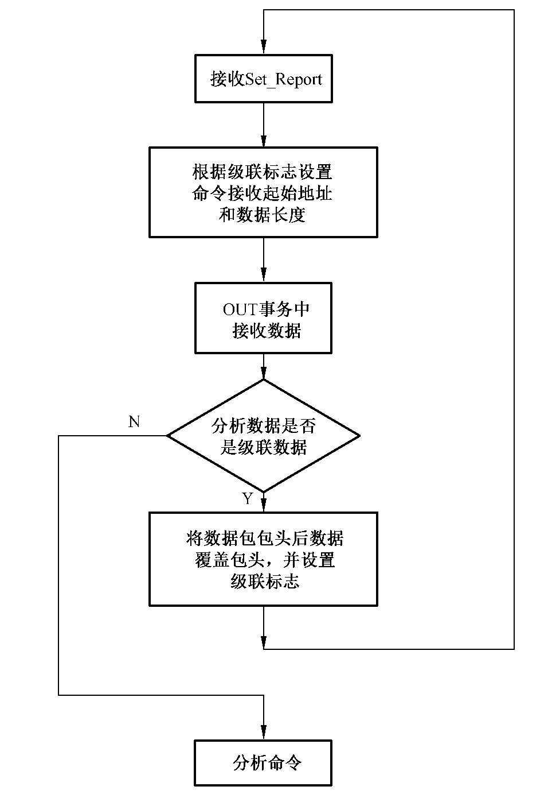

**图 7 HID 设备数据接收流程**

上位机发送的级联数据每包64 字节,包头3 字节,最后一个包实际数据除去包头可能不到61 字节,但是还是将不到61 字节的地方补0。所以接收的时候始终按64 字节长度字节去接收。

接收到的级联包实际包含了包头,给 COS 的命令应去掉这3 字节包头。搬移数据方法见图8。

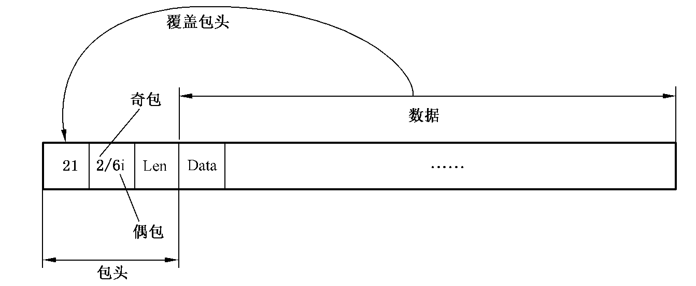

> [!note]
>
> 注:最后一包第2 字节为0i。

**图 8 HID 设备数据包组装示意图**

在实际操作时,可将接收的前3 字节去掉,从第4 字节写入到对应数据区,可省去数据搬移。在接收数据时,第一个64 字节的包全部接收,接收之后分析前3 字节,根据情况判断级联,发现级联之后的包前3 字节不写入数据区,从第4 字节开始写入数据区,但应对第2 字节进行分析,判断是否还有级联包。

###### 9.4.3.1.3 数据发送

通过 EP0 发送数据时,在发送数据前首先分析数据长度是否需要级联发送。

级联发送的具体流程见图9。

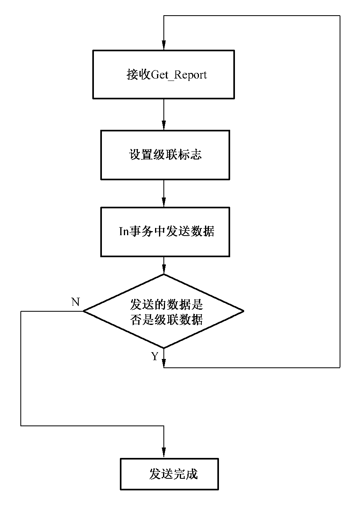

**图 9 HID 设备数据发送流程**

发送的方法是将待发送的数据按61 字节拆开,然后在每个包加上包头,最后一个包可能不到61 字节,也只要加上包头就可以,包头如下:

级联非最后一包包头:0x210x2i0x3d,i 是第几个级联包。

级联最后一包包头:0x210x0iLen,$\mathit{Len}$ 是最后一包出去包头的字节长度,这个长度包含了最后2 字节的状态字。

###### 9.4.3.1.4 HID 延时处理

HID 设备在处理上位机的命令数据时,可能需要一定的时间,这段时间可能超出 HID 的可接受的响应时间范围。这时应做延时处理:在 COS 处理命令之间,回复一个响应数据包:0x21、0xC3、0x00,通知上位机延时;在延时包发送后,最大可延时5s,即5s 之内若 COS 还没有处理好数据,应继续回复延时包。

延时的处理实际上是交给了定时器去处理,当需要调用 COS 时就开启定时器和溢出中断使能,关掉串行中断使能。

当定时器溢出时,关定时器,设置回复延时包,开串行中断使能。

当获取到 Get_Report 包时,关串行中断,开启定时器。

延时包的处理流程见图10。

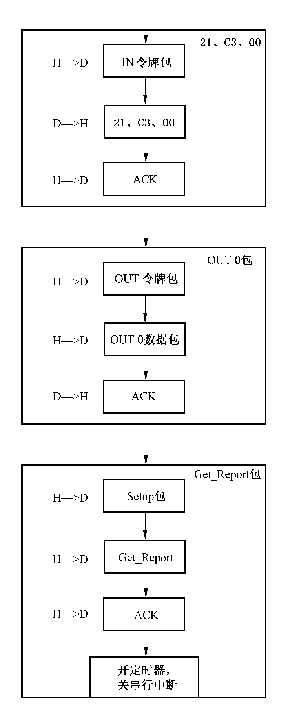

**图 10 HID 设备数据延时处理流程**

对延时包的处理要将21、C3、00,OUT0 包,Get_Report 包作为一个整体来完成。这个整体的完成而且是在定时器溢出程序中完成的,在里面采用查询的方式。

## 附录 A（规范性）设备返回码定义

设备返回码定义见表 A.1。

**表 A.1 设备返回码定义**

| SW | 说明 |
| --- | --- |
| 9000 | 正确执行 |
| 63CX | 认证失败,还剩下 $X$ 次重试机会 |
| 6700 | 长度错误$(\mathit{Lc}$ 与 DATA 域数据长度不一致) |
| 6982 | 安全状态不满足 |
| 6983 | 认证方法被锁定 |
| 6984 | 引用的数据无效 |
| 6985 | 使用的条件不满足 |
| 6986 | 命令不被允许 |
| 6988 | SM 数据对象不正确 |
| 698A | 没有选择(打开)应用 |
| 6A80 | 数据字段中的参数不正确 |
| 6A81 | 功能不被支持 |
| 6A84 | 无足够的文件存储空间 |
| 6A86 | P1、P2 参数错误 |
| 6A88 | 引用的数据未找到 |
| 6A89 | 应用已经存在 |
| 6A8A | 指定的应用已打开 |
| 6A8B | 指定的应用不存在 |
| 6A8C | 引用的对称密钥不存在 |
| 6A8D | 数据错误 |
| 6A90 | 已有打开的应用,当前设备不支持同时打开多个应用 |
| 6A91 | 指定的容器不存在 |
| 6A92 | 文件已经存在 |
| 6A93 | 指定的文件不存在 |
| 6A94 | 引用的容器未找到 |
| 6A95 | 容器中没有对应的密钥对 |
| 6A96 | 指定类型的证书不存在 |
| 6A97 | 数据写入失败 |
| 6A98 | 验证签名失败 |
| 6A99 | 不支持的会话密钥算法标识 |
| 6A9A | 非对称加密失败 |
| 6A9B | 非对称解密失败 |
| 6A9C | 私钥签名失败 |
| 6A9D | 不支持的密码杂凑算法 |
| 6A9E | 还有更多数据需要上传,应重新发送指令获取后续数据 |
| 6A9F | 引用的密钥未找到 |
| 6B00 | 给定的偏移值超出文件长度 |
| 6B01 | 生成密钥协商数据失败 |
| 6B02 | 生成协商密钥失败 |
| 6CXX | 错误的长度 $\mathit{Le}$,SW2 指示准确的长度 |
| 6E00 | CLA 错误,指定的类别不被支持 |
| 6E01 | 待返回数据长度超出最大缓冲区长度 |
| 6E02 | 指定的容器已存在 |

## 附录 B（规范性）安全报文计算过程

### B.1 数据加密运算过程

假定分组长度为 $L$ 字节,待加密数据长度为 $\mathit{Ld}$ 字节(最大长度为65535)。

加密运算步骤如下:

a) 在待加密数据前填充两字节的数据长度(以 Little Endian 方式表示),作为加密过程的输入数据;

b) 将经步骤 a)处理后的数据块分成以 $L$ 字节为单位的数据块,标识为 $\mathit{D1}$、$\mathit{D2}$……$\mathit{Dn}$;

c) 如果最后一组数据块长度为 $L$ 字节,应在其后加上1 字节0x80 及 $L-1$ 字节0x00,转到步骤 d);如果最后一组数据块长度不足 $L$ 字节,则在其后加上0x80,如果长度达到 $L$ 字节,转到步骤 d);否则在其后再加上0x00,直到长度达到 $L$ 字节;

d) 对上述每一个数据块使用相应的密钥进行加密运算;

e) 计算结束后,将所有运算后的数据块依照原有顺序连接到一起,即为加密运算后的结果。

### B.2 数据解密运算过程

解密运算步骤如下:

a) 对待解密数据按 $L$ 字节进行分组;

b) 对每一个分组使用相应的密钥进行解密运算,所有解密后数据按原有序列连接到一起;

c) 去掉前面填充的数据长度和最后的填充数据,得到原始明文。

### B.3 MAC 计算过程

MAC 是使用命令的所有元素(包括命令头)产生的,MAC 是命令数据域中的一部分,长度为4 字节。

MAC 计算步骤如下:

a) 应用向设备发送取随机数指令,从设备取回8 字节随机数;

b) 将设备回送的8 字节随机数加上 $L-8$ 个字节0x00,得到 $L$ 字节结果作为初始值;

c) 按照顺序将以下数据连接成数据块:

CLA、INS、P1、P2、$\mathit{Lc}+4$、Data;

(CLA 的低半字节置为0x4)

d) 将步骤 c)得到的结果分成以 $L$ 字节为单位的数据块,标识为 $\mathit{D1}$、$\mathit{D2}$……$\mathit{Dn}$;

e) 如果最后一组数据块长度为 $L$ 字节,应在其后加上1 字节0x80 及 $L-1$ 字节0x00,转到步骤 f);如果最后一组数据块长度不足 $L$ 字节,则在其后加上0x80,如果长度达到 $L$ 字节,转到步骤 f);否则在其后再加上0x00,直到长度达到 $L$ 字节;

f) 对上述数据块使用相应的密钥进行加密,见图 B.1;

g) 将步骤 f)得到的结果从左侧取4 字节长度的数据,作为 MAC 计算结果。

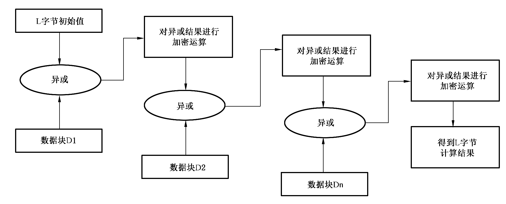

**图 B.1 安全报文 MAC 计算过程**

## 附录 C（资料性）编程范例

### C.1 用途

本附录对常用指令提供了编程范例,供应用开发商参考,应用开发商可根据实际情况进行相应的修改后使用。本附录中的编程范例使用的开发语言为 C 语言,范例中涉及的函数、数据类型和常量使用 GM/T0016 中的定义。

### C.2 设备认证

```c
BYTE *CLA,*INS,*P1,*P2,*Lc,*Data,*Le;
BYTE SW1,SW2;
BYTE CommAPDU[64],RespAPDU[64];
ULONG CommLen;
ULONG RespLen;
ULONG RetValue;
HANDLE hDev;
BYTE Rand[16];
BYTE AuthData[16];
CLA=CommAPDU;
INS=CommAPDU+1;
P1=CommAPDU+2;
P2=CommAPDU+3;
memset(CommAPDU,0,64);
memset(RespAPDU,0,64);
/*打开设备,并取得设备句柄hDev*/
……
/*取随机数*/
*CLA=0x80;
*INS=0x50;
*P1=0x00;
*P2=0x00;
Le=P2+1;
*Le=0x00;
Le++;
*Le=0x00;
Le++;
*Le=0x08;
CommLen=7;
RetValue=SKF_Transmit(hDev,CommAPDU,CommLen,RespAPDU,&RespLen);
if(RetValue!=SAR_OK)
{
    /*错误处理*/
    ……
}
SW1=RespAPDU[RespLen-2];
SW2=RespAPDU[RespLen-1];
if((SW1!=0x90)||(SW2!=0x00))
{
    /*错误处理*/
    ……
}
memcpy(Rand,RespAPDU,RespLen-2);
/*得到加密认证数据*/
/*……
使用外部设备或软件,使用设备认证密钥,按照GM/T0016设备认证中的要求,加密随机数得到
认证数据,并放在AuthData数组中。在本例中,加密使用SM4算法,加密后的设备认证数据长度为16
字节。
……*/
/*设备认证*/
*CLA=0x80;
*INS=0x10;
*P1=0x00;
*P2=0x00;/*使用默认的SM4算法*/
Lc=P2+1;
*Lc=0x00;
Lc++;
*Lc=0x00;
Lc++;
*Lc=0x10;
Data=Lc+1;
memcpy(Data,AuthData,16);
CommLen=23;
RetValue=SKF_Transmit(hDev,CommAPDU,CommLen,RespAPDU,&RespLen);
if(RetValue!=SAR_OK)
{
    /*错误处理*/
    ……
}
SW1=RespAPDU[RespLen-2];
SW2=RespAPDU[RespLen-1];
if((SW1!=0x90)||(SW2!=0x00))
{
    /*错误处理*/
    ……
}
```

### C.3 修改设备认证密钥

```c
BYTE *CLA,*INS,*P1,*P2,*Lc,*Data,*Le;
BYTE SW1,SW2;
BYTE CommAPDU[64],RespAPDU[64];
ULONG CommLen;
ULONG RespLen;
ULONG RetValue;
BYTE NewAuthKey[16];
BYTE EncryptedNewAuthKey[16];
BYTE Mac[8];
CLA=CommAPDU;
INS=CommAPDU+1;
P1=CommAPDU+2;
P2=CommAPDU+3;
memset(CommAPDU,0,64);
memset(RespAPDU,0,64);
/*得到加密认证数据*/
/*……
i.输入新的设备认证密钥并保存在NewAuthKey数组中;
ii.使用外部设备或软件,使用原设备认证密钥,参照附录B,加密NewAuthKey并保存在En-
cryptedNewAuthKey数组中;
iii.使用外部设备或软件,使用原设备认证密钥参照附录B,对NewAuthKey生成认证码并保存在
Mac数组中;
……*/
/*修改设备认证密钥*/
*CLA=0x84;
*INS=0x12;
*P1=0x00;
*P2=0x00;
Lc=P2+1;
*Lc=0x00;
Lc++;
*Lc=0x00;
Lc++;
*Lc=0x14;
Data=Lc+1;
memcpy(Data,EncryptedNewAuthKey,16);
memcpy(Data+16,Mac,4);
CommLen=27;
RetValue=SKF_Transmit(hDev,CommAPDU,CommLen,RespAPDU,&RespLen);
if(RetValue!=SAR_OK)
{
    /*错误处理*/
    ……
}
SW1=RespAPDU[RespLen-2];
SW2=RespAPDU[RespLen-1];
if((SW1!=0x90)||(SW2!=0x00))
{
    /*错误处理*/
    ……
}
```

### C.4 设置设备标签

```c
BYTE NewLabel[32]="newlabel";
ULONG LabelLen=8;
*CLA=0x80;
*INS=0x02;
*P1=0x00;
*P2=0x00;
Lc=P2+1;
*Lc=0x00;
Lc++;
*Lc=0x00;
Lc++;
*Lc=(BYTE)LabelLen;
Data=Lc+1;
memcpy(Data,NewLabel,NewLabelLen);
CommLen=7+NewLabelLen;
RetValue=SKF_Transmit(hDev,CommAPDU,CommLen,RespAPDU,&RespLen);
if(RetValue!=SAR_OK)
{
    /*错误处理*/
    ……
}
SW1=RespAPDU[RespLen-2];
SW2=RespAPDU[RespLen-1];
if((SW1!=0x90)||(SW2!=0x00))
{
    /*错误处理*/
    ……
}
```

### C.5 添加应用

```c
/*使用设备认证接口,完成设备认证*/
/*
…
*/
/**设置应用信息*/
APPLICATIONINFOappInfo;
CHAR szApplicatinName[32]="appName";
CHAR szAdminPin[16]="adminPin";
CHAR szUserPin[16]="userPin";
memset(&appInfo,0,sizeof(appInfo));
strcpy(appInfo.szApplicatinName,szApplicatinName);
strcpy(appInfo.szAdminPin,szAdminPin);
strcpy(appInfo.szUserPin,szUserPin);
appInfo.bApplicationNameLen=strlen(szApplicatinName);
appInfo.bAdminPinLen=strlen(szAdminPin);
appInfo.bUserPinLen=strlen(szUserPin);
appInfo.dwAdminPinRetryCount=10;
appInfo.dwUserPinRetryCount=10;
appInfo.dwCreateFileRights=3;
appInfo.byContainerNum=16;
appInfo.byCertNum=16;
appInfo.wFileNum=256;
/*添加应用指令数据*/
BYTE *CLA,*INS,*P1,*P2,*Lc,*Data;
BYTE SW1,SW2;
BYTE CommAPDU[64+sizeof(appInfo)],RespAPDU[64];
ULONG CommLen;
ULONG RespLen;
ULONG RetValue;
BYTE Rand[16];
BYTE AuthData[16];
CLA=CommAPDU;
INS=CommAPDU+1;
P1=CommAPDU+2;
P2=CommAPDU+3;
Lc=CommAPDU+4;
Data=CommAPDU+7;
memset(CommAPDU,0,sizeof(CommAPDU));
memset(RespAPDU,0,sizeof(RespAPDU));
*CLA=0x80;
*INS=0x20;//CreateApplication
*P1=0x00;
*P2=0x00;
Lc[2]=sizeof(appInfo);
memcpy(Data,&appInfo,sizeof(appInfo));
CommLen=7+sizeof(appInfo);
RetValue=SKF_Transmit(hDev,CommAPDU,CommLen,RespAPDU,&RespLen);
if(RetValue!=SAR_OK)
{
    /*错误处理*/
    ……
}
SW1=RespAPDU[RespLen-2];
SW2=RespAPDU[RespLen-1];
if((SW1!=0x90)||(SW2!=0x00))
{
    /*错误处理*/
    ……
}
```

### C.6 删除应用

```c
/*使用设备认证接口,完成设备认证*/
/*
…
*/
/**设置应用名称信息*/
CHAR szApplicatinName[32]="appName";
/*添加应用指令数据*/
BYTE *CLA,*INS,*P1,*P2,*Lc,*Data;
BYTE SW1,SW2;
BYTE CommAPDU[64+sizeof(appInfo)],RespAPDU[64];
ULONG CommLen;
ULONG RespLen;
ULONG RetValue;
BYTE Rand[16];
BYTE AuthData[16];
CLA=CommAPDU;
INS=CommAPDU+1;
P1=CommAPDU+2;
P2=CommAPDU+3;
Lc=CommAPDU+4;
Data=CommAPDU+7;
/*删除应用*/
memset(CommAPDU,0,sizeof(CommAPDU));
memset(RespAPDU,0,sizeof(RespAPDU));
*CLA=0x80;
*INS=0x24;//DeleteApplication
*P1=0x00;
*P2=0x00;
Lc[2]=strlen(szApplicatinName);
memcpy(Data,szApplicatinName,strlen(szApplicatinName));
CommLen=7+strlen(szApplicatinName);
RetValue=SKF_Transmit(hDev,CommAPDU,CommLen,RespAPDU,&RespLen);
if(RetValue!=SAR_OK)
{
    /*错误处理*/
    ……
}
SW1=RespAPDU[RespLen-2];
SW2=RespAPDU[RespLen-1];
if((SW1!=0x90)||(SW2!=0x00))
{
    /*错误处理*/
    ……
}
```

### C.7 修改 PIN

```c
/*PIN码信息*/
CHAR szOldAdminPin[16]="oldAdminPin";
CHAR szNewAdminPin[16]="newAdminPin";
/*指令数据*/
BYTE *CLA,*INS,*P1,*P2,*Lc,*Data,*Le;
BYTE SW1,SW2;
BYTE CommAPDU[64+sizeof(appInfo)],RespAPDU[64];
ULONG CommLen;
ULONG RespLen;
ULONG RetValue;
BYTE Rand[16];
BYTE AuthData[16];
CLA=CommAPDU;
INS=CommAPDU+1;
P1=CommAPDU+2;
P2=CommAPDU+3;
Lc=CommAPDU+4;
Data=CommAPDU+7;
/*打开应用*/
memset(CommAPDU,0,sizeof(CommAPDU));
memset(RespAPDU,0,sizeof(RespAPDU));
*CLA=0x80;
*INS=0x26;//OpenApplication
*P1=0x00;
*P2=0x00;
Lc[2]=strlen(szApplicatinName);
memcpy(Data,szApplicatinName,strlen(szApplicatinName));
Le=Data+strlen(szApplicatinName);
Le[1]=10;
CommLen=9+strlen(szApplicatinName);
RetValue=SKF_Transmit(hDev,CommAPDU,CommLen,RespAPDU,&RespLen);
if(RetValue!=SAR_OK)
{
    /*错误处理*/
    ……
}
SW1=RespAPDU[RespLen-2];
SW2=RespAPDU[RespLen-1];
if((SW1!=0x90)||(SW2!=0x00))
{
    /*错误处理*/
    ……
}
if(RespLen!=12)//返回数据格式错误,无法获取wAppId
{
    /*错误处理*/
    ……
}
/*获取AppID*/
BYTE pAppId[2];
memcpy(pAppId,RespAPDU+8,2);
/*取随机数*/
memset(CommAPDU,0,sizeof(CommAPDU));
memset(RespAPDU,0,sizeof(RespAPDU));
*CLA=0x80;
*INS=0x50;//GenRandom
*P1=0x00;
*P2=0x00;
Le=P2+1;
Le[2]=0x08;
CommLen=7;
RetValue=SKF_Transmit(hDev,CommAPDU,CommLen,RespAPDU,&RespLen);
if(RetValue!=SAR_OK)
{
    /*错误处理*/
    ……
}
SW1=RespAPDU[RespLen-2];
SW2=RespAPDU[RespLen-1];
if((SW1!=0x90)||(SW2!=0x00))
{
    /*错误处理*/
    ……
}
if(RespLen!=10)//返回数据格式错误,随机数长度不正确
{
    /*错误处理*/
    ……
}
BYTE pRandom[8];
memcpy(pRandom,RespAPDU,8);
/*对原PIN码进行SM3运算*/
CHAR sm3Hash[32];
SM3(szOldAdminPin,16,sm3Hash);
/*加密NewAdminPIN*/
BYTE encNewAdminPIN[16];
/*SM4(…)函数由软件实现*/
SM4(sm3Hash,16,szNewAdminPin,16,encNewAdminPIN,16);//
/*修改PIN码*/
memset(CommAPDU,0,sizeof(CommAPDU));
memset(RespAPDU,0,sizeof(RespAPDU));
*CLA=0x84;
*INS=0x16;//ChangePIN
*P1=0x00;
*P2=0x00;//管理员PIN码
Lc=P2+1;
*Lc=0x00;
Lc++;
*Lc=0x00;
Lc++;
*Lc=20;
Data=Lc++;
memcpy(Data,pAppId,2);//pAppId
memcpy(Data+2,encNewAdminPIN,16);//encNewAdminPIN
/*计算Mac,SM4_MAC由软件实现*/
SM4_MAC(sm3Hash,16,pRandom,8,CommAPDU,7+2+16,CommAPDU+7+2+16,4);
/*/发送指令*/
CommLen=7+22;
RetValue=SKF_Transmit(hDev,CommAPDU,CommLen,RespAPDU,&RespLen);
if(RetValue!=SAR_OK)
{
    /*错误处理*/
    ……
}
SW1=RespAPDU[RespLen-2];
SW2=RespAPDU[RespLen-1];
if((SW1!=0x90)||(SW2!=0x00))
{
    /*错误处理*/
    ……
}
```

### C.8 校验 PIN

```c
/*PIN码信息*/
CHAR szAdminPin[16]="adminPin";
/*指令数据*/
BYTE *CLA,*INS,*P1,*P2,*Lc,*Data,*Le;
BYTE SW1,SW2;
BYTE CommAPDU[64+sizeof(appInfo)],RespAPDU[64];
ULONG CommLen;
ULONG RespLen;
ULONG RetValue;
BYTE Rand[16];
BYTE AuthData[16];
CLA=CommAPDU;
INS=CommAPDU+1;
P1=CommAPDU+2;
P2=CommAPDU+3;
Lc=CommAPDU+4;
Data=CommAPDU+7;
/*打开应用*/
memset(CommAPDU,0,sizeof(CommAPDU));
memset(RespAPDU,0,sizeof(RespAPDU));
*CLA=0x80;
*INS=0x26;//OpenApplication
*P1=0x00;
*P2=0x00;
Lc[2]=strlen(szApplicatinName);
memcpy(Data,szApplicatinName,strlen(szApplicatinName));
Le=Data+strlen(szApplicatinName);
Le[1]=10;
CommLen=9+strlen(szApplicatinName);
RetValue=SKF_Transmit(hDev,CommAPDU,CommLen,RespAPDU,&RespLen);
if(RetValue!=SAR_OK)
{
    /*错误处理*/
    ……
}
SW1=RespAPDU[RespLen-2];
SW2=RespAPDU[RespLen-1];
if((SW1!=0x90)||(SW2!=0x00))
{
    /*错误处理*/
    ……
}
/*返回数据格式错误,无法获取wAppId*/
if(RespLen!=12)
{
    /*错误处理*/
    ……
}
/*获取AppID*/
BYTE pAppId[2];
memcpy(pAppId,RespAPDU+8,2);
/**取随机数*/
memset(CommAPDU,0,sizeof(CommAPDU));
memset(RespAPDU,0,sizeof(RespAPDU));
*CLA=0x80;
*INS=0x50;//GenRandom
*P1=0x00;
*P2=0x00;
Le=P2+1;
Le[2]=0x08;
CommLen=7;
RetValue=SKF_Transmit(hDev,CommAPDU,CommLen,RespAPDU,&RespLen);
if(RetValue!=SAR_OK)
{
    /*错误处理*/
    ……
}
SW1=RespAPDU[RespLen-2];
SW2=RespAPDU[RespLen-1];
if((SW1!=0x90)||(SW2!=0x00))
{
    /*错误处理*/
    ……
}
/*返回数据格式错误,随机数长度不正确*/
if(RespLen!=10)
{
    /*错误处理*/
    ……
}
BYTE pRandom[8];
memcpy(pRandom,RespAPDU,8);
/**对PIN码进行SM3运算*/
CHAR sm3Hash[32];
/*进行SM3运算,SM3(…)函数由软件实现*/
SM3(szAdminPin,16,sm3Hash);
/**加密pRandom*/
BYTE encRandom[16];
/*SM4(…)函数由软件实现*/
SM4(sm3Hash,16,pRandom,8,encRandom,16);
/**校验PIN码*/
memset(CommAPDU,0,sizeof(CommAPDU));
memset(RespAPDU,0,sizeof(RespAPDU));
*CLA=0x80;
*INS=0x18;//VerifyPIN
*P1=0x00;
*P2=0x00;//管理员PIN码
Lc=P2+1;
*Lc=0x00;
Lc++;
*Lc=0x00;
Lc++;
*Lc=18;
Data=Lc++;
memcpy(Data,pAppId,2);//pAppId
memcpy(Data+2,encRandom,16);//encRandom
CommLen=7+18;
RetValue=SKF_Transmit(hDev,CommAPDU,CommLen,RespAPDU,&RespLen);
if(RetValue!=SAR_OK)
{
    /*错误处理*/
    ……
}
SW1=RespAPDU[RespLen-2];
SW2=RespAPDU[RespLen-1];
if((SW1!=0x90)||(SW2!=0x00))
{
    /*错误处理*/
    ……
}
```

### C.9 PIN 解锁

```c
/*PIN码信息*/
CHAR szAdminPin[16]="adminPin";
CHAR szNewUserPin[16]="newUserPin";
/*指令数据*/
BYTE *CLA,*INS,*P1,*P2,*Lc,*Data,*Le;
BYTE SW1,SW2;
BYTE CommAPDU[64+sizeof(appInfo)],RespAPDU[64];
ULONG CommLen;
ULONG RespLen;
ULONG RetValue;
BYTE Rand[16];
BYTE AuthData[16];
CLA=CommAPDU;
INS=CommAPDU+1;
P1=CommAPDU+2;
P2=CommAPDU+3;
Lc=CommAPDU+4;
Data=CommAPDU+7;
/*打开应用*/
memset(CommAPDU,0,sizeof(CommAPDU));
memset(RespAPDU,0,sizeof(RespAPDU));
*CLA=0x80;
*INS=0x26;//OpenApplication
*P1=0x00;
*P2=0x00;
Lc[2]=strlen(szApplicatinName);
memcpy(Data,szApplicatinName,strlen(szApplicatinName));
Le=Data+strlen(szApplicatinName);
Le[1]=10;
CommLen=9+strlen(szApplicatinName);
RetValue=SKF_Transmit(hDev,CommAPDU,CommLen,RespAPDU,&RespLen);
if(RetValue!=SAR_OK)
{
    /*错误处理*/
    ……
}
SW1=RespAPDU[RespLen-2];
SW2=RespAPDU[RespLen-1];
if((SW1!=0x90)||(SW2!=0x00))
{
    /*错误处理*/
    ……
}
if(RespLen!=12)//返回数据格式错误,无法获取wAppId
{
    /*错误处理*/
    ……
}
/*获取AppID*/
BYTE pAppId[2];
memcpy(pAppId,RespAPDU+8,2);
/*取随机数*/
memset(CommAPDU,0,sizeof(CommAPDU));
memset(RespAPDU,0,sizeof(RespAPDU));
*CLA=0x80;
*INS=0x50;//GenRandom
*P1=0x00;
*P2=0x00;
Le=P2+1;
Le[2]=0x08;
CommLen=7;
RetValue=SKF_Transmit(hDev,CommAPDU,CommLen,RespAPDU,&RespLen);
if(RetValue!=SAR_OK)
{
    /*错误处理*/
    ……
}
SW1=RespAPDU[RespLen-2];
SW2=RespAPDU[RespLen-1];
if((SW1!=0x90)||(SW2!=0x00))
{
    /*错误处理*/
    ……
}
if(RespLen!=10)//返回数据格式错误,随机数长度不正确
{
    /*错误处理*/
    ……
}
BYTE pRandom[8];
memcpy(pRandom,RespAPDU,8);
/*对原PIN码进行SM3运算*/
CHAR sm3Hash[32];
/*进行SM3运算,SM3(…)函数由软件实现*/
SM3(szAdminPin,16,sm3Hash);
/*加密NewUserPin*/
BYTE encNewUserPIN[16];
/*SM4(…)函数由软件实现*/
SM4(sm3Hash,16,szNewUserPin,16,encNewUserPIN,16);
/*解锁PIN码*/
memset(CommAPDU,0,sizeof(CommAPDU));
memset(RespAPDU,0,sizeof(RespAPDU));
*CLA=0x84;
*INS=0x1A;//UnlockPIN
*P1=0x00;
*P2=0x00;//管理员PIN码
Lc=P2+1;
*Lc=0x00;
Lc++;
*Lc=0x00;
Lc++;
*Lc=18;
Data=Lc++;
memcpy(Data,pAppId,2);//pAppId
memcpy(Data+2,encNewUserPIN,16);//encNewAdminPIN
/*计算Mac,SM4_MAC由软件实现*/
SM4_MAC(sm3Hash,16,pRandom,8,CommAPDU,7+2+16,CommAPDU+7+2+16,4);
CommLen=7+22;
RetValue=SKF_Transmit(hDev,CommAPDU,CommLen,RespAPDU,&RespLen);
if(RetValue!=SAR_OK)
{
    /*错误处理*/
    ……
}
SW1=RespAPDU[RespLen-2];
SW2=RespAPDU[RespLen-1];
if((SW1!=0x90)||(SW2!=0x00))
{
    /*错误处理*/
    ……
}
```

### C.10 创建密钥容器

```c
/*以下编程范例演示打开已存在的名称为"CAAPP"应用,并创建名称为"12345678"的密钥容
器*/
BYTE *CLA,*INS,*P1,*P2,*Lc,*Data,*Le;
BYTE SW1,SW2;
BYTE CommAPDU[64],RespAPDU[64];
ULONG CommLen;
ULONG RespLen;
ULONG RetValue;
WORD *pwAppID;
WORD wAppID;
CLA=CommAPDU;
INS=CommAPDU+1;
P1=CommAPDU+2;
P2=CommAPDU+3;
memset(CommAPDU,0,64);
memset(RespAPDU,0,64);
/*打开名称为"CAAPP"应用*/
*CLA=0x80;
*INS=0x26;
*P1=0x00;
*P2=0x00;
Lc=P2+1;
*Lc=0x00;
Lc++;
*Lc=0x00;
Lc++;
*Lc=0x05;
Data=Lc+1;
memcpy(Data,"CAAPP",5);
RetValue=SKF_Transmit(hDev,CommAPDU,CommLen,RespAPDU,&RespLen);
if(RetValue!=SAR_OK)
{
    /*错误处理*/
    ……
}
SW1=RespAPDU[RespLen-2];
SW2=RespAPDU[RespLen-1];
if((SW1!=0x90)||(SW2!=0x00))
{
    /*错误处理*/
    ……
}
pwAppID=RespAPDU+8;
wAppID=*pwAppID;
/*创建密钥容器,容器名称为"12345678"*/
*CLA=0x80;
*INS=0x40;
*P1=0x00;
*P2=0x00;
Lc=P2+1;
*Lc=0x00;
Lc++;
*Lc=0x00;
Lc++;
*Lc=0x0A;
Data=Lc+1;
pwAppID=Data;
*pwAppID=wAppID;
Data+=2;
memcpy(Data,"12345678",8);
Le=Data+8;
*Le=0x00;
Le++;
*Le=0x02;
CommLen=9+8;
RetValue=SKF_Transmit(hDev,CommAPDU,CommLen,RespAPDU,&RespLen);
if(RetValue!=SAR_OK)
{
    /*错误处理*/
    ……
}
SW1=RespAPDU[RespLen-2];
SW2=RespAPDU[RespLen-1];
if((SW1!=0x90)||(SW2!=0x00))
{
    /*错误处理*/
    ……
}
/*关闭名称为"CAAPP"应用*/
*CLA=0x80;
*INS=0x28;
*P1=0x00;
*P2=0x00;
Lc=P2+1;
*Lc=0x00;
Lc++;
*Lc=0x00;
Lc++;
*Lc=0x02;
Data=Lc+1;
pwAppID=Data;
*pwAppID=wAppID;
RetValue=SKF_Transmit(hDev,CommAPDU,CommLen,RespAPDU,&RespLen);
if(RetValue!=SAR_OK)
{
    /*错误处理*/
    ……
}
SW1=RespAPDU[RespLen-2];
SW2=RespAPDU[RespLen-1];
if((SW1!=0x90)||(SW2!=0x00))
{
    /*错误处理*/
    ……
}
```

### C.11 删除密钥容器

```c
/*以下编程范例演示打开已存在的名称为"CAAPP"应用,并删除名称为"12345678"的密钥容
器*/
BYTE *CLA,*INS,*P1,*P2,*Lc,*Data,*Le;
BYTE SW1,SW2;
BYTE CommAPDU[64],RespAPDU[64];
ULONG CommLen;
ULONG RespLen;
ULONG RetValue;
WORD *pwAppID;
WORD wAppID;
CLA=CommAPDU;
INS=CommAPDU+1;
P1=CommAPDU+2;
P2=CommAPDU+3;
memset(CommAPDU,0,64);
memset(RespAPDU,0,64);
/*打开名称为"CAAPP"应用*/
*CLA=0x80;
*INS=0x26;
*P1=0x00;
*P2=0x00;
Lc=P2+1;
*Lc=0x00;
Lc++;
*Lc=0x00;
Lc++;
*Lc=0x05;
Data=Lc+1;
memcpy(Data,"CAAPP",5);
RetValue=SKF_Transmit(hDev,CommAPDU,CommLen,RespAPDU,&RespLen);
if(RetValue!=SAR_OK)
{
    /*错误处理*/
    ……
}
SW1=RespAPDU[RespLen-2];
SW2=RespAPDU[RespLen-1];
if((SW1!=0x90)||(SW2!=0x00))
{
    /*错误处理*/
    ……
}
pwAppID=RespAPDU+8;
wAppID=*pwAppID;
/*此处请进行VerifyPin用户PIN码认证*/
……
/*删除已存在的容器名称为"12345678"密钥容器*/
*CLA=0x80;
*INS=0x48;
*P1=0x00;
*P2=0x00;
Lc=P2+1;
*Lc=0x00;
Lc++;
*Lc=0x00;
Lc++;
*Lc=0x0A;
Data=Lc+1;
pwAppID=Data;
*pwAppID=wAppID;
Data+=2;
memcpy(Data,"12345678",8);
Le=Data+8;
*Le=0x00;
Le++;
*Le=0x02;
RetValue=SKF_Transmit(hDev,CommAPDU,CommLen,RespAPDU,&RespLen);
if(RetValue!=SAR_OK)
{
    /*错误处理*/
    ……
}
SW1=RespAPDU[RespLen-2];
SW2=RespAPDU[RespLen-1];
if((SW1!=0x90)||(SW2!=0x00))
{
    /*错误处理*/
    ……
}
/*关闭名称为"CAAPP"应用*/
*CLA=0x80;
*INS=0x28;
*P1=0x00;
*P2=0x00;
Lc=P2+1;
*Lc=0x00;
Lc++;
*Lc=0x00;
Lc++;
*Lc=0x02;
Data=Lc+1;
pwAppID=Data;
*pwAppID=wAppID;
RetValue=SKF_Transmit(hDev,CommAPDU,CommLen,RespAPDU,&RespLen);
if(RetValue!=SAR_OK)
{
    /*错误处理*/
    ……
}
SW1=RespAPDU[RespLen-2];
SW2=RespAPDU[RespLen-1];
if((SW1!=0x90)||(SW2!=0x00))
{
    /*错误处理*/
    ……
}
```

### C.12 SM2 证书制作流程

```c
/*以下编程范例演示在已存在的名称为"CAAPP"应用和名称为"12345678"的密钥容器条件
下,如何生成SM2签名密钥对、如何导入SM2加密密钥对、如何导入数字证书*/
BYTE *CLA,*INS,*P1,*P2,*Lc,*Data,*Le;
BYTE SW1,SW2;
BYTE CommAPDU[3000],RespAPDU[3000];
ULONG CommLen;
ULONG RespLen;
ULONG RetValue;
WORD *pwAppID;
WORD wAppID;
WORD *pwContainerID;
WORD wContainerID;
WORD *pulBits;
CLA=CommAPDU;
INS=CommAPDU+1;
P1=CommAPDU+2;
P2=CommAPDU+3;
memset(CommAPDU,0,64);
memset(RespAPDU,0,64);
/*此处请参考其他章条的范例代码进行如下操作
打开名称为"CAAPP"应用,并获取应用ID
……
调用VerifyPin进行用户PIN码认证*/
……
/*打开已存在的容器名称为"12345678"密钥容器*/
*CLA=0x80;
*INS=0x42;
*P1=0x00;
*P2=0x00;
Lc=P2+1;
*Lc=0x00;
Lc++;
*Lc=0x00;
Lc++;
*Lc=0x0A;
Data=Lc+1;
pwAppID=Data;
*pwAppID=wAppID;
Data+=2;
memcpy(Data,"12345678",8);
Le=Data+8;
*Le=0x00;
Le++;
*Le=0x02;
RetValue=SKF_Transmit(hDev,CommAPDU,CommLen,RespAPDU,&RespLen);
if(RetValue!=SAR_OK)
{
    /*错误处理*/
    ……
}
SW1=RespAPDU[RespLen-2];
SW2=RespAPDU[RespLen-1];
if((SW1!=0x90)||(SW2!=0x00))
{
    /*错误处理*/
    ……
}
pwContainerID=RespAPDU;
wContainerID=*pwContainerID;
/*调用GenECCKeyPair生成SM2签名密钥对*/
*CLA=0x80;
*INS=0x70;
*P1=0x00;
*P2=0x00;
Lc=P2+1;
*Lc=0x00;
Lc++;
*Lc=0x00;
Lc++;
*Lc=0x06;
Data=Lc+1;
pwAppID=Data;
*pwAppID=wAppID;
Data+=2;
pwContainerID=Data;
*pwContainerID=wContainerID;
Data+=2;
pulBits=Data;
*pulBits=256;//期望生成密钥对的位长度
Le=Data+2;
*Le=0x00;
Le++;
*Le=0x40;//期望返回的公钥数据字节长度
RetValue=SKF_Transmit(hDev,CommAPDU,CommLen,RespAPDU,&RespLen);
if(RetValue!=SAR_OK)
{
    /*错误处理*/
    ……
}
SW1=RespAPDU[RespLen-2];
SW2=RespAPDU[RespLen-1];
if((SW1!=0x90)||(SW2!=0x00))
{
    /*错误处理*/
    ……
}
/*此处请将SM2公钥的XCoordinate和YCoordinate传递给CA系统,由CA系统生成SM2加
密密钥对和对应的签名证书、加密证书,并由CA系统对加密密对按照格式要求进行组合。*/
……
/*调用ImportECCKeyPair导入加密密钥对*/
*CLA=0x80;
*INS=0x72;
*P1=0x00;
*P2=0x00;
Lc=P2+1;
*Lc=0x00;
Lc++;
*Lc=0xXX;//数据长度高位字节
Lc++;
*Lc=0xXX;//数据长度低位字节
/*导入的加密密钥对数据*/
Data=Lc+1;
memcpy(Data,pECCKeyPair,ECCKeyPairLength);
RetValue=SKF_Transmit(hDev,CommAPDU,CommLen,RespAPDU,&RespLen);
if(RetValue!=SAR_OK)
{
    /*错误处理*/
    ……
}
SW1=RespAPDU[RespLen-2];
SW2=RespAPDU[RespLen-1];
if((SW1!=0x90)||(SW2!=0x00))
{
    /*错误处理*/
    ……
}
/*导入签名数字证书*/
*CLA=0x80;
*INS=0x4C;
*P1=0x00;
*P2=0x00;
Lc=P2+1;
*Lc=0x00;
Lc++;
*Lc=0xXX;//应用ID、容器ID和签名证书数据报文数据总长度的高位字节
Lc++;
*Lc=0xXX;//应用ID、容器ID和签名证书数据报文数据总长度的低位字节
Data=Lc+1;
pwAppID=Data;
*pwAppID=wAppID;
Data+=2;
pwContainerID=Data;
*pwContainerID=wContainerID;
Data+=2;
*(BYTE*)Data=1;//先导入签名证书
Data+=1;
*(ULONG*)Data=0xXX;//签名证书数据长度,按照BigEndian方式编码
Data+=4;
memcpy(Data,pSignCertData,signDataLength);//签名数字证书数据
RetValue=SKF_Transmit(hDev,CommAPDU,CommLen,RespAPDU,&RespLen);
if(RetValue!=SAR_OK)
{
    /*错误处理*/
    ……
}
SW1=RespAPDU[RespLen-2];
SW2=RespAPDU[RespLen-1];
if((SW1!=0x90)||(SW2!=0x00))
{
    /*错误处理*/
    ……
}
/*导入加密数字证书*/
Lc=P2+1;
*Lc=0x00;
Lc++;
*Lc=0xXX;//应用ID、容器ID和加密证书数据报文数据总长度的高位字节
Lc++;
*Lc=0xXX;//应用ID、容器ID和加密证书数据报文数据总长度的低位字节
Data=Lc+1;
pwAppID=Data;
*pwAppID=wAppID;
Data+=2;
pwContainerID=Data;
*pwContainerID=wContainerID;
Data+=2;
*(BYTE*)Data=0;//表示导入加密证书
Data+=1;
*(ULONG*)Data=0xXX;//加密证书数据长度,以BigEndian方式编码
Data+=4;
memcpy(Data,pEncCertData,encdataLength);//加密数字证书数据
RetValue=SKF_Transmit(hDev,CommAPDU,CommLen,RespAPDU,&RespLen);
if(RetValue!=SAR_OK)
{
    /*错误处理*/
    ……
}
SW1=RespAPDU[RespLen-2];
SW2=RespAPDU[RespLen-1];
if((SW1!=0x90)||(SW2!=0x00))
{
    /*错误处理*/
    ……
}
/*关闭容器*/
*CLA=0x80;
*INS=0x44;
*P1=0x00;
*P2=0x00;
Lc=P2+1;
*Lc=0x00;
Lc++;
*Lc=0x00;
Lc++;
*Lc=0x04;
Data=Lc+1;
pwAppID=Data;
*pwAppID=wAppID;
Data+=2;
pwContainerID=Data;
*pwContainerID=wContainerID;
RetValue=SKF_Transmit(hDev,CommAPDU,CommLen,RespAPDU,&RespLen);
if(RetValue!=SAR_OK)
{
    /*错误处理*/
    ……
}
SW1=RespAPDU[RespLen-2];
SW2=RespAPDU[RespLen-1];
if((SW1!=0x90)||(SW2!=0x00))
{
    /*错误处理*/
    ……
}
/*关闭名称为"CAAPP"应用*/
*CLA=0x80;
*INS=0x28;
*P1=0x00;
*P2=0x00;
Lc=P2+1;
*Lc=0x00;
Lc++;
*Lc=0x00;
Lc++;
*Lc=0x02;
Data=Lc+1;
pwAppID=Data;
*pwAppID=wAppID;
RetValue=SKF_Transmit(hDev,CommAPDU,CommLen,RespAPDU,&RespLen);
if(RetValue!=SAR_OK)
{
    /*错误处理*/
    ……
}
SW1=RespAPDU[RespLen-2];
SW2=RespAPDU[RespLen-1];
if((SW1!=0x90)||(SW2!=0x00))
{
    /*错误处理*/
    ……
}
```

### C.13 使用 SM2 密钥对进行数字签名

```c
/*
*以下编程范例演示使用SM2密钥对进行数字签名
*/
#define ECC_PUBLIC_LEN XXXX//XXXX为SM2密钥对长度
/*XX=1或者XX=2当为1时输入为待签名数据的原文,当为2时输入的待签名数据为原始
数据的杂凑值。*/
#define ECC_SIGNATURE_MODLE XX
BYTE *CLA,*INS,*P1,*P2,*Lc,*Data,*Le;
BYTE SW1,SW2;
BYTE CommAPDU[256],RespAPDU[256];
CHAR *Txt="GFA";/*数据*/
ULONG CommLen;
ULONG DataLen;
ULONG RespLen;
ULONG RetValue;
BYTE Sign[256];
CLA=CommAPDU+0;
INS=CommAPDU+1;
P1=CommAPDU+2;
P2=CommAPDU+3;
Lc=CommAPDU+4;
Data=CommAPDU+7;
/*初始化命令缓冲区及返回数据的缓冲区*/
memset(CommAPDU,0,256);
memset(RespAPDU,0,256);
memset(Sign,0,256);
CLA[0]=0x80;
INS[0]=0x74;
P1[0]=ECC_SIGNATURE_MODLE;
P2[0]=0x00;
if(ECC_SIGNATURE_MODLE==0x01)
{
    DataLen=strlen(Txt);
    memcpy(Data,Txt,DataLen);
}
else if(ECC_SIGNATURE_MODLE==0x02)
{
    /*对明文进行杂凑计算,将结果直接放进命令缓冲区中*/
    DataLen=HashCal(Txt,Data);/*HashCal为杂凑计算,输入Txt,输出到Data,返回长
    度。*/
}
Lc[0]|=0xFF&(DataLen>>16);
Lc[1]|=0xFF&(DataLen>>8);
Lc[2]|=0xFF&(DataLen);
Le=CommAPDU+0x07+DataLen;
Le[0]=0x00;
Le[1]=0x00;
CommLen=0x07+DataLen+2;/*命令头+Lc为7字节*/
RetValue=SKF_Transmit(hDev,CommAPDU,CommLen,RespAPDU,&RespLen);
if(RetValue!=SAR_OK)
{
    /*错误处理*/
    ……
}
SW1=RespAPDU[RespLen-2];
SW2=RespAPDU[RespLen-1];
if((SW1!=0x90)||(SW2!=0x00))
{
    /*错误处理*/
    ……
}
memcpy(Sign,RespAPDU,RespLen-2);
```

### C.14 使用 SM2 进行数字签名验证

```c
#define ECC_PUBLIC_LEN XXXX//SM2密钥对位长度
BYTE *CLA,*INS,*P1,*P2,*Lc,*Data,*Le;
BYTE SW1,SW2;
BYTE CommAPDU[256],RespAPDU[256];
CHAR *Txt="GFA";
ULONG CommLen;
ULONG RespLen;
ULONG RetValue;
ULONG DataLen;
BYTE Sign[128];
ULONG ulBits=ECC_PUBLIC_LEN;
BYTE x[ECC_PUBLIC_LEN/8];
BYTE y[ECC_PUBLIC_LEN/8];
ULONG pbdata_len=0xXX;//验签数据长度
BYTE pbdata[0xXX];//待验签数据,长度为验签数据长度
BYTE r[ECC_PUBLIC_LEN/8];
BYTE s[ECC_PUBLIC_LEN/8];
/*给待签名数据赋值*/
memset(pbdata,0,128);
memcpy(pbdata,Txt,pbdata_len);
CLA=CommAPDU+0;
INS=CommAPDU+1;
P1=CommAPDU+2;
P2=CommAPDU+3;
Lc=CommAPDU+4;
Data=CommAPDU+7;
/*初始化*/
memset(CommAPDU,0,256);
memset(RespAPDU,0,256);
CLA[0]=0x80;
INS[0]=0x76;
P1[0]=0x00;
P2[0]=0x00;
/*给Data赋值*/
DataLen=0;//初始化数据长度为0
Data[0]|=0xFF&(ulBits>>24);
Data[1]|=0xFF&(ulBits>>16);
Data[2]|=0xFF&(ulBits>>8);
Data[3]|=0xFF&(ulBits);
DataLen+=4;
memcpy(Data+DataLen,x,ECC_PUBLIC_LEN/8);
DataLen+=ECC_PUBLIC_LEN/8;
memcpy(Data+DataLen,y,ECC_PUBLIC_LEN/8);
DataLen+=ECC_PUBLIC_LEN/8;
Data[DataLen+0]|=0xFF&(pbdata_len>>24);
Data[DataLen+1]|=0xFF&(pbdata_len>>16);
Data[DataLen+2]|=0xFF&(pbdata_len>>8);
Data[DataLen+3]|=0xFF&(pbdata_len>>0);
DataLen+=4;
memcpy(Data+DataLen,pbdata,pbdata_len);
DataLen+=pbdata_len;
memcpy(Data+DataLen,r,ECC_PUBLIC_LEN/8);
DataLen+=ECC_PUBLIC_LEN/8;
memcpy(Data+DataLen,s,ECC_PUBLIC_LEN/8);
DataLen+=ECC_PUBLIC_LEN/8;
Lc[0]|=0xFF&(DataLen>>16);
Lc[1]|=0xFF&(DataLen>>8);
Lc[2]|=0xFF&(DataLen>>0);
CommLen=0x07+DataLen;/*命令头+Lc为7字节*/
RetValue=SKF_Transmit(hDev,CommAPDU,CommLen,RespAPDU,&RespLen);
if(RetValue!=SAR_OK)
{
    /*错误处理*/
    ……
}
SW1=RespAPDU[RespLen-2];
SW2=RespAPDU[RespLen-1];
if((SW1!=0x90)||(SW2!=0x00))
{
    /*错误处理*/
    ……
}
```

### C.15 使用 SM2 密钥对交换会话密钥

```c
//发起方:
uchar CommAPDU[256],RespAPDU[256];
struct Apdu_ecc{
    struct Head{
        uchar CLA;
        uchar INS;
        uchar P1;
        uchar P2;
    }Head;
    uchar LC1;
    uchar LC2;
    uchar LC3;
}Apdu_ecc;
ULONG secret_handler;/*会话密钥句柄*/
uchar sendAPDU[256];
ushort lc;
unsigned long privatetmpkey;
memset(CommAPDU,0,256);
memset(RespAPDU,0,256);
privatetmpkey=generationEccRand();
/*
由privatetmpkey生成响应方临时SM2公钥ECCPUBLICKEYBLOB
*/

lc=4+4+ulResponserBits/8+ulResponserBits/8+4+ResponserTempXCoordinate/8+Respon-
serTempXCoordinate/8+4+ulResponserIDLen;
//设置指令信息
Apdu_ecc.Head.CLA=0x80;
Apdu_ecc.Head.INS=0x84;
Apdu_ecc.Head.P1=0x00;
Apdu_ecc.Head.P2=0x00;
Apdu_ecc.LC1=0;
Apdu_ecc.LC2=0xFF&(lc>>8);
Apdu_ecc.LC3=0xFF&(lc);
memcpy(CommAPDU,&Apdu_ecc,7);/*把APDU头放到CommAPDU里*/
/*
将对应的key数据,及长度填入CommAPDU的数据段中。
*/
RetValue=SKF_Transmit(hDev,CommAPDU,CommLen,RespAPDU,&RespLen);
if(RetValue!=SAR_OK)
{
    /*错误处理*/
    ……
}
SW1=RespAPDU[RespLen-2];
SW2=RespAPDU[RespLen-1];
if((SW1!=0x90)||(SW2!=0x00))
{
    /*错误处理*/
    ……
}
memcpy(&secret_handler,RespAPDU,RespLen-2);
//接收方:
struct Apdu_ecc{
    struct Head{
        uchar CLA;
        uchar INS;
        uchar P1;
        uchar P2;
    }Head;
    uchar LC1;
    uchar LC2;
    uchar LC3;
}Apdu_ecc;
ULONG secret_handler;/*会话密钥句柄*/
uchar recvAPDU[256];
ushort lc;
unsigned long privatetmpkey;
uchar CommAPDU[256],RespAPDU[256];
memset(CommAPDU,0,256);
memset(RespAPDU,0,256);
recvapdu(recvAPDU);/*从发起方获取APDU*/
if(recvAPDU[0]==0x80&&recvAPDU[1]==0x84&&recvAPDU[2]==0x00&&re-
cvAPDU[3]==0x00)/*判断是发起方发送的用于协商SM2密钥的APDU*/
{
    /*
    保存发起方APDU里的对应信息
    */
    privatetmpkey=generationEccRand();
    /*
    由privatetmpkey生成响应方临时SM2公钥ECCPUBLICKEYBLOB
    */
    
    lc=4+4+ulResponserBits/8+ulResponserBits/8+4+ResponserTempXCoordinate/8+Respon-
    serTempXCoordinate/8+4+ulResponserIDLe;
    //设置指令信息
    Apdu_ecc.Head.CLA=0x80;
    Apdu_ecc.Head.INS=0x86;
    Apdu_ecc.Head.P1=0x00;
    Apdu_ecc.Head.P2=0x00;
    Apdu_ecc.LC1=0;
    Apdu_ecc.LC2=0xFF&(lc>>8);
    Apdu_ecc.LC3=0xFF&(lc);
    memcpy(CommAPDU,&Apdu_ecc,7);//把APDU头放到CommAPDU里
    /*
    将对应的key数据,及长度填入CommAPDU的数据段中。
    */
    RetValue=SKF_Transmit(hDev,CommAPDU,CommLen,RespAPDU,&RespLen);
    if(RetValue!=SAR_OK)
    {
        /*错误处理*/
        ……
    }
    SW1=RespAPDU[RespLen-2];
    SW2=RespAPDU[RespLen-1];
    if((SW1!=0x90)||(SW2!=0x00))
    {
        /*错误处理*/
        ……
    }
    memcpy(&secret_handler,RespAPDU,RespLen-2);
}
```

## 附录 D（规范性）SM9APDU 指令

### D.1 ImportSM9MasterPublicKey(导入 SM9 主公钥)

#### D.1.1 定义与范围

ImportSM9MasterPublicKey 命令用于向应用中导入 SM9 主公钥。

#### D.1.2 注意事项

应通过管理员权限验证。

#### D.1.3 命令报文

见表 D.1。

**表 D.1 ImportSM9MasterPublicKey 命令报文编码**

| 代码 | 长度<br>byte | 值<br>Hex | 描述 |
| --- | --- | --- | --- |
| CLA | 1 | 80 | — |
| INS | 1 | C8 | — |
| P1 | 1 | 01/02 | 01:导入签名主公钥;<br>02:导入加密主公钥 |
| P2 | 1 | 00 | — |
| $\mathit{Lc}$ | 3 | 00XXXX | 命令报文数据长度 |
| DATA | $\mathit{Lc}$ | XX…XX | 命令报文数据 |
| $\mathit{Le}$ | — | — | 不存在 |

#### D.1.4 命令报文数据域

命令报文数据为 SM9 签名主公钥或加密主公钥数据。

以下为相关数据结构定义。

```c
#define SM9_MODULUS_BITS_LEN 256
#define SM9_MODULUS_BYTES_LEN ((SM9_MODULUS_BITS_LEN+7)/8)
#define SM9_XCOORDINATE_BITS_LEN SM9_MODULUS_BITS_LEN
#define SM9_XCOORDINATE_BYTES_LEN ((SM9_XCOORDINATE_BITS_LEN+7)/8)
#define SM9_YCOORDINATE_BITS_LEN SM9_MODULUS_BITS_LEN
#define SM9_YCOORDINATE_BYTES_LEN ((SM9_YCOORDINATE_BITS_LEN+7)/8)
typedef struct Struct_SM9KEYBLOB1{
    ULONG ulCompressType;
    ULONG ulBitLen;
    BYTE cbXCoordinate[SM9_XCOORDINATE_BYTES_LEN];
    BYTE cbYCoordinate[SM9_YCOORDINATE_BYTES_LEN];
}SM9KEYBLOB1;
typedef struct Struct_SM9KEYBLOB2{
    ULONG ulCompressType;
    ULONG ulBitLen;
    BYTE cbXACoordinate[SM9_XCOORDINATE_BYTES_LEN];
    BYTE cbXBCoordinate[SM9_XCOORDINATE_BYTES_LEN];
    BYTE cbYACoordinate[SM9_YCOORDINATE_BYTES_LEN];
    BYTE cbYBCoordinate[SM9_YCOORDINATE_BYTES_LEN];
}SM9KEYBLOB2;
typedef SM9KEYBLOB2 SM9SIGNMASTPUBLICKEYBLOB;
typedef SM9KEYBLOB1 SM9ENCMASTPUBLICKEYBLOB;
```

命令报文数据域编码见表 D.2 和表 D.3。

**表 D.2 ImportSM9MasterPublicKey 命令报文数据域编码(签名主公钥)**

| 偏移 | 数据域 | 数据类型 | 字节长度 | 说明 |
| --- | --- | --- | --- | --- |
| 0 | wAppID | WORD | 2 | 应用 ID |
| 2 | ulCompressType | ULONG | 4 | 压缩类型 |
| 6 | ulBitLen | ULONG | 4 | 模数的位长度 |
| 10 | cbXACoordinate | BYTE ARRAY | 32 | $X$ 坐标高维分量 |
| 42 | cbXBCoordinate | BYTE ARRAY | 32 | $X$ 坐标低维分量 |
| 74 | cbYACoordinate | BYTE ARRAY | 32 | $Y$ 坐标高维分量 |
| 106 | cbYBCoordinate | BYTE ARRAY | 32 | $Y$ 坐标低维分量 |

**表 D.3 ImportSM9MasterPublicKey 命令报文数据域编码(加密主公钥)**

| 偏移 | 数据域 | 数据类型 | 字节长度 | 说明 |
| --- | --- | --- | --- | --- |
| 0 | wAppID | WORD | 2 | 应用 ID |
| 2 | ulCompressType | ULONG | 4 | 压缩类型 |
| 6 | ulBitLen | ULONG | 4 | 模数的位长度 |
| 10 | cbXCoordinate | BYTE ARRAY | 32 | $X$ 坐标数据 |
| 42 | cbYCoordinate | BYTE ARRAY | 32 | $Y$ 坐标数据 |

#### D.1.5 响应报文数据域

无响应数据。

#### D.1.6 响应报文状态码

智能密码钥匙可能回送的状态码见表 D.4。

**表 D.4 ImportSM9MasterPublicKey 命令响应状态码**

| SW1 | SW2 | 意义 |
| --- | --- | --- |
| 90 | 00 | 正确执行 |
| 67 | 00 | 长度错误$(\mathit{Lc}$ 与 DATA 域数据长度不一致) |
| 69 | 82 | 不满足安全状态 |
| 6A | 84 | 空间不足 |
| 6A | 88 | 引用的应用不存在 |

### D.2 ExportSM9MasterPublicKey(导出 SM9 主公钥)

#### D.2.1 定义与范围

ExportSM9MasterPublicKey 命令用于导出 SM9 主公钥。

#### D.2.2 注意事项

应预先打开应用。

#### D.2.3 命令报文

见表 D.5。

**表 D.5 ExportSM9MasterPublicKey 命令报文编码**

| 代码 | 长度<br>byte | 值<br>Hex | 描述 |
| --- | --- | --- | --- |
| CLA | 1 | 80 | — |
| INS | 1 | CA | — |
| P1 | 1 | 01/02 | 01:导出签名主公钥;<br>02:导出加密主公钥 |
| P2 | 1 | 00 | — |
| $\mathit{Lc}$ | 3 | 00XXXX | 命令报文数据长度 |
| DATA | $\mathit{Lc}$ | XX…XX | 应用 ID |
| $\mathit{Le}$ | 2 | XXXX | 期望获取的主公钥长度;如果为0,表示获取实际长度的公钥数据 |

#### D.2.4 命令报文数据域

命令报文数据域包括应用 ID。

命令报文数据域编码见表 D.6。

**表 D.6 ExportSM9MasterPublicKey 命令报文数据域编码**

| 偏移 | 数据域 | 数据类型 | 字节长度 | 说明 |
| --- | --- | --- | --- | --- |
| 0 | wAppID | BYTE ARRAY | 2 | 应用 ID |

#### D.2.5 响应报文数据域

响应报文数据域为导出的主公钥数据。

响应报文数据域编码见表 D.7、表 D.8。

**表 D.7 ExportSM9MasterPublicKey 响应报文数据域编码(签名主公钥)**

| 偏移 | 数据域 | 数据类型 | 字节长度 | 说明 |
| --- | --- | --- | --- | --- |
| 0 | cbXACoordinate | BYTE ARRAY | 32 | $X$ 坐标高维分量 |
| 32 | cbXBCoordinate | BYTE ARRAY | 32 | $X$ 坐标低维分量 |
| 64 | cbYACoordinate | BYTE ARRAY | 32 | $Y$ 坐标高维分量 |
| 96 | cbYBCoordinate | BYTE ARRAY | 32 | $Y$ 坐标低维分量 |

**表 D.8 ExportSM9MasterPublicKey 响应报文数据域编码(加密主公钥)**

| 偏移 | 数据域 | 数据类型 | 字节长度 | 说明 |
| --- | --- | --- | --- | --- |
| 0 | cbXCoordinate | BYTE ARRAY | 32 | $X$ 坐标 |
| 32 | cbYCoordinate | BYTE ARRAY | 32 | $Y$ 坐标 |

#### D.2.6 响应报文状态码

智能密码钥匙可能回送的状态码见表 D.9。

**表 D.9 ExportSM9MasterPublicKey 命令响应状态码**

| SW1 | SW2 | 意义 |
| --- | --- | --- |
| 90 | 00 | 正确执行 |
| 67 | 00 | $\mathit{Lc}$ 错误 |
| 6A | 88 | 引用的应用不存在 |
| 6A | 86 | 参数错误 |
| 6A | 95 | 对应的主密钥不存在 |

### D.3 ImportSM9UserKey(导入 SM9 用户密钥)

#### D.3.1 定义与范围

ImportSM9UserKey 命令用于在指定应用的指定容器中导入 SM9 用户密钥保护结构。

#### D.3.2 注意事项

应通过用户权限验证。

#### D.3.3 命令报文

见表 D.10。

**表 D.10 ImportSM9UserKey 命令报文编码**

| 代码 | 长度<br>byte | 值<br>Hex | 描述 |
| --- | --- | --- | --- |
| CLA | 1 | 80 | — |
| INS | 1 | CC | — |
| P1 | 1 | 01/02/03/04 | 01:导入签名密钥密钥封装保护结构;<br>02:导入签名密钥数字信封保护结构;<br>03:导入加密密钥密钥封装保护结构;<br>04:导入加密密钥数字信封保护结构 |
| P2 | 1 | 00 | — |
| $\mathit{Lc}$ | 3 | 00XXXX | 命令报文数据长度 |
| DATA | $\mathit{Lc}$ | XX…XX | 命令报文数据 |
| $\mathit{Le}$ | — | — | 不存在 |

#### D.3.4 命令报文数据域

命令报文数据为经对称密钥加密后的待导入用户密钥保护结构数据。

以下为相关数据结构定义。SM9 用户签名密钥数据结构:

```c
typedef SM9KEYBLOB1 SM9USERSIGNPRIVATEKEYBLOB;
```

SM9 用户加密密钥数据结构:

```c
typedef SM9KEYBLOB2 SM9USERENCPRIVATEKEYBLOB;
```

SM9 用户签名密钥密钥封装保护结构数据结构:

```c
typedef struct Struct_SM9SIGNENCAPSULATEDKEYBLOB{
    ULONG Version;
    ULONG ulSymmAlgID;
    ULONG ulBits;
    BYTE cbEncryptedPriKey[SM9_MODULUS_BITS_LEN*2];
    SM9SIGNMASTPUBLICKEYBLOB signMastPubKey;
    SM9ENCMASTPUBLICKEYBLOB tmpEncMastPubKey;
    BYTE ucUserID[256];
    ULONG ulUserIDLen;
    SM9KEYPACKAGEBLOB keyPackageBlob;
}SM9SIGNENCAPSULATEDKEYBLOB;
```

SM9 用户签名密钥数字信封保护结构数据结构:

```c
typedef struct Struct_SM9SIGNENVELOPEDKEYBLOB{
    ULONG Version;
    ULONG ulSymmAlgID;
    ULONG ulBits;
    BYTE cbEncryptedPriKey[SM9_MODULUS_BITS_LEN*2];
    SM9SIGNMASTPUBLICKEYBLOB signMastPubKey;
    SM9ENCMASTPUBLICKEYBLOB tmpEncMastPubKey;
    BYTE ucUserID[256];
    ULONG ulUserIDLen;
    SM9CIPHERBLOB cipherBlob;
}SM9SIGNENVELOPEDKEYBLOB;
```

SM9 用户加密密钥密钥封装保护结构数据结构:

```c
typedef struct SKF_SM9ENCENCAPSULATEDKEYBLOB{
    ULONG Version;
    ULONG ulSymmAlgID;
    ULONG ulBits;
    BYTE cbEncryptedPriKey[SM9_MODULUS_BITS_LEN*4];
    SM9ENCMASTPUBLICKEYBLOB encMastPubKey;
    SM9ENCMASTPUBLICKEYBLOB tmpEncMastPubKey;
    BYTE ucUserID[256];
    ULONG ulUserIDLen;
    SM9KEYPACKAGEBLOB keyPackageBlob;
}SM9ENCENCAPSULATEDKEYBLOB;
```

SM9 用户加密密钥数字信封保护结构数据结构:

```c
typedef struct SKF_SM9ENCENVELOPEDKEYBLOB{
    ULONG Version;
    ULONG ulSymmAlgID;
    ULONG ulBits;
    BYTE cbEncryptedPriKey[SM9_MODULUS_BITS_LEN*4];
    SM9ENCMASTPUBLICKEYBLOB encMastPubKey;
    SM9ENCMASTPUBLICKEYBLOB tmpEncMastPubKey;
    BYTE ucUserID[256];
    ULONG ulUserIDLen;
    SM9CIPHERBLOB cipherBlob;
}SM9ENCENVELOPEDKEYBLOB;
```

SM9 密钥封装数据结构:

```c
typedef struct Struct_SM9KEYPACKAGEBLOB{
    BYTE cbXCoordinate[SM9_XCOORDINATE_BYTES_LEN];
    BYTE cbYCoordinate[SM9_YCOORDINATE_BYTES_LEN];
}SM9KEYPACKAGEBLOB;
```

SM9 密文数据结构:

```c
typedef struct Struct_SM9CIPHERBLOB{
    ULONG ulAsymAlgId;
    BYTE cbXCoordinate[SM9_XCOORDINATE_BYTES_LEN];
    BYTE cbYCoordinate[SM9_YCOORDINATE_BYTES_LEN];
    BYTE cbC3[32];
    ULONG ulC2Len;
    BYTE cbC2[1];
}SM9CIPHERBLOB;
```

命令报文数据域编码见表 D.11、表 D.12、表 D.13、表 D.14。

**表 D.11 ImportSM9UserKey 命令报文数据域编码(用户签名密钥密钥封装保护结构)**

| 偏移 | 数据域 | 数据类型 | 字节长度 | 说明 |
| --- | --- | --- | --- | --- |
| 0 | wAppID | WORD | 2 | 应用 ID |
| 2 | wContainerID | WORD | 2 | 容器 ID |
| 4 | Version | ULONG | 4 | SM9SIGNENCAPSULATEDKEYBLOB 数据结构中的版本号 |
| 8 | ulSymmAlgID | ULONG | 4 | SM9SIGNENCAPSULATEDKEYBLOB 数据结构中的对称算法标识 |
| 12 | $\mathit{ulBits}$ | ULONG | 4 | SM9SIGNENCAPSULATEDKEYBLOB 数据结构中的模数的位长度 |
| 16 | cbEncryptedPrivKey | BYTE ARRAY | 64 | SM9SIGNENCAPSULATEDKEYBLOB 数据结构中的对称算法加密的签名私钥 |
| 80 | ulCompressType | ULONG | 4 | SM9SIGNMASTPUBLICKEYBLOB 数据结构中的压缩类型 |
| 84 | ulBitLen | ULONG | 4 | SM9SIGNMASTPUBLICKEYBLOB 数据结构中的模数的位长度 |
| 88 | cbXACoordinate | BYTE ARRAY | 32 | SM9SIGNMASTPUBLICKEYBLOB 数据结构中的 $X$ 坐标高维分量 |
| 120 | cbXBCoordinate | BYTE ARRAY | 32 | SM9SIGNMASTPUBLICKEYBLOB 数据结构中的 $X$ 坐标低维分量 |
| 152 | cbYACoordinate | BYTE ARRAY | 32 | SM9SIGNMASTPUBLICKEYBLOB 数据结构中的 $Y$ 坐标高维分量 |
| 184 | cbYBCoordinate | BYTE ARRAY | 32 | SM9SIGNMASTPUBLICKEYBLOB 数据结构中的 $Y$ 坐标低维分量 |
| 216 | ulCompressType | ULONG | 4 | SM9ENCMASTPUBLICKEYBLOB 数据结构中的压缩类型 |
| 220 | ulBitLen | ULONG | 4 | SM9ENCMASTPUBLICKEYBLOB 数据结构中的模数的位长度 |
| 252 | cbXCoordinate | BYTE ARRAY | 32 | SM9ENCMASTPUBLICKEYBLOB 数据结构中的 $X$ 坐标数据 |
| 284 | cbYCoordinate | BYTE ARRAY | 32 | SM9ENCMASTPUBLICKEYBLOB 数据结构中的 $Y$ 坐标数据 |
| 316 | $\mathit{ulUserIDLen}$ | ULONG | 4 | 用户标识长度 |
| 320 | ucUserID | BYTE ARRAY | $\mathit{ulUserIDLen}$ | 用户标识 |
| $320+\mathit{ulUserIDLen}$ | cbXCoordinate | BYTE ARRAY | 32 | SM9KEYPACKAGEBLOB 数据结构中的 $X$ 坐标数据 |
| $352+\mathit{ulUserIDLen}$ | cbYCoordinate | BYTE ARRAY | 32 | SM9KEYPACKAGEBLOB 数据结构中的 $Y$ 坐标数据 |

**表 D.12 ImportSM9UserKey 命令报文数据域编码(用户签名密钥数字信封保护结构)**

| 偏移 | 数据域 | 数据类型 | 字节长度 | 说明 |
| --- | --- | --- | --- | --- |
| 0 | wAppID | WORD | 2 | 应用 ID |
| 2 | wContainerID | WORD | 2 | 容器 ID |
| 4 | Version | ULONG | 4 | SM9SIGNENVELOPEDKEYBLOB 数据结构中的版本号 |
| 8 | ulSymmAlgID | ULONG | 4 | SM9SIGNENVELOPEDKEYBLOB 数据结构中的对称算法标识 |
| 12 | $\mathit{ulBits}$ | ULONG | 4 | SM9SIGNENVELOPEDKEYBLOB 数据结构中的模数的位长度 |
| 16 | cbEncryptedPrivKey | BYTE ARRAY | 64 | SM9SIGNENVELOPEDKEYBLOB 数据结构中的对称算法加密的签名私钥 |
| 80 | ulCompressType | ULONG | 4 | SM9SIGNMASTPUBLICKEYBLOB 数据结构中的压缩类型 |
| 84 | ulBitLen | ULONG | 4 | SM9SIGNMASTPUBLICKEYBLOB 数据结构中的模数的位长度 |
| 88 | cbXACoordinate | BYTE ARRAY | 32 | SM9SIGNMASTPUBLICKEYBLOB 数据结构中的 $X$ 坐标高维分量 |
| 120 | cbXBCoordinate | BYTE ARRAY | 32 | SM9SIGNMASTPUBLICKEYBLOB 数据结构中的 $X$ 坐标低维分量 |
| 152 | cbYACoordinate | BYTE ARRAY | 32 | SM9SIGNMASTPUBLICKEYBLOB 数据结构中的 $Y$ 坐标高维分量 |
| 184 | cbYBCoordinate | BYTE ARRAY | 32 | SM9SIGNMASTPUBLICKEYBLOB 数据结构中的 $Y$ 坐标低维分量 |
| 216 | ulCompressType | ULONG | 4 | SM9ENCMASTPUBLICKEYBLOB 数据结构中的压缩类型 |
| 220 | ulBitLen | ULONG | 4 | SM9ENCMASTPUBLICKEYBLOB 数据结构中的模数的位长度 |
| 252 | cbXCoordinate | BYTE ARRAY | 32 | SM9ENCMASTPUBLICKEYBLOB 数据结构中的 $X$ 坐标数据 |
| 284 | cbYCoordinate | BYTE ARRAY | 32 | SM9ENCMASTPUBLICKEYBLOB 数据结构中的 $Y$ 坐标数据 |
| 316 | $\mathit{ulUserIDLen}$ | ULONG | 4 | 用户标识长度 |
| 320 | ucUserID | BYTE ARRAY | $\mathit{ulUserIDLen}$ | 用户标识 |
| $324+\mathit{ulUserIDLen}$ | ulAsymAlgId | ULONG | 4 | SM9CIPHERBLOB 数据结构中的算法标识 |
| $356+\mathit{ulUserIDLen}$ | cbXCoordinate | BYTE ARRAY | 32 | SM9CIPHERBLOB 数据结构中的 $X$ 坐标数据 |
| $388+\mathit{ulUserIDLen}$ | cbYCoordinate | BYTE ARRAY | 32 | SM9CIPHERBLOB 数据结构中的 $Y$ 坐标数据 |
| $420+\mathit{ulUserIDLen}$ | cbC3 | BYTE ARRAY | 32 | SM9CIPHERBLOB 数据结构中的 C3 |
| $424+\mathit{ulUserIDLen}$ | $\mathit{ulC2Len}$ | ULONG | 4 | SM9CIPHERBLOB 数据结构中的 C2 长度值 |
| $440+\mathit{ulUserIDLen}$ | cbC2 | BYTE ARRAY | $\mathit{ulC2Len}$ | SM9CIPHERBLOB 数据结构中的 C2 |

**表 D.13 ImportSM9UserKey 命令报文数据域编码(用户加密密钥密钥封装保护结构)**

| 偏移 | 数据域 | 数据类型 | 字节长度 | 说明 |
| --- | --- | --- | --- | --- |
| 0 | wAppID | WORD | 2 | 应用 ID |
| 2 | wContainerID | WORD | 2 | 容器 ID |
| 4 | Version | ULONG | 4 | SM9ENCENCAPSULATEDKEYBLOB 数据结构中的版本号 |
| 8 | ulSymmAlgID | ULONG | 4 | SM9ENCENCAPSULATEDKEYBLOB 数据结构中的对称算法标识 |
| 12 | $\mathit{ulBits}$ | ULONG | 4 | SM9ENCENCAPSULATEDKEYBLOB 数据结构中的模数的位长度 |
| 16 | cbEncryptedPrivKey | BYTE ARRAY | 128 | SM9ENCENCAPSULATEDKEYBLOB 数据结构中的对称算法加密的加密私钥 |
| 144 | ulCompressType | ULONG | 4 | SM9ENCMASTPUBLICKEYBLOB 数据结构中的压缩类型 |
| 148 | ulBitLen | ULONG | 4 | SM9ENCMASTPUBLICKEYBLOB 数据结构中的模数的位长度 |
| 152 | cbXCoordinate | BYTE ARRAY | 32 | SM9ENCMASTPUBLICKEYBLOB 数据结构中的 $X$ 坐标高维分量 |
| 184 | cbYCoordinate | BYTE ARRAY | 32 | SM9ENCMASTPUBLICKEYBLOB 数据结构中的 $X$ 坐标低维分量 |
| 216 | ulCompressType | ULONG | 4 | SM9ENCMASTPUBLICKEYBLOB 数据结构中的压缩类型 |
| 220 | ulBitLen | ULONG | 4 | SM9ENCMASTPUBLICKEYBLOB 数据结构中的模数的位长度 |
| 252 | cbXCoordinate | BYTE ARRAY | 32 | SM9ENCMASTPUBLICKEYBLOB 数据结构中的 $X$ 坐标数据 |
| 284 | cbYCoordinate | BYTE ARRAY | 32 | SM9ENCMASTPUBLICKEYBLOB 数据结构中的 $Y$ 坐标数据 |
| 288 | $\mathit{ulUserIDLen}$ | ULONG | 4 | 用户标识长度 |
| 292 | ucUserID | BYTE ARRAY | $\mathit{ulUserIDLen}$ | 用户标识 |
| $292+\mathit{ulUserIDLen}$ | cbXCoordinate | BYTE ARRAY | 32 | SM9KEYPACKAGEBLOB 数据结构中的 $X$ 坐标数据 |
| $324+\mathit{ulUserIDLen}$ | cbYCoordinate | BYTE ARRAY | 32 | SM9KEYPACKAGEBLOB 数据结构中的 $Y$ 坐标数据 |

**表 D.14 ImportSM9UserKey 命令报文数据域编码(用户加密密钥数字信封保护结构)**

| 偏移 | 数据域 | 数据类型 | 字节长度 | 说明 |
| --- | --- | --- | --- | --- |
| 0 | wAppID | WORD | 2 | 应用 ID |
| 2 | wContainerID | WORD | 2 | 容器 ID |
| 4 | Version | ULONG | 4 | SM9ENCENVELOPEDKEYBLOB 数据结构中的版本号 |
| 8 | ulSymmAlgID | ULONG | 4 | SM9ENCENVELOPEDKEYBLOB 数据结构中的对称算法标识 |
| 12 | $\mathit{ulBits}$ | ULONG | 4 | SM9ENCENVELOPEDKEYBLOB 数据结构中的模数的位长度 |
| 16 | cbEncryptedPrivKey | BYTE ARRAY | 128 | SM9ENCENVELOPEDKEYBLOB 数据结构中的对称算法加密的加密私钥 |
| 144 | ulCompressType | ULONG | 4 | SM9ENCMASTPUBLICKEYBLOB 数据结构中的压缩类型 |
| 148 | ulBitLen | ULONG | 4 | SM9ENCMASTPUBLICKEYBLOB 数据结构中的模数的位长度 |
| 152 | cbXCoordinate | BYTE ARRAY | 32 | SM9ENCMASTPUBLICKEYBLOB 数据结构中的 $X$ 坐标高维分量 |
| 184 | cbYCoordinate | BYTE ARRAY | 32 | SM9ENCMASTPUBLICKEYBLOB 数据结构中的 $X$ 坐标低维分量 |
| 216 | ulCompressType | ULONG | 4 | SM9ENCMASTPUBLICKEYBLOB 数据结构中的压缩类型 |
| 220 | ulBitLen | ULONG | 4 | SM9ENCMASTPUBLICKEYBLOB 数据结构中的模数的位长度 |
| 252 | cbXCoordinate | BYTE ARRAY | 32 | SM9ENCMASTPUBLICKEYBLOB 数据结构中的 $X$ 坐标数据 |
| 284 | cbYCoordinate | BYTE ARRAY | 32 | SM9ENCMASTPUBLICKEYBLOB 数据结构中的 $Y$ 坐标数据 |
| 316 | $\mathit{ulUserIDLen}$ | ULONG | 4 | 用户标识长度 |
| 320 | ucUserID | BYTE ARRAY | $\mathit{ulUserIDLen}$ | 用户标识 |
| $320+\mathit{ulUserIDLen}$ | ulAsymAlgId | ULONG | 4 | SM9CIPHERBLOB 数据结构中的算法标识 |
| $324+\mathit{ulUserIDLen}$ | cbXCoordinate | BYTE ARRAY | 32 | SM9CIPHERBLOB 数据结构中的 $X$ 坐标数据 |
| $356+\mathit{ulUserIDLen}$ | cbYCoordinate | BYTE ARRAY | 32 | SM9CIPHERBLOB 数据结构中的 $Y$ 坐标数据 |
| $388+\mathit{ulUserIDLen}$ | cbC3 | BYTE ARRAY | 32 | SM9CIPHERBLOB 数据结构中的 C3 |
| $420+\mathit{ulUserIDLen}$ | $\mathit{ulC2Len}$ | ULONG | 4 | SM9CIPHERBLOB 数据结构中的 C2 长度值 |
| $424+\mathit{ulUserIDLen}$ | cbC2 | BYTE ARRAY | $\mathit{ulC2Len}$ | SM9CIPHERBLOB 数据结构中的 C2 |

#### D.3.5 响应报文数据域

无响应数据。

#### D.3.6 响应报文状态码

智能密码钥匙可能回送的状态码见表 D.15。

**表 D.15 ImportSM9UserKey 命令响应状态码**

| SW1 | SW2 | 意义 |
| --- | --- | --- |
| 90 | 00 | 正确执行 |
| 67 | 00 | 长度错误$(\mathit{Lc}$ 与 DATA 域数据长度不一致) |
| 69 | 82 | 不满足安全状态 |
| 6A | 84 | 空间不足 |
| 6A | 94 | 引用的容器不存在 |
| 6A | 88 | 引用的应用不存在 |

### D.4 SM9SignData(SM9 签名)

#### D.4.1 定义与范围

SM9SignData 命令使用指定容器中 SM9 用户签名私钥对输入数据进行签名并返回签名结果。

#### D.4.2 注意事项

应通过用户权限验证。

#### D.4.3 命令报文

见表 D.16。

**表 D.16 SM9SignData 命令报文编码**

| 代码 | 长度<br>byte | 值<br>Hex | 描述 |
| --- | --- | --- | --- |
| CLA | 1 | 80 | — |
| INS | 1 | CE | — |
| P1 | 1 | 00 | — |
| P2 | 1 | 00 | — |
| $\mathit{Lc}$ | 3 | 00XXXX | 命令报文数据长度 |
| DATA | $\mathit{Lc}$ | XX…XX | 命令报文数据 |
| $\mathit{Le}$ | 2 | XXXX | 签名值数据长度 |

#### D.4.4 命令报文数据域

命令报文数据域由应用 ID(2 字节)、容器 ID(2 字节)、待签名数据的 SM3 杂凑值组成。

#### D.4.5 响应报文数据域

本命令响应报文数据为指定容器中 SM9 用户密钥对输入数据的签名结果。

相关数据结构定义:

```c
typedef struct Struct_SM9SIGNATUREBLOB{
    BYTE h[SM9_MODULUS_BYTES_LEN];
    BYTE cbSXCoordinate[SM9_XCOORDINATE_BYTES_LEN];
    BYTE cbSYCoordinate[SM9_XCOORDINATE_BYTES_LEN];
}SM9SIGNATUREBLOB;
```

响应报文数据域编码见表 D.17。

**表 D.17 SM9SignData 响应报文数据域编码**

| 偏移 | 数据域 | 数据类型 | 字节长度 | 说明 |
| --- | --- | --- | --- | --- |
| 0 | h | BYTE ARRAY | 32 | 签名结果的 h 部分 |
| 32 | cbSXCoordinate | BYTE ARRAY | 32 | 签名结果的 $s$ 部分的 $X$ 坐标 |
| 64 | cbSYCoordinate | BYTE ARRAY | 32 | 签名结果的 $s$ 部分的 $Y$ 坐标 |

#### D.4.6 响应报文状态码

智能密码钥匙可能回送的状态码见表 D.18。

**表 D.18 SM9SignData 命令响应状态码**

| SW1 | SW2 | 意义 |
| --- | --- | --- |
| 90 | 00 | 正确执行 |
| 67 | 00 | 长度错误$(\mathit{Lc}$ 与 DATA 域数据长度不一致) |
| 69 | 82 | 不满足安全状态 |
| 6A | 84 | 空间不足 |
| 6A | 94 | 引用的容器不存在 |
| 6A | 88 | 引用的应用不存在 |

### D.5 SM9Verify(SM9 验签)

#### D.5.1 定义与范围

SM9Verify 命令用 SM9 签名者标识和 KGC 签名主公钥对签名值进行验证。

#### D.5.2 注意事项

应预先打开应用。

#### D.5.3 命令报文

见表 D.19。

**表 D.19 SM9Verify 命令报文编码**

| 代码 | 长度<br>byte | 值<br>Hex | 描述 |
| --- | --- | --- | --- |
| CLA | 1 | 80 | — |
| INS | 1 | D0 | — |
| P1 | 1 | 01/02 | 1:使用内部签名主公钥;<br>2:使用外部签名主公钥 |
| P2 | 1 | 00 | — |
| $\mathit{Lc}$ | 3 | 00XXXX | 命令报文数据长度 |
| DATA | $\mathit{Lc}$ | XX…XX | 命令报文数据 |
| $\mathit{Le}$ | — | — | 不存在 |

#### D.5.4 命令报文数据域

命令报文数据域由应用 ID、签名主公钥(可选)、签名者标识、签名数据的 SM3 杂凑值以及签名值组成。

命令报文数据域编码见表 D.20、表 D.21。

**表 D.20 SM9Verify 命令报文数据域编码(内部签名主公钥)**

| 偏移 | 数据域 | 数据类型 | 字节长度 | 说明 |
| --- | --- | --- | --- | --- |
| 0 | wAppID | WORD | 2 | 应用 ID |
| 2 | $\mathit{ulUserIDLen}$ | ULONG | 4 | 签名者标识的长度 |
| 6 | ulUserID | BYTE ARRAY | $\mathit{ulUserIDLen}$ | 签名者标识 |
| $6+\mathit{ulUserIDLen}$ | pbData | BYTE ARRAY | 32 | 签名数据的杂凑值 |
| $38+\mathit{ulUserIDLen}$ | h | BYTE ARRAY | 32 | 签名结果的 h 部分 |
| $70+\mathit{ulUserIDLen}$ | cbSXCoordinate | BYTE ARRAY | 32 | 签名结果的 $s$ 部分的 $X$ 坐标 |
| $102+\mathit{ulUserIDLen}$ | cbSYCoordinate | BYTE ARRAY | 32 | 签名结果的 $s$ 部分的 $Y$ 坐标 |

**表 D.21 SM9Verify 命令报文数据域编码(外部签名主公钥)**

| 偏移 | 数据域 | 数据类型 | 字节长度 | 说明 |
| --- | --- | --- | --- | --- |
| 0 | wAppID | WORD | 2 | 应用 ID |
| 2 | ulCompressType | ULONG | 4 | SM9SIGNMASTPUBLICKEYBLOB 数据结构中的压缩类型 |
| 6 | ulBitLen | ULONG | 4 | SM9SIGNMASTPUBLICKEYBLOB 数据结构中的模数的位长度 |
| 10 | cbXACoordinate | BYTE ARRAY | 32 | SM9SIGNMASTPUBLICKEYBLOB 数据结构中的 $X$ 坐标高维分量 |
| 42 | cbXBCoordinate | BYTE ARRAY | 32 | SM9SIGNMASTPUBLICKEYBLOB 数据结构中的 $X$ 坐标低维分量 |
| 74 | cbYACoordinate | BYTE ARRAY | 32 | SM9SIGNMASTPUBLICKEYBLOB 数据结构中的 $Y$ 坐标高维分量 |
| 106 | cbYBCoordinate | BYTE ARRAY | 32 | SM9SIGNMASTPUBLICKEYBLOB 数据结构中的 $Y$ 坐标低维分量 |
| 138 | $\mathit{ulUserIDLen}$ | ULONG | 4 | 签名者 ID 的长度 |
| 142 | ulUserID | BYTE ARRAY | $\mathit{ulUserIDLen}$ | 签名者 ID |
| $142+\mathit{ulUserIDLen}$ | pbData | ULONG | 32 | 签名数据杂凑值 |
| $174+\mathit{ulUserIDLen}$ | h | BYTE ARRAY | 32 | 签名结果的 h 部分 |
| $206+\mathit{ulUserIDLen}$ | cbSXCoordinate | BYTE ARRAY | 32 | 签名结果的 $s$ 部分的 $X$ 坐标 |
| $238+\mathit{ulUserIDLen}$ | cbSYCoordinate | BYTE ARRAY | 32 | 签名结果的 $s$ 部分的 $Y$ 坐标 |

#### D.5.5 响应报文数据域

无响应数据。

#### D.5.6 响应报文状态码

智能密码钥匙可能回送的状态码见表 D.22。

**表 D.22 SM9Verify 命令响应状态码**

| SW1 | SW2 | 意义 |
| --- | --- | --- |
| 90 | 00 | 正确执行,验签成功 |
| 67 | 00 | 长度错误$(\mathit{Lc}$ 与 DATA 域数据长度不一致) |
| 6A | 88 | 引用的应用不存在 |
| 6A | 98 | 正确执行,但验证签名失败 |

### D.6 SM9KeyEncapsulate(SM9 密钥封装)

#### D.6.1 定义与范围

SM9KeyEncapsulate 命令用于生成会话密钥并使用接收者标识进行密钥封装输出。

#### D.6.2 注意事项

应预先打开应用。

#### D.6.3 命令报文

见表 D.23。

**表 D.23 SM9KeyEncapsulate 命令报文编码**

| 代码 | 长度<br>byte | 值<br>Hex | 描述 |
| --- | --- | --- | --- |
| CLA | 1 | 80 | — |
| INS | 1 | $\mathit{D2}$ | — |
| P1 | 1 | 01/02 | 01:使用内部加密主公钥;<br>02:使用外部加密主公钥 |
| P2 | 1 | 00 | — |
| $\mathit{Lc}$ | 3 | 00XXXX | 命令报文数据长度 |
| DATA | $\mathit{Lc}$ | XX…XX | 命令报文数据 |
| $\mathit{Le}$ | 2 | XXXX | 密钥封装数据结构和会话密钥 ID 数据长度 |

#### D.6.4 命令报文数据域

命令报文数据域由应用 ID、会话密钥算法标识、加密主公钥(可选)以及接收者标识组成。

命令报文数据域编码见表 D.24、表 D.25。

**表 D.24 SM9KeyEncapsulate 命令报文数据域编码(内部加密主公钥)**

| 偏移 | 数据域 | 数据类型 | 字节长度 | 说明 |
| --- | --- | --- | --- | --- |
| 0 | wAppID | WORD | 2 | 应用 ID |
| 2 | ulAlgID | ULONG | 4 | 会话密钥算法标识 |
| 6 | $\mathit{ulUserIDLen}$ | ULONG | 4 | 接收者标识的长度 |
| 10 | pUserID | BYTE ARRAY | $\mathit{ulUserIDLen}$ | 接收者标识 |

**表 D.25 SM9KeyEncapsulate 命令报文数据域编码(外部加密主公钥)**

| 偏移 | 数据域 | 数据类型 | 字节长度 | 说明 |
| --- | --- | --- | --- | --- |
| 0 | wAppID | WORD | 2 | 应用 ID |
| 2 | ulAlgID | ULONG | 4 | 会话密钥算法标识 |
| 6 | ulCompressType | ULONG | 4 | SM9ENCMASTPUBLICKEYBLOB 数据结构中的压缩类型 |
| 10 | ulBitLen | ULONG | 4 | SM9ENCMASTPUBLICKEYBLOB 数据结构中的模数位长度 |
| 14 | cbXCoordinate | BYTE ARRAY | 32 | SM9ENCMASTPUBLICKEYBLOB 数据结构中的 $X$ 坐标数据 |
| 46 | cbYCoordinate | BYTE ARRAY | 32 | SM9ENCMASTPUBLICKEYBLOB 数据结构中的 $Y$ 坐标数据 |
| 78 | $\mathit{ulUserIDLen}$ | ULONG | 4 | 接收者标识的长度 |
| 82 | pUserID | BYTE ARRAY | $\mathit{ulUserIDLen}$ | 接收者标识 |

#### D.6.5 响应报文数据域

本命令响应报文数据为密钥封装结果和会话密钥 ID。

相关数据结构定义:

```c
typedef struct Struct_SM9KEYPACKAGEBLOB{
    BYTE cbXCoordinate[SM9_XCOORDINATE_BYTES_LEN];
    BYTE cbYCoordinate[SM9_YCOORDINATE_BYTES_LEN];
}SM9KEYPACKAGEBLOB;
```

响应报文数据域编码见见表 D.26。

**表 D.26 SM9KeyEncapsulate 响应报文数据域编码**

| 偏移 | 数据域 | 数据类型 | 字节长度 | 说明 |
| --- | --- | --- | --- | --- |
| 0 | cbXCoordinate | BYTE ARRAY | 32 | 封装密文的 $X$ 坐标 |
| 32 | cbYCoordinate | BYTE ARRAY | 32 | 封装密文的 $Y$ 坐标 |
| 64 | wSessionKeyID | WORD | 2 | 生成的会话密钥 ID |

#### D.6.6 响应报文状态码

智能密码钥匙可能回送的状态码见表 D.27。

**表 D.27 SM9KeyEncapsulate 命令响应状态码**

| SW1 | SW2 | 意义 |
| --- | --- | --- |
| 90 | 00 | 正确执行 |
| 67 | 00 | 长度错误$(\mathit{Lc}$ 与 DATA 域数据长度不一致) |
| 6A | 84 | 空间不足 |
| 6A | 88 | 引用的应用不存在 |

### D.7 SM9KeyDecapsulate(SM9 解密钥封装)

#### D.7.1 定义与范围

SM9KeyDecapsulate 命令用于 SM9 密钥解封装运算。

#### D.7.2 注意事项

应通过用户权限验证。

#### D.7.3 命令报文

见表 D.28。

**表 D.28 SM9KeyDecapsulate 命令报文编码**

| 代码 | 长度<br>byte | 值<br>Hex | 描述 |
| --- | --- | --- | --- |
| CLA | 1 | 80 | — |
| INS | 1 | D4 | — |
| P1 | 1 | 00 | — |
| P2 | 1 | 00 | — |
| $\mathit{Lc}$ | 3 | 00XXXX | 命令报文数据长度 |
| DATA | $\mathit{Lc}$ | XX…XX | 命令报文数据 |
| $\mathit{Le}$ | 2 | XXXX | 会话密钥 ID 长度 |

#### D.7.4 命令报文数据域

命令报文数据域如表 D.29 所示进行编码。

**表 D.29 SM9KeyDecapsulate 命令报文数据域编码**

| 偏移 | 数据域 | 数据类型 | 字节长度 | 说明 |
| --- | --- | --- | --- | --- |
| 0 | wAppID | WORD | 2 | 应用 ID |
| 2 | wContainerID | WORD | 2 | 容器 ID |
| 4 | ulAlgID | ULONG | 4 | 会话密钥算法标识 |
| 8 | cbXCoordinate | BYTE ARRAY | 32 | 封装密文的 $X$ 坐标 |
| 40 | cbYCoordinate | BYTE ARRAY | 32 | 封装密文的 $Y$ 坐标 |

#### D.7.5 响应报文数据域

响应报文数据为会话密钥 ID。

#### D.7.6 响应报文状态码

智能密码钥匙可能回送的状态码见表 D.30。

**表 D.30 SM9KeyDecapsulate 命令响应状态码**

| SW1 | SW2 | 意义 |
| --- | --- | --- |
| 90 | 00 | 正确执行 |
| 67 | 00 | 长度错误$(\mathit{Lc}$ 与 DATA 域数据长度不一致) |
| 69 | 82 | 不满足安全状态 |
| 6A | 84 | 空间不足 |
| 6A | 94 | 引用的容器不存在 |
| 6A | 88 | 引用的应用不存在 |

### D.8 SM9Encrypt(SM9 数据加密)

#### D.8.1 定义与范围

SM9Encrypt 命令使用用户标识和加密主公钥对输入数据做加密运算并输出结果。

#### D.8.2 注意事项

应预先打开应用。

#### D.8.3 命令报文

见表 D.31。

**表 D.31 SM9Encrypt 命令报文编码**

| 代码 | 长度<br>byte | 值<br>Hex | 描述 |
| --- | --- | --- | --- |
| CLA | 1 | 80 | — |
| INS | 1 | D6 | — |
| P1 | 1 | 01/02 | 01:使用内部加密主公钥;<br>02:使用外部加密主公钥 |
| P2 | 1 | XX | SM9 加密类型;00 表示使用 SGD_SM9_3_KDF;01 表示使用 SGD_SM9_3_ECB;02 表示使用 SGD_SM9_3_CBC;03 表示使用 SGD_SM9_3_CFB;04 表示使用 SGD_SM9_3_OFB。其他暂不支持 |
| $\mathit{Lc}$ | 3 | 00XXXX | 命令报文数据长度 |
| DATA | $\mathit{Lc}$ | XX…XX | 命令报文数据 |
| $\mathit{Le}$ | 2 | XXXX | SM9 密文数据结构长度 |

#### D.8.4 命令报文数据域

命令报文数据为应用 ID、SM9 加密主公钥(可选)和待加密数据。

命令报文数据域编码见表 D.32、表 D.33。

**表 D.32 SM9Encrypt 命令报文数据域编码(内部加密主公钥)**

<table markdown="1">
<tr>
<th>偏移</th>
<th>数据域</th>
<th>数据类型</th>
<th>字节长度</th>
<th>说明</th>
</tr>
<tr>
<td>0</td>
<td>wAppID</td>
<td>WORD</td>
<td>2</td>
<td>应用 ID</td>
</tr>
<tr markdown="1">
<td>2</td>
<td markdown="1">$\mathit{ulUserIDLen}$</td>
<td>ULONG</td>
<td>4</td>
<td>接收者用户标识的长度</td>
</tr>
<tr markdown="1">
<td>6</td>
<td>pUserID</td>
<td>BYTE ARRAY</td>
<td markdown="1">$\mathit{ulUserIDLen}$</td>
<td>接收者用户标识</td>
</tr>
<tr markdown="1">
<td markdown="1">$6+\mathit{ulUserIDLen}$</td>
<td markdown="1">$\mathit{ulIVLen}$</td>
<td>ULONG</td>
<td>4</td>
<td>SM9 加密算法的 IV 向量长度</td>
</tr>
<tr markdown="1">
<td markdown="1">$10+\mathit{ulUserIDLen}$</td>
<td>pIV</td>
<td>BYTE ARRAY</td>
<td markdown="1">$\mathit{ulIVLen}$</td>
<td>SM9 加密算法的 IV 向量</td>
</tr>
<tr markdown="1">
<td markdown="1">$10+\mathit{ulUserIDLen}+\mathit{ulIVLen}$</td>
<td markdown="1">$\mathit{ulPlainTextLen}$</td>
<td>ULONG</td>
<td>4</td>
<td>待加密数据长度</td>
</tr>
<tr markdown="1">
<td markdown="1">$14+\mathit{ulUserIDLen}+\mathit{ulIVLen}$</td>
<td>pbPlainText</td>
<td>BYTE ARRAY</td>
<td markdown="1">$\mathit{ulPlainTextLen}$</td>
<td>待加密数据</td>
</tr>
<tr markdown="1">
<td colspan="5" markdown="1">注:$\mathit{ulIVLen}$ 为0 时,pIV 不存在。</td>
</tr>
</table>

**表 D.33 SM9Encrypt 命令报文数据域编码(外部加密主公钥)**

<table markdown="1">
<tr>
<th>偏移</th>
<th>数据域</th>
<th>数据类型</th>
<th>字节长度</th>
<th>说明</th>
</tr>
<tr>
<td>0</td>
<td>wAppID</td>
<td>WORD</td>
<td>2</td>
<td>应用 ID</td>
</tr>
<tr>
<td>2</td>
<td>ulCompressType</td>
<td>ULONG</td>
<td>4</td>
<td>SM9ENCMASTPUBLICKEYBLOB 数据结构中的压缩类型</td>
</tr>
<tr>
<td>6</td>
<td>ulBitLen</td>
<td>ULONG</td>
<td>4</td>
<td>SM9ENCMASTPUBLICKEYBLOB 数据结构中的模数的位长度</td>
</tr>
<tr markdown="1">
<td>10</td>
<td>cbXCoordinate</td>
<td>BYTE ARRAY</td>
<td>32</td>
<td markdown="1">SM9ENCMASTPUBLICKEYBLOB 数据结构中的 $X$ 坐标数据</td>
</tr>
<tr markdown="1">
<td>42</td>
<td>cbYCoordinate</td>
<td>BYTE ARRAY</td>
<td>32</td>
<td markdown="1">SM9ENCMASTPUBLICKEYBLOB 数据结构中的 $Y$ 坐标数据</td>
</tr>
<tr markdown="1">
<td>74</td>
<td markdown="1">$\mathit{ulUserIDLen}$</td>
<td>ULONG</td>
<td>4</td>
<td>接收者用户标识的长度</td>
</tr>
<tr markdown="1">
<td>78</td>
<td>pUserID</td>
<td>BYTE ARRAY</td>
<td markdown="1">$\mathit{ulUserIDLen}$</td>
<td>接收者用户标识</td>
</tr>
<tr markdown="1">
<td markdown="1">$78+\mathit{ulUserIDLen}$</td>
<td markdown="1">$\mathit{ulIVLen}$</td>
<td>ULONG</td>
<td>4</td>
<td>SM9 加密算法的 IV 向量长度</td>
</tr>
<tr markdown="1">
<td markdown="1">$82+\mathit{ulUserIDLen}$</td>
<td>pIV</td>
<td>BYTE ARRAY</td>
<td markdown="1">$\mathit{ulIVLen}$</td>
<td>SM9 加密算法的 IV 向量</td>
</tr>
<tr markdown="1">
<td markdown="1">$82+\mathit{ulUserIDLen}+\mathit{ulIVLen}$</td>
<td markdown="1">$\mathit{ulPlainTextLen}$</td>
<td>ULONG</td>
<td>4</td>
<td>待加密数据长度</td>
</tr>
<tr markdown="1">
<td markdown="1">$86+\mathit{ulUserIDLen}+\mathit{ulIVLen}$</td>
<td>pbPlainText</td>
<td>BYTE ARRAY</td>
<td markdown="1">$\mathit{ulPlainTextLen}$</td>
<td>待加密数据</td>
</tr>
<tr markdown="1">
<td colspan="5" markdown="1">注:$\mathit{ulIVLen}$ 为0 时,pIV 不存在。</td>
</tr>
</table>

#### D.8.5 响应报文数据域

响应报文数据为 SM9 密文数据结构。

响应报文数据域编码见表 D.34。

**表 D.34 SM9Encrypt 响应报文数据域编码**

| 偏移 | 数据域 | 数据类型 | 字节长度 | 说明 |
| --- | --- | --- | --- | --- |
| 0 | ulAsymAlgId | ULONG | 4 | SM9 加密算法标识 |
| 4 | cbXCoordinate | BYTE ARRAY | 32 | C1 的 $X$ 坐标 |
| 36 | cbYCoordinate | BYTE ARRAY | 32 | C1 的 $Y$ 坐标 |
| 68 | cbC3 | BYTE ARRAY | 32 | C3 |
| 100 | $\mathit{ulC2Len}$ | ULONG | 4 | C2 的长度 |
| 104 | cbC2 | BYTE ARRAY | $\mathit{ulC2Len}$ | C2 |

#### D.8.6 响应报文状态码

智能密码钥匙可能回送的状态码见表 D.35。

**表 D.35 SM9Encrypt 命令响应状态码**

| SW1 | SW2 | 意义 |
| --- | --- | --- |
| 90 | 00 | 正确执行 |
| 67 | 00 | 长度错误$(\mathit{Lc}$ 与 DATA 域数据长度不一致) |
| 69 | 82 | 不满足安全状态 |
| 6A | 84 | 空间不足 |

### D.9 SM9Decrypt(SM9 数据解密)

#### D.9.1 定义与范围

SM9Decrypt 命令使用用户私钥和加密主公钥对输入数据做解密运算并输出结果。

#### D.9.2 注意事项

应预先打开应用。

#### D.9.3 命令报文

见表 D.36。

**表 D.36 SM9Decrypt 命令报文编码**

| 代码 | 长度<br>byte | 值<br>Hex | 描述 |
| --- | --- | --- | --- |
| CLA | 1 | 80 | — |
| INS | 1 | D8 | — |
| P1 | 1 | 00 | — |
| P2 | 1 | 00 | — |
| $\mathit{Lc}$ | 3 | 00XXXX | 命令报文数据长度 |
| DATA | $\mathit{Lc}$ | XX…XX | 命令报文数据 |
| $\mathit{Le}$ | 2 | XXXX | 解密结果数据长度 |

#### D.9.4 命令报文数据域

命令报文数据为应用 ID、容器 ID 和 SM9 密文数据结构,见表 D.37。

**表 D.37 SM9Decrypt 命令报文数据域编码**

<table markdown="1">
<tr>
<th>偏移</th>
<th>数据域</th>
<th>数据类型</th>
<th>字节长度</th>
<th>说明</th>
</tr>
<tr>
<td>0</td>
<td>wAppID</td>
<td>WORD</td>
<td>2</td>
<td>应用 ID</td>
</tr>
<tr>
<td>2</td>
<td>wContainerID</td>
<td>WORD</td>
<td>2</td>
<td>容器 ID</td>
</tr>
<tr markdown="1">
<td>4</td>
<td markdown="1">$\mathit{ulIVLen}$</td>
<td>ULONG</td>
<td>4</td>
<td>SM9 加密算法的 IV 向量长度</td>
</tr>
<tr markdown="1">
<td>8</td>
<td>pIV</td>
<td>BYTE ARRAY</td>
<td markdown="1">$\mathit{ulIVLen}$</td>
<td>SM9 加密算法的 IV 向量</td>
</tr>
<tr>
<td>—</td>
<td>ulAsymAlgId</td>
<td>ULONG</td>
<td>4</td>
<td>SM9CIPHERBLOB 数据结构中的 SM9 加密算法标识</td>
</tr>
<tr markdown="1">
<td>—</td>
<td>cbXCoordinate</td>
<td>BYTE ARRAY</td>
<td>32</td>
<td markdown="1">SM9CIPHERBLOB 数据结构中的 C1 的 $X$ 坐标</td>
</tr>
<tr markdown="1">
<td>—</td>
<td>cbYCoordinate</td>
<td>BYTE ARRAY</td>
<td>32</td>
<td markdown="1">SM9CIPHERBLOB 数据结构中的 C1 的 $Y$ 坐标</td>
</tr>
<tr>
<td>—</td>
<td>cbC3</td>
<td>BYTE ARRAY</td>
<td>32</td>
<td>SM9CIPHERBLOB 数据结构中的 C3</td>
</tr>
<tr markdown="1">
<td>—</td>
<td markdown="1">$\mathit{ulC2Len}$</td>
<td>ULONG</td>
<td>4</td>
<td>SM9CIPHERBLOB 数据结构中的 C2 的长度</td>
</tr>
<tr markdown="1">
<td>—</td>
<td>cbC2</td>
<td>BYTE ARRAY</td>
<td markdown="1">$\mathit{ulC2Len}$</td>
<td>SM9CIPHERBLOB 数据结构中的 C2</td>
</tr>
<tr markdown="1">
<td colspan="5" markdown="1">注:$\mathit{ulIVLen}$ 为0 时,pIV 不存在。</td>
</tr>
</table>

#### D.9.5 响应报文数据域

响应报文数据为解密结果的数据。

#### D.9.6 响应报文状态码

智能密码钥匙可能回送的状态码见表 D.38。

**表 D.38 SM9Decrypt 命令响应状态码**

| SW1 | SW2 | 意义 |
| --- | --- | --- |
| 90 | 00 | 正确执行 |
| 67 | 00 | 长度错误$(\mathit{Lc}$ 与 DATA 域数据长度不一致) |
| 69 | 82 | 不满足安全状态 |
| 6A | 84 | 空间不足 |
| 6A | 94 | 引用的容器不存在 |
| 6A | 88 | 引用的应用不存在 |

### D.10 SM9GenerateAgreementData(SM9 生成密钥协商参数并输出)

#### D.10.1 定义与范围

SM9GenerateAgreementData 命令使用 SM9 密钥协商算法,为计算会话密钥而产生协商参数,返回临时 SM9 公钥及协商句柄。

#### D.10.2 注意事项

应通过用户权限验证。为协商会话密钥,协商的发起方应首先调用本函数。

#### D.10.3 命令报文

见表 D.39。

**表 D.39 SM9GenerateAgreementData 命令报文编码**

| 代码 | 长度<br>byte | 值<br>Hex | 描述 |
| --- | --- | --- | --- |
| CLA | 1 | 80 | — |
| INS | 1 | DA | — |
| P1 | 1 | 00 | — |
| P2 | 1 | 00 | — |
| $\mathit{Lc}$ | 3 | 00XXXX | 命令报文数据长度 |
| DATA | $\mathit{Lc}$ | XX…XX | 命令报文数据 |
| $\mathit{Le}$ | 2 | XXXX | 发起方的临时公钥数据和密钥协商句柄数据长度 |

#### D.10.4 命令报文数据域

命令报文数据域包括应用 ID、容器 ID、会话密钥算法标识、响应方的标识长度和响应方的标识。

命令报文数据域编码见表 D.40。

**表 D.40 SM9GenerateAgreementData 命令报文数据域编码**

| 偏移 | 数据域 | 数据类型 | 字节长度 | 说明 |
| --- | --- | --- | --- | --- |
| 0 | wAppID | WORD | 2 | 应用 ID |
| 2 | wContainerID | WORD | 2 | 容器 ID |
| 4 | ulAlgID | ULONG | 4 | 会话密钥算法标识 |
| 8 | $\mathit{ulIDLen}$ | ULONG | 4 | 响应方的标识长度 |
| 12 | pbID | BYTE ARRAY | $\mathit{ulIDLen}$ | 响应方的标识 |

#### D.10.5 响应报文数据域

响应报文数据域包括发起方的临时公钥数据和密钥协商句柄。

响应报文数据域编码见表 D.41。

**表 D.41 SM9GenerateAgreementData 响应报文数据域编码**

| 偏移 | 数据域 | 数据类型 | 字节长度 | 说明 |
| --- | --- | --- | --- | --- |
| 0 | ulCompressType | ULONG | 4 | 压缩类型 |
| 4 | ulBitLen | ULONG | 4 | 模数的位长度 |
| 8 | cbXCoordinate | BYTE ARRAY | 32 | $X$ 坐标数据 |
| 40 | cbYCoordinate | BYTE ARRAY | 32 | $Y$ 坐标数据 |
| 72 | hAgreementHandle | ULONG | 4 | 返回的密钥协商句柄 |

#### D.10.6 响应报文状态码

智能密码钥匙可能回送的状态码见表 D.42。

**表 D.42 SM9GenerateAgreementData 命令响应状态码**

| SW1 | SW2 | 意义 |
| --- | --- | --- |
| 90 | 00 | 正确执行 |
| 67 | 00 | 长度错误$(\mathit{Lc}$ 与 DATA 域数据长度不一致) |
| 69 | 82 | 不满足安全状态 |
| 6A | 84 | 空间不足 |
| 6A | 88 | 引用的应用不存在 |
| 6A | 94 | 引用的容器不存在 |
| 6B | 02 | 生成密钥协商数据失败 |

### D.11 SM9GenerateAgreementDataAndKey(SM9 产生协商数据并计算会话密钥)

#### D.11.1 定义与范围

SM9GenerateAgreementDataAndKey 命令使用 SM9 密钥协商算法,产生协商参数并计算会话密钥,输出临时 SM9 公钥,并返回产生的密钥句柄。

#### D.11.2 注意事项

应通过用户权限验证。本函数由响应方调用。

#### D.11.3 命令报文

见表 D.43。

**表 D.43 SM9GenerateAgreementDataAndKey 命令报文编码**

| 代码 | 长度<br>byte | 值<br>Hex | 描述 |
| --- | --- | --- | --- |
| CLA | 1 | 80 | — |
| INS | 1 | DC | — |
| P1 | 1 | 00 | — |
| P2 | 1 | 00 | — |
| $\mathit{Lc}$ | 3 | 00XXXX | 命令报文数据长度 |
| DATA | $\mathit{Lc}$ | XX…XX | 命令报文数据 |
| $\mathit{Le}$ | 2 | XXXX | 响应方的临时公钥、返回的会话密钥句柄数据长度 |

#### D.11.4 命令报文数据域

命令报文数据域包括应用 ID、容器 ID、会话密钥算法标识、发起方的临时公钥、发起方标识的长度和发起方的标识。

命令报文数据域编码见表 D.44。

**表 D.44 SM9GenerateAgreementDataAndKey 命令报文数据域编码**

| 偏移 | 数据域 | 数据类型 | 字节长度 | 说明 |
| --- | --- | --- | --- | --- |
| 0 | wAppID | WORD | 2 | 应用 ID |
| 2 | wContainerID | WORD | 2 | 容器 ID |
| 4 | ulAlgID | ULONG | 4 | 会话密钥算法标识 |
| 8 | ulCompressType | ULONG | 4 | 发起方临时公钥数据中的压缩类型 |
| 12 | ulBitLen | ULONG | 4 | 发起方临时公钥数据中的模数的位长度 |
| 16 | cbXCoordinate | BYTE ARRAY | 32 | 发起方临时公钥数据中的 $X$ 坐标数据 |
| 48 | cbYCoordinate | BYTE ARRAY | 32 | 发起方临时公钥数据中的 $Y$ 坐标数据 |
| 80 | $\mathit{ulSponsorIDLen}$ | ULONG | 4 | 发起方标识的长度 |
| 84 | pbSponsorID | BYTE ARRAY | $\mathit{ulSponsorIDLen}$ | 发起方的标识 |

#### D.11.5 响应报文数据域

响应报文数据域为响应方返回的临时公钥数据和会话密钥 ID。

响应报文数据域编码见表 D.45。

**表 D.45 SM9GenerateAgreementDataAndKey 响应报文数据域编码**

| 偏移 | 数据域 | 数据类型 | 字节长度 | 说明 |
| --- | --- | --- | --- | --- |
| 0 | ulCompressType | ULONG | 4 | 压缩类型 |
| 4 | ulBitLen | ULONG | 4 | 模数的位长度 |
| 8 | cbXCoordinate | BYTE ARRAY | 32 | $X$ 坐标数据 |
| 40 | cbYCoordinate | BYTE ARRAY | 32 | $Y$ 坐标数据 |
| 72 | hSessionKeyID | WORD | 2 | 返回的会话密钥 ID |

#### D.11.6 响应报文状态码

智能密码钥匙可能回送的状态码见表 D.46。

**表 D.46 SM9GenerateAgreementDataAndKey 命令响应状态码**

| SW1 | SW2 | 意义 |
| --- | --- | --- |
| 90 | 00 | 正确执行 |
| 67 | 00 | 长度错误$(\mathit{Lc}$ 与 DATA 域数据长度不一致) |
| 69 | 82 | 不满足安全状态 |
| 6A | 84 | 空间不足 |
| 6A | 88 | 引用的应用不存在 |
| 6A | 94 | 引用的容器不存在 |
| 6B | 02 | 生成密钥协商数据失败 |

### D.12 SM9GenerateKey(SM9 计算会话密钥)

#### D.12.1 定义与范围

SM9GenerateKey 命令使用 SM9 密钥协商算法,使用自身协商句柄和响应方的协商参数计算会话密钥,同时返回会话密钥句柄。

#### D.12.2 注意事项

应通过用户权限验证。协商的发起方获得响应方的协商参数后调用本函数,计算会话密钥。

#### D.12.3 命令报文

见表 D.47。

**表 D.47 SM9GenerateKey 命令报文编码**

| 代码 | 长度<br>byte | 值<br>Hex | 描述 |
| --- | --- | --- | --- |
| CLA | 1 | 80 | — |
| INS | 1 | DE | — |
| P1 | 1 | 00 | — |
| P2 | 1 | 00 | — |
| $\mathit{Lc}$ | 3 | 00XXXX | 命令报文数据长度 |
| DATA | $\mathit{Lc}$ | XX…XX | 命令报文数据 |
| $\mathit{Le}$ | 2 | XXXX | 协商成功返回会话密钥 ID 数据长度 |

#### D.12.4 命令报文数据域

命令报文数据域包括密钥协商句柄、响应方临时公钥。

命令报文数据域编码见表 D.48。

**表 D.48 SM9GenerateKey 命令报文数据域编码**

| 偏移 | 数据域 | 数据类型 | 字节长度 | 说明 |
| --- | --- | --- | --- | --- |
| 0 | wAppID | WORD | 2 | 应用 ID |
| 2 | wContainerID | WORD | 2 | 容器 ID |
| 4 | hAgreementHandle | ULONG | 4 | 发起方的密钥协商句柄 |
| 8 | ulCompressType | ULONG | 4 | 响应方临时公钥数据中的压缩类型 |
| 12 | ulBitLen | ULONG | 4 | 响应方临时公钥数据中的模数的位长度 |
| 16 | cbXCoordinate | BYTE ARRAY | 32 | 响应方临时公钥数据中的 $X$ 坐标数据 |
| 48 | cbYCoordinate | BYTE ARRAY | 32 | 响应方临时公钥数据中的 $Y$ 坐标数据 |

#### D.12.5 响应报文数据域

响应报文数据域为响应方返回的会话密钥 ID。

响应报文数据域编码见表 D.49。

**表 D.49 SM9GenerateKey 响应报文数据域编码**

| 偏移 | 数据域 | 数据类型 | 字节长度 | 说明 |
| --- | --- | --- | --- | --- |
| 0 | hSessionKeyID | WORD | 2 | 返回的会话密钥 ID |

#### D.12.6 响应报文状态码

智能密码钥匙可能回送的状态码见表 D.50。

**表 D.50 SM9GenerateKey 命令响应状态码**

| SW1 | SW2 | 意义 |
| --- | --- | --- |
| 90 | 00 | 正确执行 |
| 67 | 00 | 长度错误$(\mathit{Lc}$ 与 DATA 域数据长度不一致) |
| 69 | 82 | 不满足安全状态 |
| 6A | 84 | 空间不足 |
| 6A | 88 | 引用的应用不存在 |
| 6A | 94 | 引用的容器不存在 |
| 6B | 02 | 生成密钥协商数据失败 |

### D.13 GenSM9EncMasterKeyPair(生成 SM9 临时加密主密钥对)

#### D.13.1 定义与范围

GenSM9EncMasterKeyPair 命令用于生成 SM9 临时加密主密钥对,并返回临时加密主公钥。

#### D.13.2 注意事项

应通过用户权限验证。

#### D.13.3 命令报文

见表 D.51。

**表 D.51 GenSM9EncMasterKeyPair 命令报文编码**

| 代码 | 长度<br>byte | 值<br>Hex | 描述 |
| --- | --- | --- | --- |
| CLA | 1 | 80 | — |
| INS | 1 | E0 | — |
| P1 | 1 | 00 | — |
| P2 | 1 | 00 | — |
| $\mathit{Lc}$ | 3 | 00XXXX | 命令报文数据长度 |
| DATA | $\mathit{XXXX}$ | XX…XX | 应用 ID |
| $\mathit{Le}$ | 2 | XXXX | 响应数据长度 |

#### D.13.4 命令报文数据域

命令报文数据域包括应用 ID。

命令报文数据域编码见表 D.52。

**表 D.52 GenSM9EncMasterKeyPair 命令报文数据域编码**

| 偏移 | 数据域 | 数据类型 | 字节长度 | 说明 |
| --- | --- | --- | --- | --- |
| 0 | wAppID | WORD | 2 | 应用 ID |

#### D.13.5 响应报文数据域

响应报文数据为生成的 SM9 临时加密主公钥。见表 D.53。

**表 D.53 GenSM9EncMasterKeyPair 响应报文数据域编码**

| 偏移 | 数据域 | 数据类型 | 字节长度 | 说明 |
| --- | --- | --- | --- | --- |
| 0 | XCoordinate | BYTE ARRAY | 32 | $X$ 坐标 |
| 32 | YCoordinate | BYTE ARRAY | 32 | $Y$ 坐标 |

#### D.13.6 响应报文状态码

智能密码钥匙可能回送的状态码见表 D.54。

**表 D.54 GenSM9EncMasterKeyPair 命令响应状态码**

| SW1 | SW2 | 意义 |
| --- | --- | --- |
| 90 | 00 | 正确执行 |
| 67 | 00 | 长度错误$(\mathit{Lc}$ 与 DATA 域数据长度不一致) |
| 69 | 82 | 不满足安全状态 |
| 6A | 84 | 空间不足 |
| 6A | 88 | 引用的应用不存在 |

### D.14 ExtSM9Sign(外部 SM9 私钥签名)

#### D.14.1 定义与范围

ExtSM9Sign 命令使用外部输入的签名主公钥和外部输入的用户签名私钥对数据进行签名运算。

#### D.14.2 注意事项

ExtSM9Sign 命令仅用于在调试、测试、检测场景下对产品的算法和功能进行验证,不用于实际密码服务。

#### D.14.3 命令报文

见表 D.55。

**表 D.55 ExtSM9Sign 命令报文编码**

| 代码 | 长度<br>byte | 值<br>Hex | 描述 |
| --- | --- | --- | --- |
| CLA | 1 | 80 | — |
| INS | 1 | FC | — |
| P1 | 1 | 00 | — |
| P2 | 1 | 00 | — |
| $\mathit{Lc}$ | 3 | 00XXXX | 命令报文数据长度 |
| DATA | $\mathit{Lc}$ | XX…XX | 命令报文数据 |
| $\mathit{Le}$ | 2 | 0000 | 返回的签名结果数据长度 |

#### D.14.4 命令报文数据域

见表 D.56。

**表 D.56 ExtSM9Sign 命令报文数据域编码**

| 偏移 | 数据域 | 数据类型 | 字节长度 | 说明 |
| --- | --- | --- | --- | --- |
| 0 | $\mathit{ulSignMastPubKeyLen}$ | ULONG | 4 | 签名主公钥数据长度 |
| 4 | pbSignMastPubKey | BYTE ARRAY | $\mathit{ulSignMastPubKeyLen}$ | 签名主公钥数据 |
| — | $\mathit{ulSignUserPriKeyLen}$ | ULONG | 4 | 用户签名私钥数据长度 |
| — | pbSignUserPriKey | BYTE ARRAY | $\mathit{ulSignUserPriKeyLen}$ | 用户签名私钥数据 |
| — | pbDigest | BYTE ARRAY | 32 | 待签名数据的 SM3 杂凑值 |

#### D.14.5 响应报文数据域

响应报文数据是签名结果的数据。

#### D.14.6 响应报文状态码

智能密码钥匙可能回送的状态码见表 D.57。

**表 D.57 ExtSM9Sign 命令响应状态码**

| SW1 | SW2 | 意义 |
| --- | --- | --- |
| 90 | 00 | 正确执行 |
| 67 | 00 | 长度错误$(\mathit{Lc}$ 与 DATA 域数据长度不一致) |

### D.15 ExtSM9Decrypt(外部 SM9 私钥解密)

#### D.15.1 定义与范围

ExtSM9Decrypt 命令使用外部输入的用户加密私钥和用户标识对数据进行解密运算。

#### D.15.2 注意事项

ExtSM9Decrypt 命令仅用于在调试、测试、检测场景下对产品的算法和功能进行验证,不用于实际密码服务。

#### D.15.3 命令报文

见表 D.58。

**表 D.58 ExtSM9Decrypt 命令报文编码**

| 代码 | 长度<br>byte | 值<br>Hex | 描述 |
| --- | --- | --- | --- |
| CLA | 1 | 80 | — |
| INS | 1 | FE | — |
| P1 | 1 | 00 | — |
| P2 | 1 | 00 | — |
| $\mathit{Lc}$ | 3 | 00XXXX | 命令报文数据长度 |
| DATA | $\mathit{Lc}$ | XX…XX | 命令报文数据 |
| $\mathit{Le}$ | 2 | 0000 | 解密结果数据长度 |

#### D.15.4 命令报文数据域

见表 D.59。

**表 D.59 ExtSM9Decrypt 命令报文数据域编码**

<table markdown="1">
<tr>
<th>偏移</th>
<th>数据域</th>
<th>数据类型</th>
<th>字节长度</th>
<th>说明</th>
</tr>
<tr markdown="1">
<td>0</td>
<td markdown="1">$\mathit{ulEncUserPriKeyLen}$</td>
<td>ULONG</td>
<td>4</td>
<td>用户加密私钥数据长度</td>
</tr>
<tr markdown="1">
<td>4</td>
<td>pbEncUserPriKey</td>
<td>BYTE ARRAY</td>
<td markdown="1">$\mathit{ulEncUserPriKeyLen}$</td>
<td>用户加密私钥数据</td>
</tr>
<tr markdown="1">
<td>—</td>
<td markdown="1">$\mathit{ulUserIDLen}$</td>
<td>ULONG</td>
<td>4</td>
<td>用户标识长度</td>
</tr>
<tr markdown="1">
<td>—</td>
<td>pbUserID</td>
<td>BYTE ARRAY</td>
<td markdown="1">$\mathit{ulUserIDLen}$</td>
<td>用户标识</td>
</tr>
<tr markdown="1">
<td>—</td>
<td markdown="1">$\mathit{ulIVLen}$</td>
<td>ULONG</td>
<td>4</td>
<td>加密算法 IV 数据长度</td>
</tr>
<tr markdown="1">
<td>—</td>
<td>pbIV</td>
<td>BYTE ARRAY</td>
<td markdown="1">$\mathit{ulIVLen}$</td>
<td>加密算法 IV 数据</td>
</tr>
<tr>
<td>—</td>
<td>ulAlgID</td>
<td>BYTE ARRAY</td>
<td>4</td>
<td>加密算法标识</td>
</tr>
<tr markdown="1">
<td>—</td>
<td markdown="1">$\mathit{ulDataLen}$</td>
<td>ULONG</td>
<td>4</td>
<td>密文数据长度</td>
</tr>
<tr markdown="1">
<td>—</td>
<td>pbData</td>
<td>BYTE ARRAY</td>
<td markdown="1">$\mathit{ulDataLen}$</td>
<td>密文数据</td>
</tr>
<tr markdown="1">
<td colspan="5" markdown="1">注:$\mathit{ulIVLen}$ 为0 时,pbIV 不存在。</td>
</tr>
</table>

#### D.15.5 响应报文数据域

响应报文数据是解密结果的数据。

#### D.15.6 响应报文状态码

智能密码钥匙可能回送的状态码见表 D.60。

**表 D.60 ExtSM9Decrypt 命令响应状态码**

| SW1 | SW2 | 意义 |
| --- | --- | --- |
| 90 | 00 | 正确执行 |
| 67 | 00 | 长度错误$(\mathit{Lc}$ 与 DATA 域数据长度不一致) |
| 6A | 99 | 不支持的算法标识 |

## 附录 E（资料性）SM9 算法编程范例

### E.1 用途

本附录对规范中 SM9APDU 指令提供了编程范例,供应用开发商参考,应用开发商可根据实际情况进行相应的修改后使用。本附录中的编程范例使用的开发语言为 C 语言,范例中涉及的函数、数据类型和常量使用 GM/T0016 中的定义。

### E.2 导入 SM9 用户密钥

```c
/*以下编程范例演示在已存在的名称为"SM9APP"应用和名称为"12345678"的密钥容器条件
下,如何生成SM9临时加密主密钥对、如何导入SM9用户密钥*/
#define SM9_MODULUS_BITS_LEN 256
#define SM9_MODULUS_BYTES_LEN ((SM9_MODULUS_BITS_LEN+7)/8)
BYTE *CLA,*INS,*P1,*P2,*Lc,*Data,*Le;
BYTE SW1,SW2;
BYTE CommAPDU[1024],RespAPDU[1024];
ULONG CommLen;
ULONG RespLen;
ULONG RetValue;
ULONG DataLen;
BYTE *pSM9SignKeyData,*pSM9EncKeyData;
ULONG ulSM9SignKeyDataLength,ulSM9EncKeyDataLength;
HANDLE hDev;
WORD *pwAppID;
WORD wAppID;
WORD *pwContainerID;
WORD wContainerID;
CLA=CommAPDU;
INS=CommAPDU+1;
P1=CommAPDU+2;
P2=CommAPDU+3;
memset(CommAPDU,0,1024);
memset(RespAPDU,0,1024);
/*此处请参考其他章条的范例代码进行如下操作,
打开名称为"SM9APP"应用,并获取应用ID
调用VerifyPin进行用户PIN码认证*/
/*调用GenSM9EncMasterKeyPair生成SM9临时主加密密钥对,并导出加密主公钥*/
*CLA=0x80;
*INS=0xE0;
*P1=0x00;
*P2=0x00;
//设置命令报文数据域
Data=CommAPDU+7;
pwAppID=(WORD*)Data;
*pwAppID=wAppID;
Data+=2;
DataLen=2;
//设置命令报文数据域长度
Lc[0]=0x00;
Lc[1]=0xFF&(DataLen>>8);
Lc[2]=0xFF&(DataLen);
//设置期待的响应报文数据域长度
Le=CommAPDU+0x07+DataLen;
Le[0]=0x00;
Le[1]=0x02;
CommLen=7+DataLen+2;
RetValue=SKF_Transmit(hDev,CommAPDU,CommLen,RespAPDU,&RespLen);
if(RetValue!=SAR_OK){
    /*错误处理*/
}
SW1=RespAPDU[RespLen-2];
SW2=RespAPDU[RespLen-1];
if((SW1!=0x90)||(SW2!=0x00)){
    /*错误处理*/
}
/*此处请将SM9加密主公钥传递给KGC,由KGC为用户生成SM9签名密钥和加密密钥,并对
加密密钥和签名密钥按照格式要求进行组合。*/
/*此处请参考其他章条的范例代码打开已存在的容器名称为"12345678"的密钥容器*/
/*调用ImportSM9UserKey导入SM9用户签名密钥密钥封装保护结构*/
*CLA=0x80;
*INS=0xCC;
*P1=0x01;//SM9用户签名密钥密钥封装保护结构
*P2=0x00;
//设置命令报文数据域
Data=CommAPDU+7;
pwAppID=(WORD*)Data;
*pwAppID=wAppID;
Data+=2;
pwContainerID=(WORD*)Data;
*pwContainerID=wContainerID;
Data+=2;
//pSM9SignKeyData指向要导入的SM9用户签名密钥密钥封装保护结构数据,并且已调整用户标识为实际长度
memcpy(Data,pSM9SignKeyData,ulSM9SignKeyDataLength);
Data+=ulSM9SignKeyDataLength;
DataLen=2+2+ulSM9SignKeyDataLength;
//设置命令报文数据域长度
Lc[0]=0x00;
Lc[1]=0xFF&(DataLen>>8);
Lc[2]=0xFF&(DataLen);
CommLen=7+DataLen;
RetValue=SKF_Transmit(hDev,CommAPDU,CommLen,RespAPDU,&RespLen);
if(RetValue!=SAR_OK){
    /*错误处理*/
}
SW1=RespAPDU[RespLen-2];
SW2=RespAPDU[RespLen-1];
if((SW1!=0x90)||(SW2!=0x00)){
    /*错误处理*/
}
/*调用ImportSM9UserKey导入SM9用户加密密钥密钥封装保护结构*/
*CLA=0x80;
*INS=0xCC;
*P1=0x03;//SM9用户加密密钥密钥封装保护结构
*P2=0x00;
//设置命令报文数据域
Data=CommAPDU+7;
pwAppID=(WORD*)Data;
*pwAppID=wAppID;
Data+=2;
pwContainerID=(WORD*)Data;
*pwContainerID=wContainerID;
Data+=2;
//pSM9SignKeyData指向要导入的SM9用户加密密钥密钥封装保护结构数据,并且已调整用户标识为实际长度
memcpy(Data,pSM9EncKeyData,ulSM9EncKeyDataLength);
Data+=ulSM9SignKeyDataLength;
DataLen=2+2+ulSM9SignKeyDataLength;
//设置命令报文数据域长度
Lc[0]=0x00;
Lc[1]=0xFF&(DataLen>>8);
Lc[2]=0xFF&(DataLen);
CommLen=7+DataLen;
RetValue=SKF_Transmit(hDev,CommAPDU,CommLen,RespAPDU,&RespLen);
if(RetValue!=SAR_OK){
    /*错误处理*/
}
SW1=RespAPDU[RespLen-2];
SW2=RespAPDU[RespLen-1];
if((SW1!=0x90)||(SW2!=0x00)){
    /*错误处理*/
}
/*请参考其他章条的范例代码关闭容器和应用*/
```

### E.3 使用 SM9 进行数字签名

```c
/*以下编程范例演示使用SM9进行数字签名*/
BYTE *CLA,*INS,*P1,*P2,*Lc,*Data,*Le;
BYTE SW1,SW2;
BYTE CommAPDU[256],RespAPDU[256];
BYTE hash[32];
ULONG CommLen;
ULONG RespLen;
ULONG DataLen;
ULONG RetValue;
WORD *pwContainerID;
BYTE signature[96];
HANDLE hDev;
WORD *pwAppID;
WORD wAppID;
WORD wContainerID;
CLA=CommAPDU+0;
INS=CommAPDU+1;
P1=CommAPDU+2;
P2=CommAPDU+3;
Lc=CommAPDU+4;
/*初始化命令缓冲区及返回数据的缓冲区*/
memset(CommAPDU,0,256);
memset(RespAPDU,0,256);
*CLA=0x80;
*INS=0xCE;
*P1=0x00;
*P2=0x00;
//设置命令报文数据域
Data=CommAPDU+7;
pwAppID=(WORD*)Data;
*pwAppID=wAppID;
Data+=2;
pwContainerID=(WORD*)Data;
*pwContainerID=wContainerID;
Data+=2;
memcpy(Data,hash,32);/*hash为待签名数据的杂凑值*/
DataLen=2+2+32;
Lc[0]=0x00;
Lc[1]=0xFF&(DataLen>>8);
Lc[2]=0xFF&(DataLen);
Le=CommAPDU+0x07+DataLen;
Le[0]=0x00;
Le[1]=0x60;
CommLen=7+DataLen+2;
RetValue=SKF_Transmit(hDev,CommAPDU,CommLen,RespAPDU,&RespLen);
if(RetValue!=SAR_OK){
    /*错误处理*/
}
SW1=RespAPDU[RespLen-2];
SW2=RespAPDU[RespLen-1];
if((SW1!=0x90)||(SW2!=0x00)){
    /*错误处理*/
}
memcpy(signature,RespAPDU,RespLen-2);
```

### E.4 使用 SM9 进行数字签名验证

```c
/*以下编程范例演示使用SM9进行数字签名验证*/
BYTE *CLA,*INS,*P1,*P2,*Lc,*Data,*Le;
BYTE SW1,SW2;
BYTE CommAPDU[512],RespAPDU[512];
ULONG CommLen;
ULONG RespLen;
ULONG RetValue;
ULONG DataLen;
HANDLE hDev;
WORD *pwAppID;
WORD wAppID;
BYTE userID[256];
ULONG userIDLen;
ULONG *pUserIDLen;
BYTE hash[32];
BYTE signature[96];
CLA=CommAPDU+0;
INS=CommAPDU+1;
P1=CommAPDU+2;
P2=CommAPDU+3;
Lc=CommAPDU+4;
/*初始化*/
memset(CommAPDU,0,512);
memset(RespAPDU,0,512);
CLA[0]=0x80;
INS[0]=0xD0;
P1[0]=0x01;
P2[0]=0x00;
//设置命令报文数据域
Data=CommAPDU+7;
pwAppID=(WORD*)Data;
*pwAppID=wAppID;
Data+=2;
pUserIDLen=(ULONG*)Data;
*pUserIDLen=userIDLen;
Data+=4;
memcpy(Data,userID,userIDLen);
Data+=userIDLen;
memcpy(Data,hash,32);
Data+=32;
memcpy(Data,signature,96);
Data+=96;
DataLen=2+4+userIDLen+32+96;
Lc[0]=0x00;
Lc[1]=0xFF&(DataLen>>8);
Lc[2]=0xFF&(DataLen);
CommLen=7+DataLen;
RetValue=SKF_Transmit(hDev,CommAPDU,CommLen,RespAPDU,&RespLen);
if(RetValue!=SAR_OK){
    /*错误处理*/
}
SW1=RespAPDU[RespLen-2];
SW2=RespAPDU[RespLen-1];
if((SW1==0x90)&&(SW2==0x00)){
    /*验签成功*/
}else{
    /*错误处理*/
}
```

### E.5 使用 SM9 进行密钥封装

```c
/*以下编程范例演示使用SM9进行密钥封装*/
BYTE *CLA,*INS,*P1,*P2,*Lc,*Data,*Le;
BYTE SW1,SW2;
BYTE CommAPDU[512],RespAPDU[512];
BYTE hash[32];
ULONG CommLen;
ULONG RespLen;
ULONG DataLen;
ULONG RetValue;
ULONG *pulAlgID;
BYTE userID[256];
ULONG userIDLen;
ULONG *pUserIDLen;
HANDLE hDev;
WORD *pwAppID;
WORD wAppID;
WORD *pwContainerID;
WORD wContainerID;
BYTE keyPackage[64];
CLA=CommAPDU+0;
INS=CommAPDU+1;
P1=CommAPDU+2;
P2=CommAPDU+3;
Lc=CommAPDU+4;
/*初始化命令缓冲区及返回数据的缓冲区*/
memset(CommAPDU,0,512);
memset(RespAPDU,0,512);
*CLA=0x80;
*INS=0xD2;
*P1=0x01;
*P2=0x00;
//设置命令报文数据域
Data=CommAPDU+7;
pwAppID=(WORD*)Data;
*pwAppID=wAppID;
Data+=2;
pulAlgID=(ULONG*)Data;
*pulAlgID=SGD_SM4_CBC;
Data+=4;
pUserIDLen=(ULONG*)Data;
*pUserIDLen=userIDLen;
Data+=4;
memcpy(Data,userID,userIDLen);
Data+=userIDLen;
DataLen=2+4+4+userIDLen;
Lc[0]=0x00;
Lc[1]=0xFF&(DataLen>>8);
Lc[2]=0xFF&(DataLen);
Le=CommAPDU+0x07+DataLen;
Le[0]=0x00;
Le[1]=0x42;
CommLen=7+DataLen+2;
RetValue=SKF_Transmit(hDev,CommAPDU,CommLen,RespAPDU,&RespLen);
if(RetValue!=SAR_OK){
    /*错误处理*/
}
SW1=RespAPDU[RespLen-2];
SW2=RespAPDU[RespLen-1];
if((SW1!=0x90)||(SW2!=0x00)){
    /*错误处理*/
}
memcpy(keyPackage,RespAPDU,64);
```

### E.6 使用 SM9 进行密钥解封装

```c
/*以下编程范例演示使用SM9进行密钥封装*/
BYTE *CLA,*INS,*P1,*P2,*Lc,*Data,*Le;
BYTE SW1,SW2;
BYTE CommAPDU[512],RespAPDU[512];
BYTE hash[32];
ULONG CommLen;
ULONG RespLen;
ULONG DataLen;
ULONG RetValue;
ULONG *pulAlgID;
BYTE userID[256];
ULONG userIDLen;
ULONG *pUserIDLen;
HANDLE hDev;
WORD *pwAppID;
WORD wAppID;
WORD *pwContainerID;
WORD wContainerID;
BYTE keyPackage[64];
CLA=CommAPDU+0;
INS=CommAPDU+1;
P1=CommAPDU+2;
P2=CommAPDU+3;
Lc=CommAPDU+4;
/*初始化命令缓冲区及返回数据的缓冲区*/
memset(CommAPDU,0,512);
memset(RespAPDU,0,512);
*CLA=0x80;
*INS=0xD4;
*P1=0x00;
*P2=0x00;
//设置命令报文数据域
Data=CommAPDU+7;
pwAppID=(WORD*)Data;
*pwAppID=wAppID;
Data+=2;
pwContainerID=(WORD*)Data;
*pwContainerID=wContainerID;
Data+=2;
pulAlgID=(ULONG*)Data;
*pulAlgID=SGD_SM4_CBC;
Data+=4;
memcpy(Data,keyPackage,64);
Data+=64;
DataLen=2+2+4+64;
Lc[0]=0x00;
Lc[1]=0xFF&(DataLen>>8);
Lc[2]=0xFF&(DataLen);
Le=CommAPDU+0x07+DataLen;
Le[0]=0x00;
Le[1]=0x02;
CommLen=7+DataLen+2;
RetValue=SKF_Transmit(hDev,CommAPDU,CommLen,RespAPDU,&RespLen);
if(RetValue!=SAR_OK){
    /*错误处理*/
}
SW1=RespAPDU[RespLen-2];
SW2=RespAPDU[RespLen-1];
if((SW1!=0x90)||(SW2!=0x00)){
    /*错误处理*/
}
```

### E.7 使用 SM9 进行数据加密

```c
/*以下编程范例演示使用SM9进行加密*/
BYTE *CLA,*INS,*P1,*P2,*Lc,*Data,*Le;
BYTE SW1,SW2;
//请根据待加密明文设置合适的缓冲区
BYTE CommAPDU[4096],RespAPDU[4096];
BYTE hash[32];
ULONG CommLen;
ULONG RespLen;
ULONG DataLen;
ULONG RetValue;
BYTE userID[256];
ULONG userIDLen;
ULONG *pUserIDLen;
ULONG ulIVLen;
ULONG *pulIVLen;
HANDLE hDev;
WORD *pwAppID;
WORD wAppID;
WORD *pwContainerID;
WORD wContainerID;
BYTE *pPlainText;
ULONG ulPlainTextLen;
ULONG *pulPlainTextLen;
CLA=CommAPDU+0;
INS=CommAPDU+1;
P1=CommAPDU+2;
P2=CommAPDU+3;
Lc=CommAPDU+4;
/*初始化命令缓冲区及返回数据的缓冲区*/
memset(CommAPDU,0,4096);
memset(RespAPDU,0,4096);
*CLA=0x80;
*INS=0xD6;
*P1=0x01;//使用内部加密主公钥
*P2=0x02;//SGD_SM9_3_CBC模式
//设置命令报文数据域
Data=CommAPDU+7;
pwAppID=(WORD*)Data;
*pwAppID=wAppID;
Data+=2;
pUserIDLen=(ULONG*)Data;
*pUserIDLen=userIDLen;
Data+=4;
memcpy(Data,userID,userIDLen);
Data+=userIDLen;
pulIVLen=(ULONG*)Data;
*pulIVLen=0;//iv由设备内部生成
Data+=4;
pulPlainTextLen=(ULONG*)Data;
*pulPlainTextLen=ulPlainTextLen;
Data+=4;
memcpy(Data,pPlainText,ulPlainTextLen);
Data+=ulPlainTextLen;
DataLen=2+4+userIDLen+4+4+ulPlainTextLen;
Lc[0]=0x00;
Lc[1]=0xFF&(DataLen>>8);
Lc[2]=0xFF&(DataLen);
Le=CommAPDU+0x07+DataLen;
Le[0]=0x00;
Le[1]=0x00;
CommLen=7+DataLen+2;
RetValue=SKF_Transmit(hDev,CommAPDU,CommLen,RespAPDU,&RespLen);
if(RetValue!=SAR_OK){
    /*错误处理*/
}
SW1=RespAPDU[RespLen-2];
SW2=RespAPDU[RespLen-1];
if((SW1!=0x90)||(SW2!=0x00)){
    /*错误处理*/
}
```

### E.8 使用 SM9 进行数据解密

```c
/*以下编程范例演示使用SM9进行解密*/
BYTE *CLA,*INS,*P1,*P2,*Lc,*Data,*Le;
BYTE SW1,SW2;
//请根据待加密明文设置合适的缓冲区
BYTE CommAPDU[4096],RespAPDU[4096];
BYTE hash[32];
ULONG CommLen;
ULONG RespLen;
ULONG DataLen;
ULONG RetValue;
BYTE userID[256];
ULONG userIDLen;
ULONG *pUserIDLen;
ULONG ulIVLen;
ULONG *pulIVLen;
HANDLE hDev;
WORD *pwAppID;
WORD wAppID;
WORD *pwContainerID;
WORD wContainerID;
BYTE *pucCipherBlob;
ULONG ulCipherBlobLen;
CLA=CommAPDU+0;
INS=CommAPDU+1;
P1=CommAPDU+2;
P2=CommAPDU+3;
Lc=CommAPDU+4;
/*初始化命令缓冲区及返回数据的缓冲区*/
memset(CommAPDU,0,4096);
memset(RespAPDU,0,4096);
*CLA=0x80;
*INS=0xD8;
*P1=0x00;
*P2=0x00;
//设置命令报文数据域
Data=CommAPDU+7;
pwAppID=(WORD*)Data;
*pwAppID=wAppID;
Data+=2;
pwContainerID=(WORD*)Data;
*pwContainerID=wContainerID;
Data+=2;
pulIVLen=(ULONG*)Data;
*pulIVLen=0;
Data+=4;
memcpy(Data,pucCipherBlob,ulCipherBlobLen);
Data+=ulCipherBlobLen;
DataLen=2+2+ulCipherBlobLen;
Lc[0]=0x00;
Lc[1]=0xFF&(DataLen>>8);
Lc[2]=0xFF&(DataLen);
Le=CommAPDU+0x07+DataLen;
Le[0]=0x00;
Le[1]=0x00;
CommLen=7+DataLen+2;
RetValue=SKF_Transmit(hDev,CommAPDU,CommLen,RespAPDU,&RespLen);
if(RetValue!=SAR_OK){
    /*错误处理*/
}
SW1=RespAPDU[RespLen-2];
SW2=RespAPDU[RespLen-1];
if((SW1!=0x90)||(SW2!=0x00)){
    /*错误处理*/
}
```

### E.9 使用 SM9 交换会话密钥

```c
/*以下编程范例演示使用SM9交换会话密钥*/
BYTE *CLA,*INS,*P1,*P2,*Lc,*Data,*Le;
BYTE SW1,SW2;
BYTE CommAPDU[512],RespAPDU[512];
ULONG CommLen;
ULONG RespLen;
ULONG DataLen;
ULONG RetValue;
ULONG hAgreementHandle;
ULONG *phAgreementHandle;
WORD wSessionKeyID;
WORD *pwSessionKeyID;
HANDLE hDev;
WORD *pwAppID;
WORD wAppID;
WORD *pwContainerID;
WORD wContainerID;
ULONG *pulAlgID;
ULONG *pulSponsorIDLength;
ULONG ulSponsorIDLength;
BYTE *pcSponsorID;
ULONG *pulResponsorIDLength;
ULONG ulResponsorIDLength;
BYTE *pcResponsorID;
BYTE responsorTempPublicKey[72];
BYTE sponsorTempPublicKey[72];
CLA=CommAPDU+0;
INS=CommAPDU+1;
P1=CommAPDU+2;
P2=CommAPDU+3;
Lc=CommAPDU+4;
Data=CommAPDU+7;
memset(CommAPDU,0,512);
memset(RespAPDU,0,512);
//发起方
/*生成密钥协商参数*/
*CLA=0x80;
*INS=0xDA;
*P1=0x00;
*P2=0x00;
//设置命令报文数据域
Data=CommAPDU+7;
pwAppID=(WORD*)Data;
*pwAppID=wAppID;
Data+=2;
pwContainerID=(WORD*)Data;
*pwContainerID=wContainerID;
Data+=2;
pulAlgID=(ULONG*)Data;
*pulAlgID=SGD_SM4_CBC;
Data+=4;
pulResponsorIDLength=(ULONG*)Data;
*pulResponsorIDLength=ulResponsorIDLength;
Data+=4;
memcpy(Data,pcResponsorID,ulResponsorIDLength);
Data+=ulResponsorIDLength;
DataLen=2+2+4+4+ulResponsorIDLength;
Lc[0]=0x00;
Lc[1]=0xFF&(DataLen>>8);
Lc[2]=0xFF&(DataLen);
Le=CommAPDU+0x07+DataLen;
Le[0]=0x00;
Le[1]=0x4A;
CommLen=0x07+DataLen+0x02;
RetValue=SKF_Transmit(hDev,CommAPDU,CommLen,RespAPDU,&RespLen);
if(RetValue!=SAR_OK){
    /*错误处理*/
}
SW1=RespAPDU[RespLen-2];
SW2=RespAPDU[RespLen-1];
if((SW1!=0x90)||(SW2!=0x00)){
    /*错误处理*/
}
memcpy(&hAgreementHandle,&RespAPDU[RespLen-6],4);
memcpy(sponsorTempPublicKey,RespAPDU,72);
/*发起方将生成的临时公钥数据发送给响应方*/
/*发起方收到响应方返回的协商参数*/
//发起方计算会话密钥
*CLA=0x80;
*INS=0xDC;
*P1=0x00;
*P2=0x00;
//设置命令报文数据域
Data=CommAPDU+7;
pwAppID=(WORD*)Data;
*pwAppID=wAppID;
Data+=2;
pwContainerID=(WORD*)Data;
*pwContainerID=wContainerID;
phAgreementHandle=(ULONG*)Data;
*phAgreementHandle=hAgreementHandle;
Data+=4;
memcpy(Data,responsorTempPublicKey,72);
Data+=72;
DataLen=2+2+4+72;
Lc[0]=0x00;
Lc[1]=0xFF&(DataLen>>8);
Lc[2]=0xFF&(DataLen);
Le=CommAPDU+0x07+DataLen;
Le[0]=0x00;
Le[1]=0x02;
CommLen=0x07+DataLen+0x02;
RetValue=SKF_Transmit(hDev,CommAPDU,CommLen,RespAPDU,&RespLen);
if(RetValue!=SAR_OK){
    /*错误处理*/
}
SW1=RespAPDU[RespLen-2];
SW2=RespAPDU[RespLen-1];
if((SW1!=0x90)||(SW2!=0x00)){
    /*错误处理*/
}
memcpy(&wSessionKeyID,&RespAPDU[RespLen-6],4);
memcpy(responsorTempPublicKey,RespAPDU,72);
//响应方
/*响应方收到发起方的协商参数*/
//响应方产生协商参数并计算会话密钥
*CLA=0x80;
*INS=0xDC;
*P1=0x00;
*P2=0x00;
//设置命令报文数据域
Data=CommAPDU+7;
pwAppID=(WORD*)Data;
*pwAppID=wAppID;
Data+=2;
pwContainerID=(WORD*)Data;
*pwContainerID=wContainerID;
Data+=2;
pulAlgID=(ULONG*)Data;
*pulAlgID=SGD_SM4_CBC;
Data+=4;
memcpy(Data,sponsorTempPublicKey,72);
Data+=72;
pulSponsorIDLength=(ULONG*)Data;
*pulSponsorIDLength=ulSponsorIDLength;
Data+=4;
memcpy(Data,pcSponsorID,ulSponsorIDLength);
Data+=ulSponsorIDLength;
DataLen=2+2+4+72+ulSponsorIDLength;
Lc[0]=0x00;
Lc[1]=0xFF&(DataLen>>8);
Lc[2]=0xFF&(DataLen);
Le=CommAPDU+0x07+DataLen;
Le[0]=0x00;
Le[1]=0x4A;
CommLen=0x07+DataLen+0x02;
RetValue=SKF_Transmit(hDev,CommAPDU,CommLen,RespAPDU,&RespLen);
if(RetValue!=SAR_OK){
    /*错误处理*/
}
SW1=RespAPDU[RespLen-2];
SW2=RespAPDU[RespLen-1];
if((SW1!=0x90)||(SW2!=0x00)){
    /*错误处理*/
}
memcpy(&wSessionKeyID,&RespAPDU[RespLen-4],2);
memcpy(responsorTempPublicKey,RespAPDU,72);
/*响应方将临时公钥数据发送给发起方*/
```

## 附录 F（规范性）VPN 相关 APDU 指令

### F.1 GenKeyWithIKE(计算 IKE 工作密钥)

#### F.1.1 定义与范围

GenKeyWithIKE 命令使用 IKE 一阶段(主模式)交换得到的密钥计算参数计算 IKE 工作密钥,返回密钥 ID。需要导出时,可提供外部 SM2 公钥用于加密输出密钥密文。

#### F.1.2 注意事项

IKE 一阶段(主模式)计算 IKE 工作密钥的过程应符合 GM/T0022 中的规定。

#### F.1.3 命令报文

见表 F.1。

**表 F.1 GenKeyWithIKE 命令报文编码**

| 代码 | 长度<br>byte | 值<br>Hex | 描述 |
| --- | --- | --- | --- |
| CLA | 1 | 80 | — |
| INS | 1 | E2 | — |
| P1 | 1 | 00/01 | 00:不输入外部公钥,不输出密钥密文;<br>01:输入外部公钥,输出密钥密文 |
| P2 | 1 | 00 | — |
| $\mathit{Lc}$ | 3 | 00XXXX | 命令报文数据长度 |
| DATA | $\mathit{Lc}$ | XX…XX | 命令报文数据 |
| $\mathit{Le}$ | 2 | XXXX | 返回结果的数据长度 |

#### F.1.4 命令报文数据域

见表 F.2。

当 P1=00 时,命令报文数据域中不包含外部 SM2 公钥。

**表 F.2 GenKeyWithIKE 命令报文数据域编码**

<table markdown="1">
<tr>
<th>偏移</th>
<th>数据域</th>
<th>数据类型</th>
<th>字节长度</th>
<th>说明</th>
</tr>
<tr>
<td>0</td>
<td>wAppID</td>
<td>WORD</td>
<td>2</td>
<td>应用 ID</td>
</tr>
<tr>
<td>2</td>
<td>wContainerID</td>
<td>WORD</td>
<td>2</td>
<td>容器 ID</td>
</tr>
<tr markdown="1">
<td>4</td>
<td markdown="1">$\mathit{ulSponsorNonceLen}$</td>
<td>ULONG</td>
<td>4</td>
<td>发起方 nonce 载荷主体长度</td>
</tr>
<tr markdown="1">
<td>8</td>
<td>pbSponsorNonce</td>
<td>BYTE ARRAY</td>
<td markdown="1">$\mathit{ulSponsorNonceLen}$</td>
<td>发起方 nonce 载荷主体</td>
</tr>
<tr markdown="1">
<td>—</td>
<td markdown="1">$\mathit{ulResponseNonceLen}$</td>
<td>ULONG</td>
<td>4</td>
<td>响应方 nonce 载荷主体长度</td>
</tr>
<tr markdown="1">
<td>—</td>
<td>pbResponseNonce</td>
<td>BYTE ARRAY</td>
<td markdown="1">$\mathit{ulResponseNonceLen}$</td>
<td>响应方 nonce 载荷主体</td>
</tr>
<tr markdown="1">
<td>—</td>
<td markdown="1">$\mathit{ulSponsorCookieLen}$</td>
<td>ULONG</td>
<td>4</td>
<td>发起方 cookie 长度</td>
</tr>
<tr markdown="1">
<td>—</td>
<td>pbSponsorCookie</td>
<td>BYTE ARRAY</td>
<td markdown="1">$\mathit{ulSponsorCookieLen}$</td>
<td>发起方 cookie</td>
</tr>
<tr markdown="1">
<td>—</td>
<td markdown="1">$\mathit{ulResponseCookieLen}$</td>
<td>ULONG</td>
<td>4</td>
<td>响应方 cookie 长度</td>
</tr>
<tr markdown="1">
<td>—</td>
<td>pbResponseCookie</td>
<td>BYTE ARRAY</td>
<td markdown="1">$\mathit{ulResponseCookieLen}$</td>
<td>响应方 cookie</td>
</tr>
<tr>
<td>—</td>
<td>ulPrfAlgID</td>
<td>ULONG</td>
<td>4</td>
<td>PRF 算法标识</td>
</tr>
<tr>
<td>—</td>
<td>ulKeyBitsD</td>
<td>ULONG</td>
<td>4</td>
<td>SKEYID_d 密钥位长度</td>
</tr>
<tr>
<td>—</td>
<td>ulKeyBitsA</td>
<td>ULONG</td>
<td>4</td>
<td>SKEYID_a 密钥位长度</td>
</tr>
<tr>
<td>—</td>
<td>ulKeyBitsE</td>
<td>ULONG</td>
<td>4</td>
<td>SKEYID_e 密钥位长度</td>
</tr>
<tr markdown="1">
<td>—</td>
<td markdown="1">$\mathit{ulPubkeyBits}$</td>
<td>ULONG</td>
<td>4</td>
<td>外部 SM2 公钥的密钥位长度</td>
</tr>
<tr markdown="1">
<td>—</td>
<td>XCoordinate</td>
<td>BYTE ARRAY</td>
<td markdown="1">$\mathit{ulBits}/8$</td>
<td>外部 SM2 公钥的 XCoordinate</td>
</tr>
<tr markdown="1">
<td>—</td>
<td>YCoordinate</td>
<td>BYTE ARRAY</td>
<td markdown="1">$\mathit{ulBits}/8$</td>
<td>外部 SM2 公钥的 Ycoordinate</td>
</tr>
<tr markdown="1">
<td colspan="5" markdown="1">注:P1=00 时,$\mathit{ulPubkeyBits}$、Xcoordinate 和 YCoordinate 不存在。</td>
</tr>
</table>

#### F.1.5 响应报文数据域

见表 F.3。

当 P1=00 时,响应报文数据域中不包含密钥密文。

**表 F.3 GenKeyWithIKE 响应报文数据域编码**

<table markdown="1">
<tr>
<th>偏移</th>
<th>数据域</th>
<th>数据类型</th>
<th>字节长度</th>
<th>说明</th>
</tr>
<tr>
<td>0</td>
<td>wKeyID_d</td>
<td>WORD</td>
<td>2</td>
<td>返回的 SKEYID_d 密钥 ID</td>
</tr>
<tr>
<td>2</td>
<td>wKeyID_a</td>
<td>WORD</td>
<td>2</td>
<td>返回的 SKEYID_a 密钥 ID</td>
</tr>
<tr>
<td>4</td>
<td>wKeyID_e</td>
<td>WORD</td>
<td>2</td>
<td>返回的 SKEYID_e 密钥 ID</td>
</tr>
<tr>
<td>6</td>
<td>ulKeyLen_d</td>
<td>ULONG</td>
<td>4</td>
<td>返回的 SKEYID_d 密钥密文长度</td>
</tr>
<tr markdown="1">
<td>10</td>
<td>pbKey_d</td>
<td>BYTE ARRAY</td>
<td markdown="1">$\mathit{ulKeyLen\_d}$</td>
<td>返回的 SKEYID_d 密钥密文</td>
</tr>
<tr>
<td>—</td>
<td>ulKeyLen_a</td>
<td>ULONG</td>
<td>4</td>
<td>返回的 SKEYID_a 密钥密文长度</td>
</tr>
<tr markdown="1">
<td>—</td>
<td>pbKey_a</td>
<td>BYTE ARRAY</td>
<td markdown="1">$\mathit{ulKeyLen\_a}$</td>
<td>返回的 SKEYID_a 密钥密文</td>
</tr>
<tr>
<td>—</td>
<td>ulKeyLen_e</td>
<td>ULONG</td>
<td>4</td>
<td>返回的 SKEYID_e 密钥密文长度</td>
</tr>
<tr markdown="1">
<td>—</td>
<td>pbKey_e</td>
<td>BYTE ARRAY</td>
<td markdown="1">$\mathit{ulKeyLen\_e}$</td>
<td>返回的 SKEYID_e 密钥密文</td>
</tr>
<tr>
<td colspan="5">注:P1=00 时,ulKeyLen_d、pbKey_d、ulKeyLen_a、pbKey_a、ulKeyLen_e 和 pbKey_e 不存在。</td>
</tr>
</table>

表 F.3 中,密钥的密文数据结构见表 F.4。

**表 F.4 密钥的密文数据结构**

| 偏移 | 数据域 | 数据类型 | 字节长度 | 说明 |
| --- | --- | --- | --- | --- |
| 0 | $\mathit{ulBits}$ | ULONG | 4 | 输出密文结构中 C1 的位长度 |
| 4 | XCoordinate | BYTE ARRAY | $\mathit{ulBits}/8$ | 输出密文结构中 C1 的 $X$ 坐标 |
| $\mathit{ulBits}/8+4$ | YCoordinate | BYTE ARRAY | $\mathit{ulBits}/8$ | 输出密文结构中 C1 的 $Y$ 坐标 |
| $\mathit{ulBits}/4+4$ | Hash | BYTE ARRAY | 32 | ECCCIPHERBLOB 中的 HASH 数据 |
| $\mathit{ulBits}/4+36$ | $\mathit{CipherLen}$ | ULONG | 4 | 密文数据字节长度 |
| $\mathit{ulBits}/4+40$ | Cipher | BYTE ARRAY | $\mathit{CipherLen}$ | 密文数据 |

#### F.1.6 响应报文状态码

智能密码钥匙可能回送的状态码见表 F.5。

**表 F.5 GenKeyWithIKE 命令响应状态码**

| SW1 | SW2 | 意义 |
| --- | --- | --- |
| 90 | 00 | 正确执行 |
| 67 | 00 | 长度错误$(\mathit{Lc}$ 与 DATA 域数据长度不一致) |
| 69 | 82 | 安全状态不满足 |
| 6A | 88 | 引用的应用不存在 |
| 6A | 94 | 引用的容器不存在 |
| 6A | 99 | 不支持的算法标识 |

### F.2 GenKeyWithIPSEC(计算 IPSEC 会话密钥)

#### F.2.1 定义与范围

GenKeyWithIPSEC 命令使用 IKE 二阶段(快速模式)交换得到的密钥计算参数计算 IPSEC 会话密钥,返回密钥 ID。需要导出时,可提供外部 SM2 公钥用于加密输出密钥密文。

#### F.2.2 注意事项

IKE 二阶段(快速模式)计算 IPSEC 会话密钥的过程应符合 GM/T0022 中的规定。

GenKeyWithIPSEC 命令应用于 GenKeyWithIKE 命令之后,并将 GenKeyWithIKE 命令返回的密钥 ID 之一(SKEYID_d)作为输入。

#### F.2.3 命令报文

见表 F.6。

**表 F.6 GenKeyWithIPSEC 命令报文编码**

| 代码 | 长度<br>byte | 值<br>Hex | 描述 |
| --- | --- | --- | --- |
| CLA | 1 | 80 | — |
| INS | 1 | E4 | — |
| P1 | 1 | 00/01 | 00:不输入外部公钥,不输出密钥密文;<br>01:输入外部公钥,输出密钥密文 |
| P2 | 1 | 00 | — |
| $\mathit{Lc}$ | 3 | 00XXXX | 命令报文数据长度 |
| DATA | $\mathit{Lc}$ | XX…XX | 命令报文数据 |
| $\mathit{Le}$ | 2 | XXXX | 返回结果的数据长度 |

#### F.2.4 命令报文数据域

见表 F.7。

当 P1=00 时,命令报文数据域中不包含外部 SM2 公钥。

**表 F.7 GenKeyWithIPSEC 命令报文数据域编码**

<table markdown="1">
<tr>
<th>偏移</th>
<th>数据域</th>
<th>数据类型</th>
<th>字节长度</th>
<th>说明</th>
</tr>
<tr>
<td>0</td>
<td>wAppID</td>
<td>WORD</td>
<td>2</td>
<td>应用 ID</td>
</tr>
<tr>
<td>2</td>
<td>wContainerID</td>
<td>WORD</td>
<td>2</td>
<td>容器 ID</td>
</tr>
<tr markdown="1">
<td>4</td>
<td markdown="1">$\mathit{ulProtocolIDLen}$</td>
<td>ULONG</td>
<td>4</td>
<td>协议 ID 长度</td>
</tr>
<tr markdown="1">
<td>8</td>
<td>pbProtocolID</td>
<td>BYTE ARRAY</td>
<td markdown="1">$\mathit{ulProtocolIDLen}$</td>
<td>协议 ID</td>
</tr>
<tr markdown="1">
<td>—</td>
<td markdown="1">$\mathit{ulSpiLen}$</td>
<td>ULONG</td>
<td>4</td>
<td>安全参数索引 SPI 长度</td>
</tr>
<tr markdown="1">
<td>—</td>
<td>pbSpi</td>
<td>BYTE ARRAY</td>
<td markdown="1">$\mathit{ulSpiLen}$</td>
<td>安全参数索引 SPI</td>
</tr>
<tr markdown="1">
<td>—</td>
<td markdown="1">$\mathit{ulSponsorNonceLen}$</td>
<td>ULONG</td>
<td>4</td>
<td>发起方 nonce 载荷主体长度</td>
</tr>
<tr markdown="1">
<td>—</td>
<td>pbSponsorNonce</td>
<td>BYTE ARRAY</td>
<td markdown="1">$\mathit{ulSponsorNonceLen}$</td>
<td>发起方 nonce 载荷主体</td>
</tr>
<tr markdown="1">
<td>—</td>
<td markdown="1">$\mathit{ulResponseNonceLen}$</td>
<td>ULONG</td>
<td>4</td>
<td>响应方 nonce 载荷主体长度</td>
</tr>
<tr markdown="1">
<td>—</td>
<td>pbResponseNonce</td>
<td>BYTE ARRAY</td>
<td markdown="1">$\mathit{ulResponseNonceLen}$</td>
<td>响应方 nonce 载荷主体</td>
</tr>
<tr>
<td>—</td>
<td>wKeyID_d</td>
<td>WORD</td>
<td>2</td>
<td>SKEYID_d 密钥 ID</td>
</tr>
<tr>
<td>—</td>
<td>ulPrfAlgID</td>
<td>ULONG</td>
<td>4</td>
<td>PRF 算法标识</td>
</tr>
<tr>
<td>—</td>
<td>ulKeyBitsEnc</td>
<td>ULONG</td>
<td>4</td>
<td>加密密钥位长度</td>
</tr>
<tr>
<td>—</td>
<td>ulKeyBitsMac</td>
<td>ULONG</td>
<td>4</td>
<td>杂凑密钥位长度</td>
</tr>
<tr markdown="1">
<td>—</td>
<td markdown="1">$\mathit{ulPubkeyBits}$</td>
<td>ULONG</td>
<td>4</td>
<td>外部 SM2 公钥的密钥位长度</td>
</tr>
<tr markdown="1">
<td>—</td>
<td>XCoordinate</td>
<td>BYTE ARRAY</td>
<td markdown="1">$\mathit{ulBits}/8$</td>
<td>外部 SM2 公钥的 XCoordinate</td>
</tr>
<tr markdown="1">
<td>—</td>
<td>YCoordinate</td>
<td>BYTE ARRAY</td>
<td markdown="1">$\mathit{ulBits}/8$</td>
<td>外部 SM2 公钥的 YCoordinate</td>
</tr>
<tr markdown="1">
<td colspan="5" markdown="1">注:P1=00 时,$\mathit{ulPubkeyBits}$、XCoordinate 和 YCoordinate 不存在。</td>
</tr>
</table>

#### F.2.5 响应报文数据域

见表 F.8。其中,密钥的密文数据结构见表 F.4。

当 P1=00 时,响应报文数据域中不包含密钥密文。

**表 F.8 GenKeyWithIPSEC 响应报文数据域编码**

<table markdown="1">
<tr>
<th>偏移</th>
<th>数据域</th>
<th>数据类型</th>
<th>字节长度</th>
<th>说明</th>
</tr>
<tr>
<td>0</td>
<td>wKeyID_Enc</td>
<td>WORD</td>
<td>2</td>
<td>返回的加密密钥 ID</td>
</tr>
<tr>
<td>2</td>
<td>wKeyID_Mac</td>
<td>WORD</td>
<td>2</td>
<td>返回的杂凑密钥 ID</td>
</tr>
<tr>
<td>4</td>
<td>ulKeyLen_Enc</td>
<td>ULONG</td>
<td>4</td>
<td>返回的加密密钥密文长度</td>
</tr>
<tr markdown="1">
<td>8</td>
<td>pbKey_Enc</td>
<td>BYTE ARRAY</td>
<td markdown="1">$\mathit{ulKeyLen\_Enc}$</td>
<td>返回的加密密钥密文</td>
</tr>
<tr>
<td>—</td>
<td>ulKeyLen_Mac</td>
<td>ULONG</td>
<td>4</td>
<td>返回的杂凑密钥密文长度</td>
</tr>
<tr markdown="1">
<td>—</td>
<td>pbKey_Mac</td>
<td>BYTE ARRAY</td>
<td markdown="1">$\mathit{ulKeyLen\_Mac}$</td>
<td>返回的杂凑密钥密文</td>
</tr>
<tr>
<td colspan="5">注:P1=00 时,ulKeyLen_Enc、pbKey_Enc、ulKeyLen_Mac 和 pbKey_Mac 不存在。</td>
</tr>
</table>

#### F.2.6 响应报文状态码

智能密码钥匙可能回送的状态码见表 F.9。

**表 F.9 GenKeyWithIPSEC 命令响应状态码**

| SW1 | SW2 | 意义 |
| --- | --- | --- |
| 90 | 00 | 正确执行 |
| 67 | 00 | 长度错误$(\mathit{Lc}$ 与 DATA 域数据长度不一致) |
| 69 | 82 | 安全状态不满足 |
| 6A | 88 | 引用的应用不存在 |
| 6A | 94 | 引用的容器不存在 |
| 6A | 99 | 不支持的算法标识 |

### F.3 GenKeyWithSSL(计算 SSL 工作密钥)

#### F.3.1 定义与范围

GenKeyWithSSL 命令使用 SSL 握手协议得到的密钥计算参数计算 SSL 工作密钥,返回密钥 ID。需要导出时,可提供外部 SM2 公钥用于加密输出密钥密文。

#### F.3.2 注意事项

计算 SSL 工作密钥的过程应符合 GM/T0024 中的规定。

#### F.3.3 命令报文

见表 F.10。

**表 F.10 GenKeyWithSSL 命令报文编码**

| 代码 | 长度<br>byte | 值<br>Hex | 描述 |
| --- | --- | --- | --- |
| CLA | 1 | 80 | — |
| INS | 1 | E6 | — |
| P1 | 1 | 00/01 | 00:不输入外部公钥,不输出密钥密文;<br>01:输入外部公钥,输出密钥密文 |
| P2 | 1 | 00 | — |
| $\mathit{Lc}$ | 3 | 00XXXX | 命令报文数据长度 |
| DATA | $\mathit{Lc}$ | XX…XX | 命令报文数据 |
| $\mathit{Le}$ | 2 | XXXX | 返回结果的数据长度 |

#### F.3.4 命令报文数据域

见表 F.11。

当 P1=00 时,命令报文数据域中不包含外部 SM2 公钥。

**表 F.11 GenKeyWithSSL 命令报文数据域编码**

<table markdown="1">
<tr>
<th>偏移</th>
<th>数据域</th>
<th>数据类型</th>
<th>字节长度</th>
<th>说明</th>
</tr>
<tr>
<td>0</td>
<td>wAppID</td>
<td>WORD</td>
<td>2</td>
<td>应用 ID</td>
</tr>
<tr>
<td>2</td>
<td>wContainerID</td>
<td>WORD</td>
<td>2</td>
<td>容器 ID</td>
</tr>
<tr>
<td>4</td>
<td>wKeyID_pre_master_secret</td>
<td>WORD</td>
<td>2</td>
<td>预主密钥的密钥 ID</td>
</tr>
<tr markdown="1">
<td>8</td>
<td markdown="1">$\mathit{ulClientRndLen}$</td>
<td>ULONG</td>
<td>4</td>
<td>客户端随机数长度</td>
</tr>
<tr markdown="1">
<td>—</td>
<td>pbClientRnd</td>
<td>BYTE ARRAY</td>
<td markdown="1">$\mathit{ulClientRndLen}$</td>
<td>客户端随机数</td>
</tr>
<tr markdown="1">
<td>—</td>
<td markdown="1">$\mathit{ulServerRndomLen}$</td>
<td>ULONG</td>
<td>4</td>
<td>服务端随机数长度</td>
</tr>
<tr markdown="1">
<td>—</td>
<td>pbServerRnd</td>
<td>BYTE ARRAY</td>
<td markdown="1">$\mathit{ulServerRndomLen}$</td>
<td>服务端随机数</td>
</tr>
<tr>
<td>—</td>
<td>ulPrfAlgID</td>
<td>ULONG</td>
<td>4</td>
<td>PRF 算法标识</td>
</tr>
<tr>
<td>—</td>
<td>ulKeyBitsClientMac</td>
<td>ULONG</td>
<td>4</td>
<td>客户端杂凑密钥位长度</td>
</tr>
<tr>
<td>—</td>
<td>ulKeyBitsServerMac</td>
<td>ULONG</td>
<td>4</td>
<td>服务端杂凑密钥位长度</td>
</tr>
<tr>
<td>—</td>
<td>ulKeyBitsClientEnc</td>
<td>ULONG</td>
<td>4</td>
<td>客户端加密密钥位长度</td>
</tr>
<tr>
<td>—</td>
<td>ulKeyBitsServerEnc</td>
<td>ULONG</td>
<td>4</td>
<td>服务端加密密钥位长度</td>
</tr>
<tr>
<td>—</td>
<td>ulClientIV</td>
<td>ULONG</td>
<td>4</td>
<td>客户端 IV 长度</td>
</tr>
<tr>
<td>—</td>
<td>ulServerIV</td>
<td>ULONG</td>
<td>4</td>
<td>服务端 IV 长度</td>
</tr>
<tr markdown="1">
<td>—</td>
<td markdown="1">$\mathit{ulPubkeyBits}$</td>
<td>ULONG</td>
<td>4</td>
<td>外部 SM2 公钥的密钥位长度</td>
</tr>
<tr markdown="1">
<td>—</td>
<td>XCoordinate</td>
<td>BYTE ARRAY</td>
<td markdown="1">$\mathit{ulBits}/8$</td>
<td>外部 SM2 公钥的 Xcoordinate</td>
</tr>
<tr markdown="1">
<td>—</td>
<td>YCoordinate</td>
<td>BYTE ARRAY</td>
<td markdown="1">$\mathit{ulBits}/8$</td>
<td>外部 SM2 公钥的 Ycoordinate</td>
</tr>
<tr markdown="1">
<td colspan="5" markdown="1">注:P1=00 时,$\mathit{ulPubkeyBits}$、XCoordinate 和 YCoordinate 不存在。</td>
</tr>
</table>

#### F.3.5 响应报文数据域

见表 F.12。其中,密钥的密文数据结构见表 F.4。

当 P1=00 时,响应报文数据域中不包含密钥密文。

**表 F.12 GenKeyWithSSL 响应报文数据域编码**

<table markdown="1">
<tr>
<th>偏移</th>
<th>数据域</th>
<th>数据类型</th>
<th>字节长度</th>
<th>说明</th>
</tr>
<tr>
<td>0</td>
<td>wKeyID_ClientMac</td>
<td>WORD</td>
<td>2</td>
<td>返回的客户端杂凑密钥 ID</td>
</tr>
<tr>
<td>2</td>
<td>wKeyID_ServerMac</td>
<td>WORD</td>
<td>2</td>
<td>返回的服务端杂凑密钥 ID</td>
</tr>
<tr>
<td>4</td>
<td>wKeyID_ClientEnc</td>
<td>WORD</td>
<td>2</td>
<td>返回的客户端加密密钥 ID</td>
</tr>
<tr>
<td>6</td>
<td>wKeyID_ServerEnc</td>
<td>WORD</td>
<td>2</td>
<td>返回的服务端加密密钥 ID</td>
</tr>
<tr>
<td>8</td>
<td>ulClientIV</td>
<td>ULONG</td>
<td>4</td>
<td>返回的客户端 IV 长度</td>
</tr>
<tr markdown="1">
<td>12</td>
<td>pbClientIV</td>
<td>BYTE ARRAY</td>
<td markdown="1">$\mathit{ulClientIV}$</td>
<td>返回的客户端 IV</td>
</tr>
<tr>
<td>—</td>
<td>ulServerIV</td>
<td>ULONG</td>
<td>4</td>
<td>返回的服务端 IV 长度</td>
</tr>
<tr markdown="1">
<td>—</td>
<td>pbServerIV</td>
<td>BYTE ARRAY</td>
<td markdown="1">$\mathit{ulServerIV}$</td>
<td>返回的服务端 IV</td>
</tr>
<tr>
<td>—</td>
<td>ulKeyLen_ClientMac</td>
<td>ULONG</td>
<td>4</td>
<td>返回的客户端杂凑密钥密文长度</td>
</tr>
<tr markdown="1">
<td>—</td>
<td>pbKey_ClientMac</td>
<td>BYTE ARRAY</td>
<td markdown="1">$\mathit{ulKeyLen\_ClientMac}$</td>
<td>返回的客户端杂凑密钥密文</td>
</tr>
<tr>
<td>—</td>
<td>ulKeyLen_ServerMac</td>
<td>ULONG</td>
<td>4</td>
<td>返回的服务端杂凑密钥密文长度</td>
</tr>
<tr markdown="1">
<td>—</td>
<td>pbKey_ServerMac</td>
<td>BYTE ARRAY</td>
<td markdown="1">$\mathit{ulKeyLen\_ServerMac}$</td>
<td>返回的服务端杂凑密钥密文</td>
</tr>
<tr>
<td>—</td>
<td>ulKeyLen_ClientEnc</td>
<td>ULONG</td>
<td>4</td>
<td>返回的客户端加密密钥密文长度</td>
</tr>
<tr markdown="1">
<td>—</td>
<td>pbKey_ClientEnc</td>
<td>BYTE ARRAY</td>
<td markdown="1">$\mathit{ulKeyLen\_ClientEnc}$</td>
<td>返回的客户端加密密钥密文</td>
</tr>
<tr>
<td>—</td>
<td>ulKeyLen_ServerEnc</td>
<td>ULONG</td>
<td>4</td>
<td>返回的服务端加密密钥密文长度</td>
</tr>
<tr markdown="1">
<td>—</td>
<td>pbKey_ServerEnc</td>
<td>BYTE ARRAY</td>
<td markdown="1">$\mathit{ulKeyLen\_ServerEnc}$</td>
<td>返回的服务端加密密钥密文</td>
</tr>
<tr>
<td colspan="5">注:P1=00 时,ulKeyLen_ClientMac、pbKey_ClientMac、ulKeyLen_ServerMac、pbKey_ServerMac、ulKeyLen_ClientEnc、pbKey_ClientEnc、ulKeyLen_ServerEnc 和 pbKey_ServerEnc 不存在。</td>
</tr>
</table>

#### F.3.6 响应报文状态码

智能密码钥匙可能回送的状态码见表 F.13。

**表 F.13 GenKeyWithSSL 命令响应状态码**

| SW1 | SW2 | 意义 |
| --- | --- | --- |
| 90 | 00 | 正确执行 |
| 67 | 00 | 长度错误$(\mathit{Lc}$ 与 DATA 域数据长度不一致) |
| 69 | 82 | 安全状态不满足 |
| 6A | 88 | 引用的应用不存在 |
| 6A | 94 | 引用的容器不存在 |
| 6A | 99 | 不支持的算法标识 |

## 附录 G（规范性）BLE 接口协议

### G.1 概述

本附录描述了智能密码钥匙通过低功耗蓝牙接口通信的协议。

### G.2 安全要求

智能密码钥匙和对应的客户端应创建 LTK(长连接密钥),并且应使用 LTK 加密所用的通信。

对于低功耗蓝牙连接,在交互任何消息之前,智能密码钥匙应执行安全模式1、级别2(带加密的未认证配对)或安全模式1、级别3(带加密的认证配对)。

### G.3 传输帧

#### G.3.1 从客户端到设备的请求

请求帧格式见表 G.1。

**表 G.1 请求帧格式**

| 偏移 | 长度 | 助记符 | 描述 |
| --- | --- | --- | --- |
| 0 | 1 | CMD | 命令标识符 |
| 1 | 1 | HLEN | 长度的高半部分 |
| 2 | 1 | LLEN | 长度的低半部分 |
| 3 | $s$ | DATA | 数据 |

请求命令标识符见表 G.2。

**表 G.2 请求命令标识符**

| 命令常量 | 值 |
| --- | --- |
| PING | 0x81 |
| MSG | 0x83 |

#### G.3.2 从设备到客户端的响应

响应帧格式见表 G.3。

**表 G.3 响应帧格式**

| 偏移 | 长度 | 助记符 | 描述 |
| --- | --- | --- | --- |
| 0 | 1 | STAT | 响应状态 |
| 1 | 1 | HLEN | 长度的高半部分 |
| 2 | 1 | LLEN | 长度的低半部分 |
| 3 | $s$ | DATA | 数据 |

响应状态标识符见表 G.4。

**表 G.4 响应状态标识符**

| 命令常量 | 值 |
| --- | --- |
| PING | 0x81 |
| TIME_EXTENSION | 0x82 |
| MSG | 0x83 |
| ERROR | 0xbf |

TIME_EXTENSION 命令包括单字节,可能的值见表 G.5。

**表 G.5 TIME_EXTENSION 值**

| 状态常量 | 值 |
| --- | --- |
| PROCESSING | 0x01 |
| WAITING | 0x02 |

ERROR 错误常量和值见表 G.6。

**表 G.6 ERROR 错误常量和值**

| 错误常量 | 值 | 说明 |
| --- | --- | --- |
| ERR_INVALID_CMD | 0x01 | 请求中的命令未知/无效 |
| ERR_INVALID_PAR | 0x02 | 命令中的参数无效或丢失 |
| ERR_INVALID_LEN | 0x03 | 请求的长度无效 |
| ERR_INVALID_SEQ | 0x04 | 顺序号无效 |
| ERR_REQ_TIMEOUT | 0x05 | 请求超时 |
| ERR_OTHER | 0x7f | 其他,未指定的错误 |

#### G.3.3 帧分段

由于低功耗蓝牙内在的局限性(当前还不支持大消息),通过低功耗蓝牙发送的单一请求/响应可能会被分成多个写入和通知。帧通过以下方式分段:

一个帧被分成一个初始化段和一个或多个连续段。

初始化段定义见表 G.7。

**表 G.7 初始化段定义**

| 偏移 | 长度 | 助记符 | 描述 |
| --- | --- | --- | --- |
| 0 | 1 | CMD | 命令标识符 |
| 1 | 1 | HLEN | 长度的高半部分 |
| 2 | 1 | LLEN | 长度的低半部分 |
| 3 | $0\sim (\mathit{maxLen}-3)$ | DATA | 数据 |

$\mathit{maxLen}$ 是被特性或通知支持的最大包长度

连续的段以从0 开始的序号开始,隐式地清除了高位。达到最大序号0x7f 后,序号应回绕到0。示例1:发送40 字节的 PING 命令,$\mathit{maxLen}$ 为20 字节,见表 G.8。

**表 G.8 示例1**

| 帧 | 字节 |
| --- | --- |
| 0 | [810028][17bytesofdata] |
| 1 | [00][19bytesofdata] |
| 2 | [01][4bytesofdata] |

示例2:发送400 字节的 PING 命令,$\mathit{maxLen}$ 为512 字节,见表 G.9。

**表 G.9 示例2**

| 帧 | 字节 |
| --- | --- |
| 0 | [810190][400bytesofdata] |

### G.4 GATT(通用属性配置)服务描述

#### G.4.1 Token 服务

智能密码钥匙是一个 GATT 服务器,其对应的客户端是一个 GATT 客户端。

智能密码钥匙应实现以下描述的 Token 服务。TokenGATT 服务的 UUID 是0xFFED,应将其声明为首要服务。这个服务包括的特性见表 G.10。

**表 G.10 Token 服务特性**

| 特性名 | 助记符 | 属性 | 长度 | UUID |
| --- | --- | --- | --- | --- |
| Token 控制点 | tokenControlPoint | 写 | 厂商定义$(20\sim 512$ 字节) | F1D0FFE1-DEAA-ECEE-B42F-C9BA7ED623BB |
| Token 状态 | tokenStatus | 通知 | N/A | F1D0FFE2-DEAA-ECEE-B42F-C9BA7ED623BB |
| Token 控制点长度 | tokenControlPointLength | 读 | 2 字节 | F1D0FFE3-DEAA-ECEE-B42F-C9BA7ED623BB |
| Token 服务版本 | tokenServiceRevision | 读 | 厂商定义$(20\sim 512$ 字节) | 0x2A28 |

tokenControlPoint 是只写命令缓存。tokenStatus 是只响应属性通知。认证器将使用上述定义的响应帧,针对此属性发送一系列响应帧,最大长度为(ATT_MTU-3)。tokenControlPointLength 定义了对 tokenControlPoint 单一写请求的最大尺寸。这个值应在$20\sim 512$ 之间。tokenServiceRevision 定义了 Token 服务的版本号。这个值是 UTF-8 字符串。对于1.0 版本,这个值应为1.0 或原始字节0x312e30。

#### G.4.2 设备信息服务

认证器应实现具有以下特性的设备信息服务:

- 制造商名字字符串;

- 型号字符串;

- 固件版本字符串。

设备信息的所有值由厂商自定义。

#### G.4.3 通用访问服务

每一个认证器应实现具有以下特性通用访问服务:

- 设备名字;

- 外观特性。

### G.5 通信协议

通讯协议的通用描述如下。

a) 认证器广播 Token 服务。

b) 客户端扫描认证器广播的 Token 服务。

c) 客户端对认证器执行特性发现。

d) 如果尚未配对,客户端和认证器应执行低功耗蓝牙配对和创建 LTK。认证器应只允许从之前绑定的客户端连接,而无需用户的干预。

e) 客户端读取 tokenControlPointLength 特性。

f) 客户端注册(如果尚未注册)有关 tokenStatus 特性的通知。

g) 客户端将一个请求(例如,登记请求)写入到 tokenControlPoint 特性。

h) 认证器评估这个请求,并通过 tokenStatus 特性发送通知进行响应。

i) 协议完成,当:

&emsp;&emsp;1\) 客户端取消注册有关 tokenStatus 特性的通知;

&emsp;&emsp;2\) 连接超时,并被认证器关闭。

### G.6 广播格式

智能密码钥匙广播时,应广播 Token 服务 UUID。

当在配对模式中广播,智能密码钥匙应:

- 将 LE 受限模式位设置为0、将 LE 通用发现位设置为1,或;

- 将 LE 受限模式位设置为1、将 LE 通用发现位设置为0。

当在非配对模式下广播时,认证器应在广播数据标志中将 LE 受限模式位和 LE 通用发现位设置为0。

## 参考文献

[1]GB/T 35291—2017 信息安全技术智能密码钥匙应用接口规范

[2]PKCS#1.RSA Laboratories.RSA Cryptography Standard,v2.1,2002.7.

[3]Specification for Integrated $\mathit{Circuit}(s)$ Cards Interface Devices,Revision1.1,2005

[4]Information technology—Multimedia Commands-4(MMC-4)

[5]Information technology—SCSI Block Commands-2(SBC-2)

[6]Information technology—SCSI Primary Commands-3(SPC-3)
