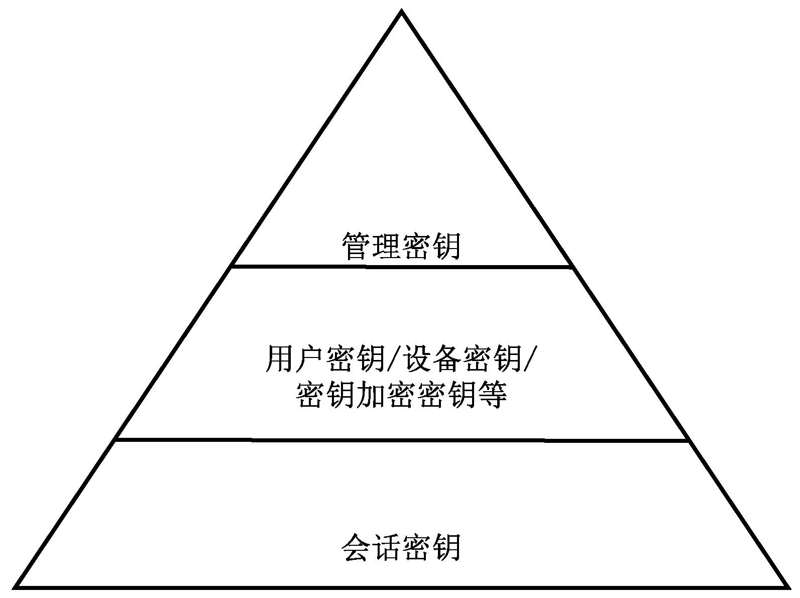

# GM/T 0030-2014 服务器密码机技术规范

## 1 范围

本标准定义了服务器密码机的相关术语，规定了服务器密码机功能要求、硬件要求、软件要求、安全性要求和检测要求等有关内容。

本标准适用于服务器密码机的研制、使用，也可用于指导服务器密码机的检测。

## 2 规范性引用文件

下列文件对于本文件的应用是必不可少的。凡是注日期的引用文件，仅注日期的版本适用于本文件。凡是不注日期的引用文件，其最新版本（包括所有的修改单）适用于本文件。

GB/T 9813　微型计算机通用规范

GM/T 0005　随机性检测规范

GM/T 0018　密码设备应用接口规范

## 3 术语和定义

下列术语和定义适用于本文件。

### 3.1 服务器密码机　cryptographic server

又称主机加密服务器，能独立或并行为多个应用实体提供密码服务和密钥管理的设备。

### 3.2 对称密码算法　symmetric cryptographic algorithm

加密和解密使用相同密钥的密码算法。

### 3.3 非对称密码算法/公钥密码算法　asymmetric cryptographic algorithm/public key cryptographic algorithm

加密和解密使用不同密钥的密码算法。其中一个密钥（公钥）可以公开，另一个密钥（私钥）必须保密，且由公钥求解私钥是计算不可行的。

### 3.4 密码杂凑算法　cryptographic hash algorithm

又称杂凑算法、密码散列算法或哈希算法。该算法将一个任意长的比特串映射到一个固定长的比特串，且满足下列三个特性：

（1）为一个给定的输出找出能映射到该输出的一个输入是计算上困难的；

（2）为一个给定的输入找出能映射到同一个输出的另一个输入是计算上困难的；

（3）要发现不同的输入映射到同一输出是计算上困难的。

### 3.5 公钥/私钥　public key /private key

非对称密码算法中可以公开的密钥称为公钥。非对称密码算法中只能由拥有者使用的不公开密钥称为私钥。

### 3.6 加密/解密　encipherment/encryption / decipherment/decryption

加密是对数据进行密码变换以产生密文的过程。

解密是加密过程对应的逆过程。

### 3.7 数字签名/验证　digital signature/verification

签名者使用私钥对待签名数据的杂凑值做密码运算得到的结果，该结果只能用签名者的公钥进行验证，用于确认待签名数据的完整性、签名者身份的真实性和签名行为的抗抵赖性。

验证是验证者使用签名者的公开密钥对数字签名进行验证的过程。

### 3.8 管理密钥　manager key

用于保护服务器密码机中密钥和敏感信息安全的对称密钥。

### 3.9 设备密钥　device key

用于表明设备身份、对设备进行管理的非对称密钥对。

### 3.10 用户密钥　user key

存储在设备内部的用于应用密码运算的非对称密钥对，包含签名密钥对和加密密钥对。

### 3.11 密钥加密密钥　key encryption key ; KEK

用于对密钥进行加密或解密的密钥。

### 3.12 会话密钥　session key

在一次会话中使用的数据加密密钥。

### 3.13 私钥访问控制码　private key access password

用于验证私钥使用权限的口令字。

### 3.14 SM2 算法　SM2 algorithm

一种椭圆曲线公钥密码算法，其密钥长度为 256 比特。

### 3.15 SM3 算法　SM3 algorithm

一种密码杂凑算法，其输出为 256 比特。

### 3.16 SM4 算法　SM4 algorithm

一种分组密码算法，分组长度为 128 比特，密钥长度为 128 比特。

## 4 缩略语

下列缩略语适用于本文件。

API：应用程序接口（Application Program Interface）

CBC：（分组密码的）密码分组链接（工作方式）（Cipher Block Chaining）

CFB：（分组密码的）密码反馈（工作方式）（Cipher Feedback）

ECB：（分组密码的）电码本（工作方式）（Electronic Codebook）

OFB：（分组密码的）输出反馈（工作方式）（Output Feedback）

## 5 服务器密码机的功能要求

### 5.1 初始化

服务器密码机的初始化主要包括密钥的生成（恢复）与安装、生成管理员，按照安全机制对密钥进行安全存储和备份，使设备处于正常工作状态。

### 5.2 密码运算

服务器密码机应具有对称密码运算、公钥密码运算以及杂凑运算等密码运算功能，并且支持多任务并发访问。

#### 5.2.1 对称密码算法

服务器密码机必须至少支持 SM4 分组密码算法，包括电子密本（ECB）和密码分组链接（CBC）两种模式。

#### 5.2.2 公钥密码算法

服务器密码机必须至少支持 SM2 公钥密码算法。

#### 5.2.3 密码杂凑算法

服务器密码机必须至少支持 SM3 密码杂凑算法。

### 5.3 密钥管理

#### 5.3.1 密钥管理功能

服务器密码机应具有对所有密钥的产生、安装、存储、使用、销毁以及备份和恢复等功能。

#### 5.3.2 密钥结构

服务器密码机必须至少支持三层密钥结构：管理密钥、用户密钥/设备密钥/密钥加密密钥、会话密钥。如图 1 所示。

**图 1　密钥结构**

管理密钥：用于保护服务器密码机中其他密钥和敏感信息的安全，包括对其他密钥的管理、备份、恢复等。不同服务器密码机的管理密钥互不相同。管理密钥必须安全存储。

用户密钥：包括签名密钥对和加密密钥对，用于实现用户签名、验证、身份鉴别以及会话密钥的保护和协商等，代表用户或应用者的身份。

设备密钥：是服务器密码机的身份密钥，包括签名密钥对和加密密钥对，用于设备管理，代表服务器密码机的身份。

密钥加密密钥：是定期更换的对称密钥，用于在预分配密钥情况下，对会话密钥的保护。服务器密码机可选择支持密钥加密密钥。

会话密钥：用于数据加解密。

#### 5.3.3 密钥产生及安装

管理密钥：由设备初始化时使用的管理工具生成或者安装，存储在服务器密码机内部的安全存储区域。

用户密钥：用户密钥分为签名密钥和加密密钥，签名密钥由服务器密码机生成或安装，必须支持使用物理噪声源芯片生成，必须支持使用强素数；加密密钥由密钥管理系统下发到设备中，加密密钥下发的格式遵循 GM/T 0018 中对加密密钥的保护格式的规定，根据系统需要必须支持一定数量用户密钥对的存储区域；用户密钥对的私有密钥必须支持硬件内部安全存储，宜支持私钥访问控制码的安全访问控制。

设备密钥：设备密钥分为签名密钥和加密密钥，签名密钥在设备初始化时使用管理工具生成或者安装，加密密钥由密钥管理系统下发到设备中，设备密钥存储服务器密码机内部的安全存储区域。

密钥加密密钥：由密码设备管理工具生成或者安装，必须支持物理噪声源芯片生成；根据系统需要必须支持一定数量密钥加密密钥的存储区域；该密钥必须支持服务器密码机内部安全存储。

会话密钥：必须支持使用物理噪声源芯片生成，以确保会话密钥的质量；必须支持一次会话更换一次会话密钥；不得以明文方式导出服务器密码机；在会话密钥长期存储时，必须支持用户密钥对或者密钥加密密钥加密存储等安全保护措施。

#### 5.3.4 密钥使用

对称密钥：根据对称密钥索引号或其他密钥唯一标识，可使用内部对称密钥做运算，同时需满足对服务器密码机的运算操作权限。

非对称密钥：根据非对称密钥索引号或其他密钥唯一标识，可使用内部对称密钥做运算，同时需满足对服务器密码机的运算操作权限；服务器密码机可配置是否使用私钥访问控制权限的机制，若使用私钥访问控制权限机制，在涉及签名和解密等使用内部私钥运算的操作时，应先验证该私钥的权限码是否正确。

#### 5.3.5 密钥安全存储及销毁

服务器密码机必须能够至少保存 32 对非对称密钥和 100 个对称密钥。

服务器密码机中长期保存的密钥必须安全存储，可采用两种方式：一为采用加密存储，用于加密存储的密钥应由安全机制保证其安全，并提供对指定密钥的销毁功能；二可采用微电保护存储，应设计销毁密钥的触发装置。当触发装置被触发时，销毁微电保护所存储的所有密钥。采用微电保护的密钥可以不加密。

#### 5.3.6 备份/恢复

对长期保存的密钥，服务器密码机应具备备份/恢复功能。备份操作产生的备份文件必须以密文形式存储到服务器密码机外的存储介质中，加密备份文件的密钥应有安全机制保证其安全。备份出的密钥可以恢复到服务器密码机中，同厂家的同型号的服务器密码机之间应能够互相备份恢复。密钥恢复操作只能在服务器密码机中进行。

### 5.4 随机数生成和检验

服务器密码机应具备随机数生成功能。服务器密码机应能对生成的随机数进行随机性检验。随机数检验应符合 GM/T 0005 的要求。

### 5.5 访问控制

服务器密码机应具备管理界面，设置管理人员并赋予操作权限，通过管理界面进行密钥产生、安装、备份和恢复以及日志查询等管理操作。

管理人员进入管理界面应进行身份鉴别。

不同的管理操作应有不同的操作权限。

### 5.6 设备管理

服务器密码机宜具有接受管理中心的管理功能，设备管理功能的实现按照国家密码管理主管部门的要求进行。

### 5.7 日志审计

服务器密码机应提供日志记录、查看和导出功能。

日志内容包括：

a） 管理员操作行为，包括登录认证、系统配置、密钥管理等操作；

b） 异常事件，包括认证失败、非法访问等异常事件的记录；

c） 如与设备管理中心连接，则对相应操作进行记录。

### 5.8 设备自检

服务器密码机应具有上电时自检和接收自检指令时自检的功能。

设备自检功能应包括密码算法正确性检查、随机数发生器检查、存储密钥和数据的完整性检查等。

## 6 服务器密码机的硬件要求

### 6.1 对外接口

服务器密码机应分别提供服务接口和管理接口。

支持目前主流服务器对外的 RJ-45 以太网接口、串口、光纤通道、USB 等硬件接口协议，可以通过 TCP/IP 网络（100M/1000M/10G）、USB 或者其他接口形式与服务器和管理设备连接。

### 6.2 随机数发生器

服务器密码机的随机数发生器应采用国家密码管理主管部门批准的物理噪声源芯片，应提供多路随机源，至少采用两个独立的物理噪声源芯片实现。

随机数发生器应支持出厂检测、上电检测、使用检测三种检测方式：

**a） 出厂检测：**

- 检测量：采集 $50 \times 10^{6}$ 比特随机数，分成 50 组，每组 $10^{6}$ 比特；
- 检测项目：依据 GM/T 0005 进行检测；
- 检测通过标准：检测中如果有一项不通过检测标准，则告警检测不合格。  
  允许重复 1 次随机数采集与检测，如果重复检测仍不合格，则判定为产品的随机数发生器失效。

**b） 上电检测：**

- 检测量：采集 $20 \times 10^{6}$ 比特随机数，分成 20 组，每组 $10^{6}$ 比特；
- 检测项目：依据 GM/T 0005 进行检测；
- 检测通过标准：检测中如果有一项不通过检测标准，则告警检测不合格。  
  允许重复 1 次随机数采集与检测，如果重复检测仍不合格，则判定为产品的随机数发生器失效。

**c） 使用检测：**

　**1）周期检测：**

- 检测量：采集 $4 \times 10^{5}$ 比特随机数，分成 20 组，每组 20000 比特。
- 检测项目：对采集随机数按照 GM/T 0005 中除离散傅立叶检测、线性复杂度检测、通用统计检测外的 12 项项目检测。
- 检测通过标准：检测中如果有一项不通过检测标准，则告警检测不合格。  
  允许重复 1 次随机数采集与检测，如果重复检测仍不合格，则判定为产品的随机数发生器失效。
- 检测周期：可配置，检测间隔最长不超过 12 h。

　**2）单次检测：**

- 检测量：根据实际应用时每次所采随机数大小确定，但长度不应小于 128 比特，且已通过检测的未用序列可继续用。
- 检测项目：扑克检测。当样本长度小于 320 比特时，参数 $m = 2$。
- 检测通过标准：检测中如果不通过检测标准，则告警检测不合格。允许重复 1 次随机数采集与检测，如果重复检测仍不合格，则判定为产品的随机数发生器失效。

### 6.3 环境适应性

服务器密码机的工作环境应根据实际需要遵循 GB/T 9813 中关于“气候环境适应性”的规定要求。

### 6.4 可靠性

服务器密码机的平均无故障工作时间应不低于 10000 h。

## 7 服务器密码机的软件要求

### 7.1 基本要求

服务器密码机底层软件应采用模块化设计，应通过技术措施防止用户的非法调用。

### 7.2 应用编程接口

服务器密码机的应用编程接口必须遵循 GM/T 0018。

### 7.3 管理工具

服务器密码机应通过管理界面实现对该服务器密码机的管理功能。

管理工具可以安装服务器密码机上，也可以安装在服务器密码机之外的管理终端上。除管理工具对密码机进行管理，还可通过外部管理中心管理。

服务器密码机也可以接受其他管理系统的管理，并按照国家密码管理主管部门的要求进行管理。

## 8 服务器密码机的安全要求

### 8.1 密码算法

服务器密码机应至少具备公钥密码算法、分组密码算法和密码杂凑算法。各类密码算法的配置和使用应按照国家密码管理主管部门的相关规定实施。

### 8.2 密钥管理

服务器密码机在密钥管理方面，应满足以下要求：

1） 管理密钥的使用不对应用系统开放；

2） 除公钥外，所有密钥均不能以明文形式出现在服务器密码机外；

3） 服务器密码机内部存储的密钥应具备防止解剖、探测和非法读取有效的密钥保护机制；

4） 服务器密码机内部存储的密钥应具备防止非法使用和导出的权限控制机制；

5） 服务器密码机内部存储的密钥应具备安全销毁功能。

### 8.3 系统要求

服务器密码机所使用的操作系统应进行安全加固，裁减一切不需要的模块，关闭所有不需要的端口和服务。

### 8.4 使用要求

服务器密码机只接受合法的操作指令。

### 8.5 管理要求

#### 8.5.1 远程管理

服务器密码机的远程管理功能只能用于远程监控，包括参数和状态查询等。其他管理功能不允许远程管理。远程管理应按照国家密码管理主管部门的要求进行管理。

#### 8.5.2 管理员安全管理

服务器密码机应设置管理员，满足相应管理权限可进行管理操作。

管理员应持有身份信息的硬件装置，进行管理操作前应通过身份鉴别。

对管理操作具备日志审计功能。

#### 8.5.3 设备安全管理

##### 8.5.3.1 设备初始化

服务器密码机的初始化，除必须由厂商进行的操作外，系统配置、密钥的生成和管理、管理员的产生等均应由用户方设备管理人员完成。

##### 8.5.3.2 设备检查

应对密码运算部件等关键部件进行正确性检查。

应对存储的密钥等敏感信息进行完整性检查。

在检查不通过时应报警并停止工作。

### 8.6 设备物理安全防护

服务器密码机在工艺设计、密码设备设计、硬件配置等方面要采取相应的保护措施，保证设备基本的物理安全防护功能。

### 8.7 设备状态

服务器密码机在设备状态方面，应满足以下要求：

1） 服务器密码机应具有初始和就绪两个状态；

2） 未安装设备密钥的服务器密码机应处于初始状态，已安装设备密钥的服务器密码机应处于就绪状态；

3） 在初始状态下，除可读取设备信息、设备密钥的生成或恢复操作外，不能执行任何操作，生成或恢复设备密钥后，服务器密码机处于就绪状态；

4） 在就绪状态下，除设备密钥的生成或恢复操作外，应能执行任何操作；

5） 在就绪状态下进行的密钥管理操作，管理员应经过服务器密码机的认证，既满足相应的管理权限方可对密钥进行管理操作。

### 8.8 过程保护

设置必要保护措施，可保障产品在运输和安装过程中的安全，不被嵌入恶意信息。

## 9 服务器密码机的检测要求

检测要求规定了服务器密码机的通用检测内容和方法。检测应包括外观和结构检查、提交文档的检查、功能检测、性能检验、敏感数据的保护与使用检测和物理检测等。

### 9.1 外观和结构的检查

根据产品的物理参数，对服务器密码机的外观、尺寸、内部部件及附件进行检查。

### 9.2 提交文档的检查

服务器密码机研制单位按照国家密码管理主管部门检测要求提交相关文档资料，作为服务器密码机的检测依据。文档资料应包含但不限于以下内容：

1） 后台服务程序、应用编程接口和客户端管理软件的结构框图、流程图和基本功能的源代码；

2） 开机自检的工作原理说明；

3） 自测程序的工作原理说明；

4） 敏感数据信息的存储和使用说明；

5） 物理防护措施说明；

6） 技术工作总结报告；

7） 安全性设计报告；

8） 安装使用说明。

### 9.3 功能检测

服务器密码机的功能检测目的是测试服务器密码机各项功能的运行情况，并检验功能实现的正确性。

#### 9.3.1 初始化检测

服务器密码机能正常启动，对服务器密码机进行初始化功能检测。服务器密码机需要进行初始化检测，初始化主要包括系统配置、生成管理员、密钥的生成（恢复）与安装，使设备处于正常工作状态。服务器密码机应能够正常初始化，检测结果符合 5.1 和 8.5.3.1 要求。

#### 9.3.2 密码运算检测

服务器密码机的密码运算测试程序由国家密码管理主管部门认可的检测机构设计提供。检测方法是将服务器密码机的密码运算结果与已知正确结果进行比较或互通测试，如果计算结果和正确结果相同或互通，则测试通过；否则，测试失败。

密码运算检测的范围必须包括服务器密码机提供的每个对称密码算法、非对称密码算法和杂凑算法的每个功能函数，如：加密、解密、杂凑、数字签名、验证签名等，其中对称密码算法的检测必须测试服务器密码机支持的各种工作模式，如：ECB、CBC、CFB、OFB 等。对服务器密码机进行密码运算检测的检测结果应符合 5.2 和 8.1 要求。

#### 9.3.3 密钥管理检测

服务器密码机的密钥管理检测范围包括密钥的产生、安装、存储、同步、使用以及备份和恢复等操作，通过使用服务器密码机的管理工具进行测试。对服务器密码机进行密钥管理检测的检测结果应符合 5.3 和 8.2 要求。

#### 9.3.4 随机数检测

随机数检测程序由国家密码管理主管部门认可的检测机构设计提供。服务器密码机应具备随机数生成功能。服务器密码机生成随机数比特流作为测试样本，输入到随机数检测程序中检测随机数的质量。对服务器密码机进行随机数检测的检测结果应符合 5.4 和 6.2 要求。

#### 9.3.5 访问控制检测

通过使用服务器密码机的管理工具或管理界面进行服务器密码机的访问控制检测。对服务器密码机的不同管理操作设置不同的操作权限，登录服务器密码机应具备完善的身份鉴别机制；服务器密码机应拒绝任何不具备相应权限的访问或操作。对服务器密码机进行访问控制检测，检测结果应符合 5.5 要求。

#### 9.3.6 设备管理检测

##### 9.3.6.1 远程管理检测

通过使用服务器密码机的远程监控工具进行服务器密码机的远程管理测试，包括参数和状态查询等。服务器密码机的远程管理功能的实现应符合国家密码管理主管部门的要求。对服务器密码机进行远程管理检测的检测结果应符合 8.5.1 要求。

##### 9.3.6.2 本地管理检测

通过使用服务器密码机的管理界面进行服务器密码机的本地管理测试，包括服务器密码机的系统配置、管理员的产生、密钥的生成和管理等。服务器密码机的本地管理功能的实现应符合国家密码管理主管部门的要求。对服务器密码机进行本地管理检测的检测结果应符合 5.6、8.5.2 和 8.5.3 要求。

#### 9.3.7 日志审计检测

通过使用服务器密码机的日志管理工具或界面进行服务器密码机的日志审计检测。服务器密码机应提供日志记录、查看和导出功能。服务器密码机的日志内容包括：管理员操作行为，包括登录认证、系统配置、密钥管理等操作；异常事件，包括认证失败、非法访问等异常事件的记录。对服务器密码机进行日志审计检测的检测结果应符合 5.7 要求。

#### 9.3.8 设备自检检测

服务器密码机的设备自检功能主要包括密码算法正确性检查、随机数发生器检查、存储密钥和数据的完整性检查，以及关键部件的正确性检测等。对服务器密码机进行设备自检检测的检测结果应符合 5.8 和 8.5.3.2 要求。

#### 9.3.9 应用编程接口检测

服务器密码机的应用编程接口必须遵循 GM/T 0018。对服务器密码机进行应用编程接口检测：对于正确的调用环境和调用过程，API 函数应该返回正确的结果，并完成相应功能；对于设定的不正确的调用环境和调用过程，API 函数应返回相应的错误代码。

#### 9.3.10 管理工具检测

通过使用服务器密码机的管理工具或管理界面进行服务器密码机的管理工具检测。对服务器密码机进行管理工具检测，检测结果应符合 7.3 要求。

### 9.4 性能检测

性能检测目的是测试服务器密码机进行各项密码运算的速度指标。

下列各项速度性能测试中的测试量由数据报文长度和测试次数决定。可以根据各个测试项的具体耗时情况，依照等比序列来选取测试次数，例如：测试次数 $N$ 可以选择 1 次、10 次、100 次、1000 次等，分别测试后得到不同测试次数时的性能序列。数据报文长度的选择在各个速度性能测试项中分别定义。

在 9.4.1、9.4.3 和 9.4.4 中包含的各个测试项的速度性能的计算如下式所示：

$$
S = \frac{8LN}{(1024 \times 1024T)}
$$

式中：

$S$ 为速度，单位为 Mbit/s（兆比特每秒）；$L$ 为数据报文的长度，单位为字节；$N$ 为测试次数；$T$ 为测量所耗费的时间，单位为秒。

在 9.4.2 中包含的各个测试项的速度性能的计算如下式所示：

$$
S = N/T
$$

式中，$S$ 为速度，单位为 tps（次/秒）；$N$ 为测试次数；$T$ 为测量所耗费的时间，单位为秒。

#### 9.4.1 对称密码算法的加解密性能测试

将一个定长数据报文，发送给服务器密码机进行加/解密操作，重复操作 $N$ 次，测量其完成时间 $T$。用于测试的数据由检测机构选取，测试应进行多次，结果取平均值。

如服务器密码机支持对称算法的多种工作模式，只需测试所支持的各种工作模式性能最高的模式进行测试。应对所支持的所有使用方式（如加密、解密、数据摘要等）进行逐一测试。

对称密码算法的加解密性能单位统一为 Mbit/s（兆比特每秒）。

#### 9.4.2 非对称密码算法的加解密性能测试

将一个定长数据报文，发送给服务器密码机进行加/解密操作，重复操作 $N$ 次，测量其完成时间 $T$。用于测试的数据由检测机构选取。测试应进行多次，结果取平均值。

如服务器密码机支持多种非对称算法，必须测试所支持的所有非对称密码算法及其各种应用模式。

非对称密码算法的加解密性能单位统一为 tps（次/秒）。

#### 9.4.3 数据杂凑算法性能测试

将一个定长数据报文，发送给服务器密码机进行摘要运算，重复操作 $N$ 次，测量其完成时间 $T$。用于测试的数据由检测机构选取。测试应进行多次，结果取平均值。

数据杂凑算法性能单位统一为 Mbit/s（兆比特每秒）。

#### 9.4.4 随机数发生器性能测试

让服务器密码机生成并输出长度为 $L$ 的符合随机特性的随机序列 $N$ 组，测量其完成时间 $T$。测试应进行多次，结果取平均值。

随机数发生器性能单位统一为 Mbit/s（兆比特每秒）。

#### 9.4.5 非对称密钥生成性能测试

让服务器密码机生成并输出指定数量的密钥对，测量其完成时间 $T$。测试应进行多次，结果取平均值。

非对称密钥生成性能单位统一为 tps（次/秒）。

### 9.5 环境适应性检测

环境适应性检测应按照 GB/T 9813—2000 中 5.8 的要求进行，其结果应符合该规范中 6.3 的要求。

### 9.6 其他检测

外观和结构检查、提交文档的检查按照相关标准进行。

## 10 合格判定

本标准中，除 9.3.6、9.3.7、9.3.10、9.4 以及 9.5 以外的各项检测中，其任意一项检测结果不合格，判定为产品不合格。
