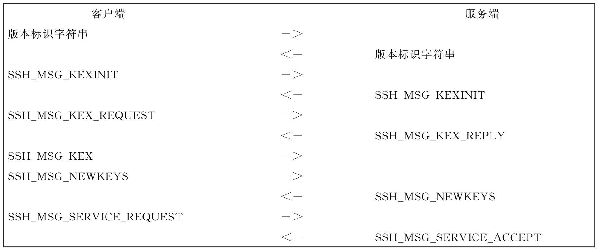
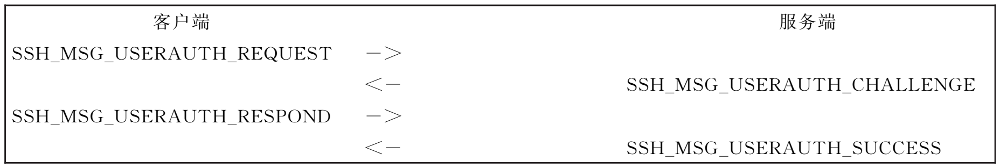

# GMT0129-2023 国密SSH密码协议规范

## 1 范围

本文件规定了 SSH 的安全交互密码协议，规定了交互通道的加密传输协议、鉴别协议与连接协议，规定了密码算法在协议中的使用方法。

本文件适用于 SSH 服务端和 SSH 客户端产品的研发和检测。

## 2 规范性引用文件

下列文件中的内容通过文中的规范性引用而构成本文件必不可少的条款。其中，注日期的引用文件，仅该日期对应的版本适用于本文件；不注日期的引用文件，其最新版本（包括所有的修改单）适用于本文件。

GB/T 15852.1　信息技术　安全技术　消息鉴别码　第 1 部分：采用分组密码的机制

GB/T 15852.2　信息技术　安全技术　消息鉴别码　第 2 部分：采用专用杂凑函数的机制

GB/T 33560　信息安全技术 密码应用标识规范

GB/T 35275　信息安全技术 SM2 密码算法加密签名消息语法规范

GB/T 35276　信息安全技术 SM2 密码算法使用规范

GM/T 0015　基于 SM2 密码算法的数字证书格式规范

GM/Z 4001　密码术语

## 3 术语和定义

GM/Z 4001 界定的术语和定义适用于本文件。

## 4 缩略语

下列缩略语适用于本文件。

CR：回车（Carriage-Return）

LF：换行（Line-Feed）

SP：空格（Space）

SSH：安全交互（Secure Shell）

## 5 协议框架

### 5.1 协议概述

SSH 密码协议是由传输层协议、鉴别协议和连接协议组成的协议族，用于在不安全的网络上进行安全远程登录和安全网络服务。传输层协议、鉴别协议也可和其他服务共同组成 sftp、scp 等安全应用服务。

SSH 密码协议的建立过程中，首先由传输层协议建立安全的通信信道；然后在此安全通信信道上由鉴别协议鉴别客户端和服务端的身份；最后在鉴别完成后，由连接协议在安全通信信道上建立对应的 SSH 服务。

### 5.2 传输层协议

传输层协议提供服务端鉴别、机密性和完整性。传输层协议可运行在一个 TCP 连接上，也可被用在其他可靠的数据流上。

### 5.3 鉴别协议

鉴别协议用于服务端鉴别客户端用户身份。鉴别协议运行在传输层协议上。

### 5.4 连接协议

连接协议用于将加密通道复用为若干逻辑信道。连接协议运行在鉴别协议上。连接协议可被用于提供各种网络服务，包括交互环境（shell）、端口转发和 X11 连接。

## 6 密码算法和密钥种类

### 6.1 密码算法

#### 6.1.1 非对称密码算法

使用的非对称密码算法为 SM2 算法，用于身份鉴别、密钥交换。

#### 6.1.2 对称密码算法

使用的对称密码算法为分组密码算法 SM4，用于密钥交换数据的加密保护和报文数据的加密保护。

#### 6.1.3 密码杂凑算法

使用的密码杂凑算法为 SM3 算法，用于完整性校验。

### 6.2 密钥种类

#### 6.2.1 服务端密钥

服务端密钥为非对称密码算法的密钥对，包括签名密钥对和加密密钥对。其中签名密钥对由服务端自身密码模块产生。

服务端公钥可使用数字证书表示。使用数字证书时，加密密钥对应通过 CA 认证中心向密钥管理中心（KMC）申请。用于在密钥交换过程中鉴别服务端身份。

#### 6.2.2 客户端密钥

客户端密钥为非对称密码算法的密钥对，包括签名密钥对和加密密钥对。其中签名密钥对由客户端自身密码模块产生。

客户端公钥可使用数字证书表示。使用数字证书时，加密密钥对应通过 CA 认证中心向 KMC 申请。用于在鉴别过程中鉴别客户端身份。

#### 6.2.3 传输层会话密钥

传输层会话密钥为对称密码算法密钥。密钥根据传输层协议由服务端和客户端共同生成。

## 7 数据类型定义

### 7.1 算法标识

本文件中使用的算法标识应符合 GB/T 33560 的规定。

### 7.2 基本数据类型

本文件中的 `uint32` 和 `uint64` 均为高位字节在前（Big-Endian）方式存储和交换。基本数据类型定义见表 1。

**表 1 基本数据类型**

| 类型名称 | 描述 | 定义 |
| --- | --- | --- |
| `int8` | 有符号 8 位整数 | 1　个字节 |
| `uint8` | 无符号 8 位整数 | 1　个字节 |
| `uint32` | 无符号 32 位整数 | 4　个字节 |
| `uint64` | 无符号 64 位整数 | 8　个字节 |
| `bool` | 布尔类型，取值为 `TRUE` 或 `FALSE` | 1　为 `TRUE`，0 为 `FALSE` |
| `byte` | 字节类型，无符号 8 位整数 | 1　个字节 |
| `string` | 任意长度的二进制字符串。前 4 个字节为 `uint32`，表示字符串的长 度，当为 0 时表示空字符串 | 字节串 |
| `mpint` | 表示二进制补码格式的多精度整数，存储为一个字符串 | 字节串 |
| `name-list` | 一个包含以逗号分隔的名称列表的字符串。字符编码为 ASCII | 字节串 |

## 8 传输层协议

### 8.1 协议概述

传输层协议运行在 TCP/IP 协议之上，或者其他可靠的数据流之上。协议可被用作多个安全网络服务的基础。传输层协议提供加密、服务端鉴别和完整性保护，也可提供压缩。传输层的密钥交换方法、密码算法、消息鉴别算法和密码杂凑算法都通过协商完成。

本协议的鉴别是基于服务端的，不执行客户端用户鉴别，用户的鉴别由鉴别协议执行。

传输层的连接由客户端发起。

传输层使用的消息编号为：

- `SSH_MSG_DISCONNECT` 1；

- SSH_MSG_SERVICE_REQUEST 5；

- SSH_MSG_SERVICE_ACCEPT 6；

- `SSH_MSG_KEXINIT` 20；

- SSH_MSG_NEWKEYS 21；

- SSH_MSG_KEX_REQUEST 200；

- SSH_MSG_KEX_REPLY 201；

- SSH_MSG_KEX 202。

### 8.2 协议流程

传输层协议的协议流程见图 1。



**图 1 传输层协议流程**

### 8.3 协议版本

本文件定义的传输层协议的版本号为 1.0。

当客户端-服务端的网络连接建立后，双方都应发送一个版本标识字符串。版本标识字符串的格式为：

```text
CSSH-<protoversion>-<softwareversion> [SP<comments>]CR LF
```

```text
示例：“CSSH-1.0-MySSH3.3 This is comment CR LF”。
```

其中，CSSH 为本文件的简称，`<protoversion>`为协议的版本号，由于本协议的版本号为 1.0，因此在此处为“1.0”。 `<softwareversion>` 为软件的名称和版本号 ，由实现者定义 。 `<protoversion>` 和 `<softwareversion>`不可含有 SP 和减号（-）。`<comments>`字段是可选的，当存在`<comments>`字段时，`<softwareversion>`和`<comments>`字段之间需要用 SP（Space，空格）分割。在版本标识字符串的最后应以 CR LF 结束。版本标识字符串的字符集为 ASCII，最大长度为 255 字节，包括 CR 和 LF。

服务端可在发送版本标识字符串之前发送其他数据行，用于在断开前显示错误信息。每个数据行字符串的字符集为 UTF-8，应使用 CR LF 结束。客户端应能够处理这些数据行，可忽略或者显示给用户。

密钥交换在发送版本标识字符串后立即开始。

### 8.4 数据包

#### 8.4.1 数据包格式

在客户端和服务端发送版本表示字符串之后的所有数据，使用表 2 给出的数据包格式。

**表 2 数据包格式**

| 名称 | 数据类型 |
| --- | --- |
| `packet_length` | `uint32` |
| `padding_length` | `byte` |
| `payload` | `byte`[$\mathit{n1}$] |
| `padding` | `byte`[$\mathit{n2}$] |
| `mac` | `byte`[$m$] |

其中：

`packet_length` 为 `uint32` 类型，表示以字节为单位的数据包长度。数据包长度不包括 `packet_length` 本身和 `mac`。

`padding_length` 为 `byte` 类型，表示以字节为单位的 `padding` 的长度。

`payload` 为数据包中有效载荷，$\mathit{n1}$ 为字节单位的长度，值为 $\mathrm{packet\_length}-\mathrm{padding\_length}-1$。 如果已经协商了压缩，则该内容是压缩的。在密钥协商后的数据包中，该内容为加密数据。

`padding` 为任意长度的填充，使得 $\mathrm{packet\_length}\mathbin{\Vert}\mathrm{padding\_length}\mathbin{\Vert}\mathrm{payload}\mathbin{\Vert}\mathrm{padding}$ 的总长度是加密分组长度的倍数。$\mathit{n2}$ 是字节单位的长度，值为 `padding_length`。最少应有 4 字节的填充。填充应包含随机字节。填充的最大长度为 255 字节。本协议的对称加密算法使用 SM4 算法，加密分组长度为 16 字节。

`mac` 为消息鉴别码，$m$ 是字节单位的长度。当使用的工作模式为可鉴别工作模式时，`mac` 字段可省略。

当双方协商的 `mac` 算法为“`none`”时，`mac` 字段忽略。

#### 8.4.2 最大数据包长度

客户端和服务端应能够处理含有 $2^{16}$ 字节或以下的非压缩有效载荷的数据包。

#### 8.4.3 数据压缩

如果协商了压缩，有效载荷将使用协商的算法压缩，`payload` 为压缩后的有效载荷。`packet_length` 和 `mac` 将根据压缩后的有效载荷计算产生。对数据包的加密在压缩之后进行。服务端和客户端使用的压缩算法可不一致。

本文件定义的压缩算法见表 3。

**表 3 数据压缩算法**

<table>
  <tr>
    <th>算法名称</th>
    <th>描述</th>
    <th>可选/必选</th>
  </tr>
  <tr>
    <td><code>zlib</code></td>
    <td>LZ77<sup>a</sup> 压缩</td>
    <td>可选</td>
  </tr>
  <tr>
    <td><code>none</code></td>
    <td>无压缩</td>
    <td>可选</td>
  </tr>
  <tr>
    <td colspan="3"><sup>a</sup> Lempel-Ziv77 数据压缩算法。</td>
  </tr>
</table>

#### 8.4.4 数据加密

在密钥交互中将协商出一种加密算法和一个会话密钥。当加密生效时，每个数据包的数据包长度 `packet_length`、填充长度 `padding_length`、有效载荷 `payload` 和填充 `padding` 应使用给定的算法加密。

本文件定义的加密算法见表 4。

**表 4 数据加密算法**

| 算法名称 | 描述 | 可选/必选 |
| --- | --- | --- |
| `SM4-CBC` | SM4　算法 CBC 工作模式 | 必选 |
| `SM4-CFB` | SM4　算法 CFB 工作模式 | 可选 |
| `SM4-CTR` | SM4　算法 CTR 工作模式 | 可选 |
| `SM4-OFB` | SM4　算法 OFB 工作模式 | 可选 |
| `SM4-CCM` | SM4　算法 CCM 工作模式，为可鉴别加密模式 | 可选 |
| `SM4-KW` | SM4　算法 Key Wrap 工作模式，为可鉴别加密模式 | 可选 |
| `SM4-GCM` | SM4　算法 GCM 工作模式，为可鉴别加密模式 | 可选 |

#### 8.4.5 数据完整性

每个数据包包含一个从会话密钥、数据包序号和数据包内容计算出来的 `mac` 对数据完整性进行保护。`mac` 的计算方法为：

$$
\mathit{mac}=\operatorname{MAC}\left(\text{会话密钥，}\text{数据包序号}\mathbin{\Vert}\text{原始数据}\right)
$$

原始数据是除 `mac` 之外的完整的数据包，数据包序号是一个 `uint32` 类型的数据。第一个数据的数据包序号为 0，在断开连接之前序号是递增的，到达 `uint32` 能够表示的最大值后重新从 0 开始。序号由客户端和服务端自行维护，不包含在数据包中。

`mac` 本身不进行加密。`mac` 的长度由所选的 MAC 算法决定。

本文件定义的 MAC 算法见表 5。

**表 5 数据完整性算法**

| 算法名称 | 可选/必选 |
| --- | --- |
| `CBC-MAC` | 可选 |
| `HMAC` | 可选 |
| `none` | 可选 |

当使用的工作模式非可鉴别工作模式 ，MAC 算法为 CBC - MAC 时 ，计算过程应符合 GB/T 15852.1 的规定。

当使用的工作模式非可鉴别工作模式，MAC 算法为 `HMAC` 时，计算过程应符合 GB/T 15852.2 的规定。

当使用可鉴别数据加密算法对数据加密时，MAC 算法可选择“`none`”，不使用 MAC 算法。

#### 8.4.6 公钥与数字证书格式

公钥的数据格式应符合 GB/T 35276 的规定，传输时使用 DER 编码。数字证书的数据格式应符合 GM/T 0015 的规定，传输时使用 DER 编码。数字证书未指明为签名证书或者加密证书时，均为签名证书和加密证书二者按顺序拼接。

### 8.5 密钥协商

#### 8.5.1 密钥协商过程

密钥协商规定生成用于加密和鉴别的会话密钥的方法，以及鉴别服务端的方法。

在客户端和服务端发送完成版本标识字符串之后，立即进行密钥协商。

双方发送支持的算法名称列表。名称列表中的第一个为首选算法。双方在列表中选择第一个与对方达成一致的算法作为密钥协商算法。

在协商达成一致后，双方各自使用该算法生成会话密钥。并使用该会话密钥加密数据包，进行后续的交互操作。

#### 8.5.2 密钥协商数据包

密钥协商时，双方各自发送数据包格式见表 6。

**表 6 数据包格式**

| 名称 | 数据类型 |
| --- | --- |
| `SSH_MSG_KEXINIT` | `byte` |
| `cookie` | `byte[16]` |
| `kex_algorithms` | `name-list` |
| `server_host_key_algorithms` | `name-list` |
| `encryption_algorithms_client_to_server` | `name-list` |
| `encryption_algorithms_server_to_client` | `name-list` |
| `mac_algorithms_client_to_server` | `name-list` |
| `mac_algorithms_server_to_client` | `name-list` |
| `compression_algorithms_client_to_server` | `name-list` |
| `compression_algorithms_server_to_client` | `name-list` |
| `languages_client_to_server` | `name-list` |
| `languages_server_to_client` | `name-list` |
| `first_kex_packet_follows` | `bool` |
| 0 | `uint32`（为将来保留） |

`name-list` 是一个逗号分隔的算法名称列表，每一种支持的算法应按照优先顺序由高到低排列。

其中：

`cookie` 是由发送方生成的随机数。作用是使任何一方都不可能对最终的密钥拥有完全的决定权。

`kex_algorithms` 为密钥协商算法。支持的密钥协商算法为：“sm2-sm3”。

`server_host_key_algorithms` 服务端发送的为服务端加密算法。客户端发送的为客户端支持的加密算法。固定为“sm2”。

encryption_algorithms 为支持的对称加密算法列表。

mac_algorithms 为支持的 `mac` 算法列表。

compression_algorithms 为支持的压缩算法列表。

languages 为使用的语言。除非需要语言标志，否则不应提供。

`first_kex_packet_follows` 表示是否有一个密钥协商数据包跟随。如果协商不一致，需要再次协商， 则该值为 `true`，否则为 `false`。

在 `SSH_MSG_KEXINIT` 消息交换后，密钥协商算法开始执行。根据协商算法的规定，可能需要几个数据包交换。

#### 8.5.3 密钥协商计算

客户端-服务端密钥协商算法达成一致后，开始进行密钥协商计算。

首先客户端发送消息：

$$
\mathrm{SSH\_MSG\_KEX\_REQUEST}\mathbin{\Vert}\mathrm{random\text{-}client}
$$

其中 `random` 为 8 字节随机数。

服务端响应如下：

$$
\mathrm{SSH\_MSG\_KEX\_REPLY}\mathbin{\Vert}\mathrm{certificate}\mathbin{\Vert}\mathrm{random\text{-}server}\mathbin{\Vert}\mathrm{sign}
$$

其中 `certificate` 为 `string` 类型的服务端数字证书，`sign` 为 DER 编码的对 $\mathrm{random\text{-}client}\mathbin{\Vert}\mathrm{random\text{-}server}$ 的数字签名。

协商会话密钥的密钥交换算法应符合 GB/T 35276 的要求。

客户端在接收到服务端发送的 SSH_MSG_KEX_REPLY 并验证签名之后，产生 32 字节随机数作为密钥 $K$。对 $K$ 使用服务端加密证书公钥对其进行加密得到 $\operatorname{enc}(K)$。客户端发送消息：

$$
\mathrm{SSH\_MSG\_KEX}\mathbin{\Vert}\operatorname{enc}(K)
$$

双方各自计算会话杂凑值 $H$：

$$
H=\operatorname{HASH}\left(\mathrm{random\text{-}client}\mathbin{\Vert}\mathrm{random\text{-}server}\mathbin{\Vert}\mathrm{certificate}\mathbin{\Vert}K\right)
$$

密钥协商产生两个结果：一个会话密钥 $K$ 和一个会话杂凑值 $H$，分别用于加密和鉴别。第一次密钥协商的会话杂凑 $H$ 也被用于会话标识 `session_id`，用于标识一个会话连接。会话标识一旦建立，除非断开连接，不应改变。

客户端到服务端的初始 $\mathrm{IV}$ 为：

$$
\mathrm{IV}=\operatorname{HASH}\left(K\mathbin{\Vert}H\mathbin{\Vert}\text{“A”}\mathbin{\Vert}\mathrm{session\_id}\right)
$$

其中 $K$ 为 `mpint` 格式，“A”为 `byte` 格式，`session_id` 为原始数据。

服务端到客户端的初始 $\mathrm{IV}$ 为：

$$
\mathrm{IV}=\operatorname{HASH}\left(K\mathbin{\Vert}H\mathbin{\Vert}\text{“B”}\mathbin{\Vert}\mathrm{session\_id}\right)
$$

客户端到服务端的加密密钥为：

$$
\mathit{Kc}=\operatorname{HASH}\left(K\mathbin{\Vert}H\mathbin{\Vert}\text{“C”}\mathbin{\Vert}\mathrm{session\_id}\right)
$$

服务端到客户端的加密密钥为：

$$
\mathit{Ks}=\operatorname{HASH}\left(K\mathbin{\Vert}H\mathbin{\Vert}\text{“D”}\mathbin{\Vert}\mathrm{session\_id}\right)
$$

客户端到服务端的完整性密钥为：

$$
\mathrm{Kmac\text{-}c}=\operatorname{HASH}\left(K\mathbin{\Vert}H\mathbin{\Vert}\text{“E”}\mathbin{\Vert}\mathrm{session\_id}\right)
$$

服务端到客户端的完整性密钥为：

$$
\mathrm{Kmac\text{-}s}=\operatorname{HASH}\left(K\mathbin{\Vert}H\mathbin{\Vert}\text{“F”}\mathbin{\Vert}\mathrm{session\_id}\right)
$$

#### 8.5.4 密钥交付

密钥协商在双方发送一个 SSH_MSG_NEWKEYS 消息后结束。该消息使用旧的密钥和算法发送。所有在该消息之后发送的消息应使用新的密钥和算法。

#### 8.5.5 密钥更新

除了正在进行密钥协商以外的时刻，发送一个 `SSH_MSG_KEXINIT` 数据包将开始密钥重新交换。当一方接收到 `SSH_MSG_KEXINIT` 消息后，应用自己的 `SSH_MSG_KEXINIT` 消息进行响应。

密钥重新协商使用本消息之前使用的会话密钥和加密算法。加密算法、压缩算法和 MAC 算法在密钥重新协商完成之前不改变。除会话标识保留不变外，重新协商的处理与初次密钥协商过程一致。 可在重新协商中改变一些或者全部算法，包括加密、MAC 和压缩，也可改变服务端数字证书。所有密钥和初始化向量在协商时重新计算。压缩和加密的上下文被重置。

推荐在传输 1 G 字节数据或连接 1 h（两者中较早到达的一个）后改变密钥。应在传输 100 G 字节数据或连接 24 h（两者中较早到达的一个）后改变密钥。在 SSH_MSG_NEWKEYS 数据包之后可继续发送应用数据。密钥交换不影响位于传输层之上的协议。

### 8.6 服务请求

在密钥协商之后，客户端可请求一个服务。服务由其名称标识。请求数据包格式为：

$$
\mathrm{SSH\_MSG\_SERVICE\_REQUEST}\mathbin{\Vert}\mathrm{service\_name}
$$

其中 `service_name` 为 `string` 类型的服务名称。

服务端如果拒绝该服务请求，可发送 `SSH_MSG_DISCONNECT` 消息并且断开连接。

服务端如果支持该服务并允许客户端使用，应发送响应数据包，格式为：

$$
\mathrm{SSH\_MSG\_SERVICE\_ACCEPT}\mathbin{\Vert}\mathrm{service\_name}
$$

### 8.7 断开连接

在 SSH 通信中的任何阶段，客户端和服务端均可发送断开连接数据包通知对方断开当前连接。 请求数据包格式见表 7。

**表 7 数据包格式**

<table>
  <tr>
    <th>名称</th>
    <th>数据类型</th>
  </tr>
  <tr>
    <td><code>SSH_MSG_DISCONNECT</code></td>
    <td><code>byte</code></td>
  </tr>
  <tr>
    <td><code>reason_code</code></td>
    <td><code>uint32</code></td>
  </tr>
  <tr>
    <td><code>description</code></td>
    <td><code>string</code>，UTF-8 编码<sup>a</sup></td>
  </tr>
  <tr>
    <td colspan="2"><sup>a</sup> 8-bit Unicode Transformation Format，一种可变长度字符编码。</td>
  </tr>
</table>

`reason_code` 为断开原因代码。断开原因代码见表 8。

`description` 为原因描述。

**表 8 断开原因**

| 序号 | 描述 |
| --- | --- |
| 1 | 服务端拒绝连接 |
| 2 | 错误的协议 |
| 3 | 密钥协商失败 |
| 4 | 保留 |
| 5 | `mac` 错误 |
| 6 | 压缩/解压缩错误 |
| 7 | 要求的服务不存在 |
| 8 | 协议版本不支持 |
| 9 | 密钥不存在 |
| 10 | 连接丢失 |
| 11 | 应用原因 |
| 12 | 已超出连接数 |
| 13 | 用户取消鉴别 |
| 14 | 鉴别方式不支持 |
| 15 | 错误的用户名 |

## 9 鉴别协议

### 9.1 协议概述

鉴别协议是运行传输层协议之上的用户身份鉴别协议，由传输层协议提供完整性和机密性保护。

本协议启动的时候从下层传输层获得会话标识（会话杂凑 $H$）。

服务端通过在任意时间告知客户端为继续交换信息可使用哪些鉴别方法来进行身份认证。鉴别方法的优先顺序为：基于数字证书的鉴别方法、基于非对称密钥的鉴别方法、基于口令的鉴别方法。客户端应按顺序尝试服务端列出的方法。

服务端应对鉴别设置超时。如果客户端未能在设定时间内完成鉴别应断开连接。推荐的超时时间为 10 min，最长不超过 30 min。服务端应限制一个客户端在一个会话中尝试次数。当客户端连续鉴别失败超过 20 次时，应断开连接。

鉴别协议的 `service_name` 为“ssh-userauth”

鉴别协议使用的消息编号为：

- `SSH_MSG_USERAUTH_REQUEST` 50

- `SSH_MSG_USERAUTH_FAILURE` 51

- `SSH_MSG_USERAUTH_SUCCESS` 52

- `SSH_MSG_USERAUTH_BANNER` 53

- SSH_MSG_USERAUTH_PK_OK 56

- `SSH_MSG_USERAUTH_CHALLENGE` 210

- `SSH_MSG_USERAUTH_RESPOND` 211

鉴别协议的流程为：

1） 客户端发起鉴别请求消息；

2） 服务端发送鉴别拒绝消息，或者鉴别挑战消息；

3） 客户端发送鉴别响应消息；

4） 服务端发送鉴别拒绝消息，或者鉴别成功消息。

### 9.2 协议流程

鉴别协议的协议流程见图 2。



**图 2 鉴别协议协议流程**

### 9.3 数据包

#### 9.3.1 鉴别请求消息

所有的鉴别请求使用消息格式见表 9。

**表 9 数据包格式**

| 名称 | 数据类型 |
| --- | --- |
| `SSH_MSG_USERAUTH_REQUEST` | `byte` |
| `user_name` | `string`，UTF-8 编码 |
| `service_name` | `string`，ASCII编码 |
| `method` | `string`，ASCII编码 |

`user_name` 和 `service_name` 在每一次新的鉴别尝试中重复出现，可改变。服务端应对 `user_name` 和 `service_name` 进行检查，如果发现改变，应重置鉴别状态。

`service_name` 规定了鉴别完成后启动的服务。可有多个不同的已鉴别的服务。如果所请求的服务不可用，服务端可立即断开连接，并发送断开连接消息。

如果 `user_name` 不存在，服务端应断开连接。

客户端可在任何时候发送一个新的 `SSH_MSG_USERAUTH_REQUEST` 消息。而服务端在接收到消息后应重置鉴别状态并处理新的鉴别请求。

#### 9.3.2 鉴别挑战消息

服务端收到鉴别请求消息后，如果接受该请求，则回复鉴别挑战消息。响应消息的数据包格式见表 10。

**表 10 数据包格式**

| 名称 | 数据类型 |
| --- | --- |
| `SSH_MSG_USERAUTH_CHALLENGE` | `byte` |
| `challenge` | `string` |
| `salt` | `string` |
| `certificate` | `string` |
| `sign` | `string` |

`challenge` 为服务端发送给客户端的认证参数。`salt` 为口令鉴别时的盐值。`certificate` 为服务端的数字证书。`sign` 为使用服务端签名私钥对以下数据的签名（按顺序拼接）。待签名数据格式见表 11。

**表 11 待签名数据格式**

| 名称 | 数据类型 |
| --- | --- |
| `session_id` | `string` |
| `SSH_MSG_USERAUTH_REQUEST` | `byte` |
| `user_name` | `string` |
| `service_name` | `string` |
| `method` | `string` |
| `public_key_algorithm_name` | `string` |
| `public_key_blob` | `string` |

`method` 为“public_key”，`public_key_algorithm_name` 为“sm2”。`public_key_blob` 为服务端数字证书。

#### 9.3.3 鉴别拒绝消息

如果服务端拒绝请求，响应的数据包格式见表 12。

**表 12 数据包格式**

| 名称 | 数据类型 |
| --- | --- |
| `SSH_MSG_USERAUTH_FAILURE` | `byte` |
| `authentication_that_can_continue` | `name-list` |
| `partial_success` | `bool` |

`authentication_that_can_continue` 为 `method` 方法列表 。 根据支持的身份认证方式 ，`authentication_that_can_continue` 可为“password”“public_key”“`certificate`”或者三者的组合，如“password，`certificate`”。

如果在鉴别失败后服务端断开链接，`partial_success` 为 `false`，否则为 `true`。鉴别失败是否需要断开链接取决于服务端的策略设置及客户端的行为，如口令鉴别失败超过设定次数，或在设定时间内进行多次失败的尝试时，可断开链接。

#### 9.3.4 鉴别成功消息

如果服务端鉴别成功，则应发送响应消息。数据包格式见表 13。

**表 13 数据包格式**

| 名称 | 数据类型 |
| --- | --- |
| `SSH_MSG_USERAUTH_SUCCESS` | `byte` |
| `prompt` | `string` |

客户端可连续发送多个鉴别请求而不必等待前一个请求的响应。服务端应完整地处理每个请求， 对于失败的鉴别，发送 `SSH_MSG_USERAUTH_FAILURE` 消息，然后继续处理下一个请求。

鉴别成功后服务端发送 `SSH_MSG_USERAUTH_SUCCESS` 消息。之后客户端发送的鉴别请求，服务端应忽略，发送的其他请求，应传递给鉴别协议之上的其他协议（如连接协议）。服务端应启动客户端所请求的服务。

#### 9.3.5 服务端提示消息

服务端可在鉴别协议从请求直至成功期间的任意阶段发送 `SSH_MSG_USERAUTH_BANNER` 消息。消息数据包格式见表 14。

**表 14 数据包格式**

| 名称 | 数据类型 |
| --- | --- |
| `SSH_MSG_USERAUTH_BANNER` | `byte` |
| `message` | `string`，UTF-8 编码 |

客户端应在屏幕上显示 `message`。`message` 可为多行，以 CR LF 换行。提示消息包可用于提示错误或者指导用户操作。客户端可选择忽略或者显示给用户。

### 9.4 基于口令的鉴别方法

服务端和客户端都应支持此方法。

使用此方法，用户使用客户端时应输入口令进行身份鉴别。

当使用基于口令的鉴别方法时，客户端发送的鉴别响应数据包格式见表 15。

**表 15 数据包格式**

| 名称 | 数据类型 |
| --- | --- |
| `SSH_MSG_USERAUTH_RESPOND` | `byte` |
| `user_name` | `string`，UTF-8 编码 |
| `service_name` | `string`，ASCII编码 |
| `method` | `string` |
| `response` | `string` |
| `algorithm_name` | `string` |

`method` 为“password”。`response` 为口令与认证参数进行密码计算的结果。`algorithm_name` 为密码校验函数，为“sm3”。

`reponse` 的计算方法为：

$$
\mathrm{response}=\operatorname{HASH}\left(\mathrm{challenge}\mathbin{\Vert}\operatorname{SM3}\left(\mathrm{password}\mathbin{\Vert}\mathrm{salt}\right)\right)\text{。}
$$

### 9.5 基于非对称密钥的鉴别方法

此方法为可选方法。

当使用此方法时，用户使用客户端应拥有非对称密钥对。

当使用基于非对称密钥的鉴别方法时，客户端发送的鉴别响应数据包格式见表 16。

**表 16 数据包格式**

| 名称 | 数据类型 |
| --- | --- |
| `SSH_MSG_USERAUTH_RESPOND` | `byte` |
| `user_name` | `string`，UTF-8 编码 |
| `service_name` | `string`，ASCII编码 |
| `method` | `string` |
| `response` | `string` |
| `public_key_algorithm_name` | `string` |
| `public_key_blob` | `string` |

`method` 为“public_key”。 `algorithm_name` 为非对称算法 ，为“sm2”。 `public_key_blob` 为用户的公钥。

`response` 值为使用用户签名私钥对表 17 所示数据的签名（按顺序拼接）。

**表 17 待签名数据格式**

| 名称 | 数据类型 |
| --- | --- |
| `session_id` | `string` |
| `SSH_MSG_USERAUTH_REQUEST` | `byte` |
| `user_name` | `string` |
| `service_name` | `string` |
| `method` | `string` |
| `challenge` | `string` |
| `public_key_algorithm_name` | `string` |
| `public_key_blob` | `string` |

`method` 为“public_key”，`public_key_algorithm_name` 为“sm2”。`public_key_blob` 为用户公钥。

### 9.6 基于数字证书的鉴别方法

服务端和客户端都应支持此方法。

使用此方法，用户使用客户端应拥有签名证书和加密证书。

当使用基于数字证书的鉴别方法时，客户端发送的鉴别请求包格式见表 18。

**表 18 数据包格式**

| 名称 | 数据类型 |
| --- | --- |
| `SSH_MSG_USERAUTH_RESPOND` | `byte` |
| `user_name` | `string`，UTF-8 编码 |
| `service_name` | `string`，ASCII编码 |
| `method` | `string` |
| `response` | `string` |
| `public_key_algorithm_name` | `string` |
| `public_key_blob` | `string` |

`method` 为“`certificate`”。 `public_key_algorithm_name` 为“sm2”。 `public_key_blob` 为用户的数字证书。

`response` 为使用用户签名私钥对表 19 所示数据的签名（按顺序拼接）并编码后生成的 signedData 类型数据。signedData 类型定义应符合 GB/T 35275 的规定。

**表 19 待签名数据格式**

| 名称 | 数据类型 |
| --- | --- |
| `session_id` | `string` |
| `SSH_MSG_USERAUTH_REQUEST` | `byte` |
| `user_name` | `string` |
| `service_name` | `string` |
| `method` | `string` |
| `challenge` | `string` |
| `public_key_algorithm_name` | `string` |
| `public_key_blob` | `string` |

`method` 为“`certificate`”，`public_key_algorithm_name` 为“sm2”。`public_key_blob` 为用户的数字证书。

## 10 连接协议

### 10.1 协议概述

连接协议运行于鉴别协议之上。连接协议提供交互式登录会话、远程命令执行、TCP/IP 连接转发和 X11 连接转发服务。

连接协议的 `service_name` 为“ssh-connection”。

连接协议使用的消息编号为：

- SSH_MSG_GLOBAL_REQUEST 80

- SSH_MSG_REQUEST_SUCCESS 81

- SSH_MSG_REQUEST_FAILURE 82

- `SSH_MSG_CHANNEL_OPEN` 90

- `SSH_MSG_CHANNEL_OPEN_CONFIRMATION` 91

- `SSH_MSG_CHANNEL_OPEN_FAILURE` 92

- `SSH_MSG_CHANNEL_WINDOW_ADJUST` 93

### 10.2 连接信道

连接信道为客户端与服务端建立的登录会话、转发连接。服务端和客户端都可新建信道。多个信道复用同一个连接。

双方通过信道编号对信道进行识别。同一个信道在客户端和服务端的编号可不同。当新建信道时，发送方在请求消息中提供己方的新建信道编号。其他消息数据包中则包括接收方的信道编号。

### 10.3 数据包

#### 10.3.1 新建信道

当客户端或者服务端新建连接时，首先为该信道分配一个本地编号，然后向对方发送消息格式见

**表 20 。**

| 名称 | 数据类型 |
| --- | --- |
| `SSH_MSG_CHANNEL_OPEN` | `byte` |
| `channel_type` | `string`，ASCII编码 |
| `sender_channel_id` | `uint32` |
| `initial_window_size` | `uint32` |
| `maximum_packet_size` | `uint32` |

接收方如果同意新建连接，则发送确认响应消息，格式见表 21。

**表 21 数据包格式**

| 名称 | 数据类型 |
| --- | --- |
| `SSH_MSG_CHANNEL_OPEN_CONFIRMATION` | `byte` |
| `recipient_channel_id` | `uint32` |
| `sender_channel_id` | `uint32` |
| `initial_window_size` | `uint32` |
| `maximum_packet_size` | `uint32` |

否则则发送失败响应消息，格式见表 22。

**表 22 数据包格式**

| 名称 | 数据类型 |
| --- | --- |
| `SSH_MSG_CHANNEL_OPEN_FAILURE` | `byte` |
| `recipient_channel_id` | `uint32` |
| `reason` | `uint32` |
| `description` | UTF-8 编码 |
| `language` | `tag` |

其中 `reason` 的定义为：

- SSH_OPEN_ADMINISTRATIVELY_PROHIBITED 1 禁止；

- SSH_OPEN_CONNECT_FAILED 2 连接失败；

- SSH_OPEN_UNKNOWN_CHANNEL_TYPE 3 无法识别的连接类型；

- SSH_OPEN_RESOURCE_SHORTAGE 4 资源不足。

#### 10.3.2 数据传输

每次传输的数据量由窗口大小规定。双方使用调整窗口消息以调整最大传输数据量。消息格式见表 23。

**表 23 数据包格式**

| 名称 | 数据类型 |
| --- | --- |
| `SSH_MSG_CHANNEL_WINDOW_ADJUST` | `byte` |
| `recipient_channel_id` | `uint32` |
| `size` | `uint32` |

窗口大小不能超过 `uint32` 的表示范围。

数据传输消息格式见表 24。

**表 24 数据包格式**

| 名称 | 数据类型 |
| --- | --- |
| `SSH_MSG_CHANNEL_DATA` | `byte` |
| `recipient_channel_id` | `uint32` |
| `data` | `string` |

#### 10.3.3 关闭信道

当一方不再向信道发送数据时，可发送消息格式见表 25。

**表 25 数据包格式**

| 名称 | 数据类型 |
| --- | --- |
| `SSH_MSG_CHANNEL_EOF` | `byte` |
| `recipient_channel_id` | `uint32` |

接收方无需回复，或者回复一个同样的消息。

客户端和服务端均可主动发送关闭信道消息以关闭一个信道。消息格式见表 26。

**表 26 数据包格式**

| 名称 | 数据类型 |
| --- | --- |
| `SSH_MSG_CHANNEL_CLOSE` | `byte` |
| `recipient_channel_id` | `uint32` |

对于此消息接收方无需回复。

## 参考文献

［1］ RFC 4251　SSH Protocol Architecture，January 2006

［2］ RFC 4252　SSH Authentication Protocol，January 2006

［3］　RFC 4253　SSH Transport Layer Protocol，January 2006

［4］　RFC 4254　SSH Connection Protocol，January 2006
