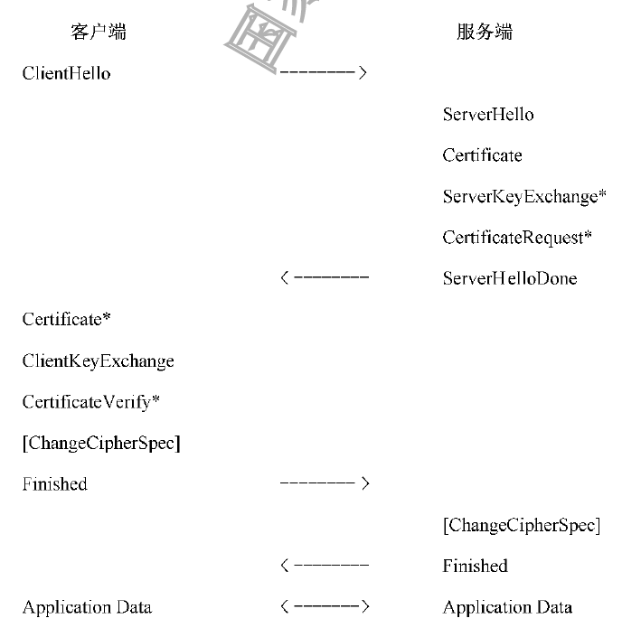
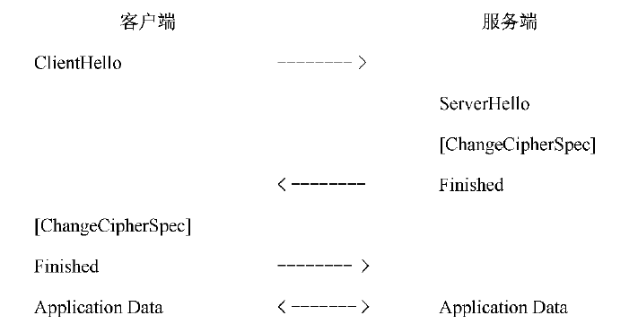
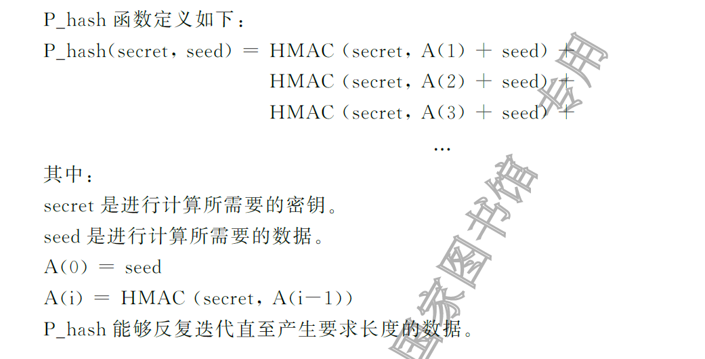
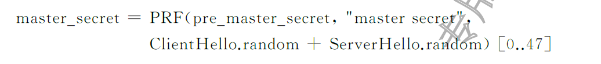
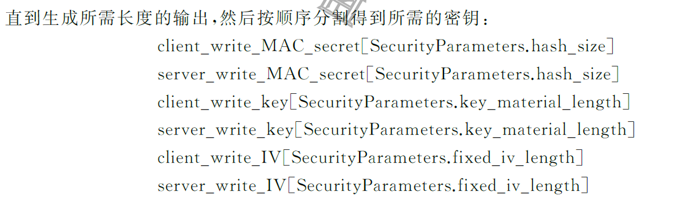
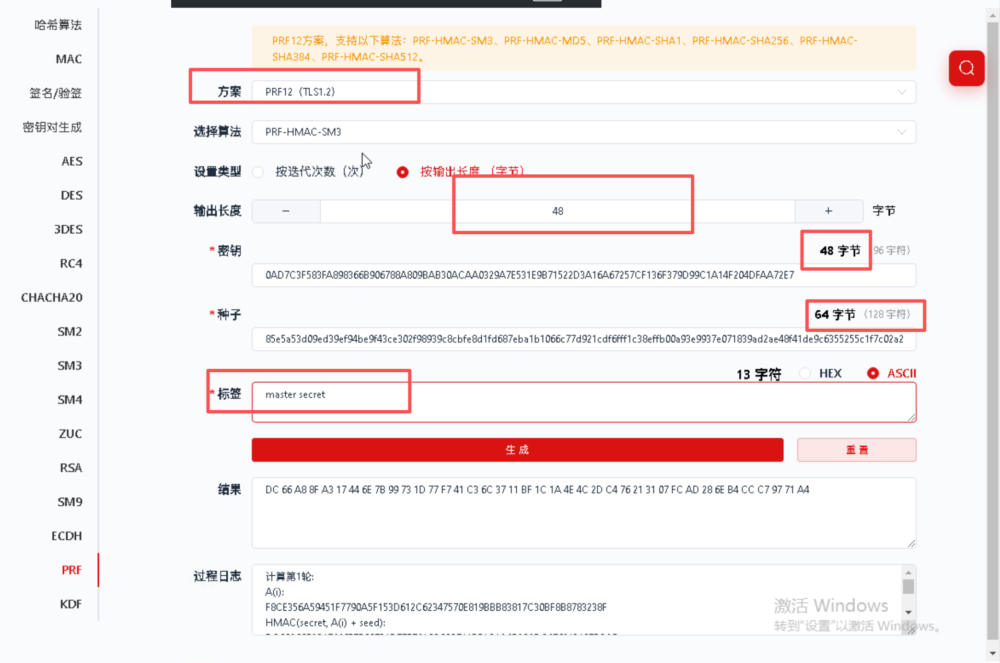
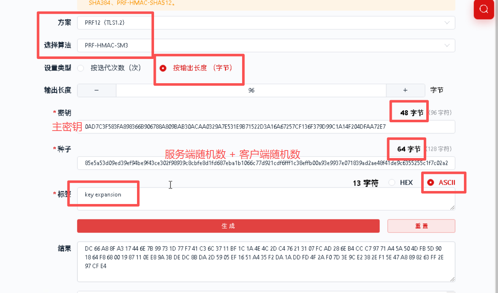
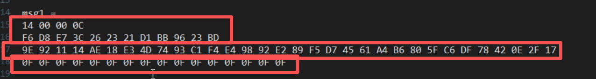
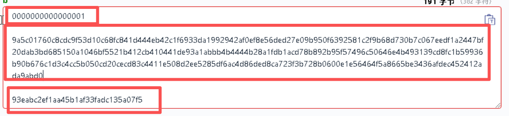
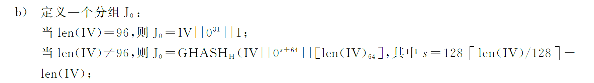

# TLCP协议详解

## 协议概述

国密TLCP协议是在国际TLS协议基础上改进而来，主要的握手消息流程如下图



如果决定使用会话重用，则如图：



握手协议中，密钥建立的流程大体如下

1. 通过ClientHello和ServerHello协商密码套件（包含密钥协商方式的选择），交换随机数
2. 服务端发送双证书Certificate以及用于服务端身份鉴别的数字签名ServerKeyExchange。若采用密钥协商方式，则包含密钥协商素材
3. 客户端验证服务端签名，使用ClientKeyExhange发送非对称加密的pre_master或是密钥协商素材

完成上述三步后，双方则可以自行生成预主密钥pre_master->主密钥master_Key->工作密钥系列

> 若采用双向身份鉴别，则包含CertificateRequest & CertificateVerify两个请求

## PRF & P_hash

PRF可以看作是P_hash的封装


$$
PRF(secret,label,seed) = P\_hash（secret, label || seed）
$$


P_hash基于HMac实现



## 密钥建立流程

### pre_master_secret

> [!note]
>
> pre_master_secret 的长度为48字节

预主密钥由协商的算法生成，以ECC为例，ClientKeyExchange中直接包含加密的预主密钥；若使用ECDHE的方式，则遵循ECDHE密钥交换协议本身，实现预主密钥的建立，不做过多赘述。

### master_secret

主密钥由48个字节组成,由预主密钥、客户端随机数、服务端随机数、常量字符串,经PRF计算生成



"master secret"为明文字符串

### 工作密钥

工作密钥包括校验密钥和加密密钥,具体密钥长度由选用的密码算法决定。由主密钥、客户端随机数、服务端随机数、常量字符串,经PRF计算生成,"key expansion"为明文字符串


$$
key\_block = PRF(master\_secret,"key\ expansion",server\_random\ ||\ client\_random)
$$
之后再分割需要的密钥：



> [!note]
>
> 加密使用不同的套件时，所需的工作密钥有所不同。

#### CBC工作密钥分割

使用CBC加密时，完整性一般由SM3-HAMC实现，此时需要单独的加密密钥和完整性密钥，需要按顺序分割：

- BYTE client_write_MAC_secret[32]
- BYTE server_write_MAC_secret[32]
- BYTE client_write_key[16]
- BYTE server_write_key[16]

一共需要48字节的key_block

#### GCM工作密钥分割

使用GCM加密时，只需一个密钥KEY即可完成算法，完整性密钥有算法本身生成，因此需要按顺序分割如下；

- BYTE client_write_key[16]
- BYTE server_write_key[16]
- BYTE client_write_IV[4]
- BYTE server_write_IV[4]

## 数据包解密

这里以使用CBC模式和GCM模式的数据包为例，预主密钥为ECC密钥传输

### 预主密钥解密

使用服务端私钥解密密文即可，比较简单，省略

### 主密钥计算

按照上文公式调用PRF即可，随机数去32字节，注意点可以关注截图



### 工作密钥计算

首先计算key_block，由于CBC和GCM所需长度不同，分开描述

#### ECC_SM4_CBC_SM3

key_block所需长度为32+32+16+16=96字节，公式参考上文，注意点如图



然后顺序分离即可：

- BYTE client_write_MAC_secret[32]
- BYTE server_write_MAC_secret[32]
- BYTE client_write_key[16]
- BYTE server_write_key[16]

#### ECC_SM4_GCM_SM3

与上述内容类似，关键点注意长度为：16+16+4+4 = 40字节

顺序分离：

- BYTE client_write_key[16]
- BYTE server_write_key[16]
- BYTE client_write_IV[4]
- BYTE server_write_IV[4]

### 消息解密

#### ECC_SM4_CBC_SM3

当使用SM3-HMac实现完整性保护时，密文消息的前16字节为解密所需的IV明文

消息采用**MAC then Enc**的方式，因此需要先解密



解密后的消息可以分为三部分

- 明文：不定长
- MAC：固定32字节
- #7填充：末尾的相同字符，**没有使用PKCS#7**

> **特别注意填充的长度**
>
> 这里的填充并不是PKCS#7或是PKCS#5，填充的格式为：
>
> ```sh
> +------+---------+----------------+
> | Data | padding | padding_length |
> +------+---------+----------------+
> ```
>
> - padding_length为固定一字节值，表示padding的长度
> - padding，去除Data和1字节的padding_length后还需要多少字节的padding就填充什么字符
>
> 以途中的0F为例，实际上是由 15个0x0F和一个padding_length = 0x0F组成, 也就是说实际数据的尾部长度应当是16个字节，**即padding_length + 1**

#### ECC_SM4_GCM_SM3

当使用ECC_SM4_GCM_SM3密码套件时，GCM为**Enc then MAC**，因此在Wireshark中直接可以看到Cipher和Tag,任取一个对应的加密数据包，可以分为一下三部分内容，如图：



从上向下的三个部分分别为：

- seq_num：8字节, 服务端和客户端各自维护的自己计数器，第一个加密消息从0开始
- cipher：消息密文
- Tag: 16字节, GCM生成的完整保护的值

要解密GCM，我们还需要拼接组成IV和ADD，公式如下:


$$
ADD = seq\_num\ ||\ tlcp.type\ ||\ tlcp.version\ ||\ tlcp.length\\
client\_IV =client\_write\_IV\ || seq\_num\\
server\_IV =server\_write\_IV\ || seq\_num
$$
这里有几个注意点

- tlcp的type, version, length在数据包中都可以看到，但是length只能是密文的长度，不是数据包的直接显示
- ADD的实际长度为 8+1+2+2 = 13字节
- client_IV长度为 4 + 8 = 12字节

> 根据标准GBT38636-2020中，附录A.1.4的描述
>
> 实际GCM的IV需要做一些预处理：
>
> 
>
> 也就是说需要在当前的client_IV后补充四个字节的0x00000001
>
> 不过我们使用豪密工具箱时，可以无视，直接使用组装好的IV即可