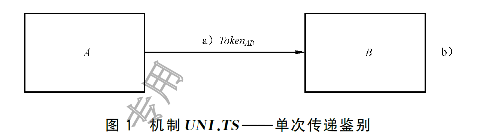
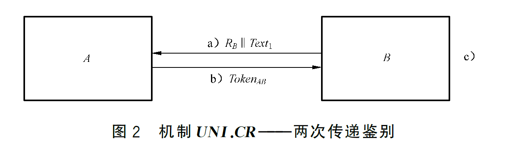
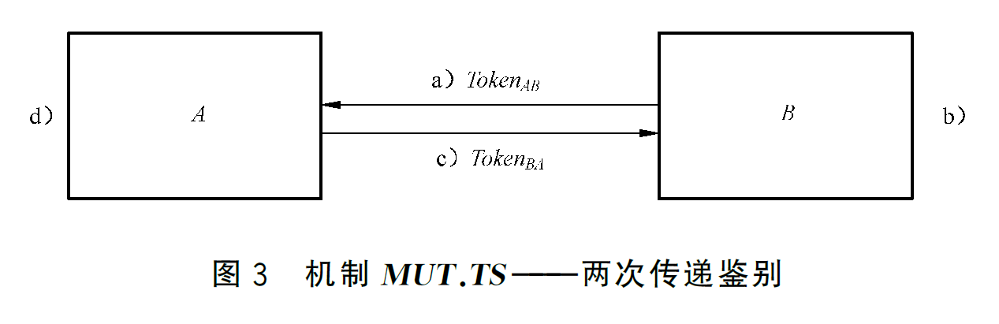
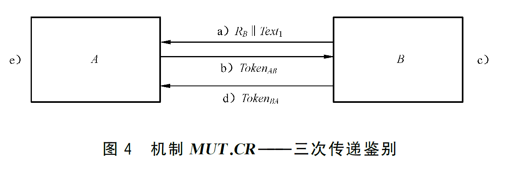

# GBT15843 网络安全技术 实体鉴别

## 采用鉴别式加密的机制

### 单向鉴别

#### 机制UNI.TS-单次传递

$$
Token_{AB}=Text_2\parallel e_{K_{AB}}(SID_{\mathrm{UNI.TS}}^{1}\parallel TN_A\parallel I_B\parallel Text_1)
$$

- $SID_{UNI.TS}^1$：鉴别类型的标识符，用来标识当前消息的鉴别类型采取什么方式。下标为类型标识，上标代表示例常数值。为了防止不同类型的消息被重放混用。
- $UNI.TS$：表示一次鉴别的机制名称
- $TN_A$：时变参数
- $I_B$：用来标识消息的目的地（传输方向）。为了放置B重放消息给A，特定场景下可省略。

> 补充消息，UNI.TS可以拆分为两个部分即UNI和TS
>
> - UNI（Unilateral）单向鉴别
> - MUT（Mutual）双向鉴别
> - TTP（Turst Third Party）可信第三方
> - TS（Timestamp）时变参数（时间戳）
> - CR（Challenge-Response）挑战-响应机制

#### 机制UNI.CR-两次传递鉴别

$$
Token_{AB}=Text_3\parallel e_{K_{AB}}(SID_{\mathrm{UNI.CR}}^{1}\parallel R_B\parallel I_B\parallel Text_2)
$$

- $R_B$：为随机数

### 双向鉴别

#### 机制MUT.TS-两次传递鉴别

由A发送给B的$Token_{AB}$与UNI.TS的消息结构相同：
$$
Token_{AB}=Text_2\parallel e_{K_{AB}}(SID_{\mathrm{MUT.TS}}^{1}\parallel TN_A\parallel I_B\parallel Text_1)
$$
由B发送给A的$Token_{BA}$结构如下：
$$
Token_{BA}=Text_4\parallel e_{K_{AB}}(SID_{\mathrm{MUT.TS}}^{2}\parallel TN_B\parallel TN_A\parallel I_A\parallel Text_3)
$$

#### MUT.CR机制-三次传递鉴别

双方发送的消息结构：
$$
Token_{AB}=Text_3\parallel e_{K_{AB}}(SID_{\mathrm{MUT.CR}}^{1}\parallel R_A \parallel R_B\parallel I_B\parallel Text_2)\\
Token_{BA}=Text_5\parallel e_{K_{AB}}(SID_{\mathrm{MUT.CR}}^{2}\parallel R_A \parallel I_A\parallel Text_4)\\
$$

### 涉及可信第三方的情况