## 1 范围

本文件描述了九种分组密码算法的工作模式,给出了参数和方法。

本文件适用于指导分组密码算法在加解密数据时的使用。

本文件描述的工作模式仅适用于保护数据的机密性,不适用于保护数据的完整性。

## 2 规范性引用文件

下列文件中的内容通过文中的规范性引用而构成本文件必不可少的条款。其中,注日期的引用文件,仅该日期对应的版本适用于本文件;不注日期的引用文件,其最新版本(包括所有的修改单)适用于本文件。

GB/T25069—2010 信息安全技术术语

GM/Z4001—2013 密码术语

## 3 术语和定义

GB/T25069—2010和GM/Z4001—2013界定的以及下列术语和定义适用于本文件。

### 3.1 分组密码算法工作模式 block cipher operation mode

分组密码算法的使用方式,主要包括电码本工作模式、密文分组链接工作模式、密文反馈工作模式、输出反馈工作模式、计数器工作模式、带密文挪用的XEX 可调分组密码工作模式、带泛杂凑函数的计数器工作模式、分组链接工作模式、带非线性函数的输出反馈工作模式等。

[来源:GM/Z4001—2013,2.26,有修改]

### 3.2 电码本工作模式 electronic codebook (ECB) operation mode

分组密码算法的一种工作模式,其特征是将明文分组直接作为算法的输入,对应的输出作为密文分组。

[来源:GM/Z4001—2013,2.10]

### 3.3 密文分组链接工作模式 cipher block chaining (CBC) operation mode

分组密码算法的一种工作模式,其特征是将当前的明文分组与前一密文分组进行异或运算后再进行加密得到当前的密文分组。

[来源:GM/Z4001—2013,2.62]

### 3.4 密文反馈工作模式 cipher feedback (CFB) operation mode

用分组密码算法构造序列密码的一种工作模式。其特征是,使用分组算法当前输出的若干比特,与明文逐比特异或得到密文,该密文同时更新算法下一时刻的输入序列。

[来源:GM/Z4001—2013,2.61]

### 3.5 输出反馈工作模式 output feedback (OFB) operation mode

用分组密码算法构造序列密码的一种工作模式,其特征是,将算法当前时刻输出的若干比特与明文逐比特异或得到密文,同时算法当前时刻的输出作为算法下一时刻的输入。

[来源:GM/Z4001—2013,2.108]

### 3.6 计数器工作模式 counter (CTR) operation mode

用分组密码算法构造序列密码的一种工作模式。其特征是,使用计数器的值作为算法的输入序列进行分组运算,将运算输出的若干比特与明文逐比特异或得到密文,然后对计数器作增量或者减量运算作为算法下一时刻的输入序列。

[来源:GM/Z4001—2013,2.37]

### 3.7 XEX结构 Xor-Encryption-Xor (XEX) construction

构造可调分组密码的一种结构,明文分组与掩码相异或后,使用分组密码算法加密,再将密文分组与掩码相异或。

### 3.8 带密文挪用的XEX可调分组密码工作模式 XEX tweakable block cipher with ciphertext stealing (XTS) operation mode

分组密码算法的一种工作模式,利用XEX 结构完成数据的加密和解密。

### 3.9 带泛杂凑函数的计数器工作模式 universal hash function based CTR (HCTR) operation mode

分组密码算法的一种工作模式,是计数器模式的变体,它使用一个泛杂凑函数生成一个秘密掩码,作为计数器模式的初始向量。

### 3.10 分组链接工作模式 block chaining (BC) operation mode

分组密码算法的一种工作模式,当前的明文分组与所有前面密文分组异或,再加密得到当前的密文分组。

### 3.11 带非线性函数的输出反馈工作模式 output feedback with a nonlinear function (OFBNLF) operation mode

分组密码算法的一种工作模式,是OFB和ECB的变体,它的密钥随着每一个分组而改变。

### 3.12 密钥 key

控制密码算法运算的关键信息或参数。

[来源:GM/Z4001—2013,2.63]

### 3.13 初始向量 initialization vector IV

在密码变换中,为增加安全性或使密码设备同步而引入的用于数据变换的起始数据。

### 3.14 计数器 counter

长度为$n$ 比特的比特序列,用于计数器模式。

注:$n$ 是分组密码的分组长度。

### 3.15 调柄 tweak TW

某些模式中使用的一个参数,以增加加密过程的变化量;当使用同一个密钥时,不同加密过程应采用各不相同的调柄。

### 3.16 填充 padding

给一个数据串附加额外比特的操作。

[来源:GB/T25069—2010,2.2.187]

### 3.17 反馈缓存 feedback buffer; FB

用于为加密过程存储输入数据的变量。

注:在启动点,$FB$的值为$IV$。

## 4 符号和缩略语

### 4.1 符号

下列符号适用于本文件。

$\operatorname{bit}(S,i)$:比特串$S$左起第$i$个比特,以1为起始值。

$C$:密文(比特串)。

$D_K$:使用密钥$K$的分组密码$E$的解密运算。

$E$:一个分组密码算法。

$E_K$:使用密钥$K$的分组密码$E$的加密运算。

$F_i$:第$i$个反馈变量。

$FB_i$:第$i$个反馈缓存。

$H$:一个泛杂凑函数。

$i$:迭代值。

$j$:明文/密文分组的大小,$1\le j\le k$。

$k$:反馈变量的比特长度,$1\le k\le n$。

$K$:密钥。

$K^i$:密钥$K$的$i$次幂。

$K_i$:第$i$个密钥变量。

$|M|$:比特串$M$的比特长度。

$n$:分组密码算法的分组长度。

$\operatorname{One}(m)$:连续$m$个比特“1”构成的比特串。

$P$:明文(比特串)。

$q$:明文/密文分组的个数。

$r$:反馈缓存的比特长度,$n\le r\le 2n$。

$T_i$:第$i$个计数值。

$X_i$:分组密码的第$i$个输入变量。

$Y_i$:分组密码的第$i$个输出变量。

$\operatorname{Zero}(m)$:连续$m$个比特“0”构成的比特串。

$\parallel$:比特串的连接。

$Z\gg 1$:比特串$Z$向右移动一位,左侧补0。

$(i)_2$:数字$i$的二进制表示。

$j\sim A$:比特串$A$的左截取,要求$A$的比特长度大于或等于$j$,则$j\sim A$是由$A$最左侧的$j$个比特组成的长度为$j$比特的比特串。

$A\sim j$:比特串$A$的右截取,要求$A$的比特长度大于或等于$j$,则$A\sim j$是由$A$最右侧的$j$个比特组成的长度为$j$比特的比特串。

$\oplus$:比特串的比特级逻辑异或运算,要求$A$、$B$是长度相等的比特串,则$A\oplus B$表示$A$和$B$的比特级逻辑异或所形成的比特串。

$\otimes$:有限域$\operatorname{GF}(2^n)$上的乘法。当$n=128$时,本文件使用本原多项式$1+\alpha+\alpha^2+\alpha^7+\alpha^{128}$定义$\operatorname{GF}(2^{128})$上的乘法运算,其中$\alpha$是$\operatorname{GF}(2^{128})$上的本原元。

$\alpha^i$:$\operatorname{GF}(2^{128})$上的本原元$\alpha$的$i$次幂。

注:令$U$和$V$是两个128位的比特串,则128位的比特串$W=U\otimes V$可以如下计算,其中比特串$U$和$V$看作有限域$\operatorname{GF}(2^{128})$上的元素,选取的本原多项式为$1+\alpha+\alpha^2+\alpha^7+\alpha^{128}$。

a)令$W=\operatorname{Zero}(128)$,$Z=U$。

b)对于$i=1,2,\ldots,128$,执行以下两个步骤:

1)若$\operatorname{bit}(V,i)=1$,则令$W=W\oplus Z$;

2)若$\operatorname{bit}(Z,128)=0$,则令$Z=Z\gg 1$;否则令$Z=(Z\gg 1)\oplus(11100001\parallel\operatorname{Zero}(120))$。

### 4.2 缩略语

下列缩略语适用于本文件。

BC:分组链接(BlockChaining)

CBC:密文分组链接(CipherBlockChaining)

CFB:密文反馈(CipherFeedback)

CTR:计数器(Counter)

ECB:电码本(ElectronicCodebook)

FB:反馈缓存(FeedbackBuffer)

HCTR:带泛杂凑函数的计数器(universalHashfunctionbasedCTR)

OFB:输出反馈(OutputFeedback)

OFBNLF:带非线性函数的输出反馈(OutputFeedbackwithaNonlinearFunction)

XEX:先异或再加密再异或的结构(Xor-Encryption-Xor)

XTS:带密文挪用的XEX可调分组密码(XEXTweakableblockcipherwithciphertextStealing)

## 5 电码本工作模式

### 5.1 变量定义

ECB工作模式采用以下变量。

a)输入变量:

1)$q$个明文分组$P_1$,$P_2$,…,$P_q$所组成的序列,每个分组都为$n$比特;

2)密钥$K$,需要加解密操作方约定一致,长度由分组密码算法$E$决定。

b)输出变量:

$q$个密文分组$C_1$,$C_2$,…,$C_q$所组成的序列,每个分组都为$n$比特。

### 5.2 ECB的加密方式描述

逐个加密明文分组:$C_i=E_K(P_i)\quad i=1,2,\ldots,q$。

此过程如图1所示。

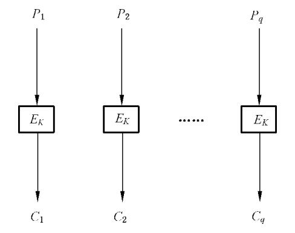

**图 1 电码本工作模式加密算法**

### 5.3 ECB的解密方式描述

逐个解密密文分组:$P_i=D_K(C_i)\quad i=1,2,\ldots,q$。

此过程如图2所示。

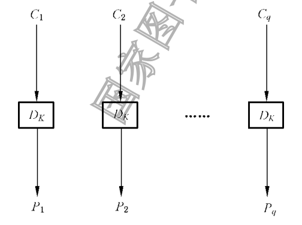

**图 2 电码本工作模式解密算法**

注1:ECB 模式的工作性质见附录A 的A.1,ECB模式的示例见附录B的B.2。

注2:如果明文长度不满足分组长度的整数倍,则需要填充明文,见A.1.3,常见的填充方法见附录C。

## 6 密文分组链接工作模式

### 6.1 变量定义

CBC工作模式采用以下变量。

a)输入变量:

1)$q$个明文分组$P_1$,$P_2$,…,$P_q$所组成的序列,分组长度由分组算法$E$决定;

2)密钥$K$,需要加解密操作方约定一致,长度由分组密码算法$E$决定;

3)初始向量$IV$,需要加解密操作方约定一致,长度为$n$比特。

b)输出变量:

$q$个密文分组$C_1$,$C_2$,…,$C_q$所组成的序列,每个分组都为$n$比特。

### 6.2 CBC的加密方式描述

对第一个明文分组进行加密:$C_1=E_K(P_1\oplus IV)$。

随后:$C_i=E_K(P_i\oplus C_{i-1})\quad i=2,3,\ldots,q$。

此过程如图3所示。初始向量$IV$ 用于生成第一个密文输出。之后的加密过程中,每个明文分组与前一个密文分组进行异或运算后再加密。

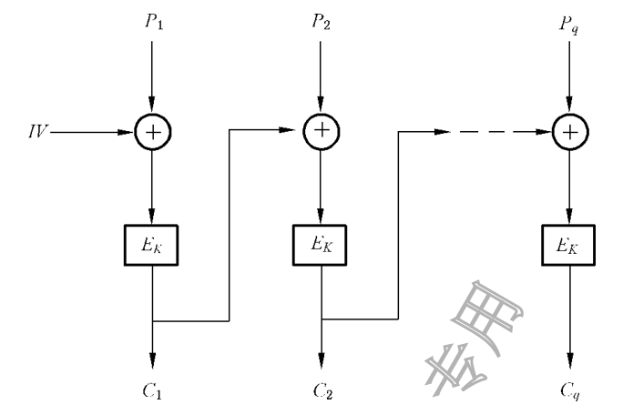

**图 3 密文分组链接工作模式加密算法**

### 6.3 CBC的解密方式描述

对第一个密文分组进行解密:$P_1=D_K(C_1)\oplus IV$。

随后:$P_i=D_K(C_i)\oplus C_{i-1}\quad i=2,3,\ldots,q$。

此过程如图4所示。

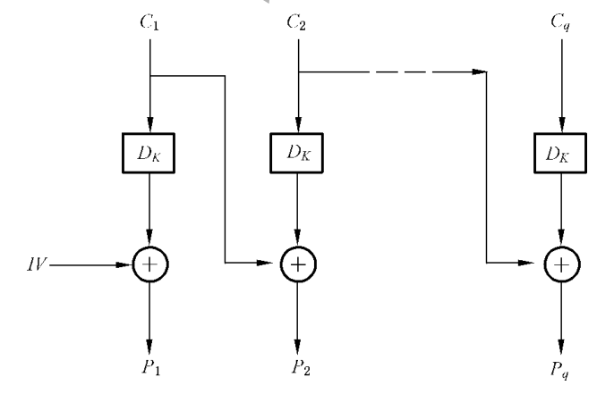

**图 4 密文分组链接工作模式解密算法**

注1:CBC 模式的工作性质见A.2,CBC模式的示例见B.3。

注2:如果明文长度不满足分组长度的整数倍,则需要填充明文,见A.2.3,常见的填充方法见附录C。

## 7 密文反馈工作模式

### 7.1 变量定义

CFB工作模式采用以下变量。

a)输入变量:

1)$q$个明文分组$P_1$,$P_2$,…,$P_q$所组成的序列,每个分组都为$j$比特;

2)密钥$K$,需要加解密操作方约定一致,长度由分组密码算法$E$决定;

3)初始向量$IV$,需要加解密操作方约定一致,长度为$r$比特。

b)中间变量:

1)$q$个密码输入变量$X_1$,$X_2$,…,$X_q$所组成的序列,每个变量都为$n$比特;

2)$q$个密码输出变量$Y_1$,$Y_2$,…,$Y_q$所组成的序列,每个变量都为$n$比特;

3)$q$个临时变量$Z_1$,$Z_2$,…,$Z_q$所组成的序列,每个变量都为$j$比特;

4)$q-1$个反馈变量$F_1$,$F_2$,…,$F_{q-1}$所组成的序列,每个变量都为$k$比特;

5)$q$个反馈缓存$FB_1$,$FB_2$,…,$FB_q$所组成的序列,每个分组都为$r$比特。

c)输出变量:

$q$个密文分组$C_1$,$C_2$,…,$C_q$所组成的序列,每个分组都为$j$比特。

### 7.2 CFB的加密方式描述

设置反馈缓存$FB$的初始向量:$FB_1=IV$。

加密运算按照如下六个步骤进行:

a)生成密码输入变量:$X_i=n\sim FB_i$;

b)使用分组密码:$Y_i=E_K(X_i)$;

c)选择左侧的$j$比特:$Z_i=j\sim Y_i$;

d)生成密文分组:$C_i=P_i\oplus Z_i$;

e)生成反馈变量:$F_i=\operatorname{One}(k-j)\parallel C_i$;

f)更新反馈缓存:$FB_{i+1}=(FB_i\parallel F_i)\sim r$。

对$i=1,2,\ldots,q$,重复上述步骤,最后一个循环结束于d)。此过程如图5所示。分组密码输出变量$Y$的左侧$j$比特用来加密明文分组,$Y$的其他比特被舍弃。

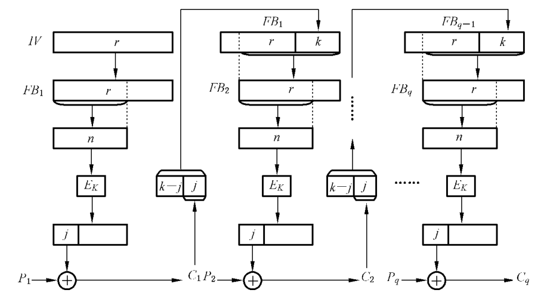

**图 5 密文反馈工作模式加密算法**

生成新的反馈缓存$FB_{i+1}$的方法是,把长度为$k-j$的全“1”比特串填充到密文分组$C_i$的左侧,得

到$k$ 比特反馈变量$F_i$;然后舍弃当前反馈缓存$FB_i$ 左侧的$k$ 比特,并将$F_i$ 填充到其右侧。此后,$FB_{i+1}$左侧的$n$比特将用于加密下一个输入$X$。

### 7.3 CFB的解密方式描述

设置反馈缓存$FB$的初始向量:$FB_1=IV$。

解密运算按照如下六个步骤进行:

a)生成密码输入变量:$X_i=n\sim FB_i$;

b)使用分组密码:$Y_i=E_K(X_i)$;

c)选择左侧的$j$比特:$Z_i=j\sim Y_i$;

d)生成明文分组:$P_i=C_i\oplus Z_i$;

e)生成反馈变量:$F_i=\operatorname{One}(k-j)\parallel C_i$;

f)更新反馈缓存:$FB_{i+1}=(FB_i\parallel F_i)\sim r$。

对$i=1,2,\ldots,q$,重复上述步骤,最后一个循环结束于d)。此过程如图6所示。

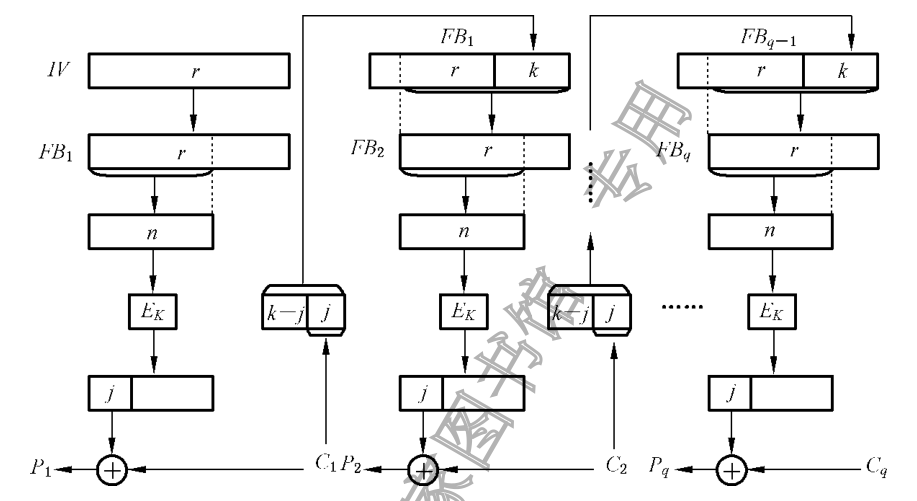

**图 6 密文反馈工作模式解密算法**

注1:建议使用$j$和$k$的值相等的CFB模式。按照这种建议($j=k$),加密操作和解密操作的e)可以写成$F_i=C_i$($j=k$)。

注2:CFB 模式的工作性质见A.3,CFB模式的示例见B.4。

注3:如果明文长度不满足分组长度的整数倍,则可能需要填充明文,见A.3,常见的填充方法见附录C。

## 8 输出反馈工作模式

### 8.1 变量定义

OFB工作模式采用以下变量。

a)输入变量:

1)$q$个明文分组$P_1$,$P_2$,…,$P_q$所组成的序列,每个分组都为$j$比特;

2)密钥$K$,需要加解密操作方约定一致,长度由分组密码算法$E$决定;

3)初始向量$IV$,需要加解密操作方约定一致,长度为$n$比特。

b)中间变量:

1)$q$个密码输入变量$X_1$,$X_2$,…,$X_q$所组成的序列,每个变量都为$n$比特;

2)$q$个密码输出变量$Y_1$,$Y_2$,…,$Y_q$所组成的序列,每个变量都为$n$比特;

3)$q$个临时变量$Z_1$,$Z_2$,…,$Z_q$所组成的序列,每个变量都为$j$比特。

c)输出变量:

$q$个密文分组$C_1$,$C_2$,…,$C_q$所组成的序列,每个分组都为$j$比特。

### 8.2 OFB的加密方式描述

设置密码输入变量$X$的初始向量:$X_1=IV$。

加密运算按照如下四个步骤进行:

a)使用分组密码:$Y_i=E_K(X_i)$;

b)选择左侧的$j$比特:$Z_i=j\sim Y_i$;

c)生成密文分组:$C_i=P_i\oplus Z_i$;

d)反馈操作:$X_{i+1}=Y_i$。

对$i=1,2,\ldots,q$,重复上述步骤,最后一个循环结束于c)。此过程如图7所示。每次使用分组密码所生成的结果$Y_i$被用来反馈并成为$X$的下一个值,即$X_{i+1}$。$Y_i$的左侧$j$比特用来加密明文分组。

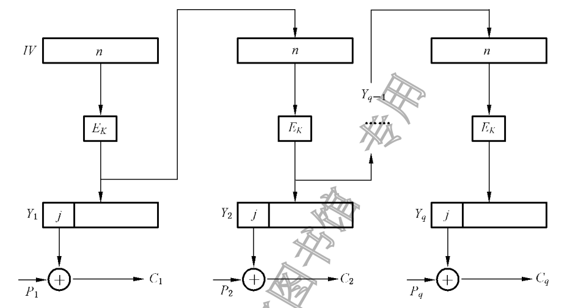

**图 7 输出反馈工作模式加密算法**

### 8.3 OFB的解密方式描述

设置密码输入变量$X$的初始向量:$X_1=IV$。

解密运算按照如下四个步骤进行:

a)使用分组密码:$Y_i=E_K(X_i)$;

b)选择左侧的$j$比特:$Z_i=j\sim Y_i$;

c)生成明文分组:$P_i=C_i\oplus Z_i$;

d)反馈操作:$X_{i+1}=Y_i$。

对$i=1,2,\ldots,q$,重复上述步骤,最后一个循环结束于c)。此过程如图8所示。解密过程与加密过程仅在步骤c)有不同,相应的变量值$X_i$和$Y_i$是相同的。

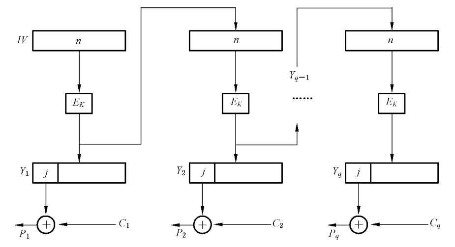

**图 8 输出反馈工作模式解密算法**

注1:OFB 模式的工作性质见A.4,OFB模式的示例见B.5。

注2:如果明文长度不满足分组长度的整数倍,则可能需要填充明文,见A.3,常见的填充方法见附录C。

## 9 计数器工作模式

### 9.1 变量定义

CTR工作模式采用以下变量。

a)输入变量:

1)$q$个明文分组$P_1$,$P_2$,…,$P_q$所组成的序列(其中$P_1$,$P_2$,…,$P_{q-1}$都为$n$比特,$P_q$为$d$

比特且$0<d\le n$);

2)密钥$K$,需要加解密操作方约定一致,长度由分组密码算法$E$决定;

3)$q$个计数序列$T_1$,$T_2$…,$T_q$,需要加解密操作方约定一致,每个都为$n$比特。

b)中间变量:

1)$q$个密码输出变量$Y_1$,$Y_2$,…,$Y_q$所组成的序列,每个变量都为$n$比特;

2)临时变量$Z$,长度为$d$比特。

c)输出变量:

$q$个密文分组$C_1$,$C_2$,…,$C_q$所组成的序列(其中$C_1$,$C_2$,…,$C_{q-1}$都为$n$比特,$C_q$为$d$比特且$0<d\le n$)。

### 9.2 CTR的加密方式描述

加密运算按照四个步骤进行:

a)加密计数序列:$Y_i=E_K(T_i)\quad i=1,2,\ldots,q$;

b)加密前$q-1$个明文分组:$C_i=P_i\oplus Y_i\quad i=1,2,\ldots,q-1$;

c)选择$Y_q$左侧的$d$比特:$Z=d\sim Y_q$;

d)加密最后一个明文分组:$C_q=P_q\oplus Z$。

此过程如图9所示。

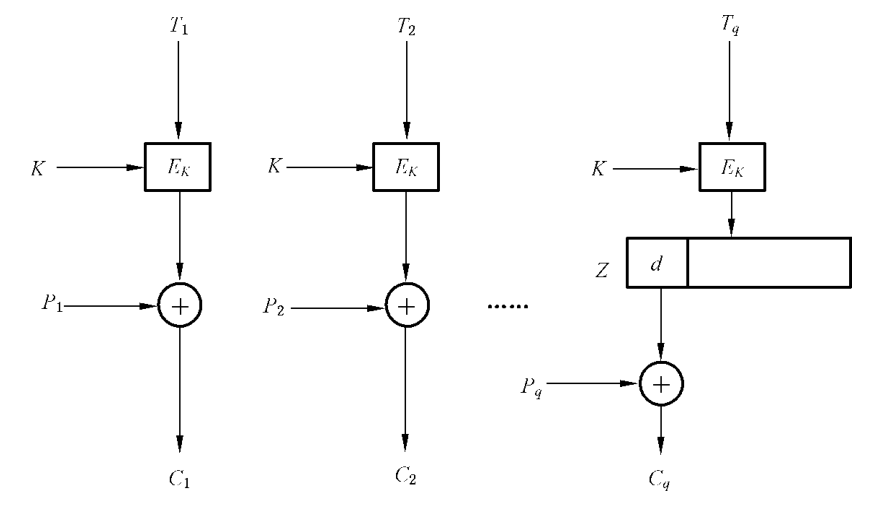

**图 9 计数器工作模式加密算法**

### 9.3 CTR的解密方式描述

解密运算按照以下四个步骤进行:

a)加密计数序列:$Y_i=E_K(T_i)\quad i=1,2,\ldots,q$;

b)解密前$q-1$个密文分组:$P_i=C_i\oplus Y_i\quad i=1,2,\ldots,q-1$;

c)选择$Y_q$左侧的$d$比特:$Z=d\sim Y_q$;

d)解密最后一个密文分组:$P_q=C_q\oplus Z$。

此过程如图10所示。

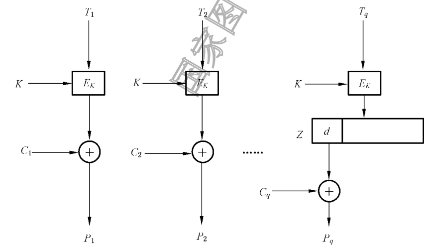

**图 10 计数器工作模式解密算法**

注:CTR 模式的工作性质见A.5,CTR模式的示例见B.6。

## 10 带密文挪用的XEX可调分组密码工作模式

### 10.1 变量定义

XTS工作模式采用以下变量:

a)输入变量:

1)$q$个明文分组$P_1$,$P_2$,…,$P_q$所组成的序列[其中$P_1$,$P_2$,…,$P_{q-1}$都为$n$比特,$P_q$为$d$

比特,满足$0<d\le n$且$(q-1)n+d\ge n$];

2)密钥$K_1$和$K_2$,需要加解密操作方约定一致,长度均由分组密码算法$E$决定;

3)调柄$TW$,需要加解密操作方约定一致,长度为$n$比特。

b)中间变量:

1)$q$个密码输入变量$X_1$,$X_2$,…,$X_q$所组成的序列,每个变量均为$n$比特;

2)临时变量$Z$,长度为$n$比特。

c)输出变量:

$q$个密文分组$C_1,C_2,\ldots,C_q$所组成的序列[其中$C_1,C_2,\ldots,C_{q-1}$都为$n$比特,$C_q$为$d$比特,满足$0<d\le n$且$(q-1)n+d\ge n$]。

根据4.1中关于有限域乘法$\otimes$的定义,本章中所有有限域乘法运算$\otimes$按照“左低右高”的方式处理变量,即变量最左侧为其最低位。

### 10.2 XTS的加密方式描述

#### 10.2.1 明文长度满足整数倍分组长度

此种情况下,$d=n$且$q\ge1$。

对$q$ 个明文分组$P_1$,$P_2$,…,$P_q$ 进行加密运算按照如下四个步骤进行:

a)计算掩码:$T_i=E_{K_2}(TW)\otimes\alpha^{i-1}$;

b)计算密码输入变量:$X_i=P_i\oplus T_i$;

c)使用分组密码:$Y_i=E_{K_1}(X_i)$;

d)生成密文分组:$C_i=Y_i\oplus T_i$。

#### 10.2.2 明文长度不满足整数倍分组长度

此种情况下,$0<d<n$且$q\ge2$。

对前$q-1$个明文分组$P_1$,$P_2$,…,$P_{q-1}$进行加密运算按照如下四个步骤进行:

a)计算掩码:$T_i=E_{K_2}(TW)\otimes\alpha^{i-1}$;

b)计算密码输入变量:$X_i=P_i\oplus T_i$;

c)使用分组密码:$Y_i=E_{K_1}(X_i)$;

d)生成密文分组:$C_i=Y_i\oplus T_i$。

对最后一个明文分组$P_q$ 进行加密运算按照如下五个步骤进行:

a)通过密文挪用设置临时变量:$Z=P_q\parallel(C_{q-1}\sim(n-d))$;

b)计算掩码:$T_q=E_{K_2}(TW)\otimes\alpha^{q-1}$;

c)计算密码输入变量:$X_q=Z\oplus T_q$;

d)使用分组密码:$Y_q=E_{K_1}(X_q)$;

e)生成密文分组:$C_q=Y_q\oplus T_q$。

密文重排按照如下三个步骤进行:

a)设置临时变量:$Z=C_{q-1}$;

b)生成第$q-1$个密文分组:$C_{q-1}=C_q$;

c)生成第$q$个密文分组:$C_q=d\sim Z$。

此过程如图11所示。

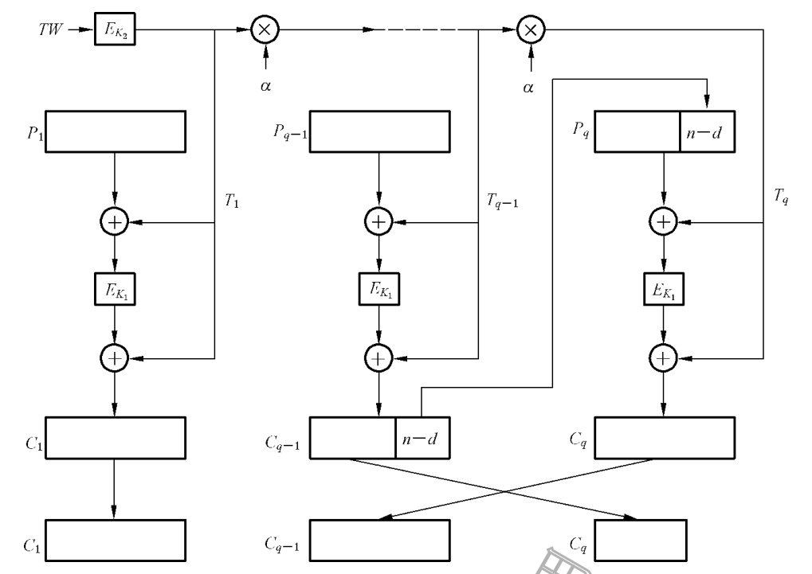

**图 11 带密文挪用的XEX可调分组密码工作模式加密算法**

### 10.3 XTS的解密方式描述

#### 10.3.1 密文长度满足整数倍分组长度

此种情况下,$d=n$且$q\ge1$。

对$q$ 个密文分组$C_1$,$C_2$,…,$C_q$ 进行解密运算按照如下四个步骤进行:

a)计算掩码:$T_i=E_{K_2}(TW)\otimes\alpha^{i-1}$;

b)计算密码输入变量:$X_i=C_i\oplus T_i$;

c)使用分组密码:$Y_i=D_{K_1}(X_i)$;

d)生成明文分组:$P_i=Y_i\oplus T_i$。

#### 10.3.2 密文长度不满足整数倍分组长度

此种情况下,$d<n$且$q\ge2$。

对前$q-2$个密文分组$C_1$,$C_2$,…,$C_{q-2}$进行解密运算按照如下四个步骤进行:

a)计算掩码:$T_i=E_{K_2}(TW)\otimes\alpha^{i-1}$;

b)计算密码输入变量:$X_i=C_i\oplus T_i$;

c)使用分组密码:$Y_i=D_{K_1}(X_i)$;

d)生成明文分组:$P_i=Y_i\oplus T_i$。

对最后两个密文分组$C_{q-1}$和$C_q$ 进行解密运算按照如下九个步骤进行:

a)计算掩码:$T_q=E_{K_2}(TW)\otimes\alpha^{q-1}$;

b)计算密码输入变量:$X_q=C_{q-1}\oplus T_q$;

c)使用分组密码:$Y_q=D_{K_1}(X_q)$;

d)生成临时变量:$Z=Y_q\oplus T_q$;

e)生成明文分组:$P_q=d\sim Z$;

f)计算掩码:$T_{q-1}=E_{K_2}(TW)\otimes\alpha^{q-2}$;

g)计算密码输入变量:$X_{q-1}=(C_q\parallel(Z\sim(n-d)))\oplus T_{q-1}$;

h)使用分组密码:$Y_{q-1}=D_{K_1}(X_{q-1})$;

i)生成明文分组:$P_{q-1}=Y_{q-1}\oplus T_{q-1}$。

此过程如图12所示。

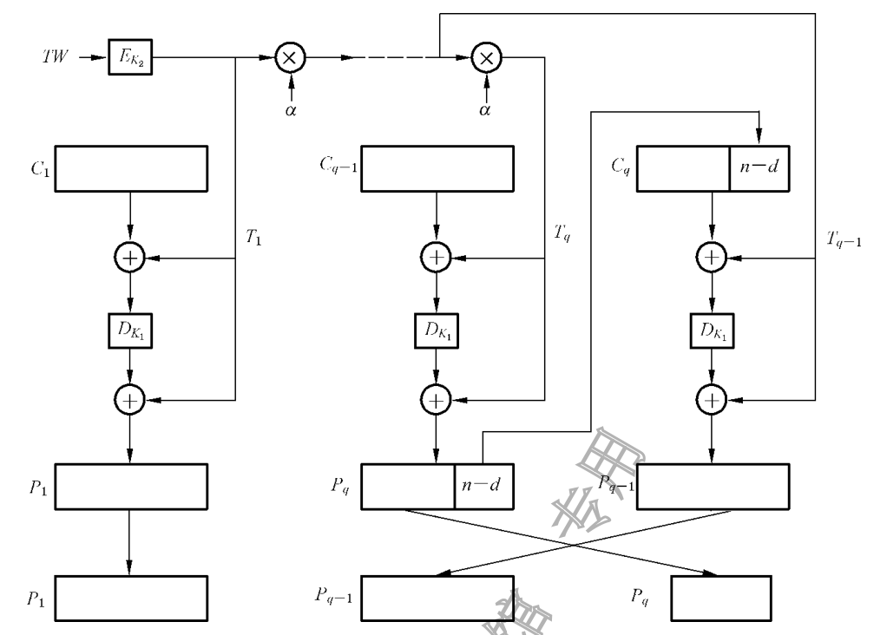

**图 12 带密文挪用的XEX可调分组密码工作模式解密算法**

注:XTS 模式的工作性质见A.6,XTS模式的示例见B.7。

## 11 带泛杂凑函数的计数器工作模式

### 11.1 变量定义

HCTR工作模式采用以下变量。

a)输入变量:

1)$q$个明文分组$P_1$,$P_2$,…,$P_q$所组成的序列[其中$P_1$,$P_2$,…,$P_{q-1}$都为$n$比特,$P_q$为$d$

比特,满足$0<d\le n$且$(q-1)n+d\ge n$];

2)两个密钥$K_1$和$K_2$,需要加解密操作方约定一致,其中$K_1$的长度由分组密码算法$E$决

定,$K_2$ 的长度为$n$ 比特;

3)调柄$TW$,需要加解密操作方约定一致,长度为$n$比特。

b)中间变量:

两个临时变量$Z_1$ 和$Z_2$,每个变量都为$n$ 比特。

c)输出变量:

$q$个密文分组$C_1,C_2,\ldots,C_q$所组成的序列[其中$C_1,C_2,\ldots,C_{q-1}$都为$n$比特,$C_q$为$d$比特,满足$0<d\le n$且$(q-1)n+d\ge n$]。

HCTR工作模式使用一个泛杂凑函数$H$。$H$使用密钥$K$压缩一个比特串$M$,记作:

$$H_K(M)=M_1\otimes K^{m+1}\oplus\cdots\oplus(M_m\parallel\operatorname{Zero}(n-d))\otimes K^2\oplus(|M|)_2\otimes K$$

其中$M=M_1\parallel\cdots\parallel M_m$,$M_1,\ldots,M_{m-1}$和$K$长度都是$n$比特,$M_m$长度是$d$比特,$1\le d\le n$。

根据4.1中关于有限域乘法$\otimes$的定义,泛杂凑函数$H$使用的有限域乘法运算$\otimes$按照“左低右高”的方式处理变量,即变量最左侧为其最低位;采用的CTR 工作模式按照“左高右低”的方式处理变量,即变量最左侧为其最高位。

### 11.2 HCTR的加密方式描述

对$q$ 个明文分组$P_1$,$P_2$,…,$P_q$ 进行加密运算按照如下四个步骤进行:

a)生成临时变量$Z_1$:$Z_1=P_1\oplus H_{K_2}(P_2\parallel\cdots\parallel P_q\parallel TW)$;

b)生成临时变量$Z_2$:$Z_2=E_{K_1}(Z_1)$;

c)生成第一个分组之外的密文分组:$(C_2,\ldots,C_q)=\operatorname{CTR}_{K_1}(P_2,\ldots,P_q)$;

其中CTR模式用到的计数器序列是$T_i=Z_1\oplus Z_2\oplus(i)_2$,$i=1,\ldots,q-1$;

d)生成第一个密文分组$C_1$:$C_1=Z_2\oplus H_{K_2}(C_2\parallel\cdots\parallel C_q\parallel TW)$。

此过程如图13所示。

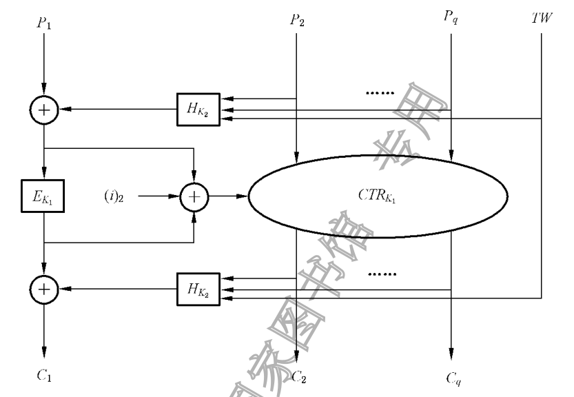

**图 13 带泛杂凑函数的计数器工作模式加密算法**

### 11.3 HCTR的解密方式描述

对$q$ 个密文分组$C_1$,$C_2$,…,$C_q$ 进行解密运算按照如下四个步骤进行:

a)生成临时变量$Z_2$:$Z_2=C_1\oplus H_{K_2}(C_2\parallel\cdots\parallel C_q\parallel TW)$;

b)生成临时变量$Z_1$:$Z_1=D_{K_1}(Z_2)$;

c)生成第一个分组之外的明文分组:$(P_2,\ldots,P_q)=\operatorname{CTR}_{K_1}(C_2,\ldots,C_q)$;

其中CTR模式用到的计数器序列是$T_i=Z_1\oplus Z_2\oplus(i)_2$,$i=1,\ldots,q-1$;

d)生成第一个明文分组$P_1$:$P_1=Z_1\oplus H_{K_2}(P_2\parallel\cdots\parallel P_q\parallel TW)$。

此过程如图14所示。

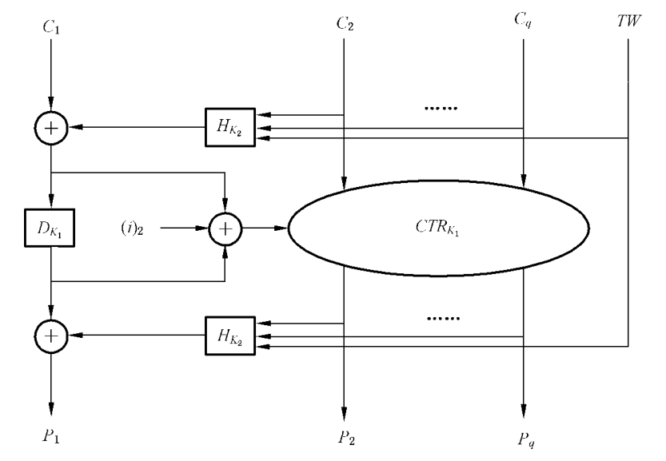

**图 14 带泛杂凑函数的计数器工作模式解密算法**

注1:HCTR 模式的工作性质见A.7,HTCR模式的示例见B.8。

注2:泛杂凑函数是一类使用密钥的高效率压缩函数,见参考文献[1]。在有限域GF(2128)上,$\otimes$的优先级高于$\oplus$。

## 12 分组链接工作模式

### 12.1 变量定义

BC工作模式采用以下变量。

a)输入变量:

1)$q$个明文分组$P_1$,$P_2$,…,$P_q$所组成的序列,每个分组都为$n$比特;

2)密钥$K$,需要加解密操作方约定一致,长度由分组密码算法$E$决定;

3)初始向量$IV$,需要加解密操作方约定一致,长度为$n$比特。

b)中间变量:

$q$个反馈变量$F_1$,$F_2$,…,$F_q$所组成的序列,每个变量都为$n$比特。

c)输出变量:

$q$个密文分组$C_1$,$C_2$,…,$C_q$所组成的序列,每个分组都为$n$比特。

### 12.2 BC的加密方式描述

设置反馈变量初始向量:$F_1=IV$。

加密运算按照如下两个步骤进行:

a)生成密文分组:$C_i=E_K(P_i\oplus F_i)$;

b)生成反馈变量:$F_{i+1}=F_i\oplus C_i$。

对$i=1,2,\ldots,q$,重复上述步骤,最后一个循环结束于a)。此过程如图15所示。初始向量$IV$ 用于生成第一个密文输出。之后的加密过程中,每个密文与当时反馈变量进行异或运算,生成下一个反馈变量。

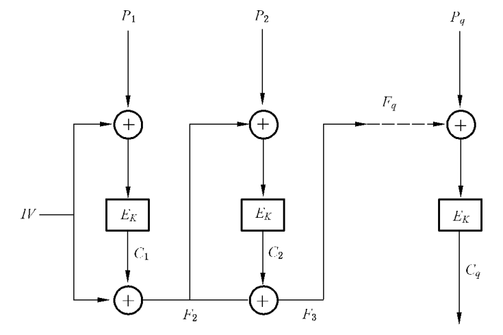

**图 15 分组链接工作模式加密算法**

### 12.3 BC的解密方式描述

设置反馈变量初始向量:$F_1=IV$。

解密运算按照如下两个步骤进行:

a)生成明文分组:$P_i=F_i\oplus D_K(C_i)$;

b)生成反馈变量:$F_{i+1}=F_i\oplus C_i$。

对$i=1,2,\ldots,q$,重复上述步骤,最后一个循环结束于a)。此过程如图16所示。

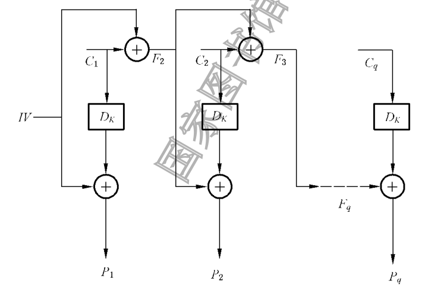

**图 16 分组链接工作模式解密算法**

注1:BC 模式的工作性质见A.8,BC模式的示例见B.9。

注2:如果明文长度不满足分组长度的整数倍,则需要填充明文,见A.3,常见的填充方法见附录C。

## 13 带非线性函数的输出反馈工作模式

### 13.1 变量定义

OFBNLF工作模式采用以下变量。

a)输入变量:

1)$q$个明文分组$P_1$,$P_2$,…,$P_q$所组成的序列,每个分组都为$n$比特;

2)密钥$K$,需要加解密操作方约定一致,长度由分组密码算法$E$决定;

3)初始向量$IV$,需要加解密操作方约定一致,长度为$n$比特。

b)中间变量:

$q+1$个密钥变量$K_0,K_1,\ldots,K_q$所组成的序列,每个变量都为$n$比特。

c)输出变量:

$q$个密文分组$C_1$,$C_2$,…,$C_q$所组成的序列,每个分组都为$n$比特。

### 13.2 OFBNLF的加密方式描述

设置密钥变量初始向量:$K_0=IV$。

加密运算按照如下两个步骤进行:

a)生成密钥变量:$K_i=E_K(K_{i-1})$;

b)生成密文分组:$C_i=E_{K_i}(P_i)$。

对$i=1,2,\ldots,q$,重复上述步骤,最后一个循环结束于b)。此过程如图17所示。每次使用的密钥变量$K_i$ 被密钥$K$ 加密并成为下一个分组的密钥变量$K_{i+1}$。

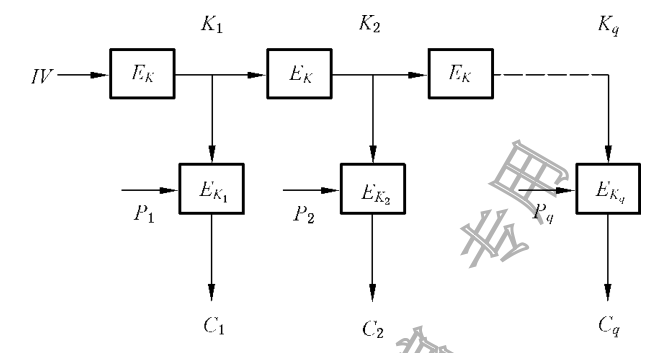

**图 17 带非线性函数的输出反馈工作模式加密算法**

### 13.3 OFBNLF的解密方式描述

设置密钥变量初始向量:$K_0=IV$。

解密运算按照如下两个步骤进行:

a)生成密钥变量:$K_i=E_K(K_{i-1})$;

b)生成明文分组:$P_i=D_{K_i}(C_i)$。

对$i=1,2,\ldots,q$,重复上述步骤,最后一个循环结束于b)。此过程如图18所示。$K_i$与加密过程中相应的值是相同的。

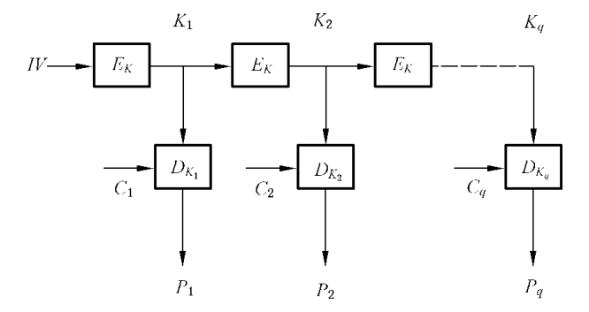

**图 18 带非线性函数的输出反馈工作模式解密算法**

注1:OFBNLF 模式的工作性质见A.9,OFBNLF模式的示例见B.10。

注2:如果明文长度不满足分组长度的整数倍,则需要填充明文,见A.3,常见的填充方法见附录C。

## 附录A

(资料性)

**工作模式的性质**

### A.1 电码本工作模式的性质

#### A.1.1 场景

在各计算机终端之间,或者多人共用一个计算机终端所交换的二进制数据可能会有重复或者共同使用的序列。在ECB工作模式中,相同的明文分组(使用相同的密钥)生成相同的密文分组。

#### A.1.2 性质

ECB工作模式的性质有:

a)对某一个分组的加密或解密可独立于其他分组进行;

b)对密文分组的重排将导致相应明文分组的重排;

c)相同的明文分组(使用相同的密钥)总是生成相同的密文分组,这使得它容易遭受“字典攻击”,

这种字典是由对应的明文和密文分组构成的。

对于超过一个分组长度的明文一般建议不使用ECB 工作模式。对于可接受重复性(例如,输入分组绝不重复),必须单独访问或随机访问各个分组的特殊使用情况,ECB 的用法可以在未来的标准中规定。

#### A.1.3 填充明文

只有长度为分组长度的整数倍的明文才能被加密或解密。其他长度的明文需要被填充至分组长度的整数倍。

#### A.1.4 差错扩散

在ECB工作模式中,如果一个密文分组中存在一个或多个比特的差错,则只会影响该密文分组的解密;该解密将导致得到的明文分组中每个明文比特以50%的概率出现差错。

#### A.1.5 同步

如果加密或解密之间的分组边界丢失了(例如由于一个比特的滑动),则在重新建立正确的分组边界之前,加密与解密之间将失去同步。如果分组边界丢失,则所有解密操作的结果都不正确。

### A.2 密文分组链接工作模式的性质

#### A.2.1 场景

只要使用相同的密钥和初始向量对相同的明文进行加密,CBC 工作模式将生成相同的密文。介意这种性质的用户需要采用相应方法来改变明文的起始分组、密钥或初始向量。一种可能的方法是将一个唯一的标识符(例如一个递增计数器)加到每个CBC 消息的起始位置。在对长度不能增加的明文进行加密时可使用某种方法从明文中计算出一个值,例如明文的随机访问存储方式的地址。

#### A.2.2 性质

CBC工作模式的性质有:

a)链接操作使得密文分组依赖于当前的和以前的明文分组,因此调换密文分组的顺序不可能使

得明文分组的顺序对应调换;

b)使用不同的$IV$以防止同一明文加密成同一密文;

c) CBC模式的安全性证明见参考文献[2]。

#### A.2.3 填充明文

只有长度为分组长度的整数倍的明文才能被加密或解密,其他长度的明文需要被填充。如果不能填充,则可以使用特殊方法处理最后一个分组,下面给出两个方法。

第一种方法处理一个不完整的明文分组[即:一个$j$($j<n$)比特的明文分组$P_q$,其中$q$大于1],按照下面描述的OFB工作模式进行加密:

a)加密:$C_q=P_q\oplus(j\sim E_K(C_{q-1}))$;

b)解密:$P_q=C_q\oplus(j\sim E_K(C_{q-1}))$。

如果$IV$ 不是秘密的或者与同一个密钥一起被多次使用(见A.4),那么最后的分组容易受到“选择明文攻击”。

第二种方法称作“密文挪用”。如果最后两个明文分组为$P_{q-1}$和$P_q$,其中$P_{q-1}$长度为$n$ 比特,$P_q$长度为$j$($j<n$)比特,$q$大于1。

a)加密:

设$C_{q-1}$为使用6.2所描述的方法由$P_{q-1}$导出的密文分组。令

$$C_q=E_K\bigl(C_{q-1}\oplus(P_q\parallel\operatorname{Zero}(n-j))\bigr),\qquad C_{q-1}^{*}=j\sim C_{q-1}$$

因此最后两个密文分组是$C_q$和$C_{q-1}^{*}$。此过程如图A.1所示。

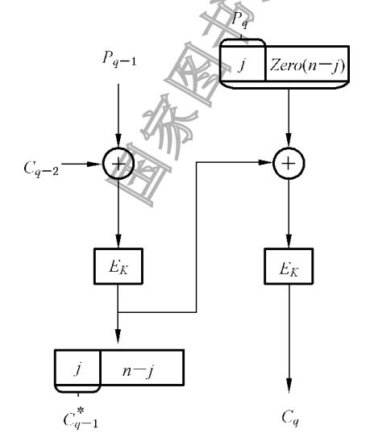

**图 A.1 密文分组链接工作模式采用密文挪用的加密算法**

b)解密:

首先对$C_q$ 进行解密,对所得明文分组的左边$j$ 比特和右边$n$-$j$ 比特分别如下处理:

$$P_q=(j\sim D_K(C_q))\oplus C_{q-1}^{*},$$

$$P_{q-1}=D_K\bigl(C_{q-1}^{*}\parallel(D_K(C_q)\sim(n-j))\bigr)\oplus C_{q-2}$$

此过程如图A.2所示。

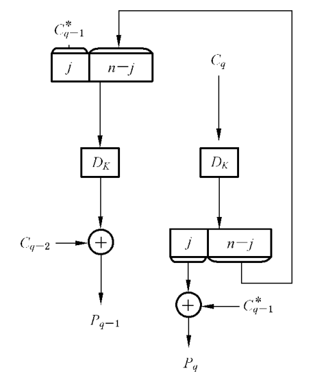

**图 A.2 密文分组链接工作模式采用密文挪用的解密算法**

#### A.2.4 差错扩散

在CBC工作模式中,一个密文分组中的一个或多个比特差错会影响两个分组(即发生差错的分组和随后的分组)的解密。第$i$个密文分组中的差错对于所生成的明文有以下影响:第$i$ 个明文分组每比特以50%的概率出错,第$i+1$个明文分组的差错模式与第$i$个密文分组相同。如果在一个不到$n$ 比特的分组中出现差错,差错扩散取决于所选择的处理方法。若使用A.3第一个方法,在被解密的较短的2.分组中,与明文出错比特直接对应的那些比特也会出错。

#### A.2.5 同步

如果解密或解密之间的分组边界丢失了(例如由于一个比特的滑动),则在重新建立正确的分组边界之前,加密与解密之间将失去同步。如果分组边界丢失,所有解密操作的结果都是不正确的。

### A.3 密文反馈工作模式的性质

#### A.3.1 场景

只要使用同样的密钥和初始向量对相同的明文进行加密,CFB工作模式将生成相同的密文。介意这种特性的用户需要采用某种办法来改变起始明文分组、密钥或初始向量。一种可能的办法是将一个唯一的标识符(例如一个递增计数器)加到每个CFB 消息的开始处。在对大小不能增加的记录进行加密时可采用另一种办法,它使用诸如初始向量的某个值,这个值能从记录中计算出来且不用知道其内容(例如它的按随机访问存储方式的地址)。

#### A.3.2 性质

CFB模式的性质有:

a)链接操作使得密文分组依赖于当前的和除确定数目以外的所有以前的明文分组,该数目取决

于$r$、$k$ 和$j$ 的选择(见图5、图6)。因此对$j$ 比特密文分组的重新排序不会导致对相应的$j$ 比特明文分组的重新排序;

b)加解密操作方需要约定一致的参数$r$、$k$和$j$,参数的取值可公开;

c)使用不同的$IV$值从而防止同一明文加密成同一密文;

d) CFB模式的加密和解密过程都使用分组密码的加密操作;

e) CFB模式的强度依赖于$k$的大小($j=k$时最大)以及$j$、$k$、$n$和$r$的相对大小;

注:$j<k$将导致输入分组的值重复出现的概率增加。这种重复出现将会泄露明文比特之间的线性关系。

f)对于每个明文,选择一个较小的$j$值将需要更多次的分组密码操作,从而引起更大的处理

开销;

g)选择$r\ge n+k$使得能对分组密码进行流水线式连续操作;

h) CFB模式的安全性证明见参考文献[3]。

#### A.3.3 填充明文

只有长度为$j$ 比特倍数的明文才能被加密。其他长度的明文需要填充至$j$ 比特的整数倍。但是,经常选择$j$ 的大小使得明文无需进行填充,例如对于明文的最后部分可以修改$j$。

#### A.3.4 差错扩散

CFB模式中,任一$j$比特密文的差错都将影响随后密文的解密,直到出错的比特移出CFB反馈缓存为止。第$j$ 个密文分组中的差错对生成的明文有下列影响:第$i$ 个明文分组与第$i$ 个密文分组有相同的差错模式。在所有未正确接收的比特被移出反馈缓存之前,随后的明文分组的每一比特出错的概率为50%。

#### A.3.5 同步

如果加密和解密之间的分组边界丢失了(例如由于一个比特的滑动),则在$j$ 比特分组重新建立的$r$比特之后,密码同步将被重新建立。如果丢失$j$比特的倍数,则在$r$比特之后将重新建立同步。

### A.4 输出反馈工作模式的性质

#### A.4.1 场景

只要使用同样的密钥和初始向量对相同的明文进行加密,OFB模式将生成相同的密文。此外,当使用相同的密钥和$IV$ 时,OFB模式中将会生成相同的密钥流,因此,为了保密起见,对于一个给定的密钥,一个特定的$IV$ 只能使用一次。

#### A.4.2 性质

OFB模式的性质有:

a)没有链接操作会使得OFB模式容易受到主动的攻击;

b)使用不同的$IV$值生成不同的密钥流,可防止同一明文加密成同一密文;

c) OFB模式的加密和解密过程都使用分组密码的加密运算;

d) OFB模式不依赖明文来生成用于对明文进行异或运算的密钥流;

e)加解密操作方需要约定一致的参数$j$,参数的取值可公开;

f)对于每个明文,选择一个较小的$j$值将需要更多次的分组密码操作,从而引起更大的处理

开销。

#### A.4.3 填充明文

只有长度为$j$ 比特倍数的明文才能被加密。其他长度的明文需要填充至$j$ 比特的整数倍。但是,经常选择$j$ 的大小使得明文无需进行填充,例如对于明文的最后部分可以修改$j$。

#### A.4.4 差错控制

OFB模式中,密文中每一差错比特只会引起明文中同一位置出现一个差错比特,不影响明文其他

位置。

#### A.4.5 同步

OFB模式不是自动同步的。如果加密和解密两个操作不同步,系统需要重新初始化。这种同步丢失可能由于插入或丢失任意数目的密文所引起。

每次重新初始化应使用一个新的$IV$ 值,它不同于与同一个密钥一起使用的以前的$IV$ 值。其原因是对于相同的参数,每次会生成相同的比特流,这将易于受到“已知明文攻击”。

### A.5 计数器工作模式的性质

#### A.5.1 场景

计数器模式下的分组密码算法使用序列号作为算法的输入。不是用加密算法的输出填充寄存器,而是将一个计数器输入到寄存器中。每一个分组完成加密后,计数器都要增加某个常数,典型值是1。

没有什么是专供计数器用的,它不必根据可能的输入计数。可以将随机序列发生器作为分组算法的输入,而不必考虑其密码上是否安全。

#### A.5.2 性质

CTR的性质有:

a)加密运算可并行处理,吞吐量仅受可使用并行数量的限制;

b)使用不同的计数器生成不同的密钥流,可防止同一明文加密成同一密文;

c) CTR工作模式的加密和解密过程都使用分组密码的加密运算;

d) CTR工作模式不依赖明文生成用于对明文进行异或运算的密钥流。

#### A.5.3 填充明文

计数器模式不需要填充明文,可以处理任意长度的明文。

#### A.5.4 差错扩散

CTR模式不在生成的明文输出中扩散密文差错。密文中每一差错比特只会引起解密后的明文中出现一个差错比特。

#### A.5.5 同步

CTR工作模式不是自动同步的。如果加密和解密两个操作不同步,系统需要重新初始化。这种同步丢失可能由于插入或丢失任意数目的密文所引起。

每次重新初始化应使用一个新的计数器值,它不同于与同一个密钥一起使用的以前的计数器值。

其原因是对于相同的参数,每次都要生成相同的密钥流。这将易于受到“已知明文攻击”。

### A.6 带密文挪用的XEX可调分组密码工作模式的性质

#### A.6.1 场景

XTS模式可以用于磁盘扇区加密等特殊的加密环境,其中调柄值用于表示扇区地址;只要使用同样的密钥和调柄对相同的明文进行加密,XTS模式将产生相同的密文。每个明文都应指定一个数值为非负整数的调柄。调柄数值应指定由一个任意的非负整数起始,并连续增长。该工作模式不适用于明文长度小于分组密码分组长度的情形。

#### A.6.2 性质

XTS模式的性质有:

a)加密运算可并行处理,吞吐量仅受可使用并行数量的限制;

b)使用不同的调柄产生不同的掩码序列,可防止同一明文加密成同一密文;

c)明文和对应的密文具有相同的长度;

d) XTS模式不依赖明文产生用于对明文进行异或运算的密钥流;

e) XTS模式具备可证明安全的理论保障。在底层分组密码算法具备超伪随机性质的的情况下,

XTS模式被证明是超伪随机的,安全界是生日界。具体安全分析见参考文献[4]和参考文献[5]。

#### A.6.3 填充明文

消息无须填充。消息长度应不少于一个分组。当消息长度不是分组长度的整数倍时,将在加密阶段的末尾进行密文挪用。

#### A.6.4 差错控制

在XTS模式中,在一个密文分组中的一个或多个比特差错只会影响发生差错的那一个分组的解密。

#### A.6.5 同步

XTS模式不是自动同步的。如果加密和解密两个操作不同步,系统需要重新初始化。这种同步丢失可能由于插入或丢失任意数目的密文所引起。

每次重新初始化应使用一个新的调柄值,它不同于与同一个密钥一起使用的以前的调柄值。其原因是,相同的参数将产生相同的掩码序列,这将易于受到“已知明文攻击”。如果在密码实现中允许并行和流水线,XTS模式将易于受到“剪贴攻击”。

### A.7 带泛杂凑函数的计数器工作模式的性质

#### A.7.1 场景

HCTR模式可以用于磁盘扇区加密等特殊的加密环境,其中调柄值用于表示扇区地址;只要使用同样的密钥和调柄对相同的明文进行加密,HCTR 模式将产生相同的密文。HCTR 模式也可用于一般的加密。该工作模式不适用于明文长度小于分组密码分组长度的情形。

#### A.7.2 性质

HCTR的性质有:

a)除去第一个分组,HCTR支持并行加密和解密;

b) HCTR模式对于不同的调柄值,得到在密钥控制下的不同置换;

c) HCTR模式明文和密文长度相同,无论是加密和解密,任意输入数据的变化,都会带来所有输

出比特的变化;

d) HCTR模式具备可证明安全的理论保障。在底层分组密码算法具备超伪随机性质的的情况

下,HCTR 模式被证明是超伪随机的,安全界是生日界。具体安全分析见参考文献[6]和参考文献[7]。

#### A.7.3 填充明文

明文长度应不少于一个分组。数据经过泛杂凑函数处理时,需要填充。

#### A.7.4 差错扩散

密文的任意比特的错误会导致明文每一个比特以50%概率出现错误。

#### A.7.5 同步

HCTR模式不是自动同步的。无论是进行加密还是解密,都是在输入完所有数据后,才能计算出输出结果。

### A.8 分组链接工作模式的性质

#### A.8.1 场景

为了在分组链接模式中使用分组算法,可以简单地将分组密码算法的输入跟所有前面密文分组的异或值相异或。如CBC算法,过程要从一个初始向量$IV$ 开始。

只要使用同样的密钥和初始向量对相同的明文进行加密,BC 工作模式将生成相同的密文。介意这种性质的用户需要采用某种方法来改变初始明文分组、密钥或初始向量。

#### A.8.2 性质

BC工作模式的性质有:

a)链接操作使得密文分组依赖于当前的和以前的明文分组,因此对密文分组的重新排序不会导

致对相应明文分组的重新排序;

b)使用不同的$IV$从而防止同一明文加密成同一密文;

c) BC模式的安全性证明见参考文献[8]。

#### A.8.3 填充明文

只有长度为分组长度整数倍的明文才能被加密,其他长度的明文需要被填充至分组长度的整数倍。

#### A.8.4 差错扩散

BC模式的反馈过程具有扩散明文错误的性质,这个问题是由于密文分组的解密依赖于所有前面的密文分组,密文中任一错误都将导致所有后续密文分组的解密出错。

#### A.8.5 同步

如果解密或解密之间的分组边界丢失了(例如由于一个比特的滑动),则在重新建立正确的分组边界之前加密与解密之间将失去同步。如果分组边界丢失,所有解密操作的结果都是不正确的。

### A.9 带非线性函数的输出反馈工作模式的性质

#### A.9.1 场景

带非线性函数的输出反馈是OFB和ECB的一个变体,它的密钥随每一个分组而改变。只要使用同样的密钥和初始向量对相同的明文进行加密,OFBNLF工作模式应将生成相同的密文。此外,当使用相同的密钥和$IV$ 时,OFBNLF工作模式将会生成相同的密钥流,因此,为了保密起见,对于一个给定的密钥,一个特定的$IV$ 只能使用一次。

#### A.9.2 性质

OFBNLF的性质有:

a)使用不同的$IV$值生成不同的密钥流,可防止同一明文加密成同一密文;

b) OFBNLF模式的加密和解密过程都使用分组密码的加密运算;

c) OFBNLF模式不依赖明文来生成用于对明文进行加密的密钥流;

d) OFBNLF模式的安全性证明见参考文献[9]。

#### A.9.3 填充明文

只有长度为分组长度整数倍的明文才能被加密,其他长度的明文需要被填充至分组长度的整数倍。

#### A.9.4 差错扩散

密文的一个比特错误将扩散到一个明文分组。如果一比特丢失或增加,那就有无限的错误扩散。

#### A.9.5 同步

OFBNLF模式不是自动同步的。如果加密和解密两个操作不同步,系统需要重新初始化。这种同步丢失可能由于插入或丢失任意数目的密文所引起。

每次重新初始化应使用一个新的$IV$ 值,它不同于与同一个密钥一起使用的以前的$IV$ 值。其原因是对于相同的参数,每次都会生成相同的比特流,这将易于受到“已知明文攻击”。

## 附录B

(资料性)

**工作模式示例**

### B.1 概述

本附录举例说明使用本文件所规定的工作模式对消息的加密和解密,使用的分组密码是GB/T32907—2016中规定的SM4算法,见参考文献[10]。所有变量采用“左高右低”的方式标记,即变量最左侧为其最高位。

除XTS和HCTR 之外,其他七种工作模式使用下列参数:密码密钥为(十六进制)2B7E151628AED2A6ABF7158809CF4F3C。

初始向量为(十六进制)000102030405060708090A0B0C0D0E0F。

明文是(十六进制)6BC1BEE22E409F96E93D7E117393172A

AE2D8A571E03AC9C9EB76FAC45AF8E51 30C81C46A35CE411E5FBC1191A0A52EF F69F2445DF4F9B17AD2B417BE66C3710。

B.7和B.8分别给出了XTS和HCTR所采用的参数。

### B.2 ECB工作模式

表B.1和表B.2分别给出ECB工作模式加密和解密的例子。

**表 B.1 ECB工作模式加密**

| $i$ | 明文$P_i$ | 分组密码输入分组 | 分组密码输出分组 | 密文$C_i$ |
| --- | --- | --- | --- | --- |
| 1 | 6BC1BEE22E409F96 E93D7E117393172A | 6BC1BEE22E409F96 E93D7E117393172A | A51411FF04A71144 3891FCE7AB842A29 | A51411FF04A71144 3891FCE7AB842A29 |
| 2 | AE2D8A571E03AC9C 9EB76FAC45AF8E51 | AE2D8A571E03AC9C 9EB76FAC45AF8E51 | D5B50F46A9A730A0 F590FFA776D99855 | D5B50F46A9A730A0 F590FFA776D99855 |
| 3 | 30C81C46A35CE411 E5FBC1191A0A52EF | 30C81C46A35CE411 E5FBC1191A0A52EF | C9A86A4D71447F4E 873ADA4F388AF9B9 | C9A86A4D71447F4E 873ADA4F388AF9B9 |
| 4 | F69F2445DF4F9B17 AD2B417BE66C3710 | F69F2445DF4F9B17 AD2B417BE66C3710 | 2B25557B50514D15 5939E6EC940AD90E | 2B25557B50514D15 5939E6EC940AD90E |

**表 B.2 ECB工作模式解密**

| $i$ | 密文$C_i$ | 分组密码输入分组 | 分组密码输出分组 | 明文$P_i$ |
| --- | --- | --- | --- | --- |
| 1 | A51411FF04A71144 3891FCE7AB842A29 | A51411FF04A71144 3891FCE7AB842A29 | 6BC1BEE22E409F96 E93D7E117393172A | 6BC1BEE22E409F96 E93D7E117393172A |
| 2 | D5B50F46A9A730A0 F590FFA776D99855 | D5B50F46A9A730A0 F590FFA776D99855 | AE2D8A571E03AC9C 9EB76FAC45AF8E51 | AE2D8A571E03AC9C 9EB76FAC45AF8E51 |

**表 B.2 ECB工作模式解密(续)**

| $i$ | 密文$C_i$ | 分组密码输入分组 | 分组密码输出分组 | 明文$P_i$ |
| --- | --- | --- | --- | --- |
| 3 | C9A86A4D71447F4E 873ADA4F388AF9B9 | C9A86A4D71447F4E 873ADA4F388AF9B9 | 30C81C46A35CE411 E5FBC1191A0A52EF | 30C81C46A35CE411 E5FBC1191A0A52EF |
| 4 | 2B25557B50514D15 5939E6EC940AD90E | 2B25557B50514D15 5939E6EC940AD90E | F69F2445DF4F9B17 AD2B417BE66C3710 | F69F2445DF4F9B17 AD2B417BE66C3710 |

### B.3 CBC工作模式

表B.3和表B.4分别给出CBC工作模式加密和解密的例子。

**表 B.3 CBC工作模式加密**

| $i$ | 明文$P_i$ | 分组密码输入分组 | 分组密码输出分组 | 密文$C_i$ |
| --- | --- | --- | --- | --- |
| 1 | 6BC1BEE22E409F96 E93D7E117393172A | 6BC0BCE12A459991 E134741A7F9E1925 | AC529AF989A62FCE 9CDDC5FFB84125CA | AC529AF989A62FCE 9CDDC5FFB84125CA |
| 2 | AE2D8A571E03AC9C 9EB76FAC45AF8E51 | 027F10AE97A58352 026AAA53FDEEAB9B | B168DD69DB3C0EEA 1AB16DE6AEA43C59 | B168DD69DB3C0EEA 1AB16DE6AEA43C59 |
| 3 | 30C81C46A35CE411 E5FBC1191A0A52EF | 81A0C12F7860EAFB FF4AACFFB4AE6EB6 | 2C15567BFF8F7074 86C202C7BE59101F | 2C15567BFF8F7074 86C202C7BE59101F |
| 4 | F69F2445DF4F9B17 AD2B417BE66C3710 | DA8A723E20C0EB63 2BE943BC5835270F | 74A629B350CD7E11 BE99998AF5206D6C | 74A629B350CD7E11 BE99998AF5206D6C |

**表 B.4 CBC工作模式解密**

| $i$ | 密文$C_i$ | 分组密码输入分组 | 分组密码输出分组 | 明文$P_i$ |
| --- | --- | --- | --- | --- |
| 1 | AC529AF989A62FCE 9CDDC5FFB84125CA | AC529AF989A62FCE 9CDDC5FFB84125CA | 6BC0BCE12A459991 E134741A7F9E1925 | 6BC1BEE22E409F96 E93D7E117393172A |
| 2 | B168DD69DB3C0EEA 1AB16DE6AEA43C59 | B168DD69DB3C0EEA 1AB16DE6AEA43C59 | 027F10AE97A58352 026AAA53FDEEAB9B | AE2D8A571E03AC9C 9EB76FAC45AF8E51 |
| 3 | 2C15567BFF8F7074 86C202C7BE59101F | 2C15567BFF8F7074 86C202C7BE59101F | 81A0C12F7860EAFB FF4AACFFB4AE6EB6 | 30C81C46A35CE411 E5FBC1191A0A52EF |
| 4 | 74A629B350CD7E11 BE99998AF5206D6C | 74A629B350CD7E11 BE99998AF5206D6C | DA8A723E20C0EB63 2BE943BC5835270F | F69F2445DF4F9B17 AD2B417BE66C3710 |

### B.4 CFB工作模式

表B.5和表B.6分别给出CFB工作模式加密和解密的例子。此例所选的参数为:$j=k=8$且$r=n$。$k$比特反馈以斜体形式给出。
表B.5和表B.6分别给出CFB工作模式加密和解密的例子。此例所选的参数为:$j=k=8$且$r=n$。$k$比特反馈以斜体形式给出。
**表 B.5 CFB工作模式加密**

| $i$ | 明文$P_i$ | 分组密码输入分组 | 分组密码输出分组 | 密文$C_i$ |
| --- | --- | --- | --- | --- |
| 1 | 6B | 0001020304050607 08090A0B0C0D0E0F | D7B0B394034794B0 DF20D63A27C5496C | BC |
| 2 | C1 | 0102030405060708 090A0B0C0D0E0FBC | 590B8185E6B10E0D 71838FDCD0706FF5 | 98 |
| 3 | BE | 0203040506070809 0A0B0C0D0E0FBC98 | 08DB5E724D537170 C6C53D22CF9C2AAE | B6 |
| 4 | E2 | 030405060708090A 0B0C0D0E0FBC98B6 | 7E5370A265433064 1081E3FEB85AC871 | 9C |
| 5 | 2E | 0405060708090A0B 0C0D0E0FBC98B69C | 25F88D7BA32C5A53 05E4F141B21BBFC6 | 0B |
| 6 | 40 | 05060708090A0B0C 0D0E0FBC98B69C0B | 7A3705B7023A0A3B 5B628CA0DA6D6EE2 | 3A |
| 7 | 9F | 060708090A0B0C0D 0E0FBC98B69C0B3A | 572474E196F3C58B 6E8F8BE6B1712EBE | C8 |
| 8 | 96 | 0708090A0B0C0D0E 0FBC98B69C0B3AC8 | EDDCA0DE36FF1E63 55D0D67DA3B9C723 | 7B |

**表 B.6 CFB工作模式解密**

| $i$ | 密文$C_i$ | 分组密码输入分组 | 分组密码输出分组 | 明文$P_i$ |
| --- | --- | --- | --- | --- |
| 1 | BC | 0001020304050607 08090A0B0C0D0E0F | D7B0B394034794B0 DF20D63A27C5496C | 6B |
| 2 | 98 | 0102030405060708 090A0B0C0D0E0FBC | 590B8185E6B10E0D 71838FDCD0706FF5 | C1 |
| 3 | B6 | 0203040506070809 0A0B0C0D0E0FBC98 | 08DB5E724D537170 C6C53D22CF9C2AAE | BE |
| 4 | 9C | 030405060708090A 0B0C0D0E0FBC98B6 | 7E5370A265433064 1081E3FEB85AC871 | E2 |
| 5 | 0B | 0405060708090A0B 0C0D0E0FBC98B69C | 25F88D7BA32C5A53 05E4F141B21BBFC6 | 2E |
| 6 | 3A | 05060708090A0B0C 0D0E0FBC98B69C0B | 7A3705B7023A0A3B 5B628CA0DA6D6EE2 | 40 |
| 7 | C8 | 060708090A0B0C0D 0E0FBC98B69C0B3A | 572474E196F3C58B 6E8F8BE6B1712EBE | 9F |
| 8 | 7B | 0708090A0B0C0D0E 0FBC98B69C0B3AC8 | EDDCA0DE36FF1E63 55D0D67DA3B9C723 | 96 |

### B.5 OFB工作模式

表B.7和表B.8分别给出OFB工作模式加密和解密的例子。此例所选的参数为:$j=128$。

**表 B.7 OFB工作模式加密**

| $i$ | 明文$P_i$ | 分组密码输入分组 | 分组密码输出分组 | 密文$C_i$ |
| --- | --- | --- | --- | --- |
| 1 | 6BC1BEE22E409F96 E93D7E117393172A | 0001020304050607 08090A0B0C0D0E0F | D7B0B394034794B0 DF20D63A27C5496C | BC710D762D070B26 361DA82B54565E46 |
| 2 | AE2D8A571E03AC9C 9EB76FAC45AF8E51 | D7B0B394034794B0 DF20D63A27C5496C | A98D4C7F2A77A64F BABA4C3D604E9870 | 07A0C62834740AD3 240D239125E11621 |
| 3 | 30C81C46A35CE411 E5FBC1191A0A52EF | A98D4C7F2A77A64F BABA4C3D604E9870 | E4BEAE5A6AACAD40 158FDC37E3EAC677 | D476B21CC9F04951 F0741D2EF9E09498 |
| 4 | F69F2445DF4F9B17 AD2B417BE66C3710 | E4BEAE5A6AACAD40 158FDC37E3EAC677 | E31BD851F4BEA1B1 8B936EE69B6B5BDE | 1584FC142BF13AA6 26B82F9D7D076CCE |

**表 B.8 OFB工作模式解密**

| $i$ | 密文$C_i$ | 分组密码输入分组 | 分组密码输出分组 | 明文$P_i$ |
| --- | --- | --- | --- | --- |
| 1 | BC710D762D070B26 361DA82B54565E46 | 0001020304050607 08090A0B0C0D0E0F | D7B0B394034794B0 DF20D63A27C5496C | 6BC1BEE22E409F96 E93D7E117393172A |
| 2 | 07A0C62834740AD3 240D239125E11621 | D7B0B394034794B0 DF20D63A27C5496C | A98D4C7F2A77A64F BABA4C3D604E9870 | AE2D8A571E03AC9C 9EB76FAC45AF8E51 |
| 3 | D476B21CC9F04951 F0741D2EF9E09498 | A98D4C7F2A77A64F BABA4C3D604E9870 | E4BEAE5A6AACAD40 158FDC37E3EAC677 | 30C81C46A35CE411 E5FBC1191A0A52EF |
| 4 | 1584FC142BF13AA6 26B82F9D7D076CCE | E4BEAE5A6AACAD40 158FDC37E3EAC677 | E31BD851F4BEA1B1 8B936EE69B6B5BDE | F69F2445DF4F9B17 AD2B417BE66C3710 |

### B.6 CTR工作模式

表B.9和表B.10分别给出CTR工作模式加密和解密的例子。此例所选的初始计数器为(十六进制)F0F1F2F3F4F5F6F7F8F9FAFBFCFDFEFF。

**表 B.9 CTR工作模式加密**

| $i$ | 明文$P_i$ | 分组密码输入分组 | 分组密码输出分组 | 密文$C_i$ |
| --- | --- | --- | --- | --- |
| 1 | 6BC1BEE22E409F96 E93D7E117393172A | F0F1F2F3F4F5F6F7 F8F9FAFBFCFDFEFF | 7F6FF490973A0C58 FB2BB2C8EB7066EB | 14AE4A72B97A93CE 1216CCD998E371C1 |
| 2 | AE2D8A571E03AC9C 9EB76FAC45AF8E51 | F0F1F2F3F4F5F6F7 F8F9FAFBFCFDFF00 | CEDA65DC7D4711F1 3F2E4AA9A053AFCA | 60F7EF8B6344BD6D A1992505E5FC219B |
| 3 | 30C81C46A35CE411 E5FBC1191A0A52EF | F0F1F2F3F4F5F6F7 F8F9FAFBFCFDFF01 | 3B384BBECF019101 D9F487488675E008 | 0BF057F86C5D7510 3C0F46519C7FB2E7 |
| 4 | F69F2445DF4F9B17 AD2B417BE66C3710 | F0F1F2F3F4F5F6F7 F8F9FAFBFCFDFF02 | DFB7214685940187 41C45528BFBBF81E | 292805035ADB9A90 ECEF145359D7CF0E |

**表 B.10 CTR工作模式解密**

| $i$ | 密文$C_i$ | 分组密码输入分组 | 分组密码输出分组 | 明文$P_i$ |
| --- | --- | --- | --- | --- |
| 1 | 14AE4A72B97A93CE 1216CCD998E371C1 | F0F1F2F3F4F5F6F7 F8F9FAFBFCFDFEFF | 7F6FF490973A0C58 FB2BB2C8EB7066EB | 6BC1BEE22E409F96 E93D7E117393172A |
| 2 | 60F7EF8B6344BD6D A1992505E5FC219B | F0F1F2F3F4F5F6F7 F8F9FAFBFCFDFF00 | CEDA65DC7D4711F1 3F2E4AA9A053AFCA | AE2D8A571E03AC9C 9EB76FAC45AF8E51 |
| 3 | 0BF057F86C5D7510 3C0F46519C7FB2E7 | F0F1F2F3F4F5F6F7 F8F9FAFBFCFDFF01 | 3B384BBECF019101 D9F487488675E008 | 30C81C46A35CE411 E5FBC1191A0A52EF |
| 4 | 292805035ADB9A90 ECEF145359D7CF0E | F0F1F2F3F4F5F6F7 F8F9FAFBFCFDFF02 | DFB7214685940187 41C45528BFBBF81E | F69F2445DF4F9B17 AD2B417BE66C3710 |

### B.7 XTS工作模式

表B.11和表B.12分别给出XTS工作模式加密和解密的例子。此例所选的参数为:

密码密钥$K_1$ 为(十六进制)2B7E151628AED2A6ABF7158809CF4F3C。

密码密钥$K_2$ 为(十六进制)000102030405060708090A0B0C0D0E0F。

调柄值$TW$ 为(十六进制)F0F1F2F3F4F5F6F7F8F9FAFBFCFDFEFF。

明文是(十六进制)6BC1BEE22E409F96E93D7E117393172A

AE2D8A571E03AC9C9EB76FAC45AF8E51 30C81C46A35CE411E5FBC1191A0A52EF F69F2445DF4F9B17。

**表 B.11 XTS工作模式加密**

| $i$ | 明文$P_i$ | 数据加密分组密码 输入分组 | 数据加密分组密码 输出分组 | 密文$C_i$ |
| --- | --- | --- | --- | --- |
| 1 | 6BC1BEE22E409F96 E93D7E117393172A | 25BF97A0CF334C05 5FB2EEC510C64411 | A72DAB13266EA813 0D6BD8EB8C1C28EA | E9538251C71D7B80 BBE4483FEF497BD1 |
| 2 | AE2D8A571E03AC9C 9EB76FAC45AF8E51 | 68129EF66EBA4555 45F0A7C6740527CC | EA634CBAA69DC60C C54F5E25855CA646 | 2C5C581BD6242FC5 1E08964FB4F60FDB |
| 3 | 30C81C46A35CE411 E5FBC1191A0A52EF | B2D796161B0010F5 0858252C02DF0621 | 12246DA98247C09D 3DEC08FAA0F564E2 | 0BA42F6349927921 3D318D2C11F6886E |
| 4 | F69F2445DF4F9B17 | B790E16D8361E165 A69E1ED5344A9A4B | 4AABEA4B15BC0353 4BE07F369D9C2209 | 903BE7F93A1B3479 |

**表 B.12 XTS工作模式解密**

| $i$ | 密文$C_i$ | 数据解密分组密码 输入分组 | 数据解密分组密码 输出分组 | 明文$P_i$ |
| --- | --- | --- | --- | --- |
| 1 | E9538251C71D7B80 BBE4483FEF497BD1 | A72DAB13266EA813 0D6BD8EB8C1C28EA | 25BF97A0CF334C05 5FB2EEC510C64411 | 6BC1BEE22E409F96 E93D7E117393172A |
| 2 | 2C5C581BD6242FC5 1E08964FB4F60FDB | EA634CBAA69DC60C C54F5E25855CA646 | 68129EF66EBA4555 45F0A7C6740527CC | AE2D8A571E03AC9C 9EB76FAC45AF8E51 |
| 3 | 0BA42F6349927921 3D318D2C11F6886E | 4AABEA4B15BC0353 4BE07F369D9C2209 | B790E16D8361E165 A69E1ED5344A9A4B | 30C81C46A35CE411 E5FBC1191A0A52EF |
| 4 | 903BE7F93A1B3479 | 12246DA98247C09D 3DEC08FAA0F564E2 | B2D796161B0010F5 0858252C02DF0621 | F69F2445DF4F9B17 |

### B.8 HCTR工作模式

表B.13和表B.14分别给出HCTR工作模式加密和解密的例子。此例所选的参数为:

密码密钥$K_1$ 为(十六进制)2B7E151628AED2A6ABF7158809CF4F3C。

密码密钥$K_2$ 为(十六进制)000102030405060708090A0B0C0D0E0F。

调柄值$TW$ 为(十六进制)F0F1F2F3F4F5F6F7F8F9FAFBFCFDFEFF。

明文是(十六进制)6BC1BEE22E409F96E93D7E117393172A

AE2D8A571E03AC9C9EB76FAC45AF8E51 30C81C46A35CE411E5FBC1191A0A52EF F69F2445DF4F9B17AD2B417BE66C3710。

**表 B.13 HCTR工作模式加密**

| $i$ | 明文$P_i$ | 数据加密分组密码 输入分组 | 数据加密分组密码 输出分组 | 密文$C_i$ |
| --- | --- | --- | --- | --- |
| 1 | 6BC1BEE22E409F96 E93D7E117393172A | 5FDF02BAD01068B8 09CB8E34AFCF2D5C | 3D188488D62C2F1F 5605FB1E137C4270 | 9CD7481D3B7CA904 B14B4084D9D4C83E |
| 2 | AE2D8A571E03AC9C 9EB76FAC45AF8E51 | 62C78632063C47A7 5FCE752ABCB36F2D | 7DB326D90877D409 629D8E42888D8C27 | D39EAC8E16747895 FC2AE1EECD220276 |
| 3 | 30C81C46A35CE411 E5FBC1191A0A52EF | 62C78632063C47A7 5FCE752ABCB36F2E | 9FF511698297DC16 B3E886D100DB6AFE | AF3D0D2F21CB3807 561347C81AD13811 |
| 4 | F69F2445DF4F9B17 AD2B417BE66C3710 | 62C78632063C47A7 5FCE752ABCB36F2F | 8B477820F5B18DB3 D0EDCFC3626ABDF3 | 7DD85C652AFE16A4 7DC68EB884068AE3 |

**表 B.14 HCTR工作模式解密**

| $i$ | 密文$C_i$ | 数据解密分组密码 输入分组 | 数据解密分组密码 输出分组 | 明文$P_i$ |
| --- | --- | --- | --- | --- |
| 1 | 9CD7481D3B7CA904 B14B4084D9D4C83E | 3D188488D62C2F1F 5605FB1E137C4270 | 5FDF02BAD01068B8 09CB8E34AFCF2D5C | 6BC1BEE22E409F96 E93D7E117393172A |
| 2 | D39EAC8E16747895 FC2AE1EECD220276 | 62C78632063C47A7 5FCE752ABCB36F2D | 7DB326D90877D409 629D8E42888D8C27 | AE2D8A571E03AC9C 9EB76FAC45AF8E51 |
| 3 | AF3D0D2F21CB3807 561347C81AD13811 | 62C78632063C47A7 5FCE752ABCB36F2E | 9FF511698297DC16 B3E886D100DB6AFE | 30C81C46A35CE411 E5FBC1191A0A52EF |
| 4 | 7DD85C652AFE16A4 7DC68EB884068AE3 | 62C78632063C47A7 5FCE752ABCB36F2F | 8B477820F5B18DB3 D0EDCFC3626ABDF3 | F69F2445DF4F9B17 AD2B417BE66C3710 |

### B.9 BC工作模式

表B.15和表B.16分别给出BC工作模式加密和解密的例子。

**表 B.15 BC工作模式加密**

| $i$ | 明文$P_i$ | 分组密码输入分组 | 分组密码输出分组 | 密文$C_i$ |
| --- | --- | --- | --- | --- |
| 1 | 6BC1BEE22E409F96 E93D7E117393172A | 6BC0BCE12A459991 E134741A7F9E1925 | AC529AF989A62FCE 9CDDC5FFB84125CA | AC529AF989A62FCE 9CDDC5FFB84125CA |
| 2 | AE2D8A571E03AC9C 9EB76FAC45AF8E51 | 027E12AD93A08555 0A63A058F1E3A594 | FB8CDE77339FFE48 1D113C40BBD5B678 | FB8CDE77339FFE48 1D113C40BBD5B678 |
| 3 | 30C81C46A35CE411 E5FBC1191A0A52EF | 67175ACB1D603390 6C3E32AD1593CF52 | 6FFC9916F98F94FF 12D78319707E2404 | 6FFC9916F98F94FF 12D78319707E2404 |
| 4 | F69F2445DF4F9B17 AD2B417BE66C3710 | CEBCFBDE98FCD869 363931D6998B8EA9 | 28718707605BC1EA C503153EBAA0FB1D | 28718707605BC1EA C503153EBAA0FB1D |

**表 B.16 BC工作模式解密**

| $i$ | 密文$C_i$ | 分组密码输入分组 | 分组密码输出分组 | 明文$P_i$ |
| --- | --- | --- | --- | --- |
| 1 | AC529AF989A62FCE 9CDDC5FFB84125CA | AC529AF989A62FCE 9CDDC5FFB84125CA | 6BC0BCE12A459991 E134741A7F9E1925 | 6BC1BEE22E409F96 E93D7E117393172A |
| 2 | FB8CDE77339FFE48 1D113C40BBD5B678 | FB8CDE77339FFE48 1D113C40BBD5B678 | 027E12AD93A08555 0A63A058F1E3A594 | AE2D8A571E03AC9C 9EB76FAC45AF8E51 |
| 3 | 6FFC9916F98F94FF 12D78319707E2404 | 6FFC9916F98F94FF 12D78319707E2404 | 67175ACB1D603390 6C3E32AD1593CF52 | 30C81C46A35CE411 E5FBC1191A0A52EF |
| 4 | 28718707605BC1EA C503153EBAA0FB1D | 28718707605BC1EA C503153EBAA0FB1D | CEBCFBDE98FCD869 363931D6998B8EA9 | F69F2445DF4F9B17 AD2B417BE66C3710 |

### B.10 OFBNLF工作模式

表B.17和表B.18分别给出OFBNLF工作模式加密和解密的例子。

**表 B.17 OFBNLF工作模式加密**

| $i$ | 明文$P_i$ | $K_i$ | 分组密码输出分组 | 密文$C_i$ |
| --- | --- | --- | --- | --- |
| 1 | 6BC1BEE22E409F96 E93D7E117393172A | D7B0B394034794B0 DF20D63A27C5496C | 00A5B5C9E645557C 20CE7F267736F308 | 00A5B5C9E645557C 20CE7F267736F308 |
| 2 | AE2D8A571E03AC9C 9EB76FAC45AF8E51 | A98D4C7F2A77A64F BABA4C3D604E9870 | A18037828850B9D7 8883CA622851F86C | A18037828850B9D7 8883CA622851F86C |
| 3 | 30C81C46A35CE411 E5FBC1191A0A52EF | E4BEAE5A6AACAD40 158FDC37E3EAC677 | B7CAEFDFB6D4CABA 6AE2D2FCE369CEB3 | B7CAEFDFB6D4CABA 6AE2D2FCE369CEB3 |
| 4 | F69F2445DF4F9B17 AD2B417BE66C3710 | E31BD851F4BEA1B1 8B936EE69B6B5BDE | 1001DD71FDDA9341 F8D221CB720FF27B | 1001DD71FDDA9341 F8D221CB720FF27B |

**表 B.18 OFBNLF工作模式解密**

| $i$ | 密文$C_i$ | $K_i$ | 分组密码输出分组 | 明文$P_i$ |
| --- | --- | --- | --- | --- |
| 1 | 00A5B5C9E645557C 20CE7F267736F308 | D7B0B394034794B0 DF20D63A27C5496C | 6BC1BEE22E409F96 E93D7E117393172A | 6BC1BEE22E409F96 E93D7E117393172A |
| 2 | A18037828850B9D7 8883CA622851F86C | A98D4C7F2A77A64F BABA4C3D604E9870 | AE2D8A571E03AC9C 9EB76FAC45AF8E51 | AE2D8A571E03AC9C 9EB76FAC45AF8E51 |
| 3 | B7CAEFDFB6D4CABA 6AE2D2FCE369CEB3 | E4BEAE5A6AACAD40 158FDC37E3EAC677 | 30C81C46A35CE411 E5FBC1191A0A52EF | 30C81C46A35CE411 E5FBC1191A0A52EF |
| 4 | 1001DD71FDDA9341 F8D221CB720FF27B | E31BD851F4BEA1B1 8B936EE69B6B5BDE | F69F2445DF4F9B17 AD2B417BE66C3710 | F69F2445DF4F9B17 AD2B417BE66C3710 |

## 附录C

(资料性)

**填充方法示例**

### C.1 概述

当明文长度不满足工作模式所规定的分组长度的整数倍时,加解密操作方需要协商一个明文填充方法,满足以下性质:

a)对于任意长度的非空明文输入,能够输出满足工作模式规定的分组长度的明文分组序列;

b)不同的非空明文输入无法输出相同的明文分组序列,即填充后的非空明文输入总是唯一的。

需要注意的是,填充方法的选择将影响到工作模式的安全强度,有必要专门分析确定。

### C.2 填充方法1

以字节为基本单位,在明文字节串$P$ 的右侧填充$a$个字节“$a$”,其中“$a$”表示$P$ 的最后一个分组达到分组长度所需要的字节数。如果$P$ 为空串或其最后一个分组正好为分组长度,那么填充方法1规定在$P$ 右侧填充一个由$b$个字节“$b$”构成的分组,其中“$b$”表示一个明文分组所需要的字节数目。

例如:$P$ 为00112233445566778899,则填充之后为00112233445566778899060606060606;若$P$ 为00112233445566778899AABBCCDDEEFF,则填充之后为00112233445566778899AABBCCDDEEFF10 101010101010101010101010101010。

### C.3 填充方法2

在明文比特串$P$的右侧填充一个比特“1”,然后在所得到的比特串右侧填充“0”,尽可能少填充(甚至不填充),使填充后的比特串的长度是$j$的正整数倍。如果$P$是空串,那么填充方法2规定对其填充一个“1”,然后在其右侧填充$j-1$个“0”。

例如:若$j=128$,$P$为00112233445566778899,则填充之后为$\mathtt{0011223344556677889980}\parallel\operatorname{Zero}(40)$;若$P$为00112233445566778899AABBCCDDEEFF,则填充之后为$\mathtt{00112233445566778899AABBCCDDEEFF80}\parallel\operatorname{Zero}(120)$。

### C.4 填充方法3

在明文比特串$P$的右侧填充“0”,尽可能少填充(甚至不填充),使填充后比特串的长度是$j$的正整数倍。然后在所得到的明文比特串左侧填充一个分组$L$。分组$L$由尽可能少的“0”和明文比特串$P$的长度$L_P$的二进制表示组成,其中位于$L_P$二进制表示的左侧的“0”尽可能少,且使$L$的长度为$j$比特。

$L$最右端的比特和$L_P$的二进制表示中的最低位相对应。如果是空串,那么填充方法3规定对其填充$j$个“0”,然后在其左侧填充一个由$j$个“0”组成的分组$L$。

例如:若$j=128$,$P$为00112233445566778899,则填充之后为$\operatorname{Zero}(120)\parallel\mathtt{0A00112233445566778899}\parallel\operatorname{Zero}(48)$;若$P$为00112233445566778899AABBCCDDEEFF,则填充之后为$\operatorname{Zero}(120)\parallel\mathtt{1000112233445566778899AABBCCDDEEFF}$。

## 参考文献

[1] GB/T 1988 信息技术 信息交换用七位编码字符集

[2] GB/T 15852.1 信息技术 安全技术 消息鉴别码 第1部分:采用分组密码的机制

[3] GB/T 15852.3—2019 信息技术 安全技术 消息鉴别码 第3部分:采用泛杂凑函数的机制

[4] GB/T 32907—2016 信息安全技术 SM4分组密码算法

[5] GB/T 36624—2018 信息技术 安全技术 可鉴别的加密机制

[6] ISO/IEC 10116:2017 Information technology—Security techniques—Modes of operation for an n-bit block cipher

[7] IEEE 1619—2018 Standard for Cryptographic Protection of Data on Block-Oriented Storage Devices

[8] 郑凯燕,王鹏.BC加密模式的分析及其改进[J].信息安全学报,2017(3):61-78.

[9] Bellare M.,Desai A.,Jokipii E.,Rogaway P.A Concrete Treatment of Symmetric Encryption.Proceedings of the 38th Annual Symposium on Foundations of Computer Science,pp.394-403,IEEE,1997.

[10] Alkassar A.,Geraldy A.,Pfitzmann B.,Sadeghi A.R.Optimized Self-Synchronizing Mode of Operation.Proceedings of Fast Software Encryption (FSE) 2001,Yokohama,Japan,Lecture Notes in Computer Science Vol.2355,pp.78-91,Springer-Verlag,Berlin,2001.

[11] Rogaway P.: Efficient Instantiations of Tweakable Blockciphers and Refinements to Modes OCB and PMAC.ASIACRYPT 2004:16-31.

[12] Ball,M.V.,C.Guyot,J.P.Hughes,L.Martin,and L.C.Noll,“The XTS-AES Disk Encryption Algorithm and the Security of Ciphertext Stealing,”Cryptologia,vol.36,no.1,pp.70-79,2012.

[13] Wang P.,Feng D.,Wu W.: HCTR A Variable-Input-Length Enciphering Mode.CISC 2005:175-188.

[14] Debrup C.,Mridul N.: An Improved Security Bound for HCTR.FSE 2008:289-302.

[15] Sun Z.,Wang P.Analysis of the OFBNLF encryption mode of operation,SCIENTIA SINICA Informationis,Volume 46,Issue 6:729-742(2016).
