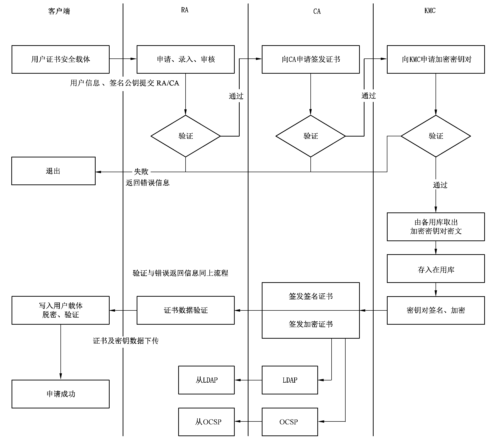
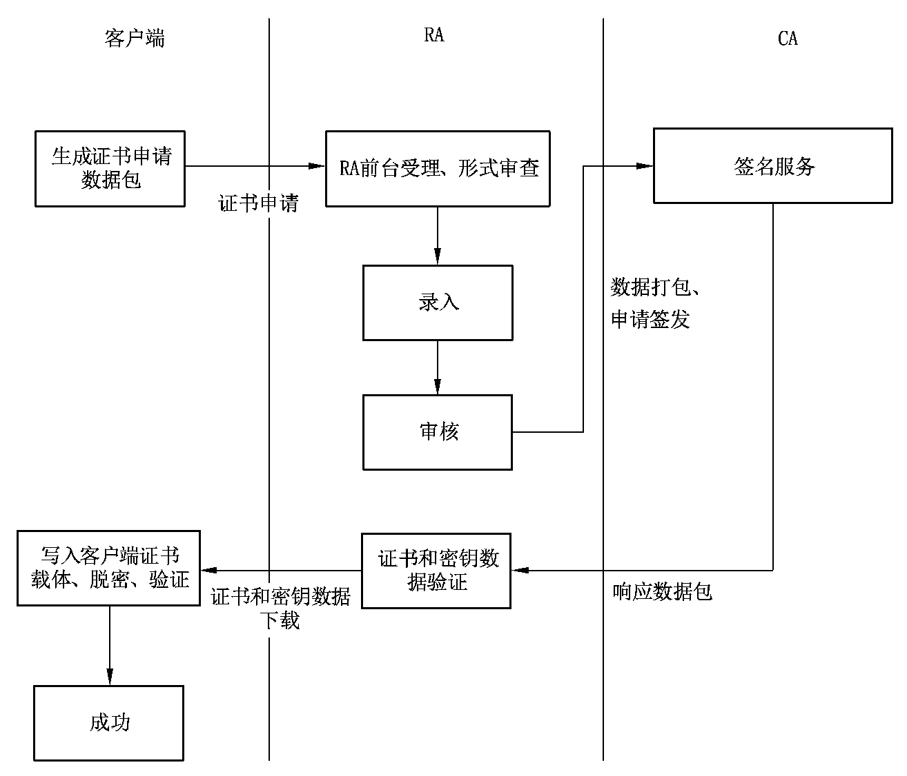
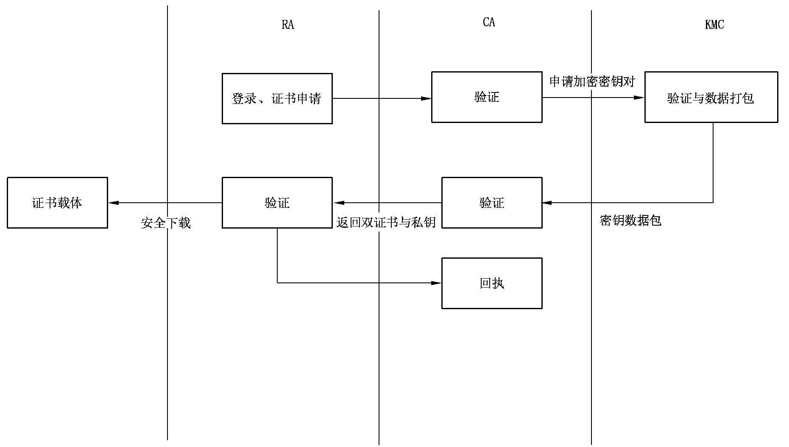
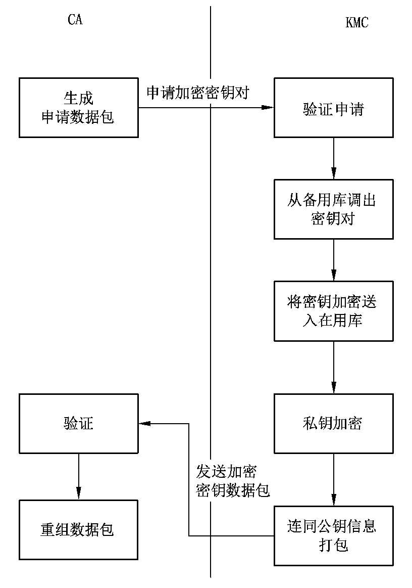
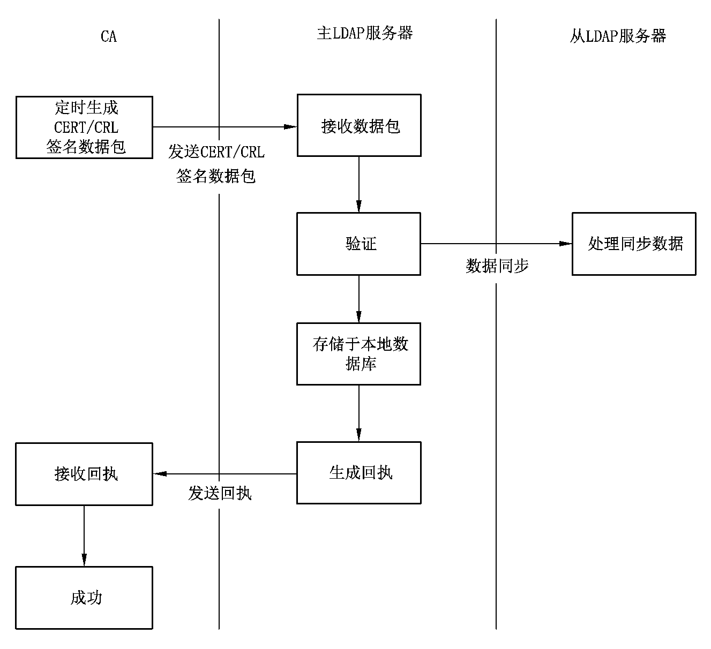
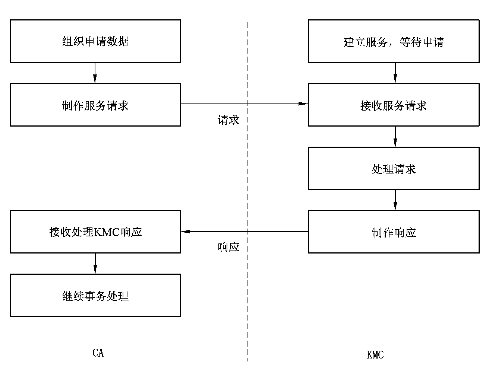
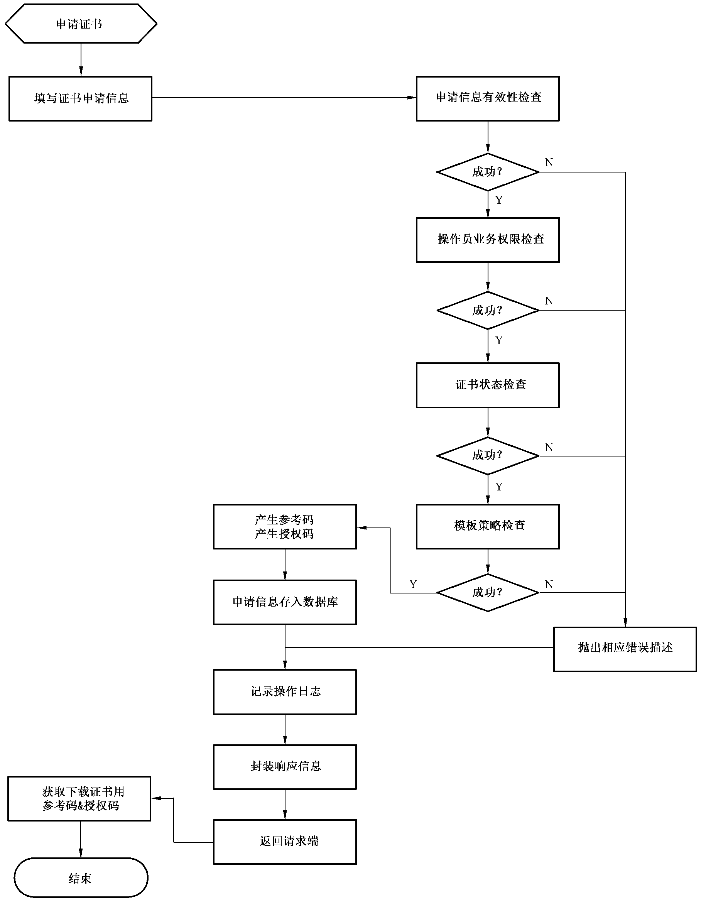
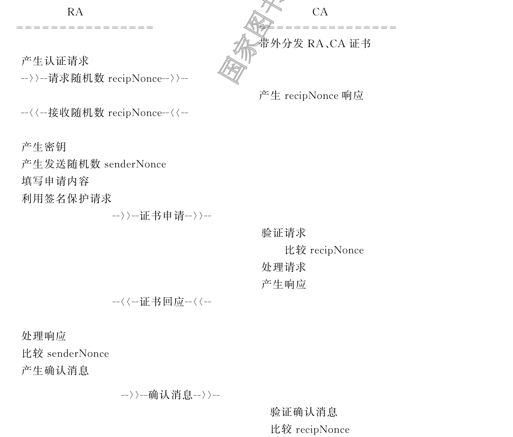

# 数字证书认证系统密码协议规范

## 1 范围

本文件规定了数字证书认证系统中的涉及密码技术的安全协议和协议报文。

本文件适用于数字证书认证系统的设计、建设、检测、运行及管理。对于组织或机构内部使用的数字证书认证系统密码协议的建设、运行及管理,可参考使用。

## 2 规范性引用文件

下列文件中的内容通过文中的规范性引用而构成本文件必不可少的条款。其中,注日期的引用文件,仅该日期对应的版本适用于本文件;不注日期的引用文件,其最新版本(包括所有的修改单)适用于本文件。

GB/T 19713 信息技术 安全技术 公钥基础设施 在线证书状态协议

GB/T 20518 信息安全技术 公钥基础设施 数字证书格式

GB/T 25056 信息安全技术 证书认证系统密码及其相关安全技术规范

GM/T 0006 密码应用标识规范

GM/T 0009 SM2密码算法使用规范

GM/T 0010 SM2密码算法加密签名消息语法规范

GM/Z 4001 密码术语

PKCS #1 公钥加密标准1 RSA 加密[Public-Key cryptography standards(PKCS)#1—RSA cryptographic message syntax]

PKCS #7 公钥加密标准7 密文消息语法[Public-Key cryptography standards(PKCS)#7—Cryptographic message syntax]

## 3 术语和定义

GM/Z 4001界定的术语和定义适用于本文件。

## 4 缩略语

下列缩略语适用于本文件。

CA:证书认证系统(Certificate Authentication system)

DIT:目录信息树系统(Directory Information Tree)

KMC:密钥管理中心(Key Management Center)

LDAP:轻量级目录访问协议(Lightweight Directory Access Protocol)

OCSP:在线证书状态查询协议(Online Certificate Status Protocol)

RA:注册服务(Registration Authority server)

## 5 相关协议

### 5.1 通则

本章给出了数字证书认证系统中各部分的相关流程和密码协议,包括RA 与客户端间、RA 和CA和KMC间、CA 与KMC 间、CA 与LDAP 间、CA 与OCSP 服务间、用户与OCSP 服务间的业务流程,以及CA 同KMC之间安全协议、CA 同LDAP 服务之间安全协议、CA 同OCSP 服务之间安全协议、用户同OCSP服务之间安全协议。对于国家根数字证书认证系统因仅有RA、CA 部分,可参见RA与CA 业务流程。

本文件给出了与协议直接相关的格式和语法。其中系统与格式定义应符合附录A 中的规定;其中凡涉及RSA 密码算法的,其密钥结构应符合PKCS #1的规定,其封装结构应符合PKCS #7的规定;凡涉及SM2算法的,其密钥结构应符合GM/T0009的规定,其封装结构应符合GM/T0010的规定;凡涉及对象标识符的应符合GM/T0006的要求。

### 5.2 业务流程

#### 5.2.1 总业务流程

本文件定义的客户端、RA、CA、KMC以及LDAP和OCSP间的总业务流程见图1。



**图 1 总业务流程图**

非实时发放证书的流程应符合附录B的规定。

#### 5.2.2 RA与客户端间业务流程

RA 同客户端间的流程见图2。



**图 2 RA与客户端业务流程**

#### 5.2.3 RA、CA与KMC间业务流程

RA、CA 与KMC间的业务流程见图3。



**图 3 RA、CA与KMC业务流程**

RA 同CA 间的相关协议见附录C。

#### 5.2.4 CA与KMC间业务流程

CA 与KMC间的流程见图4。



**图 4 CA与KMC业务流程**

#### 5.2.5 CA与LDAP间业务流程

CA 同LDAP服务间的流程见图5。



**图 5 CA与LDAP服务业务流程**

#### 5.2.6 CA与OCSP服务间业务流程

CA 与OCSP服务间流程应符合GB/T19713的规定。

#### 5.2.7 用户与OCSP服务间业务流程

用户与OCSP服务间流程应符合GB/T19713的规定。

### 5.3 CA与KMC系统间相关协议

#### 5.3.1 概述

KMC系统接收CA 系统的密钥服务请求,将处理结果返回给CA。本文件中的密钥服务协议包括申请密钥对、恢复密钥对和撤销密钥对。每个服务都按照请求-响应的步骤执行。

请求:请求由CA 发起,发送到KMC。CA 在生成用户加密证书、更新加密证书或者撤销加密证书时,首先组织密钥服务请求,发送到KMC,并延缓自身的事务处理过程,等待KMC响应返回。

响应:响应由KMC发起,发送到CA。KMC在接收到来自CA 的请求后,检查确定请求合法性,处理服务请求,并将结果返回给CA。

整个服务过程见图6。



**图 6 CA和KMC通信过程**

#### 5.3.2 协议内容

协议内容包括以下内容。

1. a) 请求,也称密钥服务请求,包含CA 请求的类型、性质以及特性数据,该请求被发送到KMC 并

得到服务响应。服务请求应包括如下数据:

- 协议版本(当前版本为2);

- 服务请求标识符;

- CA 标识符;

- 扩展的请求信息;

- 请求信息的签名。

1. b) 响应,是KMC对来自CA 请求的处理响应。KMC的响应包括如下数据:

- 协议版本(当前版本为2);

- 响应标识符;

- KMC标识符;

- 响应信息;

- 响应信息的签名。

1. c) 异常情况,当CA 系统和KMC系统任何一方处理发生错误时,应向对方发送错误信息。错误

可为:

- 验证请求失败:KMC验证来自CA 证书或CA 请求数据失败,CA 收到后应重新进行申请;

- 内部处理失败:KMC处理CA 请求过程中发生内部错误,通知CA 该请求处理失败,需要

重新申请。

本文件采用抽象语法记法(ASN.1)来描述具体协议内容。如果无特殊说明,默认为显式标记。

#### 5.3.3 密钥申请协议

##### 5.3.3.1 请求数据格式

CA 请求的基本格式如下:

```ASN.1
CARequest::= SEQUENCE {
  ksRequest  KSRequest,
  signatureAlgorithm  AlgorithmIdentifier,
  signatureValue  OCTET STRING
}
```

其中:

```ASN.1
KSRequest::= SEQUENCE {
  version  Version DEFAULT v2,
  caName  EntName,
  requestList  SEQUENCE OF Request,
  requestTime  GeneralizedTime,
  taskNo  INTEGER
}
Version ::=INTEGER {v2(1)}
EntName::= SEQUENCE {
  hashAlgorithm  AlgorithmIdentifier,
  entName  GeneralName,
  entPubKeyHash  OCTET STRING,
  serialNumber  CertificateSerialNumber
}
CertificateSerialNumber::=INTEGER
Request::= CHOICE{
  applyKeyReq [0]IMPLICT ApplyKeyReq,
  restoreKeyReq [1]IMPLICT RestoreKeyReq,
  revokeKeyReq [2]IMPLICT RevokeKeyReq
}
```

##### 5.3.3.2 KSRequest及其结构解释

KSRequest结构的各项含义如下。

1. a) 版本

version版本描述了请求语法的版本号,当前版本为2,值为1。

1. b) 请求者标识符

caName请求者标识符,是申请者的唯一名称,该值由实际运行CA 和KMC约定。

EntName结构中,entPubKeyHash是申请者公钥的杂凑值。该值将通过对发布者证书中的主体公钥字段(不含标记和长度)进行计算。hashAlgorithm 字段表示计算该杂凑值所使用的杂凑算法。serialNumber是申请者的证书序列号。

1. c) 请求类型

Request请求包类型,值为applyKey时表明该包为申请密钥申请包,值为restoreKey时表明该包为恢复密钥申请包,值为revokeKey时表明该包为撤销密钥申请包。

Request的三种数据格式为:

- ApplyKeyReq包

ApplyKeyReq为密钥申请格式包,其格式如下:

```ASN.1
ApplyKeyReq::= SEQUENCE {
  appKeyType  AlgType,
  appKeyLen  AppKeyLen,
  retAsymAlg  AlgType,
  retSymAlg  AlgType,
  retHashAlg  AlgType,
  appUserInfo  AppUserInfo
}
AlgType::= AlgorithmIdentifier
AppKeyLen ::=INTEGER
AppUserInfo::= SEQUENCE {
  userCertNo  CertificateSerialNumber,
  userPubKey  SubjectPublicKeyInfo,
  notBefore  GeneralizedTime,
  notAfter  GeneralizedTime,
  username [0]OCTET STRING OPTIONAL,
  dsCode [1]PKIFreeText OPTIONAL,
  extendInfo [2]PKIFreeText OPTIONAL
}
```

AlgType表明使用的非对称算法、对称算法、杂凑算法类型。其中,appKeyType为要申请的加密密钥对的类型,retAsymAlg、retSymAlg、retHashAlg分别为KMC 响应数据包中非对称算法、对称算法、杂凑算法类型。

AppKeyLen表示申请的密钥长度。

示例1:十进制256表示申请256比特的密钥。

AppUserInfo表示申请包中对应用户信息,依次为终端用户加密证书序列号、终端用户保护公钥、密钥有效起始时间、密钥截止时间、用户姓名、地区代码以及扩展信息。

对于同一个CA,其申请时提交的用户加密证书序列号应是唯一的,如果需要使用原有证书序列号再次申请密钥对,则应先请求将原申请密钥对撤销。

userPubKey为终端用户保护公钥,该公钥应由终端用户证书载体生成,用来在密钥传递中保护用户加密私钥。该公钥宜采用终端用户签名公钥。

用户信息结构中,userName为可选项,该项用来标识用户名称,当CA 将该项提交给KMC 时,KMC应将其保存到库中。

dsCode为可选项,CA 可使用该项标识密钥的地区属性,当dsCode存在时,KMC 应将其保存到库中。

extendInfo扩展信息为可选项,用来表示CA 需要往KMC发送关于该用户的个性信息,该域最大应能处理100字节数据。

示例2:若KMC按照区域管理密钥,则CA 可利用该域填写该用户的区域信息,KMC读出该域值后保存到库中。

- RestoreKeyReq包

RestoreKeyReq包为密钥恢复格式包,其格式如下:

```ASN.1
RestoreKeyReq::= SEQUENCE {
  retAsymAlg  AlgType,
  retSymAlg  AlgType,
  retHashAlg  AlgType,
  userCertNo  CertificateSerialNumber,
  userPubKey  SubjectPublicKeyInfo
}
```

AlgType表明使用的非对称算法、对称算法、杂凑算法类型。其中,retAsymAlg、retSymAlg、retHashAlg分别为KMC响应数据包中非对称算法、对称算法、杂凑算法类型。

userCertNo为用户加密证书序列号。

userPubKey为终端用户保护公钥。

- RevokeKeyReq包

RevokeKeyReq包为密钥撤销格式包,其格式如下:

```ASN.1
RevokeKeyReq::= SEQUENCE {
  userCertNo  CertificateSerialNumber
}
```

UserCertNo为用户证书序列号。

1. d) 请求时间

requestTime为请求生成时间,该时间为CA 产生请求的时间。

1. e) 任务序列号

taskNo为请求任务序列号,该任务序列号是申请者用来区分多次申请时候的一个标识符,以确保KMC和CA 能正确关联请求-响应过程。

KMC应能处理不大于二十字节的任务序列号,而CA 应确保不使用大于二十字节的任务序列号。

#### 5.3.4 响应

##### 5.3.4.1 响应数据格式

KMC响应的格式如下:

```ASN.1
KMRespond::= SEQUENCE {
  ksRespond  KSRespond,
  signatureAlgorithm  AlgorithmIdentifier,
  signatureValue  OCTET STRING
}
```

其中:

```ASN.1
KSRespond::= SEQUENCE {
  version  Version DEFAULT v2,
  KMName  EntName,
  respondList  SEQUENCE OF Respond,
  respondTime  GeneralizedTime,
  taskNo  INTEGER
}
Respond::= CHOICE{
  applykeyRespond [0]IMPLICT RetKeyRespond,
  restorekeyRespond [1]IMPLICT RetKeyRespond,
  revokekeyRespond [2]IMPLICT RevokeKeyRespond,
  errorPkgRespond [3]IMPLICT ErrorPkgRespond
}
```

##### 5.3.4.2 KSRespond及其结构解释

KSRespond结构的各项含义如下。

1. a) 版本

version为响应的版本号,当前版本为2,值为1。

1. b) 响应者标识符

KMName为响应者标识符,其成员分别为响应者的名称、响应者公钥的杂凑值、杂凑算法以及响应者的证书序列号。

1. c) 响应类型

Respond为响应类型,当值为applyRespond时该包为申请密钥响应包,值为restoreRespond时该包为恢复密钥响应包,值为revokeRespond时该包为撤销密钥响应包。

1. d) Respond响应子包

Respond响应子包共有如下三种数据格式。

- retKeyRespond包

retKeyRespond包为密钥响应格式包,为处理申请密钥、恢复密钥申请时响应申请者的数据包,其格式如下:

```ASN.1
retKeyRespond::= SEQUENCE {
 userCertNo  CertificateSerialNumber,
 retPubKey  SubjectPublicKeyInfo,
 retPriKey  SM2EnvelopedKey
}
```

userCertNo是用户加密证书序列号,该项从CA 申请包中取值。

retPubKey是返回给申请者的用户加密公钥数据。

retPriKey是返回给申请者的用户加密私钥数据信封,即对私钥作带签名的加密信封。

- RevokeKeyRespond包

RevokeKeyRespond包为密钥撤销响应格式包,在处理密钥撤销时响应申请者的其具体格式如下:

```ASN.1
RevokeKeyRespond::= SEQUENCE {
 userCertNo  CertificateSerialNumber
}
```

UserCertNo指定用户加密证书序列号,该项值取自申请包。

- ErrorPkgRespond包

ErrorPkgRespond包为错误包,在处理密钥服务请求出错时,KMC 使用本包响应申请者。其格式如下:

```ASN.1
ErrorPkgRespond::= SEQUENCE {
 errNo  INTEGER,
 errDesc [0]PKIFreeText OPTIONAL
}
```

1. e) respondTime响应时间

响应生成时间,该时间即为KMC产生响应的时间。

1. f) taskNo任务序列号

响应的任务序列号,该任务序列号值取自申请者数据包。

### 5.4 CA与LDAP服务间相关协议

#### 5.4.1 通则

证书与证书撤销链发布是指CA 把新签发的证书与证书撤销链送到LDAP目录服务器,以供用户查询、下载。

CA 到LDAP服务间的数据传输应符合GB/T25056的规定。

#### 5.4.2 发布协议

消息包结构定义为:

```ASN.1
PkixIssue::= SEQUENCE {
 PkixIssueInfo  TBSISSUE,--发布内容
 SignatureAlgorithm  SignatureAlgorithmIdentifier,
 CASignature  Signature
}
TBSISSUE SEQUENCE ::={
 version  Version,--版本号,值为1
 type  INTEGER,
        --0:向LDAP或OCSP更新根证书,
        --1:向LDAP发送证书,
        --2:向LDAP发送作废证书序列号,
        --3:向LDAP发送作废证书链,
        --4:向OCSP发送证书状态,
        --8:向LDAP发送交叉认证证书,LDAP自己用根证书与此包中的
         第一个证书组成PKCS #7证书发布链
 transNonce  OCTET STRING OPTIONAL,--包内随机数
 number  INTEGER OPTIONAL,--包内证书或证书状态或证书撤销链数目
 time  GeneralizedTime,
        --接收方比较此时间,根据约定时间延迟确定是否接收包内容
 cert [0]SEQUENCE SIZE (1..MAX)OF Certificate OPTIONAL,
        --如果是证书,放在本项中,如果是更新根证书将发布4个证书,依
        次为OldWithNew、NewWithOld、NewWithNew 签名证书、New-
        WithNew 加密证书
 certstatue [1]SEQUENCE OF SEQUENCE {
      certId  CertID,
      BeforeTime  GeneralizedTime,
      EndTime  GeneralizedTime,
      statue  INTEGER,
              --0有效,1无效,无效时应有原因项
      statueTime  GeneralizedTime,
      statueReasonRode  CRLReason OPTIONAL
     }
 mCRL [2]SEQUENCE OF SEQUENCE {
     stateOrProvinceNumINTEGER,
     --区域区别号,CRL 发布点可有多个,发布内容可不
           同,只有唯一地点的为0
     CLRSegment  INTEGER,
     --证书链的块号,为防证书链太大,可按证书号分
            块,同块内证书在同一条链中
     CRLNumber  INTEGER,--证书链基本序列号
     DeltareCRLNumber  INTEGER OPTIONAL,--证书链增量序列号
     CertificateList  SEQUENCE {--作废证书链
     tbsCertList  TBSCertList,
     signatureAlgorithm  AlgorithmIdentifier,
     signatureValue  BIT STRING
     }
     }
 signatureAlgorithm AlgorithmIdentifier OPTIONAL,--签名算法
 signatureValue  BIT STRING OPTIONAL,
      --CA 的签名,若是根证书更新包这里的签名是新根的签名,接收
        方应逐级验证,以确保新根合法
}
```

收到消息的回应包为:

```ASN.1
PkixIssueResponse::= SEQUENCE {
 PkixIssueResponseInfo  TBSISSUEResponse,
 SignatureAlgorithm  SignatureAlgorithmIdentifier,
 ResponseSignature  Signature
}
TBSISSUEResponse SEQUENCE ::= {
 version  Version,--版本号,值为1
 type  INTEGER,
        --0:向LDAP或OCSP更新根证书,
        --1:向LDAP发送证书,
        --2:向LDAP发送作废证书序列号,
        --3:向LDAP发送作废证书链,
        --4:向OCSP发送证书状态,
        --8:向LDAP发送交叉认证证书,LDAP 自己用根证书与此包
         中的第一个证书组成PKCS #7证书发布链
 transNonce  OCTET STRING OPTIONAL,--包内随机数
 number  INTEGER OPTIONAL,--包内证书或证书状态或证书撤销链数目
 time  GeneralizedTime,--接收方时间
 ResponseStatue INTEGER--0为正常接收,1为未接收,请下次重发
}
```

如果CA 收到回应后验证签名失败或传输随机数不同,则此次发布失败,应重新打包再发布。

### 5.5 用户与LDAP服务间相关协议

#### 5.5.1 通则

LDAP目录可用来存储多种信息,作为PKI的核心组件其作用主要用来存放证书与证书撤销列表,供用户查询。

LDAP消息协议数据单元LDAPMessage为:

```ASN.1
LDAPMessage::= SEQUENCE {
  messageID  MessageID,
  protocolOp  CHOICE {
        bindRequest  BindRequest,
        bindResponse  BindResponse,
        unbindRequest  UnbindRequest,
        searchRequest  SearchRequest,
        searchResEntry  SearchResultEntry,
        searchResDone  SearchResultDone,
        searchResRef  SearchResultReference,
         modifyRequest  ModifyRequest,
         modifyResponse  ModifyResponse,
        addRequest  AddRequest,
        addResponse  AddResponse,
        delRequest  DelRequest,
        delResponse  DelResponse,
         modDNRequest  ModifyDNRequest,
         modDNResponse  ModifyDNResponse,
        compareRequest  CompareRequest,
        compareResponse  CompareResponse,
        abandonRequest  AbandonRequest,
        extendedReq  ExtendedRequest,
        extendedResp  ExtendedResponse,
        controls [0]Controls OPTIONAL
       },
}
MessageID ::=INTEGER (0 ..maxInt)
maxIntINTEGER ::= 2147483647--(231-1)
```

LDAP消息(LDAPMessage)的功能是给所有的协议交换定义一个包含通用字段的封装。

除了在上面定义的LDAPMessage,在定义协议操作时,也可使用下面的定义:

```ASN.1
LDAPString::= OCTET STRING
```

LDAPString是一种符号上的方便表示,尽管LDAPString是一种用字符串类型来编码的串,但实际上该串能使用的合法字符集应由IA5字符集限定。

```ASN.1
LDAPDN ::= LDAPString
RelativeLDAPDN ::= LDAPString
```

LDAPDN 和RelativeLDAPDN 分别表示一个标识名和一个相对标识名:

```ASN.1
AttributeValueAssertion ::= SEQUENCE {
 attributeType  AttributeType,
 attributeValue  AttributeValue
}
AttributeType::= LDAPString
AttributeValue::= OCTET STRING
```

注意这里的AttributeType,如果服务器端拥有某个属性的文本名,则在查询结果中返回文本名,文本名字(“OrganizationName”)优先于点数方式(“2.5.4.10”)。服务器端应拥有一个较全的属性名列表,且便于客户端知道。

一个类型为AttributeValue的域的值用目录中的AttributeValue类型的一个八位编码串来表示。

```ASN.1
LDAPResult::= SEQUENCE {
 resultCode  ENUMERATED {
      success(0),
      operationsError(1),
      protocolError(2),
      timeLimitExceeded(3),
      sizeLimitExceeded(4),
      compareFalse(5),
      compareTrue(6),
      authMethodNotSupported(7),
      strongAuthRequired(8),
      --9reserved--
      referral(10),--new
      adminLimitExceeded(11),--new
      unavailableCriticalExtension(12),--new
      confidentialityRequired(13),--new
      saslBindInProgress(14),--new
      noSuchAttribute(16),
      undefinedAttributeType(17),
      inappropriateMatching(18),
      constraintViolation(19),
      attributeOrValueExists(20),
      invalidAttributeSyntax(21),
      --22-31unused--
      noSuchObject(32),
      aliasProblem (33),
      invalidDNSyntax(34),
      --35reservedforundefinedisLeaf--
      aliasDereferencingProblem (36),
      --37-47unused--
      inappropriateAuthentication(48),
      nvalidCredentials(49),
      nsufficientAccessRights(50),
       busy(51),
       unavailable(52),
       unwillingToPerform (53),
       loopDetect(54),
       --55-63unused--
       namingViolation(64),
       bjectClassViolation(65),
       notAllowedOnNonLeaf(66),
       notAllowedOnRDN (67),
       entryAlreadyExists(68),
       objectClassModsProhibited(69),
       --70reservedforCLDAP--
       affectsMultipleDSAs(71),--new
       --72-79unused--
       other(80)
       },--81-90reservedforAPIs
  matchedDN  LDAPDN,
  errorMessage  LDAPString,
  referral [3]Referral OPTIONAL
}
```

LDAPResult是从服务器返回给客户用以指明操作成功或失败的结构。对不同的请求,服务器应返回包含LDAPResult结构中的不同域的回应给客户,来指明协议操作请求的最终状态。对于服务器,这个结构中的errorMessage域应用来返回一个包含可读文本的错误诊断的ASCII串给客户。由于这个错误诊断不是标准的,在实现中不应依赖这些返回值。如果服务器不返回一个文本的错误诊断,LDAPResult结构中的errorMessage应包含一个长度为零的字符串。

若resultCodes为noSuchObject、aliasProblem、invalidDNSyntax及aliasDereferencingProblem,相应的matchedDN 域应设为在DIT 中最为匹配的条目,而且应是所提供名字的简短格式。或者,如果别名已被丢弃,应返回结果名字。在其他情况下,matchedDN 域都应设为NULLDN(也就是长度为零的字符串)。

客户和服务器之间的协议会晤包括绑定、解除绑定、查询、插入、修改、删除和丢弃。用户只能访问从LDAP,LDAP应拒绝用户的插入、修改、删除功能。协议会晤中通用部分如下:

绑定操作的功能是在客户和服务器之间初始化一个协议会晤,并允许服务器对客户进行认证。绑定请求定义如下:

```ASN.1
BindRequest::= [APPLICATION0]SEQUENCE {
  version  INTEGER (1 ..127),
name  LDAPDN,
authenticationAuthenticationChoice
}
AuthenticationChoice::= CHOICE {
  simple [0]OCTET STRING,--1and2reserved
  sasl [3]SaslCredentials
}
SaslCredentials::= SEQUENCE {
  mechanism  LDAPString,
  credentials  OCTET STRING OPTIONAL
}
```

绑定请求的参数为以下内容。

———版本,版本号指定本协议会晤中所使用协议的版本。本文件为LDAP版本3。由于没有版本

选择协商,客户应把这个参数设为它所希望的值。如果客户端设定的版本为LDAP版本2,服

务器端则应不返回版本3所加内容。如果客户端没有绑定请求(V3版可没有绑定),服务器端

应认定客户端支持V3版协议。

———名称,客户希望绑定的目录对象的名称。可为空值(一个长度为零的字符串),表示匿名绑定。

———认证,与LDAP版本2 相比,版本3 在认证上有所加强。SASL(SimpleAuthenticationand

SecurityLayer)是一个附加在面向连接协议上的框架,它提供了更高一级的安全认证机制。

但作为从LDAP,客户查询的认证必要性不大。

绑定操作的绑定回应为:

```ASN.1
BindResponse::= [APPLICATION1]SEQUENCE {
  ldapResult  COMPONENTSOFLDAPResult,
  serverSaslCreds [7]OCTET STRING OPTIONAL
}
```

放弃绑定操作是临时终止一个协议会晤,放弃绑定操作定义如下:

```ASN.1
UnbindRequest::= [APPLICATION2]NULL
```

若没有定义放弃绑定操作回应。在收到一个放弃绑定请求后,服务器可假设发送请求的客户已终止该会晤,所有已收到的还未处理的请求可被丢弃。

丢弃操作是允许客户请求服务器终止一个已发出的操作请求。丢弃操作定义如下:

```ASN.1
AbandonRequest::= [APPLICATION16]MessageID
```

在丢弃操作中没有定义相应的回应。在发送一个丢弃操作后,一个客户可能期望丢弃请求中包含的消息ID 标识的操作已被丢弃。如果服务器在把一个查找操作的回应发送给客户时,收到对该查找操作的丢弃请求,服务器应停止发送回应,并立即终止该查找操作。

#### 5.5.2 证书查询与下载协议

查找操作允许客户请求代表他的服务器进行一次查找。查找请求定义如下:

```ASN.1
SearchRequest::= [APPLICATION3]SEQUENCE {
  baseObject  LDAPDN,
scope  ENUMERATED {
       baseObject  (0),
       singleLevel  (1),
       wholeSubtree  (2)
       },
derefAliases  ENUMERATED {
       neverDerefAliases  (0),
       derefInSearching  (1),
       derefFindingBaseObject (2),
       derefAlways  (3)
       },
sizeLimit  INTEGER (0 ..maxInt),
timeLimit  INTEGER (0 ..maxInt),
attrsOnly  BOOLEAN,
filter  Filter,
attributes  SEQUENCE OF AttributeType
}
Filter::= CHOICE {
and [0]SET OF Filter,
or [1]SET OF Filter,
not [2]Filter,
equalityMatch [3]AttributeValueAssertion,
substrings [4]SubstringFilter,
greaterOrEqual [5]AttributeValueAssertion,
lessOrEqual [6]AttributeValueAssertion,
present [7]AttributeType,
approxMatch [8]AttributeValueAssertion,
extensibleMatch [9]MatchingRuleAssertion
}
SubstringFilter::= SEQUENCE {
type  AttributeType, --atleastonemustbepresent
substrings  SEQUENCE OF CHOICE {
        initial [0]LDAPString,
        any [1]LDAPString,
        final [2]LDAPString
        }
}
MatchingRuleAssertion::= SEQUENCE {
  matchingRule [1]MatchingRuleId OPTIONAL,
  type [2]AttributeDescription OPTIONAL,
  matchValue [3]AssertionValue,
  dnAttributes [4]BOOLEAN DEFAULT FALSE
}
```

查找请求的参数为以下内容。

———baseObject:一个相对于要进行查找操作的基本对象条目。

———scope:指示要查找的范围。该域可能的语义上的值与目录查找操作中的范围域的语义值是一

致的。

———derefAliases:指示在操作中别名对象该如何处理。该域可能的语义上的值按照升序的顺序

进行。

———neverDerefAliases:在查找或定位查找的基本对象时不丢弃别名引用。

———derefInSearching:在查找过程中,丢弃基本对象的下一级的别名引用,但对基本对象进行定位

时,不丢弃别名引用。

———derefFindingBaseObject:在定位基本对象时,丢弃别名引用,但在查找基本对象的下一级

时,不丢弃别名引用。

———derefAlways:在定位基本对象和查找基本对象的下一级时都丢弃别名引用。

———sizelimit:一个sizelimit限制了可返回的最大查找结果的条目数量。如果该域的值为0,表示

不限制查找的sizelimit。

———timelimit:一个timelimit限制了一个查找最多允许的时间(以秒计算)。如果该域的值为

0,表示不限制查找的timelimit。

———attrsOnly:指示在返回的查找结果中是否要包含属性类型和属性值,或者仅包含属性类型。

如果该域设为TRUE,仅返回属性类型(没有值),如果该域设为FALSE,同时返回属性类型

和属性值。

———filter:一个过滤器定义了一个应满足的条件,以使该查找能匹配给定的条目。

———attributes:要返回的查找结果中的每一个条目的属性列表。一个空的列表表示查找结果应包

含每一个条目的所有属性。

在收到一个查找请求后,服务器返回结果为:

```ASN.1
SearchResultEntry::= [APPLICATION4]SEQUENCE {
   objectName  LDAPDN,
   attributes  PartialAttributeList
}
PartialAttributeList::= SEQUENCE OF SEQUENCE {
   type  AttributeDescription,
   vals  SET OF AttributeValue
}
SearchResultReference::= [APPLICATION19]SEQUENCE OF LDAPURL
SearchResultDone::= [APPLICATION5]LDAPResult
```

在收到一个查找请求后,服务器对DIT 进行查找。服务器把一系列的回应返回给客户。这些回应包括以下内容。

1. a) 零个或多个查找回应,每个回应包含所查找到的一个条目。在每个回应的后面跟着回应的序

列号。

1. b) 一个包含操作成功或对所发生错误的详细描述的单个查找回应。

每个返回的条目应包括所有的属性,以及在查找请求的“attributes”域中指定的所要求的关联的值。

DIT 的“列表”操作可通过具有检查objectClass属性是否存在的一个LDAP过滤器查找来模拟。同样,DIT 的“读”操作可通过具有同样过滤器的LDAP查找来模拟。

协议报文实例见附录D。

#### 5.5.3 CRL查询与下载协议

证书或证书撤销列表以一条条数据的形式存放在LDAP 的不同的分支下。LDAP 根据“baseObject”与属性值查询满足条件的记录返回用户查询下载的证书或CRL。

baseObject是查找的基本条件,具体查找一条CRL 应根据目录树的设计区别对待。CRL 目录有两种设计。

1. a) 根据证书号分段,其中CRLNumber放到serialnumber中,分段号组合到ou中,具体的区别名

放到dc中。

示例1:如201段CRLLDAPDN 存放“serialnumber=???,ou=crl201,dc=isc,dc=com”,202段CRLLDAPDN 存放“serialnumber=???,ou=crl202,dc=isc,dc=com”。

1. b) 增量CRLCRLLDAPDN 存放,递增的号码放入serialnumber。

示例2:如“serialnumber=???,ou=dcrl,dc=isc,dc=com”。因为增量CRL 的序列号是CRL 基本序列号的累加,如基本号为1,增量号为2……9,下一个基本号为10,接下来的增量号为11……19,这个递增的号码不会重复。

对第一种情况,若要查找CRLNumber为100,分段号为10的CRL,baseObject可这样组织:“serialnumber=100,ou=crl10,dc=isc,dc=com”,发送这样的请求就可获得具体的CRL列表。

对第二种情况,若要查找serialnumber为100,baseObject可这样组织:“serialnumber=100,ou=dcrl,dc=isc,dc=com”,发送这样的请求就可获得具体的CRL 列表。对于一个应用来说,如果这个列表是基本表,时间也满足要求,通过这个表可知道证书是否作废;如果这个列表是增量表,时间也满足要求,通过这个表还不能知道证书是否作废,这时还要下载对应此表的基本表以及到目前表为止的增量表,经过每个表的检查方知具体证书的作废情况。

### 5.6 CA与OCSP服务间相关发布协议

CertID 结构用于标识特定的证书。

```ASN.1
CertID ::= SEQUENCE {
    hashAlgorithm  AlgorithmIdentifier,
    issuerNameHash  OCTET STRING,--HashofIssuer'sDN
    issuerKeyHash  OCTET STRING,--HashofIssuerspublickey
    serialNumber  CertificateSerialNumber
}
```

证书状态的发布有两种方式,开发者可根据情况自选一种。一种是PKIXIssue方式,按照CA 到LDAP服务的发布协议中发布到OCSP服务的规定。另一种是PKIMessage方式,定义格式如下:

当CA 已经或将要作废一个特定的证书时,可发布一个有关该事件(可能是将要发生的事件)的告示。

```ASN.1
RevAnnContent::= SEQUENCE {
    status  PKIStatus,
    certId  CertID,
    willBeRevokedAt  GeneralizedTime,
    badSinceDate  GeneralizedTime,
    crlDetails  Extensions OPTIONAL
            --额外的CRL 细节(如crlnumber、reason、
              location)
}
```

CA 可使用这样的告示来警告(或通知)一个申请者其证书将要(或已经)作废。这一消息通常用于作废请求并不是由相关证书的subject发起的情况。

willBeRevokedAt字段包含新的条目将增加到相关CRLs的时间。

### 5.7 用户与OCSP服务间相关协议

OCSP使得应用程序可获得所需要检验证书的状态。

这个协议规定了在应用程序检查证书状态和OCSP服务器提供状态之间所需要交换的数据。

一个OCSP请求包含以下数据:协议版本、服务请求、目标证书标识、可能被OCSP 服务器处理的可选扩展。作为OCSP服务器应检测客户请求与服务策略之间的合理化。如果请求格式不对或服务器要求的客户信息不够,则OCSP服务器应产生一个错误信息;否则返回一个确定的回复。

具体协议应符合GB/T19713的规定。

## 6 协议报文语法

### 6.1 加密数据报文

加密数据报文为不附带任何编码标示的原始密文数据。

使用SM2算法的加密数据报文定义应符合GM/T0009的规定。

### 6.2 杂凑数据报文

```ASN.1
Digestinfo::= SEQUENCE{
  digestAlgorithm  DigestAlgorithmidentifier,
  digest  Digest
}
DigestAlgorithmIdentifier::= AlgorithmIdentifier
Digest::= OCTET STRING
```

其中:

DigestAlgorithmIdentifier是杂凑算法标识,包括SM3、SHA_256。

Digest是消息杂凑进程的结果。

### 6.3 数字签名报文

基于SM2算法的数字签名报文格式应符合GM/T0010的规定,基于RSA 算法的数字签名报文格式应符合PKCS #7的规定。

### 6.4 数字信封报文

基于SM2算法的数字信封报文格式应符合GM/T0010的规定,基于RSA 算法的数字信封报文格式应符合PKCS #7的规定。

## 附录 A（规范性）系统与格式定义

### A.1 证书模板格式

本文件中所描述证书应符合GB/T20518的规定。

不同的PKI管理消息要求消息的发起者指明证书中必备的一些域。证书模板结构允许一个终端实体或者RA 尽可能指定其要求的证书内容。除了域内容是随意填写之外,证书模板可等同于一个证书。

即使消息的发起者指定全部它所需求的证书内容,而CA 在签发证书时有权进行修改。如果这样签发的证书不能被消息请求者接受,可拒绝确认消息或发送一个错误消息。

证书模板语法如下:

```ASN.1
CertTemplate::= SEQUENCE {
 version [0]Version  OPTIONAL,
 serialNumber [1]INTEGER  OPTIONAL,
 signingAlg [2]AlgorithmIdentifier  OPTIONAL,
 issuer [3]Name  OPTIONAL,
 validity [4]OptionalValidity  OPTIONAL,
 subject [5]Name  OPTIONAL,
 publicKey [6]SubjectPublicKeyInfo OPTIONAL,
 issuerUID [7]UniqueIdentifier  OPTIONAL,
 subjectUID [8]UniqueIdentifier  OPTIONAL,
 extensions [9]Extensions  OPTIONAL
}
```

### A.2 证书撤销列表CRL格式

本文件中所描述证书撤销列表CRL应符合GB/T20518的规定。

### A.3 加密值

当在PKI消息中发送加密值时(在文件中指私钥或者证书),应使用加密数据结构。

使用该数据结构时要求发送者和期望的接收者都能进行加解密运算。发送者和接收者宜进行加解密运算,或者能够产生一个共享密钥。

如果PKI消息的接收者已经拥有一个用来解密的私钥,则“encSymmKey”域可包含一个使用接收者公钥加密的会话密钥。

加密值的语法如下:

```ASN.1
EncryptedValue::= SEQUENCE {
  intendedAlg [0]AlgorithmIdentifier  OPTIONAL,
        --加密值期望使用的算法
  symmAlg [1]AlgorithmIdentifier  OPTIONAL,
        --用于加密数据的对称算法类型
  encSymmKey [2]BIT STRING  OPTIONAL,
       --加密后的对称密钥
  keyAlg [3]AlgorithmIdentifier  OPTIONAL,
       --用于加密对称密钥的算法类型
  valueHint [4]OCTET STRING  OPTIONAL,
       --关于加密内容的简短说明
  encValue  BIT STRING
       --对称加密结果
}
```

### A.4 PKI消息的状态码和故障信息

所有的响应消息都应包含状态信息,状态码定义如下:

```ASN.1
PKIStatus::=INTEGER {
  granted  (0),
        --按照请求准确地返回结果
  grantedWithMods  (1),
        --按照请求返回了一些近似的结果,请求者负责确定其中的
         区别
  rejection  (2),
        --拒绝请求,在消息其他地方将有更多的信息
  waiting  (3),
        --等待,请求尚没有被处理
  revocationWarning  (4),
        --撤销警告,该消息警告了一个即将收到的撤销
  revocationNotification (5),
        --撤销通知,通知撤销已经发生
  keyUpdateWarning  (6)
        --密钥更新,请求消息中指定的密钥已经更新
}
```

响应者可使用下面的语法来提供更多的关于故障的信息。

```ASN.1
PKIFailureInfo::= BIT STRING {
        --在需要的时候,将来可添加更多的错误码
  badAlg  (0),
        --不能识别或者不支持的算法标识符
  badMessageCheck  (1),
        --消息完整性检查失败,如签名未能验证通过
  badRequest  (2),
        --不准许或者不支持该事务
  badTime  (3),
        --根据本地策略,消息时间和系统时间差别较大
  badCertId  (4),
        --没有找到合适的证书
  badDataFormat  (5),
        --提交的数据格式错误
  wrongAuthority  (6),
         --请求中指定的权威和创建响应者令牌的权威不相同
  incorrectData  (7),
         --请求者数据不正确(用在公正服务中)
  missingTimeStamp  (8),
         --缺失时间戳
  badPOP  (9)
         --拥有证明结构错误
}
PKIStatusInfo::= SEQUENCE {
  status  PKIStatus,
  statusString  PKIFreeText  OPTIONAL,
  failInfo  PKIFailureInfo OPTIONAL
}
```

### A.5 证书识别

使用证书ID(CertID)数据结构来识别特定的证书,CertID 的语法为:

```ASN.1
CertID ::= SEQUENCE {
  hashAlgorithm  AlgorithmIdentifier,
  issuerNameHash  OCTET STRING,--HashofIssuer'sDN
  issuerKeyHash  OCTET STRING,--HashofIssuerspublickey
  serialNumber  CertificateSerialNumber
}
```

### A.6 带外根CA公钥

每个根CA 应将其当前公钥通过带外的方式发布。

可通过两种方法发布根CA 公钥:一种是CA 直接发布其自签名证书;另外一种是通过目录服务发布,CA 同时发布该公钥的杂凑值,以便允许验证公钥的完整性。

```ASN.1
OOBCert::= Certificate
```

该证书中的域限制如下:

———证书应是自签名的,即签名应能够使用证书中公钥信息来验证;

———主题域(subject)和签发者域(issuer)应相同;

———如果主题域(subject)为空,则主题可选名称(subjectAltNames)和签发者可选名称(issuerAltNames)应非空,而且两者应完全相同;

———其他扩展项的值应符合自签名证书要求(如主题密钥标识和签发者密钥标识应相同)。

```ASN.1
OOBCertHash ::= SEQUENCE {
hashAlg [0]AlgorithmIdentifier  OPTIONAL,
certId [1]CertId  OPTIONAL,
hashVal  BIT STRING
}
```

使用杂凑值可使任何能安全得到该杂凑值的用户(如通过带外的方式得到)都能验证该CA 的自签名证书。

### A.7 存档选项

请求者可使用“PKIArchiveOptions”存档选项来表明要求PKI存档私钥。

存档选项PKIArchiveOptions语法如下:

```ASN.1
PKIArchiveOptions::= CHOICE {
  encryptedPrivKey [0]EncryptedKey,--私钥
  keyGenParameters [1]KeyGenParameters,--允许重新产生私钥的参数
  archiveRemGenPrivKey [2]BOOLEAN
          --如果发送者期望接收者归档其对应请求所生成密钥
           对中的私钥,则设置为真,如果不需要归档,则设置
           为假
}
KeyGenParameters::= OCTET STRING
```

### A.8 发布信息

请求者可使用“PKIPublicationInfo”选项来表明要求PKI发布证书。

发布信息PKIPublicationInfo语法如下:

```ASN.1
PKIPublicationInfo::= SEQUENCE {
  action  INTEGER {
     dontPublish(0),
     pleasePublish(1)
     },
pubInfos  SEQUENCE SIZE (1..MAX)OF SinglePubInfo OPTIONAL
}
```

如果action项为“dontPublish”(不发布),则pubInfos应为空。

## 附录 B（规范性）非实时发布证书流程

非实时发布证书流程如图B.1所示。



**图 B.1 非实时发布证书协议流程**

## 附录 C（资料性）RA与CA间相关协议

### C.1 RA的服务模式

RA 服务器通常有两种服务模式,一种是C/S模式,一种是B/S 模式。目前,RA 服务器大都以Web方式提供服务。RA 服务器的程序大致分为两部分:前台页面程序和后台服务程序。前台页面程序主要用于与客户端进行交互,通过页面表单方式实现客户端与RA 服务器的信息交换,而客户端利用浏览器下载并执行前台页面程序。后台服务程序在RA 服务器上运行,用来实现RA 内在的业务流程,并与CA 服务器进行通信,实现证书的签发、撤消、更新和恢复功能。

### C.2 RA前台页面程序

RA 前台页面程序用来与客户端进行交互,客户端利用浏览器下载并执行前台页面程序。

RA 前台页面程序主要包括注册页面、审核页面和执行页面。

注册页面主要包括证书申请、撤销、更新、冻结、解冻和密钥恢复注册。

审核页面主要包括证书申请、撤销、更新、冻结、解冻和密钥恢复审核。

执行页面主要包括证书申请、撤销、更新、冻结、解冻和密钥恢复执行。

客户端组件提供的证书载体服务主要包括设备管理类接口、密码服务类接口和证书管理类接口。

设备类接口主要包括打开设备、关闭设备、格式化设备、获取设备信息、创建容器、删除容器、获取容器信息、设置(修改)Pin码、验证Pin码。

密码服务类接口主要包括杂凑、随机数生成、对称加密、对称解密、密钥对生成(非对称密钥)、密钥对导入、公钥导出、数字签名、签名验证、非对称加密、非对称解密。

证书管理类接口主要包括导入证书、导出证书、验证证书、解析证书(取序列号、公钥、DN 及扩展项)。

### C.3 RA后台服务程序

RA 服务器利用Web程序提供后台服务,实现RA 内在业务流程并与CA 进行通信,主要包括三类服务:注册服务、审核服务和执行服务。

注册服务主要包括证书申请、撤销、更新、冻结、解冻和密钥恢复注册。

审核服务主要包括证书申请、撤销、更新、冻结、解冻和密钥恢复审核。

执行服务主要包括证书申请、撤销、更新、冻结、解冻和密钥恢复执行。

RA 与CA 间的通信协议见GB/T19714。本节所有用于PKI管理的消息都采用下列结构:

```ASN.1
PKIMessage::= SEQUENCE {
  header  PKIHeader,
  body  PKIBody,
  protection [0]PKIProtection OPTIONAL,
  extraCerts [1]SEQUENCE SIZE (1..MAX)OF Certificate OPTIONAL
}
```

PKIHeader消息头,即各种PKI消息共有的信息。

PKIBody消息体,即与具体消息相关的信息。

PKIProtection用于保护PKI消息的完整性。

extraCerts包含对接收者有用的证书。例如,CA 或RA 可利用该字段为用户提供用于验证用户新证书的证书。注意,该字段中包含的不一定是证书链,接收者在使用这些证书时可对这些证书进行排序、选择或处理。

PKIMessageHeader采用下面的数据结构:

```ASN.1
PKIHeader::= SEQUENCE {
   pvno  INTEGER  {ietf-version2(1)},
   sender  GeneralName,--标识发送者
   recipient  GeneralName,--标识预期的接收者
   messageTime [0]GeneralizedTime OPTIONAL,
        --产生本消息的时间(当发送者认为接收到该消息时
            这个时间仍有意义的情况下使用)
   protectionAlg [1]AlgorithmIdentifier OPTIONAL,--计算保护比特的算法
   senderKID [2]KeyIdentifier OPTIONAL,
   recipKID [3]KeyIdentifier OPTIONAL,--标识用于保护的特定密钥
   transactionID [4]OCTET STRING OPTIONAL,
        --标识transaction;在相关的请求、响应、确认消息中本
            字段值相同
   senderNonce [5]OCTET STRING OPTIONAL,
   recipNonce [6]OCTET STRING OPTIONAL,
        --用于提供重放保护的随机数,senderNonce由该消息
            的产生者插入;recipNonce是本消息预期接收者之
            前在相关消息中插入的随机数
   freeText [7]PKIFreeText OPTIONAL,--用于上下文相关的人可读说明
   generalInfo [8]SEQUENCE SIZE(1..MAX)OF InfoTypeAndValue OPTIONAL
        --用于上下文相关的可读信息
}
PKIFreeText::= SEQUENCE SIZE (1..MAX)OF UTF8String
```

pvno是CMP的当前版本号,取固定值1。

sender是PKIMessage发送者的名字。该名字与senderKID(若有)一起可用于验证对该消息的保护。如果发送方实体不知道任何有关sender的信息(例如,在初始化请求消息中EE可能不知道自己的DN、e-mailname和IPaddress),则“sender”字段包含值“NULL”;即编码为长度为0的SEQUENCE OFRDN。在这种情况下,senderKID 包含一个标识符(即referencenumber)通知接收者用于验证消息的相关的共享秘密信息。

recipient是PKIMessage接收者的名字。该名字与recipKID(若有)一起可用于验证对该消息的保护。

protectionAlg指定用于保护消息的算法。如果未提供用作保护的比特位(即PKIProtection为设置),则该字段省略;若提供用作保护的比特位,则提供该字段。

senderKID、recipKID 用于指明使用哪一密钥对消息进行保护(仅当使用DH 密钥保护消息时才要求recipKID 出现)。

transactionID 允许响应消息的接收者将响应与先前发送的请求相互关联起来。例如,当RA 在给定时刻有多个正在处理的请求的情况下。

senderNonce、recipNonce用于保护PKIMessage免受重放攻击。

messageTime包含发送者产生该消息的时间。可由EE用于根据中央系统的时间调整自己的本地时间。

freeText可用于向接收者发送人可读消息(使用任意多种语言)。在这个序列中使用的第一种语言指明期望响应所用的语言。

generalInfo可用于向接收者发送机器可读的附加数据。

```ASN.1
PKIBody::= CHOICE {  --与消息相关的体元素
  ir [0] CertReqMessages,  --InitializationRequest
  ip [1] CertRepMessage,  --InitializationResponse
  cr [2] CertReqMessages,  --CertificationRequest
  cp [3] CertRepMessage,  --CertificationResponse
  p10cr [4] CertificationRequest,  --PKCS #10certificationrequest
  popdecc [5] POPODecKeyChallContent, --popChallenge
  popdecr [6] POPODecKeyRespContent, --popResponse
  kur [7] CertReqMessages,  --KeyUpdateRequest
  kup [8] CertRepMessage,  --KeyUpdateResponse
  krr [9] CertReqMessages,  --KeyRecoveryRequest
  krp [10]KeyRecRepContent,  --KeyRecoveryResponse
  rr [11]RevReqContent,  --RevocationRequest
  rp [12]RevRepContent,  --RevocationResponse
  ccr [13]CertReqMessages,  --Cross-CertificationRequest
  ccp [14]CertRepMessage,  --Cross-CertificationResponse
  ckuann [15]CAKeyUpdAnnContent,  --CA KeyUpdateAnnouncement
  cann [16]CertAnnContent,  --CertificateAnnouncement
  rann [17]RevAnnContent,  --RevocationAnnouncement
  crlann [18]CRLAnnContent,  --CRLAnnouncement
  conf [19]PKIConfirmContent,  --Confirmation
  nested [20]NestedMessageContent,  --NestedMessage
  genm [21]GenMsgContent,  --GeneralMessage
  genp [22]GenRepContent,  --GeneralResponse
  error [23]ErrorMsgContent  --ErrorMessage
}
NestedMessageContent::= SEQUENCE SIZE (1..MAX)OF PKIMessage
```

如果使用非对称算法保护消息且公钥部分已被认证,则消息的来源也可被认证。如果公钥部分未被认证,则消息来源不能被自动认证,但可通过外部系统方法进行认证。

对PKI消息实行保护时,采用下面的结构:

```ASN.1
PKIProtection ::= BIT STRING
```

计算PKIProtection所用的输入是下列数据结构的DER 编码:

```ASN.1
ProtectedPart::= SEQUENCE {
  header  PKIHeader,
  body  PKIBody
}
```

若使用PKIX 之外的其他保护方法,也可不使用PKIProtection比特串来保护消息(即省略该可选项)。例如,包括PKIMessage的PKCS #7和SecurityMultiparts封装。若外部保护方法要求用户已经拥有公钥证书和/或唯一的DN 和/或其他类似的信息,则该保护方法不能用于初始化注册、密钥恢复或其他的具有启动特性的过程,使用可选的PKIProtection以保护其完整性。

下面是通用消息:

1. a) 正确确认消息(PKIConfirmationcontent):

正确确认消息在证书管理协议中是最后的PKIMessage消息。在所有情况下它的内容都相同,即没有任何内容,PKIHeader中包含了所有要求的信息。

```ASN.1
PKIConfirmContent::= NULL
```

1. b) 错误确认消息(ErrorMessagecontent):

如果对请求的处理发生错误,则可能返回错误消息。其语法定义如下:

```ASN.1
ErrorMsgContent::= SEQUENCE {
  pKIStatusInfo  PKIStatusInfo,
  errorCode  INTEGER  OPTIONAL,--与实现相关的错误码
  errorDetails  PKIFreeText OPTIONAL--与实现相关的错误细节描述
}
```

1. c) 所有的响应消息都包含状态信息。状态值定义如下:

```ASN.1
PKIStatusInfo::= SEQUENCE {
  status  PKIStatus,
  statusString  PKIFreeText  OPTIONAL,
  failInfo  PKIFailureInfo OPTIONAL
}
PKIStatus::=INTEGER {
  granted  (0),
  --yougotexactlywhatyouaskedfor;
  grantedWithMods  (1),
  --yougotsomethinglikewhatyouaskedfor;herequesterisresponsibleforascertaining
  thedifferences
  rejection  (2),
  --youdon'tgetit;moreinformationelsewhereinthemessage
   waiting  (3),
  --therequestbodyparthasnotyetbeen processed,expecttohearmorelater
  revocationWarning  (4),
  --thismessagecontainsawarningthatarevocationisimminent
  revocationNotification  (5),
  --notificationthatarevocationhasoccurred
  keyUpdateWarning  (6),
  --updatealreadydonefortheoldCertIdspecifiedinthekeyupdaterequestmessage
}
```

1. d) 在错误的情形下,响应者可使用下面的语法来提供更多的信息:

```ASN.1
PKIFailureInfo::= BIT STRING {
  badAlg  (0),
  --unrecognizedorunsupportedAlgorithmIdentifier
  badMessageCheck  (1),
  --integritycheckfailed(eg,signaturedidn'tverify)
  badRequest  (2),
  --transactionnotpermittedorsupported
  badTime  (3),
  --messageTimewasnotsufficientlyclosetothesystemtime,asdefinedbylocalpolicy
  badCertId  (4),
  --nocertificatecouldbefoundmatchingtheprovidedcriteria
  badDataFormat  (5),
  --thedatasubmittedhasthewrongformat
  wrongAuthority  (6),
  --theauthority indicated in the requestis different from the one creating the
  responsetoken
  incorrectData  (7),
  --therequester'sdataisincorrect [usedfornotary(公证人)services]
  missingTimeStamp  (8),
  --whenthetimestampismissingbutshouldbethere(bypolicy)
  badPOP  (9)
  --theproof-of-possessionfailed
}
```

### C.4 证书申请协议C

正常流程分为以下步骤完成,如果CA 收到请求后发现错误或其他原因不能正确回应,CA 直接返回错误消息,并中断此次连接。



当验证确认消息失败时,如果新签发的证书已经发布或可通过其他方式获得,则CA 作废这个证书。

1. a) 申请结构内容填写

PKIBody为CertReqMessages,命令字是cr,其中指定了请求的certificate(s)。通常情况下,对每一个请求都提供SubjectPublicKeyInfo、KeyId和Validity字段。这一消息用于实体初次与PKI进行交互。

```ASN.1
CertReqMessages::= SEQUENCE SIZE (1..MAX)OF CertReqMsg
CertReqMsg::= SEQUENCE {
   certReq  CertRequest,
   pop  ProofOfPossession OPTIONAL,--contentdependsuponkeytype
   regInfo  SEQUENCE SIZE(1..MAX)OF AttributeTypeAndValue OPTIONAL
}
CertRequest::= SEQUENCE {
   certReqId  INTEGER,--IDformatchingrequestandreply
   certTemplate  CertTemplate,--Selectedfieldsofcerttobeissued
   controls  Controls OPTIONAL --Attributesaffectingissuance
}
Controls::= SEQUENCE SIZE(1..MAX)OF AttributeTypeAndValue
```

其中,regInfo仅包含与认证请求上下文相关的辅助信息。这些信息可包括用户的联系信息、计费信息或其他有助于完成认证请求的辅助信息。

直接与证书内容相关的信息包含在certReq中。RA 计划放入证书内容中的信息可放入regInfo。CRMF中定义的注册信息包括:id-regInfo-asciiPairs和id-regInfo-certReq。

CertRequest中可能包含一个或多个与处理请求相关的控件。CRMF 中定义的控件包括:regToken、authenticator、pkiPublicationInfo、pkiArchiveOptions、oldCertID 及protocolEncrKey。

许多PKI管理操作要求消息的发送方指明需要在证书中出现的字段,如ir、cr、kur和ccr,CertTemplate结构允许RA 为其申请的证书指定任意多的字段。CertTemplate与Certificate结构相同,但所有的字段都为可选字段。

即使发送方为申请的证书指定了所有内容,CA 仍可在实际签发的证书中任意地修改各个字段。如果请求者不接受被修改的证书,可拒发Confirmation 消息,或发送一个Error 消息(其中的PKIStatus为“rejection”)。

```ASN.1
CertTemplate::= SEQUENCE {
   version [0]Version  OPTIONAL,
   serialNumber [1]INTEGER  OPTIONAL,
   signingAlg [2]AlgorithmIdentifier  OPTIONAL,
  issuer [3]Name  OPTIONAL,
   validity [4]OptionalValidity  OPTIONAL,
   subject [5]Name  OPTIONAL,
   publicKey [6]SubjectPublicKeyInfo  OPTIONAL,
  issuerUID [7]UniqueIdentifier  OPTIONAL,
   subjectUID [8]UniqueIdentifier  OPTIONAL,
  extensions [9]Extensions  OPTIONAL
}
```

1. b) 申请回复

PKIBody为CertRepMessage,命令字是cp,对所请求的每一个证书,CertRepMessage中都包含一个PKIStatusInfo字段、一个申请者证书、还可能有一个加密的私钥(通常由一个会话密钥加密,而会话密钥本身由protocolEncKey加密)。

PKIBody为CertRepMessage,对每一个请求,CertRepMessage中都包含一个状态、可选的CA 公钥、失败信息、申请者证书和加密的私钥。

```ASN.1
CertRepMessage::= SEQUENCE {
  caPubs [1]SEQUENCE SIZE (1..MAX)OF Certificate OPTIONAL,
  response  SEQUENCE OF CertResponse
}
CertResponse::= SEQUENCE {
  certReqId  INTEGER,
  --将该响应与相应的请求进行匹配(请求中未指定certReqId值时,取值为-1)
  status  PKIStatusInfo,
  certifiedKeyPair CertifiedKeyPair OPTIONAL,
  rspInfo  OCTET STRING OPTIONAL
  --与为[CRMF]中CertReqMsg的regInfo字段定义的id-regInfo-asciiPairs相似
}
CertifiedKeyPair::= SEQUENCE {
  certOrEncCert  CertOrEncCert,
  privateKey [0]EncryptedValue OPTIONAL,
  publicationInfo [1]PKIPublicationInfo OPTIONAL
}
CertOrEncCert::= CHOICE {
  certificate [0]Certificate,
  encryptedCert [1]EncryptedValue
}
```

依赖于响应的状态,在每一个CertResponse中PKIStatusInfo的failInfo和CertifiedKeyPair中的证书只能出现一个。对某些状态值(如waiting),任何可选的字段都不会出现。

给定了EncryptedCert和相关的解密密钥就可获得证书,以允许CA 返回证书,但只有预期的接收者才能获得实际的证书。采用这种方法,即使没有证据能够证明请求者就是能使用相关私钥的EE,CA也可为其返回携带证书的响应(注意,直到CA 接收到PKIConfirm 消息,才能够获得证据)。因此,CA不必在POP发生错误的情况下作废该证书。

若在PKI消息中要发送加密的值(CMP中限制为私钥或证书),使用EncryptedValue类型的数据结构。

```ASN.1
EncryptedValue::= SEQUENCE {
  intendedAlg [0]AlgorithmIdentifier OPTIONAL,
  symmAlg [1]AlgorithmIdentifier OPTIONAL,--用于加密值的对称算法
  encSymmKey [2]BIT STRING OPTIONAL,--加密后的用于加密值的对称密钥
  keyAlg [3]AlgorithmIdentifier OPTIONAL,--用于加密对称密钥的算法
  valueHint [4]OCTET STRING OPTIONAL,
  --encValue内容的简要描述或标识(仅对发送方有意义,且仅当发送方将来需要检查En-
  cryptedValue才可能使用)
  encValue  BIT STRING
}
```

该数据结构要求产生者和预期的接收者都能够进行加密和解密,即发送者和接收者有或能产生共享密钥。

### C.5 证书撤销协议

RA 请求作废一个或几个证书时,使用下面的数据结构。RA 的名字在PKIHeader结构中。流程见证书申请过程。

申请的PKIBody为RevReqContent,命令字是rr。

```ASN.1
RevReqContent::= SEQUENCE OF RevDetails
RevDetails::= SEQUENCE {
  certDetails  CertTemplate,
  --允许请求者为请求作废的证书指定尽可能多的信息(如在serialNumber未知的情况下)
  revocationReason  ReasonFlags OPTIONAL,
  --请求作废的原因crlEntryExtensions
  badSinceDate GeneralizedTime OPTIONAL,
  crlEntryDetails Extensions OPTIONAL--请求的crlEntryExtensions
}
```

CA 响应的PKIBody为RevRepContent,命令字是rp。

```ASN.1
RevRepContent::= SEQUENCE {
  status  SEQUENCE SIZE (1..MAX)OF PKIStatusInfo,
  --与RevReqContent中的次序相同
  revCerts [0]SEQUENCE SIZE (1..MAX)OF CertId OPTIONAL,
  --请求作废的证书的ID(与status次序相同)
  crls [1]SEQUENCE SIZE (1..MAX)OF CertificateList OPTIONAL
  --由此产生的CRLs(可能不止一个)
}
```

### C.6 证书更新协议

流程见5.2。

申请的PKIBody为CertReqMessages,命令字是kur。通常情况下,可为每一个更新的密钥提供SubjectPublicKeyInfo、KeyId和Validity字段。该消息用于请求更新现有证书(尚未作废且未过期)。

回复的PKIBody为CertRepMessage,命令字是kup。该消息与证书申请的回复相同。

### C.7 证书冻结协议

证书冻结是指证书临时撤销,协议同证书撤销;只在撤销原因项注明原因,表示证书并未作废,有可能重新解冻启用。

### C.8 证书解冻协议

证书解冻是指证书临时撤销的反动作,协议同证书撤销;只在撤销原因项注明原因,表示证书解冻并重新启用。

### C.9 密钥恢复协议

密钥恢复功能不宜放到RA 来进行,密钥管理系统提供密钥恢复。RA 若能保证自己的签名私钥是有效的,可恢复自己的加密私钥。申请的PKIBody为CertReqMessages,命令字是krr。

密钥恢复响应的PKIBody为KeyRecRepContent,命令字是krp。对某些状态值(如waiting),可选项都不出现。

```ASN.1
KeyRecRepContent::= SEQUENCE {
  status  PKIStatusInfo,
  newSigCert [0]Certificate OPTIONAL,
  caCerts [1]SEQUENCE SIZE (1..MAX)OF Certificate OPTIONAL,
  keyPairHist [2]SEQUENCE SIZE (1..MAX)OF CertifiedKeyPair OPTIONAL
}
```
