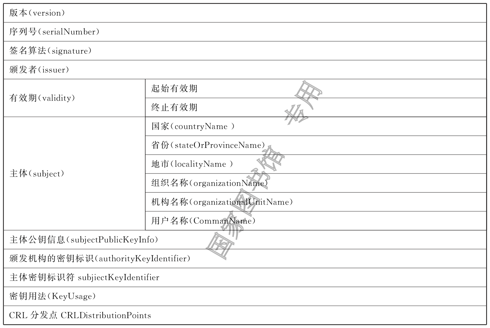
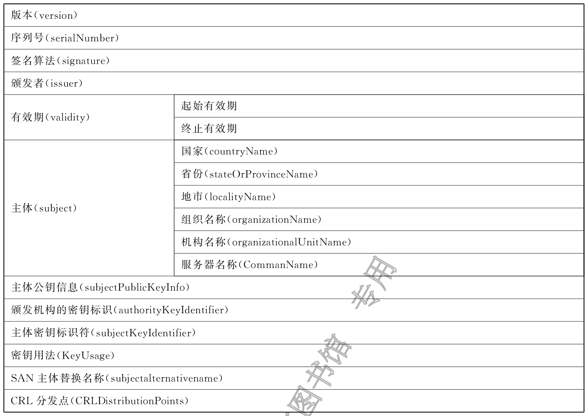

# 数字证书格式

## 1 范围

本文件规定了数字证书和证书撤销列表的基本结构,描述了数字证书和证书撤销列表中的各数据项内容。

本文件适用于数字证书认证系统的研发、数字证书认证机构的运营以及基于数字证书的安全应用。

## 2 规范性引用文件

下列文件中的内容通过文中的规范性引用而构成本文件必不可少的条款。其中,注日期的引用文件,仅该日期对应的版本适用于本文件;不注日期的引用文件,其最新版本(包括所有的修改单)适用于本文件。

GB/T 16262.1 信息技术 抽象语法记法一(ASN.1) 第1部分:基本记法规范

GB/T 16264.8 信息技术 开放系统互连 目录 第8部分:公钥和属性证书框架

GB/T 17969.1 信息技术 开放系统互联 OSI登记机构的操作规程 第1部分:一般规程和国

际对象标识符树的顶级弧

GB/T 25069 信息安全技术 术语

GM/T 0006 密码应用标识规范

GM/T 0009 SM2密码算法使用规范

GM/T 0010 SM2密码算法加密签名消息语法规范

GM/Z 4001 密码术语

## 3 术语和定义

GB/T 25069和GM/Z4001界定的术语和定义适用于本文件。

## 4 缩略语

下列缩略语适用于本文件。

CA:证书认证机构(CertificationAuthority)CRL:证书撤销列表(CertificateRevocationList)DIT:目录信息树系统(DirectoryInformationTree)DNS:域名系统(DomainNameSystem)OID:对象标识符(ObjectID)PKI:公钥基础设施(PublicKeyInfrastructure)URI:统一资源标识符(Uniform ResourceIdentifier)

## 5 数字证书与 CRL

### 5.1 概述

数字证书具有以下特性:

- 数字证书可通过证书认证机构的公钥进行有效性验证;

- 数字证书不可被篡改和伪造。

证书认证机构通过对信息集合的签名来生成用户证书,信息集合包括可甄别的用户名、公钥以及一个可选的包含用户附加信息的唯一性标识符。唯一性标识符可是诸如对象标识符、证书、日期或是说明有关可辨别用户名的有效性的证书的其他形式。具体地说,如果一个用户证书的可辨别名为 $A$,唯一性标识符为 $UA$,并且该证书是由名为 $CA$,其唯一性标识符为 $UCA$ 的认证机构生成的,则用户证书具有下列的形式：$\mathrm{CA}\langle\langle A\rangle\rangle = \mathrm{CA}\{V,SN,AI,CA,UCA,A,UA,Ap,T^{A}\}$。这里 $V$ 为证书版本；$SN$ 为证书序列号；$AI$ 为签发证书使用的算法标识符；$UCA$ 为 $CA$ 的可选的唯一性标识符；$UA$ 为用户 $A$ 的可选的唯一性标识符；$Ap$ 为用户 $A$ 的公钥；$T^{A}$ 表示证书的有效期。

CRL是CA对撤销的证书而签发的一个列表文件,该文件可用于应用系统鉴别用户证书的有效性。

### 5.2 数字证书格式

#### 5.2.1 综述

本文件按照GB/T16262.1的特定编码规则(DER)对下列证书项中的各项信息进行编码,组成特定的证书数据结构。ASN.1DER编码是关于每个元素的标记、长度和值的编码系统。

#### 5.2.2 基本证书域的数据结构

数字证书的基本数据结构如下:

```ASN.1
Certificate ::= SEQUENCE {
tbsCertificate     TBSCertificate,
signatureAlgorithm  AlgorithmIdentifier,
signatureValue  BIT STRING }
TBSCertificate ::= SEQUENCE {
version    [0] EXPLICIT Version DEFAUT v1,
serialNumber    CertificateSerialNumber,
signature      AlgorithmIdentifier,
issuer       Name,
validity       Validity,
subject       Name,
subjectPublicKeyInfo SubjectPublicKeyInfo,
issuerUniqueID [1]IMPLICIT UniqueIdentifier OPTIONAL,
      ———如果出现,version应是v2或者v3
subjectUniqueID [2]IMPLICIT UniqueIdentifier OPTIONAL,
      ———如果出现,version应是v2或者v3
extensions   [3]EXPLICITExtensions OPTIONAL   扩展项
      ———如果出现,version应是v3
}
Version ::= INTEGER { v1(0),v2(1),v3(2) }
CertificateSerialNumber ::= INTEGER
Validity::= SEQUENCE {
notBefore   Time,
notAfter   Time}
Time::= CHOICE {
utcTime    UTCTime,
generalTime  GeneralizedTime}
UniqueIdentifier ::= BIT STRING
SubjectPublicKeyInfo ::= SEQUENCE {
algorithm     AlgorithmIdentifier,
subjectPublicKey  BIT STRING }
Extensions ::= SEQUENCE SIZE (1..MAX)OFExtension
Extension ::= SEQUENCE {
extnID   OBJECT IDENTIFIER,
critical    BOOLEANDEFAULT FALSE,
extnValue OCTET STRING }
```

上述的证书数据结构由tbsCertificate,signatureAlgorithm 和signatureValue三个域构成。这些域的含义如下所述。

- tbsCertificate域包含了主体名称和颁发者名称、主体的公钥、证书的有效期以及其他相关

信息。

- signatureAlgorithm 域包含了证书签发机构签发该证书所使用的密码算法标识符。其ASN.1

结构如下:

```ASN.1
AlgorithmIdentifier ::= SEQUENCE {
  algorithm  OBJECT IDENTIFIER,
  parameters ANYDEFINED BY algorithm  OPTIONAL }
```

其中algorithm 是算法标识符,标识了具体的算法。parameters是可选参数,依赖于所标识的算法。该域中algorithm 标识的算法应与tbsCertificate域中signature标识的签名算法相同。如果签名算法为SM2,则parameters的值为空。

- signatureValue域包含了对tbsCertificate域进行数字签名的结果。采用ASN.1DER编码的

tbsCertificate域作为数字签名的输入,签名的结果按照ASN.1BITSTRING类型编码,并保存在signatureValue 域内。如果签名算法为SM2 密码算法,则签名数据格式应遵循GM/T0009。

#### 5.2.3 TBSCertificate数据结构

##### 5.2.3.1 版本(Version)

本项描述了编码证书的版本号。

##### 5.2.3.2 序列号(Serialnumber)

本项描述了证书序列号,证书序列号是CA 分配给所签发证书的用于唯一标识该数字证书的一个正整数。序列号最大长度为20个八比特字节。

##### 5.2.3.3 签名算法(Signature)

本项包含CA 签发该证书所使用的密码算法的标识符,这个算法标识符应与证书signatureAlgorithm域中项的算法标识符相同。可选参数的内容依赖算法标识符所标识的具体算法。本项可支持用户定义的签名算法。

##### 5.2.3.4 颁发者(Issuer)

本项标识了进行证书签名和证书颁发的实体。它应包含一个非空的甄别名称(DN———distinguishedname)。该项被定义为Name类型,其ASN.1的结构如下。

```ASN.1
Name::= CHOICE {RDNSequence}
RDNSequence::= SEQUENCE OF RelativeDistinguishedName
RelativeDistinguishedName::= SET OFAttributeTypeAndValue
AttributeTypeAndValue::= SEQUENCE {
type AttributeType,
value AttributeValue}
AttributeType::= OBJECT IDENTIFIER
AttributeValue::= ANYDEFINED BY  AttributeType
DirectoryString::= CHOICE {
teletexString      TeletexString(SIZE (1..MAX)),
printableString     PrintableString(SIZE (1..MAX)),
universalString     UniversalString(SIZE (1..MAX)),
utf8String       UTF8String(SIZE (1..MAX)),
bmpString       BMPString(SIZE (1..MAX))}
```

Name是由一些属性及相应的值组成的层次结构,如“国家=C”。其中AttributeValue项的类型是由AttributeType确定的,通常它是一个DirectoryString类型。

DirectoryString类型定义可取值范围包括 PrintableString, TeletexString,BMPString,UTF8String和UniversalString类型。UTF8String是首选的编码类型。

##### 5.2.3.5 有效期(Validity)

###### 5.2.3.5.1 概述

证书有效期是一个时间段,在这个时间段内,CA 担保对证书状态的相关信息进行维护。该项是证书有效期的起始时间(notBefore)和证书有效期的终止时间(notAfter)两个时间值的序列(SEQUENCE)。NotBefore和notAfter这两个时间都可作为UTCTime类型或者GeneralizedTime类型进行编码。

###### 5.2.3.5.2 编码类型要求

在2049年之前(包括2049年)颁发的证书,时间值应采用UTCTime类型编码,在2050年之后颁发的证书,时间值应采用GeneralizedTime类型编码。

###### 5.2.3.5.3 世界时间(UTCTime)

本项是为国际应用设立的一个标准ASN.1类型,在这里只有本地时间是不够的。UTCTime包含Z(用于Zulu,或格林威治标准时间)或时间差。

在本文件中,UTCTime值应使用格林威治标准时间(Zulu)表示,其年份使用最低两位,并且应包含秒,即时间格式为YYMMDDHHMMSSZ。系统对年字段(YY)应作如下解释:

当YY 大于或等于50,年字段应解释为19YY;当YY 小于50,年应解释为20YY。

###### 5.2.3.5.4 通用时间类型(GeneralizedTime)

本项是一个标准ASN.1类型,表示时间的可变精确度。GeneralizedTime字段能包含一个本地和格林威治标准时间之间的时间差。

本文件中,GeneralizedTime 值应使用格林威治标准时间表示,且应包含秒,即时间格式为YYYYMMDDHHMMSSZ。GeneralizedTime值中秒的取值为整数。

##### 5.2.3.6 主体(Subject)

本项描述了与主体公钥信息项中的公钥相对应的实体。本项可出现在主体项和/或主体可选替换名称扩展项中。如果主体是一个CA,那么主体项应是一个非空的与颁发者项的内容相匹配的甄别名称。如果主体的命名信息只出现在主体替换名称扩展项中,那么主体名称应是一个空序列,且主体替换名称扩展项应被标记为关键的。

当主体项非空时,这个项应包含一个甄别名称。一个CA 认证的每个主体实体的甄别名称应是唯一的。一个CA 可为同一个主体实体以相同的甄别名称签发多个证书。

主体项结构定义应符合GB/T16264.8中对名字类型的要求。

##### 5.2.3.7 主体公钥信息(SubjectPublicKeyInfo)

本项包含证书公钥和相应的公钥算法。公钥算法使用算法标识符AlgorithmIdentifier结构表示。

当公钥算法为SM2 时,AlgorithmIdentifier结构定义应遵循GM/T0010;当公钥算法为RSA时,AlgorithmIdentifier结构定义见RFC8017。

##### 5.2.3.8 颁发者唯一标识符(issuerUniqueID)

本项用来处理颁发者名称的重用问题。对于不同的颁发者,颁发者唯一标识符不同。在v1版本中,符合本文件的CA 在颁发证书时,证书中应不包含本项,但应用在解析证书过程中,若存在包含本扩展项的证书,应能正确解析该项的值。

##### 5.2.3.9 主体唯一标识符(subjectUniqueID)

本项用来处理主体名称的重用问题。对于不同的主体,主体唯一标识符不同。在v1版本中,符合本文件的CA 在颁发证书时,证书中应不包含本项,但应用在解析证书过程中,若存在包含本扩展项的证书,应能正确解析该项的值。

##### 5.2.3.10 扩展项(extensions)

本项是一个或多个证书扩展的序列(SEQUENCE),其内容和数据结构见5.2.4。

#### 5.2.4 证书扩展域及其数据结构

##### 5.2.4.1 证书扩展

证书的扩展包括标准扩展项和专用扩展项。扩展由三部分组成,分别是扩展类型、扩展关键度和扩展项值。扩展关键度可定义成关键的或非关键的,表明一个证书的使用者是否可忽略该扩展项。证书的应用系统如果不能识别关键的扩展时,应拒绝接受该证书,如果不能识别非关键的扩展,则可忽略该扩展项的信息。

本条定义一些标准的扩展项。应特别注意的是,在实际应用过程中,如果采用了关键的扩展,可能导致在一些通用的应用中无法使用该证书。

每个扩展项包括一个对象标识符OID 和一个ASN.1结构。当证书中出现一个扩展时,OID作为extnID项出现,其对应的ASN.1编码结构就是八比特字符串extnValue的值。一个证书中特定的扩展应只出现一次。一个扩展中包含一个布尔型的值用来表示该扩展的关键性,其缺省值为FALSE,即非关键的。

CA应支持颁发机构密钥标识符、主体密钥标识符、基本限制、密钥用法和证书策略扩展,其他的扩展是可选的。如果CA 签发的证书中的主体项为空序列,该CA 就应支持主体可替换名称扩展。CA 也可支持本文件定义之外的其他的扩展,但如果这些扩展被定义为关键的,则可能会给互操作性带来障碍。

应用应至少能识别下列扩展:密钥用法、证书策略、主体替换名称、基本限制、名称限制、策略限制和扩展的密钥用途。另外,宜支持颁发机构密钥标识符、主体密钥标识符以及策略映射扩展。

##### 5.2.4.2 标准扩展

###### 5.2.4.2.1 综述

本条定义数字证书的标准证书扩展,其中,扩展5.2.4.2.2到扩展5.2.4.2.17共16个扩展中定义的OID应遵循GB/T16264.8。这些OID都是id-ce的成员,其定义如下:

```ASN.1
id-ce  OBJECT IDENTIFIER ::= {joint-iso-ccitt(2)ds(5)29}
```

扩展5.2.4.2.18到扩展5.2.4.2.23共6个扩展定义的OID应遵循GM/T0006。

###### 5.2.4.2.2 颁发机构密钥标识符(authorityKeyIdentifier)

本项提供了一种方式,以识别与证书签名私钥相应的公钥。当颁发者由于有多个密钥共存或由于发生变化而具有多个签名密钥时使用该扩展。颁发机构密钥标识符可基于CA 证书中的主体密钥标识符或基于颁发者的名称和序列号。

CA产生的所有证书应包括颁发机构密钥标识符扩展的keyIdentifier项,以便于证书链的建立。CA以“自签”(self-signed)证书形式发放其公钥时,可省略认证机构密钥标识符。此时,主体和认证机构密钥标识符是完全相同的。

本项既可用作证书扩展亦可用作CRL 扩展。本项标识用来验证在证书或CRL 上签名的公开密钥。它能辨别同一CA 使用的不同密钥(例如,在密钥更新发生时)。本项定义如下:

```ASN.1
id-ce-authorityKeyIdentifierOBJECT IDENTIFIER ::= {id-ce35}
AuthorityKeyIdentifier::= SEQUENCE {
keyIdentifier        [0]KeyIdentifier       OPTIONAL,
authorityCertIssuer     [1]GeneralNames     OPTIONAL,
authorityCertSerialNumber [2]CertificateSerialNumber  OPTIONAL }
(WITH COMPONENTS {…,authorityCertIssuer PRESENT,authorityCertSerialNumber
PRESENT}│
WITH COMPONENTS {…,authorityCertIssuerABSENT,authorityCertSerialNumberAB-
SENT})
KeyIdentifier::= OCTET STRING。
```

KeyIdentifier项的值应从用于证实证书签名的公钥导出或用产生唯一值的方法导出。公开密钥的密钥标识符KeyIdentifier可采用下述两种通用的方法之一生成。

1. keyIdentifier由BITSTRINGsubjectPublicKey值(不包括标签、长度和未使用的比特个数的
编码)的SM3杂凑值中最低位的160比特组成。

1. keyIdentifier由0100加上后跟的BITSTRINGsubjectPublicKey值(不包括标签、长度和未
使用的比特个数的编码)的SM3杂凑值中最低位的60比特组成。

此密钥可通过keyIdentifier字段中的密钥标识符来标识,也可通过此密钥的证书标识(使用authorityCertIssur字段中的证书颁发者或authorityCertSerialNumber字段中的证书序列号)来标识,或者可通过密钥标识符和此密钥的证书标识来标识。如果使用两种标识形式,证书或CRL的颁发者应保证它们是一致的。对于颁发机构的包含扩展的证书或CRL的所有密钥标识符而言,每个密钥标识符应是唯一的。支持此扩展的实现不必处理authorityCertIssuer字段中的所有名字形式。

证书认证机构指定或者自动产生证书序列号,这样颁发者和证书序列号相结合就唯一地标识了一份证书。

除自签证书之外,所有的证书应包含本扩展,而且要包含keyIdentifier项。如果证书的颁发者的证书有主体密钥标识符扩展,则本扩展中keyIdentifier项应与颁发者的证书中SubjectKeyIdetifier扩展的值一致,如果证书的颁发者的证书没有主体密钥标识符扩展,则可使用文中介绍的两种方法之一来产生。

本扩展应是非关键的。

###### 5.2.4.2.3 主体密钥标识符(subjectKeyIdentifier)

本项提供一种识别包含有一个特定公钥的方法。此扩展标识了被认证的公开密钥。它能区分同一主体使用的不同密钥。此项定义如下:

```ASN.1
id-ce-subjectKeyIdentifierOBJECT IDENTIFIER ::= {id-ce14}
SubjectKeyIdentifier::=KeyIdentifier
```

对于使用密钥标识符的主体的各个密钥而言,每一个密钥标识符均应是唯一的。此扩展项总是非关键的。

所有的CA 证书应包括本扩展;而且CA 签发证书时应把CA 证书中本扩展的值赋给终端实体证书颁发者密钥标识符扩展中的KeyIdentifier项。CA 证书的主体密钥标识符应从公钥或生成唯一值的方法中导出。终端实体证书的主体密钥标识符应从公钥中导出。从公钥中生成密钥标识符,应使用5.2.4.2.2中的两种通用方法之一。

###### 5.2.4.2.4 密钥用法(keyUsage)

本项指示已认证的公开密钥用于何种用途,该项定义如下:

```ASN.1
id-ce-keyUsageOBJECT IDENTIFIER ::= {id-ce15}
KeyUsage::=BIT STRING{
digitalSignature       (0),
nonRepudiation        (1),
keyEncipherment       (2),
dataEncipherment       (3),
keyAgreement         (4),
keyCertSign         (5),
cRLSign           (6),
encipherOnly         (7),
decipherOnly         (8)}
```

KeyUsage类型中的用法如下:

1. digitalSignature:验证下列b)、f)或g)所标识的用途之外的数字签名;
1. nonRepudiation:验证用来提供抗抵赖服务的数字签名,这种服务防止签名实体不实地拒绝某
种行为(不包括如f)或g)中的证书或CRL签名);

1. keyEncipherment:加密密钥或其他安全信息,例如用于密钥传输;
1. dataEncipherment:加密用户数据,但不包括上面c)中的密钥或其他安全信息;
1. keyAgreement:用作公开密钥协商密钥;
1. keyCertSign:验证证书的CA签名;
1. cRLSign:验证CRL的CA签名;
1. encipherOnly:当本位与已设置的keyAgreement位一起使用时,公开密钥协商密钥仅用于加
密数据(本位与已设置的其他密钥用法位一起使用的含义未定义);

1. decipherOnly:当本位与已设置的keyAgreement位一起使用时,公开密钥协商密钥仅用于解
密数据(本位与已设置的其他密钥用法位一起使用的含义未定义)。

keyCertSign只用于CA证书。如果KeyUsage被置为keyCertSign和基本限制扩展存在于同一证书之中,那么,basicConstraints扩展的cA 字段的值应被置为TRUE。CA 还可使用keyUsag扩展中定义的其他密钥用法位,例如,提供鉴别和在线管理事务完整性的digitalSignature。

若未设置keyAgreement位,则不定义encipherOnly位的含义。若设置encipherOnly位,且keyAgreement位也被设置时,主体公钥可只用于加密数据,同时执行密钥协议。

若未设置keyAgreement位,则不定义decipherOnly位的含义。若设置decipherOnly位,且keyAgreement位也被设置时,主体公钥可只用于脱密数据,同时执行密钥协议。

所有的CA 证书应包括本扩展,而且应包含keyCertSign这一用法。此扩展可定义为关键的或非关键的,由证书签发者选择。

如果此扩展标记为关键的,那么该证书应只用于相应密钥用法位置为“1”的用途。

如果此扩展标记为非关键的,那么它指明此密钥的预期的用途或多种用途,并可用于查找具有多密钥/证书的实体的正确密钥/证书。它是一个建议项,并不意指此密钥的用法限于指定的用途。置为“0”的位指明此密钥不是预期的这一用途。如果所有位均为“0”,它指明此密钥预期用于所列用途之外的某种用途。

在应用中,使用该扩展项对证书类型进行区别,当设置了c)、d)、e)位中的一位时,表示该证书为加密证书;当设置了a)、b)位中的一位时,表示该证书为签名证书。

###### 5.2.4.2.5 扩展密钥用途(extKeyUsage)

本项指明已验证的公开密钥可用于一种用途或多种用途,它们可作为对密钥用法扩展项中指明的基本用途的补充或替代。此项定义如下:

id-ce-extKeyUsage OBJECTIDENTIFIER ::{id-ce37}

```ASN.1
ExtKeyUsageSyntax ::=SEQUENCE SIZE (1‥MAX)OFKeyPurposeId
KeyPurposeId::=OBJECT IDENTIFIER
```

密钥的用途可由有此需要的任何组织定义。用来标识密钥用途的客体标识符应按照GB/T17969.1要求来分配。

由证书签发者确定此扩展是关键的或非关键的。

如果此扩展标记为关键的,那么,此证书应只用于所指示的用途之一。

如果此扩展标记为非关键的,那么,它指明此密钥的预期用途或一些用途,并可用于查找多密钥/证书的实体的正确密钥/证书。它是一个建议项,并不表示认证机构将此密钥的用法限于所指示的用途。然而,进行应用的证书应指明特定的用途,以便证书为此应用接受。

如果证书包含关键的密钥用途项和关键的扩展密钥项,那么,两个项应独立地处理,并且证书应只用于与两个项一致的用途。如果没有与两个项一致的用途,那么,此证书不能用于任何用途。

本文件定义下列密钥用途:

```ASN.1
id-kp OBJECT IDENTIFIER ::= {id-pkix3}
id-kp-serverAuth OBJECT IDENTIFIER ::= {id-kp1}
```

- TLS Webserver鉴别

- Keyusage可设置为digitalSignature,keyEncipherment或keyAgreement

```ASN.1
id-kp-clientAuth OBJECT IDENTIFIER ::= {id-kp2}
```

- TLS Webserver鉴别

- Keyusage可设置为digitalSignature和/或keyAgreement

```ASN.1
id-kp-codeSigning OBJECT IDENTIFIER ::= {id-kp3}
```

- 可下载执行代码的签名

- Keyusage可设置为digitalSignature

```ASN.1
id-kp-emailProtection OBJECT IDENTIFIER ::= {id-kp4}
```

- E-mail保护

- Keyusage可设置为digitalSignature,nonRepudiation和/或(keyEncipherment或keyAgree-

ment)

```ASN.1
id-kp-timeStamping OBJECT IDENTIFIER ::= {id-kp8}
```

- 将对象的Hash与同一时间源提供的时间绑定

- Keyusage可设置为digitalSignature,nonRepudiation

```ASN.1
id-kp-OCSPSigningOBJECT IDENTIFIER ::= {id-kp9}
```

- OCSP 应答签名

- Keyusage可设置为digitalSignature,nonRepudiation

###### 5.2.4.2.6 私有密钥使用期(privateKeyUsagePeriod)

本项指明与已验证的公开密钥相对应的私有密钥的使用期限。它仅用于数字签名密钥。此项定义如下:

```ASN.1
id-ce-privateKeyUsagePeriodOBJECT IDENTIFIER::={id-ce16}
PrivateKeyUsagePeriod::=SEQUENCE{
notBefore   [0]   GeneralizedTime OPTIONAL,
notAfter    [1]   GeneralizedTime OPTIONAL}
```

notBefore字段指明私有密钥可能用于签名的最早时间。如果没有notBefere字段,那么不提供有关私有密钥有效使用期何时开始的信息。notAfter字段指明私有密钥可用于签名的最迟时间。如果没有notAfter字段,那么,不提供有关私有密钥有效使用期何时结束的信息。

这个扩展应标记为非关键。

注1:私有密钥有效使用期可与证书有效性周期指明的已验证的公开密钥有效性不同。就数字签名密钥而言,签名的私有密钥使用期一般比验证公开密钥的时间短。

注2:数字签名的验证者想要检查直到验证时刻此密钥是否未被撤销,则在验证时,对公开密钥的有效证方需存

在。在公开密钥的证书期满之后,签名验证者不能依赖CRL所通知的协议。

###### 5.2.4.2.7 证书策略(certificatePolicies)

本项列出了由颁发的CA 所认可的证书策略,这些策略适用于证书以及关于这些证书策略的任选的限定符信息。

证书策略扩展包含了一系列策略信息条目,每个条目都由一个OID 和一个可选的限定条件组成。这个可选的限定条件不应改变策略的定义。

在用户证书中,这些策略信息条目描述了证书发放所依据的策略以及证书的应用目的;在CA 证书中,这些策略条目指定了包含这个证书的验证路径的策略集合。具有特定策略需求的应用系统应拥有它们将接受的策略的列表,并把证书中的策略OID 与该列表进行比较。如果该扩展是关键的,则应能解释该扩展(包括选择性限定语),否则应拒绝该证书。如果CA 不希望限制该证书的证书路径上的策略集合,可使用一个特别的anyPolicy策略。

为了提高互操作性,本文件策略信息条目中宜只包含一个OID,如果一个OID 不够,宜使用本条定义的限定语。

```ASN.1
id-ce-certificatePoliciesOBJECT IDENTIFIER ::= {id-ce32}
CertificatePolicies::=SEQUENCE SIZE (1..MAX)OFPolicyInformation
PolicyInformation::=SEQUENCE{
policyIdentifier   CertPolicyId,
policyQualifiers  SEQUENCE SIZE (1..MAX)OF
          PolicyQualifierInfo OPTIONAL}
CertPolicyId::=OBJECT IDENTIFIER PolicyQualifierInfo::=SEQUENCE{
policyQualifierId PolicyQualifierId,
qualifier     ANYDEFINED BY policyQualifierId}
```

- policyQualifierIdsforInternetpolicyqualifiers

```ASN.1
id-qt     OBJECT IDENTIFIER ::= {id-pkix2}
id-qt-cps   OBJECT IDENTIFIER ::= {id-qt1}
id-qt-unotice OBJECT IDENTIFIER ::= {id-qt2}
PolicyQualifierId::=OBJECT IDENTIFIER (id-qt-cps❘id-qt-unotice)
Qualifier::= CHOICE {
cPSuri    CPSuri,
userNotice  UserNotice}
CPSuri::=IA5String
UserNotice::=SEQUENCE {
noticeRef   NoticeReference OPTIONAL,
explicitText  DisplayText OPTIONAL }
NoticeReference::= SEQUENCE {
organization  DisplayText,
noticeNumbers SEQUENCE OF INTEGER }
DisplayText::= CHOICE {
visibleString  VisibleString (SIZE (1‥200)),
bmpString  BMPString  (SIZE (1‥200)),
utf8String   UTF8String (SIZE (1‥200))}
```

本项定义了两种策略限定语:CPSPointer和UserNotice限定语,以供证书策略制定者和证书签发者使用。

CPSPointer限定语包含一个CA发布的CPS(CertificationPracticeStatement),指示字的形式为URI。

UserNotice有两种可选字段:noticeRef字段和explicitText字段。noticeRef字段命名一个组织,并通过记数识别该组织所做的一个专用文本声明。explicitText字段在证书内直接包括文本声明,该字段是一个最多含有200个字符的文本。如果noticeRef和explicitText选项都在同一个限定语中,且如果应用软件可找出由noticeRef 选项指明的通知文本,则应展示该文本,否则应展示explicitText的值。

###### 5.2.4.2.8 策略映射(policyMappings)

本扩展仅用于CA 证书。它列出一个或多个OID 对,每对包括一个issuerDomainPolicy和一个subjectDomainPolicy。这种成对形式表明,发行方CA认为其issuerDomainPolicy与主体CA的subjectDomainPolicy是等效的。发行方CA的用户可为某应用接收一个issuerDomainPolicy。策略映射告知发行方CA 的用户,哪些同CA 有关的策略可与他们接收到的策略是等效的。此项定义如下:

```ASN.1
id-ce-policyMappingsOBJECT IDENTIFIER ::= {id-ce33}
PolicyMappingsSyntax::=SEQUENCE SIZE(1..MAX)OFSEQUENCE{
issuerDomainPolicy   CertPolicyId,
subjectDomainPolicy  CertPolicyId}
```

策略不会被映射到或来自特殊的值anyPolicy。

该扩展可由CA 和/或应用支持。证书签发者宜将该扩展选择为关键的,否则一个证书用户就不能正确解释发布的CA 设定的规则。

###### 5.2.4.2.9 主体替换名称(subjectAltName)

本项包含一个或多个可选替换名供实体使用,CA 把该实体与认证的公开密钥绑定在一起。

主体替换名称扩展允许把附加身份加到证书的主体上。所定义的选项包括因特网电子邮件地址、DNS名称、IP地址和统一资源标识符(URI)。还有一些纯本地定义的选项,可包括多名称形式和每个名称形式的多个范例。当这样的身份被附加到一个证书中时,应使用主体选择名称或颁发者选择名称扩展。由于主体可选替换名被认为是与公钥绑在一起的,主体可选替换名的所有部分应由CA 认证。此项定义如下:

```ASN.1
id-ce-subjectAltName OBJECT IDENTIFIER ::= {id-ce17}
SubjectAltName::= GeneralNames
GeneralNames::=SEQUENCE SIZE(1..MAX)OFGeneralName
GeneralName::=CHOICE{
otherName         [0]    OtherName,
rfc822Name   [1]   IA5String,
dNSName   [2]   IA5String,
x400Address   [3]   ORAddress,
directoryName   [4]   Name,
ediPartyName   [5]   EDIPartyName,
uniformResourceIdentifier  [6]   IA5String,
iPAddress   [7]   OCTET STRING,
registeredID   [8]   OBJECT IDENTIFIER}
OtherName::=SEQUENCE {
type-id  OBJECT IDENTIFIER,
value   [0]EXPLICIT ANYDEFINED BY type-id}
EDIPartyName::=SEQUENCE{
nameAssigner        [0]  DirectoryString  OPTIONAL,
partyName    [1]  DirectoryString }
```

GeneralName类型中可替换的值是下列各种形式的名称:

- otherName是按照OTHER-NAME信息客体类别实例定义的任一种形式的名称;

- rfc822Name是Internet电子邮件地址;

- dNSName是Internet域名;

- x400Address是O/R地址;

- directoryName是目录名称;

- ediPartyName是通信的电子数据交换双方之间商定的形式名称;nameAssigner成分标

识了分配partyName中唯一名称值的机构;

- uniformResourceIdentifier是用于WWW的UniformRAesourceIdentifier,RFC1738中

定义的URL语法和编码规则;

- iPAddress是用二进制串表示的InternetProtocol地址;

- registeredID是对注册的客体分配的标识符。

CA不应签发带有subjectAltNames却包含空GeneralName项的证书。如果证书中的唯一主体身份是一个替换名称格式(如一个电子邮件地址),则主体的甄别名应是一个空序列,且主体替换名称扩展应存在,且应标识为关键的。如果出现主体替换名称扩展,则序列应至少包含一个条目。

对GeneralName类型中使用的每个名称形式,应有一个名称注册系统,以保证所使用的任何名称能向证书颁发者和证书使用者无歧义地标识一个主体。

此扩展可是关键的或非关键的,由证书签发者选择。不要求支持此扩展的实现能处理所有名称形式。如果此扩展标记为关键的,至少应能识别和处理存在的名称形式之一,否则,应认为此证书无效。除先前的限制以外,允许证书使用系统忽略具有不能识别的或不被支持的名称形式的任何名称。倘若证书的主体项包含了无歧义标识主体的目录名称,此项标记宜为非关键的。如果存在此扩展并标记为关键的,证书的subject项可包含空名称,在此情况下,主体只能用此扩展中的名称或一些扩展名称来标识。

###### 5.2.4.2.10 颁发者替换名称(issuerAltName)

此项包含一个或多个替换名称(可使用多种名称形式中的任一个),以供证书或CRL 颁发者使用。此项定义如下:

```ASN.1
id-ce-issuerAltNameOBJECT IDENTIFIER ::= {id-ce18}
IssuerAltName::= GeneralNames
```

此项可是关键的或非关键的,由证书或CRL颁发者选择。如果此扩展标记为关键的,那么至少应能识别和处理存在的名称形式之一,否则,应认为此证书无效。另外,应忽略不能识别的名称或不能被支持的名称格式。倘若证书或CRL的颁发者项包含了一个明确标识颁发机构的目录名称,此项标记宜为非关键的。

如果存在此扩展,并标记为关键的,证书或CRL的issuer项可包含空名称(例如,对应可甄别名的一个“0”序列),在此情况下,颁发者只能用名称或此扩展中的一些名称来标识。

###### 5.2.4.2.11 主体目录属性(subjectDirectoryAttributes)

本项为证书主体传送其期望的任何目录属性值。此项定义如下:

```ASN.1
id-ce-subjectDirectoryAttributesOBJECT IDENTIFIER ::= {id-ce9}
SubjectDirectoryAttributes::= SEQUENCE SIZE (1‥MAX )OFAttribute
AttributesSyntax::=SEQUENCE SIZE (1..MAX)OFAttribute
```

该扩展总标记为非关键的。

###### 5.2.4.2.12 基本限制(basicConstraints)

本扩展项用来标识证书的主体是否是一个CA,通过该CA 可能存在的认证路径有多长。此项定义如下:

```ASN.1
id-ce-basicConstraintsOBJECT IDENTIFIER ::={id-ce19}
BasicConstraintsSyntax::=SEQUENCE{
cA          BOOLEANDEFAULT FALSE,
pathLenConstraint  INTEGER (0..MAX) OPTIONAL}
```

CA字段标识此公钥证书是否可用来验证证书签名。

pathLenConstraint字段仅在cA设置为TRUE时才有意义。它给出此证书之后认证路径中最多的CA 证书数目。0值表明在路径中只应签发终端实体证书。pathLenConstraint字段出现时应大于或等于0。如果在认证路径的任何证书中未出现pathLenConstraint字段,则对认证路径的允许长度没有限制。

CA证书中应包括本扩展,而且应标记为关键的。

如果此扩展存在,并标记为关键的,那么:

- 如果cA 字段的值置为FALSE,则密钥用法不能包含keyCertSign这一用法,其公开密钥不能

用来验证证书签名;

- 如果cA 字段的值置为TRUE,并且pathLenConstraint存在,则证书使用系统应检查被处理

的认证路径是否与pathLenConstraint的值一致。

注:为限制一证书主体只是一个终端实体,颁发者在扩展中只包含一个空SEQUENCE值的扩展项。

###### 5.2.4.2.13 名称限制(nameConstraints)

本项应只用于CA 证书,它指示了一个名称空间,在此空间设置了认证路径中后续证书中的所有主体名称。此项定义如下:

```ASN.1
id-ce-nameConstraintsOBJECT IDENTIFIER::={id-ce30}
NameConstraintsSyntax::=SEQUENCE{
permittedSubtrees     [0]    GeneralSubtrees OPTIONAL,
excludedSubtrees  [1]  GeneralSubtrees OPTIONAL}
GeneralSubtrees::=SEQUENCE SIZE (1..MAX)OFGeneralSubtree
GeneralSubtree::=SEQUENCE{
base       GeneralName,
minimum      [0]    BaseDistanceDEFAULT0,
maximum  [1]   BaseDistance OPTIONAL}
BaseDistance::=INTEGER(0..MAX)
```

如果存在permittedSubtrees和excludedSubtrees字段,则它们每个都规定一个或多个命名子树,每个由此子树的根的名称或以任选处于其子树内的任意节点名称来定义,子树范围是一个由上界和/或下界限定的区域。如果permittedSubtrees存在,在主体CA 和认证路径中下级CA 颁发的所有证书中,只有那些在子树中具有与permittedSubtrees字段规定主体名称相同的证书才是可接受的。如果excludedSubtrees存在,在主体CA或认证路径中后继的CA颁发的所有证书中,同excludedSubtrees规定主体名称相同的任何证书都是不可接受的。如果permittedSutrees和excludedSubtrees都存在并且名称空间重叠,则优先选用排斥声明excludedSubtrees。

通过GeneralName字段定义的命名格式,应将那些具有良好定义的分层结构的名称形式用于这些字段,DirectoryName名称形式满足这种要求;使用这些命名格式命名的子树对应于DIT 子树。在应用中不应检查和识别所有可能的命名格式。如果此扩展标记为关键项,并且证书使用中不能识别用于base项的命名格式,应视同遇到未识别的关键项扩展那样来处理此证书。如果此扩展标记为非关键的,并且证书使用中不能识别用于base项的命名格式,那么,可忽略此子树规范。当证书主体具有同一名称形式的多个名称时(在directory Name 名称形式情况下,包括证书主体项中的名称,如果非“0”),那么,应检验所有这些名称。

可对主体名称或主体替换名称进行限制。只有当确定的名称格式出现时才应用限制。如果证书中没有类型的名称,则证书是可接受的。当对于命名格式限制的一致性测试证书主体名称时,即使扩展中标识为非关键项也应予以处理。

minimum字段规定了子树内这一区域的上边界。最后的命名形式在规定的级别之上的所有名称不包含在此区域内。等于“0”的minimum 值对应于此基部,即子树的顶节点。例如,如果minimum 置为“1”,则命名子树不包含根节点而只包含下级节点。

maximun字段规定了子树内这一区域的下边界。最后的命名形式在规定的级别之下所有名称不包含在此区域内。最大值“0”对应于此基部,即子树的顶。不存在的maximun字段指出不应把下限值施加到子树内的此区域上。例如,如果maximun置为“1”,那么,命名子树不包含除子树根节点及其直接下级外的所有节点。

此扩展宜标记为关键项,否则,证书用户不能检验认证路径中的后续证书是否位于签发CA 指定的命名域中。

如果此扩展存在,并标记为关键的,则证书用户系统应检验所处理的认证路径与此扩展中的值是否一致。

本文件中,任何名称格式都不使用最小和最大字段,最小数总为0,最大数总是空缺的。

###### 5.2.4.2.14 策略限制(policyConstraints)

策略限制扩展用于向CA 颁发的证书中。本扩展以两种方式限制路径确认。它可用来禁止策略映射或要求路径中的每个证书包含一个认可的策略标示符。本项定义如下:

```ASN.1
id-ce-policyConstraintsOBJECT IDENTIFIER ::={id-ce36}
PolicyConstraints::=SEQUENCE{
requireExplicitPolicy       [0]SkipCerts OPTIONAL,
inhibitPolicyMapping  [1]SkipCerts OPTIONAL}
SkipCerts::=INTEGER(0..MAX)
```

如果requireExplicitPolicy字段存在,并且证书路径包含一个由指定CA(包含此扩展信息的CA 或是认证路径中后续CA)签发的证书,所有在此路径中的证书都应在证书扩展项中包含合适的策略标识符。合适的策略标识符是由用户在证书策略中定义的标识符,或声明通过策略映射与其等价的策略的标识符。

如果inhibitPolicyMapping字段存在,它表明在认证路径中从所指定CA(包含此扩展信息的CA或是认证路径中后续CA)开始直到认证路径结束为止的所有证书中,不准许策略映射。

SkipCerts类型的值表示在某个限制成为有效之前,应在认证路径中跳过的证书的个数。

此扩展由证书签发者选择是关键的还是非关键的。证书签发者宜标记为关键的。

###### 5.2.4.2.15 证书撤销列表分发点(CRLDistributionPoints)

证书撤销列表分发点扩展用来标识如何获得CRL信息,本扩展仅作为证书扩展使用。它可用于认证机构证书,终端实体公钥证书中。本项指定了CRL分发点或证书用户的查阅点以确定证书是否已被撤销。证书用户能从可用分发点获得一个CRL,或者它可从认证机构目录项获得当前完整的CRL。

该项定义如下:

```ASN.1
id-ce-CRLDistributionPointsOBJECT IDENTIFIER ::={id-ce31}
cRLDistributionPoits::={CRLDistPointsSyntax}
CRLDistPointsSyntax::=SEQUENCE SIZE (1..MAX)OFDistributionPoint
DistributionPoint::=SEQUENCE{
distributionPoint         [0]   DistributionPointName OPTIONAL,
reasons  [1]  ReasonFlags OPTIONAL,
cRLIssuer  [2]  GeneralNames OPTIONAL}
DistributionPointName::=CHOICE{
fullName  [0]  GeneralNames,
nameRelativeToCRLIssuer  [1]  RelativeDistinguishedName}
ReasonFlags::=BIT STRING{
unused  (0),
keyCompromise    (1),
CACompromise    (2),
affiliationChanged    (3),
superseded    (4),
cessationOfOperation    (5),
certificateHold    (6)}
```

distributionPoint字段标识如何能获得CRL的位置。如果此字段缺省,分发点名称默认为CRL颁发者的名称。

当使用fullName或应用默认时,分发点名称可有多种名称形式。同一名称应存在于颁发CRL 的分发点扩展的distrubutionPoint字段中。证书使用系统可只处理分发点提供的诸多名称形式中的一种。如果不能处理某一分发点的任何名称形式,但能从另一个信任源得到必要的撤销信息,例如,另一个分发点或CA 目录项,则证书应用系统仍能使用该证书。

如果CRL 分发点被赋与一个属于CRL 颁发者的目录名称的目录名,则应只使用nameRelativeToCRLIssuer字段。此时,nameRelativeToCRLIssuer字段是以CRL颁发者目录名称相对的可甄别名。

reasons字段指明由此CRL所包含的撤销原因。如果没有reasons字段,相应的CRL分发点发布应只包含此证书项的CRL,而不包含撤销原因。否则,reasons值指明相应的CRL 分发点所包含的那些撤销原因。

cRLIssuer字段标识颁发和签署CRL的机构。如果没有此字段,CRL颁发者的名称默认为证书签发者的名称。

此扩展可是关键的或非关键的,由证书颁发者选择,该扩展宜设置为非关键的,但CA 和应用应支持该扩展。

如果该扩展标记为关键,CA 则要保证分发点包含所用的撤销原因代码keyCompromise和/或cACompromise。若没有首先从一个包含了原因代码keyCompromise(对终端实体证书)或cACompromise(对CA证书)的指定的分发点检索和核对CRL,证书使用系统应不使用该证书。在分发点条目为所有撤销原因代码和由CA(包括作为关键扩展的cRLDistributionPoint)发布的CRL 信息的项中,CA 不应在CA 条目发布一个完整的CRL。

如果此扩展标记为非关键的,当证书使用系统未能识别此扩展项类型时,则只有在下列情况中,该系统使用此证书:

- 它能从CA 获得一份完整CRL 并检查它(通过在CRL 中设有发布点扩展项来指示最近的

CRL是完整的);

- 根据本地策略不要求撤销检查;

- 用其他手段完成撤销检查。

注:证书撤销列表CRL的应用,见RFC5280。

###### 5.2.4.2.16 限制所有策略(inhibitAnyPolicy)

本扩展指定了一个限制,它指出了对于从指定CA(包含这个扩展的证书的主体CA,或是认证路径中后继认证机构CA)开始的认证路径中的所有证书的证书策略与anyPolicy都是不匹配的。

```ASN.1
id-ce-inhibitAnyPolicyOBJECT IDENTIFIER ::={id-ce54}
InhibitAnyPolicy::=SkipCerts
SkipCerts::=INTEGER(0..MAX)
```

本扩展由证书颁发者选择关键项还是非关键项。宜标记为关键项,否则证书用户可能不能正确地解释认证机构CA 设定的规则。

###### 5.2.4.2.17 最新证书撤销列表(freshestCRL)

最新证书撤销列表扩展用于标识如何获取增量证书撤销列表。

```ASN.1
id-ce-CRLfreshestCRLOBJECT IDENTIFIER ::={id-ce46}
reshestCRL::={CRLDistPointsSyntax}
```

根据证书颁发者的选择,这个扩展可是关键的,也可是非关键的。如果最新的CRL 扩展是关键的,那么证书使用者在使用证书之前,应首先使用最新CRL 来验证该证书。如果freshestCRL 被标记为不关键的,证书使用者可使用本地方法来决定是否检查最新的CRL。

###### 5.2.4.2.18 个人身份标识码(identifyCode)

个人身份证号码用于表示个人身份证件的号码,其定义如下:

```ASN.1
id-IdentifyCodeOBJECT IDENTIFIER ::={1.2.156.10260.4.1.1.1}
residenterCardNumber::= PrintableString
```

residenterCardNumber  ——— 身份证号码此扩展项标记为非关键的。

```ASN.1
id-IdentifyCodeOBJECT IDENTIFIER ::={1.2.156.10260.4.1.1.2}
passportNumber::= UTF8String
```

passportNumber ——— 护照号码此扩展项标记为非关键的。

###### 5.2.4.2.19 个人社会保险号(insuranceNumber)

个人社会保险号扩展项用于表示个人社会保险号码,其定义如下:

```ASN.1
ID-InsuranceNumberOBJECT IDENTIFIER ::={1.2.156.10260.4.1.2}
InsuranceNumber::= PrintableString
```

此扩展项标记为非关键的。

###### 5.2.4.2.20 企业工商注册号(iCRegistrationNumber)

企业工商注册号扩展项用于表示企业工商注册号码,其定义如下:

```ASN.1
ID-ICRegistrationNumberOBJECT IDENTIFIER ::={1.2.156.10260.4.1.3}
ICRegistrationNumber::= PrintableString
```

此扩展项标记为非关键的。

###### 5.2.4.2.21 企业组织机构代码(organizationCode)

企业组织机构代码号扩展项用于表示企业组织机构代码,其定义如下:

```ASN.1
ID-OrganizationCodeOBJECT IDENTIFIER ::={1.2.156.10260.4.1.4}
OrganizationCode::= PrintableString
```

此扩展项标记为非关键的。

###### 5.2.4.2.22 企业税号(taxationNumeber)

企业税号扩展项用于表示企业税号码,其定义如下:

```ASN.1
ID-TaxationNumeberOBJECT IDENTIFIER ::={1.2.156.10260.4.1.5}
TaxationNumeber::= PrintableString
```

此扩展项标记为非关键的。

###### 5.2.4.2.23 统一社会信用代码(UniformSocialCreditIdentifier)

统一社会信用号扩展项用于每一个法人和其他组织在全国范围内唯一的,终身不变的法定身份识别码,其定义如下:

```ASN.1
ID-UniformSocialCreditIdentifierOBJECT IDENTIFIER ::={1.2.156.10260.4.4}
UniformSocialCreditIdentifier::= PrintableString
```

此扩展项标记为非关键的。

##### 5.2.4.3 专用因特网扩展(privateInternetExtensions)

###### 5.2.4.3.1 综述

本条定义了两个应用于因特网公钥基础结构的新扩展,用于应用来识别支持CA 的在线验证服务。其对象标识符如下:

```ASN.1
id-pkix OBJECT IDENTIFIER ::=
    {iso(1)identified-organization(3)dod(6)internet(1)
security(5)mechanisms(5)pkix(7)}
id-pe OBJECT IDENTIFIER ::= {id-pkix1}
```

每个扩展是一个IA5String值的序列,每个值分别代表一个URI。URI直接确定信息的位置和格式以及获得信息的方式。

###### 5.2.4.3.2 机构信息访问(authorityInfoAccess)

本扩展项描述了包含该扩展的证书的签发者如何访问CA 的信息以及服务。包括在线验证服务和CA策略数据。该扩展可在用户证书和CA证书中,且应为非关键的。

```ASN.1
id-pe-authorityInfoAccessOBJECT IDENTIFIER ::= {id-pe1}
AuthorityInfoAccessSyntax ::=
```

SEQUENCESIZE (1..MAX)OFAccessDescription

```ASN.1
AccessDescription ::= SEQUENCE {
accessMethod      OBJECT IDENTIFIER,
accessLocation     GeneralName }
id-adOBJECT IDENTIFIER ::= {id-pkix48}
id-ad-caIssuersOBJECT IDENTIFIER ::= {id-ad2}
id-ad-ocspOBJECT IDENTIFIER ::= {id-ad1}
```

序列AuthorityInfoAccessSyntax表示颁发含有该扩展的证书的CA 附加信息格式和位置。信息的类型和格式由accessMethod字段说明;信息的位置由accessLocation字段说明。检索机制可由accessMethod表明或由acessLocaion说明。

定义用于accessMethod的两个OID,id-ad-caIssuers和id-ad-ocsp。id-ad-caIssuers用于获取CA证书,id-ad-ocsp用于获取OCSP服务地址。

当id-ad-caIssuers以accessInfoType出现时,acessLocaion字段说明参考的描述服务器及获得参考描述的访问协议。AcessLocaion字段定义为GeneralName,它可有几种形式:当信息可通过http,ftp或ldap获得时,acessLocaion应是一个uniformResourceIdentifier类型。当信息可通过目录访问协议获得时,acessLocaion应是一个directoryName类型。当信息可通过电子邮件获得时,acessLocaion应是一个rfc822Name类型。

###### 5.2.4.3.3 主体信息访问(subjectInformationAccess)

本扩展描述了证书主体如何访问信息和服务。如果主体是CA,则包括证书验证服务和CA 策略的数据。主体是用户,则包括提供的服务的类型以及如何访问它们,在这种情况下,扩展域/项中的内容在所支持的服务的协议的说明中定义。这个扩展项应被定义为非关键的。

```ASN.1
id-pe-SubjectInformationAccessOBJECT IDENTIFIER ::={id-pe11}
SubjectInfoAccessSyntax ::=
```

SEQUENCESIZE (1..MAX)OFAccessDescription

```ASN.1
AccessDescription ::= SEQUENCE {
accessMethod     OBJECT IDENTIFIER,
accessLocation    GeneralName }
```

### 5.3 CRL格式

#### 5.3.1 综述

本文件按照GB/T16262.1中定义的特定编码规则(DER)对下列证书撤销列表项中的各项信息进行编码,组成特定的证书撤销列表数据结构。

#### 5.3.2 CRL的数据结构

CRL数据结构的ASN.1编码形式如下:

```ASN.1
CertificateList::= SEQUENCE {
tbsCertList         TBSCertList,
signatureAlgorithm   AlgorithmIdentifier,
signatureValue   BIT STRING
}
TBSCertList::= SEQUENCE {
version            Version  OPTIONAL,
           ———如果出现,应是v2
  signature  AlgorithmIdentifier,
  issuer  Name,
  thisUpdate       Time,
  nextUpdate      Time OPTIONAL,
  revokedCertificates  SEQUENCE OF SEQUENCE {
  userCertificate     CertificateSerialNumber,
  revocationDate  Time,
  crlEntryExtensions      Extensions OPTIONAL
        ———如果出现,version应是v2
    } OPTIONAL,
  crlExtensions  [0]EXPLICITExtensions OPTIONAL
             ———如果出现,version应是v2
}
```

上述的CRL数据结构由tbsCertList、signatureAlgorithm 和signatureValue三个域构成。这些域的含义如下所述。

- tbsCertList域包含了版本、签名算法、颁发者、生效日期、下次更新日期、被撤销的证书列表和

CRL的扩展项。

- signatureAlgorithm 域包含CA签发该CRL所使用的算法标识符。一个算法标识符的ASN.1编

码形式如下:

```ASN.1
AlgorithmIdentifier ::= SEQUENCE
  {
  algorithm    OBJECT IDENTIFIER,
  parameters  ANYDEFINED BY algorithm  OPTIONAL
  }
```

其中algorithm 是算法标识符,标识了具体的算法。parameters是可选参数,依赖于所标识的算法。该域中algorithm 标识的算法应与tbsCertList域中signature标识的签名算法相同。

如果签名算法为SM2,则parameters的值为空。

- signatureValue域包含了对tbsCertList域进行数字签名的结果。采用ASN.1DER编码的

tbsCertList域作为数字签名的输入,签名的结果按照ASN.1BITSTRING类型编码,并保存

在CRL签名值域内。如果签名算法为SM2密码算法,则签名数据格式应遵循GM/T0009。

#### 5.3.3 TBSCertList数据结构

##### 5.3.3.1 版本(version)

本可选项描述了编码CRL 的版本号。如果crlExtensions项存在,则此项应存在,且其值应是v2(用整数1表示)。

##### 5.3.3.2 签名算法(signature)

本项包含CA 签发该CRL 所使用的密码算法的标识符,这个算法标识符应与CertificateList中signatureAlgorithm项的算法标识符相同。

##### 5.3.3.3 颁发者(issuer)

本项标识了签名和颁发CRL 的实体。它应包含一个非空的甄别名称(DN———distinguished name)。该项被定义为Name类型。

issuer的编码规则同5.2.3.4。

##### 5.3.3.4 生效日期(thisUpdate)

本项标明了CRL的颁发日期,使用UTCTime或GeneralizedTime类型编码。

在2049年之前(包括2049年)颁发的CRL,时间值应采用UTCTime类型编码,在2050年之后颁发的CRL,时间值应采用GeneralizedTime类型编码。

UTCTime的编码规则同5.2.3.5.3。

GeneralizedTime的编码规则同5.2.3.5.4。

##### 5.3.3.5 下次更新日期(nextUpdate)

本项标明了下一次CRL将要发布的时间。下一次CRL 可在此时间前签发,但不能晚于此时间签发。使用UTCTime或GeneralizedTime编码。

CRL颁发者应在签发的CRL中包含nextUpdate项。

对于在2049年之前(包括2049年)颁发的CRL,应将该时间编码为UTCTime类型;在2050年之后颁发的CRL,应将该时间编码为GeneralizedTime类型。

UTCTime的编码规则同5.2.3.5.3。

GeneralizedTime的编码规则同5.2.3.5.4。

##### 5.3.3.6 被撤销的证书列表(RevokedCertificates)

本项标明被撤销证书的序列号、撤销时间和证书撤销列表条目扩展项。

当没有被撤销的证书时,此项不存在,否则应在本项中包含被撤销证书的序列号,并标明撤销的日期。

##### 5.3.3.7 扩展项(crlExtensions)

本项只可在v2版本的CRL中出现。本项由一个或多个CRL扩展的序列组成。

crlExtensions在5.3.4描述。

#### 5.3.4 CRL扩展项

##### 5.3.4.1 颁发机构密钥标识符(authorityKeyIdentifier)

本项提供了一种识别与CRL签名私钥相应的公钥的方式。当颁发者拥有多个密钥或由于发生变化而具有多个签名密钥时,使用该扩展。

##### 5.3.4.2 颁发者替换名称(issuerAltName)

本项包含一个或多个替换名称,以供CRL颁发者使用。

本扩展项应为非关键的。

##### 5.3.4.3 证书撤销列表号(crlNumber)

对于CRL颁发者,在其依次颁发的一系列CRL中,本项表示的值可构成一个单调递增序列。本项可让用户方便地确定一个特定的CRL 何时取代另一个CRL。证书撤销列表号宜支持区分完整CRL和增量CRL。本项是一个非关键的CRL扩展。

如果CRL颁发者在一个特定范围内除了生成完整CRL之外,还生成了增量CRL,完整CRL和增量CRL应采用同一个编号。如果完整CRL和增量CRL在同一时间被颁发,它们应使用相同的证书撤销列表号,并提供相同的撤销信息。

如果CRL颁发者在一个特定范围内的不同时间生成两个CRL(可能是两个完整CRL,或两个增量CRL,或一个完整CRL和一个增量CRL),即两个CRL的thisUpdate域不同,此时这两个CRL不能使用相同的证书撤销列表号。

CRL验证者应能处理20个字节长的证书撤销列表号。CRL颁发者应使用不大于20字节长的证书撤销列表号。

```ASN.1
id-ce-cRLNumberOBJECT IDENTIFIER ::= {id-ce20}
CRLNumber::=INTEGER (0..MAX)
```

##### 5.3.4.4 增量证书撤销列表指示(deltaCRLIndicator)

本项用于标识一个CRL是增量CRL。增量CRL包含上次发布之后要新添加的证书撤销信息,而不是将所有的撤销信息包含在一个完整CRL里。本项应标记成关键。

本项扩展包含一个类型为BaseCRLNumber的值。证书撤销列表号标识了此增量CRL 使用的起始基准CRL。CRL颁发者应以完整CRL 形式颁发基准CRL,增量CRL 中应包含所有的更新撤销信息。增量CRL和参考基准CRL的组合等效于完整CRL。

```ASN.1
id-ce-deltaCRLIndicatorOBJECT IDENTIFIER ::= {id-ce27}
BaseCRLNumber::= CRLNumber
```

##### 5.3.4.5 颁发分发点(issuingDistributionPoint)

本项表示一个特定CRL的分发点和范围,以及CRL中是否仅包含了用户证书的撤销信息、CA 证书的撤销信息或者一系列的原因代码。本项应标记成关键。

```ASN.1
id-ce-issuingDistributionPointOBJECT IDENTIFIER ::= {id-ce28}
IssuingDistributionPoint::= SEQUENCE {
distributionPoint      [0]DistributionPointName OPTIONAL,
 onlyContainsUserCerts  [1]BOOLEANDEFAULT FALSE,
 onlyContainsCACerts  [2]BOOLEANDEFAULT FALSE,
 onlySomeReasons  [3]ReasonFlags OPTIONAL,
indirectCRL  [4]BOOLEANDEFAULT FALSE,
 onlyContainsAttributeCerts [5]BOOLEANDEFAULT FALSE }
```

##### 5.3.4.6 最新证书撤销列表(freshestCRL)

本项标识完整CRL中的增量CRL信息如何获取。本项应标记成非关键。此项不在增量CRL 中出现。

本项的格式同5.2.4.2.15,但应略去其中的reasons和cRLIssuer域。

```ASN.1
id-ce-freshestCRLOBJECT IDENTIFIER ::= {id-ce46}
FreshestCRL ::= CRLDistributionPoints
```

##### 5.3.4.7 证书撤销列表条目(CRLEntry)

###### 5.3.4.7.1 原因代码(reasonCode)

本项表明证书撤销的原因,应标记为非关键扩展。

原因代码removeFromCRL (8)仅用于增量CRL。其他原因代码可用于任意CRL。

```ASN.1
id-ce-cRLReasonsOBJECT IDENTIFIER ::= {id-ce21}
———reasonCode::= {CRLReason}
CRLReason ::= ENUMERATED {
unspecified        (0),
keyCompromise      (1),
cACompromise      (2),
affiliationChanged     (3),
superseded        (4),
cessationOfOperation   (5),
certificateHold      (6),
   ———7不使用
removeFromCRL     (8),
privilegeWithdrawn    (9),
aACompromise      (10)}
```

###### 5.3.4.7.2 撤销时间(invalidityDate)

本项表示确认或怀疑私钥泄露或证书失效的时间,应标记为非关键扩展。

本项包含的GeneralizedTime应使用格林威治标准时间,应按照5.2.3.5.3的要求表示。

```ASN.1
id-ce-invalidityDateOBJECT IDENTIFIER ::= {id-ce24}
InvalidityDate::= GeneralizedTime
```

###### 5.3.4.7.3 证书颁发者(certificateIssuer)

本项用于间接CRL,表示证书的颁发者名。如果在间接CRL 中,第一个条目不包含本扩展,则证书颁发者是CRL颁发者,后续的条目如果不包含本扩展,则证书颁发者是前一条目的证书颁发者。

本项应标记为关键扩展。

```ASN.1
id-ce-certificateIssuerOBJECT IDENTIFIER ::= {id-ce29}
CertificateIssuer::= GeneralNames
```

本文件附录A 中规定了证书的结构,附录B中规定了数字证书的结构实例,并规定了数据项是否为关键项,附录C中规定了目前通用的数字证书结构,附录D 中提供了数字证书的编码示例。

## 附录 A（规范性）证书结构

### A.1 证书构成

证书的构成见表A.1。

**表A.1 证书结构**

| 证书结构 |
|---|
| 基本证书域(TBSCertificate) |
| 签名算法域(signatureAlgorithm) |
| 签名值域(signatureValue) |

### A.2 基本证书域

基本证书域见表A.2。

**表A.2 基本证书域**
| 项名称 | 描述 | 备注 |
|---|---|---|
| version | 版本 | — |
| serialNumber | 序列号 | — |
| signature | 签名算法 | — |
| issuer | 颁发者 | — |
| validity | 有效日期 | — |
| Subject | 主体 | — |
| subjectPublicKeyInfo | 主体公钥信息 | — |
| issuerUniqueID | 颁发者唯一标识符 | 本文件中不使用 |
| subjectUniqueID | 主体唯一标识符 | 本文件中不使用 |
| extensions | 扩展项 | 按本文件的扩展项进行定义,见A.3 |

### A.3 标准的扩展域

标准的扩展域见表A.3。

**表A.3 标准的扩展域**
| 名称 | 描述 | 关键度 |
|---|---|---|
| authorityKeyIdentifier | 颁发机构密钥标识符 | 非关键 |
| subjectKeyIdentifier | 主体密钥标识符 | 非关键 |
| keyUsage | 密钥用法 | 关键 |
| extKeyUsage | 扩展密钥用途 | 如果密钥的用法只限于所指示的用途时标记为关键,否<br>则标记为非关键 |
| privateKeyUsagePeriod | 私有密钥使用期 | 非关键 |
| certificatePolicies | 证书策略 | 非关键 |
| policyMappings | 策略映射 | 如果证书用户需要正确解释发布的CA 设定的规则时标<br>识为关键,否则标识为非关键 |
| subjectAltName | 主体可选替换名称 | 非关键 |
| issuerAltName | 颁发者可选替换名称 | 非关键 |
| subjectDirectoryAttributes | 主体目录属性 | 非关键 |
| basicConstraints | 基本限制 | CA 证书标记为关键,终端实体证书标记为非关键 |
| nameConstraints | 名称限制 | 如果证书用户系统应检验所处理的认证路径与此扩展<br>中的值是否一致时标记为关键,否则标记为非关键 |
| policyConstraints | 策略限制 | 如果证书用户需要正确地解释认证机构CA 设定的规则<br>时标识为关键,否则标识为非关键 |
| CRLDistributionPoints | CRL分发点 | 非关键 |
| inhibitAnyPolicy | 限制所有策略 | 如果证书用户需要正确地解释认证机构CA 设定的规则<br>时标识为关键,否则标识为非关键 |
| freshestCRL | 最新的CRL | 非关键 |
| authorityInfoAccess | 机构信息访问 | 非关键 |
| SubjectInformationAccess | 主体信息访问 | 非关键 |
| IdentifyCardNumber | 个人身份标识码 | 非关键 |
| InuranceNumber | 个人社会保险号 | 非关键 |
| ICRegistrationNumber | 企业工商注册号 | 非关键 |
| OrganizationCode | 企业组织机构代码 | 非关键 |
| TaxationNumeber | 企业税号 | 非关键 |
| UniformSocialCreditIdentifier | 统一社会信用号 | 非关键 |

## 附录 B（规范性）证书的结构实例

### B.1 用户证书的结构实例

用户证书的结构实例见表B.1。

**表B.1 用户证书的结构实例**


### B.2 服务器证书的结构实例

服务器证书的结构实例见表B.2。

**表B.2 服务器证书的结构实例**


## 附录 C（规范性）证书内容表

### C.1 通则

本附录定义了一系列证书内容表。每个表定义了一个特别类型证书或证书撤销列表的证书内容。并且在签发者属性中,包含了在PKI体系中被广泛支持的可选特征。在实际应用中,证书和证书撤销列表中可包括局部应用中非关键扩展信息,但是PKI客户端可不去处理这些额外信息。另外,对于未列在工作表中的关键扩展,不应在PKI证书或证书撤销列表内容中使用。

证书内容表包括以下内容。

1. 自签名CA证书内容表,即根证书内容工作表,定义了自签名证书强制和可选的内容。当确认
一个信任根时,PKI体系中的CA 发布自签名证书。

1. 二级CA证书内容表,定义了二级CA证书的强制和可选内容。
1. 终端实体签名证书内容表,定义了CA颁发的实体签名证书的强制和可选内容,其对象是一终
端实体,其私钥用于签名,其公钥用于验证签名,该证书的密钥对签发时在客户端生成,为用户所私有,其私钥在终端介质中应不能导出。

1. 终端实体加密证书内容表,它定义了由PKI体系中CA颁发的实体加密证书的强制和可选内
容。其公钥用于加密数据,私钥用于解密数据。密钥由密钥管理中心(KM)分发,其生命周期受密钥管理中心控制,在证书有效期间,在介质损坏的情况下,可通过正常的流程通过CA 中心进行恢复。

1. 证书撤销列表内容表,其定义了由证书撤销列表签发者发布的证书撤销列表的强制和可选
内容。

对于终端实体签名证书和加密证书,它们应总是成对出现,其生命周期由CA 中心进行管理。对于既用作签名,又用于加密的单张终端实体证书,由于其安全和可管理性存在问题,因此不宜使用。

### C.2 自签名CA证书内容表

自签名CA 证书内容表见表C.1。

**表C.1 基本证书域结构**
<table>
<tr><td>域</td><td>关键项标识</td><td>值</td><td>描述</td></tr>
<tr><td>Certificate</td><td>—</td><td>—</td><td>—</td></tr>
<tr><td>signature</td><td>—</td><td>—</td><td>—</td></tr>
<tr><td>AlgorithmIdentifier</td><td>—</td><td>—</td><td>应与signatureAlgorithm 域匹配</td></tr>
<tr><td rowspan="3">algorithm</td><td rowspan="3">—</td><td colspan="2">选择下列算法</td></tr>
<tr><td>1.2.156.10197.1.501</td><td>SM3WithSM2Encryption</td></tr>
<tr><td>1.2.840.113549.1.1.11</td><td>sha256WithRSAEncryption</td></tr>
<tr><td>parameters</td><td>—</td><td>NULL</td><td>当为SM2密码算法时,此项不需要</td></tr>
<tr><td>tbsCertificate</td><td>—</td><td>—</td><td>待签名内容</td></tr>
<tr><td>version</td><td>—</td><td>2</td><td>整数2用于版本3证书</td></tr>
<tr><td>serialNumber</td><td>—</td><td>INTEGER</td><td>唯一正整数,见5.2.3.2</td></tr>
<tr><td>issuer</td><td>—</td><td>—</td><td>—</td></tr>
<tr><td>Name</td><td>—</td><td>—</td><td>应与主题DN 一致</td></tr>
<tr><td>RDNSequence</td><td>—</td><td>—</td><td>—</td></tr>
<tr><td>RelativeDistinguishedName</td><td>—</td><td>—</td><td>—</td></tr>
<tr><td>AttributeTypeAndValue</td><td>—</td><td>—</td><td>—</td></tr>
<tr><td>AttributeType</td><td>—</td><td>OID</td><td>—</td></tr>
<tr><td>AttributeValue</td><td>—</td><td>—</td><td>见5.2.3.4</td></tr>
<tr><td>validity</td><td>—</td><td>—</td><td>—</td></tr>
<tr><td>NotBefore</td><td>—</td><td>—</td><td>—</td></tr>
<tr><td>Time</td><td>—</td><td>—</td><td>—</td></tr>
<tr><td>UtcTime</td><td>—</td><td>YYMMDDHHMMSSZ</td><td>用于2049之前的年份(含2049)</td></tr>
<tr><td>generalTime</td><td>—</td><td>YYYYMMDDHHMMSSZ</td><td>用于2049之后的年份</td></tr>
<tr><td>NotAfter</td><td>—</td><td>—</td><td>—</td></tr>
<tr><td>Time</td><td>—</td><td>—</td><td>—</td></tr>
<tr><td>UtcTime</td><td>—</td><td>YYMMDDHHMMSSZ</td><td>用于2049之前的年份(含2049)</td></tr>
<tr><td>generalTime</td><td>—</td><td>YYYYMMDDHHMMSSZ</td><td>用于2049之后的年份</td></tr>
<tr><td>subject</td><td>—</td><td>—</td><td>—</td></tr>
<tr><td>Name</td><td>—</td><td>—</td><td>应与主题DN 一致</td></tr>
<tr><td>RDNSequence</td><td>—</td><td>—</td><td>—</td></tr>
<tr><td>RelativeDistinguishedName</td><td>—</td><td>—</td><td>—</td></tr>
<tr><td>AttributeTypeAndValue</td><td>—</td><td>—</td><td>—</td></tr>
<tr><td>AttributeType</td><td>—</td><td>OID</td><td>—</td></tr>
<tr><td>AttributeValue</td><td>—</td><td>—</td><td>见5.2.3.4</td></tr>
<tr><td>subjectPublicKeyInfo</td><td>—</td><td>—</td><td>—</td></tr>
<tr><td>algorithm</td><td>—</td><td>—</td><td>—</td></tr>
<tr><td>AlgorithmIdentifier</td><td>—</td><td>—</td><td>公钥算法,RSA 公钥或椭圆曲线<br>公钥</td></tr>
<tr><td rowspan="3">algorithm</td><td rowspan="3">—</td><td>1.2.840.113549.1.1.1</td><td>RSA</td></tr>
<tr><td>1.2.840.10045.2.1</td><td>Id-ecPublicKey</td></tr>
<tr><td>1.2.156.10197.1.301</td><td>SM2椭圆曲线公钥密码算法</td></tr>
<tr><td rowspan="2">parameters</td><td>—</td><td>NULL</td><td>RSA</td></tr>
<tr><td>—</td><td>ECPublicKeySpec</td><td>当使用SM2 密码算法时,为SM2<br>密码算法曲线的OID</td></tr>
<tr><td>subjectPublicKey</td><td>—</td><td>BITSTRING</td><td>对RSA 算法,模长至少应是2048<br>位,对SM2算法,公钥至少256位</td></tr>
<tr><td>必须的扩展</td><td>—</td><td>—</td><td>—</td></tr>
<tr><td>subjectKeyIdentifier</td><td>FALSE</td><td>—</td><td>主题密钥标识符,用于证书路径<br>查询</td></tr>
<tr><td>keyIdentifier</td><td>—</td><td>OCTETSTRING</td><td>公钥值的SM3哈希算法摘要</td></tr>
<tr><td>subjectInfoAccess</td><td>FALSE</td><td>—</td><td>对象信息存储包括一系列访问方<br>法。只有一种存储方法被定义为<br>CA 证书中</td></tr>
<tr><td>AccessDescription</td><td>—</td><td>—</td><td>—</td></tr>
<tr><td>accessMethod</td><td>—</td><td>id-ad-caRepository<br>(1.3.6.1.5.5.7.48.5)</td><td>自签名证书至少要包括存储方法<br>一个实例,这种存储方法包括<br>URI名字形成LDAP 访问目录服<br>务器的指定位置。证书也可包括<br>URI名字形成指定HTTP 访问<br>WEB服务器。每一个URI应指向<br>CA 证书的位置</td></tr>
<tr><td>accessLocation</td><td>—</td><td>—</td><td>—</td></tr>
<tr><td>GeneralName</td><td>—</td><td>—</td><td>—</td></tr>
<tr><td>uniformResourceIdentifier</td><td>—</td><td>—</td><td>采用“ldap://”或者“http://”形式</td></tr>
<tr><td>basicConstraints</td><td>TRUE</td><td>—</td><td>—</td></tr>
<tr><td>cA</td><td>—</td><td>TRUE</td><td>—</td></tr>
<tr><td>KeyUsage</td><td>TRUE</td><td>—</td><td>—</td></tr>
<tr><td>数字签名(digitalSignature)</td><td>—</td><td>0</td><td>—</td></tr>
<tr><td>防抵赖(nonRepudiation)</td><td>—</td><td>0</td><td>—</td></tr>
<tr><td>密钥加密(keyEncipherment)</td><td>—</td><td>0</td><td>—</td></tr>
<tr><td>数据加密(dataEncipherment)</td><td>—</td><td>0</td><td>—</td></tr>
<tr><td>密钥协议(keyAgreement)</td><td>—</td><td>0</td><td>—</td></tr>
<tr><td>证书签发(KeyCertSign)</td><td>—</td><td>1</td><td>—</td></tr>
<tr><td>黑名单签名(CRLSign)</td><td>—</td><td>1</td><td>—</td></tr>
<tr><td>仅加密(encipherOnly)</td><td>—</td><td>0</td><td>—</td></tr>
<tr><td>仅解密(decipherOnly)</td><td>—</td><td>0</td><td>—</td></tr>
<tr><td>可选扩展</td><td>—</td><td>—</td><td>—</td></tr>
<tr><td>issuerAltName</td><td>—</td><td>—</td><td>任何名字类型都可以,但只有最通<br>用的名称才在这里加入</td></tr>
<tr><td>GeneralNames</td><td>—</td><td>—</td><td>—</td></tr>
<tr><td>GeneralName</td><td>—</td><td>—</td><td>—</td></tr>
<tr><td>rfc822Name</td><td>—</td><td>IA5String</td><td>PKI管理机构的电子邮件地址</td></tr>
</table>

### C.3 下级CA证书内容表

下级CA 证书内容表见表C.2。

**表C.2 下级CA证书内容表**
<table>
<tr><td>域</td><td>关键项标识</td><td>值</td><td>描述</td></tr>
<tr><td>Certificate</td><td>—</td><td>—</td><td>—</td></tr>
<tr><td>signature</td><td>—</td><td>—</td><td>—</td></tr>
<tr><td>AlgorithmIdentifier</td><td>—</td><td>—</td><td>应与signatureAlgorithm 域匹配</td></tr>
<tr><td rowspan="3">algorithm</td><td rowspan="3">—</td><td>选择下列算法</td><td>algorithm</td></tr>
<tr><td>1.2.156.10197.1.501</td><td>SM3WithSM2Encryption</td></tr>
<tr><td>1.2.840.113549.1.1.11</td><td>sha256WithRSAEncryption</td></tr>
<tr><td>parameters</td><td>—</td><td>NULL</td><td>当为SM2算法时,此项不需要</td></tr>
<tr><td>tbsCertificate</td><td>—</td><td>—</td><td>待签名内容</td></tr>
<tr><td>version</td><td>—</td><td>2</td><td>整数2用于版本3证书</td></tr>
<tr><td>serialNumber</td><td>—</td><td>INTEGER</td><td>唯一正整数</td></tr>
<tr><td>issuer</td><td>—</td><td>—</td><td>—</td></tr>
<tr><td>Name</td><td>—</td><td>—</td><td>应与发行者主题DN 一致</td></tr>
<tr><td>RDNSequence</td><td>—</td><td>—</td><td>—</td></tr>
<tr><td>RelativeDistinguishedName</td><td>—</td><td>—</td><td>—</td></tr>
<tr><td>AttributeTypeAndValue</td><td>—</td><td>—</td><td>—</td></tr>
<tr><td>AttributeType</td><td>—</td><td>OID</td><td>—</td></tr>
<tr><td>AttributeValue</td><td>—</td><td>—</td><td>—</td></tr>
<tr><td>validity</td><td>—</td><td>—</td><td>—</td></tr>
<tr><td>NotBefore</td><td>—</td><td>—</td><td>—</td></tr>
<tr><td>Time</td><td>—</td><td>—</td><td>—</td></tr>
<tr><td>UtcTime</td><td>—</td><td>YYMMDDHHMMSSZ</td><td>用于2049之前的年份(含2049)</td></tr>
<tr><td>generalTime</td><td>—</td><td>YYYYMMDDHHMMSSZ</td><td>用于2049之后的年份</td></tr>
<tr><td>NotAfter</td><td>—</td><td>—</td><td>—</td></tr>
<tr><td>Time</td><td>—</td><td>—</td><td>—</td></tr>
<tr><td>UtcTime</td><td>—</td><td>YYMMDDHHMMSSZ</td><td>用于2049之前的年份(含2049)</td></tr>
<tr><td>generalTime</td><td>—</td><td>YYYYMMDDHHMMSSZ</td><td>用于2049之后的年份</td></tr>
<tr><td>subject</td><td>—</td><td>—</td><td>—</td></tr>
<tr><td>Name</td><td>—</td><td>—</td><td>—</td></tr>
<tr><td>RDNSequence</td><td>—</td><td>—</td><td>—</td></tr>
<tr><td>RelativeDistinguishedName</td><td>—</td><td>—</td><td>—</td></tr>
<tr><td>AttributeTypeAndValue</td><td>—</td><td>—</td><td>—</td></tr>
<tr><td>AttributeType</td><td>—</td><td>OID</td><td>—</td></tr>
<tr><td>AttributeValue</td><td>—</td><td>—</td><td>—</td></tr>
<tr><td>subjectPublicKeyInfo</td><td>—</td><td>—</td><td>—</td></tr>
<tr><td>algorithm</td><td>—</td><td>—</td><td>—</td></tr>
<tr><td>AlgorithmIdentifier</td><td>—</td><td>—</td><td>公钥算法,RSA 公钥或椭圆曲线<br>公钥</td></tr>
<tr><td rowspan="3">algorithm</td><td rowspan="3">—</td><td>1.2.840.113549.1.1.1</td><td>RSA</td></tr>
<tr><td>1.2.840.10045.2.1</td><td>Id-ecPublicKey</td></tr>
<tr><td>1.2.156.10197.1.301</td><td>SM2椭圆曲线公钥密码算法</td></tr>
<tr><td rowspan="2">parameters</td><td rowspan="2">—</td><td>NULL</td><td>RSA</td></tr>
<tr><td>ECPublicKeySpec</td><td>SM2算法曲线的OID</td></tr>
<tr><td>subjectPublicKey</td><td>—</td><td>BITSTRING</td><td>对RSA 算法,模长至少应是2048<br>位,对SM2算法,公钥至少256位</td></tr>
<tr><td>必须的扩展</td><td>—</td><td>—</td><td>—</td></tr>
<tr><td>authorityKeyIdentifier</td><td>FALSE</td><td>—</td><td>签发者密钥标识符</td></tr>
<tr><td>keyIdentifier</td><td>—</td><td>OCTETSTRING</td><td>签发者公钥值的SM3摘要值</td></tr>
<tr><td>subjectKeyIdentifier</td><td>FALSE</td><td>—</td><td>主题密钥标识符用于证书路径<br>查询</td></tr>
<tr><td>keyIdentifier</td><td>—</td><td>OCTETSTRING</td><td>公钥值的SM3哈希算法摘要</td></tr>
<tr><td>basicConstraints</td><td>TRUE</td><td>—</td><td>—</td></tr>
<tr><td>CA</td><td>—</td><td>TRUE</td><td>—</td></tr>
<tr><td>KeyUsage</td><td>TRUE</td><td>—</td><td>—</td></tr>
<tr><td>数字签名(digitalSignature)</td><td>—</td><td>0</td><td>—</td></tr>
<tr><td>防抵赖(nonRepudiation)</td><td>—</td><td>0</td><td>—</td></tr>
<tr><td>密钥加密(keyEncipherment)</td><td>—</td><td>0</td><td>—</td></tr>
<tr><td>数据加密(dataEnciphermen)</td><td>—</td><td>0</td><td>—</td></tr>
<tr><td>密钥协议(keyAgreement)</td><td>—</td><td>0</td><td>—</td></tr>
<tr><td>证书签发(KeyCertSign)</td><td>—</td><td>1</td><td>—</td></tr>
<tr><td>黑名单签名(CRLSign)</td><td>—</td><td>1</td><td>—</td></tr>
<tr><td>仅加密(encipherOnly)</td><td>—</td><td>0</td><td>—</td></tr>
<tr><td>仅解密(decipherOnly)</td><td>—</td><td>—</td><td>—</td></tr>
<tr><td>certificatePolicies</td><td>—</td><td>—</td><td>—</td></tr>
<tr><td>PolicyInformation</td><td>—</td><td>—</td><td>—</td></tr>
<tr><td>policyIdentifier</td><td>—</td><td>OID</td><td>Theinclusionofpolicyqualifiers<br>isdiscouraged</td></tr>
<tr><td>CRLDistributionPoints</td><td>—</td><td>—</td><td>—</td></tr>
<tr><td>DistributionPoint</td><td>—</td><td>—</td><td>—</td></tr>
<tr><td>distributionPoint</td><td>—</td><td>—</td><td>—</td></tr>
<tr><td>DistributionPointName</td><td>—</td><td>—</td><td>—</td></tr>
<tr><td>fullName</td><td>—</td><td>—</td><td>—</td></tr>
<tr><td>GeneralNames</td><td>—</td><td>—</td><td>—</td></tr>
<tr><td>GeneralName</td><td>—</td><td>—</td><td>—</td></tr>
<tr><td>directoryName</td><td>—</td><td>—</td><td>—</td></tr>
<tr><td>Name</td><td>—</td><td>—</td><td>—</td></tr>
<tr><td>RDNSequence</td><td>—</td><td>—</td><td>—</td></tr>
<tr><td>RelativeDistinguished</td><td>—</td><td>—</td><td>—</td></tr>
<tr><td>AttributeTypeAndV</td><td>—</td><td>—</td><td>—</td></tr>
<tr><td>AttributeType</td><td>—</td><td>OID</td><td>—</td></tr>
<tr><td>AttributeValue</td><td>—</td><td>—</td><td>—</td></tr>
<tr><td>uniformResourceIdentifier</td><td>—</td><td>—</td><td>采用“ldap://”或者“http://”形式</td></tr>
<tr><td>authorityInfoAccess</td><td>FALSE</td><td>—</td><td>—</td></tr>
<tr><td>AccessDescription</td><td>—</td><td>—</td><td>访问方法一</td></tr>
<tr><td>accessMethod</td><td>—</td><td>id-ad-caIssuers<br>(1.3.6.1.5.5.7.48.2)</td><td>—</td></tr>
<tr><td>accessLocation</td><td>—</td><td>—</td><td>—</td></tr>
<tr><td>GeneralName</td><td>—</td><td>—</td><td>—</td></tr>
<tr><td>uniformResourceIdentifier</td><td>—</td><td>—</td><td>采用“ldap://”或者“http://”形式</td></tr>
<tr><td>AccessDescription</td><td>—</td><td>—</td><td>访问方法二</td></tr>
<tr><td>accessMethod</td><td>—</td><td>id-ad-ocsp<br>(1.3.6.1.5.5.7.48.1)</td><td>—</td></tr>
<tr><td>accessLocation</td><td>—</td><td>—</td><td>—</td></tr>
<tr><td>GeneralName</td><td>—</td><td>—</td><td>—</td></tr>
<tr><td>uniformResourceIdentifier</td><td>—</td><td>—</td><td>采用“ldap://”或者“http://”形式</td></tr>
<tr><td>subjectInfoAccess</td><td>FALSE</td><td>—</td><td>对象信息存储包括一系列访问方<br>法。只有一种存储方法被定义为<br>CA 证书中</td></tr>
<tr><td>AccessDescription</td><td>—</td><td>—</td><td>—</td></tr>
<tr><td>accessMethod</td><td>—</td><td>id-ad-caRepository<br>(1.3.6.1.5.5.7.48.5)</td><td>自签名证书至少要包括存储方法<br>一个实例,这种存储方法包括<br>URI名字形成LDAP 访问目录服<br>务器的指定位置。证书也可包括<br>URI名字形成指定HTTP 访问<br>WEB服务器。每一个URI应指向<br>CA 证书的位置</td></tr>
<tr><td>accessLocation</td><td>—</td><td>—</td><td>—</td></tr>
<tr><td>GeneralName</td><td>—</td><td>—</td><td>—</td></tr>
<tr><td>uniformResourceIdentifier</td><td>—</td><td>—</td><td>采用“ldap://”或者“http://”形式</td></tr>
<tr><td>可选扩展</td><td>—</td><td>—</td><td>—</td></tr>
<tr><td>issuerAltName</td><td>FALSE</td><td>—</td><td>任何名字类型都可以,但只有最通<br>用的名称才在这里加入</td></tr>
<tr><td>GeneralNames</td><td>—</td><td>—</td><td>—</td></tr>
<tr><td>GeneralName</td><td>—</td><td>—</td><td>—</td></tr>
<tr><td>rfc822Name</td><td>—</td><td>IA5String</td><td>PKI管理机构的电子邮件地址</td></tr>
<tr><td>FreshestCRL</td><td>FALSE</td><td>—</td><td>使用增量黑名单方式才有此扩展</td></tr>
<tr><td>DistributionPoint</td><td>—</td><td>—</td><td>—</td></tr>
<tr><td>distributionPoint</td><td>—</td><td>—</td><td>—</td></tr>
<tr><td>DistributionPointName</td><td>—</td><td>—</td><td>—</td></tr>
<tr><td>fullName</td><td>—</td><td>—</td><td>—</td></tr>
<tr><td>GeneralNames</td><td>—</td><td>—</td><td>—</td></tr>
<tr><td>GeneralName</td><td>—</td><td>—</td><td>—</td></tr>
<tr><td>directoryName</td><td>—</td><td>—</td><td>—</td></tr>
<tr><td>Name</td><td>—</td><td>—</td><td>—</td></tr>
<tr><td>RDNSequence</td><td>—</td><td>—</td><td>—</td></tr>
<tr><td>RelativeDistinguished</td><td>—</td><td>—</td><td>—</td></tr>
<tr><td>AttributeTypeAndV</td><td>—</td><td>—</td><td>—</td></tr>
<tr><td>AttributeType</td><td>—</td><td>OID</td><td>—</td></tr>
<tr><td>AttributeValue</td><td>—</td><td>—</td><td>—</td></tr>
<tr><td>uniformResourceIdentifier</td><td>—</td><td>—</td><td>采用“ldap://”或者“http://”形式</td></tr>
</table>

### C.4 终端实体签名证书内容表

终端实体签名证书内容表见表C.3。

**表C.3 终端实体签名证书内容表**
<table>
<tr><td>域</td><td>关键项标识</td><td>值</td><td>描述</td></tr>
<tr><td>Certificate</td><td>—</td><td>—</td><td>—</td></tr>
<tr><td>signature</td><td>—</td><td>—</td><td>—</td></tr>
<tr><td>AlgorithmIdentifier</td><td>—</td><td>—</td><td>应与signatureAlgorithm 域匹配</td></tr>
<tr><td rowspan="3">algorithm</td><td rowspan="3">—</td><td colspan="2">选择下列算法</td></tr>
<tr><td>1.2.156.10197.1.501</td><td>SM3WithSM2Encryption</td></tr>
<tr><td>1.2.840.113549.1.1.11</td><td>sha256WithRSAEncryption</td></tr>
<tr><td>parameters</td><td>—</td><td>NULL</td><td>—</td></tr>
<tr><td>tbsCertificate</td><td>—</td><td>—</td><td>待签名内容</td></tr>
<tr><td>version</td><td>—</td><td>2</td><td>整数2用于版本3证书</td></tr>
<tr><td>serialNumber</td><td>—</td><td>INTEGER</td><td>唯一正整数</td></tr>
<tr><td>issuer</td><td>—</td><td>—</td><td>—</td></tr>
<tr><td>Name</td><td>—</td><td>—</td><td>应与发行者主题DN 一致</td></tr>
<tr><td>RDNSequence</td><td>—</td><td>—</td><td>—</td></tr>
<tr><td>RelativeDistinguishedName</td><td>—</td><td>—</td><td>—</td></tr>
<tr><td>AttributeTypeAndValue</td><td>—</td><td>—</td><td>—</td></tr>
<tr><td>AttributeType</td><td>—</td><td>OID</td><td>—</td></tr>
<tr><td>AttributeValue</td><td>—</td><td>—</td><td>—</td></tr>
<tr><td>validity</td><td>—</td><td>—</td><td>—</td></tr>
<tr><td>NotBefore</td><td>—</td><td>—</td><td>—</td></tr>
<tr><td>Time</td><td>—</td><td>—</td><td>—</td></tr>
<tr><td>UtcTime</td><td>—</td><td>YYMMDDHHMMSSZ</td><td>用于2049之前的年份(含2049)</td></tr>
<tr><td>generalTime</td><td>—</td><td>YYYYMMDDHHMMSSZ</td><td>用于2049之后的年份</td></tr>
<tr><td>NotAfter</td><td>—</td><td>—</td><td>—</td></tr>
<tr><td>Time</td><td>—</td><td>—</td><td>—</td></tr>
<tr><td>UtcTime</td><td>—</td><td>YYMMDDHHMMSSZ</td><td>用于2049之前的年份(含2049)</td></tr>
<tr><td>generalTime</td><td>—</td><td>YYYYMMDDHHMMSSZ</td><td>用于2049之后的年份</td></tr>
<tr><td>subject</td><td>—</td><td>—</td><td>—</td></tr>
<tr><td>Name</td><td>—</td><td>—</td><td>—</td></tr>
<tr><td>RDNSequence</td><td>—</td><td>—</td><td>—</td></tr>
<tr><td>RelativeDistinguishedName</td><td>—</td><td>—</td><td>—</td></tr>
<tr><td>AttributeTypeAndValue</td><td>—</td><td>—</td><td>—</td></tr>
<tr><td>AttributeType</td><td>—</td><td>OID</td><td>—</td></tr>
<tr><td>AttributeValue</td><td>—</td><td>—</td><td>—</td></tr>
<tr><td>subjectPublicKeyInfo</td><td>—</td><td>—</td><td>—</td></tr>
<tr><td>algorithm</td><td>—</td><td>—</td><td>—</td></tr>
<tr><td>AlgorithmIdentifier</td><td>—</td><td>—</td><td>公钥算法,RSA 公钥或椭圆曲线<br>公钥</td></tr>
<tr><td rowspan="3">algorithm</td><td rowspan="3">—</td><td>1.2.840.113549.1.1.1</td><td>RSA</td></tr>
<tr><td>1.2.840.10045.2.1</td><td>Id-ecPublicKey</td></tr>
<tr><td>1.2.156.10197.1.301</td><td>SM2椭圆曲线公钥密码算法</td></tr>
<tr><td rowspan="2">parameters</td><td rowspan="2">—</td><td>NULL</td><td>RSA</td></tr>
<tr><td>ECPublicKeySpec</td><td>SM2算法曲线的OID</td></tr>
<tr><td>subjectPublicKey</td><td>—</td><td>BITSTRING</td><td>对RSA 算法,模长至少应是2048<br>位,对SM2算法,公钥至少256位</td></tr>
<tr><td>必须的扩展</td><td>—</td><td>—</td><td>—</td></tr>
<tr><td>authorityKeyIdentifier</td><td>FALSE</td><td>—</td><td>签发者密钥标识符</td></tr>
<tr><td>keyIdentifier</td><td>—</td><td>OCTET 字符串</td><td>签发者公钥值的SM3 哈希算法<br>摘要</td></tr>
<tr><td>subjectKeyIdentifier</td><td>FALSE</td><td>—</td><td>主题密钥标识符,用于证书路径<br>查询</td></tr>
<tr><td>keyIdentifier</td><td>—</td><td>OCTET 字符串</td><td>公钥值的SM3哈希算法摘要</td></tr>
<tr><td>KeyUsage</td><td>TRUE</td><td>—</td><td>—</td></tr>
<tr><td>数字签名(digitalSignature)</td><td>—</td><td>1</td><td>—</td></tr>
<tr><td>防抵赖(nonRepudiation)</td><td>—</td><td>1</td><td>—</td></tr>
<tr><td>密钥加密(keyEncipherment)</td><td>—</td><td>0</td><td>—</td></tr>
<tr><td>数据加密(dataEnciphermen)</td><td>—</td><td>0</td><td>—</td></tr>
<tr><td>密钥协议(keyAgreement)</td><td>—</td><td>0</td><td>—</td></tr>
<tr><td>证书签发(KeyCertSign)</td><td>—</td><td>0</td><td>—</td></tr>
<tr><td>黑名单签名(CRLSign)</td><td>—</td><td>0</td><td>—</td></tr>
<tr><td>仅加密(encipherOnly)</td><td>—</td><td>0</td><td>—</td></tr>
<tr><td>仅解密(decipherOnly)</td><td>—</td><td>—</td><td>—</td></tr>
<tr><td>certificatePolicies</td><td>FALSE</td><td>—</td><td>—</td></tr>
<tr><td>PolicyInformation</td><td>—</td><td>—</td><td>—</td></tr>
<tr><td>policyIdentifier</td><td>—</td><td>OID</td><td>Theinclusionofpolicyqualifiers<br>isdiscouraged</td></tr>
<tr><td>CRLDistributionPoints</td><td>—</td><td>—</td><td>—</td></tr>
<tr><td>DistributionPoint</td><td>—</td><td>—</td><td>—</td></tr>
<tr><td>distributionPoint</td><td>—</td><td>—</td><td>—</td></tr>
<tr><td>DistributionPointName</td><td>—</td><td>—</td><td>—</td></tr>
<tr><td>fullName</td><td>—</td><td>—</td><td>—</td></tr>
<tr><td>GeneralNames</td><td>—</td><td>—</td><td>—</td></tr>
<tr><td>GeneralName</td><td>—</td><td>—</td><td>—</td></tr>
<tr><td>directoryName</td><td>—</td><td>—</td><td>—</td></tr>
<tr><td>Name</td><td>—</td><td>—</td><td>—</td></tr>
<tr><td>RDNSequence</td><td>—</td><td>—</td><td>—</td></tr>
<tr><td>RelativeDistinguished</td><td>—</td><td>—</td><td>—</td></tr>
<tr><td>AttributeTypeAndV</td><td>—</td><td>—</td><td>—</td></tr>
<tr><td>AttributeType</td><td>—</td><td>OID</td><td>—</td></tr>
<tr><td>AttributeValue</td><td>—</td><td>—</td><td>—</td></tr>
<tr><td>uniformResourceIdentifier</td><td>—</td><td>—</td><td>采用“ldap://”或者“http://”形式</td></tr>
<tr><td>authorityInfoAccess</td><td>FALSE</td><td>—</td><td>—</td></tr>
<tr><td>AccessDescription</td><td>—</td><td>—</td><td>访问方法一</td></tr>
<tr><td>accessMethod</td><td>—</td><td>id-ad-caIssuers<br>(1.3.6.1.5.5.7.48.2)</td><td>—</td></tr>
<tr><td>accessLocation</td><td>—</td><td>—</td><td>—</td></tr>
<tr><td>GeneralName</td><td>—</td><td>—</td><td>—</td></tr>
<tr><td>uniformResourceIdentifier</td><td>—</td><td>—</td><td>采用“ldap://”或者“http://”形式</td></tr>
<tr><td>AccessDescription</td><td>—</td><td>—</td><td>访问方法二</td></tr>
<tr><td>accessMethod</td><td>—</td><td>id-ad-ocsp<br>(1.3.6.1.5.5.7.48.1)</td><td>—</td></tr>
<tr><td>accessLocation</td><td>—</td><td>—</td><td>—</td></tr>
<tr><td>GeneralName</td><td>—</td><td>—</td><td>—</td></tr>
<tr><td>uniformResourceIdentifier</td><td>—</td><td>—</td><td>采用“ldap://”或者“http://”形式</td></tr>
<tr><td>可选扩展</td><td>—</td><td>—</td><td>—</td></tr>
<tr><td>extKeyUsage</td><td>BOOLEAN</td><td>—</td><td>扩展密钥用法</td></tr>
<tr><td>KeyPurposeId</td><td>—</td><td>OID</td><td>—</td></tr>
<tr><td>issuerAltName</td><td>FALSE</td><td>—</td><td>任何名字类型都可以,但只有最通<br>用的被名称才在这里加入</td></tr>
<tr><td>GeneralNames</td><td>—</td><td>—</td><td>—</td></tr>
<tr><td>GeneralName</td><td>—</td><td>—</td><td>—</td></tr>
<tr><td>rfc822Name</td><td>—</td><td>IA5String</td><td>PKI管理机构的电子邮件地址</td></tr>
<tr><td>subjectAltName</td><td>FALSE</td><td>—</td><td>—</td></tr>
<tr><td>GeneralNames</td><td>—</td><td>—</td><td>—</td></tr>
<tr><td>GeneralName</td><td>—</td><td>—</td><td>—</td></tr>
<tr><td>rfc822Name</td><td>—</td><td>IA5String</td><td>—</td></tr>
<tr><td>dNSName</td><td>—</td><td>IA5String</td><td>—</td></tr>
<tr><td>iPAddress</td><td>—</td><td>IA5String</td><td>—</td></tr>
<tr><td>directoryName</td><td>—</td><td>—</td><td>—</td></tr>
<tr><td>Name</td><td>—</td><td>—</td><td>—</td></tr>
<tr><td>RDNSequence</td><td>—</td><td>—</td><td>—</td></tr>
<tr><td>RelativeDistinguished</td><td>—</td><td>—</td><td>—</td></tr>
<tr><td>AttributeTypeAndV</td><td>—</td><td>—</td><td>—</td></tr>
<tr><td>AttributeType</td><td>—</td><td>OID</td><td>—</td></tr>
<tr><td>AttributeValue</td><td>—</td><td>—</td><td>—</td></tr>
<tr><td>FreshestCRL</td><td>FALSE</td><td>—</td><td>使用增量黑名单方式才有此扩展</td></tr>
<tr><td>DistributionPoint</td><td>—</td><td>—</td><td>—</td></tr>
<tr><td>distributionPoint</td><td>—</td><td>—</td><td>—</td></tr>
<tr><td>DistributionPointName</td><td>—</td><td>—</td><td>—</td></tr>
<tr><td>fullName</td><td>—</td><td>—</td><td>—</td></tr>
<tr><td>GeneralNames</td><td>—</td><td>—</td><td>—</td></tr>
<tr><td>GeneralName</td><td>—</td><td>—</td><td>—</td></tr>
<tr><td>directoryName</td><td>—</td><td>—</td><td>—</td></tr>
<tr><td>Name</td><td>—</td><td>—</td><td>—</td></tr>
<tr><td>RDNSequence</td><td>—</td><td>—</td><td>—</td></tr>
<tr><td>RelativeDistinguished</td><td>—</td><td>—</td><td>—</td></tr>
<tr><td>AttributeTypeAndV</td><td>—</td><td>—</td><td>—</td></tr>
<tr><td>AttributeType</td><td>—</td><td>OID</td><td>—</td></tr>
<tr><td>AttributeValue</td><td>—</td><td>—</td><td>—</td></tr>
<tr><td>uniformResourceIdentifier</td><td>—</td><td>—</td><td>采用“ldap://”或者“http://”形式</td></tr>
</table>

### C.5 终端实体加密证书内容表

终端实体加密证书内容表见表C.4。

**表C.4 终端实体加密证书内容表**
<table>
<tr><td>域</td><td>关键项标识</td><td>值</td><td>描述</td></tr>
<tr><td>Certificate</td><td>—</td><td>—</td><td>—</td></tr>
<tr><td>signature</td><td>—</td><td>—</td><td>—</td></tr>
<tr><td>AlgorithmIdentifier</td><td>—</td><td>—</td><td>应与signatureAlgorithm 域匹配</td></tr>
<tr><td rowspan="3">algorithm</td><td rowspan="3">—</td><td colspan="2">选择下列算法</td></tr>
<tr><td>1.2.156.10197.1.501</td><td>SM3WithSM2Encryption</td></tr>
<tr><td>1.2.840.113549.1.1.11</td><td>sha256WithRSAEncryption</td></tr>
<tr><td>parameters</td><td>—</td><td>NULL</td><td>—</td></tr>
<tr><td>tbsCertificate</td><td>—</td><td>—</td><td>待签名内容</td></tr>
<tr><td>version</td><td>—</td><td>2</td><td>整数2用于版本3证书</td></tr>
<tr><td>serialNumber</td><td>—</td><td>INTEGER</td><td>唯一正整数</td></tr>
<tr><td>issuer</td><td>—</td><td>—</td><td>—</td></tr>
<tr><td>Name</td><td>—</td><td>—</td><td>应与发行者主题DN 一致</td></tr>
<tr><td>RDNSequence</td><td>—</td><td>—</td><td>—</td></tr>
<tr><td>RelativeDistinguishedName</td><td>—</td><td>—</td><td>—</td></tr>
<tr><td>AttributeTypeAndValue</td><td>—</td><td>—</td><td>—</td></tr>
<tr><td>AttributeType</td><td>—</td><td>OID</td><td>—</td></tr>
<tr><td>AttributeValue</td><td>—</td><td>—</td><td>—</td></tr>
<tr><td>validity</td><td>—</td><td>—</td><td>—</td></tr>
<tr><td>NotBefore</td><td>—</td><td>—</td><td>—</td></tr>
<tr><td>Time</td><td>—</td><td>—</td><td>—</td></tr>
<tr><td>UtcTime</td><td>—</td><td>YYMMDDHHMMSSZ</td><td>用于2049之前的年份(含2049)</td></tr>
<tr><td>generalTime</td><td>—</td><td>YYYYMMDDHHMMSSZ</td><td>用于2049之后的年份</td></tr>
<tr><td>NotAfter</td><td>—</td><td>—</td><td>—</td></tr>
<tr><td>Time</td><td>—</td><td>—</td><td>—</td></tr>
<tr><td>UtcTime</td><td>—</td><td>YYMMDDHHMMSSZ</td><td>用于2049之前的年份(含2049)</td></tr>
<tr><td>generalTime</td><td>—</td><td>YYYYMMDDHHMMSSZ</td><td>用于2049之后的年份</td></tr>
<tr><td>subject</td><td>—</td><td>—</td><td>—</td></tr>
<tr><td>Name</td><td>—</td><td>—</td><td>—</td></tr>
<tr><td>RDNSequence</td><td>—</td><td>—</td><td>—</td></tr>
<tr><td>RelativeDistinguishedName</td><td>—</td><td>—</td><td>—</td></tr>
<tr><td>AttributeTypeAndValue</td><td>—</td><td>—</td><td>—</td></tr>
<tr><td>AttributeType</td><td>—</td><td>OID</td><td>—</td></tr>
<tr><td>AttributeValue</td><td>—</td><td>—</td><td>—</td></tr>
<tr><td>subjectPublicKeyInfo</td><td>—</td><td>—</td><td>—</td></tr>
<tr><td>algorithm</td><td>—</td><td>—</td><td>—</td></tr>
<tr><td>AlgorithmIdentifier</td><td>—</td><td>—</td><td>公钥算法,RSA 公钥或椭圆曲线<br>公钥</td></tr>
<tr><td rowspan="3">algorithm</td><td rowspan="3">—</td><td>1.2.840.113549.1.1.1</td><td>RSA</td></tr>
<tr><td>1.2.840.10045.2.1</td><td>Id-ecPublicKey</td></tr>
<tr><td>1.2.156.10197.1.301</td><td>SM2椭圆曲线公钥密码算法</td></tr>
<tr><td rowspan="2">parameters</td><td rowspan="2">—</td><td>NULL</td><td>RSA</td></tr>
<tr><td>ECPublicKeySpec</td><td>SM2算法曲线的OID</td></tr>
<tr><td>subjectPublicKey</td><td>—</td><td>BITSTRING</td><td>对RSA 算法,模长至少应是2048<br>位,对SM2算法,公钥至少256位</td></tr>
<tr><td>必须的扩展</td><td>—</td><td>—</td><td>—</td></tr>
<tr><td>authorityKeyIdentifier</td><td>FALSE</td><td>—</td><td>签发者密钥标识符</td></tr>
<tr><td>keyIdentifier</td><td>—</td><td>OCTET 字符串</td><td>签发者公钥值的SM3 哈希算法<br>摘要</td></tr>
<tr><td>subjectKeyIdentifier</td><td>FALSE</td><td>—</td><td>主题密钥标识符,用于证书路径<br>查询</td></tr>
<tr><td>keyIdentifier</td><td>—</td><td>OCTET 字符串</td><td>公钥值的SM3哈希算法摘要</td></tr>
<tr><td>KeyUsage</td><td>TRUE</td><td>—</td><td>—</td></tr>
<tr><td>数字签名(digitalSignature)</td><td>—</td><td>0</td><td>—</td></tr>
<tr><td>防抵赖(nonRepudiation)</td><td>—</td><td>0</td><td>—</td></tr>
<tr><td>密钥加密(keyEncipherment)</td><td>—</td><td>1</td><td>—</td></tr>
<tr><td>数据加密(dataEnciphermen)</td><td>—</td><td>1</td><td>—</td></tr>
<tr><td>密钥协议(keyAgreement)</td><td>—</td><td>1</td><td>—</td></tr>
<tr><td>证书签发(KeyCertSign)</td><td>—</td><td>0</td><td>—</td></tr>
<tr><td>黑名单签名(CRLSign)</td><td>—</td><td>0</td><td>—</td></tr>
<tr><td>仅加密(encipherOnly)</td><td>—</td><td>0</td><td>—</td></tr>
<tr><td>仅解密(decipherOnly)</td><td>—</td><td>0</td><td>—</td></tr>
<tr><td>certificatePolicies</td><td>FALSE</td><td>—</td><td>—</td></tr>
<tr><td>PolicyInformation</td><td>—</td><td>—</td><td>—</td></tr>
<tr><td>policyIdentifier</td><td>—</td><td>OID</td><td>Theinclusionofpolicyqualifiers<br>isdiscouraged</td></tr>
<tr><td>CRLDistributionPoints</td><td>—</td><td>—</td><td>—</td></tr>
<tr><td>DistributionPoint</td><td>—</td><td>—</td><td>—</td></tr>
<tr><td>distributionPoint</td><td>—</td><td>—</td><td>—</td></tr>
<tr><td>DistributionPointName</td><td>—</td><td>—</td><td>—</td></tr>
<tr><td>fullName</td><td>—</td><td>—</td><td>—</td></tr>
<tr><td>GeneralNames</td><td>—</td><td>—</td><td>—</td></tr>
<tr><td>GeneralName</td><td>—</td><td>—</td><td>—</td></tr>
<tr><td>directoryName</td><td>—</td><td>—</td><td>—</td></tr>
<tr><td>Name</td><td>—</td><td>—</td><td>—</td></tr>
<tr><td>RDNSequence</td><td>—</td><td>—</td><td>—</td></tr>
<tr><td>RelativeDistinguished</td><td>—</td><td>—</td><td>—</td></tr>
<tr><td>AttributeTypeAndV</td><td>—</td><td>—</td><td>—</td></tr>
<tr><td>AttributeType</td><td>—</td><td>OID</td><td>—</td></tr>
<tr><td>AttributeValue</td><td>—</td><td>—</td><td>—</td></tr>
<tr><td>uniformResourceIdentifier</td><td>—</td><td>—</td><td>采用“ldap://”或者“http://”形式</td></tr>
<tr><td>authorityInfoAccess</td><td>FALSE</td><td>—</td><td>—</td></tr>
<tr><td>AccessDescription</td><td>—</td><td>—</td><td>访问方法一</td></tr>
<tr><td>accessMethod</td><td>—</td><td>id-ad-caIssuers<br>(1.3.6.1.5.5.7.48.2)</td><td>—</td></tr>
<tr><td>accessLocation</td><td>—</td><td>—</td><td>—</td></tr>
<tr><td>GeneralName</td><td>—</td><td>—</td><td>—</td></tr>
<tr><td>uniformResourceIdentifier</td><td>—</td><td>—</td><td>采用“ldap://”或者“http://”形式</td></tr>
<tr><td>AccessDescription</td><td>—</td><td>—</td><td>访问方法二</td></tr>
<tr><td>accessLocation</td><td>—</td><td>—</td><td>—</td></tr>
<tr><td>GeneralName</td><td>—</td><td>—</td><td>—</td></tr>
<tr><td>uniformResourceIdentifier</td><td>—</td><td>—</td><td>采用“ldap://”或者“http://”形式</td></tr>
<tr><td>可选扩展</td><td>—</td><td>—</td><td>—</td></tr>
<tr><td>extKeyUsage</td><td>BOOLEAN</td><td>—</td><td>扩展密钥用法</td></tr>
<tr><td>KeyPurposeId</td><td>一</td><td>OID</td><td>—</td></tr>
<tr><td>issuerAltName</td><td>FALSE</td><td>—</td><td>任何名字类型都可以,但只有最通<br>用的被名称才在这里加入</td></tr>
<tr><td>GeneralNames</td><td>—</td><td>—</td><td>—</td></tr>
<tr><td>GeneralName</td><td>—</td><td>—</td><td>—</td></tr>
<tr><td>rfc822Name</td><td>—</td><td>IA5String</td><td>PKI管理机构的电子邮件地址</td></tr>
<tr><td>subjectAltName</td><td>FALSE</td><td>—</td><td>—</td></tr>
<tr><td>GeneralNames</td><td>—</td><td>—</td><td>—</td></tr>
<tr><td>GeneralName</td><td>—</td><td>—</td><td>—</td></tr>
<tr><td>rfc822Name</td><td>—</td><td>IA5String</td><td>—</td></tr>
<tr><td>dNSName</td><td>—</td><td>IA5String</td><td>—</td></tr>
<tr><td>iPAddress</td><td>—</td><td>IA5String</td><td>—</td></tr>
<tr><td>directoryName</td><td>—</td><td>—</td><td>—</td></tr>
<tr><td>Name</td><td>—</td><td>一</td><td>—</td></tr>
<tr><td>RDNSequence</td><td>—</td><td>一</td><td>—</td></tr>
<tr><td>RelativeDistinguished</td><td>—</td><td>—</td><td>—</td></tr>
<tr><td>AttributeTypeAndV</td><td>—</td><td>一</td><td>—</td></tr>
<tr><td>AttributeType</td><td>—</td><td>OID</td><td>—</td></tr>
<tr><td>AttributeValue</td><td>—</td><td>—</td><td>—</td></tr>
<tr><td>FreshestCRL</td><td>FALSE</td><td>—</td><td>使用增量黑名单方式才有此扩展</td></tr>
<tr><td>DistributionPoint</td><td>—</td><td>—</td><td>—</td></tr>
<tr><td>distributionPoint</td><td>—</td><td>—</td><td>—</td></tr>
<tr><td>DistributionPointName</td><td>—</td><td>—</td><td>—</td></tr>
<tr><td>fullName</td><td>—</td><td>—</td><td>—</td></tr>
<tr><td>GeneralNames</td><td>—</td><td>—</td><td>—</td></tr>
<tr><td>GeneralName</td><td>—</td><td>—</td><td>—</td></tr>
<tr><td>directoryName</td><td>—</td><td>—</td><td>—</td></tr>
<tr><td>Name</td><td>—</td><td>—</td><td>—</td></tr>
<tr><td>RDNSequence</td><td>—</td><td>—</td><td>—</td></tr>
<tr><td>RelativeDistinguished</td><td>—</td><td>—</td><td>—</td></tr>
<tr><td>AttributeTypeAndV</td><td>—</td><td>—</td><td>—</td></tr>
<tr><td>AttributeType</td><td>—</td><td>OID</td><td>—</td></tr>
<tr><td>AttributeValue</td><td>—</td><td>—</td><td>—</td></tr>
<tr><td>uniformResourceIdentifier</td><td>—</td><td>—</td><td>采用“ldap://”或者“http://”形式</td></tr>
</table>

### C.6 证书撤销列表内容表

证书撤销列表内容表见表C.5。

**表C.5 证书撤销列表内容表**
<table>
<tr><td>域</td><td>关键项标识</td><td>值</td><td>描述</td></tr>
<tr><td>CertificateList</td><td>—</td><td>—</td><td>—</td></tr>
<tr><td>signature</td><td>—</td><td>—</td><td>—</td></tr>
<tr><td>AlgorithmIdentifier</td><td>—</td><td>—</td><td>应与signatureAlgorithm 域匹配</td></tr>
<tr><td rowspan="3">algorithm</td><td rowspan="3">—</td><td colspan="2">选择下列算法</td></tr>
<tr><td>1.2.156.10197.1.501</td><td>SM3WithSM2Encryption</td></tr>
<tr><td>1.2.840.113549.1.1.11</td><td>sha256WithRSAEncryption</td></tr>
<tr><td>parameters</td><td>—</td><td>NULL</td><td>—</td></tr>
<tr><td>tbsCertList</td><td>—</td><td>—</td><td>待签名内容</td></tr>
<tr><td>version</td><td>—</td><td>2</td><td>版本2(整数1)</td></tr>
<tr><td>issuer</td><td>—</td><td>—</td><td>—</td></tr>
<tr><td>Name</td><td>—</td><td>—</td><td>应与发行者主题DN 一致</td></tr>
<tr><td>RDNSequence</td><td>—</td><td>—</td><td>—</td></tr>
<tr><td>RelativeDistinguishedName</td><td>—</td><td>—</td><td>—</td></tr>
<tr><td>AttributeTypeAndValue</td><td>—</td><td>—</td><td>—</td></tr>
<tr><td>AttributeType</td><td>—</td><td>OID</td><td>—</td></tr>
<tr><td>AttributeValue</td><td>—</td><td>—</td><td>—</td></tr>
<tr><td>thisUpdate</td><td>—</td><td>—</td><td>—</td></tr>
<tr><td>Time</td><td>—</td><td>—</td><td>—</td></tr>
<tr><td>UtcTime</td><td>—</td><td>YYMMDDHHMMSSZ</td><td>用于2049之前的年份(含2049)</td></tr>
<tr><td>generalTime</td><td>—</td><td>YYYYMMDDHHMMSSZ</td><td>用于2049之后的年份</td></tr>
<tr><td>nextUpdate</td><td>—</td><td>—</td><td>—</td></tr>
<tr><td>Time</td><td>—</td><td>—</td><td>—</td></tr>
<tr><td>UtcTime</td><td>—</td><td>YYMMDDHHMMSSZ</td><td>用于2049之前的年份(含2049)</td></tr>
<tr><td>generalTime</td><td>—</td><td>YYYYMMDDHHMMSSZ</td><td>用于2049之后的年份</td></tr>
<tr><td>revokedCertificates</td><td>—</td><td>—</td><td>—</td></tr>
<tr><td>userCertificate</td><td>—</td><td>INTEGER</td><td>被撤销证书的序列号</td></tr>
<tr><td>revocationDate</td><td>—</td><td>—</td><td>—</td></tr>
<tr><td>Time</td><td>—</td><td>—</td><td>—</td></tr>
<tr><td>UtcTime</td><td>—</td><td>YYMMDDHHMMSSZ</td><td>用于2049之前的年份(含2049)</td></tr>
<tr><td>generalTime</td><td>—</td><td>YYYYMMDDHHMMSSZ</td><td>用于2049之后的年份</td></tr>
<tr><td>crlEntryExtensions</td><td>—</td><td>—</td><td>—</td></tr>
<tr><td>Extensions</td><td>—</td><td>—</td><td>—</td></tr>
<tr><td>reasonCode</td><td>FALSE</td><td>—</td><td>废除原因</td></tr>
<tr><td>CRLReason</td><td>—</td><td>—</td><td>主要使用的原因包括:keyCompro-<br>mise 密钥泄露、CACompromise<br>CA 泄露、affiliationChanged、super-<br>seded或cessationOfOperation。如<br>果废除原因未知,则无此扩展项。<br>removeFromCRL 只能用于增量<br>CRL 中,关于证书冻结certificate-<br>Hold不宜使用</td></tr>
<tr><td>invalidtyDate</td><td>FALSE</td><td>—</td><td>—</td></tr>
<tr><td>GeneralizedTime</td><td>—</td><td>YYYYMMDDHHMMSSZ</td><td>—</td></tr>
<tr><td>certificateIssuer</td><td>FALSE</td><td>—</td><td>—</td></tr>
<tr><td>GeneralNames</td><td>—</td><td>—</td><td>—</td></tr>
<tr><td>GeneralName</td><td>—</td><td>—</td><td>—</td></tr>
<tr><td>rfc822Name</td><td>—</td><td>IA5String</td><td>PKI管理机构的电子邮件地址</td></tr>
<tr><td>crlExtensions</td><td>—</td><td>—</td><td>—</td></tr>
<tr><td>Extensions</td><td>—</td><td>—</td><td>—</td></tr>
<tr><td>authorityKeyIdentifier</td><td>FALSE</td><td>—</td><td>签发者密钥标识符</td></tr>
<tr><td>keyIdentifier</td><td>—</td><td>OCTET 字符串</td><td>签发者公钥值的SM3 哈希算法<br>摘要</td></tr>
<tr><td>issuerAltName</td><td>FALSE</td><td>—</td><td>可为任意名字类型,应为最通用的<br>名称才在这里加入</td></tr>
<tr><td>GeneralNames</td><td>—</td><td>—</td><td>—</td></tr>
<tr><td>GeneralName</td><td>—</td><td>—</td><td>—</td></tr>
<tr><td>rfc822Name</td><td>—</td><td>IA5String</td><td>PKI管理机构的电子邮件地址</td></tr>
<tr><td>CRLNumber</td><td>FALSE</td><td>INTEGER</td><td>单调递增序列,所有的CRL都应包<br>含这一项</td></tr>
<tr><td>issuingDistributionPoint</td><td>TRUE</td><td>OCTET 字符串</td><td>本项出现在分块CRL 中,若CRL<br>覆盖所有发行者签发的证书,则无<br>需包含此项。不宜使用间接CRL<br>或不能覆盖所有原因码的CRL</td></tr>
<tr><td>distributionPoint</td><td>—</td><td>—</td><td>—</td></tr>
<tr><td>DistributionPointName</td><td>—</td><td>—</td><td>使用在分块CRL中,应与证书中的<br>发布点扩展值一致</td></tr>
<tr><td>fullName</td><td>—</td><td>—</td><td>—</td></tr>
<tr><td>GeneralNames</td><td>—</td><td>—</td><td>—</td></tr>
<tr><td>GeneralName</td><td>—</td><td>—</td><td>—</td></tr>
<tr><td>directoryName</td><td>—</td><td>—</td><td>—</td></tr>
<tr><td>Name</td><td>—</td><td>—</td><td>—</td></tr>
<tr><td>RDNSequence</td><td>—</td><td>—</td><td>—</td></tr>
<tr><td>RelativeDistinguished</td><td>—</td><td>—</td><td>—</td></tr>
<tr><td>AttributeTypeAndV</td><td>—</td><td>—</td><td>—</td></tr>
<tr><td>AttributeType</td><td>—</td><td>OID</td><td>—</td></tr>
<tr><td>AttributeValue</td><td>—</td><td>—</td><td>—</td></tr>
<tr><td>uniformResourceIdentifier</td><td>—</td><td>IA5String</td><td>采用“ldap://”或者“http://”形式</td></tr>
<tr><td>onlyContainsUserCerts</td><td>—</td><td>BOOLEAN</td><td>如果设置为真,则本CRL只覆盖实<br>体证书。(注意:如果本值为真,同<br>时覆盖了所有实体证书,则distri-<br>butionPoint可以忽略)</td></tr>
<tr><td>onlyContainsCACerts</td><td>—</td><td>BOOLEAN</td><td>如果设置为真,则本CRL 只覆盖<br>CA 证书。(注意:如果本值为<br>真,同时覆盖了所有CA 证书,则<br>distributionPoint可以忽略)</td></tr>
<tr><td>IndirectCRL</td><td>—</td><td>FALSE</td><td>本文件不宜使用间接CRL,如果本<br>CRL包含了非本CRL 发行者所颁<br>发的证书,这一项应设置为真</td></tr>
<tr><td>FreshestCRL</td><td>FALSE</td><td>—</td><td>在启用增量方式时,包含此项</td></tr>
<tr><td>DistributionPoint</td><td>—</td><td>—</td><td>—</td></tr>
<tr><td>distributionPoint</td><td>—</td><td>—</td><td>—</td></tr>
<tr><td>DistributionPointName</td><td>—</td><td>—</td><td>—</td></tr>
<tr><td>fullName</td><td>—</td><td>—</td><td>—</td></tr>
<tr><td>GeneralNames</td><td>—</td><td>—</td><td>—</td></tr>
<tr><td>GeneralName</td><td>—</td><td>—</td><td>—</td></tr>
<tr><td>directoryName</td><td>—</td><td>—</td><td>—</td></tr>
<tr><td>Name</td><td>—</td><td>—</td><td>—</td></tr>
<tr><td>RDNSequence</td><td>—</td><td>—</td><td>—</td></tr>
<tr><td>RelativeDistinguished</td><td>—</td><td>—</td><td>—</td></tr>
<tr><td>AttributeTypeAndV</td><td>—</td><td>—</td><td>—</td></tr>
<tr><td>AttributeType</td><td>—</td><td>OID</td><td>—</td></tr>
<tr><td>AttributeValue</td><td>—</td><td>—</td><td>—</td></tr>
<tr><td>uniformResourceIdentifier</td><td>—</td><td>—</td><td>采用“ldap://”或者“http://”形式</td></tr>
<tr><td>deltaCRLIndicator</td><td>TRUE</td><td>—</td><td>本扩展项只出现在增量CRL中</td></tr>
<tr><td>BaseCRLNumber</td><td>—</td><td>INTEGER</td><td>指向基CRL</td></tr>
</table>
